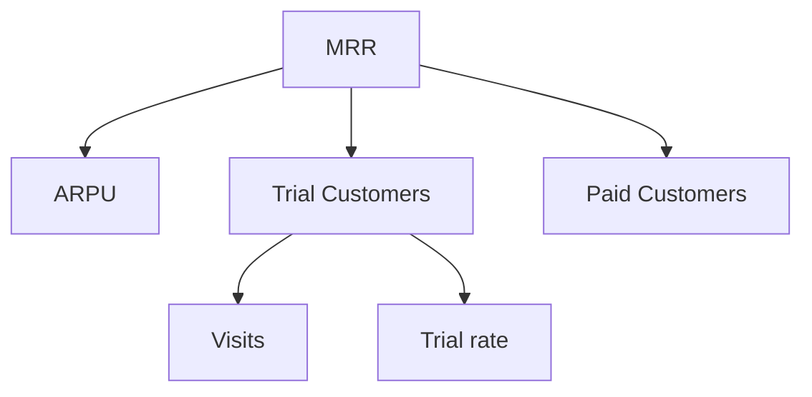

# نوشته‌ی ۵۴: دام درخت متریک

[نوشته‌ی ۵۳: وضعیت مشتری: بلوک سازنده‌ی تحلیل پیشرفته‌ی مشتری →](53-customer-state-a-key-building-block-of-advanced-customer.md) · [مجموعه](../README.md) · [نوشته‌ی ۵۵: قیف جذب کاربر ←](55-user-acquisition-funnel.md)

> **مقاله‌ی اصلی:** [The Metric Tree Trap](https://medium.com/@paul.levchuk/the-metric-tree-trap-4280405fd35e) · Medium، ۲۰۲۵-۰۶-۰۳

## خلاصه

درخت سنجه، تجزیه‌ی سلسله‌مراتبی هدف بالای کسب‌وکار به سنجه‌های قابل‌اقدام است. نویسنده می‌پرسد آیا می‌توان با آن تصمیم **قابل‌اعتماد** گرفت. دو هدف اول، دیدن اثر و پاسخ‌گویی، ارزش واقعی دارند. ولی سه هدف بعد، شناسایی عامل‌های کلیدی، تحلیل علت ریشه‌ای و اولویت‌بندی، بسیار سخت‌ترند. تجزیه ذهنی است و تعریف متناقض و سطح جزئیات ناهمگن و هدف نامشخص تجزیه تولید می‌کند. همبستگی بالای اجزا با کل محتوم ریاضی است و کشش واقعی را نشان نمی‌دهد. ایستا بودن درخت نوسان، اثر cohort، تغییر ترکیب و عامل‌های پنهان را نمی‌بیند. نتیجه: درخت چارچوب بصری عالی است، نه ابزار تصمیم.

## نکته‌های کلیدی

- **تعریف:** تجزیه‌ی سلسله‌مراتبی هدف سطح بالای کسب‌وکار به سنجه‌های قابل‌اقدام، که هر سنجه‌ی والد از فرزندانش حساب می‌شود و تجزیه تا رسیدن به محرک‌های قابل‌اندازه‌گیری ادامه می‌یابد.
- **مثال:** MRR به ARPU و Trial Customers و Paid Customers تجزیه می‌شود و Trial Customers باز هم تجزیه می‌شود.
- **پنج هدف نظری:** دیدن اثر سنجه‌های پایین بر هدف بالا؛ پاسخ‌گویی (مالکیت سنجه برای تیم یا فرد)؛ شناسایی عامل‌های کلیدی (اهرم‌ها)؛ تحلیل علت ریشه‌ای؛ اولویت‌بندی ابتکارها.
- **دو هدف اول** درباره‌ی دیدن و هم‌راستایی‌اند و درخت سنجه می‌تواند خیلی مفید باشد. سه هدف آخر خیلی سخت‌ترند، اگر شدنی باشند.
- **معمای تجزیه:** ذهنی است. تیم‌ها و ابزارهای مختلف تجزیه‌های متناقض می‌سازند. سه مشکل بحرانی:
  - **تعریف‌های متناقض:** گذاشتن Trial Customers زیر MRR. درآمد آزمایشی در درآمد ماهانه می‌آید ولی تعهدی نیست؛ اگر آزمایشی‌ها تبدیل نشوند MRR مصنوعی می‌افتد. این هدف MRR را، درآمد پایدار و قابل‌پیش‌بینی از مشتریان پرداخت‌کننده، نقض می‌کند.
  - **سطح جزئیات ناهمگن:** درآمد هر مکان برابر درمان‌های انجام‌شده ضرب قیمت هر درمان ضرب تعداد پزشکان. تعداد پزشکان ظرفیت درمان‌ها را می‌سازد و منطق دایره‌ای پدید می‌آید. راه‌حل‌ها: تعداد پزشکان را به‌عنوان ضریب ناهمگن حذف کنید، به سطح پزشک بروید یا پزشکان را به محرک‌های پایین‌تر مثل ظرفیت منتقل کنید.
  - **هدف نامشخص تجزیه:** رابطه‌ی علّی است یا برش ویژگی؟ علّی: پزشکان حجم درمان را می‌رانند (اهرم قابل‌اقدام). ویژگی: پزشکان تغییرهای قیمت را توضیح می‌دهند (عدسی تشخیصی). بدون این روشنی درخت محرک‌ها را با توصیف‌گرها قاطی می‌کند و اهرم کاذب می‌سازد.
- **شناسایی عامل‌های کلیدی:** در درخت به‌طور پیش‌فرض تجزیه ضرب است: فروش دیجیتال برابر درآمد هر بازدیدکننده ضرب بازدیدها. همبستگی بالا (۰٫۹۱۶ و ۰٫۹۵۱) بین فروش و اجزایش با تجزیه محتوم ریاضی است و از نظر عملیاتی گمراه‌کننده.
- **این همبستگی‌ها نشان نمی‌دهند:** رابطه‌ی واقعی بین RPV و بازدید؛ و قدرت نسبی کشش هر جزء بر فروش.
- **چه بینش‌های حیاتی را درخت می‌پوشاند:**
  - **توهم اثر برابر:** ساختار درخت اثر متناسب را القا می‌کند ولی کشش‌ها به‌ندرت نزدیک ۱ یا مساوی‌اند.
  - **تعاوض پنهان:** بازدید و RPV اغلب همبستگی منفی دارند (تخفیف ترافیک می‌آورد ولی ارزش متوسط را کم می‌کند). تجزیه‌ی ضربی این تنش را کاملاً می‌پوشاند.
  - **نقطه‌ی کور cohort:** محاسبه‌ی تقویمی کاربران مراحل عمر متفاوت را قاطی می‌کند و رابطه‌ی علّی را می‌پوشاند.
  - **عامل‌های مخدوش‌کننده:** فصلی بودن، کمپین بزرگ و تغییرهای اقتصادی هم بازدید و هم فروش را همزمان تحت تأثیر می‌گذارند. درخت راهی برای تشخیص و جداسازی ندارد.
- **تحلیل علت ریشه‌ای، وعده‌ی شکسته:**
  - **نوسان نامرئی است:** همه‌ی سنجه‌ها نوسان طبیعی دارند. عکس ایستای درخت پنهان می‌کند افت نویز است یا سیگنال.
  - **تله‌ی پویایی:** اثر cohort (علت و معلول ماه‌ها فاصله دارند)، بازده نزولی، تغییر ترکیب خاموش و همبستگی منفی از دست‌رفته (اصلاح یک اهرم مثل بازدید ممکن است RPV را خراب کند).
  - **حلقه‌های گمشده در زنجیره:** علت ریشه‌ای یعنی ردیابی تغییر سیاست به تغییر رفتار به تغییر سنجه‌ی فرعی به اثر سنجه‌ی هدف. درخت به‌ندرت محرک‌های درونی (تغییر فرایند، آموزش، ابزار) و رویدادهای بیرونی (حرکت رقبا، مقررات، اقتصاد) دارد. این‌ها توهم خطرناکی می‌سازد که درخت فقط اهرم‌های مهم دارد و نتایج کاملاً قابل کنترل است.
- **نقطه‌ی کور اولویت‌بندی:** اثر برابر اولویت نیست. اگر کشش RPV برابر ۰٫۸٪ (۸۰ هزار دلار از ۱۰ میلیون دلار) و کشش بازدید ۰٫۴٪ (۴۰ هزار دلار) برای هر ۱٪ باشد، RPV دو برابر قوی‌تر به نظر می‌رسد ولی بازدید با هزینه‌ی کمتر ROI ده برابر بیشتر می‌دهد، ۱۶۰٪ در برابر ۱۶٪. باز هم همه‌ی روش‌های ارزیابی اثر ایرادهای درخت را به ارث می‌برند: مخدوش‌کننده، تغییر ترکیب، اثر تأخیری cohort و اهرم کاذب.
- **جمع‌بندی:** درخت سنجه به‌عنوان چارچوب بصری برای ارتباط تیم و ارتباط سطح بالای KPI عالی است. وقتی داده می‌افزایید تا حرکت سنجه‌ها را توضیح دهید یا اهرم‌ها را اولویت دهید، انتظار داشته باشید: نبود زمینه‌ی کامل، دقت کاذب، تعاوض پنهان و تغییر ساختاری پوشیده. محافظ: نتیجه‌ی درخت را همیشه با تحلیل علت ریشه‌ای (cohort، تغییر ترکیب، تحلیل علّی)، آزمون سناریو (حساسیت یا Monte Carlo) و دقت هزینه‌فایده (ROI و هزینه‌ی فرصت) جفت کنید.

## فهرست بخش‌ها

- درخت سنجه چیست
- معمای تجزیه
- شناسایی عامل‌های کلیدی
- علت ریشه‌ای
- نقطه‌ی کور اولویت‌بندی
- جمع‌بندی

## یادداشت‌ها

اخیراً بسیاری در LinkedIn درباره‌ی درخت سنجه حرف می‌زنند. بسیار هیجان‌زده‌اند و آن را ابزار همگانی ساختاردهی اهرم‌های رشد شرکت می‌دانند. هرچند درخت سنجه در بعضی موردها می‌تواند مفید باشد، هدف نوشته‌ی امروز به چالش کشیدن امکان استفاده از آن برای تصمیم‌های **قابل‌اعتماد** است. با تعریف شروع می‌کنیم.

**درخت سنجه** تجزیه‌ی سلسله‌مراتبی هدف سطح بالای کسب‌وکار به سنجه‌های فرعی قابل‌اقدام است، که هر سنجه‌ی والد از سنجه‌های فرزندش حساب می‌شود و تجزیه تکرار می‌شود تا به محرک‌های قابل‌اندازه‌گیری برسد. نمونه‌ای از درخت سنجه: این درخت برای تجزیه‌ی MRR به ARPU و Trial Customers و Paid Customers طراحی شده است و Trial Customers باز هم تجزیه می‌شود.

در نگاه اول درخت سنجه بسیار جذاب و امیدوارکننده است. از نظر نظری به ما اجازه می‌دهد:

- **دیدن اثر:** نشان می‌دهد سنجه‌های سطح پایین چطور به هدف رشد سطح بالا کمک می‌کنند.
- **پاسخ‌گویی:** مالکیت سنجه‌های فرعی را به تیم‌ها یا افراد می‌دهد.
- **شناسایی عامل‌های کلیدی:** سنجه‌های فرعی را که بر هدف سطح بالا اثر چشمگیر دارند برجسته می‌کند، یعنی «اهرم‌های» احتمالی.
- **تحلیل علت ریشه‌ای:** وقتی سنجه‌ی بالا عملکرد پایین دارد، با فرو رفتن در درخت سنجه‌ی فرعی مشکل‌دار را می‌یابد.
- **اولویت‌بندی:** نشان می‌دهد کدام نواحی، شاخه‌ها یا برگ‌های درخت، در صورت بهبود بیشترین بازده را برای تلاش و منابع دارند.

دو هدف اول درباره‌ی دیدن و هم‌راستایی است. اینجاست که باور دارم درخت سنجه می‌تواند به هر کسب‌وکاری کمک بزرگ کند. در همان حال سه هدف آخر خیلی سخت‌تر قابل دستیابی‌اند، اگر اصلاً شدنی باشند.

**معمای تجزیه.** شکستن اهداف سطح بالا به سنجه‌های کوچک‌تر ساده به نظر می‌رسد ولی ذهنی است. تیم‌های مختلف و ابزارها اغلب تجزیه‌های متناقض می‌سازند که ۳ مشکل بحرانی را نشان می‌دهد. به مثال درخت MRR از Count.co، SaaS مخصوص ساخت درخت سنجه، نگاه کنیم.

*تعریف‌های متناقض سنجه:* گذاشتن Trial Customers زیر MRR. مشکل: درآمد آزمایشی در درآمد ماهانه سهم دارد ولی تعهدی نیست. اگر آزمایشی‌ها بدون تبدیل ریزش کنند MRR مصنوعی می‌افتد و سلامت واقعی درآمد را غلط نشان می‌دهد. تعارض: این هدف اصلی MRR را نقض می‌کند: ردیابی درآمد پایدار و قابل‌پیش‌بینی از مشتریان پرداخت‌کننده. پس تجزیه وقتی شکست می‌خورد که تعریف سنجه‌ها همگانی فهمیده نشود.

حالا نمونه‌ای از درخت سنجه که در یک پست LinkedIn یافتم. *سطح جزئیات ناهمگن:* درآمد هر مکان برابر درمان‌های انجام‌شده ضرب قیمت هر درمان ضرب تعداد پزشکان. مشکل: تعداد پزشکان ظرفیت درمان‌های انجام‌شده را می‌سازد و منطق دایره‌ای پدید می‌آید. راه‌حل‌ها:

- تعداد پزشکان را به‌عنوان ضریب ناهمگن حذف کنید.
- به جزئیات سطح پزشک بروید: درآمد هر مکان برابر درمان‌های انجام‌شده برای هر پزشک ضرب قیمت هر درمان ضرب تعداد پزشکان.
- پزشکان را به محرک‌های سطح پایین‌تر منتقل کنید، مثلاً سنجه‌های ظرفیت.

پس تجزیه به جزئیات عملیاتی **سازگار** نیاز دارد، مثلاً سطح درمان یا سطح پزشک.

*اهداف نامشخص تجزیه:* پرسش پنهان: رابطه‌ی علّی است یا برش ویژگی؟ علّی: پزشکان حجم درمان را می‌رانند، اهرم قابل‌اقدام. ویژگی: پزشکان تغییرهای قیمت را توضیح می‌دهند، عدسی تشخیصی. بدون این روشنی، درخت‌ها محرک‌ها را با توصیف‌گرها قاطی می‌کنند و اهرم کاذب می‌سازند.

حالا که مسائل تجزیه تمام شد، به منافع تحلیلی (فرضی) استفاده از درخت سنجه برویم.

**شناسایی عامل‌های کلیدی.** هر مدل کسب‌وکار نقاط تماس زیادی دارد که می‌توان مکان خوبی برای صرف تلاش دانستشان. ولی همه‌ی تلاش‌ها نتیجه‌ی یکسان نمی‌دهند. به نمونه‌ای از درخت سنجه از DoubleLoop، SaaS دیگری برای ساخت درخت سنجه، دقیق نگاه کنیم. به‌طور پیش‌فرض تجزیه‌ی سنجه در درخت بر ضرب استوار است. در مورد ما: فروش دیجیتال برابر درآمد هر بازدیدکننده ضرب بازدیدها. یک گام اعتبارسنجی رایج تحلیل همبستگی است، خط‌چین‌ها با ضرایب. همبستگی‌های بالا (۰٫۹۱۶ و ۰٫۹۵۱) بین فروش دیجیتال و اجزایش از نظر ریاضی با توجه به تجزیه محتوم‌اند، ولی از نظر *عملیاتی* گمراه‌کننده‌اند. این همبستگی‌ها **نشان نمی‌دهند**:

- رابطه‌ی واقعی *بین* RPV و بازدید.
- *قدرت نسبی* (کشش) اثر هر جزء بر فروش دیجیتال.

پس همبستگی‌های بالا فقط تأیید می‌کنند هویت ضربی از نظر عددی برقرار است.

**چه بینش‌های حیاتی را درخت سنجه می‌پوشاند؟**

*توهم اثر برابر:* ساختار درخت از نظر بصری القا می‌کند RPV و بازدید به تغییرهای فروش دیجیتال متناسب کمک می‌کنند. در واقعیت کشش‌هایشان، وزن‌های اثر واقعی، به‌ندرت نزدیک ۱٫۰ است *و* به‌ندرت با هم برابر.

*تعاوض پنهان:* بازدید و RPV اغلب *همبستگی منفی* دارند، مثلاً تخفیف ترافیک را بالا می‌برد ولی ارزش متوسط را کم می‌کند. تجزیه‌ی ضربی این تنش عملیاتی حیاتی را کاملاً می‌پوشاند.

*نقطه‌ی کور cohort:* محاسبه‌ی دوره‌ی تقویمی، مثلاً ماهانه، کاربران را در مراحل عمر متفاوت، جدید و فعال و ریزش‌کرده، با رفتارهای بسیار متفاوت قاطی می‌کند. این رابطه‌های علّی واقعی را می‌پوشاند و تحلیل مبتنی بر cohort را، که برای فهم سفر کاربر و ارزش بلندمدت ضروری است، ناممکن می‌کند.

*نادیده گرفتن تأثیرهای پنهان (مخدوش‌کننده‌ها):* عامل‌های بیرونی، مثل فصلی بودن، کمپین‌های بزرگ و تغییرهای اقتصادی، اغلب *هم* سنجه‌ی فرعی بازدید *و* هم سنجه‌ی نتیجه فروش دیجیتال را همزمان تحت تأثیر می‌گذارند. درخت راهی برای شناسایی یا جداسازی این مخدوش‌کننده‌ها نمی‌دهد و خطر همبستگی کاذب دارد.

پس هرچند درخت سنجه نقطه‌ی شروع مفیدی برای مصور سازی می‌دهد، این تله‌ها یعنی اغلب تصویری *بیش‌ازحد ساده‌شده* یا *حتی گمراه‌کننده* از محرک‌های **واقعی** عملیاتی سنجه‌های کلیدی شما می‌کشند.

**تحلیل علت ریشه‌ای، وعده‌ی شکسته.** ذی‌نفع‌های کسب‌وکار ابزار می‌خواهند تا افت سنجه را سریع تشخیص دهند. درخت سنجه برای این کار عالی به نظر می‌رسد ولی واقعیت فرق دارد.

*نوسان سنجه نامرئی است:* همه‌ی سنجه‌ها mutability طبیعی دارند: نویز، فصلی بودن، نوسان تصادفی. عکس ایستای درخت سنجه این را پنهان می‌کند. افتی که در درخت نشان داده می‌شود می‌تواند نویز عادی باشد یا سیگنال واقعی، و بدون تحلیل تاریخچه‌ی سنجه و زمینه‌اش تشخیصش ناممکن است.

*تله‌ی پویایی:* نکته‌های کلیدی تحلیل علت ریشه‌ای پنهان می‌ماند:

- اثرهای cohort: علت، مثلاً تغییر بازاریابی، و معلول، مثلاً اثر فروش، می‌توانند ماه‌ها فاصله داشته باشند.
- بازده نزولی: تاکتیکی که ابتدا سنجه‌ی فرعی را بالا برد حالا شاید بازده بسیار کمتری بدهد.
- تغییر ترکیب خاموش: سنجه‌های تجمیعی اغلب تغییرهای ساختاری را پنهان می‌کنند.
- همبستگی‌های منفی از دست‌رفته: «اصلاح» یک اهرم، مثلاً هل دادن بازدیدها، ممکن است ناخواسته به اهرم دیگر آسیب بزند، مثلاً RPV را سقوط دهد.

*حلقه‌های گمشده در زنجیره:* علت ریشه‌ای واقعی ردیابی زنجیره‌ی علّی را می‌خواهد: تغییر سیاست، تغییر رفتار، تغییر سنجه‌ی فرعی، اثر بر سنجه‌ی هدف. درخت سنجه به‌ندرت *محرک‌های درونی* (تنظیم فرایند، آموزش، ابزار) یا *رویدادهای بیرونی* (حرکت رقبا، مقررات، شرایط اقتصادی) دارد. همه‌ی این حذف‌ها توهم خطرناکی می‌سازد که درخت *فقط* اهرم‌هایی دارد که مهم‌اند و نتایج کاملاً قابل کنترل است.

**نقطه‌ی کور اولویت‌بندی.** حالا درباره‌ی چیزی که کاربران عادی بیشتر از درخت سنجه می‌خواهند: کمک در اولویت‌بندی فرضیه‌هایشان. حتی با درخت سنجه‌ی «کامل» رتبه‌بندی سنجه‌های فرعی برای سرمایه‌گذاری مبهم است. چرا؟ اثر برابر اولویت نیست. روش‌های رایج هر کدام تعاوض پنهان دارند.

**حقیقت سخت:** فرض کنید تحلیل کشش نشان دهد:

- ۱٪ افزایش RPV درآمد را ۰٫۸٪ بالا می‌برد، ۸۰ هزار دلار از ۱۰ میلیون دلار درآمد ماهانه.
- ۱٪ افزایش بازدید درآمد را ۰٫۴٪ بالا می‌برد، ۴۰ هزار دلار.

کشش می‌گوید RPV به ازای هر درصد تغییر ۲ برابر قوی‌تر است، ولی ... نتیجه: با وجود کشش کمتر، بازدیدها ROI **۱۰ برابر بالاتر** می‌دهند، ۱۶۰٪ در برابر ۱۶٪. با این حال همه‌ی روش‌های ارزیابی اثر ایرادهای هسته‌ای درخت سنجه را به ارث می‌برند: مخدوش‌کننده‌ها، ترکیب‌های جابه‌جاشده، اثرهای تأخیری cohort و اهرم‌های کاذب هنوز زیر ریاضی ساده کمین کرده‌اند.

> **Try it:** [ترکیب یا رفتار](../widgets/67-mix-or-behaviour.html): ببینید چگونه تغییر ترکیب با رفتار قاطی می‌شود و تجزیه‌ی ساده را گمراه می‌کند.

**جمع‌بندی:**

- دیدن و هم‌راستایی: درخت سنجه به‌عنوان *چارچوب بصری* برای ارتباط تیم و پیوند سطح بالای KPI عالی است.
- تله‌ی کمّی‌سازی: وقتی داده می‌افزایید تا حرکت سنجه‌ها را «توضیح» دهید یا اهرم‌ها را اولویت دهید، انتظار داشته باشید: نبود زمینه‌ی کامل، دقت کاذب، تعاوض پنهان و تغییرهای ساختاری پوشیده.
- محافظ: نتیجه‌های درخت سنجه را همیشه با این‌ها جفت کنید: تحلیل علت ریشه‌ای (نمای cohort، تحلیل تغییر ترکیب، تحلیل علّی)، آزمون سناریو (حساسیت یا Monte Carlo) و دقت هزینه‌فایده (ROI و هزینه‌ی فرصت).

> **Vault note:** مثال‌های Count.co و DoubleLoop و پست LinkedIn نقد نویسنده بر نمونه‌های عمومی است؛ ما آن‌ها را بازنشر نکرده‌ایم.

> **In practice:** درخت سنجه در Metabase برای دیدن کل و پاسخ‌گویی خوب است؛ ولی تصمیم «کدام شاخه را اول درست کنیم» را به تحلیل جدا در JupyterHub بسپارید.
>
> **Your turn:** درخت سنجه نشان می‌دهد یک شاخه بالاترین همبستگی را با درآمد دارد. آیا اولویت آن است؟
>
> *Answer:* نه لزوماً؛ همبستگی جزء با کل از ریاضی تجزیه می‌آید و کشش واقعی را نشان نمی‌دهد (بخش «شناسایی عامل‌های کلیدی»).

## پیوندها

- **بر پایه‌ی:** [فصل ۳۷](37-blended-retention-vs-cohort-retention.md) و [فصل ۳۸](38-how-to-build-user-cohort-properly.md) که محاسبه‌ی تقویمی را در برابر cohort گذاشتند، و [فصل ۴۰](40-all-user-cohorts-are-noisy-but-some-can-tell-you-a-story.md) که نویز را از سیگنال جدا کرد.
- **همان ایده در:** [فصل ۶۷](67-flo-health-what-zero-uplift-really-means.md) که ترکیب را از رفتار جدا می‌کند و [فصل ۷۱](71-split-a-churn-spike-lmdi.md) که تجزیه‌ی LMDI را می‌سازد.

## خودتان را بسنجید

*پرسش‌ها و پاسخ‌ها مال vault است.*

1. **چرا همبستگی بالای فروش با اجزای ضربی‌اش چیزی ثابت نمی‌کند؟**
   - [x] چون محتوم ریاضی است و کشش واقعی و رابطه‌ی بین اجزا را نشان نمی‌دهد.
   - [ ] چون همبستگی همیشه غلط است.
   - [ ] چون اجزا مستقل‌اند.

   *Answer:* (بخش «شناسایی عامل‌های کلیدی»).

2. **چرا RPV با کشش بیشتر لزوماً اولویت اول نیست؟**

   *Answer:* چون ROI بازدید به‌خاطر هزینه‌ی کمتر ۱۰ برابر بالاتر بود، ۱۶۰٪ در برابر ۱۶٪ (بخش «نقطه‌ی کور اولویت‌بندی»).
