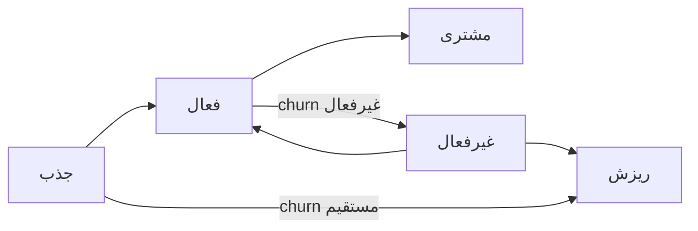

# نوشته‌ی ۵۵: قیف جذب کاربر

[نوشته‌ی ۵۴: دام درخت متریک →](54-the-metric-tree-trap.md) · [مجموعه](../README.md) · [نوشته‌ی ۵۶: نمودار گذار بین وضعیت‌های کاربر ←](56-user-transition-states-diagram.md)

> **مقاله‌ی اصلی:** [User Acquisition Funnel](https://medium.com/@paul.levchuk/user-acquisition-funnel-1e66402b1a41) · Medium، ۲۰۲۵-۰۸-۲۰

## خلاصه

قیف جذب کاربر ساده است: چند کاربر جذب شد و چند کاربر به مشتری تبدیل شد. این نمایش جزئیات مفید را پنهان می‌کند: درصد از دست‌رفته‌ها از تبدیل‌شده‌ها بسیار بزرگ‌تر است، تبدیل لحظه‌ای نیست و در دوره‌ی freemium کاربر می‌تواند مدت‌ها نسخه‌ی رایگان را استفاده کند. نویسنده تمرکز را از نتیجه به فرایند می‌برد: churn دو مسیر دارد، مستقیم و غیرفعال. کاربر فعال یعنی کار با feature هسته‌ای، با فاصله‌ی استفاده مناسب. در freemium حتی کاربر فعال هم توجه می‌خواهد و هر کاربر می‌تواند بلغزد. قیف برای بهینه‌سازی گام‌های مشخص خوب است ولی سفر واقعی کاربر را نشان نمی‌دهد.

## نکته‌های کلیدی

- **هدف کسب‌وکارها گسترش پایگاه مشتری است** و یک راه رایج جذب مشتری جدید. جذب در یک لحظه رخ نمی‌دهد: اول کاربر جدید جذب می‌شود، محصول و پیشنهاد قیمت را ارزیابی می‌کند و بعضی تصمیم می‌گیرند مشتری شوند. فرایندی با هدف کارایی.
- **قیف دو اندازه‌گیری دارد:** چند کاربر جدید جذب کردیم؟ چند کاربر را به مشتری تبدیل کردیم؟
- **این نمایش سه چیز را پنهان می‌کند:** درصد کاربران از دست‌رفته بسیار بزرگ‌تر از تبدیل‌شده‌هاست؛ تبدیل در یک لحظه رخ نمی‌دهد و کاربران از مرحله‌های میانی می‌گذرند؛ در دوران freemium بعضی کاربران می‌توانند مدت‌های طولانی نسخه‌ی رایگان را ادامه دهند.
- **از نتیجه به فرایند:** گام‌ها را جدا کنید تا بفهمید کِی و چگونه اکثریت کاربران جذب‌شده را پیش از فرصت مشتری شدن از دست دادید. اگر می‌خواهیم تبدیل به مشتری جدید را بهتر کنیم باید بفهمیم کجا نتوانستیم کاربران را **درگیر** نگه داریم.
- **پدیده‌ی churn دو مسیر دارد:** درصد کاربران فعال برابر ۱ منهای درصد کاربران ریزش‌کرده؛ پس برای تبدیل بیشتر باید churn را کم کنیم.
- **پدیده‌ی churn مستقیم:** مثل نرخ پرش در تحلیل وب. کاربر جدید جذب شد، وارد محصول شد، فوراً فهمید لازمش نیست و رفت. عمدتاً از کیفیت ترافیک جذب‌شده و دقت targeting می‌آید.
- **پدیده‌ی churn غیرفعال:** نتیجه یکی است، کاربر رفت، ولی دلیل و زمان بسیار فرق دارد. کاربران می‌توانند برای حل مشکلشان با محصول مصمم باشند ولی نفهمند چطور ارزش کافی بگیرند. محصول را کاوش کردند ولی نتوانستند درست شروع به استفاده کنند. عمدتاً به ارزش ذاتی محصول یا onboarding برمی‌گردد.
- **کاربر فعال چه معنایی دارد؟** دو زیرپرسش: کدام فعالیت‌های کاربر واقعاً مهم‌اند؟ تحلیل را به چه بازه‌ی زمانی محدود کنیم؟
- **همه‌ی فعالیت‌ها وضعیت فعال نمی‌سازند:** بعضی feature‌ها را می‌شود بدون اثر محسوس حذف کرد و حذف feature‌های هسته‌ای محصول را بی‌معنا می‌کند. کاربر فعال یعنی کار با feature هسته‌ای را شروع کرده و ارزش محصول را مرتب تجربه کرده است. تعداد feature‌های هسته‌ای محدود است و باید همبستگی قوی با retention کاربر، جانشین گرفتن ارزش، داشته باشند. حس محصولی هرچه خوب باشد باز باید با داده پشتیبانی شود: اگر فقط کسر کوچکی از کاربران از ناپدید شدن feature هسته‌ای بسیار ناامید شوند، یا کاربران برای استفاده دوباره از آن برنگردند، پرچم قرمز است.
- **زمان برای بیشتر فعالیت‌ها کلیدی است:** اگر کاربر ارزش بگیرد فرض می‌کنیم بعد از مدتی برای گرفتن دوباره‌ی آن برمی‌گردد. به این مدت فاصله‌ی استفاده از محصول می‌گوییم. سازنده‌ها فکر می‌کنند محصول همان‌طور استفاده می‌شود که قصد دارند ولی کاربران ممکن است کاربردهای خودشان را بیابند. پس همه‌ی feature‌ها را از نظر تناوب استفاده و اخیر بودن بررسی کنید: کاربران اگر feature مشخص را مرتب در بازه‌ی **از پیش تعیین‌شده** استفاده کنند فعال‌اند؛ اگر نامرتب، غیرفعال، یعنی شروع به بی‌علاقگی کرده‌اند.
- **مدل freemium:** کاربران نسخه‌ی رایگان محصول یا بخشی از آن را استفاده می‌کنند و تجربه چنان چیده شده که در آینده برای باز کردن پتانسیل کامل مشتری پولی شوند.
- **حتی کاربران فعال توجه می‌خواهند:** سفر از رایگان تا پولی هفته‌ها تا ماه‌ها یا سال‌ها طول می‌کشد و در این مدت کسی از تیم باید روی کاربران کار کند: گاه افزایش استفاده از feature‌های هسته‌ای و گاه کشف feature‌های مکمل. کیفیت فعال بودن رایگان نیست و باید محیطی بسازید که استفاده‌ی مرتب از محصول بیش از استفاده‌نکردن معنا داشته باشد.
- **هر کاربر می‌تواند بلغزد:** کار با کاربرانی که تازه شروع به بی‌علاقگی کرده‌اند یا کاملاً بی‌علاقه‌اند، یعنی بازاریابی چرخه‌ی عمر، چیزی است که اغلب در فهرست ابتکارهای رشد از قلم می‌افتد. کاربران **غیرفعال** تا چندی پیش فعال بودند و برای درگیر کردن دوباره تلاش کمتری می‌خواهند؛ کاربران **ریزش‌کرده** کاملاً بی‌علاقه‌اند، تلاش بیشتر و شانس کمتر. با این حال کمپین‌های مختلف را آزمایش کنید: درگیر کردن دوباره‌ی غیرفعال‌ها (محتوای شخصی‌سازی‌شده، یادآوری feature) و کمپین win-back برای ریزش‌کرده‌ها (نظرسنجی خروج، تبلیغ ویژه، به‌روزرسانی بهبود محصول).
- **جمع‌بندی:** قیف برای بهینه‌سازی گام مشخص خوب است ولی سفر واقعی کاربر را، با گام‌های برگشتی و حلقه‌ها، نشان نمی‌دهد؛ جدا کردن churn مستقیم از غیرفعال راه بسیار بهتری برای فهمیدن دلیل‌ها و ساختن راه‌حل است؛ اغلب کاربران فعال حتی تلاش بیشتری از شرکت می‌خواهند.

## فهرست بخش‌ها

- قیف جذب کاربر
- پدیده‌ی churn مستقیم و غیرفعال
- کاربر فعال چیست
- مدل freemium
- جمع‌بندی

## یادداشت‌ها

همه‌ی کسب‌وکارهایی که با آن‌ها کار کردم روی گسترش پایگاه مشتری متمرکز بودند. دلیل اصلی این است که هرچه مشتری بیشتر داشته باشید درآمدتان بالاتر است. و، چنان‌که حدس می‌زنید، یکی از راه‌های رایج گسترش پایگاه مشتری جذب مشتری جدید است. جذب مشتری جدید هیچ‌وقت در یک لحظه رخ نمی‌دهد. اول کاربران جدید جذب می‌کنید که محصول و پیشنهاد قیمت شما را ارزیابی می‌کنند. بعضی تصمیم می‌گیرند مشتری شما شوند. این فرایندی با هدف کارایی است. کارایی معمولاً این‌طور توصیف می‌شود: چند درصد کاربران جذب‌شده مشتری شدند.

در ادامه نمایش سطح بالای نگاه بازاریاب‌ها به فرایند جذب کاربر است. قیفی با دو اندازه‌گیری:

- چند کاربر جدید *جذب* کردیم؟
- چند کاربر جدید را به مشتری *تبدیل* کردیم؟

هرچند این قیف اجازه می‌دهد عملکرد کلی جذب کاربر را ارزیابی کنیم، این نمایش جزئیات مفید زیادی را پنهان می‌کند:

- از نمودار می‌آموزیم درصد کاربران از دست‌رفته بسیار بزرگ‌تر از درصد تبدیل‌شده‌هاست.
- تبدیل در یک لحظه رخ نمی‌دهد. یعنی کاربران قبل از تبدیل به مشتری جدید از مرحله‌های میانی می‌گذرند.
- در دوران freemium بعضی کاربران می‌توانند مدت‌های بسیار طولانی نسخه‌ی رایگان محصول را ادامه دهند.

این نکته‌های حیاتی ما را به ایده‌ی تغییر تمرکز از *نتیجه* به *فرایند* می‌رساند: شکستن آن به مرحله‌هایی که به ما اجازه می‌دهد بفهمیم کِی و چگونه *اکثریت* کاربران جذب‌شده را پیش از آن‌که فرصت مشتری شدن داشته باشند از دست دادیم. در واقع اگر بخواهیم تبدیل به مشتریان جدید را بهتر کنیم، باید بفهمیم کجا نتوانستیم کاربران را *درگیر* نگه داریم. ساعت‌های زیادی صرف تحلیل کسب‌وکارهای بسیار متفاوت کردم و به شمای ساده‌شده‌ی زیر رسیدم. روشن است هر کسب‌وکار یکتاست؛ ولی حتی جریان‌های مختلف جذب کاربر اشتراک‌های زیادی دارند. در این نوشته توجه شما را به همین اشتراک‌ها می‌برم.

**اولین چیزی که باید درباره‌اش حرف بزنیم churn کاربر است.** کاربرانی که شانس تبدیل به مشتری دارند باید فعال باشند. می‌دانیم درصد کاربران فعال برابر ۱ منهای درصد کاربران ریزش‌کرده است. به همین دلیل اگر تبدیل بیشتر می‌خواهیم باید churn را کم کنیم. در شمای بالا دو مسیر به churn می‌بینیم:

- پدیده‌ی churn **مستقیم**
- پدیده‌ی churn **غیرفعال**

پدیده‌ی churn *مستقیم* شبیه نرخ پرش در تحلیل وب است. وقتی کاربران جدید جذب می‌کنیم، وارد محصول می‌شوند و فوراً می‌فهمند لازمش ندارند و سریع ترکش می‌کنند. این مسئله اساساً از کیفیت ترافیک جذب‌شده و یا دقت targeting کمپین می‌آید. churn *غیرفعال* با churn *مستقیم* موردی کاملاً متفاوت است. هرچند نتیجه یکی است، کاربران رفتند، دلیل‌ها و زمان‌بندی بسیار فرق دارد. کاربران می‌توانند برای حل مشکلشان با محصول کاملاً مصمم باشند ولی نفهمند چطور ارزش کافی از آن بگیرند. محصول را کاوش می‌کردند ولی نتوانستند درست شروع به استفاده کنند. این مسئله عمدتاً به ارزش ذاتی محصول و یا onboarding برمی‌گردد. پس تمایز بین این موردهای churn کاربر به ما اجازه می‌دهد روی دلیل شکست درست تمرکز کنیم و شانس رفع مشکل را بالا ببریم.

**چیز بعدی که باید درباره‌اش حرف بزنیم معنای کاربر *فعال* است.** این پرسش بی‌اهمیت به نظر می‌رسد ولی نیست. برای جواب باید بفهمیم دو زیرپرسش داریم:

- کدام فعالیت‌های کاربر واقعاً مهم‌اند؟
- تحلیل را به چه بازه‌ی زمانی محدود کنیم؟

*همه‌ی فعالیت‌های محصول به وضعیت فعال مربوط نیستند.* هر محصول feature‌های زیادی دارد ولی همه‌ی feature‌ها برابر ساخته نشده‌اند. بعضی feature‌ها را می‌شود بدون اثر محسوس بر تجربه‌ی کاربر حذف کرد، در حالی که حذف feature‌های (هسته‌ای) دیگر محصول را ساده بی‌معنا می‌کند. یعنی برای فعال کردن یک کاربر باید مطمئن شویم کاربر کار با feature(های) هسته‌ای محصول را شروع کرده و ارزش محصول را مرتب تجربه کرده است. به یاد داشته باشید تعداد feature‌های هسته‌ای محدود است. علاوه بر آن باید همبستگی قوی با retention کاربر داشته باشند، به‌عنوان جانشینی که آیا آن کاربران ارزش می‌گیرند. مهم نیست حس محصولی ما چقدر خوب است، هنوز منطقی است آن را با داده پشتیبانی کنیم. اگر فقط کسر بسیار کوچکی از کاربران از ناپدید شدن feature هسته‌ای محصول بسیار ناامید شوند، یا کاربران برای استفاده از آن feature (دوباره و دوباره) به محصول برنگردند، پرچم قرمز است.

*زمان‌بندی برای بیشتر فعالیت‌های محصول کلیدی است.* اگر کاربر ارزش محصول را بگیرد، می‌توانیم فرض کنیم بعد از مدتی برای گرفتن دوباره‌ی این ارزش برمی‌گردد. این مدت فاصله‌ی استفاده از محصول نام دارد. هر محصول طراحی شده تا ارزش را از طریق feature‌ها برساند. ما، به‌عنوان سازندگان محصول، باور داریم محصول همان‌طور استفاده می‌شود که قرار است. ولی کاربران ممکن است کاربردهای خودشان را بیابند که برایشان بسیار منطقی‌تر است. به همین دلیل منطقی است همه‌ی feature‌های محصول را از نظر تناوب استفاده و *اخیر بودن* بررسی کنیم:

- اگر کاربران feature‌های محصول مشخصی را مرتب **در** یک بازه‌ی *از پیش تعیین‌شده* استفاده کنند، می‌توانیم آن‌ها را *فعال* بدانیم.
- اگر کاربران feature‌های محصول مشخصی را نامرتب استفاده کنند، می‌توانیم آن‌ها را *غیرفعال* بدانیم، کسی که شروع به بی‌علاقگی به محصول کرده است.

پس همان‌طور که گفتم وضعیت کاربر *فعال* همزمان ساده و پیچیده است: نیاز دارد درک عمیقی از این‌که محصول چطور ارزش می‌رساند و تعریف دقیقی از این‌که این رساندن ارزش هر چند وقت یک بار باید رخ دهد داشته باشیم.

**آخرین چیزی که باید درباره‌اش حرف بزنیم اثر مدل *freemium* است.** بسیاری از کسب‌وکارهای SaaS از مدل freemium استفاده می‌کنند. در یک جمله، freemium یعنی اجازه می‌دهیم کاربران محصول یا بخشی از آن را رایگان استفاده کنند، ولی تجربه‌ی کاربر را طوری سازمان می‌دهیم که در آینده برای باز کردن پتانسیل کامل محصول به مشتری پولی تبدیل شوند.

*حتی کاربران فعال به توجه شما نیاز دارند.* سفر کاربر از نسخه‌ی رایگان تا پولی می‌تواند زمان بسیار متفاوتی بگیرد: گاه فقط هفته‌ها و گاه ماه‌ها یا حتی سال‌ها. در این مدت کسی از تیم باید روی این کاربران تمرکز کند و آن‌ها را رشد دهد:

- گاه منطقی است روی افزایش استفاده از feature‌های هسته‌ای محصول تمرکز کنیم.
- گاه بهتر است به کاربران کمک کنیم feature‌های مکمل محصول را کشف کنند.

نکته‌ی کلیدی اینجا این است که بفهمیم حتی کاربران *فعال* هم هنوز به توجه شما نیاز دارند تا فعال بمانند. این کیفیت کاربر رایگان به شما داده نمی‌شود. باید محیطی بسازید که استفاده‌ی مرتب از محصول بیش از استفاده نکردن معنا داشته باشد.

*هر کاربری می‌تواند در طول زمان بلغزد.* فرایند حیاتی دیگری که باید سازمان داد کار با کاربرانی است که تازه شروع به بی‌علاقگی کرده‌اند یا کاملاً بی‌علاقه‌اند. یکی از نکته‌های مهم نمودار این است که درباره‌ی بازاریابی چرخه‌ی عمر است. و راستش را بگویم، همین چیزی است که اغلب هنگام تهیه‌ی فهرست ابتکارهای رشد شرکت از قلم می‌افتد. کاربران *غیرفعال* تا چندی پیش فعال بودند و برای درگیر کردن دوباره‌شان تلاش کمتری لازم است. کاربران *ریزش‌کرده* کاملاً بی‌علاقه‌اند و تلاش خیلی بیشتری می‌خواهند و شانس کمتری برای برگشتن دارند. با این حال منطقی است فعالیت‌های مختلف را آزمایش کنیم تا نرخ پاسخ به چنین کمپین‌هایی را بهینه کنیم:

- درگیر کردن دوباره‌ی کاربران *غیرفعال* (محتوای شخصی‌سازی‌شده، یادآوری feature).
- راه‌اندازی کمپین‌های win-back برای کاربران *ریزش‌کرده* (نظرسنجی خروج، تبلیغ‌های ویژه، به‌روزرسانی‌های بهبود محصول).

> **Try it:** [قیف و وضعیت‌های گذار](../widgets/56-transition-states.html): جابه‌جایی کاربر بین جذب، فعال، غیرفعال و ریزش را بازی کنید.

**جمع‌بندی:**

- قیف‌ها برای بهینه‌سازی گام‌های مشخص خوب‌اند ولی نمی‌توانند سفر واقعی کاربر، با گام‌های برگشتی و حلقه‌ها و غیره، را نشان دهند.
- جدا کردن churn *مستقیم* و churn *غیرفعال* راه بسیار بهتری برای فهمیدن دلیل‌ها و ساختن راه‌حل برای کم کردن آن‌هاست.
- اغلب کاربران *فعال* حتی تلاش بیشتری از شرکت می‌خواهند تا در این وضعیت بمانند.

در نوشته‌ی بعد ([فصل ۵۶](56-user-transition-states-diagram.md)) بررسی می‌کنیم چطور استفاده از محصول را با کسب درآمد در چارچوب تحلیلی قدرتمندی ترکیب کنیم.

> **Vault note:** تعریف «فعال» به feature هسته‌ای و فاصله‌ی استفاده بستگی دارد و برای هر محصول باید با داده بسته شود؛ شمای نویسنده نقطه‌ی شروع است نه قالب جهانی.

> **In practice:** churn غیرفعال را فقط وقتی می‌بینید که کاربر فعال با feature هسته‌ای و فاصله‌ی استفاده در Gold تعریف شده باشد، نه با ورود به اپ.
>
> **Your turn:** قیف جذب ۵٪ تبدیل نشان می‌دهد. چه چیزی را پنهان می‌کند؟
>
> *Answer:* مسیر ۹۵٪ دیگر و زمان تبدیل؛ churn مستقیم و غیرفعال دو مسیر جدا دارند و کاربر freemium ممکن است مدت‌ها رایگان بماند (بخش «پدیده‌ی churn مستقیم و غیرفعال»).

## پیوندها

- **بر پایه‌ی:** [فصل ۳۱](31-user-engagement-first-time-user-experience.md) که ریزش جلسه‌ی اول را دید، [فصل ۳۴](34-user-engagement-key-events.md) و [فصل ۳۵](35-why-does-product-analytics-go-beyond-product-feature.md) که feature هسته‌ای را شناختند، و [فصل ۵۳](53-customer-state-a-key-building-block-of-advanced-customer.md).
- **ادامه در:** [فصل ۵۶](56-user-transition-states-diagram.md) که قیف را به ماتریس گذار می‌برد، [فصل ۵۹](59-your-day-2-paywall-is-burning-your-best-future-customers.md) تا [فصل ۶۱](61-d30-roas-is-the-wrong-metric-here-is-what-to-use-instead.md).

## خودتان را بسنجید

*پرسش‌ها و پاسخ‌ها مال vault است.*

1. **دو نوع churn مستقیم و غیرفعال چه فرقی دارند؟**
   - [x] مستقیم از کیفیت ترافیک و targeting می‌آید؛ غیرفعال از ارزش ذاتی محصول و onboarding.
   - [ ] هیچ فرقی ندارند.
   - [ ] مستقیم فقط در freemium است.

   *Answer:* (بخش «پدیده‌ی churn مستقیم و غیرفعال»).

2. **چرا کاربر فعال هم در freemium توجه می‌خواهد؟**

   *Answer:* چون سفر تا پولی شدن ماه‌ها یا سال‌ها طول می‌کشد و کیفیت فعال بودن رایگان نیست (بخش «مدل freemium»).
