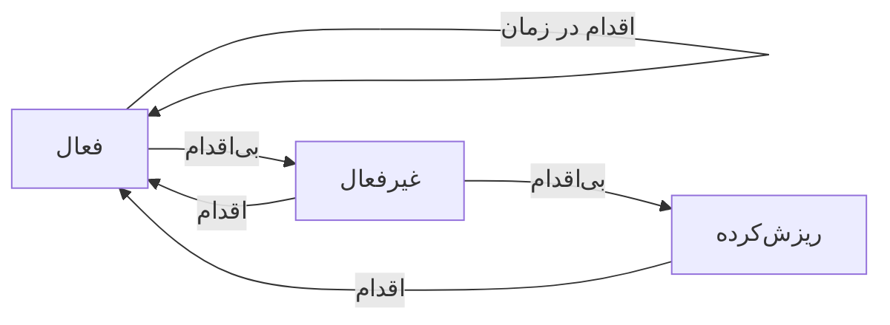

# نوشته‌ی ۵۶: نمودار گذار بین وضعیت‌های کاربر

[نوشته‌ی ۵۵: قیف جذب کاربر →](55-user-acquisition-funnel.md) · [مجموعه](../README.md) · [نوشته‌ی ۵۷: وقتی LTV دروغ می‌گوید: «مجانب مرگ» ←](57-when-ltv-can-lie-to-you-asymptote-of-death.md)

> **مقاله‌ی اصلی:** [User Transition States Diagram](https://medium.com/@paul.levchuk/user-transition-states-diagram-1e8210ff86d4) · Medium، ۲۰۲۵-۱۱-۱۲

## خلاصه

در [فصل ۵۵](55-user-acquisition-funnel.md) دیدیم کاربر پیش از اولین پرداخت چه می‌کند. اینجا استفاده از محصول و کسب درآمد کنار هم می‌آیند. دو جریان موازی داریم، استفاده و درآمدزایی، و در هر دو کاربر سه وضعیت فعال، غیرفعال و ریزش‌کرده دارد. زمان‌بندی همه‌چیز را تعیین می‌کند. ماتریس ۲ در ۲ استفاده در برابر پرداخت چهار وضعیت کلی می‌دهد ولی ایستاست. نمودار گذار برای محصول freemium هفت وضعیت و بیست گذار دارد. پرسش «چرا کاربر جابه‌جا می‌شود» انگیزه‌ها را می‌گوید و «چقدر» با احتمال گذار اندازه‌ی مسئله یا فرصت را. جمع احتمال همه‌ی خروجی‌های هر وضعیت، با حلقه‌ی خودش، باید ۱۰۰٪ شود. ماتریس گذار پیش‌بینی و شبیه‌سازی را ممکن می‌کند.

## نکته‌های کلیدی

- **چهار هدف سازنده‌ی محصول برای کاربر جدید:** فعال کردن تا استفاده را شروع کند، فعال نگه داشتن، فعال کردن تا پرداخت را شروع کند و پرداخت‌کننده نگه داشتن. پس دو جریان موازی داریم: **استفاده** و **درآمدزایی**.
- **وضعیت‌ها در هر دو جریان مشابه‌اند:** فعال، غیرفعال و ریزش‌کرده.
- **فعال:** کاربر که وارد جریان می‌شود فعال است و زمان دارد اقدام هدف را تکرار کند. اقدام هدف در جریان استفاده کار با یکی از feature‌های هسته‌ای است و در درآمدزایی پرداخت. اگر در زمان تعیین‌شده تکرار کند فعال می‌ماند، یعنی حلقه به همان وضعیت، و اگر نه، غیرفعال می‌شود.
- **غیرفعال:** دوباره زمان دارد. اگر انجام داد به فعال برمی‌گردد و اگر نه به ریزش‌کرده می‌رود.
- **ریزش‌کرده:** دوباره زمان دارد. اگر انجام داد به فعال برمی‌گردد و اگر کاری نکند احتمالاً برای همیشه می‌ماند.
- **زمان‌بندی همه‌چیز را تعیین می‌کند.** اگر کاربران زمان نامحدود داشتند، بیشتر وضعیت‌ها بی‌معنا می‌شد. چهار آستانه‌ی راهنمای عملی: پنجره‌ی فعال‌سازی ۱ تا ۷ روز بعد ثبت‌نام؛ فعال به غیرفعال ۱۴ تا ۳۰ روز بی‌فعالیتی؛ پرداخت‌کننده به عقب‌افتاده چرخه‌ی صورتحساب به‌اضافه‌ی مهلت ۷ تا ۱۴ روز؛ غیرفعال به ریزش‌کرده ۳۰ تا ۶۰ روز بی‌فعالیتی مداوم.
- **ماتریس استفاده در برابر پرداخت:** بالا-راست «کاربر فعال و مشتری پرداخت‌کننده». بالا-چپ «پرداخت‌کننده‌ی بی‌استفاده»، در خطر churn. پایین-راست «استفاده‌کننده‌ی بدون پرداخت»، فرصت تبدیل. پایین-چپ «کاربر غیرفعال یا ریزش‌کرده»، نه استفاده و نه پرداخت.
- **ماتریس ایستا است.** برای فهم پویایی باید از مدل مبتنی بر وضعیت به مدل مبتنی بر گذار برویم.
- **نمودار freemium:** هفت وضعیت و ۲۰ گذار. ماتریس کامل ۷ وضعیت تا ۴۹ مسیر دارد ولی مدل روی ۲۰ گذاری که رفتار واقعی را می‌نمایند تمرکز دارد.
- **چهار مرحله‌ی رشد کاربر:** وضعیت اولیه (NS ثبت‌نام جدید به AF کاربر رایگان فعال با «شروع استفاده»، یا CF کاربر رایگان ریزش‌کرده با «هرگز فعال نمی‌شود»)؛ چرخه‌ی عمر کاربر رایگان (AF با استفاده‌ی منظم حلقه، با اولین خرید به AP، با ترک استفاده به IF؛ IF با برگشتن به AF، با خرید به AP، با هرگز برنگشتن به CF)؛ چرخه‌ی عمر کاربر پرداخت‌کننده (AP حلقه؛ AP به IP با ترک استفاده و ادامه‌ی پرداخت؛ AP به AF با توقف پرداخت و ادامه‌ی استفاده؛ AP به IF با توقف هر دو؛ IP به AP با بازگشت به استفاده؛ IP به IF با توقف پرداخت؛ IP به CP با ریزش و توقف پرداخت)؛ مسیرهای win-back (CF به AF؛ CP به AP؛ CP به AF).
- **رنگ ابتکارهای عملیاتی:** سبز رشد و سلامت (فعال‌سازی و استفاده)؛ نارنجی موتور درآمد (تبدیل و پرداخت تکراری)؛ آبی بازیابی و مداخله (نشانه‌ی بی‌علاقگی و win-back)؛ قرمز هشدار بحرانی (ریزش کاربر پرداخت‌کننده، بالاترین اولویت)؛ خاکستری ریزش مورد انتظار (کاربر رایگان).
- **چرا کاربران جابه‌جا می‌شوند؟** AF به IF: نبود ارزش (لحظه‌ی «آها» را نیافتند)، مشکل کاربردپذیری (گیج‌کننده یا باگ‌دار) و نبود زمان (چیز خوب‌است که از رادار افتاد). AP به IP: تغییر نقش شغلی، ریزش تیم (صورتحساب هنوز لغو نشده) و تنبلی محض (فراموش می‌کنند اشتراکی را که استفاده نمی‌کنند لغو کنند؛ خطر بزرگ retention). AP به AF: حساسیت به قیمت، ناهمخوانی feature (feature پولی فقط برای یک پروژه) و انجام کاری که باید («Job to be Done»)؛ سطح رایگان کافی بود.
- **اندازه‌ی مسئله یا فرصت:** احتمال گذار لایه‌ی گمشده است و نقشه‌ی ایستا را به نمودار پویا تبدیل می‌کند.
- **بررسی ثبات ریاضی:** از هر وضعیت کاربر باید **جایی** برود. پس جمع احتمال همه‌ی مسیرهای خروجی، با حلقه‌ی خود وضعیت، ۱۰۰٪ است. در نمودار حلقه‌های CF و CP برای کم شدن شلوغی حذف شد: ۹۷٪ برای CF به CF و ۸۸٪ برای CP به CP، یعنی ریزش‌کرده‌ها بسیار محتمل است ریزش‌کرده بمانند.
- **ماتریس گذار:** موتور محاسباتی که از مشاهده به پیش‌بینی می‌رود. شبیه‌سازی و پیش‌بینی: «اگر ۱۰۰۰ کاربر جدید جذب کنیم ۶ ماه بعد چند مشتری پولی داریم؟» با ضرب ماتریس در طول زمان (نظریه‌ی زنجیره‌ی مارکوف). سنجش اثر: اگر feature جدید گذار AF به IF را از ۱۵٪ به ۱۰٪ برساند، اثر دقیق بر تبدیل و retention.
- **جمع‌بندی:** درآمدزایی به‌شدت با استفاده درهم‌تنیده است؛ ناهمخوانی استفاده و پرداخت را بپذیرید؛ زمان‌بندی همه‌چیز است؛ همه‌ی وضعیت‌ها برابر نیستند و باید با احتمال اولویت‌بندی کرد: اول احتمال را اندازه بگیرید، بعد موانع را بیابید و بعد گذارها را بهتر کنید.

## فهرست بخش‌ها

- از استفاده تا درآمدزایی
- زمان‌بندی
- ماتریس استفاده و پرداخت
- نمودار گذار
- چرا کاربر جابه‌جا می‌شود
- اندازه‌ی گذار
- ماتریس گذار

## یادداشت‌ها

در [فصل ۵۵](55-user-acquisition-funnel.md) درباره‌ی این‌که وقتی کاربران برای محصول ثبت‌نام می‌کنند چه می‌شود حرف زدیم. روی جریان استفاده از محصول پیش از اولین پرداخت تمرکز کردیم. امروز درباره‌ی این‌که چطور *استفاده* از محصول و *درآمدزایی* با هم همزیستی می‌کنند حرف می‌زنیم.

**از استفاده از محصول تا درآمدزایی.** در کل، وقتی کاربر جدیدی جذب می‌کنیم، ما به‌عنوان سازندگان محصول احتمالاً چند هدف در ذهن داریم:

- کاربر را *فعال* کنیم تا استفاده از محصول را *شروع* کند.
- کاربر را *فعال نگه داریم*.
- کاربر را فعال کنیم تا پرداخت برای محصول را *شروع* کند.
- کاربر را *پرداخت‌کننده نگه داریم*.

این اهداف ما را به این ایده می‌رساند که در واقع دو جریان موازی داریم: جریان *استفاده* از محصول و جریان *درآمدزایی*. هرچند این دو جریان به اهداف متفاوتی خدمت می‌کنند، می‌توانیم وضعیت کاربر را در هر جریان با وضعیت‌های مشابه دنبال کنیم: *فعال*، *غیرفعال* و *ریزش‌کرده*. ببینیم این وضعیت‌ها از نظر مفهومی چطور کار می‌کنند.

وقتی کاربر وارد جریان می‌شود، *فعال* شمرده می‌شود. کاربر مدتی زمان دارد تا اقدام هدف را تکرار کند. برای جریان *استفاده*، اقدام هدف می‌تواند کار با یکی از feature‌های هسته‌ای محصول باشد. برای جریان *درآمدزایی* اقدام هدف پرداخت است. پس در وضعیت *فعال*، کاربر مدتی زمان دارد تا اقدام بعدی را بکند:

- اگر اقدام هدف را در زمان از پیش تعیین‌شده تکرار کند، فعال شمرده می‌شود، یعنی حلقه به همان وضعیت.
- اگر رخ ندهد، کاربر به وضعیت غیرفعال می‌رود.

در وضعیت *غیرفعال* کاربر باز هم مدتی زمان دارد:

- اگر اقدام هدف را در زمان از پیش تعیین‌شده انجام دهد، به وضعیت فعال برمی‌گردد.
- اگر رخ ندهد، کاربر به وضعیت ریزش‌کرده می‌رود.

در وضعیت *ریزش‌کرده* کاربر باز هم مدتی زمان دارد:

- اگر اقدام هدف را در زمان از پیش تعیین‌شده انجام دهد، به وضعیت فعال برمی‌گردد.
- اگر کاربر هیچ کاری نکند، احتمالاً برای همیشه در این وضعیت می‌ماند.

**زمان‌بندی همه‌چیز را تعیین می‌کند.** وضعیتی که کاربر وارد می‌شود نه فقط به این بستگی دارد که چه می‌کند (یا نمی‌کند)، بلکه به این هم که چقدر سریع رخ می‌دهد. اگر کاربران می‌توانستند در بازه‌ی زمانی نامحدود اقدام کنند، بیشتر وضعیت‌های کاربر ساده بی‌معنا می‌شد. وقتی از زمان‌های از پیش تعیین‌شده حرف زدم، منظورم ۴ آستانه‌ی اصلی بود. هرچند این آستانه‌ها بسته به محصول فرق می‌کند، راهنمای عملی خوبی هست:

| آستانه | بازه |
|---|---|
| پنجره‌ی فعال‌سازی | ۱ تا ۷ روز بعد ثبت‌نام |
| فعال به غیرفعال | ۱۴ تا ۳۰ روز بی‌فعالیتی |
| پرداخت‌کننده به عقب‌افتاده | چرخه‌ی صورتحساب به‌اضافه‌ی مهلت ۷ تا ۱۴ روز |
| غیرفعال به ریزش‌کرده | ۳۰ تا ۶۰ روز بی‌فعالیتی مداوم |

**آیا وضعیت‌ها با هم کار می‌کنند؟** نکته‌ی ظریف این است که هرچند جریان‌های *استفاده* و *درآمدزایی* موازی اجرا می‌شوند، در واقع با هم تعامل دارند. پیش از رفتن به نمودار دقیق وضعیت‌های کاربر، با ماتریس ساده‌ی استفاده در برابر پرداخت شروع می‌کنیم. ماتریس این‌ها را نشان می‌دهد:

| | **استفاده می‌کند** | **استفاده نمی‌کند** |
|---|---|---|
| **پرداخت می‌کند** | کاربر فعال و مشتری پرداخت‌کننده | پرداخت‌کننده‌ی بی‌استفاده، در خطر churn |
| **پرداخت نمی‌کند** | استفاده‌کننده‌ی بدون پرداخت، فرصت تبدیل | کاربر غیرفعال یا ریزش‌کرده |

ماتریس به‌روشنی نشان می‌دهد جریان‌های *استفاده* و *درآمدزایی* چطور تعامل دارند و ۴ وضعیت سطح بالایی را نشان می‌دهد که کاربران بر پایه‌ی رفتار درگیری و پرداخت می‌توانند داشته باشند.

**آیا داشتن وضعیت‌ها کافی است؟** هرچند ماتریس ۲ در ۲ ابزار قدرتمندی برای دسته‌بندی کاربران است، تصویر ایستایی می‌دهد. برای فهم واقعی پویایی پایگاه کاربر باید از مدل مبتنی بر وضعیت به مدل مبتنی بر گذار برویم. پیکربندی‌های گذار وضعیت کاربر بسیار متفاوتی را (بر پایه‌ی منطق و داده) آزمودم و در نهایت به نمودار دقیق زیر برای محصول freemium رسیدم. این نمودار کمک می‌کند مسیرهایی را که کاربر را به هر وضعیت می‌رساند ردیابی کنیم. هرچند نمودار در نگاه اول پیچیده است، در واقع نیست. از نظر مفهومی در نمودار ۴ مرحله‌ی رشد کاربر داریم.

***وضعیت اولیه*** (وقتی کاربران وارد محصول می‌شوند):

- گذار NS (ثبت‌نام جدید) با «شروع استفاده» به AF (کاربر رایگان فعال).
- گذار NS با «هرگز فعال نمی‌شود» به CF (کاربر رایگان ریزش‌کرده).

***چرخه‌ی عمر کاربر رایگان*** (وقتی کاربران از محصول استفاده می‌کنند):

- گذار AF با «استفاده‌ی منظم» به AF (حلقه).
- گذار AF با «اولین خرید» به AP (کاربر پرداخت‌کننده‌ی فعال).
- گذار AF با «ترک استفاده» به IF (کاربر رایگان غیرفعال).
- گذار IF با «بازگشت به محصول» به AF.
- گذار IF با «خرید» به AP.
- گذار IF با «هرگز برنمی‌گردد» به CF.

***چرخه‌ی عمر کاربر پرداخت‌کننده*** (وقتی کاربران برای محصول پول می‌دهند):

- گذار AP با «استفاده‌ی منظم و پرداخت» به AP (حلقه).
- گذار AP با «ترک استفاده ولی ادامه‌ی پرداخت» به IP (پرداخت‌کننده‌ی غیرفعال).
- گذار AP با «توقف پرداخت ولی ادامه‌ی استفاده» به AF.
- گذار AP با «توقف هر دو، استفاده و پرداخت» به IF.
- گذار IP با «بازگشت به استفاده» به AP.
- گذار IP با «توقف پرداخت» به IF.
- گذار IP با «هرگز برنمی‌گردد و پرداخت را متوقف می‌کند» به CP (پرداخت‌کننده‌ی ریزش‌کرده).

***مسیرهای win-back*** (وقتی می‌خواهیم کاربران را دوباره فعال کنیم):

- گذار CF با «کمپین win-back» به AF.
- گذار CP با «کمپین win-back» به AP.
- گذار CP با «win-back به‌عنوان کاربر رایگان» به AF.

می‌بینید پیچیدگی نمودار این است: ۷ وضعیت و ۲۰ گذار. هرچند ماتریس گذار کامل برای ۷ وضعیت می‌تواند تا ۴۹ مسیر ممکن داشته باشد، مدل ما روی ۲۰ گذاری تمرکز دارد که رفتار واقعی کاربر را نشان می‌دهند و وضوح و فایده را تضمین می‌کنند. راه جایگزین پیمایش نمودار تمرکز بر رنگ‌بندی ابتکارهای عملیاتی است:

| رنگ | معنا |
|---|---|
| سبز | رشد و سلامت: فعال‌سازی و استفاده‌ی فعال |
| نارنجی | موتور درآمد: تبدیل و پرداخت‌های تکراری |
| آبی | بازیابی و مداخله: نشانه‌های بی‌علاقگی و کمپین‌های win-back |
| قرمز | هشدار بحرانی: ریزش کاربر پرداخت‌کننده، بالاترین اولویت |
| خاکستری | ریزش مورد انتظار: ریزش کاربر رایگان |

> **Try it:** [ماتریس گذار کاربر](../widgets/56-transition-states.html): احتمال‌های گذار را عوض کنید و جمع خروجی هر وضعیت را ۱۰۰٪ نگه دارید.

**چرا کاربران جابه‌جا می‌شوند؟** یک لحظه دیدگاه را از آنچه رخ داد به چرایی تغییر می‌دهیم. نمودار بالا رفتار کاربر را ردیابی می‌کند ولی انگیزه‌های پشتش را توضیح نمی‌دهد. این‌که کاربران چرا جابه‌جا می‌شوند به اندازه‌ی این‌که به کجا می‌روند مهم است. عمیق‌تر به بعضی گذارهای مهم می‌پردازیم و حدس می‌زنیم چه موانعی کاربران را به مسیر تنزل می‌کشانند. بسته به نوع محصول، B2C یا B2B، و بخش بازار دلیل‌ها می‌تواند خیلی فرق کند. چند مثال:

*چرا کاربران رایگان فعال، AF، غیرفعال می‌شوند، IF؟*

- *نبود ارزش*: لحظه‌ی «آها» یا پیشنهاد ارزش هسته‌ای را نیافتند.
- *مشکل کاربردپذیری*: محصول خیلی گیج‌کننده یا باگ‌دار بود.
- *نبود زمان*: چیز خوب‌است بود که از رادارشان افتاد.

*چرا کاربران پرداخت‌کننده‌ی فعال، AP، به پرداخت‌کننده‌ی غیرفعال، IP، می‌روند؟*

- *تغییر نقش شغلی*: محصول دیگر به مسئولیت‌های جدیدشان ربطی ندارد.
- *ریزش تیم*: تیمشان استفاده را متوقف کرد ولی صاحب صورتحساب هنوز لغو نکرده است.
- *تنبلی محض*: ساده فراموش می‌کنند اشتراکی را که استفاده نمی‌کنند لغو کنند. این ریسک بزرگ retention است.

*چرا کاربران پرداخت‌کننده‌ی فعال، AP، به کاربر رایگان فعال، AF، تنزل می‌کنند؟*

- *حساسیت به قیمت*: دیگر نمی‌بینند ارزش هزینه را توجیه کند.
- *ناهمخوانی feature*: فقط برای پروژه‌ی یک‌باره به feature پولی نیاز داشتند.
- *انجام موفق «Job to Be Done»*: سطح رایگان برای حل مشکل هسته‌ایشان کافی بود.

می‌بینید دلیل‌های بسیار متفاوتی می‌تواند وجود داشته باشد که چرا کاربران در مرحله‌ی مشخصی کاری را متوقف کردند. هدف ما، سازندگان محصول، شناسایی این موانع و یا کاملاً برداشتن آن‌ها یا کمک به کاربران برای عبور سریع از آن‌هاست. توجه کنید بسیاری از مشکل‌های کاربر ذاتاً پیچیده‌اند و همکاری چند تیم را می‌خواهند: تیم رشد، تیم retention و تیم محصول.

**اندازه‌ی مسئله یا فرصت گذار.** حالا دوباره دیدگاه را از دلیل ممکن شدن گذار به این‌که مسئله یا فرصت چقدر بزرگ است می‌بریم. برای پیش‌بینی حرکت کاربر و اولویت‌بندی تلاش‌هایمان، نه فقط مقصدها بلکه باید جریان ترافیک بین آن‌ها را هم کمّی کنیم. این لایه‌ی گمشده *احتمال گذار* است و افزودنش نقشه‌ی ایستای ما را به نمودار واقعی گذار وضعیت‌ها تبدیل می‌کند. نموداری با *احتمال‌های گذار* کمّی‌شده بین وضعیت‌ها داریم.

**مهم:** وقتی احتمال به نمودار می‌افزایید، به یاد داشته باشید: از هر وضعیت کاربر باید *جایی* برود. بنابراین جمع احتمال همه‌ی مسیرهای خروجی ممکن، از جمله حلقه‌های خود وضعیت، باید ۱۰۰٪ شود. این بررسی بنیادی برای ثبات ریاضی مدل است. اگر این بررسی را روی نمودار اعمال کنید، می‌بینید احتمال‌های وضعیت‌های CF و CP ناسازگار به نظر می‌رسند. دلیلش این است که حلقه‌های خودشان را برای کم کردن شلوغی بصری حذف کردم. با این حال این گذارهای حذف‌شده، ۹۷٪ شانس برای CF به CF و ۸۸٪ شانس برای CP به CP، برای فهم حیاتی‌اند: نشان می‌دهند کاربران وقتی ریزش کردند بسیار محتمل است ریزش‌کرده بمانند.

**از نمودار تا ماتریس گذار.** هرچند نمودار وضعیت برای مصور سازی مسیرهای کاربر عالی است، قدرتمندترین راه عملیاتی کردن این مدل تبدیلش به *ماتریس گذار* وضعیت است. این ماتریس موتور ریاضی است که به ما اجازه می‌دهد از مشاهده به پیش‌بینی برویم. ماتریس فقط نمای دیگر نیست؛ ابزار محاسباتی است. با نمایش نمودار به این شکل می‌توانیم:

- *پیش‌بینی و شبیه‌سازی*: مثلاً جواب دهیم «اگر ۱۰۰۰ کاربر جدید جذب کنیم، ۶ ماه بعد چند نفرشان مشتری پولی‌اند؟» با ضرب ماتریس در طول زمان، با نظریه‌ی زنجیره‌ی مارکوف.
- *کمّی کردن اثر*: اثر تغییرهای محصول را مدل کنیم. مثلاً اگر feature جدیدی ریزش AF به IF را از ۱۵٪ به ۱۰٪ کم کند، می‌توانیم دقیق حساب کنیم این چطور تبدیل و retention را بهتر می‌کند.

احتمالاً در نوشته‌ی بعد جزئیات انجام چنین ارزیابی‌هایی را با شما به اشتراک می‌گذارم.

**جمع‌بندی:**

- درآمدزایی عمیقاً با استفاده از محصول درهم‌تنیده است. وقتی جریان درآمدزایی را تنظیم می‌کنید، جریان استفاده عوض می‌شود و بالعکس.
- ناهمخوانی بین استفاده و پرداخت را بشناسید. برای بعضی کاربران کاملاً طبیعی است که در وضعیت کاملاً فعال‌نشده باشند، فقط استفاده یا فقط درآمدزایی.
- زمان‌بندی در گذار وضعیت کاربر همه‌چیز است. یادگیری از آستانه‌ها چیزی است که به شما اجازه می‌دهد کاربرانتان را در وضعیت فعال نگه دارید.
- همه‌ی وضعیت‌های کاربر برابر نیستند. از احتمال برای اولویت‌بندی استفاده کنید. اول احتمال‌ها را اندازه بگیرید، موانع را بیابید و بعد گذارها را بهتر کنید.

> **Vault note:** احتمال‌های ۹۷٪ و ۸۸٪ و ۱۵٪ در این نوشته مثال‌اند و داده‌ی عمومی منتشرشده نیستند؛ ماتریس واقعی را باید از لاگ کاربر خودتان بسازید. بازنویسی کامل ماتریس ۷ در ۷ اینجا نیامده تا فقط نمودار نویسنده خوانده شود.

> **In practice:** ماتریس گذار وضعیت‌ها یک جدول Gold با ستون‌های وضعیت قبلی و بعدی است؛ جمع هر سطر باید ۱۰۰٪ باشد و این را می‌شود به‌صورت تست در Airflow بررسی کرد.
>
> **Your turn:** جمع احتمال‌های خروجی یک وضعیت در جدول گذار ۹۳٪ است. چه چیزی کم است؟
>
> *Answer:* احتمالاً حلقه‌ی ماندن در همان وضعیت یا یک وضعیت جاافتاده؛ جمع همه‌ی خروجی‌ها با حلقه‌ی خود باید ۱۰۰٪ شود (بخش «ماتریس گذار»).

## پیوندها

- **بر پایه‌ی:** [فصل ۵۲](52-rr-ff-matrices-introduction-to-customer-states.md) و [فصل ۵۳](53-customer-state-a-key-building-block-of-advanced-customer.md) که وضعیت‌ها را از R و F ساختند، و [فصل ۵۵](55-user-acquisition-funnel.md) که churn مستقیم و غیرفعال را تفکیک کرد.
- **ادامه در:** [فصل ۵۷](57-when-ltv-can-lie-to-you-asymptote-of-death.md) که مجانب مرگ را از همین زنجیره می‌گیرد، [فصل ۶۰](60-the-four-questions-churn-analysis-should-answer.md) که چهار پرسش ریزش را می‌پرسد، و [فصل ۷۰](70-getting-in-building-it-locking-in.md).

## خودتان را بسنجید

*پرسش‌ها و پاسخ‌ها مال vault است.*

1. **جمع احتمال خروجی‌های هر وضعیت باید چقدر باشد؟**
   - [x] ۱۰۰٪، با حساب کردن حلقه‌ی خود وضعیت.
   - [ ] ۵۰٪.
   - [ ] هر عددی.

   *Answer:* (بخش «اندازه‌ی گذار»).

2. **چرا ماتریس ۲ در ۲ استفاده و پرداخت کافی نیست؟**

   *Answer:* چون ایستاست و پویایی را نشان نمی‌دهد؛ باید به مدل مبتنی بر گذار برویم (بخش «ماتریس استفاده و پرداخت»).
