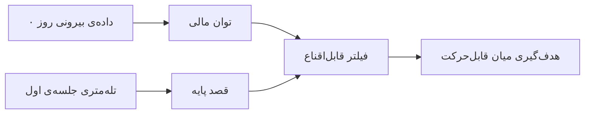

# نوشته‌ی ۵۸: چرا مدل LTV در Live-Ops پول را به آتش می‌کشد؟

[نوشته‌ی ۵۷: وقتی LTV دروغ می‌گوید: «مجانب مرگ» →](57-when-ltv-can-lie-to-you-asymptote-of-death.md) · [مجموعه](../README.md) · [نوشته‌ی ۵۹: paywall روز دوم بهترین مشتریان آینده‌تان را می‌سوزاند ←](59-your-day-2-paywall-is-burning-your-best-future-customers.md)

> **مقاله‌ی اصلی:** [Why is your Live-Ops LTV model setting money on fire?](https://medium.com/@paul.levchuk/why-your-live-ops-ltv-model-is-setting-money-on-fire-379647665445) · Medium، ۲۰۲۶-۰۲-۲۳

## خلاصه

تیم‌های رشد روی سنجه‌ی کاملاً گذشته‌نگر میلیون‌ها دلار بهینه می‌کنند. نویسنده این را «توهم بزرگ تحلیل» می‌نامد: کاربر فعال را با قصد خرید یکی می‌گیریم و نبود پرداخت گذشته را با نبود توان مالی. راه‌حل جدا کردن قصد از توان مالی است. ماتریس solvency کاربران را در شبکه‌ی ۲ در ۲ با توان مالی پنهان در برابر پرداخت مشاهده‌شده می‌نشاند و چهار سنخ می‌دهد: نهنگ واقعی، سواری رایگان، ریزشی ناامید و ارزش به دام افتاده. داده‌ی رفتاری نباید توان مالی را تخمین بزند. موتور تخصیص علّی سه گام دارد: پیش‌بینی توان مالی در روز صفر، سرنوشت پیش‌آگاهی یا قصد پایه و فیلتر قابل‌اقناع. در شبیه‌سازی ۱۰ هزار کاربر موتور «قطعی‌ها» و «بی‌امیدها» را سرکوب کرد و بودجه را روی «میان قابل‌حرکت» ریخت؛ T-Learner ۲۴٪ درآمد افزایشی بیشتر گرفت.

## نکته‌های کلیدی

- **توهم بزرگ تحلیل:** دو سنجه‌ی روان‌شناختی بنیادی متفاوت را قاطی کرده‌ایم. استفاده از محصول را با **قصد** یکی می‌گیریم (اگر زیاد کلیک می‌کنند باید بخواهند بخرند). لاگ پرداخت را با **توان مالی** یکی می‌گیریم (اگر نپرداخته‌اند باید بی‌پول باشند). تا وقتی مدل‌ها «صفر پرداخت گذشته» را «صفر ظرفیت آینده» بگیرند، میلیون‌ها دلار روی میز می‌ماند و برای کاربرانی که حتماً ریزش می‌کنند بیش‌ازحد پرداخت می‌شود.
- **باید قصد را از توان مالی جدا کرد.**
- **ماتریس solvency:** شبکه‌ی ۲ در ۲ با محور افقی پرداخت‌های مشاهده‌شده و محور عمودی توان مالی پنهان یا ظرفیت پرداخت. چهار سنخ کاربر:
  - **نهنگ واقعی** (توان مالی بالا، لاگ بالا): کاربر رؤیایی؛ پول دارد و محصول آن را عالی می‌گیرد. تنها راهبرد retention.
  - **سواری رایگان** (توان مالی پایین، لاگ پایین): نه ظرفیت مالی دارد نه قصد. الگوریتم تبلیغات نباید جذبشان کند و مهندس‌ها نباید برایشان بسازند.
  - **ریزشی ناامید** (توان مالی پایین، لاگ بالا): تله‌ی نهایی. ظرفیت پایین دارد ولی به نقطه‌ی اصطکاک فوری برخورد و خرد-تراکنش کرد. الگوریتم تبلیغات عاشق آن‌هاست چون روز اول سریع تبدیل می‌شوند، ولی LTV‌شان عملاً صفر است.
  - **ارزش به دام افتاده** (توان مالی بالا، لاگ صفر): معدن طلای شما. درآمد قابل‌خرج بالا، دستگاه شاخص و درگیری عمیق دارند ولی سطح قیمت یا paywall فعلی تبدیلشان نمی‌کند. مدل RFM آن‌ها را «صفر» می‌داند و پتانسیل‌شان را کاملاً از دست می‌دهد.
- **داده‌ی رفتاری هرگز نباید توان مالی را تخمین بزند.** وقتی تیم داده می‌فهمد باید LTV را در روز ۰ پیش‌بینی کند معمولاً خطای معماری می‌کند: داده‌ی رفتاری (کلیک، طول جلسه، استفاده از feature) را به مدل **solvency** می‌دهد. رفتار **قصد** را می‌سنجد؛ می‌گوید کاربر چقدر می‌خواهد مشکلی را حل کند، و درباره‌ی اندازه‌ی کیف پول هیچ نمی‌گوید. اگر مدل ML را برای پیش‌بینی اندازه‌ی کیف پول از کلیک‌های درون اپ آموزش دهید، ناگزیر **ریزشی ناامید** را شکار می‌کند: کاربری که ناامید است و آزمایشی ۱٫۹۹ دلاری می‌خرد، و کاربر ثروتمند و روشمندی را که سه روز نرم‌افزار را ارزیابی می‌کند و بعد ۳۰۰ دلار اشتراک سالانه می‌دهد نادیده می‌گیرد.
- **موتور تخصیص علّی، چارچوب ۳ گامی:** به‌جای «چه کسی می‌خرد؟» می‌پرسد «چه کسی واقعاً به هل نیاز دارد تا بخرد؟» گام‌ها: پیش‌بینی توان مالی (داده‌ی بیرونی روز ۰)، سرنوشت پیش‌آگاهی (قصد پایه) و فیلتر قابل‌اقناع (U-Shape).
- **گام ۱، پیش‌بینی توان مالی:** پیش از دیدن paywall، سقف ظرفیت پرداخت را پیش‌بینی می‌کنیم. فقط متغیرهای بیرونی لحظه‌ی نصب: سطح سخت‌افزار دستگاه، نسخه‌ی OS، اپراتور شبکه و جانشین‌های ثروت جغرافیایی. رگرسیون چندک برای تخمین اندازه‌ی کیف پول.
- **گام ۲، سرنوشت پیش‌آگاهی:** قصد را می‌سنجیم. از تله‌متری اولین جلسه، اغلب فقط چند دقیقه‌ی اول، هندسه‌ی رفتاری را با گروه کنترل تاریخی مقایسه می‌کنیم. ۷ روز برای حجم درگیری صبر نمی‌کنیم؛ ساختار قصد اولیه را می‌سنجیم.
- **گام ۳، فیلتر قابل‌اقناع (U-Shape):** سرنوشت پایه‌ی کاربر را روی منحنی Net Weight of Evidence می‌نشانیم. منحنی ریاضی‌وار می‌گوید بازاریابی کجا واقعاً کار می‌کند:
  - **دم راست** (سرنوشت بیش از ۷۵٪): «چیزهای قطعی»؛ خودشان ارگانیک می‌خرند و بازاریابی برایشان اثر افزایشی صفر و حاشیه‌خور است.
  - **دم چپ** (کمتر از ۲۰٪) با توان مالی پایین: «مورد باخته»؛ نه قصد دارند نه ظرفیت.
  - **میان قابل‌حرکت:** سرنوشت متوسط با توان مالی **بالا**؛ «قابل‌اقناع‌ها». پول دارند ولی تخفیف یا ایمیل یا هل لازم دارند تا خط پایان را رد کنند.
- **جهش تکاملی:** می‌توانید با قاعده‌های ایستا شروع کنید، مثلاً هدف گرفتن کاربران با قصد پایه ۲۵٪ تا ۷۵٪. ولی قاعده‌ی ایستا وقتی پویایی محصول عوض شود می‌شکند. شکل نهایی چارچوب منحنی U ایستا را با Causal Metalearner، مثل T-Learner، جایگزین می‌کند: به‌جای حدس زدن قابل‌اقناع‌ها برای هر کاربر دو آینده را شبیه‌سازی می‌کند، یکی بدون مداخله و یکی با مداخله، و دقیقاً اختلاف ریاضی بین آن‌ها را هدف می‌گیرد.
- **شبیه‌سازی روز ۰ برای ۱۰ هزار کاربر جدید در خط لوله‌ی freemium:** در شرکت معمولی CRM فعال‌ترین کاربران را با کمپین بازهدف‌گیری پر می‌کرد تا ROI روز ۱ را بالا ببرد. موتور تخصیص علّی:
  - «چیزهای قطعی» (۴۷۱ کاربر) را سرکوب کرد: گروهی با ۸۲٪ احتمال خرید ارگانیک. ریاضی‌وار جلوی ارسال تخفیف توسط CRM را گرفت و حاشیه‌ی ۴۷۱ تبدیل تضمینی را نجات داد.
  - «موردهای باخته» (۵۵ کاربر) را بست: کمترین ظرفیت کیف پول ۴۶ دلار و تقریباً صفر قصد ۱۵٪. همه‌ی تبلیغ‌های CRM و push را بست و جلوی هدر رفتن هزینه‌ی سرور و پهنای باند درگیری گرفت.
  - «میان قابل‌حرکت» (۷۶۴۵ کاربر) را مقیاس داد: اوج دقیق منحنی قابل‌اقناع. بالاترین ظرفیت کیف پول کل cohort، ۹۷ دلار، با قصد پایه‌ی ۴۳٪ که روی حصارند. کل بودجه‌ی Live-Ops و تبلیغ را به این‌ها سرازیر کرد.
  - «ارزش به دام افتاده» (۱۸۲۹ کاربر) را باز کرد: گروه بزرگ مقاوم با کیف پول سنگین، ۸۸ دلار، و قصد پایه‌ی افتضاح، ۱۸٪. به‌جای ارسال بازاریابی استاندارد، برای تیم محصول علامت زد تا مداخله‌های پویا (مثل جایگزین‌های paywall) راه بیندازند.
- **پیروزی دوگانه:** با سرکوب دو سر طیف هزاران دلار حاشیه‌ی خورده‌شده و اسپم CRM را نجات داد و با متمرکز کردن مداخله‌ها روی میان قابل‌حرکت LTV افزایشی عظیم ساخت.
- **ضریب علّی:** پیروزی دوگانه با آستانه‌ی ابتکاری استاندارد بود. اجرای دوم با مدل T-Learner کامل: به‌جای هدف گرفتن نوار وسیع میانی قصد، الگوریتم اثر درمان میانگین شرطی (CATE) دقیق را برای هر کاربر در لحظه حساب کرد. دو کاربر با قصد پایه‌ی دقیقاً ۳۳٪ ممکن است به یک تبلیغ کاملاً متفاوت واکنش نشان دهند. با نگاشت پویای اثر علّی واقعی در برابر ظرفیت پنهان، متالرنر ۲۴٪ درآمد افزایشی واقعی بیشتر از همان cohort گرفت، بی‌آنکه یک دلار اضافی از بودجه‌ی Live-Ops خرج شود.
- **جمع‌بندی:** رفتار درآمد نیست؛ کلیک درون اپ **قصد** را می‌سنجد و درباره‌ی ظرفیت کیف پول چیزی نمی‌گوید. بر رشد ارگانیک خودتان مالیات نبندید؛ مدل‌های استاندارد RFM و پیش‌بینی برای کاربرانی که تبدیلشان آسان‌تر است بهینه می‌کنند و ناگزیر «چیزهای قطعی» (حاشیه‌خوری) یا «ریزشی ناامید» (جذب کاربر LTV پایین) را هدف می‌گیرند. اثر علّی را پیش‌بینی کنید، نه تبدیل: از پیش‌بینی این‌که کاربر چه خواهد کرد به محاسبه‌ی این‌که چطور به مداخله واکنش نشان می‌دهد برسید.

## فهرست بخش‌ها

- توهم بزرگ تحلیل
- ماتریس solvency
- رفتار و توان مالی
- موتور تخصیص علّی
- شبیه‌سازی
- ضریب علّی
- جمع‌بندی

## یادداشت‌ها

اگر داشبوردهای بیشتر تیم‌های رشد امروزی را ببینید، نقص عظیم و نامرئی‌ای را می‌یابید. میلیون‌ها دلار صرف بهینه‌سازی سنجه‌ای می‌کنیم که کاملاً گذشته‌نگر است. این چیزی می‌سازد که «توهم بزرگ تحلیل» می‌نامم. دو سنجه‌ی روان‌شناختی بنیادی متفاوت را قاطی کرده‌ایم:

- استفاده از محصول را با *قصد* اشتباه می‌گیریم. (اگر کاربران زیاد کلیک می‌کنند باید بخواهند بخرند.)
- لاگ پرداخت را با *توان مالی* اشتباه می‌گیریم. (اگر کاربران پرداخت نکرده‌اند باید بی‌پول باشند.)

تا وقتی مدل‌های پیش‌بینی شما «صفر پرداخت گذشته» را «صفر ظرفیت آینده» بگیرند، میلیون‌ها دلار روی میز می‌ماند و برای کاربرانی که ناگزیر ریزش می‌کنند بیش‌ازحد می‌پردازید. وقت جدا کردن *قصد* از *توان مالی* است.

**ماتریس solvency.** برای رفع این توهم باید پیش‌بینی میانگین‌ها را کنار بگذاریم و شروع کنیم به نقشه‌کشی چشم‌انداز واقعی پایگاه کاربر. این کار را با نشاندن کاربران روی شبکه‌ی ۲ در ۲ انجام می‌دهیم. محور افقی پرداخت‌های مشاهده‌شده و محور عمودی توان مالی پنهان یا ظرفیت پرداخت. این چهار سنخ کاربر متمایز می‌دهد:

| | **لاگ بالا** | **لاگ پایین** |
|---|---|---|
| **توان مالی بالا** | نهنگ واقعی | ارزش به دام افتاده |
| **توان مالی پایین** | ریزشی ناامید | سواری رایگان |

- *نهنگ واقعی* (توان مالی بالا، لاگ بالا): کاربر رؤیایی. پول دارد و محصول شما آن را عالی بیرون می‌کشد. تنها راهبرد اینجا retention است.
- *سواری رایگان* (توان مالی پایین، لاگ پایین): کاربرانی که ظرفیت مالی و قصد ندارند. الگوریتم‌های تبلیغات شما نباید جذبشان کنند و مهندس‌هایتان نباید برایشان بسازند.
- *ریزشی ناامید* (توان مالی پایین، لاگ بالا): تله‌ی نهایی. این کاربران ظرفیت پایین دارند ولی به نقطه‌ی اصطکاک فوری برخوردند و خرد-تراکنش کردند. الگوریتم‌های تبلیغات عاشق آن‌هایند چون روز ۱ سریع تبدیل می‌شوند، ولی LTV‌شان عملاً صفر است.
- *ارزش به دام افتاده* 💎 (توان مالی بالا، لاگ صفر): معدن طلای شماست. این کاربران درآمد قابل‌خرج بالا، دستگاه شاخص و درگیری عمیق دارند. ولی سطح قیمت یا paywall فعلی شما شکست می‌خورد تبدیلشان کند. مدل RFM شما آن‌ها را «صفر» علامت می‌زند و پتانسیلشان را کاملاً از دست می‌دهد.

**داده‌ی رفتاری هرگز نباید برای تخمین توان مالی به کار رود.** وقتی تیم‌های داده می‌فهمند باید LTV را در روز ۰ پیش‌بینی کنند، معمولاً خطای معماری حیاتی می‌کنند: داده‌ی رفتاری، یعنی کلیک و طول جلسه و استفاده از feature، را به مدل‌های *توان مالی* خود می‌دهند. رفتار *قصد* را می‌سنجد. می‌گوید کاربر چقدر می‌خواهد مشکلی را حل کند. درباره‌ی اندازه‌ی کیف پول او هیچ نمی‌گوید. اگر مدل یادگیری ماشین را آموزش دهید تا اندازه‌ی کیف پول را از کلیک‌های درون اپ پیش‌بینی کند، مدل ناگزیر دنبال **ریزشی ناامید** می‌گردد. کاربرانی را می‌یابد که فقط می‌چرخند و آزمایشی ۱٫۹۹ دلاری می‌خرند چون ناامیدند، و کاربر ثروتمند و روشمندی را نادیده می‌گیرد که سه روز نرم‌افزار شما را ارزیابی می‌کند و بعد ۳۰۰ دلار برای اشتراک سالانه می‌دهد. برای یافتن «ارزش به دام افتاده» باید این دو سنجه را از هم جدا کنید.

**موتور تخصیص علّی: چارچوب ۳ گامی.** به‌جای پرسیدن «چه کسی می‌خرد؟»، موتور می‌پرسد «چه کسی واقعاً به یک هل نیاز دارد تا بخرد؟» چارچوب سه گامی ساختن موتور Live-Ops بهتر:

- *پیش‌بینی توان مالی (داده‌ی بیرونی روز ۰)*
- *سرنوشت پیش‌آگاهی (قصد پایه)*
- *فیلتر قابل‌اقناع (U-Shape)*

*پیش‌بینی توان مالی (داده‌ی بیرونی روز ۰).* پیش از آن‌که کاربر paywall را ببیند، *سقف* ظرفیت پرداخت او را پیش‌بینی می‌کنیم. فقط از متغیرهای بیرونی ثبت‌شده در لحظه‌ی نصب استفاده می‌کنیم: سطح سخت‌افزار دستگاه، نسخه‌ی OS، اپراتور شبکه و جانشین‌های ثروت جغرافیایی. از رگرسیون چندک برای تخمین اندازه‌ی کیف پول استفاده می‌کنیم.

*سرنوشت پیش‌آگاهی (قصد پایه).* بعد *قصد* آن‌ها را می‌سنجیم. با مشاهده‌ی تله‌متری اولین جلسه‌ی آن‌ها، اغلب فقط چند دقیقه‌ی اول، هندسه‌ی رفتاری آن‌ها را با گروه کنترل تاریخی مقایسه می‌کنیم. ۷ روز صبر نمی‌کنیم تا حجم درگیری را بسنجیم؛ ساختار قصد اولیه‌شان را می‌سنجیم.

*فیلتر قابل‌اقناع (U-Shape).* حالا آن‌ها را ترکیب می‌کنیم. سرنوشت پایه‌ی کاربر را روی منحنی Net Weight of Evidence (NWOE) می‌نشانیم. این منحنی ریاضی‌وار تعیین می‌کند بازاریابی کجا واقعاً کار می‌کند:

- *دم راست* (سرنوشت بیش از ۷۵٪): کاربران عمیقاً در این منطقه، مثلاً امتیاز ۹۰٪، «چیزهای قطعی»اند. ارگانیک می‌خرند. بازاریابی برایشان اثر افزایشی صفر دارد و حاشیه‌ی شما را می‌خورد.
- *دم چپ* (سرنوشت کمتر از ۲۰٪): کاربران در این منطقه، مثلاً امتیاز ۱۰٪، با توان مالی پایین «موردهای باخته»اند. نه قصد دارند نه ظرفیت کیف پول برای تبدیل.
- *میان قابل‌حرکت*: کاربران با سرنوشت متوسط ولی توان مالی **بالا**. اینها «قابل‌اقناع‌ها»یند. پول دارند ولی تخفیف، ایمیل یا هل لازم دارند تا از خط پایان رد شوند.

**جهش تکاملی.** می‌توانید با هدف گرفتن این «میان قابل‌حرکت» با قاعده‌های ایستای ساده شروع کنید، مثلاً هدف گرفتن کاربران با قصد پایه‌ی ۲۵٪ تا ۷۵٪. ولی قاعده‌های ایستا وقتی پویایی محصول عوض شود می‌شکنند. شکل نهایی این چارچوب منحنی U ایستا را با Causal Metalearner، مثل T-Learner، جایگزین می‌کند. به‌جای حدس زدن این‌که چه کسی قابل‌اقناع است، هوش مصنوعی برای هر کاربر به‌طور پویا دو آینده را شبیه‌سازی می‌کند، یکی که او را تنها می‌گذاریم و یکی که درمانش می‌کنیم، و صریحاً اختلاف ریاضی بین آن‌ها را هدف می‌گیرد.

**شبیه‌سازی: متوقف کردن آتش پول.** برای اثبات اثر مالی این معماری اخیراً شبیه‌سازی روز ۰ از ۱۰ هزار کاربر جدید را اجرا کردم که وارد خط لوله‌ی محصول freemium می‌شوند. در شرکت استاندارد، تیم CRM به فعال‌ترین کاربران نگاه می‌کرد و فوراً کمپین بازهدف‌گیری بر آن‌ها می‌ریخت تا ROI روز ۱ را بالا ببرد. موتور تخصیص علّی به‌جای آن این کارها را کرد:

- **«چیزهای قطعی» (۴۷۱ کاربر) را سرکوب کرد**: موتور گروهی با ۸۲٪ احتمال پایه‌ی خرید ارگانیک را شناسایی کرد. ریاضی‌وار جلوی ارسال تخفیف توسط تیم CRM را گرفت. با نکردن کاری، موتور حاشیه‌ی ۴۷۱ تبدیل تضمینی را نجات داد.
- **«موردهای باخته» (۵۵ کاربر) را بست**: موتور کاربران با کمترین ظرفیت کیف پول (۴۶ دلار) و تقریباً صفر قصد (۱۵٪) را شناسایی کرد. همه‌ی تبلیغ‌ها و push‌های CRM را اینجا بست و جلوی هدر رفتن هزینه‌ی سرور و پهنای درگیری روی کاربرانی را گرفت که ریاضی پشتشان نیست.
- **«میان قابل‌حرکت» (۷۶۴۵ کاربر) را مقیاس داد**: موتور اوج دقیق منحنی قابل‌اقناع را یافت. این کاربران بالاترین ظرفیت کیف پول در کل cohort (۹۷ دلار) را داشتند ولی روی حصار بودند (قصد پایه ۴۳٪). کل بودجه‌ی Live-Ops و تبلیغاتی را به سمت آن‌ها هدایت کرد.
- **«ارزش به دام افتاده» (۱۸۲۹ کاربر) را باز کرد**: موتور گروه عظیم مقاومی را جدا کرد. کیف پول سنگین (۸۸ دلار) ولی قصد پایه‌ی افتضاح (۱۸٪). به‌جای اسپم با بازاریابی استاندارد، برایشان برای تیم محصول علامت زد تا مداخله‌های پویا، مثل جایگزین‌های paywall، راه بیندازد.

موتور به پیروزی دوگانه رسید: با سرکوب دو سر طیف هزاران دلار حاشیه‌ی خورده‌شده و اسپم CRM هدررفته را نجات داد، و با متمرکز کردن مداخله‌هایش کاملاً روی میان قابل‌حرکت LTV افزایشی عظیم ساخت.

> **Try it:** [ترتیب و پرسش](../widgets/62-order-and-question.html): ببینید چگونه پرسش «چه کسی می‌خرد» با «چه کسی به هل نیاز دارد» ترتیب هدف‌گیری را عوض می‌کند.

**ضریب علّی: فشار دادن به حد.** پیروزی دوگانه‌ی بالا با آستانه‌ی ابتکاری استاندارد به دست آمد. ثابت کرد ماتریس solvency کار می‌کند. ولی وقتی قاعده‌های تعریف‌شده توسط انسان را برداریم و بگذاریم موتور علّی واقعی کنترل را بگیرد چه می‌شود؟ در اجرای دوم شبیه‌سازی منطق مسیریابی را به مدل T-Learner کامل ارتقا دادیم. به‌جای هدف گرفتن نوار میانی وسیع قصد، الگوریتم اثر درمان میانگین شرطی دقیق (CATE) را برای هر کاربر به‌طور لحظه‌ای حساب کرد. T-Learner فهمید دو کاربر با قصد پایه‌ی دقیقاً ۳۳٪ ممکن است به همان تبلیغ دقیقاً یکسان کاملاً متفاوت واکنش نشان دهند. با نگاشت پویای اثر علّی واقعی در برابر ظرفیت پنهان، متالرنر ۲۴٪ درآمد افزایشی واقعی بیشتر از همان cohort کاربر گرفت، بی‌آنکه یک دلار اضافه از بودجه‌ی Live-Ops خرج کند.

**جمع‌بندی:**

- **رفتار درآمد نیست.** ماتریس solvency ثابت می‌کند کلیک‌های درون اپ *قصد* را می‌سنجند ولی درباره‌ی ظرفیت کیف پول چیزی نمی‌گویند. کاربران بسیار فعال را با کاربران بسیار باارزش اشتباه نگیرید.
- **بر رشد ارگانیک خودتان مالیات نبندید.** مدل‌های استاندارد RFM و پیش‌بینی برای کاربرانی که تبدیلشان آسان‌تر است بهینه می‌کنند. این ناگزیر «چیزهای قطعی» (حاشیه‌خوری) یا «ریزشی‌های ناامید» (جذب کاربران LTV پایین) را هدف می‌گیرد.
- **اثر علّی را پیش‌بینی کنید، نه تبدیل را.** برای ساختن موتور واقعی درآمدزایی Live-Ops باید از پیش‌بینی *آنچه* کاربر خواهد کرد به محاسبه‌ی *نحوه‌ی واکنش او* به مداخله ارتقا یابید.

> **Vault note:** شبیه‌سازی ۱۰ هزار کاربر یک تمرین ساختگی نویسنده است و داده‌ی واقعی نیست؛ ۲۴٪ بهبود هم برای همان سناریوی شبیه‌سازی‌شده گزارش شده و در محصول واقعی باید با آزمایش کنترل‌شده اثبات شود.

> **In practice:** مدل توان مالی و مدل uplift دو مدل جدا در MLflow‌اند؛ خروجی هر دو به جدول Gold کاربر برمی‌گردد و موتور تخصیص از آن می‌خواند.
>
> **Your turn:** مدل LTV فعلی کاربرانی را که هنوز نپرداخته‌اند کم‌ارزش می‌داند. چه اشکالی دارد؟
>
> *Answer:* نبود پرداخت گذشته را با نبود توان مالی یکی می‌گیرد؛ «ارزش به دام افتاده» دقیقاً همین کاربران‌اند (بخش «ماتریس solvency»).

## پیوندها

- **بر پایه‌ی:** [فصل ۴۵](45-ltv-and-behavioral-signals.md) که نشان داد رفتار LTV را توضیح نمی‌دهد، و [فصل ۴۹](49-rf-matrix-introduction.md) تا [فصل ۵۱](51-rf-matrix-frequency-dimension.md) که RFM را به «صفر» می‌رساند.
- **همان ایده در:** [فصل ۶۲](62-stop-decomposing-metric-tree.md) که ترتیب و پرسش را می‌گوید و [فصل ۶۳](63-best-ua-signal-less-revenue-than-nothing.md) که تله‌ی دقت را.
- **ادامه در:** [فصل ۵۹](59-your-day-2-paywall-is-burning-your-best-future-customers.md) و [فصل ۶۰](60-the-four-questions-churn-analysis-should-answer.md).

## خودتان را بسنجید

*پرسش‌ها و پاسخ‌ها مال vault است.*

1. **کدام سنخ کاربر معدن طلا است و مدل RFM آن را «صفر» می‌بیند؟**
   - [x] ارزش به دام افتاده: توان مالی بالا، لاگ صفر.
   - [ ] ریزشی ناامید.
   - [ ] سواری رایگان.

   *Answer:* (بخش «ماتریس solvency»).

2. **چرا داده‌ی رفتاری نباید توان مالی را تخمین بزند؟**

   *Answer:* چون رفتار قصد را می‌سنجد و درباره‌ی کیف پول چیزی نمی‌گوید؛ مدل در نهایت ریزشی ناامید را شکار می‌کند (بخش «رفتار و توان مالی»).
