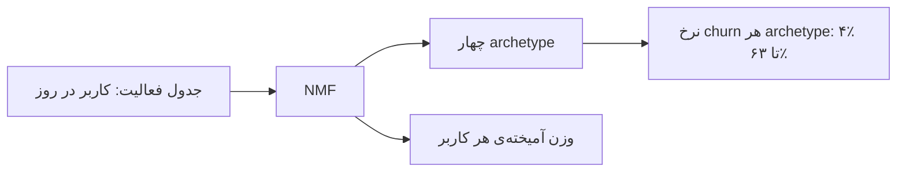

# نوشته‌ی ۶۰: چهار پرسشی که تحلیل churn باید جواب بدهد

[نوشته‌ی ۵۹: paywall روز دوم بهترین مشتریان آینده‌تان را می‌سوزاند →](59-your-day-2-paywall-is-burning-your-best-future-customers.md) · [مجموعه](../README.md) · [نوشته‌ی ۶۱: D30 ROAS متریک اشتباهی است؛ به‌جایش چه بسنجیم ←](61-d30-roas-is-the-wrong-metric-here-is-what-to-use-instead.md)

> **مقاله‌ی اصلی:** [The Four Questions Churn Analysis Should Answer](https://medium.com/@paul.levchuk/the-four-questions-churn-analysis-should-answer-3479ca3d5cf8) · Medium، ۲۰۲۶-۰۳-۲۳

## خلاصه

دانستن این‌که کاربری ریزش می‌کند تقریباً هیچ نمی‌گوید. آنچه می‌گوید کجا خرج کنیم این است که چه وقت قابل‌تشخیص می‌شود، چند نفر را با اطمینان می‌شود دسته‌بندی کرد و کدام بخش بیشتر به مداخله پاسخ می‌دهد. چهار پرسش واقعی: کاربران من رفتاراً که هستند، هر سنخ چه وقت پیش از ریزش قابل‌تشخیص می‌شود، اولین آزمایش را روی کدام سنخ بگذارم و هر روز با چه اطمینانی روی چند نفر می‌توانم عمل کنم. پاسخ در چهار گام: NMF روی فعالیت روزانه، پنجره‌ی مداخله، رتبه‌بندی پاسخ‌پذیری و ترانسفورمر علّی با سه سطل تصمیم. هدف پیش‌بینی churn نیست؛ دانستن این است که به چه کسی، با چه اطمینانی، در چه لحظه‌ای عمل کنیم و بقیه را کنار بگذاریم.

## نکته‌های کلیدی

- **چهار پرسش واقعی churn:**
  - پرسش Q1: کاربران من رفتاراً که هستند؟
  - پرسش Q2: هر سنخ کاربر چه وقت پیش از ریزش قابل‌تشخیص می‌شود؟
  - پرسش Q3: اولین آزمایش را روی کدام سنخ بگذارم؟
  - پرسش Q4: در هر روز، چند کاربر را با اطمینان می‌توانم هدف بگیرم و چند نفر را هنوز نمی‌شناسم؟
  - مدل استاندارد churn Q1 را ناقص و Q4 را اصلاً پاسخ نمی‌دهد.
- **گام ۱، NMF روی فعالیت خام:** یک جدول: کاربران سطر، روزها ستون، شمارش فعالیت مقدار. بدون برچسب، بدون فرضیه، بدون دانستن تعداد سنخ‌ها. NMF الگوهای مسیر تکرارشونده‌ای می‌یابد که با هم همه را توصیف می‌کنند. در شبیه‌سازی چهار الگو پیدا شد، هر کدام با نرخ churn بسیار متفاوت: دامنه‌ی churn ۵۹ واحد درصد، از ۴٪ تا ۶۳٪. این تقسیم‌بندی از هر feature engineering دستی متمایزکننده‌تر بود، بی‌هیچ دانش حوزه.
- **کاربر در جعبه نمی‌افتد، امتیاز آمیخته می‌گیرد:** کاربری که ۶۰٪ Fast Fader و ۴۰٪ Gradual Fader است با کسی که ۹۵٪ Fast Fader است فرق دارد. کاربر A تماماً Fast Fader بود و ریزش کرد. کاربر C نزدیک نصف Fast Fader بود ولی ۱۵٪ Late Activator و ۳۶٪ Gradual Fader هم داشت و ماند. خوشه‌بندی استاندارد هر دو را Fast Fader می‌خواند و یک نتیجه پیش‌بینی می‌کرد؛ آمیختگی تفاوت را گرفت. کاربر E، Late Activator خالص، کم ریزش می‌کند؛ شکل V در مسیرش دقیقاً همین است: درگیری کم می‌شود و بعد از روز ۲۰ برمی‌گردد.
- **برای PM و UA:** Late Activator‌ها نیازی به کمپین ندارند. Fast Fader‌ها ۶۳٪ ریزش می‌کنند ولی هدف درست اولین آزمایش نیستند.
- **گام ۲، پنجره‌ی مداخله:** برای هر سنخ و هر روز می‌سنجیم فعالیت تجمعی تا آن لحظه ریزش نهایی را چقدر پیش‌بینی می‌کند. این ویژگی خود داده است، نه مدل. اگر سیگنال فقط روز ۲۸ ظاهر شود کاری نمی‌توان کرد. Gradual Faders ۲۱ روز پنجره می‌دهند، Fast Faders ۱۱ روز و Mid Faders هیچ. صفر بودن پنجره‌ی Mid Faders شکست مدل نیست؛ یعنی این کاربران در ۲۲ روز سیگنال متمایز کافی تولید نمی‌کنند. مشکل طراحی محصول است.
- **برای مدیران UA:** پنجره‌ی قابل‌اجرا دقیقاً از لحظه‌ای که سیگنال از آستانه رد می‌شود تا روز ۲۲ است. اجرای کمپین پیش از باز شدن پنجره سوزاندن بودجه روی نویز است.
- **گام ۳، اولین آزمایش روی کدام سنخ:** غریزه می‌گوید روی پرریزش‌ترین، Fast Faders با ۶۳٪. اشتباه است: churn بالا به معنای پاسخ‌پذیری بالا نیست. پاسخ‌پذیری با پرسشی خلاف‌واقع سنجیده شد: اگر نیمرخ رفتاری کاربر به سمت سالم‌ترین سنخ برود، churn پیش‌بینی‌شده چقدر می‌افتد؟ این مقدار بر بیشینه‌ی ممکن نرمال شد. Mid Faders، نه Fast Faders، در رتبه‌ی اول پاسخ‌پذیری‌اند و بیشتر از آنچه baseline پیش‌بینی می‌کند حرکت می‌کنند. رتبه‌بندی روی هشت seed تصادفی پایدار بود. هشدار: امتیاز پاسخ‌پذیری برای **جهت و رتبه** قابل‌اعتماد است ولی اثر مورد انتظار را حدود ۱٫۶ برابر نسبت به A/B واقعی بزرگ‌نمایی می‌کند. از آن برای تصمیم «اول روی که آزمایش کنم» استفاده کنید، نه پیش‌بینی اندازه‌ی اثر. برای تخصیص بودجه بعد از داده‌ی A/B تحلیل علّی درست لازم است.
- **گام ۴، عمل امروز و اطمینان:** ترانسفورمر علّی فعالیت هر کاربر را روز به روز می‌خواند و امتیاز ریسک می‌دهد. مدل برای پیش‌بینی churn نهایی آموزش دیده، نه بی‌فعالیتی کوتاه‌مدت؛ تفاوتش میان مدلی است که دقتش در ۳۰ روز از ۰٫۵۴ به ۰٫۹۵ می‌رسد با مدلی که وارونه می‌شود. هر روز هر کاربر در یکی از سه سطل است:
  - **ریزش قطعی:** ریسک بالای ۰٫۵۵ برای دو روز پیاپی، اینجا عمل کن.
  - **امن قطعی:** ریسک زیر ۰٫۲۰ برای دو روز پیاپی، بی‌خیال شو و بودجه را نگه دار.
  - **نامشخص:** هیچ‌کدام پایدار نیست، شواهد هنوز جمع می‌شود.
  - سطل امن و ریزش در روزهای متفاوتی قابل‌استفاده می‌شوند. بیشتر تحلیل‌ها این دو را یک پرسش می‌بینند.
- **نتایج روز ۲۲:**
  - سنخ Late Activator: ۶۴٪ با دقت ۱۰۰٪ امن قطعی‌اند؛ کاملاً رهایشان کنید. روی ۲٪ برچسب ریزش نزنید چون ۹۷٪ آن هشدارها غلط است.
  - سنخ Fast Fader: ۴۸٪ ریزش قطعی با دقت ۷۶٪؛ ارزش عمل دارد. ۴۹٪ نامشخص را پیش‌فرض در خطر بگیرید: با churn پایه‌ی ۶۳٪ از دست دادنشان گران‌تر از مداخله‌ی اضافه است.
  - سنخ Mid Fader: ۵۷٪ در روز ۲۲ نامشخص. همراه پنجره‌ی صفر گام ۲ یک مشکل ساختاری را تأیید می‌کند. مدل بهتر آن را حل نمی‌کند؛ چرخه‌ی عمر محصول متفاوتی لازم است.
- **کدام روز کمپین بزنیم؟** نه هرچه زودتر. هر ستون نتیجه‌ی اجرای کمپین در همان روز است؛ بخش قرمز تیره churner‌های واقعی و قرمز روشن بودجه‌ی هدررفته روی کسانی که هرگز نمی‌رفتند. پیش از روز ۹ بخش هدررفته از مؤثر بزرگ‌تر است. روز ۲ نرخ هدررفت ۵۳٪ است، بدتر از انتخاب تصادفی چون churn پایه‌ی آن سنخ ۳۱٪ است. بعد از روز ۹ تصمیم churn ۶۰٪ دقیق می‌شود و بخش مؤثر غالب. خط سبز هم مهم است: تا روز ۹ برای کمپین churn صبر کنید ولی کاربران امن قطعی را از روز ۲ با دقت ۹۰٪ کنار بگذارید. پیام «صبر کن و کاری نکن» نیست؛ بلافاصله روی امن‌ها صرفه‌جویی کنید و تا قابل‌اعتماد شدن پرچم‌های churn خرج نکنید.
- **جمع‌بندی:** هدف پیش‌بینی churn هدف بدی است. هدف این است که بدانیم به چه کسی، با چه اطمینانی، در چه لحظه‌ای عمل کنیم، و بقیه را رها کنیم.

## فهرست بخش‌ها

- چهار پرسش
- کاربران که هستند
- پنجره‌ی تشخیص
- اولین آزمایش
- عمل امروز

## یادداشت‌ها

دانستن این‌که کاربری ریزش می‌کند تقریباً هیچ به شما نمی‌گوید. دانستن این‌که چه وقت قابل‌تشخیص می‌شود، چند نفر را می‌توانید با اطمینان دسته‌بندی کنید و کدام بخش بیشتر به مداخله پاسخ می‌دهد، به شما می‌گوید کجا خرج کنید.

چهار پرسش واقعی درباره‌ی churn این‌هاست:

- **پرسش Q1** کاربران من از نظر رفتاری چه کسانی‌اند؟
- **پرسش Q2** هر سنخ کاربر چه وقت پیش از ریزش قابل‌تشخیص می‌شود؟
- **پرسش Q3** اولین آزمایشم را روی کدام سنخ کاربر اجرا کنم؟
- **پرسش Q4** در هر روز، چند کاربر را می‌توانم با اطمینان هدف بگیرم و درباره‌ی چند نفر هنوز چیزی نمی‌دانم؟

مدل استاندارد churn Q1 را جزئی پاسخ می‌دهد و Q4 را اصلاً. یکی‌یکی می‌گذریم.

**گام ۱: کاربران شما که هستند؟** پیش از ساختن هر مدل پیش‌بینی، NMF را روی فعالیت روزانه‌ی خام اجرا کنید. یک جدول به آن بدهید: کاربران سطر، روزها ستون، شمارش فعالیت مقدار. بدون برچسب، بدون فرضیه، بدون دانش قبلی از این‌که چند سنخ کاربر هست.

روش NMF الگوهای مسیر تکرارشونده‌ای می‌یابد که با هم همه را توصیف می‌کنند. در شبیه‌سازی ما چهار الگو یافت شد که هر کدام نرخ churn شگفت‌انگیز متفاوتی داشت. *نمودار ۱: مسیر متوسط فعالیت روزانه برای هر archetype. همان اپ، همان ۳۰ روز، نرخ churn از ۴٪ تا ۶۳٪.*

دامنه‌ی churn بین archetype‌ها ۵۹ واحد درصد بود. NMF بدون هیچ دانش حوزه‌ای تقسیم‌بندی متمایزکننده‌تری از هر feature engineering دستی ساخت.

چیزی که نمودار مسیر نمی‌تواند نشان دهد تفاوت کلیدی NMF با تقسیم‌بندی استاندارد است: کاربران در یک جعبه قرار نمی‌گیرند. به هر کدام *امتیاز آمیخته* روی هر چهار archetype داده می‌شود. کاربری که ۶۰٪ Fast Fader و ۴۰٪ Gradual Fader است با کسی که ۹۵٪ Fast Fader است فرق دارد، چون رفتار و ریسک churn‌شان واقعاً متفاوت است.

هر ستون یک کاربر واقعی است. پنل بالا مسیرشان را نشان می‌دهد، آنچه در هر نمودار فعالیت می‌بینید. پنل پایین نشان می‌دهد NMF زیرش چه یافته است.

کاربر A یک Fast Fader خالص است: ۱۰۰٪ وزنش روی آن archetype است. ریزش کرد. کاربر C تقریباً نصف Fast Fader است ولی ۱۵٪ وزن Late Activator و ۳۶٪ وزن Gradual Fader هم دارد. زنده ماند. الگوریتم خوشه‌بندی استاندارد هر دو را Fast Fader برچسب می‌زد و یک نتیجه پیش‌بینی می‌کرد. آمیختگی تفاوت را گرفت.

کاربر E، Late Activator خالص، کم ریزش می‌کند، و شکل V در مسیرش دقیقاً چیزی است که archetype نمایش می‌دهد: درگیری که فرو می‌رود و بعد از روز ۲۰ برمی‌گردد. این سیگنال رفتاری است که الگوریتم بدون گفتن دنبالش بگردد جدا کرد.

**این برای PM و مدیران UA چه معنا دارد؟** کاربران شما یک جمعیت واحد نیستند که یک راهبرد retention لازم داشته باشند. Late Activator‌ها به‌ندرت ریزش می‌کنند و اصلاً به کمپین نیاز ندارند. Fast Fader‌ها ۶۳٪ ریزش می‌کنند، ولی همان‌طور که می‌بینید، هدف درست اولین آزمایش نیستند. دانستن این شکل‌ها طراحی سفر محصول و تخصیص بودجه‌ی کمپین را عوض می‌کند.

**گام ۲: چه وقت می‌توانید کاربران در خطر را واقعاً تشخیص دهید؟** دانستن این‌که Fast Fader‌ها ۶۳٪ ریزش می‌کنند نمی‌گوید در کدام نقطه از چرخه‌ی عمرشان می‌توانید آن‌هایی را که ریزش می‌کنند از آن‌هایی که نمی‌کنند جدا کنید. اگر سیگنال فقط روز ۲۸ ظاهر شود، کاری نمی‌توانید بکنید.

برای هر archetype در هر روز حساب کردیم فعالیت تجمعی تا آن نقطه ریزش نهایی را چقدر خوب پیش‌بینی می‌کند. هیچ مدلی لازم نیست. این ویژگی خود داده‌ی خام است.

وجود صفر پنجره‌ی مداخله برای Mid Fader‌ها شکست مدل نیست. یعنی این کاربران در ۲۲ روز سیگنال رفتاری متمایز کافی تولید نمی‌کنند که هیچ تکنیکی بتواند به‌موقع شناسایی‌شان کند. این مشکل طراحی محصول است.

این یافته کاری می‌کند که مدل استاندارد churn نمی‌تواند: می‌گوید با داده‌ی موجود اصلاً عمل روی یک segment شدنی است یا نه. Gradual Fader‌ها ۲۱ روز به شما می‌دهند. Fast Fader‌ها ۱۱ روز. Mid Fader‌ها هیچ.

**به‌ویژه برای مدیران UA.** اگر کمپین‌های retargeting را برای زمان ساکت شدن کاربران زمان‌بندی می‌کنید، این نمودار پنجره‌ی قابل‌اجرا برای هر سنخ کاربر را می‌دهد. شلیک کمپین پیش از باز شدن پنجره سوزاندن بودجه روی نویز است. پنجره هر زمان پیش از ریزش نیست؛ دقیقاً از لحظه‌ای است که سیگنال از آستانه رد می‌شود تا روز ۲۲.

**گام ۳: اولین آزمایش روی کدام segment؟** غریزه‌ی طبیعی این است که اولین A/B را روی segment با بالاترین churn اجرا کنید: Fast Fader‌ها با ۶۳٪. این جواب اشتباه از آب درمی‌آید.

مقدار churn بالا به معنای پاسخ‌پذیری بالا به مداخله نیست. یک segment می‌تواند به‌شدت ریزش کند و باز هم وقتی به او دست می‌زنید رفتارش عوض نشود. پاسخ‌پذیری را با پرسشی خلاف‌واقع سنجیدیم: اگر نیمرخ رفتاری کاربر به سمت سالم‌ترین archetype برود، churn پیش‌بینی‌شده چقدر می‌افتد؟ آن را بر بیشینه‌ی ممکن نرمال کردیم.

سنخ Mid Fader‌ها، نه Fast Fader‌ها، در رتبه‌ی اول پاسخ‌پذیری‌اند. بیشتر از آنچه baseline‌شان پیش‌بینی می‌کند حرکت می‌کنند. این رتبه‌بندی در هشت seed تصادفی پایدار بود.

یک هشدار مهم: امتیاز پاسخ‌پذیری برای **جهت و رتبه‌بندی** قابل‌اعتماد است، ولی اثر مورد انتظار را در مقایسه با A/B واقعی حدود ۱٫۶ برابر بیش‌برآورد می‌کند. از آن برای تصمیم **اول روی چه کسی آزمایش کنیم** استفاده کنید، نه برای پیش‌بینی اندازه‌ی اثر. برای تخصیص بودجه، پس از رسیدن داده‌ی A/B به تحلیل علّی درست نیاز دارید.

| segment | churn پایه | پنجره‌ی مداخله | رتبه‌ی پاسخ‌پذیری |
|---|---|---|---|
| Late Activator | بسیار کم | کمپین لازم نیست | هدف نیست |
| Gradual Fader | متوسط | ۲۱ روز | کمتر از Mid |
| Fast Fader | ۶۳٪ | ۱۱ روز | هدف اول نیست |
| Mid Fader | میانی | هیچ | رتبه‌ی اول |

> **Vault note:** جدول بالا فقط مقدارهایی را آورده که نویسنده گفته (۶۳٪ و ۲۱ و ۱۱ و صفر و رتبه‌ی اول Mid)؛ ستون‌های دیگر برچسب کیفی هستند نه عدد.

**گام ۴: امروز روی چه کسی عمل کنید و چقدر مطمئن هستید؟** گام‌های قبلی راهبردی بودند. گام ۴ عملیاتی است. هر روز به سه سطل کاربر نیاز دارید: کسانی که باید رویشان عمل کرد، کسانی که باید رد شد و کسانی که واقعاً هنوز درباره‌شان چیزی نمی‌دانید.

یک ترانسفورمر علّی فعالیت هر کاربر را روز به روز می‌خواند و امتیاز ریسک می‌دهد. مدل برای پیش‌بینی ریزش نهایی آموزش دیده، نه بی‌فعالیتی کوتاه‌مدت، که تفاوت میان مدلی است که دقتش در ۳۰ روز از ۰٫۵۴ به ۰٫۹۵ می‌رسد با مدلی که وارونه می‌شود. هر روز هر کاربر چنین دسته‌بندی می‌شود:

- **ریزش قطعی:** ریسک بالای ۰٫۵۵ برای دو روز پیاپی. اینجا عمل کنید.
- **امن قطعی:** ریسک زیر ۰٫۲۰ برای دو روز پیاپی. رد شوید و بودجه را نگه دارید.
- **نامشخص:** هیچ‌کدام از آستانه‌ها پایدار نیست. شواهد هنوز در حال جمع شدن است.

سطل امن و سطل ریزش در روزهای متفاوتی قابل‌استفاده می‌شوند. بیشتر تحلیل‌ها آن‌ها را یک پرسش می‌گیرند.

برای Late Activator‌ها: ۶۴٪ با دقت ۱۰۰٪ امن قطعی‌اند. کاملاً رهایشان کنید. روی ۲٪ پرچم‌خورده به‌عنوان ریزش عمل نکنید، چون ۹۷٪ آن پرچم‌ها هشدار غلط است.

برای Fast Fader‌ها: ۴۸٪ ریزش قطعی با دقت ۷۶٪ دارند. ارزش عمل کردن دارد. ۴۹٪ نامشخص را به‌طور پیش‌فرض در خطر بگیرید. با churn پایه‌ی ۶۳٪ از دست دادنشان گران‌تر از مداخله‌ی بیش از حد است.

برای Mid Fader‌ها: ۵۷٪ در روز ۲۲ نامشخص. این همراه پنجره‌ی مداخله‌ی صفر در گام ۲ یک مشکل ساختاری را تأیید می‌کند. مدل بهتر آن را حل نمی‌کند. چرخه‌ی عمر محصول متفاوتی لازم است.

تصویر روز ۲۲ نشان می‌دهد همه کجا تمام شده‌اند. ولی پرسش عملیاتی‌تر این است: واقعاً کدام روز باید کمپینت را بزنی؟ پاسخ «هرچه زودتر» نیست.

هر ستون نشان می‌دهد اگر کمپین churn را در آن روز مشخص بزنید چه می‌شود. بخش قرمز تیره به churner‌های واقعی می‌رسد. بخش قرمز روشن بودجه‌ای است که روی کسانی هدر رفت که هرگز نمی‌رفتند.

پیش از روز ۹، بخش هدررفته از بخش مؤثر بزرگ‌تر است. در روز ۲ نرخ هدررفت ۵۳٪ است، **بدتر از انتخاب تصادفی کاربران این segment**، چون churn پایه ۳۱٪ است.

بعد از روز ۹ وضع بهتر می‌شود: تصمیم churn ۶۰٪ دقیق می‌شود. بخش قرمز تیره غالب می‌شود.

خط سبز هم همین‌قدر مهم است. در حالی که باید تا روز ۹ برای شلیک کمپین churn صبر کنید، می‌توانید از روز ۲ با دقت ۹۰٪ کاربران امن قطعی را کنار بگذارید. پیام این نیست که صبر کنید و هیچ نکنید. پیام این است: همین حالا روی کاربران امن قطعی صرفه‌جویی کنید و تا قابل‌اعتماد شدن پرچم‌های churn صبر کنید و بعد خرج کنید.

> **Try it:** [دم پنهان](../widgets/64-tail-you-cannot-see.html): ببینید چرا بخشی از کاربران در پنجره‌ی مشاهده هنوز نامشخص می‌مانند.

**جمع‌بندی:**

- هدف پیش‌بینی churn هدف بدی است.
- هدف دانستن این است که به چه کسی، با چه اطمینانی، در چه لحظه‌ای عمل کنیم و همه‌ی دیگران را رد کنیم.

> **In practice:** پیش‌بینی churn بدون پنجره‌ی مداخله در Airflow فقط یک جدول است؛ خروجی باید سطل‌های تصمیم با تاریخ مشخص برای هر کاربر باشد.
>
> **Your turn:** مدل churn با AUC بالا ساخته شده ولی هیچ تیمی از آن استفاده نمی‌کند. چه کم دارد؟
>
> *Answer:* پاسخ به این‌که چه وقت و روی چه کسی با چه اطمینانی عمل کنیم؛ هدف دانستن لحظه و سنخ قابل‌اقدام است، نه فقط پیش‌بینی churn (بخش «چهار پرسش»).

## پیوندها

- **بر پایه‌ی:** [فصل ۵۵](55-user-acquisition-funnel.md) که churn مستقیم و غیرفعال را جدا کرد، و [فصل ۵۶](56-user-transition-states-diagram.md) که احتمال گذار ریزش را اندازه گرفت.
- **همان ایده در:** [فصل ۶۴](64-long-tail-eats-your-ltv-model.md) که دم دیده‌نشده را می‌گوید و [فصل ۵۸](58-why-your-live-ops-ltv-model-is-setting-money-on-fire.md) که فیلتر قابل‌اقناع را.
- **ادامه در:** [فصل ۶۱](61-d30-roas-is-the-wrong-metric-here-is-what-to-use-instead.md).

## خودتان را بسنجید

*پرسش‌ها و پاسخ‌ها مال vault است.*

1. **چرا اولین آزمایش روی Fast Fader‌ها با ۶۳٪ churn بهترین انتخاب نیست؟**
   - [x] چون churn بالا یعنی پاسخ‌پذیری بالا نیست؛ Mid Fader‌ها پاسخ‌پذیرترند.
   - [ ] چون Fast Fader‌ها کم‌اند.
   - [ ] چون ریزش‌شان قابل‌تشخیص نیست.

   *Answer:* (بخش «اولین آزمایش»).

2. **چرا کمپین churn را نباید در روز ۲ زد؟**

   *Answer:* چون در روز ۲ نرخ هدررفت ۵۳٪ است، بدتر از انتخاب تصادفی؛ تا روز ۹ باید صبر کرد ولی امن‌ها را همان روز ۲ کنار گذاشت (بخش «عمل امروز»).
