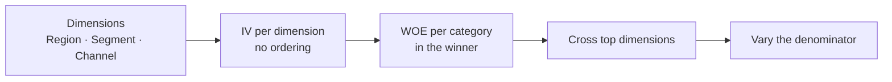

# نوشته‌ی ۶۲: درخت متریک را تکه‌تکه نکنید

[نوشته‌ی ۶۱: D30 ROAS متریک اشتباهی است؛ به‌جایش چه بسنجیم →](61-d30-roas-is-the-wrong-metric-here-is-what-to-use-instead.md) · [مجموعه](../README.md) · [نوشته‌ی ۶۳: چرا بهترین سیگنال جذب کاربر از هیچ‌کاری‌نکردن درآمد کمتری می‌سازد؟ ←](63-best-ua-signal-less-revenue-than-nothing.md)

> **مقاله‌ی اصلی:** [Stop Decomposing Metric Tree](https://medium.com/@paul.levchuk/stop-decomposing-metric-tree-8f8ca9ac7488) · Medium، ۲۰۲۶-۰۴-۱۴

## خلاصه

هر تیم داده‌ای جایی یک درخت متریک دارد: MRR به ARPU ضرب در تعداد مشتری می‌شکند، تعداد مشتری به جدید به‌اضافه‌ی برگشتی منهای churn کرده، و churn به چیزی که بسته به کشنده‌ی درخت فرق می‌کند. نویسنده پیش‌تر گفته بود درخت برای دید کلی و هم‌سویی مفید است ولی برای پیدا کردن محرک اصلی، ریشه‌یابی و اولویت‌بندی قابل‌اتکا نیست. این‌جا جایگزین مشخصی نشان می‌دهد: ارزیابی مستقل هر بُعد با Information Value و Weight of Evidence، بدون درخت. روی یک شرکت SaaS شبیه‌سازی‌شده با علت کاشته‌شده، درخت بسته به ترتیب شکافتن گناه را گردن منطقه یا کانال می‌اندازد، ولی IV/WOE هر بار یک پاسخ می‌دهد. بعد نشان می‌دهد همان داده به «چه کسی بیشتر churn می‌کند؟» و «کجا بیشترین پول را از دست می‌دهیم؟» پاسخ متفاوت می‌دهد، و عوض کردن مخرج کسر خود پرسش را عوض می‌کند.

## نکته‌های کلیدی

- **ترتیب، داستان را می‌سازد.** اگر اول منطقه را بشکافید EMEA با ۴۳٪ churn و نرخ ۱۰٪ مقصر است؛ اگر اول کانال را بشکافید Partner با ۳۷٪ churn و نرخ ۲۲٪. بُعد اول در تجزیه‌ی پشت‌سرهم همیشه بیشترین واریانس را می‌بلعد، چه محرک واقعی باشد چه نه.
- **بُعدها را مستقل بسنجید.** برای هدف دودویی، WOE هر دسته لگاریتم نسبت سهم غیررویداد به سهم رویداد است و IV مجموع اختلاف این دو سهم ضرب در WOE. کانال قاطعانه می‌برد و WOE دسته‌ی Partner برابر ۰٫۸۵۸− است.
- **هدف، برنده را عوض می‌کند.** برای MRR از‌دست‌رفته Segment می‌برد: Enterprise حدود ۵٪ مشتری‌ها و حدود ۳۵٪ MRR از‌دست‌رفته را دارد، با WOE برابر ۱٫۴۸+.
- **دو پاسخ مکمل‌اند.** کانال علت را می‌گوید و Segment میزان در معرض بودن مالی را؛ تقاطع Partner و Enterprise اولین نقطه‌ی داغ است.
- **مخرج کسر همان پرسش است.** سهم حجم می‌تواند تعداد مشتری، MRR فعال یا هر مبنای «سهم منصفانه» باشد و هر کدام رتبه‌بندی دیگری می‌دهد.
- **درخت در لایه‌ی semantic جایی ندارد،** چون به پرسش، زمان و ترکیب جمعیت وابسته است و می‌تواند کاملاً وارونه شود.

## فهرست بخش‌ها

- صحنه: شرکت SaaS در دردسر
- روش A: درخت متریک
- روش B: ارزیابی مستقل بُعدها با IV/WOE
- پیچش داستان: از کاربر به پول
- مخرج کسر پرسش را عوض می‌کند
- چرا این برای بحث لایه‌ی semantic مهم است
- گردش کار عملی

## یادداشت‌ها

نوشته‌ی قبلی نویسنده بحث زیادی راه انداخت، از جمله پیشنهادی برای این‌که درخت متریک به‌عنوان شیء درجه‌یک در لایه‌ی semantic جا بگیرد. این بار نویسنده به‌جای نقد صرف، جایگزین مشخصی نشان می‌دهد و چیزی را نشان می‌دهد که درخت ذاتاً از عهده‌اش برنمی‌آید: همان داده بسته به این‌که متریک را چطور وزن بدهید به پرسش‌های متفاوت پاسخ متفاوت می‌دهد.

**صحنه.** یک شرکت SaaS افت MRR می‌بیند. حدود ۵٬۹۰۰ مشتری دارد در سه منطقه (NA، EMEA و APAC)، سه Segment (SMB، Mid-Market و Enterprise) و سه کانال جذب (Organic، Paid و Partner). حقیقت پنهان، یعنی فرایند تولید داده که هنوز کسی نمی‌داند، این است: یک فروشنده‌ی کلیدی Partner از هم پاشیده و مشتری‌هایی که از Partner آمده‌اند با نرخ حدود ۲۲٪ churn می‌کنند، در برابر ۵ تا ۸٪ برای Organic و Paid. این نرخ بالا در همه‌ی منطقه‌ها و همه‌ی Segment‌ها یکسان است؛ علت کانالی است، نه منطقه‌ای. ولی EMEA اتفاقاً سهم نامتناسبی از مشتری‌های Enterprise آمده از Partner دارد. همین نکته‌ی آخر دام ترکیبی می‌سازد که درخت مستقیم در آن می‌افتد.

**روش A، درخت.** گردش کار تشخیصی معمول از درخت شروع می‌کند: MRR افت کرد، churn کرده‌ها را باز کن، کدام منطقه بیشتر از دست داد؟

| ترتیب شکافتن | داستان درخت | عدد |
|---|---|---|
| اول منطقه، بعد کانال | مشکل منطقه‌ای است؛ تیم EMEA توجه می‌خواهد | EMEA با ۴۳٪ churn و نرخ ۱۰٪، تقریباً دو برابر APAC |
| اول کانال، بعد منطقه | مشکل کانالی است؛ برنامه‌ی Partner را بررسی کنید | Partner با ۳۷٪ churn و نرخ ۲۲٪، نزدیک چهار برابر Organic |

همان داده، دو تشخیص کاملاً متفاوت و دو اقدام راهبردی متفاوت. درخت نمی‌گوید کدام درست است، چون هیچ‌وقت پرسش مقدم را نپرسید: اول کدام بُعد را باید شکافت؟ این مزاحمت کوچکی نیست. در تجزیه‌ی پشت‌سرهم بُعد اول همیشه بیشترین واریانس را جذب می‌کند، فارغ از این‌که محرک واقعی باشد یا نه. همان مسئله‌ی مجموع مربعات نوع یک در برابر نوع سه در ANOVA است: تجزیه‌ی پشت‌سرهم بنا به ساختارش به ترتیب وابسته است.

> **Try it:** [ترتیب و پرسش](../widgets/62-order-and-question.html): روی یک جدول کوچک churn ترتیب شکافتن و هدف (نرخ یا پول) را عوض کنید و ببینید داستان درخت و رتبه‌بندی IV/WOE چطور تغییر می‌کنند.

**روش B، ارزیابی مستقل با IV/WOE.** به‌جای انتخاب ترتیب، هر بُعد را جداگانه می‌سنجیم. برای هدف دودویی مثل churn (بله یا نه) WOE دو توزیع را مقایسه می‌کند: سهم رویداد، یعنی چند درصد از همه‌ی churn کرده‌ها در این دسته‌اند، و سهم غیررویداد، یعنی چند درصد از همه‌ی ماندگارها در این دسته‌اند. برای هر دسته:

- فرمول: WOE = ln(سهم غیررویداد ÷ سهم رویداد)
- فرمول: IV = Σ (سهم غیررویداد − سهم رویداد) × WOE

مقدار WOE مثبت یعنی دسته کمتر از سهمش churn دارد (خوب) و منفی یعنی بیشتر از سهمش (بد). IV بالاتر یعنی آن بُعد churn کرده‌ها را بهتر از ماندگارها جدا می‌کند.

نتیجه برای churn دودویی: کانال قاطعانه می‌برد. WOE دسته‌ی Partner برابر ۰٫۸۵۸− سیگنال قوی است؛ این دسته به‌شدت روی رویداد churn سنگینی می‌کند. منطقه به‌زحمت دیده می‌شود و Segment برای پرسش نرخ عملاً بی‌ربط است. این همان پاسخی است که درخت می‌خواست بدهد و نتوانست: کانال بُعد مهم است و Partner دسته‌ی مقصر. ترتیبی لازم نیست و پاسخ هر بار یکی است.

**پیچش داستان: از کاربر به پول.** تا این‌جا مشتری‌های churn کرده را شمردیم، ولی ذی‌نفعان معمولاً به دلار از‌دست‌رفته اهمیت می‌دهند. ARPU مشتری Enterprise ده برابر SMB است (۴۵۰ در برابر ۴۰ دلار). پس حتی اگر Enterprise با نرخ بالاتری churn نکند، هر مشتری Enterprise رفته گران‌تر تمام می‌شود. IV/WOE برای هدف پیوسته‌ای مثل MRR از‌دست‌رفته هم کار می‌کند، با جایگزین کردن مقایسه‌ی رویداد و غیررویداد با مقایسه‌ی سهم ارزش و سهم حجم:

- سهم ارزش: چند درصد از کل MRR از‌دست‌رفته در این دسته است؟
- سهم حجم: چند درصد از کل مشتری‌ها در این دسته‌اند؟
- فرمول: WOE = ln(سهم ارزش ÷ سهم حجم) و IV = Σ (سهم ارزش − سهم حجم) × WOE

این بار WOE مثبت یعنی دسته MRR از‌دست‌رفته‌ی نامتناسبی نسبت به تعداد مشتری‌اش جمع کرده است. و برنده برمی‌گردد: برای دلار از‌دست‌رفته Segment غالب است. Enterprise فقط حدود ۵٪ مشتری‌ها را دارد ولی حدود ۳۵٪ MRR از‌دست‌رفته را، و WOE آن یعنی ۱٫۴۸+ تمرکز شدیدی را نشان می‌دهد.

| پرسش | هدف | بُعد برنده | خوانش |
|---|---|---|---|
| چه کسی بیشتر churn می‌کند؟ | نرخ دودویی | کانال؛ Partner با WOE برابر ۰٫۸۶− | علت: فروپاشی فروشنده‌ی Partner |
| کجا بیشترین پول را از دست می‌دهیم؟ | دلار پیوسته | Segment؛ Enterprise با WOE برابر ۱٫۴۸+ | در معرض بودن مالی: Enterprise هزینه‌ی هر churn را چند برابر می‌کند |

این دو بینش مکمل‌اند، نه متناقض. با هم می‌گویند مشتری‌های Enterprise آمده از Partner تقاطع حیاتی‌ای‌اند که اول باید سراغشان رفت. درخت متریک نمی‌تواند هر دو را هم‌زمان نشان بدهد؛ در یک ترتیب و برای یک متریک می‌شکافد و همان مسیر را توضیح معرفی می‌کند.

**مخرج کسر پرسش را عوض می‌کند.** در فرمول پیوسته، مخرج یعنی سهم حجم لازم نیست «تعداد مشتری» باشد؛ هر چیزی است که مبنای «سهم منصفانه» را نشان بدهد. هر مخرج رتبه‌بندی دیگری می‌دهد چون پرسش دیگری می‌پرسد. Enterprise MRR از‌دست‌رفته‌ی بالایی به ازای هر نفر دارد، ولی MRR بالایی هم می‌سازد. اگر به‌جای تعداد مشتری با MRR فعال وزن بدهید، ممکن است WOE آن کم شود، چون churn آن متناسب با پایه‌ی درآمدش است. بینش اصلی همین است: یک تجزیه‌ی «درست» وجود ندارد. پرسش‌های متفاوتی هست؛ IV/WOE اجازه می‌دهد با عوض کردن مخرج پرسش را عوض کنید، در حالی که درخت شما را در یک تجزیه و یک پرسش قفل می‌کند.

**چرا این برای بحث لایه‌ی semantic مهم است.** پیشنهاد اخیر این است که درخت متریک در لایه‌ی semantic جا بگیرد: رابطه‌ی متریک‌ها رسمی شود، AI یال‌ها را استنباط کند و درخت کنار تعریف متریک‌ها شیء درجه‌یک باشد. تحلیل بالا نشان می‌دهد چرا این از نظر ساختاری مشکل دارد:

- **وابسته به پرسش:** «چرا نرخ churn بالاست؟» و «کجا بیشترین MRR را از دست می‌دهیم؟» درخت بهینه‌ی متفاوت می‌دهند. لایه‌ی semantic تعریف‌های پایدار نگه می‌دارد، نه محصول‌های تحلیلی گذرا که با هر پرسش عوض می‌شوند.
- **وابسته به زمان:** فروشنده‌ی Partner همین فصل فروپاشید. درخت فصل قبل کاملاً فرق داشت. درخت «درست» باید برای هر دوره دوباره ساخته شود و آن‌وقت دیگر مدل داده‌ی ماندگار نیست؛ نتیجه‌ی یک کوئری است.
- **وابسته به ترکیب:** اگر پایه‌ی Enterprise در EMEA فصل بعد بزرگ شود، همان نرخ‌های churn انتساب منطقه‌ای کاملاً متفاوتی می‌دهند، نه چون چیزی در عملیات عوض شده بلکه چون ترکیب جابه‌جا شده.
- **قابل وارونه شدن:** درخت با داده‌ی جدید فقط کمی جابه‌جا نمی‌شود؛ بُعد بالا می‌تواند کاملاً برگردد. منجمد کردن درخت در لایه‌ی semantic یعنی پاسخ امروز را حقیقت همیشگی جا زدن.

**گردش کار عملی.** چه چیزی جای درخت را می‌گیرد؟

1. بُعدها را با IV برای همان متریک هدف و وزنی که برایتان مهم است رتبه بدهید. این بدون وابستگی به ترتیب می‌گوید کدام بُعد مهم‌تر است.
2. مقدار WOE هر دسته را در بُعد برنده بخوانید. این با امتیازی علامت‌دار و قابل‌تفسیر می‌گوید کدام دسته‌ی مشخص مشکل است.
3. بُعدهای بالا را تقاطع بزنید. اگر کانال در نرخ و Segment در دلار برد، تقاطع Partner و Enterprise نقطه‌ی داغ است.
4. مخرج را عوض کنید و ببینید نتیجه با پرسش دیگر (به ازای نفر، به ازای دلار در خطر، به ازای درآمد ساخته‌شده) عوض می‌شود یا نه.

درخت متریک می‌تواند در پایان قالب ارائه باشد، یک جمع‌بندی بصری برای ذی‌نفعان. ولی موتور تحلیلی که شما را به آن‌جا می‌رساند باید ارزیابی مستقل بُعدها باشد، نه تجزیه‌ی پشت‌سرهم. درخت در نشان دادن *یک* داستان عالی است و در گفتن داستان *درست* نامطمئن، چون داستانش به این بستگی دارد که کدام بُعد را اول بگذارید، کدام متریک را بشکافید و به کدام دوره نگاه کنید. IV/WOE این وابستگی‌ها را ندارد.

> **Vault note:** داده‌ی این نوشته شبیه‌سازی با علت کاشته‌شده است؛ ثابت می‌کند روش علت معلوم را بازیابی می‌کند، نه این‌که در داده‌ی درهم واقعی همیشه چنین کند. IV/WOE از اعتبارسنجی مالی آمده و هم‌بستگی را رتبه می‌دهد نه علت را. [فصل ۷۱](71-split-a-churn-spike-lmdi.md) همین روش را گام غربالگری می‌نامد و دام ترتیب را با تجزیه‌ی دقیق LMDI حل می‌کند.

> **In practice:** IV و WOE هر بُعد را می‌شود در یک query ClickHouse روی جدول Gold churn ساخت؛ این را کنار درخت سنجه‌ی Metabase بگذارید، نه به‌جای آن.
>
> **Your turn:** دو drill-down در داشبورد churn دو مقصر متفاوت نشان می‌دهند. چه می‌کنید؟
>
> *Answer:* هر بُعد را مستقل با IV و WOE بسنجید؛ درخت بسته به ترتیب شکافتن تقصیر را جابه‌جا می‌کند، ولی IV/WOE هر بار یک جواب می‌دهد (بخش «روش B: ارزیابی مستقل بُعدها با IV/WOE»).

## پیوندها

- **بر پایه‌ی:** [فصل ۵۴](54-the-metric-tree-trap.md) یعنی همان «نوشته‌ی قبلی» درباره‌ی دام درخت متریک، و [فصل ۱۰](10-retention-deep-dive.md) که با Information gain بُعدها را مستقل می‌سنجد.
- **ادامه در:** [فصل ۷۱](71-split-a-churn-spike-lmdi.md) که جهش churn را دقیق به mix و rate می‌شکند، و [فصل ۶۷](67-flo-health-what-zero-uplift-really-means.md) که باز ترکیب جمعیت را از رفتار جدا می‌کند.
- **همان ایده در:** [فصل ۶۳](63-best-ua-signal-less-revenue-than-nothing.md) که در آن هم پرسش نادرست سیگنال درست را گمراه‌کننده می‌کند.

## خودتان را بسنجید

*پرسش‌ها و پاسخ‌ها مال vault است.*

1. **چرا درختی که اول منطقه را می‌شکافد با درختی که اول کانال را می‌شکافد مقصر متفاوتی پیدا می‌کند؟**
   - [ ] داده بین دو اجرا عوض شده.
   - [x] در تجزیه‌ی پشت‌سرهم بُعد اول بیشترین واریانس را جذب می‌کند، چه محرک واقعی باشد چه نه.
   - [ ] منطقه و کانال با واحدهای متفاوت سنجیده می‌شوند.

   *Answer:* تجزیه‌ی پشت‌سرهم ذاتاً به ترتیب وابسته است، مثل مجموع مربعات نوع یک (بخش «روش A: درخت متریک»).

2. **برای MRR از‌دست‌رفته Segment برنده شد، نه کانال. یعنی چه؟**
   - [x] کانال می‌گوید چه کسی می‌رود و Segment می‌گوید پول کجا از دست می‌رود.
   - [ ] نتیجه‌ی کانال غلط بود.
   - [ ] مشتری‌های Enterprise با نرخ بیشتری churn می‌کنند.

   *Answer:* Enterprise حدود ۵٪ مشتری‌ها و حدود ۳۵٪ MRR از‌دست‌رفته را دارد؛ دو پاسخ مکمل‌اند (بخش «پیچش داستان: از کاربر به پول»).

3. **دو دلیل بیاورید که چرا نباید درخت را در لایه‌ی semantic پخت.**

   *Answer:* هر دو از این‌ها: به پرسش، به دوره‌ی زمانی و به ترکیب جمعیت وابسته است و می‌تواند وارونه شود (بخش «چرا این برای بحث لایه‌ی semantic مهم است»).

4. **برای پرسیدن «نسبت به درآمدی که می‌سازیم کجا پول از دست می‌دهیم؟» چه چیزی را عوض می‌کنید؟**

   *Answer:* مخرج را: به‌جای سهم مشتری، سهم MRR فعال (بخش «مخرج کسر پرسش را عوض می‌کند»).
