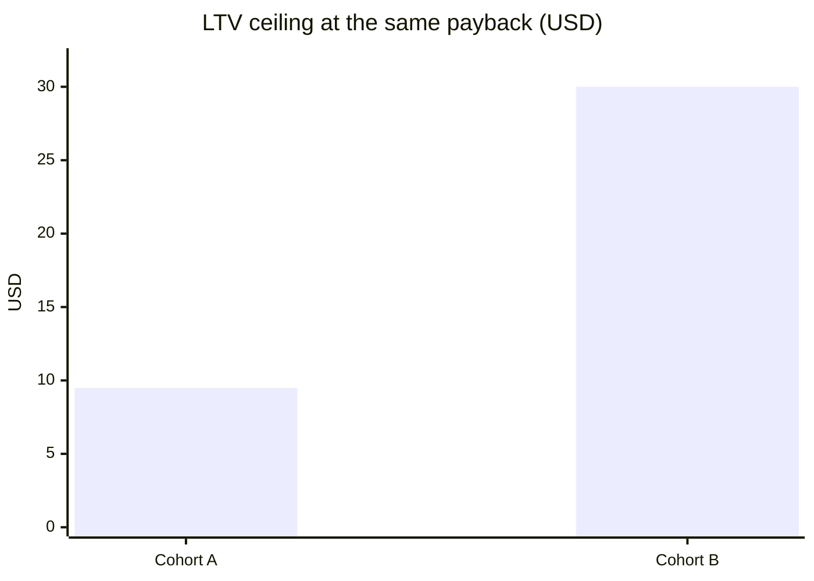

# نوشته‌ی ۶۶: دو cohort، یک دوره‌ی payback، دو سرمایه‌گذاری کاملاً متفاوت

[نوشته‌ی ۶۵: وقتی منحنی retention بیشتر از آنچه نشان می‌دهد پنهان می‌کند →](65-retention-curve-hides-more-than-it-shows.md) · [مجموعه](../README.md) · [نوشته‌ی ۶۷: شرکت Flo Health: «uplift صفر» واقعاً یعنی چه ←](67-flo-health-what-zero-uplift-really-means.md)

> **مقاله‌ی اصلی:** [Two Cohorts, Same Payback Period, Very Different Investments](https://medium.com/@paul.levchuk/two-cohorts-same-payback-period-very-different-investments-8ffe616ee48c) · Medium، ۲۰۲۶-۰۴-۲۸

## خلاصه

میان‌بر عملیاتی رایج در UA پولی این است که اقتصاد یک cohort را با **دوره‌ی payback** خلاصه کنیم: چند روز طول می‌کشد تا LTV تجمعی هر کاربر جذب‌شده از CAC بگذرد. پرارجاع‌ترین عدد هر بحث LTV در برابر CAC است، برنامه‌ریزی نقدینگی را هدایت می‌کند، تصمیم بودجه را لنگر می‌اندازد و معمولاً تا اسلاید CFO بالا می‌رود. نویسنده می‌گوید payback لازم است ولی به‌شدت ناکافی. دو cohort با payback تقریباً یکسان (۶۱ و ۶۵ روز) می‌توانند سرمایه‌گذاری‌های کاملاً متفاوتی باشند: سقف LTV یکی حدود ۹٫۵۰ دلار است و دیگری حدود ۳۰ دلار. یکی با حجم payback می‌گیرد و دیگری با ماندگاری. بنیان‌های تشخیصی، یعنی نرخ بازمانده، شدت پرتگاه، نیمه‌عمر دم و فاصله تا سقف، تفاوت را نشان می‌دهند و فاصله تا سقف است که باید تصمیم مقیاس را هدایت کند.

## نکته‌های کلیدی

- **یک payback، دو سرمایه‌گذاری.** cohort A با بازمانده‌ی ۲۰٪ و نیمه‌عمر دم ۲ ماه؛ cohort B با بازمانده‌ی ۱۴٪ و نیمه‌عمر دم ۹٫۲ ماه. منحنی‌ها حوالی روز ۶۰ هم را قطع می‌کنند و سقف LTV ‏B بیش از سه برابر A است.
- **حجم در برابر ماندگاری.** با payback ثابت، نرخ بازمانده با ماندگاری دم بده‌بستان دارد؛ معمولاً نمی‌شود هر دو را داشت.
- **سهم دم تمایز نمی‌دهد.** A ‏۹۴٪ و B ‏۹۶٪؛ هر دو الگوی معمول موبایل را دارند که بخش وفادار LTV را می‌سازد.
- **فاصله تا سقف مهم‌ترین تفاوت است.** A ‏۴۸٪ و B ‏۸۳٪. A با ۱۰۰٪ افزایش CAC ورشکسته می‌شود؛ B با ۲۰۰٪ افزایش هنوز ۵۰٪ فاصله دارد.
- **فاصله‌ی منفی یعنی payback تعریف‌نشده.** در افت نمایی τ = ln(1 − (CAC/m)·c) ÷ ln(1 − c) فقط وقتی جواب دارد که CAC کمتر از m/c یعنی سقف LTV باشد.
- **پنج الگو در مقایسه‌ی cohort‌ها** که هر کدام به تصمیم دیگری می‌رسد؛ رایج‌ترین، بده‌بستان بدون غالب، است که چارچوب جوابش را نمی‌دهد ولی بده‌بستان را صریح می‌کند.
- **دقت:** بازمانده، payback و فاصله تا سقف دقیق‌اند؛ دقت نیمه‌عمر دم با کوچک شدن c₂ کم می‌شود؛ شدت پرتگاه فقط برای قضاوت کیفی.

## فهرست بخش‌ها

- دو cohort با payback یکسان
- هر بنیان در این مقایسه چه می‌گوید
- چرا فاصله تا سقف بار را می‌کشد
- مثال کار‌شده: تصمیم مقیاس
- الگوهای بین cohort‌ها و تصمیم سبد
- در عمل چه شکلی دارد
- بنیان‌ها در شرایط واقعی چقدر دقیق‌اند؟

## یادداشت‌ها

نویسنده دو cohort می‌سازد که payback مشابه ولی بنیان‌های کاملاً متفاوت دارند. هر دو cohort دوبخشی تمیزند تا تضاد حجم و ماندگاری بدون تورش ناهمگنی دیده شود. روی cohort‌های واقعی فاصله تا سقف برازش‌شده‌ی مطلق پایین تورش دارد (موضوع نوشته‌ی قبلی)، ولی مقایسه‌ی *نسبی* دو cohort که یکسان برازش شده‌اند پابرجاست چون تورش خنثی می‌شود. الگوها و منطق تصمیم به cohort واقعی منتقل می‌شوند؛ فقط عددهای آستانه باید با تاریخچه‌ی سبد خودتان دوباره کالیبره شوند.

**دو cohort با payback یکسان.** هر دو ۵ دلار هزینه‌ی جذب دارند و ۰٫۵۰ دلار حاشیه به ازای هر روز کاربر فعال. هر دو در حدود دو ماه برمی‌گردند و در جدول payback مدیر مالی کنار هم می‌نشینند:

| | cohort A | cohort B |
|---|---|---|
| CAC | ۵٫۰۰ دلار | ۵٫۰۰ دلار |
| دوره‌ی payback | ۶۱ روز، ۲٫۰ ماه | ۶۵ روز، ۲٫۲ ماه |

این نمای سرخط است. داخل هر cohort: منحنی‌های retention حوالی روز ۶۰ هم را قطع می‌کنند. پیش از روز ۶۰ A کاربر بیشتری نگه می‌دارد و پس از آن B. هر دو تقریباً هم‌زمان به ۵ دلار LTV تجمعی می‌رسند، که همان payback هم‌اندازه است، ولی مسیر LTV تجمعی بلندمدتشان به‌شدت واگرا می‌شود. LTV تجمعی A حدود ۹٫۵۰ دلار در سقف بلندمدت تخت می‌شود؛ B از ۲۵ دلار می‌گذرد و در روز ۵۴۰ هنوز بالا می‌رود. سقف‌های LTV تقریباً ۹٫۵۰ در برابر ۳۰ دلارند: cohort ماندگار در کل عمرش بیش از ۳ برابر cohort حجمی می‌ارزد، با آن‌که مثل یک سرمایه‌گذاری payback به نظر می‌رسند.

**هر بنیان در این مقایسه چه می‌گوید.**

| بنیان | فرمول | cohort A | cohort B | نسبت |
|---|---|---|---|---|
| نرخ بازمانده | d₁ · (1 − c₁)^(k−1) | ۲۰٪ | ۱۴٪ | ۱٫۴ برابر |
| نیمه‌عمر دم | ln(2) ÷ −ln(1 − c₂) | ۶۰ روز، حدود ۲ ماه | ۲۷۷ روز، بیش از ۹ ماه | ۴٫۶ برابر |
| شدت پرتگاه | c₁ ÷ c₂ | ۱۳ برابر | ۸۴ برابر | ۶٫۵ برابر |
| سهم دم | L_tail ÷ (L_cliff + L_tail) | ۹۴٪ | ۹۶٪ | تقریباً برابر |
| فاصله تا سقف | ۱ − CAC ÷ سقف LTV | ۴۸٪ | ۸۳٪ | B حدود ۳ برابر نسبت به CAC |

*نرخ بازمانده.* در A یک‌پنجم کاربران از روز ۷ می‌گذرند؛ در B بخش وفادار کوچک‌تر است ولی بازماندگانش ماندگارترند. نکته‌ی ظریف: با payback ثابت، نرخ بازمانده با ماندگاری دم بده‌بستان دارد. A بازمانده‌ی بالاتر (۲۰٪ در برابر ۱۴٪) ولی نیمه‌عمر دم کوتاه‌تر (۲٫۰ در برابر ۹٫۲ ماه) دارد. هر دو به payback مشابه می‌رسند: A با حجم و B با ماندگاری. **معمولاً با payback یکسان نمی‌شود هر دو را داشت.** cohortی با بازمانده‌ی خیلی بالا در یک CAC مشخص تقریباً همیشه دم کم‌دوام‌تری دارد و برعکس. این بده‌بستان دلیل ساختاری این است که دو cohort با اقتصاد سرخط یکسان سرمایه‌گذاری‌های خیلی متفاوتی باشند.

*نیمه‌عمر دم.* این‌جا cohort‌ها از همه‌جا بیشتر واگرا می‌شوند. کاربر وفادار A هر دو ماه نصف می‌شود و کاربر وفادار B هر نه ماه. تا روز ۳۶۰ retention ‏B هنوز ۶٪ است و A ‏۰٫۳٪، و بیشتر تفاوت LTV بلندمدت از همین‌جا می‌آید.

*شدت پرتگاه.* شهودش این است که B عملاً **دو جمعیت متمایز** است: ۱۴٪ وفادار و ۸۶٪ توریستی که ظرف دو هفته می‌ریزد. A طیف پیوسته‌تری است که مرز «وفادار» و «توریست» در آن محوتر است. این شکل خواندن متریک‌های کلی را تعیین می‌کند: retention روز ۷ در A تقریباً نماینده‌ی کل cohort است؛ در B عملاً شمارش کسانی است که از فاز توریستی جان به در برده‌اند، با پویایی پسین کاملاً متفاوت.

*سهم دم.* هر دو LTV دم‌محور دارند، که برای cohort‌های با ماندگاری غیرجزئی قاعده است نه استثنا. **سهم دم بنیانی است که بین این دو cohort تمایز مفیدی نمی‌دهد.** تمایز باید از بنیان‌های دیگر بیاید.

*فاصله تا سقف: چقدر فشار CAC را می‌توانید جذب کنید؟* کسری از سقف LTV عمر cohort که هنوز با CAC مصرف نشده؛ «سقف LTV» همان LTVی است که cohort اگر تا بی‌نهایت پیش‌بینی شود به آن می‌رسد. فاصله تا سقف بیش از payback باید تعیین کند *آیا مقیاس بدهیم*. cohortی با payback ‏۶۰ روز و فاصله‌ی ۸۰٪ می‌تواند ۵۰٪ افزایش CAC را جذب کند و امن بماند (فاصله به ۷۰٪ می‌رسد، هنوز راحت). cohortی با همان payback و فاصله‌ی ۲۰٪ هیچ چیز را جذب نمی‌کند؛ ۲۵٪ افزایش CAC فاصله را به صفر می‌رساند و cohort ورشکسته می‌شود. یک payback، مواجهه‌ی کاملاً متفاوت با تغییرات بهینه‌سازی پلتفرم، فشار رقابتی bid یا جهش فصلی CAC. برای این دو cohort این پیامدارترین تفاوت تنهاست: فاصله‌ی ۴۸٪ ‏A امروز راحت است ولی فقط ۹۰٪ افزایش CAC آن را ورشکسته می‌کند؛ فاصله‌ی ۸۳٪ ‏B یعنی حدود ۵۰۰٪ افزایش CAC لازم است. **در بازاری که CAC معمولاً ۲۰ تا ۵۰٪ نوسان دارد، B از نظر ساختاری سرمایه‌گذاری مقیاس بسیار امن‌تری است، با آن‌که payback آن کمی بلندتر از A است.**

**چرا فاصله تا سقف بار را می‌کشد.** ادعای «فاصله‌ی زیر صفر یعنی هرگز برنمی‌گردد» نرم نیست. در افت نمایی با حاشیه‌ی m و نرخ churn ‏c در هر دوره، دوره‌ی payback به شکل بسته این است: τ = ln(1 − (CAC/m)·c) ÷ ln(1 − c). صورت فقط وقتی تعریف شده که (CAC/m)·c کمتر از ۱ باشد، یعنی CAC کمتر از m/c. همین m/c سقف LTV است، بیشینه‌ی ساختاری LTV که cohort در زمان بی‌نهایت می‌سازد. وقتی CAC به این سقف برسد یا از آن بگذرد، τ از نظر ریاضی تعریف‌نشده است: نه «خیلی طولانی»، بلکه تعریف‌نشده. ریاضی هیچ عددی برنمی‌گرداند. cohortی که معادله‌ی payback آن با CAC فعلی جواب ندارد ممکن است در داشبورد هنوز متریک‌های روزانه‌ی سالمی نشان بدهد، ولی اقتصاد زیربنایی‌اش از نظر ساختاری شکسته است. فاصله تا سقف نام عملیاتی فاصله از این پرتگاه است: مثبت یعنی معادله جواب دارد، صفر یعنی cohort دقیقاً در بی‌نهایت برمی‌گردد و منفی یعنی هیچ نقطه‌ای در آینده سربه‌سر نیست. برای cohort‌های دوبخشی شرط وجود از نظر کیفی همان است: سقف LTV از مؤلفه‌های پرتگاه و دم حساب می‌شود نه یک نرخ، ولی اصل «فاصله‌ی مثبت شرط وجود payback است» برقرار است.

**مثال کار‌شده: تصمیم مقیاس.** سرخط می‌گوید payback هر دو حدود ۶۰ روز است؛ کمپین برمی‌گردد ولی نه آن‌قدر سریع که مطمئن باشید. مقیاس بدهید؟ payback به‌تنهایی جواب نمی‌دهد. پرسش واقعی این است: اگر CAC را بالا ببرم تا کاربران بیشتری در حاشیه جذب کنم، payback چطور تغییر می‌کند؟ این پرسش درباره‌ی فاصله تا سقف است.

| سناریو | فاصله‌ی A | payback ‏A | فاصله‌ی B | payback ‏B |
|---|---|---|---|---|
| وضع فعلی | ۴۸٪ | ۶۱ روز | ۸۳٪ | ۶۵ روز |
| ۲۵٪ افزایش CAC | ۳۵٪ | ۸۸ روز | ۷۹٪ | ۸۶ روز |
| ۵۰٪ افزایش CAC | ۲۱٪ | ۱۳۰ روز | ۷۵٪ | ۱۰۸ روز |
| ۱۰۰٪ افزایش CAC | ۵٪− ورشکسته | ندارد | ۶۶٪ | ۱۵۶ روز |
| ۲۰۰٪ افزایش CAC | ۵۷٪− ورشکسته | ندارد | ۵۰٪ | ۲۷۲ روز |

در A ‏۵۰٪ افزایش CAC فاصله را از ۴۸٪ به ۲۱٪ فشرده و payback را از ۶۱ به ۱۳۰ روز می‌برد، بیش از دو برابر؛ ۱۰۰٪ افزایش cohort را کاملاً ورشکسته می‌کند. در B حتی دو برابر شدن CAC فاصله را راحت روی ۶۶٪ نگه می‌دارد و سه برابر شدنش هنوز ۵۰٪ باقی می‌گذارد. پاسخ «این را مقیاس بدهم؟» به این بستگی دارد که کدام cohort باشد، و آن به فاصله تا سقف و آن به بنیان‌ها. مقیاس دادن معمولاً خودش CAC را بالا می‌برد، چون الگوریتم باید برای پر کردن حجم بیشتر عمیق‌تر در مخاطب برود. پس مقیاس دادن A خطر ورشکستگی با فشار متوسط CAC دارد و مقیاس دادن B از نظر ساختاری امن‌تر است.

> **Try it:** [بنیان‌های دوبخشی](../widgets/65-two-segment-primitives.html): هر دو cohort را بار کنید، بعد به CAC فشار بیاورید و فاصله تا سقف و payback را مقایسه کنید.

**الگوهای بین cohort‌ها و تصمیم سبد.** مقایسه‌ی A و B یک حالت مشخص است (الگوی ۳). در سبد واقعی کانال‌ها چند الگوی تکراری می‌بینید که هر کدام به تصمیم دیگری می‌رسد:

- **الگوی ۱، بازمانده‌ی یکسان، نیمه‌عمر دم متفاوت:** هر دو کسر مشابهی را از پرتگاه می‌گذرانند ولی بخش وفادار یکی به‌طور معنادار ماندگارتر است. روی retention روز ۷ همگرا و روی LTV بلندمدت واگرا می‌شوند. *تصمیم:* cohort ماندگارتر را ترجیحاً مقیاس بدهید؛ اقتصاد حجم یکسان است ولی نیمه‌عمر بهتر به سقف LTV و فاصله‌ی بیشتر مرکب می‌شود. *اگر غافلگیرکننده است:* ببینید تفاوت ماندگاری از کیفیت مخاطب می‌آید (احتمالاً پایدار) یا تغییر اخیر محصول (احتمالاً موقت).
- **الگوی ۲، نیمه‌عمر دم یکسان، بازمانده‌ی متفاوت:** ماندگاری بلندمدت مشابه ولی یکی در پرتگاه تهاجمی‌تر فیلتر می‌کند. *تصمیم:* cohortی با اقتصاد حجم به CAC بهتر؛ ماندگاری هم‌ارز است، پس مسئله فقط فیلتر پرتگاه و هزینه‌ی جذب است. *بررسی:* cohort کم‌بازمانده‌تر ممکن است مشکل کریتیو یا هدف‌گیری قابل‌اصلاح داشته باشد؛ اگر بازمانده‌اش را بدون اثر روی دم بالا ببرید، به‌طور کلی بهتر می‌شود.
- **الگوی ۳، payback یکسان، فاصله تا سقف متفاوت (حالت A و B):** *تصمیم:* cohort با فاصله‌ی بیشتر را مقیاس بدهید. مقیاس معمولاً CAC را بالا می‌برد و cohort با فاصله‌ی بیشتر جذبش می‌کند؛ A با ۱۰۰٪ افزایش شکست و B با ۲۰۰٪ ورشکسته نشد. حتی اگر payback آن کمی بلندتر باشد، شرط امن‌تر است.
- **الگوی ۴، A در همه‌ی بنیان‌ها بر B غالب:** بازمانده‌ی بیشتر، نیمه‌عمر بلندتر، فاصله‌ی بیشتر و payback مشابه یا بهتر. *تصمیم:* B واقعاً ضعیف‌تر است؛ اگر برای همان بودجه با A رقابت می‌کند، توقف یا کاهش خرجش را بسنجید. پیش از توقف مطمئن شوید B تفاوت ساختاری‌ای ندارد که حضورش را توجیه کند، مثل خدمت به بخشی از مخاطب که ارزشش کیفی است و در بنیان‌ها دیده نمی‌شود، یا تنوع‌بخشی سبد در برابر حالت‌های شکست خاص A. اگر هیچ‌کدام نیست، B فقط خرج ناکارا است.
- **الگوی ۵، بده‌بستان بین بنیان‌ها (حالت معمول):** یکی بازمانده‌ی بیشتر دارد و دیگری نیمه‌عمر بلندتر؛ یکی فاصله‌ی بهتر و دیگری CAC کمتر. هیچ‌کدام غالب نیست و بیشتر مقایسه‌های واقعی کانال همین‌اند. تصمیم به سه چیز بستگی دارد:
  - **اولویت راهبردی:** حجم امروز می‌خرید (بازمانده‌ی بیشتر، دم کوتاه‌تر را بپذیرید) یا پایه‌ی بلندمدت می‌سازید (نیمه‌عمر بلندتر، حجم کمتر)؟
  - **نوسان CAC بازار:** در محیط CAC پایدار فاصله تا سقف کمتر مهم است؛ در محیط پرنوسان (بیشتر social پولی، روزافزون) قید مهم‌تر است.
  - **اهرم‌های موجود:** می‌توانید بنیان ضعیف‌تر را بهتر کنید؟ نیمه‌عمر کوتاه از تغییر اخیر کسب درآمد قابل‌اصلاح است و از ترکیب مخاطب اغلب نه؛ بازمانده‌ی پایین از کریتیو خسته با تازه‌سازی اصلاح می‌شود و از تناسب ساختاری محصول نه.

در الگوی ۵ سهم چارچوب انتخاب پاسخ نیست؛ صریح کردن بده‌بستان است، تا گفت‌وگو از «این کانال سریع‌تر برمی‌گردد، مقیاسش بده» به «این کانال این نقاط قوت و ضعف را دارد، این را معامله می‌کنیم و این کار را می‌شود برای ضعف‌ها کرد» برود.

**در عمل چه شکلی دارد.**

- **برای هر کانال مدل retention دوبخشی برازش کنید،** روی پنجره‌ی cohort ‏۶۰ تا ۹۰ روز اخیر؛ نرخ بازمانده، نیمه‌عمر دم، شدت پرتگاه، payback و فاصله تا سقف را حساب کنید.
- **فاصله تا سقف را غربال اصلی بگیرید** برای این‌که کانال مقیاس را جذب می‌کند یا نه: بیش از ۴۰٪ راحت، ۱۵ تا ۴۰٪ زرد (با احتیاط مقیاس بدهید و هفتگی پایش کنید)، زیر ۱۵٪ نزدیک به سیاه (مقیاس ندهید و علت فشردگی را بررسی کنید). **این آستانه‌ها روی cohort‌های ساختگی این نوشته کالیبره شده‌اند و روی سبد واقعی کالیبراسیون دوباره می‌خواهند.** دو عامل جابه‌جایشان می‌کند: نوسان CAC (بازاری با ±۵۰٪ نوسان فاصله‌ی بیشتری از بازار ±۱۰٪ می‌خواهد) و ناهمگنی cohort (cohort‌های ناهمگن فاصله‌ی برازش‌شده‌ی سیستماتیک پایین‌تری می‌دهند چون تورش c₂ سقف را فشرده می‌کند).
- **وقتی payback تغییر کرد، ببینید کدام بنیان جابه‌جا شد.** افت بازمانده به عملیات جذب می‌رود (تازه‌سازی کریتیو، کیفیت مخاطب، ترکیب کانال)؛ افت نیمه‌عمر دم به محصول و کسب درآمد. فشرده شدن فاصله تا سقف می‌تواند هر دو باشد، بسته به این‌که سقف افتاده یا CAC بالا رفته. اگر همه‌ی کانال‌ها افت بازمانده دارند مشکل بالادستی است (کریتیو، MMP، انتساب)؛ اگر فقط یک کانال، مخصوص همان کانال است.
- **کانال‌ها را با بنیان‌ها مقایسه کنید، نه payback.** دو کانال با payback مشابه اگر بنیان‌هایشان واگرا باشد جایگزین هم نیستند؛ کانال «ماندگارتر» نامزد بهتر مقیاس است، حتی با payback کمی بلندتر.
- **روی تغییر payback درون نویز عمل نکنید.** با cohort زیر حدود ۵٬۰۰۰ نصب، جابه‌جایی ۵ تا ۱۰٪ هفتگی payback نویز نمونه‌گیری معمول است.

نوشته‌ی قبلی پایش یک cohort در طول زمان را پوشش می‌داد و این نوشته مقایسه‌ی cohort‌ها در یک لحظه را؛ با هم کاربرد عملیاتی چارچوب‌اند. قوی‌ترین ادعای چارچوب این است که بنیان‌ها لازم‌اند، نه کافی. لازم‌اند چون payback بیش از حد پنهان می‌کند؛ کافی نیستند چون cohort‌های واقعی ویژگی‌های زیادی دارند که چارچوب نمی‌گیرد (نویز انتساب کانال، اثر فصلی، کمپین re-engagement، تغییر کسب درآمد). بنیان‌ها تشخیص را باریک می‌کنند و بررسی عملیاتی کاملش می‌کند.

**بنیان‌ها در شرایط واقعی چقدر دقیق‌اند؟** همان دو cohort در ۳۰ آزمون با N = ۵٬۰۰۰ نصب و نویز واقع‌بینانه (اثر روز هفته، نویز انتساب، یک روز گزارش بد) برازش شدند:

| بنیان | A واقعی | A برازش‌شده (میانگین ± انحراف) | B واقعی | B برازش‌شده |
|---|---|---|---|---|
| نرخ بازمانده | ۱۹٫۵٪ | ۱۹٫۴٪ ± ۰٫۲٪ | ۱۴٫۳٪ | ۱۴٫۳٪ ± ۰٫۲٪ |
| نیمه‌عمر دم (ماه) | ۲٫۰ | ۲٫۰ ± ۰٫۰۳ | ۹٫۲ | ۹٫۶ ± ۰٫۹۵ |
| شدت پرتگاه | ۱۲٫۶ برابر | ۱۳٫۲ ± ۰٫۵ برابر | ۸۴٫۰ برابر | ۸۹٫۵ ± ۹٫۸ برابر |
| payback (روز) | ۶۱ | ۶۱ ± ۰٫۶ | ۶۵ | ۶۵ ± ۰٫۵ |
| فاصله تا سقف | ۴۷٫۶٪ | ۴۷٫۸٪ ± ۰٫۵٪ | ۸۳٫۲٪ | ۸۳٫۷٪ ± ۱٫۴٪ |

- **بازمانده، payback و فاصله تا سقف دقیق‌اند.** انحراف معیار بین آزمون‌ها در هر دو cohort خیلی زیر ۵٪ میانگین است؛ با اندازه‌ی معمول cohort می‌شود با اطمینان رویشان عمل کرد.
- **دقت نیمه‌عمر دم با c₂ معکوس است.** A ‏(c₂ = ۰٫۰۱۱۵) حدود ۱٫۵٪ نویز نسبی دارد و B ‏(c₂ = ۰٫۰۰۲۵) حدود ۱۰٪. دم بلند ذاتاً سخت‌تر برآورد می‌شود، چون c₂ کوچک است و خطای مطلق کوچک به خطای بزرگ نیمه‌عمر تبدیل می‌شود. نیمه‌عمر گزارش‌شده‌ی ۶ ماهه با فرض برابری بقیه عدم قطعیت تنگ‌تری از ۱۲ ماهه دارد. در عمل وقتی هر دو cohort زیر ۶ ماه‌اند به مقایسه اعتماد کنید و برای cohort‌های دم‌بلند (بیش از ۸ ماه) عدم قطعیت ±۱۰ تا ۱۵٪ فرض کنید.
- **شدت پرتگاه نویز بیشتری دارد،** چون نسبت دو کمیت برازش‌شده است و واریانس‌ها مرکب می‌شوند. در A حدود ۵٪ بالا تورش دارد (۱۳٫۲ در برابر ۱۲٫۶)؛ در B پراکندگی مطلق بزرگ است (±۱۰) ولی نسبی کوچک. بهترین کاربردش تشخیص *کیفی* این است که cohort پرتگاه تیز (بیش از ۳۰ برابر) دارد یا متوسط (۱۰ تا ۲۰ برابر)، نه مقایسه‌ی ریز.

تفاوت ساختاری A و B خیلی بزرگ‌تر از نویز برازش هر بنیان است، پس چارچوب حجم در برابر ماندگاری در شرایط واقع‌بینانه مقاوم است: اگر دو cohort واقعی واقعاً این‌طور فرق کنند، بنیان‌ها تفاوت را مطمئن نشان می‌دهند.

> **In practice:** کنار دوره‌ی payback در داشبورد، فاصله تا سقف LTV را از جدول Gold بنیان‌ها نشان دهید.
>
> **Your turn:** دو کانال payback حدود ۶۰ روز دارند. کدام را مقیاس می‌دهید؟
>
> *Answer:* کانالی که فاصله تا سقف بزرگ‌تری دارد؛ payback یکسان می‌تواند سقف LTV حدود ۹٫۵۰ در برابر ۳۰ دلار را پنهان کند (بخش «چرا فاصله تا سقف بار را می‌کشد»).

## پیوندها

- **بر پایه‌ی:** [فصل ۶۵](65-retention-curve-hides-more-than-it-shows.md) که بنیان‌ها و برازش مطمئن را تعریف می‌کند، و [فصل ۵۷](57-when-ltv-can-lie-to-you-asymptote-of-death.md) که سقف m/c را «مجانب مرگ» می‌نامد.
- **ادامه در:** [فصل ۵۸](58-why-your-live-ops-ltv-model-is-setting-money-on-fire.md) که تخصیص بودجه را با ماتریس solvency می‌سنجد، و [فصل ۶۱](61-d30-roas-is-the-wrong-metric-here-is-what-to-use-instead.md) که کیفیت نصب را پیش از bid قیمت می‌گذارد.
- **همان ایده در:** [فصل ۴۴](44-cac-payback-period-vs-ltv-cac.md) که payback و LTV به CAC را مقایسه می‌کند.

## خودتان را بسنجید

*پرسش‌ها و پاسخ‌ها مال vault است.*

1. **کدام بنیان بین A و B تمایز مفیدی نمی‌دهد؟**
   - [ ] نیمه‌عمر دم
   - [x] سهم دم
   - [ ] فاصله تا سقف

   *Answer:* سهم دم A ‏۹۴٪ و B ‏۹۶٪ است؛ هر دو دم‌محورند (بخش «هر بنیان در این مقایسه چه می‌گوید»).

2. **چرا مقیاس دادن A خطرناک‌تر از B است، با آن‌که payback کوتاه‌تری دارد؟**

   *Answer:* چون مقیاس CAC را بالا می‌برد و فاصله‌ی ۴۸٪ ‏A با ۱۰۰٪ افزایش CAC منفی می‌شود، در حالی که B با ۲۰۰٪ افزایش هنوز ۵۰٪ دارد (بخش «مثال کار‌شده: تصمیم مقیاس»).

3. **چرا وقتی CAC از m/c بیشتر شود payback «خیلی طولانی» نیست بلکه تعریف‌نشده است؟**

   *Answer:* چون صورت τ = ln(1 − (CAC/m)·c) ÷ ln(1 − c) فقط برای CAC کمتر از m/c، یعنی سقف LTV، تعریف شده است (بخش «چرا فاصله تا سقف بار را می‌کشد»).

4. **نیمه‌عمر دم دو cohort ‏۹ و ۱۱ ماه برازش شده. چقدر به تفاوتشان اعتماد می‌کنید؟**

   *Answer:* کم؛ برای دم بلندتر از ۸ ماه عدم قطعیت ±۱۰ تا ۱۵٪ است (بخش «بنیان‌ها در شرایط واقعی چقدر دقیق‌اند؟»).
