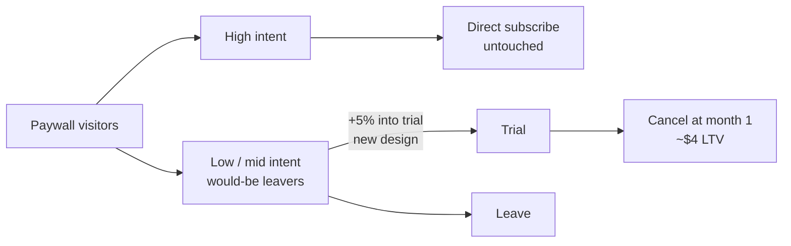

# نوشته‌ی ۶۷: شرکت Flo Health: «uplift صفر» واقعاً یعنی چه

[نوشته‌ی ۶۶: دو cohort، یک دوره‌ی payback، دو سرمایه‌گذاری کاملاً متفاوت →](66-two-cohorts-same-payback-different-investments.md) · [مجموعه](../README.md) · [نوشته‌ی ۶۸: چرا streak در Duolingo کار می‌کند، در چهار پرسش ←](68-why-duolingo-streaks-work-in-four-questions.md)

> **مقاله‌ی اصلی:** [Flo Health: What “zero uplift” really means](https://medium.com/@paul.levchuk/flo-health-what-zero-uplift-really-means-31b01b6b19b6) · Medium، ۲۰۲۶-۰۵-۲۳

## خلاصه

شرکت Flo Health باید toggle آزمایش رایگان اشتراکش را، که بی‌سروصدا حدود ۱۵٪ درآمد جدید را می‌ساخت، پیش از مهلت Apple جایگزین می‌کرد؛ تنها شاهد ارزشش نموداری پنج‌ساله بود. آزمایش «uplift صفر» برگرداند و تیم آن را برد نامید. درست هم بود، ولی کنار آن صفر عدد دومی نشسته بود: ثبت‌نام آزمایشی *بیشتر*، بی‌آسیب به مسیر خرید مستقیم. ثبت‌نام بیشتر، پول بیشتر نه. نویسنده دنیایی شبیه‌سازی‌شده می‌سازد که با واقعیت‌های گزارش‌شده‌ی Flo جور است و شش گام تحلیلی را رویش اجرا می‌کند: عدد غیرقابل‌اعتماد را رد کن، به عددی قابل‌اعتماد برس، برچسب‌هایی را که فقط هم‌بسته‌اند از ویژگی‌هایی که علت‌اند جدا کن، آنچه واقعاً حرکت کرد را تجزیه کن، بلندمدت را بیازما، و فقط بعد تصمیم بگیر. سازوکارها واقعی‌اند و اندازه‌ها مال نویسنده.

## نکته‌های کلیدی

- **عدد مشهور را رد کنید.** «۲۰٪ افزایش LTV» از ۲۰۲۱ مقایسه‌ی قبل و بعد است؛ حدود ۶۲٪ آن فقط ترکیب پولدارتر مخاطب است، چون سهم Organic از ۳۰٪ به ۴۸٪ رسید و Paid از ۵۰٪ به ۳۲٪ افتاد.
- **گروه holdout عدد قابل‌اعتماد می‌دهد.** گروه تصادفی با toggle روشن ۱٫۳۹ و خاموش ۱٫۲۳ درآمد به ازای کاربر دارد: ارزش toggle حدود ۱۳٪+.
- **«آزمایش را برداشت» نشانگر است نه اهرم.** IV آن از ۰٫۱۵۳ به ۰٫۰۳۳ می‌افتد وقتی قصد پیش از paywall را کنترل کنید؛ فقط ۲۱٪ می‌ماند، زیر آستانه‌ی ۷۰٪.
- **تبدیل بالا، پول تخت.** تبدیل ۳٪+ با بازه‌ی [۲٫۲٪+، ۳٫۷٪+]؛ ارزش هر کاربر ۰٫۳٪+ با بازه‌ی [۰٫۹٪−، ۱٫۴٪+]، و در آزمون واقع‌بینانه‌ی ۵۰ هزار نفره [۴٫۰٪−، ۱٫۶٪+] که زیان را رد نمی‌کند.
- **سود به محتاط‌ترین‌ها رسید.** افزایش تبدیل از ۰٫۶− واحد برای مصمم‌ترین کاربران تا ۱٫۸+ واحد برای محتاط‌ترین‌هاست؛ ۷۹٪ افت ارزش هر تبدیل‌شده از ترکیب است.
- **نرخ retention یکسان، شکل متفاوت.** در ماه ۱۲، ۲۲٪ در برابر ۲۳٪؛ ولی شکاف عمدتاً ماندگاری است، ۴۰٪ ترکیب و ۶۰٪ ساختاری، و بزرگ‌ترین شکاف ماه اول در پرتگاه پایان آزمایش است.
- **قاعده:** بر اساس این‌که کاربران پیش از paywall که بودند برش بزنید، هرگز بر اساس کاری که طراحی جدید وادارشان کرد.

## فهرست بخش‌ها

- عددی را که همه به آن اعتماد دارند دور بیندازید
- درست اندازه بگیرید: holdout
- چرا چهار نوع کاربر نمی‌توانند آزمون را نمره بدهند
- ثبت‌نام بیشتر، پول بیشتر نه
- نرخ retention سرخط یکسان، شکل متفاوت
- با نتیجه‌ی تخت واقعاً چه کنیم
- اعتبار و محدودیت‌ها

## یادداشت‌ها

نویسنده نتیجه‌ای مثل این را همیشه یک‌جور می‌خواند و برای صادق ماندن، مراحل را فقط *توصیف* نکرده: دنیایی را بازسازی کرده که با واقعیت‌های گزارش‌شده‌ی Flo جور است (۵٪+ به آزمایش و مسیر مستقیم دست‌نخورده) و هر گام را رویش *اجرا* کرده. هر عدد زیر خروجی روش است، نه داده‌ی Flo. شبیه‌سازی حدود ۳۰۰ هزار کاربر در هر بازو دارد، با seed ثابت، و هر کاربر یک امتیاز پنهان «قاطعیت» دارد که پیش از paywall تعیین شده است.

**۱. عددی را که همه به آن اعتماد دارند دور بیندازید.** تمام اعتبار toggle روی یک آمار ۲۰۲۱ است: «LTV را حدود ۲۰٪ بالا برد». همین عدد آن را ارزش محافظت کرد و اولین عددی است که باید دور انداخت. مشکل: مقایسه‌ی قبل و بعد پنج سال پیش است، ارزش هر کاربر با toggle در برابر پیش از آن. ولی در پنج سال *همه‌چیز دیگر* هم حرکت کرد: کدام کانال‌ها را خریدید، در کدام کشورها بودید، چقدر قیمت گذاشتید. پس «بعد» بالاتر ممکن است فقط یعنی مخاطب پرارزش‌تری وارد شد و toggle هیچ کاری نکرد. نویسنده شکاف را به دو پرسش می‌شکند: چه مقدار از *ترکیب متفاوت کاربران* آمد (ترکیبی) و چه مقدار از *تغییر واقعی* در رفتار کاربران (ساختاری)؟ روش برای هر کانال دو چیز می‌پرسد: سهمش از مخاطب حرکت کرد؟ ارزش هر کاربرش حرکت کرد؟ و دو اثر را جدا جمع می‌زند.

| کانال | سهم کاربران | ارزش هر کاربر |
|---|---|---|
| Organic، پرارزش | ۳۰٪ ← ۴۸٪ | ۱٫۸۹ ← ۲٫۰۳ دلار |
| Paid، کم‌ارزش | ۵۰٪ ← ۳۲٪ | ۰٫۹۸ ← ۱٫۰۴ دلار |
| Search | ۲۰٪ ← ۲۰٪ | ۱٫۳۴ ← ۱٫۴۰ دلار |
| آمیخته | | ۱٫۳۲ ← ۱٫۵۹ دلار، ۲۰٪+ |

ستون سهم داستان واقعی را نشان می‌دهد: کانال پرارزش از ۳۰٪ به ۴۸٪ رسید و کانال کم‌ارزش از ۵۰٪ به ۳۲٪ فروریخت. مخاطب پولدارتری وارد شد و همین جابه‌جایی ترکیب به‌تنهایی حدود ۶۲٪ از ۲۰٪+ را توضیح می‌دهد (۱۲٫۵+ واحد). ارزش هر کاربر درون هر کانال هم چند درصد بالا رفت، که ۳۸٪ دیگر است (۷٫۵+ واحد)؛ ولی پخش در پنج سال، آن تکه هم کلافی از قیمت، محصول و بازار است، نه اثر تمیز toggle. دو بررسی شهودی درستی تقسیم را تأیید می‌کنند: با ثابت نگه داشتن هر کانال تبدیل به‌زحمت جابه‌جا می‌شود، و کانال جذب هم به *زمان ورود* کاربر و هم به *ارزشش* گره خورده، که دقیقاً قبل و بعد خام را مسموم می‌کند. پس ۲۰٪+ رد می‌شود، نه به معنای «غلط است» بلکه «آن‌قدر تمیز نیست که رویش برنامه‌ریزی کرد». نقلش نکنید و نگذارید تصمیم را لنگر بیندازد.

> **Try it:** [ترکیب یا رفتار؟](../widgets/67-mix-or-behaviour.html): سهم و ارزش کانال‌ها را ویرایش کنید و تکه‌ی ترکیبی و ساختاری تغییر را ببینید.

**۲. درست اندازه بگیرید: holdout.** بدون عدد بد، ارزش toggle را چطور بسنجیم؟ با آزمایشی که قبل و بعد هیچ‌وقت نبود، و Flo عملاً همین کار را کرد. «خاموشی» آن‌ها toggle را برای برشی از کاربران خاموش کرد و دید چه چیزی ناپدید شد. چون آن برش تصادفی است، مقایسه تمیز است: تنها تفاوت toggle است.

| گروه | درآمد جدید به ازای کاربر (شاخص) |
|---|---|
| toggle روشن | ۱٫۳۹ |
| toggle خاموش | ۱٫۲۳ |
| تفاوت | ۱۳٪+ |

پس toggle حدود ۱۳٪+ درآمد جدید می‌ارزد، نزدیک حدود ۱۵٪ گزارش‌شده‌ی Flo، و برخلاف ۲۰٪+ قابل‌اعتماد است چون تصادفی‌سازی مشکل ترکیب مخاطب را حذف می‌کند. هشداری که باید بلند گفت: این به پرسش *دیگری* جواب می‌دهد تا آزمون سرخط. toggle در برابر *هیچ* است (اگر حذفش کنید چه از دست می‌دهید)، نه پاپ‌آپ جدید در برابر toggle (طراحی جدید چه را عوض کرد). دو پرسش، دو عدد.

**۳. چرا چهار نوع کاربر نمی‌توانند آزمون را نمره بدهند.** Flo بازدیدکنندگان paywall را چهار گروه می‌کند: خروج سریع، مشترک سریع، تصمیم‌گیر سنجیده و گیرکرده. برای فهم کاربران و طراحی صفحه واقعاً مفیدند. گام وسوسه‌انگیز بعدی نمره دادن به آزمایش با آن‌هاست: «تصمیم‌گیرهای سنجیده زیر طراحی جدید بهتر عمل کردند؟» Flo این کار را نکرد و بررسی زیر نشان می‌دهد چرا نتیجه‌ی عکس می‌داد. پرسش واقعی: آیا برچسبی مثل «آزمایش را برداشت» *علت* مشترک پرارزش شدن است یا فقط *برچسبی* که همراهش سفر می‌کند؟ آزمون ساده است: قدرت پیش‌بینی برچسب را به‌تنهایی بسنجید، بعد دوباره پس از حساب کردن این‌که کاربر پیش از رسیدن به paywall چطور بود (چقدر آماده‌ی خرید). اگر بیشتر سیگنال همان قصد از پیش موجود بود که نشت می‌کرد، ناپدید می‌شود.

| سنجه | IV |
|---|---|
| IV حاشیه‌ای، سیگنال خام | ۰٫۱۵۳ |
| IV لایه‌بندی‌شده بر سیگنال پیش از paywall | ۰٫۰۳۳ |
| آستانه‌ی ۷۰٪ | ۰٫۱۰۷ |

فقط حدود یک‌پنجم سیگنال می‌ماند (۲۱٪)، خیلی زیر حدود ۷۰٪ که پیش از اعتماد لازم است؛ اهرم واقعی پس از کنترل قصد قبلی بیشتر قدرتش را نگه می‌دارد و نشانگر عمدتاً بخار می‌شود. پس برداشتن آزمایش **نشانگر** است (کاربر را *توصیف* می‌کند) نه **اهرم** (چیزی که با کشیدنش نتیجه حرکت کند). نشانه‌ی تمیزتری هم هست: این‌که کاربر در کدام گروه می‌افتد *به این بستگی دارد که کدام paywall را دید.* برچسبی که خودش خروجی آزمون است نمی‌تواند داور آزمون باشد؛ این دوری است. اگر این را نبینید در دام می‌افتید: همه‌ی آزمایش‌برداران را ردیف کنید و گروه طراحی جدید **حدود ۸٪ کم‌ارزش‌تر به ازای هر نفر** به نظر می‌رسد، انگار طراحی به مردم آسیب زد. نزد؛ فقط *ترکیب* دیگری حالا آزمایش برمی‌دارد (کاربران کم‌قصد بیشتر)، نه این‌که کسی کم‌ارزش‌تر شده باشد. نشانگرها توصیف می‌کنند، داوری نمی‌کنند. برای نمره دادن به طراحی گروه‌های تصادفی را مقایسه کنید.

**۴. ثبت‌نام بیشتر، پول بیشتر نه.** خود پارادوکس، در چهار حرکت.

*اول، سرخط.* تبدیل آزمایشی حدود ۵٪ بالا رفت. همه را که جمع بزنید تقسیم تمیزی است:

| متریک | تغییر در برابر طراحی قدیم | خوانش صادقانه |
|---|---|---|
| تبدیل، آزمون کامل | ۳٪+ با بازه‌ی [۲٫۲٪+، ۳٫۷٪+] | آشکارا بالا |
| ارزش هر کاربر، آزمون کامل | ۰٫۳٪+ با بازه‌ی [۰٫۹٪−، ۱٫۴٪+] | تخت؛ صفر را در بر می‌گیرد |
| ارزش هر کاربر، آزمون واقع‌بینانه‌ی ۵۰ هزار نفره | بازه‌ی [۴٫۰٪−، ۱٫۶٪+] | زیان را رد نمی‌کند |

بازه‌ی ارزش *پهن* است: حتی با توان کامل صفر را در بر می‌گیرد و با اندازه‌ی نمونه‌ی واقع‌بینانه می‌تواند ۴٪ زیان را پنهان کند. ارزش واقعاً پرنویز است (چند مشترک بلندعمر و موجی از ریزش سریع)، پس نویسنده ادعا نمی‌کند «تخت» *اثبات* شده. حرکت صادقانه گزارش بازه و خودداری از بیش‌خوانی است.

*دوم، ثبت‌نام‌های اضافه به چه کسی رسید؟* برش افزایش تبدیل بر اساس آمادگی پیش از paywall نشان می‌دهد یک‌طرفه است: از حدود **۰٫۶− واحد برای مصمم‌ترین کاربران تا ۱٫۸+ واحد برای محتاط‌ترین‌ها.** طراحی جدید دقیقاً به کسانی کمک کرد که کمترین احتمال خرید را داشتند، و همین دلیل مکانیکی این است که *شمار* بالا رفت و *پول* نه.

*سوم، ارزش را بر اساس چه برش بزنیم؟* پیش از تجزیه‌ی پول، *یک* ویژگی را که واقعاً ارزش را می‌راند انتخاب و هم‌شکل‌هایش را رها کنید. هر نامزد را دو جور بسنجید: چقدر به‌تنهایی ارزش را پیش‌بینی می‌کند (ربط)، و وقتی محرک اصلی را می‌دانید چه سیگنال *یکتایی* می‌افزاید (یکتایی). هر چه سیگنال یکتا ندارد تکراری است و حذف می‌شود. در شبیه‌سازی، سیگنال پیش از paywall با IV حاشیه‌ای حدود ۰٫۷۶ و IV خالص حدود ۰٫۵۹ تنها محرک اصلی است؛ sessions، کانال، سطح قیمت و جغرافیا IV خالص نزدیک صفر دارند و تکراری یا نویزند. پس ارزش را بر آمادگی پیش از paywall تجزیه می‌کنید، نه جانشین‌هایش.

*چهارم، پاسخ و آشتی.* به ازای هر *کاربر* ارزش تخت است (سرخط). به ازای هر *تبدیل‌شده* حدود ۱٪ پایین می‌رود؛ مشترک جدید متوسط کمی کم‌ارزش‌تر است. همان تجزیه‌ی گام ۱ را روی این افت بزنید و **۷۹٪ آن ترکیب است**: تبدیل‌شده‌های جدید به سمت افراد کم‌ارزش‌تر کج‌اند، در حالی که ارزش *درون* هر نوار آمادگی به‌زحمت حرکت می‌کند. دو واقعیت حالا جور می‌شوند: تبدیل‌شده‌ی بیشتر، هر کدام کمی کم‌ارزش‌تر، با برآیند ارزش تخت به ازای هر کاربر. پول تخت داستان ترکیب است، نه این‌که کسی کمتر بپردازد.

**۵. retention سرخط یکسان، شکل متفاوت.** برد در زمان دوام می‌آورد؟ در ماه دوازدهم مشترکان طراحی جدید تقریباً دقیقاً مثل قدیم مانده‌اند: ۲۲٪ در برابر ۲۳٪. پرونده بسته؟ نه کاملاً. «سطح یکسان» می‌تواند «شکل متفاوت» را پنهان کند و سه خوانش سریع تفاوت را بیرون می‌کشند.

- **خوانش ۱، churn یا خرج؟** ارزش عمر cohort مشترکان فقط حاصل‌ضرب دو چیز است: چقدر می‌مانند × وقتی هستند چقدر می‌پردازند. شکاف جدید و قدیم را این‌طور بشکنید و **به‌شدت سمت ماندگاری است**: خرج به ازای هر ماه فعال به‌زحمت حرکت می‌کند (حدود ۱٪)؛ cohort فقط زودتر می‌رود. مشکل retention است نه قیمت.
- **خوانش ۲، چه کسی یا چطور؟** شکاف retention را با همان ابزار ترکیب و تغییر واقعی گام ۱ تجزیه کنید: **حدود ۴۰٪ ترکیبی** (آمیزه‌ی کم‌قصدتر مشترکان) و **۶۰٪ ساختاری** (با قصد هم‌تراز، مشترکان جدید هنوز متفاوت رفتار می‌کنند). هر دو نیرو واقعی‌اند: پاپ‌آپ هم *چه کسی* مشترک می‌شود و هم *چطور رفتار می‌کند* را عوض کرد.
- **خوانش ۳، کجای سال؟** ماه به ماه بپرسید دو منحنی کجا بیشتر جدا می‌شوند. پاسخ درست در آغاز متمرکز است: **بزرگ‌ترین شکاف تک‌ماهه ماه اول است**، پرتگاه پایان آزمایش، جایی که cohort جدید آشکارا محتمل‌تر لغو می‌کند. تبدیل‌شده‌های اضافه‌ای که پاپ‌آپ کشید به‌طور نامتناسب همان لحظه‌ای که آزمایش صورت‌حساب می‌دهد می‌روند. این سازوکار پشت پول تخت گام ۴ است: ۵٪+ ثبت‌نام می‌کنند و در پرتگاه لغو می‌کنند، پس تقریباً چیزی نمی‌افزایند.

ریسک پیش رو مستقیم از این می‌آید. cohortی که لغوهایش را در پرتگاه آزمایش جلو انداخته هنوز به پرتگاه‌های *تمدید* نرسیده، و بازه‌ی واقع‌بینانه‌ی ارزش، [۴٫۰٪−، ۱٫۶٪+]، برای امن نامیدن خیلی پهن است. انضباط این است که retention این cohort و هزینه‌ی بازپرداخت و پشتیبانی‌اش را بپایید، که خط درآمد تخت نادیده‌اش می‌گیرد، و نتیجه را در افق payback دوباره بررسی کنید نه پنجره‌ی آزمایش.

**۶. با نتیجه‌ی تخت واقعاً چه کنیم.** پنج گام را کنار هم بگذارید و یک داستان بیرون می‌آید. طراحی جدید پیشنهاد آزمایش را غیرقابل‌ندیدن می‌کند، پس حالا به کاربرانی می‌رسد که در غیر این صورت بی‌هیچ درگیری‌ای دور می‌شدند، و چندتایی امتحانش می‌کنند. این ۵٪+ است و دلیل دست‌نخورده ماندن مسیر مستقیم: ثبت‌نام‌های اضافه از کسانی آمد که داشتند می‌رفتند، نه کسانی که به‌هرحال می‌پرداختند. هرگز واقعاً قانع نشده بودند، پس در پرتگاه پایان آزمایش لغو کردند. انتخاب دیدنی‌تر، ثبت‌نام بیشتر، تقریباً بی‌ارزش اضافه.

«بیشتر بکاوید» توصیه‌ی بی‌فایده‌ای است. نسخه‌ی منضبط دقیقاً همین ترتیب است، هر گام پرسشی با روشی که جوابش داد:

| گام | حرکت | خروجی این‌جا |
|---|---|---|
| ۱ | عددی را که نمی‌شود به آن اعتماد کرد رد کن | ۶۲٪ از ۲۰٪+ فقط مخاطب پولدارتر بود |
| ۲ | به عددی برس که می‌شود | holdout: ارزش toggle حدود ۱۳٪+ |
| ۳ | بر ویژگی نمره بده، نه رفتار روی paywall | «آزمایش را برداشت» نشانگر است (۲۱٪ می‌ماند) |
| ۴ | ترکیب را از کیفیت جدا کن | ۷۹٪ افت ارزش، این است که چه کسی تبدیل می‌شود |
| ۵ | بلندمدت را بیازما | retention در ۱۲ ماه می‌ماند ولی churn را در پرتگاه جلو می‌اندازد |
| ۶ | بعد تصمیم بگیر | تخت درون پنجره واقعی است؛ پیش از حساب کردنش رو به جلو تأیید کن |

قاعده‌ی زیر همه‌ی این‌ها: **بر اساس این‌که کاربران پیش از paywall که بودند برش بزنید، هرگز بر اساس کاری که طراحی جدید وادارشان کرد.** هر خوانش واقعی این‌جا از رعایت آن آمد و هر سراب از شکستنش. درس قابل‌حمل فراتر از این پرونده: انتخابی را دیدنی‌تر کنید و کسانی را می‌کشید که پیش‌تر انتخاب نمی‌کردند، اغلب کم‌ارزش‌ترین کاربرانتان. ثبت‌نام‌های جدید را بشمارید، فقط تا ندانید کیستند رویشان حساب نکنید.

**اعتبار و محدودیت‌ها.** هیچ‌کدام از این‌ها نقد تیم Flo نیست، برعکس. عدد آسان را دور انداختند، toggle را با holdout اندازه گرفتند، آزمون جایگزینی کنترل‌شده اجرا کردند، درآمد را تا افق payback دنبال کردند و بررسی کردند مسیر مستقیم بماند. الگوی ۵٪+ با ارزش تخت مشاهده‌ی خود آن‌هاست؛ چارچوب فقط حرکت‌ها را نام می‌برد و بررسی‌هایی را اجرا می‌کند که گزارش آن‌ها نیاورده بود. پرونده‌های قوی و تمیز جایی‌اند که چارچوب تشخیصی کمترین چیز را می‌افزاید، و دقیقاً به همین دلیل انتشارش ارزش دارد: روشی که همیشه شلیک کند به نظر می‌رسد مشکل را بنا به ساختارش پیدا می‌کند. سه محاسبه بار اصلی را می‌کشند:

- **تقسیم ترکیبی و ساختاری** (۲۰٪+ در گام ۱ و افت ارزش در گام ۴): برای هر بخش، ترکیبی = جابه‌جایی سهم × ارزش قدیم؛ ساختاری = جابه‌جایی ارزش × سهم جدید.
- **گروه holdout** (گام ۲): میانگین درآمد گروه تصادفی toggle روشن منهای خاموش؛ تنها عدد تمیز علّی.
- **آزمون نشانگر** (گام ۳): قدرت سیگنال به‌تنهایی، و دوباره پس از کنترل قصد پیش از paywall؛ آنچه می‌ماند می‌گوید علت است یا فقط برچسب.

> **In practice:** گروه holdout را باید پیش از آزمایش در جدول Silver تخصیص ثبت کرد تا بعداً قابل بازسازی باشد؛ uplift و ترکیب ثبت‌نام را از همان جدول حساب کنید.
>
> **Your turn:** آزمایش uplift صفر برگردانده و تیم آن را شکست می‌داند. چه چیزی را کنار آن عدد بررسی می‌کنید؟
>
> *Answer:* تغییر ترکیب و شکل retention؛ در مثال نویسنده ثبت‌نام بیشتر شد بی‌آن‌که پول بیشتر شود، و نتیجه‌ی تخت خودش اطلاعات است (بخش «با نتیجه‌ی تخت واقعاً چه کنیم»).

## پیوندها

- **بر پایه‌ی:** [فصل ۶۲](62-stop-decomposing-metric-tree.md) که IV/WOE و دام ترکیب را معرفی می‌کند، و [فصل ۵۹](59-your-day-2-paywall-is-burning-your-best-future-customers.md) که paywall روز دوم و سنخ‌های ثبت‌نام‌کننده را می‌سنجد.
- **ادامه در:** [فصل ۷۱](71-split-a-churn-spike-lmdi.md) که تجزیه‌ی ترکیبی و ساختاری را با LMDI دقیق و بدون باقیمانده می‌کند.
- **همان ایده در:** [فصل ۳۷](37-blended-retention-vs-cohort-retention.md) که retention مخلوط را از retention هر cohort جدا می‌کند، و [فصل ۶۶](66-two-cohorts-same-payback-different-investments.md) که در آن هم سرخط یکسان دو واقعیت متفاوت را می‌پوشاند.

## خودتان را بسنجید

*پرسش‌ها و پاسخ‌ها مال vault است.*

1. **چرا «۲۰٪ افزایش LTV» از ۲۰۲۱ نباید تصمیم را لنگر بیندازد؟**
   - [x] چون حدود ۶۲٪ آن جابه‌جایی ترکیب کانال‌هاست، نه اثر toggle.
   - [ ] چون عدد غلط حساب شده.
   - [ ] چون toggle هیچ ارزشی ندارد.

   *Answer:* سهم Organic از ۳۰٪ به ۴۸٪ رسید و قبل و بعد خام ترکیب را از رفتار جدا نمی‌کند (بخش «عددی را که همه به آن اعتماد دارند دور بیندازید»).

2. **چرا گروه آزمایش‌برداران طراحی جدید ۸٪ کم‌ارزش‌تر به نظر می‌رسد، با آن‌که کسی کمتر نپرداخته؟**

   *Answer:* چون «آزمایش را برداشت» خودش خروجی آزمون است و حالا ترکیب کم‌قصدتری آن را برمی‌دارد؛ نشانگر است، نه داور (بخش «چرا چهار نوع کاربر نمی‌توانند آزمون را نمره بدهند»).

3. **ارزش هر تبدیل‌شده ۱٪ افتاد. چه سهمی از آن ترکیب است؟**

   *Answer:* ۷۹٪؛ تبدیل‌شده‌های جدید کم‌ارزش‌ترند و ارزش درون هر نوار آمادگی ثابت می‌ماند (بخش «ثبت‌نام بیشتر، پول بیشتر نه»).

4. **نرخ retention ماه ۱۲ تقریباً برابر است. چرا هنوز باید این cohort را پایید؟**

   *Answer:* چون churn را در پرتگاه ماه اول جلو انداخته، هنوز به پرتگاه تمدید نرسیده و بازه‌ی ارزش [۴٫۰٪−، ۱٫۶٪+] پهن است (بخش «نرخ retention سرخط یکسان، شکل متفاوت»).
