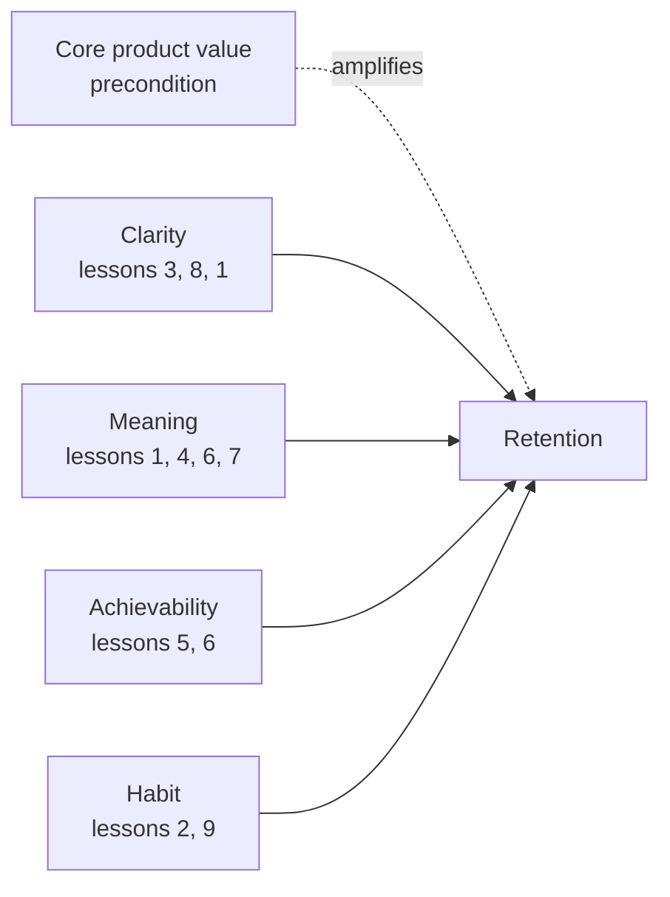
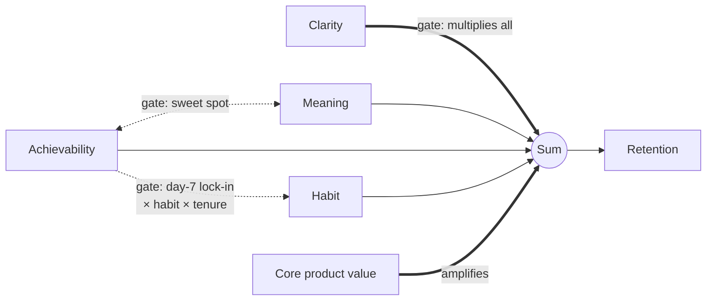

# نوشته‌ی ۶۸: چرا streak در Duolingo کار می‌کند، در چهار پرسش

[نوشته‌ی ۶۷: شرکت Flo Health: «uplift صفر» واقعاً یعنی چه →](67-flo-health-what-zero-uplift-really-means.md) · [مجموعه](../README.md) · [نوشته‌ی ۶۹: در Duolingo، streak عدد نیست بلکه چرخه‌ی عمر است ←](69-a-streak-is-a-lifecycle.md)

> **مقاله‌ی اصلی:** [Why Duolingo Streaks Work, in Four Questions](https://medium.com/@paul.levchuk/why-duolingo-streaks-work-in-four-questions-36703246d279) · Medium، ۲۰۲۶-۰۵-۳۰

## خلاصه

بپرسید چرا مردم streak در Duolingo را زنده نگه می‌دارند و وسوسه فوری است: همه‌چیز را رسم کن، هر اهرم و هر پیکان، همه رو به retention. نویسنده آن نمودار را ساخت و بیشتر تلاشش را صرف فروریختنش کرد؛ آنچه ماند جالب است دقیقاً چون ادعای کمی دارد. کار سه گام داشت و ترتیب نکته‌ی اصلی است: اول درس‌هایی که تیم Duolingo گفته بود را نوشت، بعد آن‌ها را به چند پرسش زیربنایی فشرد، و فقط بعد پرسید پاسخ‌ها چطور به هم جفت می‌شوند. نتیجه تقریباً به‌طرز شرم‌آوری کوچک است: چهار پرسش درباره‌ی هر کاربر (روشنی، معنا، دست‌یافتنی بودن و عادت) روی یک پیش‌شرط یعنی ارزش هسته‌ای محصول، و سه جا که پاسخ‌ها به هم وابسته‌اند.

## نکته‌های کلیدی

- **ده درس، چهار پرسش.** ده مشاهده‌ی تیم retention در Duolingo در چهار عامل فشرده می‌شوند: روشنی، معنا، دست‌یافتنی بودن و عادت؛ همه زیر پیش‌شرط ارزش هسته‌ای محصول.
- **فشرده‌سازی کار اصلی است.** هر تاکتیکی که Duolingo توصیف کرد راهی برای چرخاندن یکی از این چهار دکمه است.
- **نه جمع خالص، نه ضرب خالص.** ضرب کامل یعنی کاربر عادت‌کرده با افت ارزش یک روز فوراً برنمی‌گردد، که غلط است؛ جمع خالص نقطه‌ی بهینه‌ی انعطاف و پیش‌شرط فهم را نمی‌گیرد.
- **مدل ترکیبی: ستون جمعی با سه دروازه.** روشنی همه‌چیز را دروازه می‌کند؛ دست‌یافتنی بودن و معنا یکدیگر را؛ و قفل روز هفتم که دست‌یافتنی بودن، عادت و مدت حضور را فقط با هم بازده می‌دهد.
- **سه خطای رایج:** بیش‌وزن دادن به یک عامل، اشتباه گرفتن پیش‌شرط با اهرم، و تنظیم جداگانه‌ی عامل‌هایی که فقط با هم کار می‌کنند.
- **فرضیه است نه نتیجه.** همه از یک منبع دست‌دوم می‌آید؛ ارزشش این است که می‌گوید دقیقاً چه چیزی را بیازمایید.

## فهرست بخش‌ها

- با آنچه تیم توصیف کرد شروع کنید
- ده درس، چهار پرسش
- چهار عامل چطور ترکیب می‌شوند
- این مدل کجا به کار می‌آید
- فرضیه، نه نتیجه

## یادداشت‌ها

**با آنچه تیم توصیف کرد شروع کنید.** ماده‌ی خام یک [قسمت](https://www.youtube.com/watch?v=_CCwoQZH5hI) از Lenny's Podcast با Jackson Shuttleworth، مدیر محصول گروه retention در Duolingo است. یک احتیاط که نویسنده در سراسر نگه می‌دارد: همه‌ی آنچه می‌آید تجربه‌ی *گزارش‌شده*‌ی Duolingo از یک گفت‌وگوی عمومی است، تیمی که آزمایش‌های خودش را توصیف می‌کند، نه چیزی که نویسنده سنجیده باشد. حدود ده ایده مدام تکرار می‌شد:

1. واحدی که می‌شمارید بزرگ‌ترین تصمیم است: یک درس تمام‌شده در روز، نه یک لمس جزئی. اگر میله را خیلی پایین بگذارید کاربرانی را جذب می‌کنید که اهمیتی نمی‌دهند و streak دیگر معنایی ندارد.
2. هفته‌ی اول تعیین‌کننده است. بزرگ‌ترین افت از روز اول به دوم است و بیشتر طراحی برای این است که کاربر را تا جایی ببرد که عادت خودش نگه دارد.
3. روشنی اهرم retention است: توضیح روشن‌تر سازوکار بنا به گزارش ده‌ها هزار کاربر فعال روزانه افزود.
4. انتخاب آگاهانه از سختی تحمیلی بهتر است: اجازه دادن به کاربر برای تعهد به هدف، با راه خروج آسان، بهتر از گذاشتن بی‌صدای هدف سخت‌تر است.
5. انعطاف نقطه‌ی بهینه دارد: دو streak freeze از یکی بهتر بود، سه تقریباً مثل دو، و بخشش بیش از حد عادت را فرسوده می‌کند.
6. نجات به‌دست‌آمده از نجات رایگان بهتر است: تلاشی که برای نجات streak صرف می‌شود همان چیزی است که معنایش را حفظ می‌کند.
7. از آن معنا محافظت کنید؛ ارزان کردن streak دری یک‌طرفه است.
8. سادگی اجباری است: بنا به گزارش حتی تغییری برنده را کنار گذاشتند چون شلوغی می‌افزود.
9. یادآورها با رفتار خود کاربر زمان‌بندی می‌شوند، نه ساعت ثابت.
10. سازوکار streak محصولی را که ارزش بازگشت دارد تقویت می‌کند؛ دلیل بازگشت را نمی‌سازد.

ده مشاهده، مفید، ولی فهرست مدل نیست. حرکت بعدی همان است که فولکلور محصول را به چیزی تبدیل می‌کند که می‌شود درباره‌اش استدلال کرد.

**ده درس، چهار پرسش.** به فهرست خیره شوید و آیتم‌ها دیگر مستقل به نظر نمی‌رسند. در مجموعه‌ی خیلی کوچک‌تری از پرسش‌ها فرو می‌ریزند که واقعاً درباره‌ی هر کاربر جدید می‌پرسید؛ وقتی مدلشان کنید، چهار عامل:

| عامل | پرسش | درس‌ها |
|---|---|---|
| روشنی | کاربر می‌فهمد streak چیست و چطور نگهش دارد؟ | ۳ و ۸ و بخشی از ۱ |
| معنا | streak چیزی ارزش محافظت دارد؟ | ۱، ۴، ۶ و ۷ |
| دست‌یافتنی بودن | واقع‌بینانه می‌تواند نگهش دارد و وقتی لغزید برگردد؟ | ۵ و ۶ |
| عادت | رفتار در حال خودکار شدن است؟ | ۲ و ۹ |
| پیش‌شرط: ارزش هسته‌ای محصول | اصلاً چیزی برای برگشتن هست؟ | ۱۰ |

این فشرده‌سازی کار واقعی است. ده چیزی که تیمی می‌بیند را می‌گیرد و می‌گوید: زیر آن، فقط چهار دکمه را می‌چرخانید، روی محصولی که یا بازگشت را به دست می‌آورد یا نه. هر تاکتیکی که Duolingo توصیف کرد راهی برای حرکت دادن یکی از این چهار است. وقتی retention را روشنی، معنا، دست‌یافتنی بودن و عادت ببینید، تقویت‌شده با ارزش هسته‌ای محصول، بالاخره چیزی دارید که می‌شود درباره‌اش پرسش ساختاری پرسید.

**چهار عامل چطور ترکیب می‌شوند.** پرسش ساختاری را ساده می‌شود گفت و آسان می‌شود غلط جواب داد: این چهار عامل فقط *جمع* می‌شوند، یا بعضی یکدیگر را *دروازه* می‌کنند، یعنی یکی دیگری را روشن یا خاموش می‌کند؟

تلاش اول نویسنده فرض کرد همه ضرب می‌شوند، هر عامل هر عامل دیگر را مقیاس می‌دهد. دقیق به نظر می‌رسید و به شکلی مفید غلط بود: لازمه‌اش این بود که کاربر عمیقاً عادت‌کرده لحظه‌ای که ارزش افت کند برنگردد، انگار کل چیز با افت یک دکمه فرو می‌ریزد. عادت این‌طور کار نمی‌کند؛ مردم حتی وقتی ارزش یک روز کم است با تکانه برمی‌گردند. پس به قطب مقابل رفت: مدل جمعی تمیز که هر عامل جداگانه سهم می‌دهد و سهم‌ها جمع می‌شوند. همان چیزی که بیشتر تحلیل‌ها بی‌صدا فرض می‌کنند، ساده و خوانا، ولی دو چیزی را که درس‌ها واقعی می‌دانستند صاف می‌کند. نقطه‌ی بهینه‌ی انعطاف را نمی‌گیرد، تپه‌ای که در آن کمی بخشش کمک می‌کند و زیادش آسیب، چون یک جمله‌ی جمعی شیب است نه تپه. و پیش‌شرط فهم را نمی‌گیرد، چون جمع اجازه می‌دهد عامل‌های دیگر حتی برای کاربرانی که اصلاً streak را نمی‌فهمند «کار کنند». بده‌بستان در یک جمله: جمع خالص ساده‌ترین و کم‌اعتمادترین مدل است، درست همان‌جا که رفتار جالب زندگی می‌کند؛ ضرب خالص وابستگی را همه‌جا می‌گیرد، از جمله جاهایی که نیست، و این آن را بیش‌برازش و شکننده می‌کند.

مدلی که ماند سازش است: **در بیشتر جاها جمعی**، با **سه دروازه**، سه جا که یک عامل در دیگری ضرب می‌شود به‌جای جمع شدن، هر کدام گره خورده به سازوکاری که درس‌ها واقعاً نشان دادند:

- **روشنی همه‌چیز را دروازه می‌کند.** اگر کاربران streak را نفهمند، اثر هر عامل دیگر به سمت صفر می‌رود. روشنی فقط به retention اضافه نمی‌شود؛ عامل‌های دیگر را روشن می‌کند.
- **دست‌یافتنی بودن و معنا یکدیگر را دروازه می‌کنند.** بخشش دست‌یافتنی بودن را بالا می‌برد و معنا را فرسوده می‌کند، پس با هم نقطه‌ی بهینه می‌سازند: تا جایی مفید، پس از آن مخرب.
- **قفل روز هفتم.** دست‌یافتنی بودن، عادت و مدت حضور فقط در ترکیب و در آن هفته‌ی اول شکننده بازده می‌دهند.

بقیه جمعی می‌ماند. انضباط، یعنی *هر جا می‌توانی جمع کن و فقط جایی ضرب کن که شاهد وادارت کند*، کل نکته است: سازشی بین مدلی آن‌قدر ساده که بشود با آن استدلال کرد و آن‌قدر وفادار که سه جایی را که رفتار واقعاً خم می‌شود بگیرد.

> **Try it:** [دروازه، جمع، برهم‌کنش](../widgets/70-gate-sum-interaction.html): سه قاعده‌ی ترکیب را کنار هم ببینید؛ دروازه‌ی روشنی و شمار نیروها را تنظیم کنید.

**این مدل کجا به کار می‌آید.** هدف درست کردن ساختار ظرافت نیست؛ این است که ساختار نشان می‌دهد تیم‌ها کجا مطمئناً اشتباه می‌کنند، و بیشتر این اشتباه‌ها از برخورد با این چهار به‌عنوان فهرست تخت دکمه‌هایی برای بیشتر چرخاندن می‌آید.

- **بیش‌وزن دادن به یک عامل.** نویسندگان متن عاشق روشنی می‌شوند، تیم‌های رشد عاشق یادآور، طراحان عاشق انیمیشن پاداش؛ هر کدام عامل محبوبش را کل موتور می‌داند. مدل چیز دیگری می‌گوید: بیشتر عامل‌ها با مقدارهای متوسط جمع می‌شوند، و وقتی اهرمی به بقیه وابسته شد، تنها بالا بردنش چیز زیادی نمی‌خرد. بردهای واقعی از ساختار آمد، یعنی واحد، پیش‌شرط و نقطه‌ی بهینه، نه از به حداکثر رساندن یک دکمه.
- **اشتباه گرفتن پیش‌شرط با اهرم.** روشنی مثال آشکار است. شبیه عامل دیگری به نظر می‌رسد که می‌شود معامله‌اش کرد، کمی روشنی بیشتر این‌جا، کمی ارزش بیشتر آن‌جا. ولی دکمه نیست؛ دروازه است و بالادست همه‌چیز می‌نشیند. اگر کاربران streak را نفهمند، ارزش بیشتر و یادآور بیشتر تقریباً در صفر ضرب می‌شوند. نمی‌شود با خرج کردن روی عامل‌های دیگر دور سردرگمی را خرید. فهم ورودی‌ای است که بقیه به آن وابسته‌اند؛ اول درستش کنید وگرنه هیچ چیز پایین‌دستی نمی‌نشیند.
- **تنظیم جداگانه‌ی عامل‌هایی که فقط با هم کار می‌کنند.** انعطاف دام است. streak freeze به‌تنهایی خوب یا بد نیست؛ فقط در ترکیب با این‌که streak معنایی دارد یا نه کارش را می‌کند. به streakی که وزنی ندارد بخشش بیفزایید و فقط عددی بی‌معنا را آسان‌تر نگه‌داشتنی کرده‌اید. قفل اوایل هفته هم همین است: دست‌یافتنی بودن، عادت و زمان‌بندی فقط با هم بازده می‌دهند. هر کدام را جدا بیازمایید و نویز می‌سنجید و درس غلط می‌گیرید.

خوانده‌شده به‌عنوان چک‌لیست تخت، آن ده درس هر سه اشتباه را دعوت می‌کنند. خوانده‌شده به‌عنوان چهار پرسش با سه دروازه بینشان، خود ساختار از آن‌ها برحذرتان می‌دارد.

**فرضیه، نه نتیجه.** احتیاطی که نویسنده دفن نمی‌کند: این مدل است، نه اندازه‌گیری. همه‌چیز به یک تیم برمی‌گردد که تجربه‌ی خودش را توصیف می‌کند؛ منبعی قوی ولی تنها و دست‌دوم. وضعیت صادقانه *آزمودنی* است، نه *اثبات‌شده*. ارزشش هم همین‌جاست. فهرست تخت بهترین روش‌ها چیزی برای آزمودن نمی‌دهد؛ مدل ساختاریافته دقیقاً می‌گوید چه چیزی را اجرا کنید: بیش از یک اهرم را هم‌زمان عوض کنید، چند سطح انعطاف را به‌جای روشن و خاموش بیازمایید، و ببینید آیا آن سه دروازه واقعاً تنها جاهایی‌اند که عامل‌ها خم می‌شوند. تا آن موقع نمودار را نقشه‌ی کاری برای تصمیم درباره‌ی آزمون بعدی بدانید، نه ادعای این‌که سرزمین نقشه‌برداری شده است.

> **In practice:** پیش از ساختن داشبورد streak، چهار پرسش نویسنده را به چهار سنجه‌ی مشخص در Gold تبدیل کنید و فرضیه بودنشان را در توضیح داشبورد بنویسید.
>
> **Your turn:** تیم می‌خواهد همه‌ی اهرم‌های streak را روی یک نمودار رو به retention بکشد. چه پیشنهادی دارید؟
>
> *Answer:* اول درس‌ها را به چند پرسش زیربنایی بفشرید و بعد وابستگی‌ها را بسنجید؛ نتیجه یک فرضیه است، نه نتیجه‌ی ثابت‌شده (بخش «فرضیه، نه نتیجه»).

## پیوندها

- **بر پایه‌ی:** [فصل ۲۹](29-user-engagement-introduction.md) و [فصل ۳۲](32-user-engagement-d1-retention.md) که درگیری کاربر و retention روز اول را می‌سازند، و [فصل ۷](07-what-is-the-impact-on-the-retention-rate.md) که اثر feature بر retention را می‌سنجد.
- **ادامه در:** [فصل ۶۹](69-a-streak-is-a-lifecycle.md) که همین مدل ایستا را به چرخه‌ی عمر در زمان تبدیل می‌کند، و [فصل ۷۰](70-getting-in-building-it-locking-in.md) که شکل‌گیری streak را با سه قاعده‌ی ترکیب شبیه‌سازی می‌کند.
- **همان ایده در:** [فصل ۵۹](59-your-day-2-paywall-is-burning-your-best-future-customers.md) که در آن هم انتخاب آگاهانه‌ی کاربر از فشار تحمیلی بهتر عمل می‌کند.

## خودتان را بسنجید

*پرسش‌ها و پاسخ‌ها مال vault است.*

1. **چرا مدل ضرب کامل برای streak غلط است؟**
   - [x] چون لازم می‌آورد کاربر عادت‌کرده با افت ارزش یک روز برنگردد.
   - [ ] چون خیلی ساده است.
   - [ ] چون روشنی را نادیده می‌گیرد.

   *Answer:* عادت با تکانه کار می‌کند؛ ضرب خالص وابستگی‌هایی می‌سازد که وجود ندارند (بخش «چهار عامل چطور ترکیب می‌شوند»).

2. **چرا روشنی پیش‌شرط است نه اهرم؟**

   *Answer:* چون اگر کاربر streak را نفهمد، ارزش و یادآور بیشتر تقریباً در صفر ضرب می‌شوند (بخش «این مدل کجا به کار می‌آید»).

3. **چرا آزمودن streak freeze به‌تنهایی درس غلط می‌دهد؟**

   *Answer:* چون دست‌یافتنی بودن و معنا یکدیگر را دروازه می‌کنند؛ بخشش فقط وقتی کار می‌کند که streak معنایی داشته باشد (بخش «این مدل کجا به کار می‌آید»).

4. **درس ۱۰ به کدام بخش مدل می‌رود؟**

   *Answer:* پیش‌شرط ارزش هسته‌ای محصول؛ streak دلیل بازگشت را تقویت می‌کند، نمی‌سازد (بخش «ده درس، چهار پرسش»).
