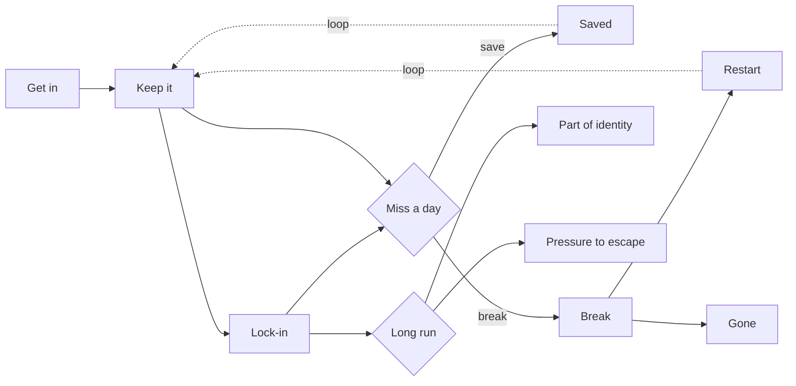

# نوشته‌ی ۶۹: در Duolingo، streak عدد نیست بلکه چرخه‌ی عمر است

[نوشته‌ی ۶۸: چرا streak در Duolingo کار می‌کند، در چهار پرسش →](68-why-duolingo-streaks-work-in-four-questions.md) · [مجموعه](../README.md) · [نوشته‌ی ۷۰: در Duolingo: ورود، ساختن، قفل شدن ←](70-getting-in-building-it-locking-in.md)

> **مقاله‌ی اصلی:** [Duolingo: A Streak Is Not a Number. It’s a Lifecycle.](https://medium.com/@paul.levchuk/duolingo-streak-is-not-a-number-its-a-lifecycle-d35913f2f274) · Medium، ۲۰۲۶-۰۶-۰۵

## خلاصه

سازوکار streak یکی از پرتقلیدترین featureهای نرم‌افزار مصرفی است: شمارنده‌ی کوچکی که هر روزی که می‌آیید یکی بالا می‌رود و روزی که نمی‌آیید صفر می‌شود؛ شعله‌ی Duolingo، آتش Snapchat، حلقه‌های بسته‌شونده‌ی ساعت. درباره‌اش مثل یک عدد حرف می‌زنیم و تیم‌های محصول هم همان‌طور می‌سنجندش، خطی که می‌خواهیم بالا و راست برود. ولی عدد خروجی است نه سازوکار. نویسنده می‌گوید streak را باید چرخه‌ی عمر دید: معنای یک عدد در مرحله‌های مختلف فرق می‌کند، نیروها در طول مسیر عوض می‌شوند، و streak حلقه است نه قیف. چرخه‌ی عمر از ورود، نگه داشتن و قفل شدن به لحظه‌ی خطر یک روز ازدست‌رفته می‌رسد، که یا نجات می‌یابد یا می‌شکند، و به بلندمدت، که یا بخشی از هویت می‌شود یا فشاری که می‌خواهید از آن فرار کنید. در هر مرحله کاربر *احساسی* را دنبال می‌کند و پلتفرم *عددی* را؛ مشکل وقتی است که عدد بی‌احساس بالا برود.

## نکته‌های کلیدی

- **عدد خروجی است، سازوکار نیست.** برای فهم این‌که streak چرا کار می‌کند و چرا گاهی بی‌صدا از کار می‌افتد، باید فرایند پشت عدد را دید.
- **سه دلیل برای چرخه‌ی عمر:** روز ۲ و روز ۲۰۰ یک شیء نیستند؛ نیرویی که شروع می‌کند همانی نیست که نگه می‌دارد یا برمی‌گرداند؛ و streak حلقه‌ای است که در هر دو جهت روی خودش بازخورد دارد.
- **واحد درست تحلیل** شمار streak نیست؛ مرحله و حرکت از یک مرحله به بعدی است.
- **دو نگاه در هر مرحله:** کاربر احساس را دنبال می‌کند (پیشرفت، هویت، آسودگی) و پلتفرم عدد را (DAU، retention، ارزش عمر).
- **نجات ظریف‌ترین اهرم است:** نجاتی که خیلی آسان باشد streakی را که قرار است حفظ کند ارزان می‌کند.
- **عکس و فیلم.** مدل علّی ایستای نوشته‌ی قبلی عکس سازوکار است؛ چرخه‌ی عمر همان مدل در حرکت است و فقط زمان را می‌افزاید.

## فهرست بخش‌ها

- چرا اصلاً به چرخه‌ی عمر فکر کنیم؟
- کل چرخه‌ی عمر
- همیشه دو نفر در اتاق‌اند
- عکس و فیلم
- این از کجا می‌آید و چه در پیش است

## یادداشت‌ها

**چرا اصلاً به چرخه‌ی عمر فکر کنیم؟** «چرخه‌ی عمر» نامیدن streak فقط برچسب مرتب‌تری نیست؛ ادعای این است که streak از نوع چیزهایی نیست که یک عدد بگیردشان. سه دلیل:

- **یک عدد در نقطه‌های مختلف معناهای مختلف دارد.** روز ۲ و روز ۲۰۰ هر دو «streak»‌اند، ولی در ذهن آدم یک شیء نیستند. یکی نیت تازه و شکننده است و دیگری بخشی از این‌که شخص خودش را چطور می‌بیند. یک رقم نمی‌تواند چیزی را نگه دارد که معنایش بسته به جای شما درونش عوض می‌شود.
- **نیروها در طول مسیر عوض می‌شوند.** آنچه کسی را به شروع وامی‌دارد همانی نیست که برش می‌گرداند، و آن همانی نیست که پس از لغزش دوباره می‌کشدش. پرسیدن «چه چیزی streak را می‌راند؟» به‌طور کلی پرسشی ناقص است. پاسخ صادقانه همیشه «بستگی دارد منظورت کدام مرحله است» است، و مدلی که مرحله را نادیده بگیرد روی تفاوت‌های واقعی میانگین می‌گیرد.
- **روی خودش بازخورد دارد.** streak قیف نیست. قیف خط یک‌طرفه است: مردم وارد می‌شوند، می‌افتند و چندتایی به آخر می‌رسند. streak حلقه است. هر روز نگه‌داشته روز بعد را محتمل‌تر می‌کند، که عادت را عمیق‌تر می‌کند، که باز نگهش می‌دارید. و حلقه در هر دو جهت می‌چرخد: شکستن می‌تواند انگیزه را با خودش ببرد، پس یک روز ازدست‌رفته دو روز می‌شود و بعد تمام. بازخورد و این نوع وابستگی به مسیر در عددی که بالا می‌رود دیده نمی‌شوند.

روی هم این‌ها می‌گویند واحد درست تحلیل شمار streak نیست؛ مرحله است و حرکت از یک مرحله به بعدی.

**کل چرخه‌ی عمر.** از ورود، از طریق نگه داشتن و قفل شدن، به لحظه‌ی خطر یک روز ازدست‌رفته می‌رسد، جایی که یا نجات داده می‌شود یا می‌شکند، و به بلندمدت، جایی که یا بخشی از هویت شما می‌شود یا فشاری که می‌خواهید از آن رها شوید. پیکان‌های خط‌چین حلقه‌اند: streak نگه‌داشته یا بازسازی‌شده به «نگه داشتن» برمی‌گردد. چرخه است، نه خط.

**همیشه دو نفر در اتاق‌اند.** در هر مرحله دو دیدگاه هست: آنچه *کاربر* تجربه می‌کند و آنچه *پلتفرم* می‌خواهد به دست بیاورد. بیشتر وقت‌ها هم‌جهت‌اند؛ جایی که از هم جدا می‌شوند جایی است که طراحی streak جالب و پرخطر می‌شود.

| مرحله | کاربر | پلتفرم |
|---|---|---|
| ورود | کنجکاوی، اولین برد کوچک، غافلگیری کوچک «اوه، حالا streak دارم» | فعال‌سازی؛ تبدیل بازدیدکننده به کسی که چیزی برای از دست دادن دارد |
| نگه داشتن | کشش ملایم روزانه، عددی که آرام بالا می‌رود، حس شتاب | درگیری روزانه؛ خط DAU که همه نگاهش می‌کنند |
| قفل شدن | دیگر تصمیم نیست و عادت می‌شود، حتی بخشی از هویت: «من کسی‌ام که هر روز تمرین می‌کند» | جایزه همین است؛ retentionی که دیگر نیاز به متقاعد کردن فعال ندارد |
| یک روز ازدست‌رفته، نجات | تکان «وای نه» و بعد انتخاب: تلاش یا پرداخت برای نجات، یا رها کردن | اهرم پیشگیری از churn (freeze و restore)؛ ولی ظریف، چون نجات خیلی آسان streakی را که باید محافظت کند ارزان می‌کند |
| شکستن | دلسردی، گاهی آسودگی، گاهی فقط پایان | retention ازدست‌رفته و مسئله‌ی فعال‌سازی دوباره |
| شروع دوباره | شروعی تازه، یا بی‌صدا تسلیم شدن | فرصت بازگرداندن |
| بلندمدت | یا streak بخشی از کیستی اوست یا فشار پس‌زمینه‌ای کم که می‌خواهد از زیرش بیرون بیاید | ارزش بلندمدت، یا کاربر فرسوده‌ای که از اپ دلخور می‌شود |

الگوی این فهرست را ببینید. کاربر *احساسی* را دنبال می‌کند: پیشرفت، هویت، آسودگی. پلتفرم *عددی* را: DAU، retention، ارزش عمر. وقتی احساس و عدد با هم حرکت می‌کنند همه می‌برند. وقتی جدا می‌شوند، وقتی عدد می‌تواند بی‌احساس بالا برود، دردسر می‌آید. این رشته‌ای است که زیر کل این مجموعه می‌دود.

**عکس و فیلم.** این چرخه‌ی عمر از هیچ نیامده. نویسنده در نوشته‌ی قبلی مدل *ایستای* همین سیستم را ساخت: نمودار علّی نیروهایی که streak را می‌رانند، این‌که چه چیزی مردم را برمی‌گرداند، نیروها چطور ترکیب می‌شوند، و کدام‌ها فقط جمع می‌شوند و کدام‌ها دیگران را دروازه یا خم می‌کنند. آن مدل به شکل مشخص خودش مفید است و پرسشی تیز را جواب می‌دهد: *اهرم کجاست و قطعه‌ها در یک لحظه چطور جفت می‌شوند؟* عکس سازوکار است، قطعه‌ها چیده و سیم‌کشی‌شده. ولی عکس محدودیتی در خودش دارد: نمی‌تواند حرکت نشان بدهد. چنین نموداری محور زمان ندارد و نمی‌تواند حلقه بکشد؛ بنا به ساختارش تصویر ثابت است. و streak تماماً حرکت است: دنباله‌ای در زمان که روی خودش خم می‌شود.

چرخه‌ی عمر همان مدل در حال اجراست، عکسی که فیلم شده. نیروها عوض نمی‌شوند؛ آنچه دیده می‌شود چیدمانشان در زمان است. عاملی که مدل ایستا پیش‌شرط نامیده بود دروازه‌ی «ورود» می‌شود. برهم‌کنشی که در هفته‌ی اول نشان داده بود مرحله‌ی «قفل شدن» می‌شود. اهرم شکننده‌ای که کمک می‌کند و بعد آسیب می‌زند لحظه‌ی «نجات» و دو حلقه‌اش می‌شود. چیزی افزوده نمی‌شود که در نیروها نبود؛ آنچه افزوده می‌شود زمان است. پس دو نما همراه‌اند، نه رقیب: نمودار ایستا دقت می‌دهد، یعنی قطعه‌ها و نحوه‌ی ترکیبشان؛ چرخه‌ی عمر مسیر می‌دهد، یعنی هر قطعه کی عمل می‌کند و کل چیز چطور حلقه می‌زند.

| مدل ایستا (نوشته‌ی قبلی) | چرخه‌ی عمر |
|---|---|
| پیش‌شرط روشنی | دروازه‌ی ورود |
| برهم‌کنش هفته‌ی اول | مرحله‌ی قفل شدن |
| اهرم انعطاف که کمک و بعد آسیب می‌کند | لحظه‌ی نجات و دو حلقه‌اش |

**این از کجا می‌آید و چه در پیش است.** نویسنده داده‌ی داخلی Duolingo را گزارش نمی‌کند و آن را ندارد. این چرخه‌ی عمر از درس‌هایی ساخته شده که [تیم آن‌ها علنی گفته‌اند](https://www.youtube.com/watch?v=_CCwoQZH5hI)، به‌علاوه‌ی تلاش خود نویسنده برای مدل کردن ساختار زیرین. آن را عدسی برای فکر کردن بدانید، نه واقعیت اثبات‌شده. نوشته‌های بعدی چرخه‌ی عمر را نه جعبه به جعبه، بلکه حول لحظه‌هایی که طراحی واقعاً در آن‌ها تصمیم گرفته می‌شود پیمایش می‌کنند:

- **این‌که streak چطور شکل می‌گیرد:** چرا فهم باید اول بیاید، چرا هیچ اهرم تنهایی کار را نمی‌کند، و چرا هفته‌ی اول مثل هیچ هفته‌ی دیگری رفتار نمی‌کند.
- **نجات:** جای عجیبی که آسان‌تر کردن می‌تواند بی‌ارزش کند و همان سازوکار می‌تواند کاربر را بالا یا پایین بچرخاند.
- **وقتی streak از کار می‌افتد:** چطور می‌شکند، مردم چطور برمی‌گردند، و چطور عددی که بالا می‌رود می‌تواند عددی را که پایین می‌رود پنهان کند.

> **In practice:** طول streak را به‌صورت توزیع بر حسب مرحله‌ی چرخه‌ی عمر در Gold نگه دارید، نه یک میانگین؛ لحظه‌ی خطر یعنی روز ازدست‌رفته باید رویداد جدایی باشد.
>
> **Your turn:** میانگین طول streak بالا می‌رود ولی retention نه. چه معنایی دارد؟
>
> *Answer:* عدد بی‌احساس بالا رفته؛ streak خروجی است نه سازوکار، و باید مرحله‌ی چرخه‌ی عمر کاربر را دید (بخش «همیشه دو نفر در اتاق‌اند»).

## پیوندها

- **بر پایه‌ی:** [فصل ۶۸](68-why-duolingo-streaks-work-in-four-questions.md) که مدل علّی ایستا با چهار عامل و سه دروازه را می‌سازد، و [فصل ۵۶](56-user-transition-states-diagram.md) که گذار بین وضعیت‌های کاربر را می‌شمارد.
- **ادامه در:** [فصل ۷۰](70-getting-in-building-it-locking-in.md) که مرحله‌های ورود، ساختن و قفل شدن را باز می‌کند.
- **همان ایده در:** [فصل ۵۲](52-rr-ff-matrices-introduction-to-customer-states.md) و [فصل ۵۳](53-customer-state-a-key-building-block-of-advanced-customer.md) که وضعیت مشتری را به‌جای یک عدد واحد تحلیل می‌گیرند.

## خودتان را بسنجید

*پرسش‌ها و پاسخ‌ها مال vault است.*

1. **چرا streak قیف نیست؟**
   - [ ] چون مرحله ندارد.
   - [x] چون حلقه است و روی خودش در هر دو جهت بازخورد دارد.
   - [ ] چون کاربران از آن نمی‌افتند.

   *Answer:* هر روز نگه‌داشته روز بعد را محتمل‌تر می‌کند و شکستن می‌تواند انگیزه را ببرد (بخش «چرا اصلاً به چرخه‌ی عمر فکر کنیم؟»).

2. **چرا نجات ظریف‌ترین اهرم پلتفرم است؟**

   *Answer:* چون نجات خیلی آسان همان streakی را که باید محافظت کند ارزان می‌کند (بخش «همیشه دو نفر در اتاق‌اند»).

3. **مدل ایستای نوشته‌ی قبلی چه چیزی را نمی‌تواند نشان بدهد که چرخه‌ی عمر نشان می‌دهد؟**

   *Answer:* حرکت و حلقه؛ نمودار ایستا محور زمان ندارد و چرخه‌ی عمر همان نیروها را در زمان می‌چیند (بخش «عکس و فیلم»).
