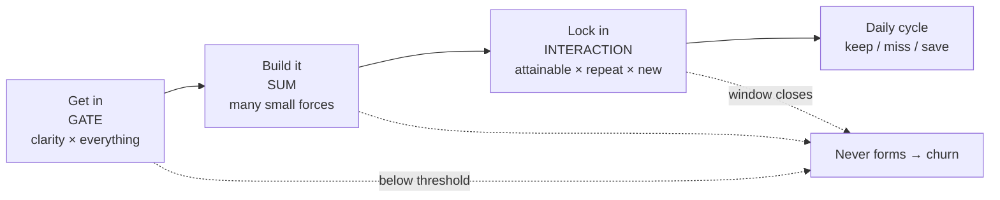

# نوشته‌ی ۷۰: در Duolingo: ورود، ساختن، قفل شدن

[نوشته‌ی ۶۹: در Duolingo، streak عدد نیست بلکه چرخه‌ی عمر است →](69-a-streak-is-a-lifecycle.md) · [مجموعه](../README.md) · [نوشته‌ی ۷۱: چطور جهش churn را به mix و rate بشکنیم ←](71-split-a-churn-spike-lmdi.md)

> **مقاله‌ی اصلی:** [Duolingo: Getting In, Building It, Locking In — How a Streak Becomes a Habit](https://medium.com/@paul.levchuk/duolingo-getting-in-building-it-locking-in-how-a-streak-becomes-a-habit-6617ca993fd0) · Medium، ۲۰۲۶-۰۶-۱۰

## خلاصه

بیشتر streakها جوان می‌میرند: نه در روز ۲۰۰ یا ۵۰، بلکه در هفته‌ی اول، اغلب در همان چند روز نخست، پیش از آن‌که عادتی فرصت شکل گرفتن داشته باشد. این نوشته لایه‌ی **شکل‌گیری** چرخه‌ی عمر streak را باز می‌کند، لایه‌ای که کاربر یک بار و در همان آغاز از آن می‌گذرد و سه حرکت دارد: **ورود**، **ساختن** و، اگر خوب پیش برود، **قفل شدن**. وسوسه این است که این سه را یک سراشیبی نرم ببینیم؛ ولی هر کدام با نوع دیگری از قاعده کار می‌کند. ورود یک **دروازه** است، ساختن یک **جمع** و قفل شدن یک **برهم‌کنش**. هر کدام را با کتاب‌قانون دیگری اداره کنید و تلاش را جای غلط می‌ریزید.

## نکته‌های کلیدی

- **روشنی دروازه است، نه پرداخت نهایی.** زیر آستانه‌ی فهم، هیچ چیزی که می‌سازید اصلاً روشن نمی‌شود؛ افزودن انگیزه روی سردرگمی فقط ضرب در صفر با رقم اعشار بیشتر است.
- **اهرم جادویی وجود ندارد.** بالای دروازه، بازگشت روزانه با نیروهای کوچک زیادی نگه داشته می‌شود که جمع می‌شوند؛ هیچ‌کدام غالب نیست و هیچ‌کدام را هم نمی‌شود رایگان از دست داد.
- **عادت سراشیبی نیست، کلیک است.** قفل شدن وقتی رخ می‌دهد که دست‌یافتنی بودن، تکرار و تازگی هم‌زمان برقرار باشند، ضرب‌شده نه جمع‌شده.
- **زانوی منحنی حدود یک هفته است.** چند روز کافی نیست؛ پس از حدود یک هفته روزهای اضافه کم می‌افزایند. جای زانو از سخنان علنی Duolingo وام گرفته شده و شکلش ادعای مدل است.
- **هفته‌ی اول مثل هفته‌ی دهم نیست.** همان freeze در هفته‌ی اول اثر بزرگی دارد و چند هفته بعد نزدیک صفر.
- **شکل‌گیری با شکست دوباره اجرا می‌شود.** بازگرداندن کاربر شکل‌گیری دوباره است با دروازه‌ی اولی که از قبل باز است.

## فهرست بخش‌ها

- ورود: روشنی دروازه است، نه پرداخت نهایی
- ساختن: اهرم جادویی نیست
- قفل شدن: عادت سراشیبی نیست، کلیک است
- شکل شکل‌گیری
- شکل‌گیری کجا به بقیه وصل می‌شود
- اگر یکی می‌سازید

## یادداشت‌ها

**سه حرکت، سه قاعده.** کلمه‌ای درباره‌ی حرکت وسط، چون باعث سردرگمی می‌شود. کنش روزانه هیچ‌وقت عوض نمی‌شود: یک درس در روز، همان کاری که در کل عمر streak می‌کنید. آنچه عوض می‌شود *کارکرد* آن است. در این روزهای اول دارید عادتی را *می‌سازید* که هنوز وجود ندارد؛ بعدتر، وقتی جا افتاد، دارید عادتی موجود را *نگه می‌دارید*. همان کنش، کار متفاوت؛ برای همین این مرحله «ساختن» است و چرخه‌ی تکرارشونده‌ی بعدی «نگه داشتن». چیزی را که شکل نگرفته نمی‌شود نگه داشت.

**ورود: روشنی دروازه است، نه پرداخت نهایی.** اولین چیزی که باید رخ بدهد به‌طرز شرم‌آوری پایه‌ای است: کاربر باید بفهمد streak چیست. نه این‌که از آن لذت ببرد یا انگیزه بگیرد؛ فقط بفهمد. چه چیزی نگهش می‌دارد، چه چیزی می‌شکندش، چه می‌گیرد، و کجای صفحه است. تیم‌ها معمولاً این روشنی را پرداخت نهایی می‌دانند، چیزی که اگر وقت ماند آخر کار مرتبش می‌کنند. این خطای مرکزی کل مرحله‌ی شکل‌گیری است و از مدل ذهنی غلطی از کارکرد روشنی می‌آید.

مدل درست این است: تقریباً هر چیزی که streak را برانگیزاننده می‌کند، حس پیشرفت، ترس از دست دادن، کشش کوچک روزانه، فقط وقتی کار می‌کند که کاربر از قبل سازوکار را فهمیده باشد. از دست دادن چیزی که نمی‌دانید دارید نمی‌ترساندتان. روی عددی که نمی‌توانید تفسیرش کنید حس پیشرفت نمی‌کنید. پس روشنی یک ماده کنار بقیه نیست؛ کلیدی است که بقیه را روشن می‌کند. در مدل پشت این مجموعه، روشنی مثل *دروازه* رفتار می‌کند: ضریبی که جلوی همه‌چیز نشسته. اگر فهم بالا باشد، نیروهای دیگر با تمام قدرت عبور می‌کنند؛ اگر پایین باشد، مهم نیست آن نیروها چقدر خوب‌اند، تقریباً تا صفر ضرب می‌شوند. سازوکار درخشان loss aversion ضربدر فهم صفر، صفر است.

برای همین روشنی پرداخت نیست. پرداخت جمعی است: کمی بیشتر، کمی بهتر. دروازه فرق دارد: زیر آستانه‌ای از فهم، *هیچ چیز دیگری که می‌سازید اصلاً شلیک نمی‌کند*. می‌شود هوشمندانه‌ترین featureهای streak دنیا را منتشر کرد و دید هیچ کاری نمی‌کنند، چون کاربران هرگز از خطی که آن featureها در آن خوانا می‌شوند رد نشدند. نمودار نویسنده همان کاربران شبیه‌سازی‌شده را زیر دو فرض نشان می‌دهد: دروازه یک منطقه‌ی مرده می‌گذارد که در آن پرداخت هیچ چیز را عوض نمی‌کند، و پرداخت از همان آغاز بالا می‌رود. این شبیه‌سازی مدل است، نه داده‌ی سنجیده.

در عمل این خودش را در کارهای ظاهراً کسل‌کننده‌ای نشان می‌دهد که معلوم می‌شود بسیار مهم‌اند: توضیح یک‌خطی streak، لحظه‌ی بار اولی که عدد را در حال بالا رفتن نشان می‌دهد، متنی که دقیقاً می‌گوید اگر روزی را جا بیندازید چه می‌شود. هیچ‌کدام پرزرق‌وبرق نیست و همه باربرند، چون همین‌ها کاربر را از آستانه‌ی فهمی رد می‌کنند که بقیه از آن به بعد کار می‌کنند. پیامد ناخوشایند: اگر streakتان کم‌بازده است، اولین پرسش «چه feature انگیزشی‌ای اضافه کنیم؟» نیست؛ «کاربران واقعاً می‌فهمندش؟» است.

> **Try it:** [دروازه، جمع، برهم‌کنش](../widgets/70-gate-sum-interaction.html): روشنی را جابه‌جا کنید، نیروهای کوچک را کم و زیاد کنید، و دست‌یافتنی بودن، روزهای تکرار و تازگی را تغییر بدهید تا هر سه شکل را ببینید.

**ساختن: اهرم جادویی نیست.** وقتی کاربر از آن خط گذشت، شروع به ساختن می‌کند: بازگشت روزانه، عددی که آرام بالا می‌رود. پرسش حالا این است که چه چیزی فردا برش می‌گرداند، و پاسخ هر کسی را که به یک اهرم قدرتمند امید دارد ناامید می‌کند. اهرم واحدی نیست. در مدل، بازگشت روزانه با نیروهای کوچک زیادی نگه داشته می‌شود که هیچ‌کدام غالب نیست: حس روشن پیشرفت کمی کمک می‌کند، یادآوری خوش‌زمان کمی، حس این‌که streak معنایی دارد کمی، عدد قابل‌دیدن کمی، و برد کوچکی درون خود درس کمی. جمعشان کنید و عادتی در حال ساخته شدن دارید.

و نکته‌ای تیزتر از تکرار ساده: هیچ‌کدام را هم نمی‌شود رایگان از دست داد. نزدیک قفل شدن، هر نیروی کوچکی باربر است، چون قفل شدن آستانه است نه شمارش، و آستانه هر چیزی را که جمع از دست بدهد بزرگ می‌کند. حتی یکی را بردارید و سهم معناداری از عادت‌های بالقوه هرگز جا نمی‌افتند. نمودار نویسنده (شبیه‌سازی از مدل) همین را نشان می‌دهد: هیچ نیرویی غالب نیست، برداشتن هر کدام قفل‌شدن‌ها را به‌طور سنجش‌پذیری پایین می‌آورد، و یک اهرم به‌تنهایی به جایی نمی‌رسد.

این «پهنا بر عمق می‌چربد» است و با غریزه‌ی قوی محصول در تضاد است. یاد گرفته‌ایم دنبال *آن* اهرم بگردیم، featureی که سخت کشیده شود و شاخص را تکان بدهد. پس تیم‌ها منابع را صرف عالی کردن یک چیز می‌کنند: انیمیشن زیبای streak، فشار تهاجمی notification، پاداشی هوشمندانه. و اغلب غافلگیر می‌شوند که شرط بزرگ retention را تقریباً تکان نمی‌دهد، در حالی که دوجین بهبود بی‌زرق‌وبرق، هر کدام ریز، روی هم آن را بسیار تکان می‌دهند. دلیل ساختاری است: بالای دروازه، نیروها *جمع* می‌شوند نه ضرب. سیستم جمعی جمله‌ی غالب ندارد؛ پس پربازده‌ترین راهبرد بیشینه کردن یک نیرو نیست، اطمینان از این است که هیچ‌کدام غایب نباشد.

دامی بی‌صدا هم این‌جا پنهان است که نوشته‌های بعدی به آن برمی‌گردند: می‌شود کسی را بی‌آن‌که ارزش واقعی زیادی بگیرد در حال برگشتن نگه داشت، با تکیه بر نیروهایی که *بازدید* را می‌رانند نه ارزش *خود* بازدید را. عدد حرکت می‌کند و معنایش آرام نازک می‌شود. فعلاً درس ساده‌تر است: دنبال اهرم جادویی نگردید؛ پهنا بسازید.

**قفل شدن: عادت سراشیبی نیست، کلیک است.** اگر ساختن به‌قدر کافی خوب پیش برود، چیزی عوض می‌شود. streak دیگر کاری نیست که کاربر هر روز تصمیم می‌گیرد بکند؛ کاری است که فقط می‌کند. قفل می‌شود. این جایزه‌ی واقعی است، retentionی که دیگر متقاعد کردن فعال نمی‌خواهد، و همان حرکتی است که بیش از همه بد خوانده می‌شود، چون آن را پایان نرم سراشیبی ساختن تصور می‌کنند. در مدل، قفل شدن شیب نیست؛ *برهم‌کنش* است: چند چیز باید هم‌زمان، در پنجره‌ای مشخص، درست باشند تا عادت جا بیفتد.

- **دست‌یافتنی بودن:** streak باید آن‌قدر آسان حس شود که ساختنش شغل دوم به نظر نرسد.
- **تکرار:** رفتار باید به‌قدر کافی تکرار شود تا شیاری بکند.
- **تازگی:** و حیاتی‌تر، این باید وقتی رخ بدهد که کاربر هنوز *تازه* است، تازه به این تلاش streak، نه لزوماً به محصول، پیش از آن‌که الگوها فرصت سفت شدن داشته باشند.

این سه ضرب می‌شوند نه جمع. اگر هر کدام غایب باشد، streak خیلی سخت حس شود، روزها خیلی پراکنده باشند یا کاربر مدت‌ها از پنجره‌ی شکل‌دهنده گذشته باشد، عادت جا نمی‌افتد، هر قدر هم دو تای دیگر قوی باشند.

تکه‌ی تکرار شکلی دارد که ارزش نام بردن دارد. دو سه روز کافی نیست؛ شیار شکل نمی‌گیرد. جایی حدود یک هفته زانوی منحنی است، جایی که عادت نگه می‌دارد. و پس از آن، روزهای اضافه کم می‌افزایند: عادت حاشیه‌ای هر روز وقتی شیار کنده شد کوچک می‌شود. برای همین بالاتر بردن شمار روزهای لازم پیش از قفل شدن رایگان نیست؛ میله‌ی بالاتر یعنی کاربران کمتری هرگز از آن رد می‌شوند. درباره‌ی عدد: *جای* زانو از سخنان علنی Duolingo درباره‌ی هفته‌ی اول وام گرفته شده و *شکل* ادعای مدل است. زانوی محصول شما ممکن است جای دیگری بیفتد؛ شکل از عدد دقیق مهم‌تر است.

| روزهای نگه‌داشته در آغاز | احتمال جا افتادن عادت (شکل مدل) |
|---|---|
| دو سه روز | پایین؛ شیار شکل نمی‌گیرد |
| حدود یک هفته | زانو؛ عادت نگه می‌دارد |
| بیش از یک هفته | بازده کاهنده؛ هر روز اضافه کم می‌افزاید |

برای همین هفته‌ی اول هیچ شباهتی به هفته‌ی دهم ندارد. در هفته‌ی اول هر سه عامل زنده‌اند: سازوکار هنوز در حال یادگیری است، دست‌یافتنی بودن بیشترین اهمیت را دارد و پنجره‌ی شکل‌دهنده هنوز کاملاً باز است. همان پشتیبانی، یک freeze، تلنگری دلگرم‌کننده، قاعده‌ای بخشنده، در هفته‌ی اول بسیار بیشتر از همان چیز در هفته‌ی دهم کار می‌کند، چون در هفته‌ی اول *درون* برهم‌کنشی می‌نشیند که عادت را می‌سازد. بعدتر، عادت یا جا افتاده یا نه، و همان تلنگر بیشتر برمی‌گردد. خود تیم Duolingo علنی همین را گفته: دادن دو streak freeze رایگان به کاربران تازه، به‌جای این‌که بعدتر انعطاف را بخرند، بنا به گفته‌ی خودشان یکی از بزرگ‌ترین بردهایشان بود. نمودار نویسنده (شبیه‌سازی، نه داده‌ی سنجیده) همان freeze اضافه را در روزهای مختلف می‌دهد: جهش بزرگ در هفته‌ی اول و نزدیک صفر در عرض چند هفته.

این همچنین توضیح می‌دهد چرا آغاز این‌قدر شکننده است. برهم‌کنش ترد است: هر یک عامل را بیندازید و قفل شدن شکست می‌خورد، چون ضرب می‌کنید نه جمع. کاربر تازه‌ای که به streakی برمی‌خورد که حتی کوتاه‌مدت خیلی سخت حس می‌شود، می‌تواند کل چیز را از دست بدهد، نه چون دیگر اهمیتی نمی‌دهد، بلکه چون یک جمله‌ی برهم‌کنش در تنها پنجره‌ای که مهم بود به صفر رسید. و قفل شدن خط پایان نیست؛ درگاه است. کاربر را به لایه‌ی بعدی چرخه‌ی عمر می‌برد: **چرخه‌ی روزانه‌ی** نگه داشتن، جا انداختن یک روز، نجات یا شکستن، که تا آخر عمر streak تکرار می‌شود. کل کار شکل‌گیری این است که کاربر را به‌عنوان عادت، نه تصمیم روزانه، به آن چرخه تحویل بدهد.

**شکل شکل‌گیری.** عقب بایستید و سه حرکت سه شکل متفاوت دارند؛ درس واقعی همین است.

| حرکت | شکل | قاعده | آنچه این‌جا کار نمی‌کند |
|---|---|---|---|
| ورود | دروازه | روشنی همه‌چیز را ضرب می‌کند؛ زیر آستانه هیچ چیز شلیک نمی‌کند | افزودن انگیزه روی سردرگمی |
| ساختن | جمع | نیروهای کوچک زیاد جمع می‌شوند؛ اهرم واحد نیست | گشتن دنبال اهرم جادویی |
| قفل شدن | برهم‌کنش | چند عامل باید هم‌زمان، در پنجره‌ای باریک و زود، برقرار باشند | برخورد با هفته‌ی اول مثل هر هفته‌ی دیگر |

حرکتی که هنگام ساختن کار می‌کند، یعنی یک نیروی کوچک دیگر افزودن، در دروازه کاری نمی‌کند اگر کاربران هنوز چیز را نفهمند، و در قفل شدن کاری نمی‌کند اگر پنجره‌ی زود بسته شده باشد. بیشتر شکست‌های زود streak در واقع شکست در دیدن این است که در کدام شکل هستید. وقتی هر کدام از این بدخوانی‌ها جا بیفتد، نتیجه‌ی معمول streak لنگان نیست، بلکه مسیر *هرگز شکل نمی‌گیرد* است: خروج به churn پیش از آن‌که عادت فرصت جا افتادن داشته باشد. بیشتر ریزش زود این مسیر را می‌رود.

**شکل‌گیری کجا به بقیه وصل می‌شود.** شکل‌گیری یک لایه از چرخه‌ی عمر بزرگ‌تر است، پس ارزش دارد لبه‌هایش صریح گفته شود، چون رفتار هر لایه تا حدی با جایی که به بقیه می‌پیوندد تعریف می‌شود.

- **به چرخه‌ی روزانه خارج می‌شود.** قفل شدن کاربر را به حلقه‌ی تکرارشونده‌ی نگه داشتن، جا انداختن و نجات تحویل می‌دهد. کل نکته‌ی شکل‌گیری همین تحویل است: نه رسیدن به عدد، بلکه گذاشتن کاربر در چرخه به‌عنوان کسی که بی‌تصمیم streak را نگه می‌دارد.
- **از شکستن دوباره واردش می‌شوند.** streakی که می‌شکند و دوباره شروع می‌شود به این‌جا *برمی‌گردد* و از صفر دوباره شکل می‌گیرد؛ پس شکل‌گیری فقط تجربه‌ی بار اول نیست، با هر بازگشت دوباره اجرا می‌شود. با یک تفاوت که ارزش طراحی دارد: کاربر برگشته از دروازه‌ی روشنی گذشته و سازوکار را می‌فهمد، پس برای او دروازه بیشتر باز است و کار واقعی برهم‌کنش دست‌یافتنی بودن و تازگی است که باید بار دوم شلیک کند. بازگرداندن کاربر شکل‌گیری دوباره است با دروازه‌ی اولی که از قبل باز است. احتیاط این است که کاربر برگشته دقیقاً تازه نیست؛ تاریخچه و شاید یک شکست قبلی با خودش دارد، پس پنجره واقعی است ولی وضعیت کاملاً مثل بار اول نیست.
- **می‌تواند بی‌خروج بلرزد.** لغزشی زود، یعنی یک روز ازدست‌رفته پیش از قفل شدن، به همان ماشین جا انداختن و نجاتی می‌افتد که چرخه به کار می‌برد. ولی نجات موفق کاربر را به ساختن برمی‌گرداند نه به نگه داشتن: ابزارهای تعمیر مشترک‌اند و مقصد به این بستگی دارد که عادت شکل گرفته یا نه.
- **فقط از راه چرخه به بلندمدت می‌رسد.** شکل‌گیری مستقیم به «عادت عمیق» یا «فرسودگی» نمی‌رسد؛ به چرخه می‌رسد، و آن دو پایان بلندمدت جایی‌اند که چرخه پس از گذرهای بسیار به آن‌ها می‌لغزد. هیچ چیز درباره‌ی بلندمدت این‌جا تصمیم گرفته نمی‌شود؛ فقط این‌که کاربر اصلاً وارد چرخه می‌شود یا نه.

برای همین کنش روزانه در تمام مسیر یکی است، یک درس در روز، هرچند این‌جا اسمش را ساختن و بعدتر نگه داشتن می‌گذاریم. شکل دادن عادت و نگه داشتنش دو کار متفاوت‌اند که با کنشی یکسان انجام می‌شوند؛ قفل شدن لحظه‌ای است که اولی دومی می‌شود. ماشین پیوسته است؛ آنچه عوض می‌شود این است که کدام کار را انجام می‌دهد.

**اگر یکی می‌سازید.** سه تغییر از این بیرون می‌آید، و هر سه مخصوص شکل‌گیری‌اند؛ چرخه‌ی روزانه قاعده‌های دیگری دارد.

- **روشنی را پیش‌شرط بدانید، نه دست آخر.** پیش از افزودن هر چیز انگیزشی، مطمئن شوید کاربران واقعاً سازوکار را می‌فهمند. زیر آن خط، هر چه اضافه کنید در نزدیک صفر ضرب می‌شود.
- **دنبال یک اهرم بزرگ نگردید و دنبال اهرم‌های کوچک غایب بگردید.** بیشترین بازده معمولاً از چند اصلاح بی‌زرق‌وبرق می‌آید، نه از یک feature قهرمان.
- **از هفته‌ی اول مثل حالت خاص محافظت کنید و بازگشت را هم هفته‌ی اول خودش بدانید.** هر پشتیبانی‌ای که streak زود را دست‌یافتنی می‌کند، زود بدهید، چون همان کمک درون پنجره‌ی شکل‌دهنده بسیار بیشتر از بیرون آن می‌ارزد. کاربر برگشته دوباره درون آن پنجره است، منهای سردرگمی.

نویسنده داده‌ی داخلی Duolingo را ندارد. این از درس‌هایی ساخته شده که تیمشان علنی گفته، به‌علاوه‌ی مدل خود نویسنده از ساختار زیرین. دروازه، جمع و برهم‌کنش را شیوه‌ی فکر کردن بدانید، نه واقعیت سنجیده؛ عدسی‌ای که باید در برابر محصول خودتان ارزشش را ثابت کند. مرحله‌ی بعد جایی است که چیزها واقعاً عجیب می‌شوند: لحظه‌ای که کاربر روزی را جا می‌اندازد و طراحی باید تصمیم بگیرد نجات streak چقدر آسان باشد؛ معلوم می‌شود نجات *بیش از حد* آسان می‌تواند بی‌صدا کل streak را بی‌ارزش کند.

> **In practice:** سه حرکت ورود و ساختن و قفل شدن را سه سنجه‌ی جدا در Gold کنید، با سه تعریف؛ یک نرخ تبدیل برای هر سه کافی نیست.
>
> **Your turn:** بیشتر streakها در هفته‌ی اول می‌میرند. اول کجا را بهینه می‌کنید؟
>
> *Answer:* ورود، که یک دروازه است و با روشنی کار می‌کند؛ ساختن جمع است و قفل شدن برهم‌کنش، و هر کدام قاعده‌ی خود را دارد (بخش «ورود: روشنی دروازه است، نه پرداخت نهایی»).

## پیوندها

- **بر پایه‌ی:** [فصل ۶۹](69-a-streak-is-a-lifecycle.md) که چرخه‌ی عمر و لایه‌ی شکل‌گیری را تعریف می‌کند، و [فصل ۶۸](68-why-duolingo-streaks-work-in-four-questions.md) که دروازه‌ی روشنی و قفل روز هفتم را در مدل ایستا می‌سازد.
- **ادامه در:** [فصل ۳۲](32-user-engagement-d1-retention.md) که retention روز اول و هفته‌ی اول را از نگاه داده می‌سنجد.
- **همان ایده در:** [فصل ۵۴](54-the-metric-tree-trap.md) که در آن هم ضرب و جمع بودن عامل‌ها تصمیم می‌گیرد کجا تلاش کنید.

## خودتان را بسنجید

*پرسش‌ها و پاسخ‌ها مال vault است.*

1. **چرا روشنی دروازه است و نه پرداخت نهایی؟**
   - [ ] چون گران‌ترین کار است.
   - [x] چون جلوی همه‌ی نیروهای دیگر ضرب می‌شود و زیر آستانه هیچ‌کدام شلیک نمی‌کنند.
   - [ ] چون فقط برای کاربران تازه مهم است.

   *Answer:* سازوکار درخشان ضربدر فهم صفر، صفر است (بخش «ورود: روشنی دروازه است، نه پرداخت نهایی»).

2. **چرا شرط بزرگ روی یک feature در مرحله‌ی ساختن اغلب retention را تکان نمی‌دهد؟**

   *Answer:* چون بالای دروازه نیروها جمع می‌شوند و جمله‌ی غالبی نیست؛ بازده از پر کردن جاهای خالی می‌آید (بخش «ساختن: اهرم جادویی نیست»).

3. **چرا همان freeze در هفته‌ی اول اثر بزرگ دارد و در هفته‌ی دهم تقریباً هیچ؟**

   *Answer:* چون در هفته‌ی اول درون برهم‌کنش دست‌یافتنی بودن، تکرار و تازگی می‌نشیند که عادت را می‌سازد (بخش «قفل شدن: عادت سراشیبی نیست، کلیک است»).

4. **بازگرداندن کاربر برگشته چه فرقی با شکل‌گیری بار اول دارد؟**

   *Answer:* دروازه‌ی روشنی از قبل باز است و کار واقعی شلیک دوباره‌ی برهم‌کنش دست‌یافتنی بودن و تازگی است (بخش «شکل‌گیری کجا به بقیه وصل می‌شود»).
