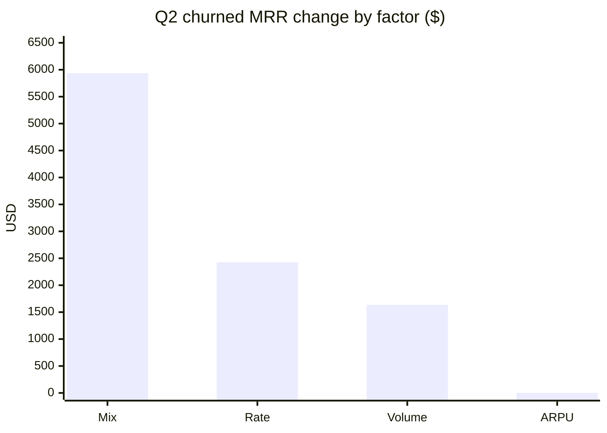

# نوشته‌ی ۷۱: چطور جهش churn را به mix و rate بشکنیم

[نوشته‌ی ۷۰: در Duolingo: ورود، ساختن، قفل شدن →](70-getting-in-building-it-locking-in.md) · [مجموعه](../README.md)

> **مقاله‌ی اصلی:** [How to Split a Churn Spike into Mix and Rate: A Step-by-Step LMDI Guide](https://medium.com/@paul.levchuk/how-to-split-a-churn-spike-into-mix-and-rate-a-step-by-step-lmdi-guide-6bd813fa70c8) · Medium، ۲۰۲۶-۰۹-۲۷

## خلاصه

داشبورد churn همین الان گفته EMEA مشکل است. ترتیب فیلترها را عوض کنید و می‌گوید کانال reseller مشکل است. هر دو از نظر فنی درست‌اند، و همین باید نگرانتان کند. در فصل دوم، churned MRR ده هزار دلار جهش کرد. اول با Region برش بزنید و EMEA ظاهراً ۹۲٫۵ درصد آن را ساخته؛ اول با Channel برش بزنید و Partner resellerها ظاهراً ۱۰۵ درصد را ساخته‌اند و Direct جبران کرده. هر دسته‌ای که اول بررسی شود تقصیر را برمی‌دارد، نه چون علت واقعی است، بلکه چون اول آمده. این راهنما با روشی وام‌گرفته از اقتصاد انرژی، LMDI، هر تغییری را به «mix مشتری‌ها جابه‌جا شد» و «مشتری‌ها واقعاً رفتار دیگری داشتند» می‌شکند، با حسابی که هر بار دقیقاً روی عدد واقعی می‌نشیند. نتیجه در این مثال: ۵۹ درصد mix، ۲۴ درصد rate و ۱۶ درصد volume؛ EMEA از نظر عملیاتی شکست نخورده بود.

## نکته‌های کلیدی

- **دام ترتیب.** در برش پشت‌سرهم، بعد اول واریانس هر چیزی را که زیرش است جذب می‌کند و جابه‌جایی ساختاری mix را به شکست عملیاتی خیالی تبدیل می‌کند.
- **باقیمانده‌ی برهم‌کنش.** waterfallهای سنتی جمله‌ی interaction می‌گذارند که در کسب‌وکارهای پرشتاب می‌تواند ۲۰ تا ۴۰ درصد کل واریانس باشد.
- **روش LMDI بی‌باقیمانده است.** هر برش را هم‌زمان در چهار عامل volume، mix، rate و ARPU تجزیه می‌کند و وزن لگاریتمی برهم‌کنش را پیوسته جذب می‌کند.
- **ابعاد را ضرب کنید، جدا تجزیه نکنید.** Region به‌تنهایی می‌گوید EMEA خراب است؛ Region × Channel می‌گوید چرا.
- **هر عامل پاسخ مدیریتی دیگری می‌خواهد:** rate یعنی وضعیت اضطراری عملیاتی، mix یعنی راهبرد جذب، volume یعنی برنامه‌ریزی ظرفیت، ARPU یعنی قیمت‌گذاری.
- **حسابداری است نه علیت.** LMDI دقیقاً می‌گوید *چه* حرکت کرد، نه *چرا*.

## فهرست بخش‌ها

- چرا داشبوردها با هم نمی‌خوانند
- روش: LMDI
- اجرای تجزیه در پنج گام
- مثال کارشده
- تجزیه‌ی کامل و حکم
- چه باید کرد
- اصل ردپای حسابرسی و خطاهای رایج
- روش LMDI در برابر Oaxaca-Blinder

## یادداشت‌ها

**چرا داشبوردها با هم نمی‌خوانند.** دو سازوکار پشت این ناسازگاری است.

- **دام ترتیب.** با Region و بعد Channel برش بزنید و Region داستان Channel را جذب می‌کند. ترتیب را برعکس کنید و Channel داستان Region را جذب می‌کند. بعد اول همیشه می‌برد، نه چون مهم‌تر است، بلکه چون اول است.
- **باقیمانده‌ی برهم‌کنش.** waterfallهای واریانس سنتی یک جمله‌ی interaction جا می‌گذارند که سطل «سایر» می‌شود و در کسب‌وکارهای پرشتاب می‌تواند ۲۰ تا ۴۰ درصد کل واریانس باشد.

```text
Δ = Rate Effect + Mix Effect + Interaction
```

هر دو داشبورد درست‌اند. هر دو به تیم دیگری اشاره می‌کنند. هیچ‌کدام نمی‌گوید چه اتفاقی افتاد.

**روش: LMDI.** LMDI یعنی Logarithmic Mean Divisia Index، که اقتصاددان انرژی B.W. Ang در دهه‌ی ۱۹۹۰ ساخت تا کارایی فنی را از جابه‌جایی‌های ساختاری در انتشار کربن ملی جدا کند. ایده ساده است: به‌جای برش زدن یک بعد در هر بار، ابعاد مهم را ضرب کنید و هر برش را هم‌زمان در چهار عامل تجزیه کنید:

| عامل | معنا |
|---|---|
| Volume | چند مشتری دارید |
| Mix | آن مشتری‌ها در کدام برش‌ها نشسته‌اند |
| Rate | هر برش چقدر churn می‌کند |
| ARPU | هر مشتری churn‌شده چقدر درآمد با خودش می‌برد |

هر عامل پاسخ مدیریتی دیگری می‌خواهد و LMDI دقیقاً می‌گوید هر کدام چقدر از تغییر را ساخته، بی‌هیچ باقیمانده. در داده‌ی فصل دوم پایه از ۲٬۰۰۰ به ۲٬۲۰۰ مشتری رسید، پس volume زنده است. ARPU ثابت نگه داشته شد (۱۰۰ دلار برای Direct و ۱۵۰ دلار برای Partner)، پس اثر ARPU صفر است.

**اجرای تجزیه در پنج گام.**

*گام ۱: اتحاد را بنویسید.* عامل‌ها را تعریف حسابداری شاخص دیکته می‌کند، نه مدل‌سازی. در این‌جا N کل مشتری‌ها، S(i) سهم برش، R(i) نرخ churn برش و A(i) میانگین درآمد برش است.

```text
Churned MRR = Σ N × S(i) × R(i) × A(i)
```

*گام ۲: ابعاد را ضرب کنید.* هیچ بعدی را جدا تجزیه نکنید. اول غربال کنید: یک گذر WOE/IV در برابر رخداد churn می‌گوید کدام ابعاد قدرت تفکیک واقعی دارند. در این داده Channel به‌تنهایی امتیاز بالا گرفت و Region امتیاز ضعیف؛ Region فقط وقتی ضرب‌شده با Channel گویا شد. پس Region × Channel ضرب می‌شود: EMEA Direct، EMEA Partner، NA Direct و NA Partner.

*گام ۳: جدول دوره را بسازید.* برای هر برش، مشتری‌ها، مشتری‌های churn‌شده و churned MRR را در هر دو دوره جمع کنید و سهم، نرخ و ARPU را حساب کنید. این جدول را پیش از هر جمع‌بندی نشان بدهید؛ ردپای حسابرسی همین است.

| برش | پایه‌ی Q1 | نرخ Q1 | پایه‌ی Q2 | نرخ Q2 | ازدست‌رفته‌ی Q1 | ازدست‌رفته‌ی Q2 |
|---|---|---|---|---|---|---|
| EMEA Direct | ۹۰۰ | ۵٫۰٪ | ۸۰۰ | ۵٫۰٪ | ۴٬۵۰۰ دلار | ۴٬۰۰۰ دلار |
| EMEA Partner | ۱۰۰ | ۱۵٫۰٪ | ۴۰۰ | ۲۰٫۰٪ | ۲٬۲۵۰ دلار | ۱۲٬۰۰۰ دلار |
| NA Direct | ۹۰۰ | ۵٫۰٪ | ۹۰۰ | ۵٫۰٪ | ۴٬۵۰۰ دلار | ۴٬۵۰۰ دلار |
| NA Partner | ۱۰۰ | ۱۵٫۰٪ | ۱۰۰ | ۲۰٫۰٪ | ۲٬۲۵۰ دلار | ۳٬۰۰۰ دلار |
| **کل** | **۲٬۰۰۰** | **۶٫۰۰٪** | **۲٬۲۰۰** | **۸٫۴۱٪** | **۱۳٬۵۰۰ دلار** | **۲۳٬۵۰۰ دلار** |

*گام ۴: وزن لگاریتمی را حساب کنید.* برای هر برش، Y همان churned MRR برش است. این وزن برهم‌کنش را پیوسته جذب می‌کند و دلیل نبود باقیمانده در LMDI همین است.

```text
w(i) = ( Y1(i) − Y0(i) ) / ( ln Y1(i) − ln Y0(i) )
```

*گام ۵: اثرها را حساب و جمع کنید.* برای هر عامل F، اثر روی برش‌ها جمع می‌شود. چون LMDI جمع‌پذیر است، می‌شود با جمع ساده به Region، Channel یا هر بعد دیگری رسید. وزن‌ها و نسبت‌های لگاریتمی را با دقت کامل در طول محاسبه نگه دارید وگرنه جمع‌ها چند سنت می‌لغزند؛ گرد کردن برای نمایش اشکالی ندارد، گرد کردن میانی دارد.

```text
ΔY(F) = Σ w(i) × ln( F1(i) / F0(i) )
```

خواندن علامت‌ها: mix مثبت یعنی سهم برش بزرگ شد و منفی یعنی کوچک شد؛ rate مثبت یعنی برش بیشتر churn می‌کند؛ volume مثبت یعنی کل پایه بزرگ شد.

> **Try it:** [mix و rate و حجم](../widgets/71-lmdi-mix-rate-volume.html): همان چهار برش نوشته با LMDI زنده، به‌علاوه‌ی دو drill-down پشت‌سرهم کنار هم؛ برش‌ها را عوض کنید و ببینید اثرها همیشه با خود تغییر جمع می‌شوند.

**مثال کارشده.** EMEA Partner به‌تنهایی تقریباً کل نوسان سطح شرکت را می‌سازد.

- سهم Q1 برابر ۱۰۰ بر ۲٬۰۰۰ یعنی ۰٫۰۵ و سهم Q2 برابر ۴۰۰ بر ۲٬۲۰۰ یعنی ۰٫۱۸۱۸.
- نرخ Q1 برابر ۱۵ بر ۱۰۰ یعنی ۰٫۱۵ و نرخ Q2 برابر ۸۰ بر ۴۰۰ یعنی ۰٫۲۰.
- مقدار ARPU در هر دو دوره ۱۵۰ دلار.
- مقدار MRR ازدست‌رفته در Q1 برابر ۱۵ × ۱۵۰ یعنی ۲٬۲۵۰ دلار و در Q2 برابر ۸۰ × ۱۵۰ یعنی ۱۲٬۰۰۰ دلار.

```text
w            = (12,000 − 2,250) / (ln 12,000 − ln 2,250) = 9,750 / 1.6739 ≈ 5,824.455
Volume effect = 5,824.455 × ln(2,200 / 2,000) = 5,824.455 × 0.09531 ≈ +$555.13
Mix effect    = 5,824.455 × ln(0.1818 / 0.05) = 5,824.455 × 1.29098 ≈ +$7,519.28
Rate effect   = 5,824.455 × ln(0.20 / 0.15)   = 5,824.455 × 0.28768 ≈ +$1,675.59
Total         = +$9,750.00
```

برای مقایسه، در EMEA Direct نرخ churn تکان نخورد (۵٫۰ درصد به ۵٫۰ درصد)، پس اثر rate آن بنا به ساختار صفر است. کل تغییر منفی ۵۰۰ دلاری‌اش بین volume مثبت ۴۰۴٫۶۰ و mix منفی ۹۰۴٫۶۰ دلار تقسیم می‌شود: برش در عدد مطلق کوچک شد در حالی که شرکت بزرگ شد، پس mix منفی‌ای می‌گیرد که بخشی از mix مثبت بزرگ EMEA Partner را جبران می‌کند.

**تجزیه‌ی کامل و حکم.** نتیجه‌ی سطح برش:

| برش | کل تغییر | Volume | Mix | Rate |
|---|---|---|---|---|
| EMEA Direct | −۵۰۰ | +۴۰۴٫۶۰ | −۹۰۴٫۶۰ | ۰٫۰۰ |
| EMEA Partner | +۹٬۷۵۰ | +۵۵۵٫۱۳ | +۷٬۵۱۹٫۲۸ | +۱٬۶۷۵٫۵۹ |
| NA Direct | ۰ | +۴۲۸٫۹۰ | −۴۲۸٫۹۰ | ۰٫۰۰ |
| NA Partner | +۷۵۰ | +۲۴۸٫۴۸ | −۲۴۸٫۴۸ | +۷۵۰٫۰۰ |
| **کل** | **+۱۰٬۰۰۰** | **+۱٬۶۳۷٫۱۱** | **+۵٬۹۳۷٫۳۰** | **+۲٬۴۲۵٫۵۹** |

برای برش‌هایی که پایه‌شان تغییر نکرد (هر دو ردیف NA)، اثر volume و mix برابر و مخالف‌اند. پایه‌ی NA ثابت ماند در حالی که کل بزرگ شد، پس volume مثبتی گرفت که دقیقاً با mix منفی خنثی شد. این باگ نیست؛ همان چیزی است که وقتی برشی با اندازه‌ی ثابت درون کلی در حال رشد می‌نشیند رخ می‌دهد.

| جمع‌بندی | کل تغییر | Volume | Mix | Rate |
|---|---|---|---|---|
| Region: EMEA | +۹٬۲۵۰ | +۹۵۹٫۷۳ | +۶٬۶۱۴٫۶۸ | +۱٬۶۷۵٫۵۹ |
| Region: NA | +۷۵۰ | +۶۷۷٫۳۸ | −۶۷۷٫۳۸ | +۷۵۰٫۰۰ |
| Channel: Partner | +۱۰٬۵۰۰ | +۸۰۳٫۶۱ | +۷٬۲۷۰٫۸۰ | +۲٬۴۲۵٫۵۹ |
| Channel: Direct | −۵۰۰ | +۸۳۳٫۵۰ | −۱٬۳۳۳٫۵۰ | ۰٫۰۰ |

برش EMEA Partner به‌تنهایی mix مثبت ۷٬۵۱۹٫۲۸ دلار نشان می‌دهد ولی کل EMEA فقط ۶٬۶۱۴٫۶۸ دلار است، چون EMEA Direct با mix منفی ۹۰۴٫۶۰ دلار آن را سبک کرد. بی هر دو ردیف، جمع‌بندی متناقض به نظر می‌رسد؛ با هر دو، حساب شفاف است.



حکم:

- مقدار churned MRR ده هزار دلار بالا رفت. از آن ۵٬۹۳۷٫۳۰ دلار از mix آمد، ۲٬۴۲۵٫۵۹ دلار از rate و ۱٬۶۳۷٫۱۱ دلار از volume؛ تقریباً ۵۹، ۲۴ و ۱۶ درصد.
- منطقه‌ی EMEA ۹٬۲۵۰ دلار از تغییر را جذب کرد و ۷۱٫۵ درصد آن mix بود: Marketing پایه‌ی Partner در EMEA را چهار برابر کرد (۱۰۰ به ۴۰۰) در حالی که پایه‌ی Direct کوچک شد (۹۰۰ به ۸۰۰).
- بدتر شدن عملیاتی واقعی ۲٬۴۲۵٫۵۹ دلار اثر rate بود که از لغزش کانال Partner از ۱۵ به ۲۰ درصد **در همه‌جا** آمد؛ EMEA Partner و NA Partner دقیقاً یکسان حرکت کردند.
- منطقه‌ی EMEA از نظر عملیاتی شکست نخورد. مشتری‌های Direct آن با همان نرخ ۵٫۰ درصد NA churn کردند؛ ضربه‌ی reseller را جذب کرد چون سبدش بیشتر در معرض بود.

داشبورد Region-اول اشتباه بود. داشبورد Channel-اول نزدیک‌تر ولی باز اشتباه بود: کل نوسان را به Partner نسبت داد در حالی که بخشی از آن انقباض سهم EMEA Direct بود.

**چه باید کرد.** عامل غالب می‌گوید پاسخ مال کیست:

| عامل غالب | معنا | پاسخ |
|---|---|---|
| Rate | وضعیت اضطراری عملیاتی | اجرا را درست کنید: onboarding، کیفیت lead، باگ‌های محصول، SLA resellerها را بازبینی کنید |
| Mix | راهبرد جذب | مدیر منطقه را اخراج نکنید؛ کانال‌ها را متعادل کنید، منابع جذب را بازبینی کنید، تمرکز سبد را کم کنید |
| Volume | برنامه‌ریزی ظرفیت | پایه سریع‌تر از انتظار رشد می‌کند؛ ظرفیت onboarding، پشتیبانی و نسبت CSM را بازبینی کنید |
| ARPU | قیمت‌گذاری و ردیف‌ها | اگر نرخ‌ها ثابت‌اند و دلارها جهش کرده، اندازه‌ی قرارداد، شرایط enterprise و تخفیف را بازبینی کنید |

در مورد Q2: Marketing/Growth باید mix resellerها را درست کند و نباید Customer Success در EMEA را مقصر دانست.

**اصل ردپای حسابرسی و خطاهای رایج.** جدول کامل برش‌ها را پیش از جمع‌بندی نشان بدهید. LMDI جمع‌پذیر است، پس جمع‌بندی‌ها فقط جمع‌اند؛ اگر فقط یک برش نشان بدهید، جمع‌بندی انگار از هیچ آمده. برای جمع‌بندی EMEA هر دو برش EMEA را نشان بدهید، برای Partner هر دو برش Partner را، و برای کل شرکت هر چهار خانه را. آن‌وقت هر کسی می‌تواند حساب را با جدول برش‌ها بسنجد و هیچ جمع‌بندی‌ای متناقض به نظر نمی‌رسد. خطاهای رایج:

- **اجرای LMDI روی یک بعد به‌تنهایی.** Region به‌تنهایی می‌گوید EMEA خراب است؛ Region × Channel را ضرب کنید تا ببینید چرا.
- **اشتباه گرفتن عامل با بعد.** عامل‌ها اتحاد ریاضی‌اند (N × S × R × A)؛ ابعاد برش‌ها هستند: Region، Channel، Segment.
- **نشان دادن فقط یک برش پیش از جمع‌بندی.** جمع‌بندی متناقض به نظر می‌رسد.
- **بدخوانی mix منفی روی برش ثابت.** وقتی کل رشد می‌کند، برش‌های با اندازه‌ی ثابت mix منفی (رقیق شدن) می‌گیرند که با volume مثبت خنثی می‌شود؛ باگ نیست.
- **علّی دانستن LMDI.** LMDI حسابداری دقیق *چه* حرکت کرد است، نه *چرا*.
- **گرد کردن گام‌های میانی.** دقت کامل را نگه دارید و فقط برای نمایش گرد کنید.

**روش LMDI در برابر Oaxaca-Blinder.**

| | LMDI | Oaxaca-Blinder |
|---|---|---|
| داده | تجمیعی و گروه‌بندی‌شده | خرد، در سطح ردیف |
| سازوکار | اتحاد حسابداری دقیق | رگرسیون |
| باقیمانده | صفر | شکاف توضیح‌داده‌نشده پس از کنترل covariateها |
| ساخته برای | BI، لایه‌ی metric، نسبت دادن KPI | توضیح تفاوت گروه‌ها در میانگین شرطی |

برای گزارش مدیریتی از LMDI استفاده کنید. وقتی باید covariateهایی مثل tenure یا میزان استفاده از seat را کنترل کنید سراغ Oaxaca-Blinder بروید. توجه کنید که آن هم مثل LMDI شکاف مشاهده‌شده را تجزیه می‌کند نه اثر علّی را؛ برای گفتن این‌که شکاف *چرا* هست هنوز راهبرد شناسایی لازم است.

خط آخر: بعد اول در برش پشت‌سرهم واریانس هر چیزی را که زیرش است جذب می‌کند و جابه‌جایی‌های ساختاری mix را به شکست‌های عملیاتی خیالی تبدیل می‌کند. LMDI ابعاد ضرب‌شده را هم‌زمان ارزیابی می‌کند و تقسیمی دقیق بین volume، mix، rate و ARPU برمی‌گرداند، با باقیمانده‌ی صفر.

> **In practice:** تجزیه‌ی LMDI را می‌شود در SQL روی جدول Gold churn بر حسب بُعد ساخت؛ نتیجه‌ی آن، یعنی سهم mix و rate و volume، را کنار drill-down در Metabase نشان دهید.
>
> **Your turn:** داشبورد churn بسته به ترتیب فیلترها یک بار منطقه و یک بار کانال را مقصر می‌داند. چه می‌کنید؟
>
> *Answer:* با LMDI تغییر را به mix و rate و volume بشکنید؛ جمعش دقیقاً روی عدد واقعی می‌نشیند و به ترتیب برش وابسته نیست (بخش «روش: LMDI»).

## پیوندها

- **بر پایه‌ی:** [فصل ۶۲](62-stop-decomposing-metric-tree.md) که IV/WOE را برای غربال ابعاد پیش از تجزیه می‌آورد، و [فصل ۵۴](54-the-metric-tree-trap.md) که دام تجزیه‌ی درخت metric را نشان می‌دهد.
- **ادامه در:** [فصل ۶۷](67-flo-health-what-zero-uplift-really-means.md) که همان پرسش mix در برابر رفتار را در Flo Health دنبال می‌کند.
- **همان ایده در:** [فصل ۶۳](63-best-ua-signal-less-revenue-than-nothing.md) که در آن هم ترکیب سبد عددی را می‌سازد که به رفتار نسبت داده می‌شود.

## خودتان را بسنجید

*پرسش‌ها و پاسخ‌ها مال vault است.*

1. **چرا داشبورد Region-اول EMEA را مقصر نشان داد؟**
   - [x] چون بعد اول واریانس ابعاد زیرش، این‌جا ضربه‌ی کانال Partner، را جذب می‌کند.
   - [ ] چون نرخ churn مشتری‌های Direct در EMEA بالا رفته بود.
   - [ ] چون ARPU در EMEA بالاتر بود.

   *Answer:* Direct در EMEA با همان ۵ درصد NA churn کرد؛ آنچه EMEA را سنگین کرد mix بود (بخش «چرا داشبوردها با هم نمی‌خوانند»).

2. **چرا NA Direct اثر volume و mix برابر و مخالف دارد؟**

   *Answer:* پایه‌اش ثابت ماند در حالی که کل رشد کرد؛ volume مثبت با mix منفی (رقیق شدن) دقیقاً خنثی می‌شود (بخش «تجزیه‌ی کامل و حکم»).

3. **اگر اثر mix غالب باشد، پاسخ مال کیست؟**

   *Answer:* راهبرد جذب: متعادل کردن کانال‌ها و منابع جذب، نه اخراج مدیر منطقه (بخش «چه باید کرد»).

4. **چرا LMDI باقیمانده ندارد؟**

   *Answer:* وزن لگاریتمی برهم‌کنش را پیوسته جذب می‌کند، پس اثرها دقیقاً با کل تغییر جمع می‌شوند (بخش «اجرای تجزیه در پنج گام»).
