# چارچوب تحلیلی: از رفتار کاربر تا تصمیم

[مجموعه](README.md) · [نوشته‌ی ۱ ←](chapters/01-churn-rate-evolution-at-netflix.md)

نویسنده در ۷۱ نوشته هیچ‌وقت یک چارچوب واحد ارائه نکرده است؛ هر نوشته یک پرسش را جواب می‌دهد. این صفحه **سنتز خود vault** است: سرنخ‌های پراکنده‌ی نوشته‌ها را در یک ساختار به هم وصل می‌کند تا بدانید هر نوشته کجای کار تحلیل محصول و رشد می‌نشیند و کدام نوشته‌ها مکمل هم‌اند.

این چارچوب سه لایه دارد. **زنجیره‌ی ارزش** می‌گوید چه چیزی را می‌سنجیم: جذب، فعال‌سازی، عادت، retention، درآمد، اقتصاد واحد و رشد. **هشت اصل** می‌گوید چطور نگاه کنیم، یعنی حرکت‌های فکری‌ای که نویسنده بارها تکرار می‌کند. **جعبه‌ابزار و راهنمای تصمیم** می‌گوید برای هر پرسش کدام ابزار و کدام نوشته را بردارید. در پایان فهرست دام‌ها، سیر تکامل اندیشه‌ی نویسنده، تنش‌های بین نوشته‌ها، یک گردش‌کار کامل و نقشه‌ی هر ۷۱ نوشته آمده است.

همه‌ی ادعاها به نوشته‌ها ارجاع می‌دهند؛ عددها از خود نوشته‌ها می‌آیند و بیشترشان از داده یا شبیه‌سازی خود نویسنده‌اند، نه قانون عام. جایی که خوانش vault است، صریحاً گفته شده.

## تصویر کل

### کل مجموعه در سه جمله

خوانش vault از ۷۱ نوشته، پیش از هر جزئی:

1. **رشد سقف دارد و retention آن سقف را جابه‌جا می‌کند.** پایه‌ی مشتری به جذب ÷ churn میل می‌کند ([۱](chapters/01-churn-rate-evolution-at-netflix.md))، پس هر بهبود retention ضرب‌کننده‌ی رشد است ([۲۲](chapters/22-plg-growth-retaining-monetizing-users.md)).
2. **هر عددی گمراه می‌کند مگر درست شمرده شود، در cohort دیده شود، صادقانه تجزیه شود و با عدم قطعیتش خوانده شود.** این چهار کار هسته‌ی هشت اصل‌اند ([۳](chapters/03-how-popular-is-this-feature-among-weekly-daily-active.md)، [۳۷](chapters/37-blended-retention-vs-cohort-retention.md)، [۷۱](chapters/71-split-a-churn-spike-lmdi.md)، [۶۴](chapters/64-long-tail-eats-your-ltv-model.md)).
3. **هدف پیش‌بینی نیست، اقدامی است که اثر علّی‌اش سنجیده شود.** مجموعه از سنجش feature در ۲۰۲۲ به تخصیص علّی بودجه در ۲۰۲۶ رسیده است ([۲](chapters/02-how-do-you-measure-the-success-of-a-product-feature.md)، [۵۸](chapters/58-why-your-live-ops-ltv-model-is-setting-money-on-fire.md)، [۶۷](chapters/67-flo-health-what-zero-uplift-really-means.md)).

### از کل به جزء

این صفحه مثل نقشه از دور به نزدیک خوانده می‌شود. هر سطح همان سطح قبلی است با بزرگ‌نمایی بیشتر، و هر اسلاید بالای خود می‌گوید در کدام سطح هستید:

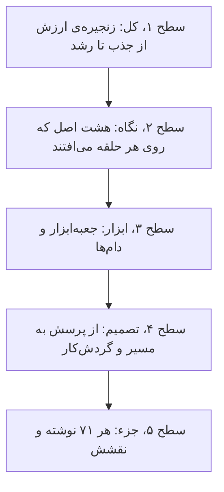

> **Try it:** [کاوشگر چارچوب](widgets/00-framework-explorer.html): از تصویر کل زنجیره شروع کنید، یک اصل را مثل عدسی روی آن بیندازید، روی یک حلقه بزنید تا لایه باز شود و بعد روی یک نوشته تا نقشش را ببینید. تور راهنما همین مسیر را قدم‌به‌قدم می‌رود.

## زنجیره‌ی ارزش

### نقشه‌ی زنجیره

*سطح ۱ از ۵: کل.*

کار تحلیل در این نوشته‌ها حول یک زنجیره می‌چرخد. کاربر جذب می‌شود، باید در همان ساعت‌های اول ارزش بگیرد، عادت بسازد، بماند، پول بدهد، و مجموع این‌ها باید از هزینه‌ی جذبش بیشتر شود تا رشد پایدار باشد. نویسنده مدل Sequoia را دوبار به کار می‌برد: engagement باعث stickiness می‌شود، stickiness باعث retention و retention باعث رشد ([۲۳](chapters/23-plg-growth-retaining-users.md)، [۲۹](chapters/29-user-engagement-introduction.md)).

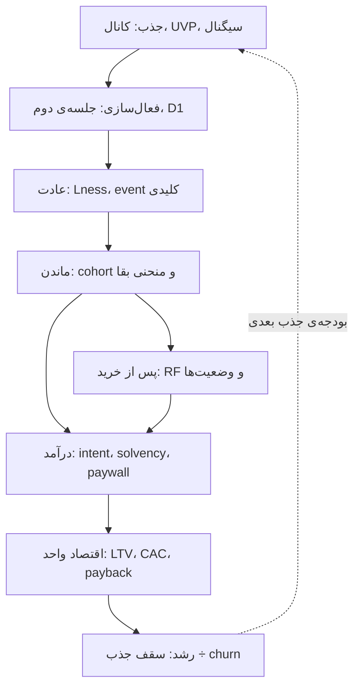

دو قاعده‌ی ساده کل زنجیره را مهار می‌کنند. **اول، سقف رشد:** پایه‌ی مشتری به نرخ جذب ماهانه تقسیم بر نرخ churn ماهانه میل می‌کند؛ Netflix با churn ده درصدی در سه سال به ۲۷٪ این سقف می‌رسد و با ۱٫۹٪ به ۷۳٪ ([۱](chapters/01-churn-rate-evolution-at-netflix.md)). **دوم، retention ضرب‌کننده است:** در مقایسه‌ی IVP، شرکتی که آهسته‌تر می‌فروشد ولی retention بالاتری دارد بعد از ۳۶ ماه ۱٫۵۵ برابر سریع‌تر رشد می‌کند ([۲۲](chapters/22-plg-growth-retaining-monetizing-users.md)).

> **Try it:** [مجانب churn](widgets/01-churn-asymptote.html): نرخ churn را تغییر دهید و ببینید سقف پایه‌ی مشتری و سهمی که در سه سال به آن می‌رسید چطور جابه‌جا می‌شود.

### لایه‌ها و پرسش‌هایشان

| لایه | پرسش اصلی | سنجه‌های پیشرو | سنجه‌ی نتیجه | نوشته‌ها |
|---|---|---|---|---|
| جذب | چه کسی را و با کدام سیگنال می‌آوریم؟ | کانال، UVP، AUC و پوشش سیگنال | ریزش cohort جدید، D180 ROAS | [۱۸](chapters/18-plg-growth-attracting-users.md)، [۲۶](chapters/26-threads-growth-analysis.md)، [۵۵](chapters/55-user-acquisition-funnel.md)، [۶۱](chapters/61-d30-roas-is-the-wrong-metric-here-is-what-to-use-instead.md)، [۶۳](chapters/63-best-ua-signal-less-revenue-than-nothing.md) |
| فعال‌سازی | کاربر در ۲۴ ساعت اول ارزش می‌گیرد؟ | جلسه‌ی دوم، شمار جلسه‌های روز صفر، event کلیدی | شاخص D1 retention | [۱۹](chapters/19-plg-growth-activating-new-users.md)، [۲۹](chapters/29-user-engagement-introduction.md)–[۳۴](chapters/34-user-engagement-key-events.md) |
| عادت | استفاده تکرار می‌شود؟ | Lness، شدت روزانه، گذار بین سطح‌ها | retention هفته‌ای | [۳](chapters/03-how-popular-is-this-feature-among-weekly-daily-active.md)–[۶](chapters/06-clustering-users-based-on-weekly-habit-and-daily.md)، [۲۳](chapters/23-plg-growth-retaining-users.md)–[۲۷](chapters/27-stickiness-insights-part3.md)، [۳۵](chapters/35-why-does-product-analytics-go-beyond-product-feature.md)، [۶۸](chapters/68-why-duolingo-streaks-work-in-four-questions.md)–[۷۰](chapters/70-getting-in-building-it-locking-in.md) |
| ماندن | چه سهمی می‌ماند و منحنی چه شکلی دارد؟ | MCC featureها، شدت پرتگاه | بقای cohort، نیمه‌عمر دم | [۷](chapters/07-what-is-the-impact-on-the-retention-rate.md)–[۱۵](chapters/15-how-a-successful-product-feature-should-look-like.md)، [۳۶](chapters/36-user-cohort-retention.md)–[۴۰](chapters/40-all-user-cohorts-are-noisy-but-some-can-tell-you-a-story.md)، [۶۰](chapters/60-the-four-questions-churn-analysis-should-answer.md)، [۶۵](chapters/65-retention-curve-hides-more-than-it-shows.md) |
| درآمد | چه کسی می‌تواند و می‌خواهد بپردازد؟ | MCC پولی‌ها، intent، solvency | تبدیل، درآمد افزایشی | [۱۲](chapters/12-what-is-the-difference-in-product-feature-usage-between.md)، [۱۶](chapters/16-is-focusing-on-retention-could-help-us-improve.md)، [۲۲](chapters/22-plg-growth-retaining-monetizing-users.md)، [۵۶](chapters/56-user-transition-states-diagram.md)، [۵۸](chapters/58-why-your-live-ops-ltv-model-is-setting-money-on-fire.md)، [۵۹](chapters/59-your-day-2-paywall-is-burning-your-best-future-customers.md)، [۶۷](chapters/67-flo-health-what-zero-uplift-really-means.md) |
| پس از خرید | مشتری کجا می‌رود؟ | Recency، Frequency، وضعیت قبلی | خرید ماه بعد | [۴۹](chapters/49-rf-matrix-introduction.md)–[۵۳](chapters/53-customer-state-a-key-building-block-of-advanced-customer.md) |
| اقتصاد واحد | پول جذب برمی‌گردد و چقدر سود می‌دهد؟ | WOE درآمد ۳۰ روز، فاصله تا سقف | LTV، payback، LTV به CAC | [۴۱](chapters/41-when-do-you-need-to-use-the-ltv-projection.md)–[۴۸](chapters/48-ltv-forecasting-how-good-the-corrective-models-are.md)، [۵۷](chapters/57-when-ltv-can-lie-to-you-asymptote-of-death.md)، [۶۴](chapters/64-long-tail-eats-your-ltv-model.md)–[۶۶](chapters/66-two-cohorts-same-payback-different-investments.md) |
| رشد | سقف کجاست و به آن نزدیک می‌شویم؟ | فرض‌های مدل رشد | پایه‌ی مشتری | [۱](chapters/01-churn-rate-evolution-at-netflix.md)، [۲۲](chapters/22-plg-growth-retaining-monetizing-users.md)، [۲۸](chapters/28-growth-models.md) |

## هشت اصل

*سطح ۲ از ۵: نگاه.*

هشت حرکت فکری در سراسر مجموعه تکرار می‌شوند. هر کدام دام‌هایی را می‌بندد که نوشته‌های مختلف یکی‌یکی نشان داده‌اند. نام‌گذاری اصل‌ها مال vault است؛ مصداق‌ها مال نویسنده.

هر اصل با یک شکل چهارخانه شروع می‌شود: **دام** رایج، **حرکت فکری** که آن را می‌بندد، **ابزاری** که حرکت را عملی می‌کند و **نتیجه‌ای** با عدد خود نوشته‌ها. بعد مصداق‌ها می‌آیند و در پایان یک شبیه‌سازی که اصل را لمس‌پذیر می‌کند.

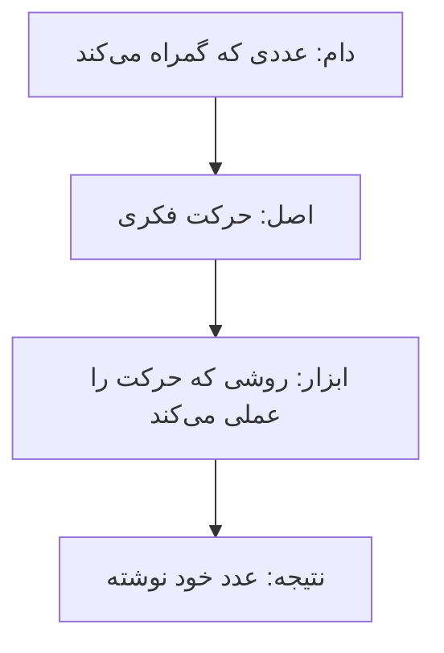

### اصل ۱: اول درست بشمار

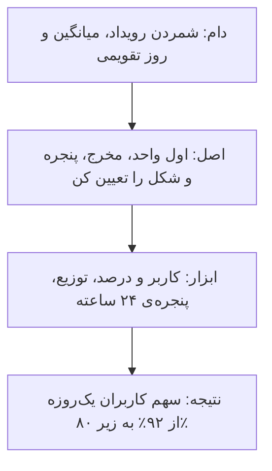

پیش از هر مدلی، چهار انتخاب پایه تعیین می‌کنند عدد شما چه می‌گوید: **واحد، مخرج، پنجره و شکل.**

- **واحد:** رویداد را کاربران پرمصرف یا یک باگ بالا می‌برند؛ کاربر را بشمارید، بعد درصد، بعد جدا برای کاربر جدید و قدیمی ([۳](chapters/03-how-popular-is-this-feature-among-weekly-daily-active.md)).
- **شکل:** میانگین «روز به ازای هر کاربر» الگو را پنهان می‌کند؛ با حذف کاربرانی که وسط هفته آمده‌اند، سهم کاربران یک‌روزه از ۹۲٪ به زیر ۸۰٪ می‌رسد ([۴](chapters/04-how-regular-are-users-using-this-feature-per-week.md)). هیستوگرام شدت روزانه ([۵](chapters/05-how-often-are-users-using-this-feature-per-day.md)) و توزیع Lness به‌جای نسبت DAU/MAU ([۲۳](chapters/23-plg-growth-retaining-users.md)) همین درس‌اند، و میانگین دوره‌ی بازگشت CAC هم گمراه می‌کند ([۴۲](chapters/42-cac-payback-period.md)).
- **پنجره:** روز تقویمی به کاربر نیمه‌شب ۲۳٫۵ ساعت و به کاربر آخر شب نیم ساعت فرصت می‌دهد؛ پنجره‌ی ۲۴ ساعته منصفانه است ([۳۰](chapters/30-user-engagement-period-of-analysis.md)) و cohort با روز تقویمی در دوره‌ی اول تا ۱٫۸۱ برابر خوش‌بینانه‌تر است ([۳۸](chapters/38-how-to-build-user-cohort-properly.md)).
- **مخرج:** عوض کردن مخرج خود پرسش را عوض می‌کند: «چه کسی بیشتر churn می‌کند» و «کجا بیشتر پول از دست می‌دهیم» دو پاسخ متفاوت دارند ([۶۲](chapters/62-stop-decomposing-metric-tree.md)). تعریف «برگشته»، یعنی برگشتن به همان feature یا به هر feature، هم retention محلی را از سراسری جدا می‌کند ([۹](chapters/09-two-types-of-feature-retention.md)، [۲۱](chapters/21-mastering-the-mcc-coefficient.md)).

> **Try it:** [توزیع Lness در برابر یک عدد](widgets/23-lness-vs-dau-mau.html): توزیع روزهای فعال را با نسبت DAU/MAU مقایسه کنید و ببینید یک عدد فشرده چه چیزی را پنهان می‌کند.

### اصل ۲: با cohort فکر کن، نه با تقویم

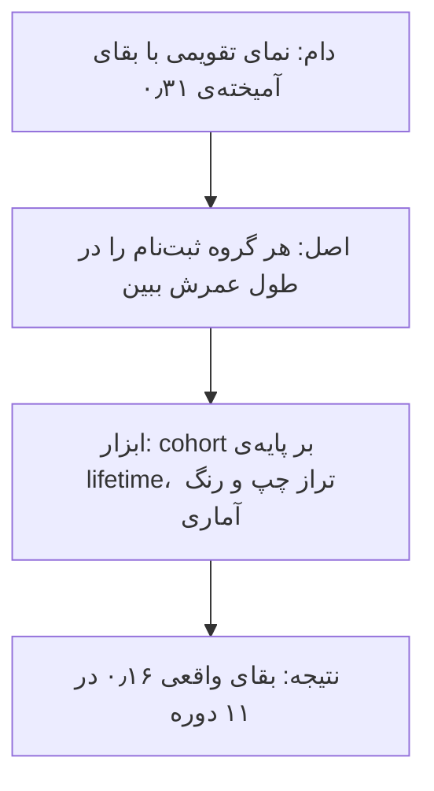

نمای تقویمی کاربرانی با عمر متفاوت را در یک عدد می‌آمیزد. در مثال نویسنده همه‌ی cohortها دقیقاً یک‌جور رفتار می‌کنند، ولی بقای آمیخته‌ی دسامبر ۰٫۳۱ است، تقریباً دو برابر بقای واقعی ۰٫۱۶ در ۱۱ دوره ([۳۷](chapters/37-blended-retention-vs-cohort-retention.md)). تحلیل event کلیدی بر پایه‌ی تقویم هم کاربران جدید و قدیمی را قاطی می‌کند ([۳۵](chapters/35-why-does-product-analytics-go-beyond-product-feature.md)).

- **ساختن:** cohort بر پایه‌ی lifetime و تراز چپ، با بازه‌ی ۲۴ ساعته ([۳۸](chapters/38-how-to-build-user-cohort-properly.md)).
- **خواندن:** هر cohort سه مرحله دارد: ریزش دوره‌ی اول، خط میانی و دم بلند ([۳۶](chapters/36-user-cohort-retention.md)). رنگ‌بندی بر پایه‌ی مقدار گمراه می‌کند؛ سلول را وقتی رنگ کنید که بیش از دو انحراف معیار از میانگین ۷ روز قبل فاصله دارد ([۳۹](chapters/39-how-to-draw-and-read-user-cohorts-properly.md)، [۴۰](chapters/40-all-user-cohorts-are-noisy-but-some-can-tell-you-a-story.md)).
- **مقایسه‌ی دوره به دوره:** cohort کلاسیک هر دوره را با ثبت‌نام می‌سنجد؛ سنجیدن با دوره‌ی قبل نشان می‌دهد ۸۲٫۱٪ کاربران هفته‌ی ۲۱ در هفته‌ی ۲۲ ماندند ([۲۴](chapters/24-in-the-last-post-i-discussed-how-stickiness-relates-to.md)).
- **حد cohort:** cohort هم کاربران را بر پایه‌ی سابقه‌ی فعالیت قاطی می‌کند؛ برای دیدن مسیر به وضعیت‌ها بروید ([۵۳](chapters/53-customer-state-a-key-building-block-of-advanced-customer.md)).

> **Try it:** [بقای آمیخته در برابر بقای cohort](widgets/37-blended-survival.html): cohortها را روی هم بچینید و ببینید چرا عدد آمیخته‌ی تقویمی از بقای واقعی خوش‌بینانه‌تر است.

### اصل ۳: کیفیت را با کمیت و جهت بسنج

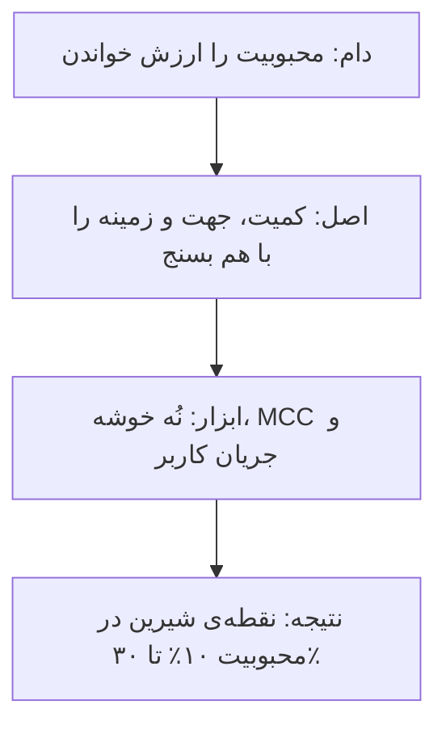

سنجش اثر feature در این مجموعه گام‌به‌گام دقیق‌تر می‌شود، و هر گام خطای گام قبل را می‌بندد:

| گام | چه چیزی اضافه شد | نوشته |
|---|---|---|
| retention هر feature | کاربرانی که برگشتند و همان feature را به کار بردند | [۷](chapters/07-what-is-the-impact-on-the-retention-rate.md) |
| کمیت کنار کیفیت | محبوبیت روی یک محور و برگشته‌ها روی محور دیگر، نُه خوشه | [۸](chapters/08-an-enhanced-version-of-the-analysis-of-how-product.md) |
| غیرکاربران | ماتریس درهم‌ریختگی و Information Gain | [۱۰](chapters/10-retention-deep-dive.md) |
| جهت | ضریب MCC که علامت دارد | [۱۱](chapters/11-product-feature-retention-deep-dive-mcc-coefficient.md)، [۲۰](chapters/20-the-mcc-coefficient-or-cohort-analysis.md)، [۲۱](chapters/21-mastering-the-mcc-coefficient.md) |
| زمینه | ضریب MCC در جریان کاربر، بعد از گام قبلی | [۱۳](chapters/13-user-flow.md) |
| گروه‌ها و مرحله‌ها | پولی و رایگان، P0 تا P3، روز ۱ و ۲ و ۷ | [۱۲](chapters/12-what-is-the-difference-in-product-feature-usage-between.md)، [۱۹](chapters/19-plg-growth-activating-new-users.md)، [۳۵](chapters/35-why-does-product-analytics-go-beyond-product-feature.md) |

یافته‌های مشترک: **تقریباً همه‌ی featureهای محبوب اثر منفی روی retention دارند**، چون در بالای قیف و با قصد کم استفاده می‌شوند ([۱۱](chapters/11-product-feature-retention-deep-dive-mcc-coefficient.md))؛ بین محبوبیت و درصد برگشته‌ها همبستگی منفی هست و موفق‌ترین featureها در خوشه‌ی میانی‌اند، با محبوبیت ۱۰٪ تا ۳۰٪ و MCC بالای صدک ۵۰ ([۱۵](chapters/15-how-a-successful-product-feature-should-look-like.md)). نرخ تکمیل پایین هم لزوماً بد نیست مگر با اثر روی retention سنجیده شود ([۱۴](chapters/14-what-is-the-completion-rate-of-a-product-feature.md)). و retention در سطح feature با درآمدزایی هم‌بسته است: همبستگی ۰٫۷۴ بین MCC و درصد کاربران پولی ([۱۶](chapters/16-is-focusing-on-retention-could-help-us-improve.md)).

> **Try it:** [جهت اثر: Information Gain یا MCC](widgets/11-information-gain-vs-mcc.html): یک feature را از مثبت به منفی ببرید و ببینید کدام معیار جهت را می‌فهمد.

### اصل ۴: فرایند را ببین، نه نتیجه را

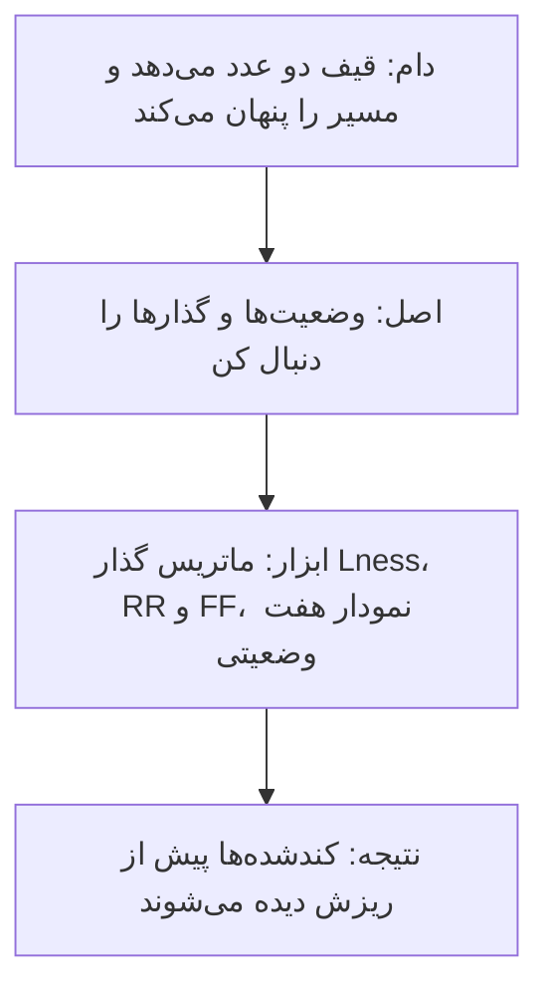

قیف دو عدد می‌دهد و مسیر را پنهان می‌کند: از‌دست‌رفته‌ها از تبدیل‌شده‌ها بسیار بیشترند، تبدیل لحظه‌ای نیست و churn دو مسیر دارد، مستقیم و غیرفعال ([۵۵](chapters/55-user-acquisition-funnel.md)). نویسنده بارها از «یک عدد» به «وضعیت و گذار» می‌رود:

| از نتیجه | به فرایند | نوشته |
|---|---|---|
| یک سطح Lness | ماتریس گذار Lness: شتاب‌گرفته، همان، کندشده | [۲۵](chapters/25-stickiness-insights-part-2.md) |
| Lness اولیه | Lness اخیر، که اطلاعات بسیار بیشتری دارد | [۲۷](chapters/27-stickiness-insights-part3.md) |
| ماتریس RF ایستا | ماتریس RR و FF: مسیر مشتری | [۴۹](chapters/49-rf-matrix-introduction.md)–[۵۲](chapters/52-rr-ff-matrices-introduction-to-customer-states.md) |
| دو دوره | سه دوره: از کجا آمده و به کجا می‌رود | [۵۳](chapters/53-customer-state-a-key-building-block-of-advanced-customer.md) |
| ماتریس ۲ در ۲ استفاده و پرداخت | نمودار گذار با هفت وضعیت و بیست گذار | [۵۶](chapters/56-user-transition-states-diagram.md) |
| شمارنده‌ی streak | چرخه‌ی عمر: شکل‌گیری، چرخه‌ی روزانه، دوره‌ی بلند | [۶۹](chapters/69-a-streak-is-a-lifecycle.md) |
| کیسه‌ای از featureها | جریانی تجمعی از تجربه‌ها | [۱۳](chapters/13-user-flow.md)، [۱۹](chapters/19-plg-growth-activating-new-users.md) |

درس مشترک: **معمولاً کندشده‌ها از شتاب‌گرفته‌ها بیشترند** ([۲۵](chapters/25-stickiness-insights-part-2.md))، پس سیگنال کمک‌خواستن پیش از ریزش در گذارها دیده می‌شود، نه در عدد کل.

> **Try it:** [گذارهای Lness هفته به هفته](widgets/25-lness-transitions.html): ماتریس گذار را بازی دهید و ببینید کندشده‌ها کجا از شتاب‌گرفته‌ها جلو می‌زنند.

### اصل ۵: تغییر را صادقانه تجزیه کن

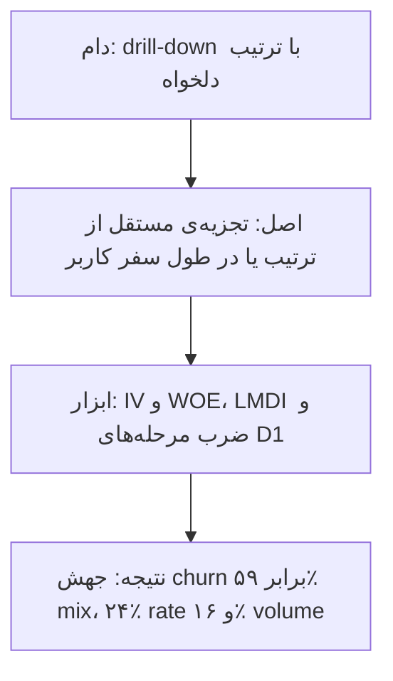

هر عدد کل از چند جزء ساخته شده، ولی هر تجزیه‌ای صادق نیست:

- **درخت متریک:** همبستگی بالای اجزا با کل محتوم ریاضی است و کشش واقعی را نشان نمی‌دهد؛ درخت چارچوب بصری خوبی است، نه ابزار تصمیم ([۵۴](chapters/54-the-metric-tree-trap.md)).
- **دام ترتیب:** در drill-down پشت‌سرهم، بُعد اول تقصیر را برمی‌دارد؛ با Region اول، EMEA ۹۲٫۵٪ جهش churn را ساخته و با Channel اول، resellerها ۱۰۵٪ ([۷۱](chapters/71-split-a-churn-spike-lmdi.md)). رتبه‌بندی مستقل هر بُعد با IV و WOE به ترتیب وابسته نیست ([۶۲](chapters/62-stop-decomposing-metric-tree.md)).
- **ترکیب در برابر رفتار:** متریک یا تکان می‌خورد چون جمعیت عوض شده یا چون آدم‌ها جور دیگری رفتار کرده‌اند. retention آمیخته ([۳۷](chapters/37-blended-retention-vs-cohort-retention.md))، «uplift صفر» در Flo ([۶۷](chapters/67-flo-health-what-zero-uplift-really-means.md)) و LMDI با ۵۹٪ mix و ۲۴٪ rate و ۱۶٪ volume ([۷۱](chapters/71-split-a-churn-spike-lmdi.md)) همه همین تفکیک‌اند.
- **ضرب مرحله‌ها:** تجزیه در طول سفر کاربر، نه در سلسله‌مراتب ذهنی، کار می‌کند: D1 برابر حاصل‌ضرب «جلسه‌ی دوم در ۲۴ ساعت» و «برگشت بعد از جلسه‌ی دوم» است ([۳۲](chapters/32-user-engagement-d1-retention.md)).
- **شکل ترکیب:** عامل‌ها به سه شکل ترکیب می‌شوند: دروازه که همه چیز را ضرب می‌کند، جمع که روی هم انباشته می‌شود، و برهم‌کنش که باید هم‌زمان برقرار باشد ([۶۸](chapters/68-why-duolingo-streaks-work-in-four-questions.md)، [۷۰](chapters/70-getting-in-building-it-locking-in.md)).

> **Try it:** [ترتیب و پرسش](widgets/62-order-and-question.html): ترتیب شکافتن را عوض کنید و ببینید داستان درخت عوض می‌شود ولی رتبه‌بندی IV/WOE نه.

### اصل ۶: سیگنال‌ها را از هم جدا نگه دار

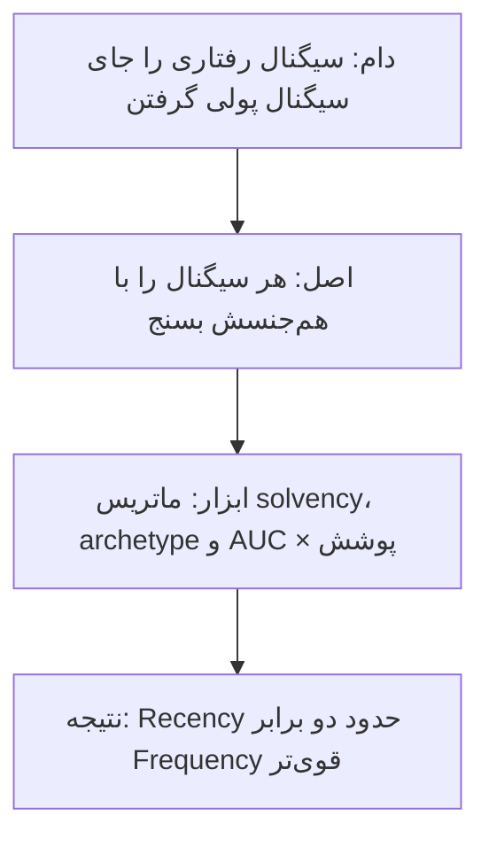

سیگنال‌هایی که یکی به نظر می‌آیند، چیزهای متفاوتی می‌سنجند:

| این را | با این یکی نگیرید | چرا | نوشته |
|---|---|---|---|
| نیاز به ارزش مکرر | توان محصول در عادت‌سازی | عامل اول تا ۷۰٪ موفقیت retention را می‌سازد | [۲۳](chapters/23-plg-growth-retaining-users.md) |
| سیگنال رفتاری | سیگنال پولی | درخواست بیشتر یا TTV کوتاه‌تر LTV بیشتر نمی‌دهد | [۴۵](chapters/45-ltv-and-behavioral-signals.md)، [۴۶](chapters/46-ltv-forecasting-introduction.md) |
| قصد خرید (intent) | توان مالی (solvency) | نبود پرداخت گذشته یعنی نبود قصد، نه لزوماً نبود توان | [۵۸](chapters/58-why-your-live-ops-ltv-model-is-setting-money-on-fire.md) |
| کیفیت cohort | سرعت پرداختش | Churnerها ۱۰۰٪ ارزش عمرشان را در ۳۰ روز می‌دهند و نهنگ‌ها ۲۱٪ | [۶۱](chapters/61-d30-roas-is-the-wrong-metric-here-is-what-to-use-instead.md) |
| دقت سیگنال | حجمی که پوشش می‌دهد | بهترین ROAS ممکن است از هیچ‌کاری‌نکردن درآمد کمتری بسازد | [۶۳](chapters/63-best-ua-signal-less-revenue-than-nothing.md) |
| برچسب هم‌بسته | اهرم علّی | نشانه بعد از کنترل نیت پیشین محو می‌شود | [۶۷](chapters/67-flo-health-what-zero-uplift-really-means.md) |
| ارزش فعلی (Frequency) | پتانسیل آینده (Recency) | با WOE و IV، Recency دو برابر Frequency قوی‌تر است | [۵۰](chapters/50-rf-matrix-the-magic-of-recency.md)، [۵۱](chapters/51-rf-matrix-frequency-dimension.md) |

قاعده‌ی vault از این جدول: **سیگنالی که می‌خواهید پیش‌بینی کنید را با سیگنالی از همان جنس بسنجید.** رفتار تراکنشی خرید بعدی را پیش‌بینی می‌کند ([۵۰](chapters/50-rf-matrix-the-magic-of-recency.md))، ولی رفتار درگیری توان پرداخت را نه ([۴۵](chapters/45-ltv-and-behavioral-signals.md)، [۵۸](chapters/58-why-your-live-ops-ltv-model-is-setting-money-on-fire.md)).

> **Try it:** [D30 در برابر D180](widgets/61-d30-roas.html): افق ROAS را جابه‌جا کنید و ببینید کدام archetype زود پول می‌دهد و کدام دیر.

### اصل ۷: عدم قطعیت را اندازه بگیر

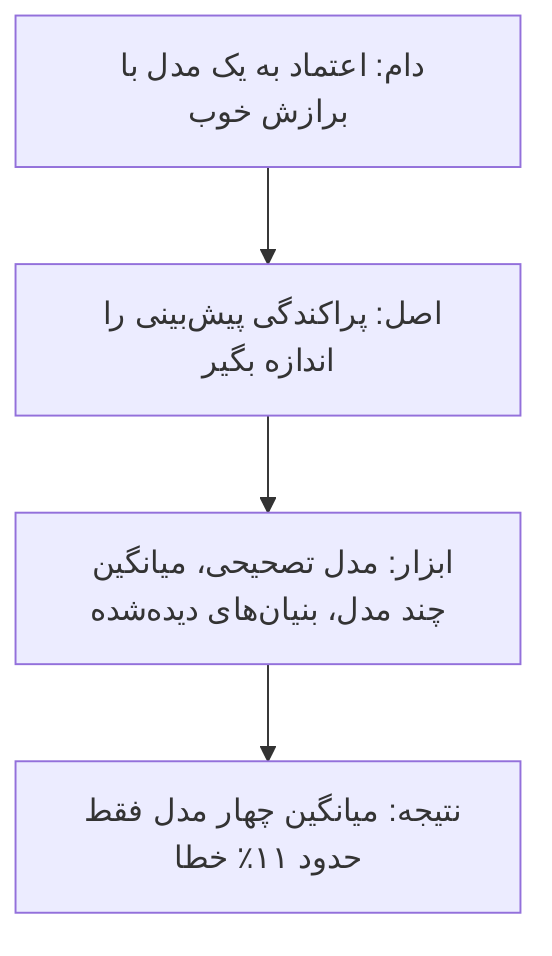

هر پیش‌بینی بلندمدت بر بخش کوچکی از داده بنا شده و خطایش ساختار دارد:

- **کمبود داده:** خطای مدل LTV با ۳۶ دوره ۲٫۱٪ است، با ۶ دوره ۵٫۸٪ و با ۳ دوره ۱۰٫۵٪ ([۴۶](chapters/46-ltv-forecasting-introduction.md)). خطا سیستماتیک است و مدل تصحیحی آن را ۸۲٪ کم می‌کند ([۴۷](chapters/47-ltv-forecasting-battle-for-accuracy.md))، برای هر cohort هم MAPE را به ۲٪ تا ۶٪ می‌رساند ([۴۸](chapters/48-ltv-forecasting-how-good-the-corrective-models-are.md)).
- **اختلاف مدل‌ها:** چهار خانواده‌ی مدل retention همه غلط‌اند، دو تا ۴۲٪ تا ۴۵٪ بیش‌برآورد و دو تا ۶۴٪ تا ۶۵٪ کم‌برآورد، ولی میانگینشان فقط حدود ۱۱٪ خطا دارد؛ برازش درون‌نمونه پیش‌بینی‌کننده‌ی معکوس دقت است ([۶۴](chapters/64-long-tail-eats-your-ltv-model.md)).
- **نویز cohort:** خطای نسبی retention در دم بلند سریع و خطی بالا می‌رود ([۴۰](chapters/40-all-user-cohorts-are-noisy-but-some-can-tell-you-a-story.md)).
- **سقف ریاضی:** با churn بالا و قیمت پایین، درآمد تجمعی هر کاربر صاف می‌شود؛ در شبیه‌سازی نویسنده با CAC ‏۵۰ دلار، قیمت ۱۰ دلار و churn ۲۰٪ منحنی در ۴۹٫۷۶ دلار می‌ایستد و payback هرگز رخ نمی‌دهد ([۵۷](chapters/57-when-ltv-can-lie-to-you-asymptote-of-death.md)). حساب vault: این سقف تقریباً قیمت ÷ churn است، یعنی ۱۰ ÷ ۰٫۲.
- **عددهای مشاهده‌شده به‌جای برون‌یابی:** بنیان‌های دوبخشی، یعنی نرخ بازمانده، نیمه‌عمر دم، شدت پرتگاه، سهم دم و سقف LTV، بیشتر ویژگی داده‌ی دیده‌شده‌اند ([۶۵](chapters/65-retention-curve-hides-more-than-it-shows.md))؛ دو cohort با payback ۶۱ و ۶۵ روز می‌توانند سقف ۹٫۵۰ و ۳۰ دلاری داشته باشند و فاصله تا سقف باید تصمیم مقیاس را هدایت کند ([۶۶](chapters/66-two-cohorts-same-payback-different-investments.md)).

> **Try it:** [دمی که نمی‌بینید](widgets/64-tail-you-cannot-see.html): چند خانواده‌ی مدل را روی یک cohort برازش دهید و پراکندگی پیش‌بینی LTV را ببینید.

### اصل ۸: از پیش‌بینی به اقدام علّی

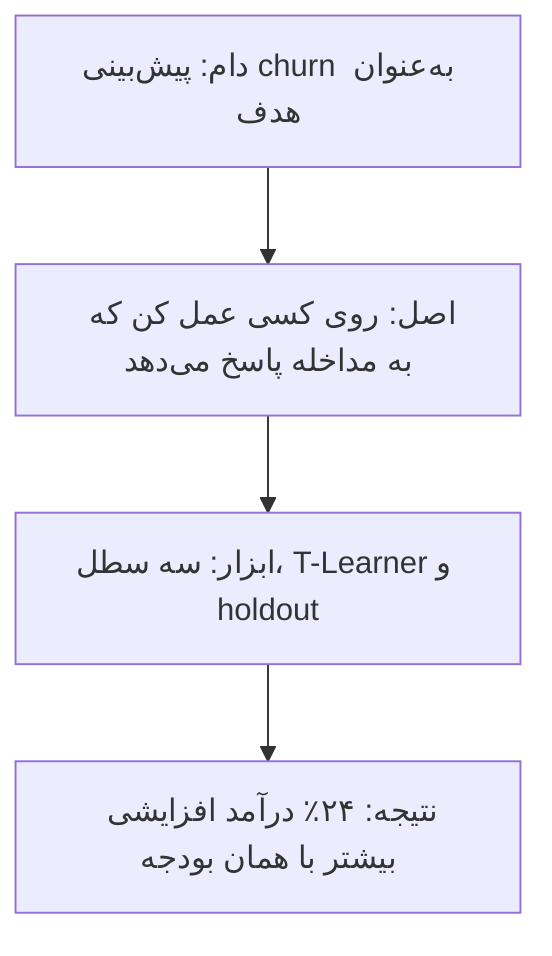

نویسنده از همان نوشته‌ی دوم، به نقل از راهنمای Amplitude، یادآوری می‌کند که این سنجه‌ها هنوز علیت نمی‌دهند ([۲](chapters/02-how-do-you-measure-the-success-of-a-product-feature.md)). نوشته‌های آخر این شکاف را مستقیم می‌بندند:

- **پرسش درست:** دانستن این‌که کاربری churn می‌کند تقریباً هیچ نمی‌گوید؛ باید بدانید کی قابل‌تشخیص می‌شود، روی چند نفر با اطمینان می‌شود عمل کرد و کدام سنخ به مداخله پاسخ می‌دهد. سه سطل: churn قطعی، safe قطعی و نامطمئن ([۶۰](chapters/60-the-four-questions-churn-analysis-should-answer.md)).
- **قابل‌اقناع‌ها:** موتور تخصیص علّی «قطعی‌ها» و «بی‌امیدها» را کنار می‌گذارد و بودجه را روی «میان قابل‌حرکت» می‌ریزد؛ T-Learner ۲۴٪ درآمد افزایشی بیشتر گرفت ([۵۸](chapters/58-why-your-live-ops-ltv-model-is-setting-money-on-fire.md)).
- **پیشنهاد متناسب:** paywall یکسان برای همه بهترین مشتریان آینده را می‌سوزاند؛ پیشنهاد متناسب با intent و «فارغ‌التحصیلی» تیپ‌ها بیشترین درآمد را ساخت ([۵۹](chapters/59-your-day-2-paywall-is-burning-your-best-future-customers.md)).
- **عدد علّی تمیز:** holdout تنها عدد علّی تمیز در مقایسه‌ی آشفته‌ی قبل و بعد است، و صفر را باید کنار عددهای دیگر خواند ([۶۷](chapters/67-flo-health-what-zero-uplift-really-means.md)).
- **تخصیص بودجه:** bidding با فیلتر کیفیت، با همان بودجه، D180 ROAS را از ۱٫۸۱ به ۵٫۸۸ می‌برد ([۶۱](chapters/61-d30-roas-is-the-wrong-metric-here-is-what-to-use-instead.md))؛ و استراتژی LTV به CAC زیان بزرگ را از زیان قابل‌مدیریت بهتر از payback جدا می‌کند ([۴۴](chapters/44-cac-payback-period-vs-ltv-cac.md)).

> **Try it:** [ترکیب یا رفتار؟](widgets/67-mix-or-behaviour.html): جهش قبل و بعد را به سهم جمعیت و سهم رفتار بشکنید و ببینید holdout چه می‌گوید.

## جعبه‌ابزار

*سطح ۳ از ۵: ابزار.* هر ابزار با این‌که چه می‌سنجد، کی به کار می‌آید و دامش چیست.

### ابزارهای سنجش رابطه

| ابزار | چه می‌سنجد | کی | دامش | نوشته‌ها |
|---|---|---|---|---|
| قاعده‌ی صدک ۵۰ و ۸۰ | بخش‌بندی casual، power و core بدون مدل | اولین نگاه به هر ویژگی | مرزها قراردادی‌اند | [۶](chapters/06-clustering-users-based-on-weekly-habit-and-daily.md)، [۷](chapters/07-what-is-the-impact-on-the-retention-rate.md)، [۸](chapters/08-an-enhanced-version-of-the-analysis-of-how-product.md) |
| شاخص Information Gain | اطلاعات استفاده درباره‌ی برگشتن، با غیرکاربران | رتبه‌بندی featureها | جهت ندارد | [۱۰](chapters/10-retention-deep-dive.md) |
| ضریب MCC | همبستگی دو متغیر دودویی، با علامت | اثر feature و event کلیدی | علیت نیست و به تعریف «برگشته» حساس است | [۱۱](chapters/11-product-feature-retention-deep-dive-mcc-coefficient.md)–[۱۶](chapters/16-is-focusing-on-retention-could-help-us-improve.md)، [۲۰](chapters/20-the-mcc-coefficient-or-cohort-analysis.md)، [۲۱](chapters/21-mastering-the-mcc-coefficient.md)، [۳۴](chapters/34-user-engagement-key-events.md)، [۳۵](chapters/35-why-does-product-analytics-go-beyond-product-feature.md) |
| شاخص WOE و IV | قدرت هر بُعد یا دسته، مستقل از ترتیب | ریشه‌یابی churn، مقایسه‌ی کمپین با کانال | مخرج کسر پرسش را تعیین می‌کند | [۴۲](chapters/42-cac-payback-period.md)، [۵۱](chapters/51-rf-matrix-frequency-dimension.md)، [۶۲](chapters/62-stop-decomposing-metric-tree.md) |
| روش k-means | خوشه‌های طبیعی روی چند سنجه | featureها، سناریوهای جذب | تفسیر خوشه با شماست | [۱۵](chapters/15-how-a-successful-product-feature-should-look-like.md)، [۳۲](chapters/32-user-engagement-d1-retention.md) |
| رگرسیون لجستیک و خطی | احتمال برگشت، قدرت پیش‌بینی سیگنال | Lness و سیگنال‌های روز صفر | outlier ضریب R² را پایین می‌کشد | [۲۷](chapters/27-stickiness-insights-part3.md)، [۳۳](chapters/33-d1-retention-a-tricky-metric-to-predict.md) |
| سنجه‌ی AUC × پوشش × درآمد | ارزش واقعی یک سیگنال جذب | انتخاب سیگنال برای شبکه‌ی تبلیغات | دقت بدون حجم | [۶۳](chapters/63-best-ua-signal-less-revenue-than-nothing.md) |

### ابزارهای زمان و ساختار

| ابزار | چه می‌سنجد | کی | دامش | نوشته‌ها |
|---|---|---|---|---|
| جدول cohort بر پایه‌ی lifetime | بقای هر گروه ثبت‌نام در طول عمر | هر سؤال retention | روز تقویمی، رنگ بر پایه‌ی مقدار | [۳۶](chapters/36-user-cohort-retention.md)–[۴۰](chapters/40-all-user-cohorts-are-noisy-but-some-can-tell-you-a-story.md) |
| ماتریس گذار | حرکت بین سطح‌ها یا وضعیت‌ها | عادت، مسیر مشتری، freemium | جمع خروجی هر وضعیت باید ۱۰۰٪ شود | [۲۵](chapters/25-stickiness-insights-part-2.md)، [۵۲](chapters/52-rr-ff-matrices-introduction-to-customer-states.md)، [۵۳](chapters/53-customer-state-a-key-building-block-of-advanced-customer.md)، [۵۶](chapters/56-user-transition-states-diagram.md) |
| ماتریس RF | فعال بودن و ارزش مشتری | پس از اولین خرید | ایستاست؛ مسیر را نمی‌گوید | [۴۹](chapters/49-rf-matrix-introduction.md)–[۵۱](chapters/51-rf-matrix-frequency-dimension.md) |
| مدل دوبخشی retention | پرتگاه، دم و سقف | تشخیص ساختار cohort | برای پیش‌بینی دم بلند کم‌برآورد است | [۶۴](chapters/64-long-tail-eats-your-ltv-model.md)–[۶۶](chapters/66-two-cohorts-same-payback-different-investments.md) |
| روش LMDI | تجزیه‌ی دقیق به volume، mix، rate و ARPU | جهش یک متریک | علّی نیست: می‌گوید چه تکان خورد، نه چرا؛ یک بُعد تنها گمراه می‌کند | [۷۱](chapters/71-split-a-churn-spike-lmdi.md) |
| تجزیه‌ی ترکیب و ساختار | سهم جمعیت در برابر سهم رفتار | قبل و بعد یک تغییر | باقی‌مانده‌ی برهم‌کنش | [۶۷](chapters/67-flo-health-what-zero-uplift-really-means.md) |

### ابزارهای اقتصاد و اقدام

| ابزار | چه می‌سنجد | کی | دامش | نوشته‌ها |
|---|---|---|---|---|
| پیش‌بینی LTV با لگاریتم | منحنی LTV تجمعی | سقف CAC هر کانال | با داده‌ی کم خطای سیستماتیک | [۴۱](chapters/41-when-do-you-need-to-use-the-ltv-projection.md)، [۴۶](chapters/46-ltv-forecasting-introduction.md) |
| مدل تصحیحی | خطای مدل اول | cohortهای جوان | دوره‌ی یادگیری را از retention نسبی بگیرید | [۴۷](chapters/47-ltv-forecasting-battle-for-accuracy.md)، [۴۸](chapters/48-ltv-forecasting-how-good-the-corrective-models-are.md) |
| دوره‌ی payback | سرعت برگشت پول | قاعده‌ی سرانگشتی نقدینگی | میانگین گمراه است و ارزش بلندمدت را نمی‌بیند | [۴۲](chapters/42-cac-payback-period.md)–[۴۴](chapters/44-cac-payback-period-vs-ltv-cac.md)، [۶۶](chapters/66-two-cohorts-same-payback-different-investments.md) |
| نسبت LTV به CAC | کارایی سرمایه | اولویت کانال و کمپین | به دقت LTV وابسته است | [۴۱](chapters/41-when-do-you-need-to-use-the-ltv-projection.md)، [۴۴](chapters/44-cac-payback-period-vs-ltv-cac.md) |
| ماتریس solvency | توان پنهان در برابر پرداخت دیده‌شده | هدف‌گیری درآمد | داده‌ی رفتاری توان را تخمین نمی‌زند | [۵۸](chapters/58-why-your-live-ops-ltv-model-is-setting-money-on-fire.md) |
| مدل uplift (T-Learner) | اثر افزایشی مداخله برای هر کاربر | تخصیص بودجه‌ی پیشنهاد | به آزمایش تصادفی نیاز دارد | [۵۸](chapters/58-why-your-live-ops-ltv-model-is-setting-money-on-fire.md) |
| روش NMF و سه سطل تصمیم | سنخ‌های رفتاری و اطمینان روزانه | برنامه‌ی ضد churn | هدف پیش‌بینی نیست، اقدام است | [۶۰](chapters/60-the-four-questions-churn-analysis-should-answer.md) |
| آزمایش holdout | اثر علّی یک feature | پیش از برداشتن یا تغییر | صفر را بدون عدد دوم نخوانید | [۶۷](chapters/67-flo-health-what-zero-uplift-really-means.md) |
| مدل رشد در Excel | پایه‌ی مشتری با فرض‌های صریح | برنامه‌ریزی | فرض‌ها مهم‌ترین بخش‌اند | [۲۸](chapters/28-growth-models.md) |

## از پرسش به مسیر

*سطح ۴ از ۵: تصمیم.* از پرسشی که روی میزتان است شروع کنید؛ مسیر، نوشته‌ها را به ترتیب خواندن می‌چیند.

| پرسش شما | مسیر پیشنهادی | دامی که باید دور زد | نوشته‌ها |
|---|---|---|---|
| این feature ارزش دارد؟ | کاربر و درصد ← نُه خوشه ← MCC روی cohort ← زمینه ← پولی و رایگان | retention تک‌بعدی، Information Gain بی‌جهت | [۳](chapters/03-how-popular-is-this-feature-among-weekly-daily-active.md)، [۸](chapters/08-an-enhanced-version-of-the-analysis-of-how-product.md)، [۱۱](chapters/11-product-feature-retention-deep-dive-mcc-coefficient.md)، [۱۳](chapters/13-user-flow.md)، [۱۲](chapters/12-what-is-the-difference-in-product-feature-usage-between.md)، [۲۰](chapters/20-the-mcc-coefficient-or-cohort-analysis.md) |
| چرا کاربران جدید برنمی‌گردند؟ | پنجره‌ی ۲۴ ساعته ← جلسه‌ی دوم ← D1 دومرحله‌ای ← سیگنال روز صفر ← event کلیدی ← کانال و UVP | روز تقویمی، میانگین زمان جلسه | [۳۰](chapters/30-user-engagement-period-of-analysis.md)–[۳۴](chapters/34-user-engagement-key-events.md)، [۱۸](chapters/18-plg-growth-attracting-users.md) |
| retention بهتر شده؟ | cohort بر پایه‌ی lifetime ← رنگ آماری ← سه مرحله‌ی منحنی | retention آمیخته | [۳۶](chapters/36-user-cohort-retention.md)–[۴۰](chapters/40-all-user-cohorts-are-noisy-but-some-can-tell-you-a-story.md) |
| کاربران عادت می‌سازند؟ | توزیع Lness ← دوره به دوره ← ماتریس گذار ← Lness اخیر | نسبت DAU/MAU | [۲۳](chapters/23-plg-growth-retaining-users.md)–[۲۷](chapters/27-stickiness-insights-part3.md) |
| streak یا مکانیزم عادت ما چرا کار می‌کند؟ | چهار پرسش ← دروازه، جمع، برهم‌کنش ← چرخه‌ی عمر | streak به‌عنوان یک عدد | [۶۸](chapters/68-why-duolingo-streaks-work-in-four-questions.md)–[۷۰](chapters/70-getting-in-building-it-locking-in.md) |
| چرا churn جهش کرد؟ | هر بُعد با IV و WOE ← LMDI به mix و rate و volume | drill-down با ترتیب دلخواه | [۵۴](chapters/54-the-metric-tree-trap.md)، [۶۲](chapters/62-stop-decomposing-metric-tree.md)، [۷۱](chapters/71-split-a-churn-spike-lmdi.md) |
| این کمپین یا کانال سودآور است؟ | توزیع payback ← LTV به CAC ← سقف LTV و فاصله تا سقف | payback ساده، D30 ROAS | [۴۲](chapters/42-cac-payback-period.md)–[۴۴](chapters/44-cac-payback-period-vs-ltv-cac.md)، [۵۷](chapters/57-when-ltv-can-lie-to-you-asymptote-of-death.md)، [۶۵](chapters/65-retention-curve-hides-more-than-it-shows.md)، [۶۶](chapters/66-two-cohorts-same-payback-different-investments.md) |
| LTV را چطور پیش‌بینی کنم؟ | داده‌ی تراکنش ← مدل لگاریتمی ← مدل تصحیحی ← میانگین چند مدل | اعتماد به برازش درون‌نمونه | [۴۶](chapters/46-ltv-forecasting-introduction.md)–[۴۸](chapters/48-ltv-forecasting-how-good-the-corrective-models-are.md)، [۶۴](chapters/64-long-tail-eats-your-ltv-model.md) |
| کدام سیگنال را به شبکه‌ی تبلیغات بدهم؟ | AUC × پوشش × درآمد در برابر هیچ‌کاری‌نکردن ← archetype و D180 | سیگنال دقیق بی‌حجم | [۶۱](chapters/61-d30-roas-is-the-wrong-metric-here-is-what-to-use-instead.md)، [۶۳](chapters/63-best-ua-signal-less-revenue-than-nothing.md) |
| به چه کسی پیشنهاد یا مداخله بدهم؟ | intent جدا از solvency ← پیشنهاد متناسب ← چهار پرسش و سه سطل | پیش‌بینی churn به‌جای تصمیم | [۵۸](chapters/58-why-your-live-ops-ltv-model-is-setting-money-on-fire.md)–[۶۰](chapters/60-the-four-questions-churn-analysis-should-answer.md) |
| آزمایش «uplift صفر» داد؛ یعنی چه؟ | holdout ← نشانه در برابر اهرم ← mix در برابر رفتار ← بلندمدت | صفر را «بی‌اثر» خواندن | [۶۷](chapters/67-flo-health-what-zero-uplift-really-means.md) |
| مشتری پس از خرید کجا می‌رود؟ | ماتریس RF ← RR و FF ← سه دوره ← نمودار گذار | cohort که سابقه‌ها را قاطی می‌کند | [۴۹](chapters/49-rf-matrix-introduction.md)–[۵۳](chapters/53-customer-state-a-key-building-block-of-advanced-customer.md)، [۵۶](chapters/56-user-transition-states-diagram.md) |
| سقف رشد ما کجاست؟ | جذب ÷ churn ← اثر retention بر رشد ← مدل رشد با فرض صریح | رشد به هر قیمت | [۱](chapters/01-churn-rate-evolution-at-netflix.md)، [۱۶](chapters/16-is-focusing-on-retention-could-help-us-improve.md)، [۲۲](chapters/22-plg-growth-retaining-monetizing-users.md)، [۲۸](chapters/28-growth-models.md) |

> **Try it:** [نقشه‌ی چارچوب](widgets/00-framework-map.html): یک پرسش انتخاب کنید یا روی خانه‌ای از جدول لایه‌ها و اصل‌ها بزنید تا نوشته‌های مربوط و ترتیب خواندنشان را ببینید.

## دام‌ها

*سطح ۳ از ۵: ابزار، از سوی دیگر.* هر دام با جایگزینش.

| دام | چرا گمراه می‌کند | جایگزین | نوشته |
|---|---|---|---|
| شمردن رویداد | کاربران پرمصرف و باگ عدد را بالا می‌برند | کاربر، درصد، جدا برای جدید و قدیمی | [۳](chapters/03-how-popular-is-this-feature-among-weekly-daily-active.md) |
| میانگین به‌جای توزیع | الگو را پنهان می‌کند | هیستوگرام، Lness | [۴](chapters/04-how-regular-are-users-using-this-feature-per-week.md)، [۵](chapters/05-how-often-are-users-using-this-feature-per-day.md)، [۲۳](chapters/23-plg-growth-retaining-users.md)، [۴۲](chapters/42-cac-payback-period.md) |
| روز تقویمی | فرصت نابرابر به کاربران | پنجره‌ی ۲۴ ساعته | [۳۰](chapters/30-user-engagement-period-of-analysis.md)، [۳۸](chapters/38-how-to-build-user-cohort-properly.md) |
| retention آمیخته | عمرهای متفاوت را می‌آمیزد | cohort بر پایه‌ی lifetime | [۳۷](chapters/37-blended-retention-vs-cohort-retention.md) |
| رنگ بر پایه‌ی مقدار | اندازه‌ی cohort را جای کیفیت نشان می‌دهد | فاصله از میانگین ۷ روز به انحراف معیار | [۳۹](chapters/39-how-to-draw-and-read-user-cohorts-properly.md)، [۴۰](chapters/40-all-user-cohorts-are-noisy-but-some-can-tell-you-a-story.md) |
| کیفیت بدون کمیت | Niche را core می‌خواند | نمودار پراکندگی و نُه خوشه | [۸](chapters/08-an-enhanced-version-of-the-analysis-of-how-product.md) |
| فراموش کردن غیرکاربران | feature خنثی را مؤثر نشان می‌دهد | Information Gain و MCC | [۱۰](chapters/10-retention-deep-dive.md) |
| معیار بی‌جهت | اثر منفی را «اطلاعات زیاد» می‌خواند | ضریب MCC | [۱۱](chapters/11-product-feature-retention-deep-dive-mcc-coefficient.md) |
| MCC بی‌زمینه | علامت اثر با گام قبلی عوض می‌شود | جریان کاربر | [۱۳](chapters/13-user-flow.md) |
| شروع سریع | ثبت‌نام زیاد با ۹۶٪ ریزش در ۱۲ روز | cohort روز اول، دقیقه‌ی روزانه | [۲۶](chapters/26-threads-growth-analysis.md) |
| درخت متریک برای اولویت | همبستگی اجزا محتوم ریاضی است | درخت فقط برای هم‌سویی | [۵۴](chapters/54-the-metric-tree-trap.md) |
| drill-down با ترتیب | بُعد اول تقصیر را برمی‌دارد | IV و WOE، LMDI | [۶۲](chapters/62-stop-decomposing-metric-tree.md)، [۷۱](chapters/71-split-a-churn-spike-lmdi.md) |
| payback ساده | فرض می‌کند کاربر تا ابد می‌ماند | payback واقعی با churn و سقف درآمد تجمعی | [۵۷](chapters/57-when-ltv-can-lie-to-you-asymptote-of-death.md) |
| payback تنها | سقف و ماندگاری را نمی‌بیند | فاصله تا سقف و بنیان‌ها | [۶۶](chapters/66-two-cohorts-same-payback-different-investments.md) |
| شاخص D30 ROAS | سرعت پرداخت را جای کیفیت می‌سنجد | D180 و archetype | [۶۱](chapters/61-d30-roas-is-the-wrong-metric-here-is-what-to-use-instead.md) |
| سیگنال دقیق بی‌حجم | بودجه‌ی کمی را به کار می‌اندازد | سه بُعد هم‌زمان | [۶۳](chapters/63-best-ua-signal-less-revenue-than-nothing.md) |
| اعتماد به برازش خوب | برازش درون‌نمونه معکوس دقت است | میانگین و پراکندگی مدل‌ها | [۶۴](chapters/64-long-tail-eats-your-ltv-model.md) |
| رفتار به‌جای توان مالی | کاربر فعال را با خریدار یکی می‌گیرد | ماتریس solvency | [۵۸](chapters/58-why-your-live-ops-ltv-model-is-setting-money-on-fire.md) |
| یک paywall برای همه | تیپ‌های آینده‌دار را می‌سوزاند | پیشنهاد متناسب با intent | [۵۹](chapters/59-your-day-2-paywall-is-burning-your-best-future-customers.md) |
| پیش‌بینی churn به‌عنوان هدف | نمی‌گوید روی چه کسی و کی عمل کنید | چهار پرسش و سه سطل | [۶۰](chapters/60-the-four-questions-churn-analysis-should-answer.md) |
| «uplift صفر» یعنی بی‌اثر | عدد دوم و mix را نمی‌بیند | holdout و تجزیه | [۶۷](chapters/67-flo-health-what-zero-uplift-really-means.md) |
| streak به‌عنوان عدد | عدد بی‌احساس بالا می‌رود | چرخه‌ی عمر | [۶۹](chapters/69-a-streak-is-a-lifecycle.md) |

## نقشه‌ی سنجه‌ها

*سطح ۱ از ۵: کل، این بار با سنجه‌ها.*

سنجه‌ها از پیشرو به تأخیری چیده می‌شوند. هر چه به چپ نزدیک‌تر، زودتر در دسترس و پرنویزتر؛ هر چه به راست، دیرتر و نزدیک‌تر به پول. retention خودش یک شاخص تأخیری است و تا رفتار به‌شدت عوض نشود تکان نمی‌خورد ([۲۳](chapters/23-plg-growth-retaining-users.md)).

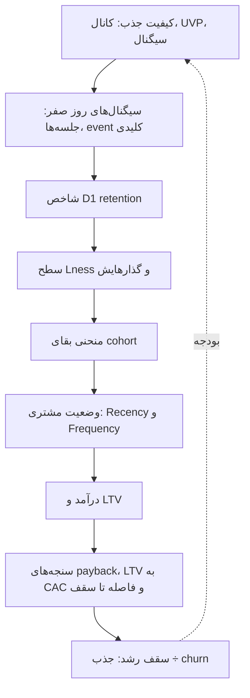

| حلقه | سنجه | نوشته‌ها |
|---|---|---|
| کیفیت جذب | ریزش دوره‌ی اول cohort، AUC و پوشش سیگنال | [۱۸](chapters/18-plg-growth-attracting-users.md)، [۳۶](chapters/36-user-cohort-retention.md)، [۶۳](chapters/63-best-ua-signal-less-revenue-than-nothing.md) |
| سیگنال‌های روز صفر | برگشت به جلسه‌ی دوم و شمار جلسه‌ها، با R² حدود ۰٫۳ برای D1 | [۳۱](chapters/31-user-engagement-first-time-user-experience.md)، [۳۳](chapters/33-d1-retention-a-tricky-metric-to-predict.md)، [۳۴](chapters/34-user-engagement-key-events.md) |
| شاخص D1 retention | برگشت بین ۲۴ تا ۴۸ ساعت | [۳۰](chapters/30-user-engagement-period-of-analysis.md)، [۳۲](chapters/32-user-engagement-d1-retention.md) |
| سطح Lness | توزیع روزهای فعال در هفته | [۲۳](chapters/23-plg-growth-retaining-users.md)، [۲۷](chapters/27-stickiness-insights-part3.md) |
| منحنی بقا | پرتگاه، خط میانی، دم | [۳۶](chapters/36-user-cohort-retention.md)، [۶۵](chapters/65-retention-curve-hides-more-than-it-shows.md) |
| وضعیت مشتری | ۷۵٪ خریداران آینده Recency زیر ۳۰ روز دارند | [۵۰](chapters/50-rf-matrix-the-magic-of-recency.md)، [۵۲](chapters/52-rr-ff-matrices-introduction-to-customer-states.md)، [۵۳](chapters/53-customer-state-a-key-building-block-of-advanced-customer.md) |
| درآمد و LTV | LTV تا امروز و پیش‌بینی‌شده | [۴۶](chapters/46-ltv-forecasting-introduction.md)، [۵۱](chapters/51-rf-matrix-frequency-dimension.md) |
| اقتصاد واحد | payback، LTV به CAC، فاصله تا سقف | [۴۲](chapters/42-cac-payback-period.md)–[۴۴](chapters/44-cac-payback-period-vs-ltv-cac.md)، [۶۶](chapters/66-two-cohorts-same-payback-different-investments.md) |
| سقف رشد | جذب ÷ churn | [۱](chapters/01-churn-rate-evolution-at-netflix.md) |

## سیر اندیشه‌ی نویسنده

خوانش vault از ترتیب انتشار: هر دوره ابزاری تازه آورده و پرسش را یک قدم به تصمیم نزدیک‌تر کرده است.

| دوره | نوشته‌ها | تمرکز | ابزار تازه | جهش فکری |
|---|---|---|---|---|
| ۲۰۲۰ | [۱](chapters/01-churn-rate-evolution-at-netflix.md) | churn در Netflix | مدل cohort ساده | سقف رشد |
| ۲۰۲۲ تا اوایل ۲۰۲۳ | [۲](chapters/02-how-do-you-measure-the-success-of-a-product-feature.md)–[۱۵](chapters/15-how-a-successful-product-feature-should-look-like.md) | سنجش feature | صدک، Information Gain، MCC | از شمردن به رابطه‌ی جهت‌دار |
| ۲۰۲۳ | [۱۶](chapters/16-is-focusing-on-retention-could-help-us-improve.md)–[۲۸](chapters/28-growth-models.md) | PLG و stickiness | Lness، ماتریس گذار، رگرسیون لجستیک | از عدد فشرده به توزیع و گذار |
| ۲۰۲۳ تا ۲۰۲۴ | [۲۹](chapters/29-user-engagement-introduction.md)–[۴۰](chapters/40-all-user-cohorts-are-noisy-but-some-can-tell-you-a-story.md) | engagement و cohort | پنجره‌ی ۲۴ ساعته، رنگ آماری | از تقویم به cohort |
| ۲۰۲۴ | [۴۱](chapters/41-when-do-you-need-to-use-the-ltv-projection.md)–[۴۸](chapters/48-ltv-forecasting-how-good-the-corrective-models-are.md) | LTV و CAC | WOE، مدل تصحیحی | از رفتار به اقتصاد |
| ۲۰۲۴ تا ۲۰۲۵ | [۴۹](chapters/49-rf-matrix-introduction.md)–[۵۶](chapters/56-user-transition-states-diagram.md) | RF و وضعیت مشتری | RR و FF، نمودار گذار | از قیف به فرایند |
| ۲۰۲۶ | [۵۷](chapters/57-when-ltv-can-lie-to-you-asymptote-of-death.md)–[۷۱](chapters/71-split-a-churn-spike-lmdi.md) | UA، churn علّی، تجزیه | T-Learner، NMF، AUC × پوشش، LMDI | از پیش‌بینی به اقدام و تجزیه‌ی صادق |

## تنش‌ها و پرسش‌های باز

این بخش خوانش vault است: جاهایی که نوشته‌ها با هم کشمکش دارند یا پرسشی را باز می‌گذارند.

- **همبستگی تا علیت.** بخش بزرگی از مجموعه بر ضریب MCC بنا شده که همبستگی است ([۱۱](chapters/11-product-feature-retention-deep-dive-mcc-coefficient.md)–[۳۵](chapters/35-why-does-product-analytics-go-beyond-product-feature.md))؛ نویسنده خودش از ابتدا هشدار داده ([۲](chapters/02-how-do-you-measure-the-success-of-a-product-feature.md)) و در نوشته‌های آخر به holdout و مدل uplift رسیده ([۵۸](chapters/58-why-your-live-ops-ltv-model-is-setting-money-on-fire.md)، [۶۰](chapters/60-the-four-questions-churn-analysis-should-answer.md)، [۶۷](chapters/67-flo-health-what-zero-uplift-really-means.md)). پس رتبه‌بندی MCC را فهرست فرضیه بخوانید، نه فهرست اهرم.
- **رفتار پیش‌بینی می‌کند یا نه؟** سیگنال‌های رفتاری LTV را توضیح نمی‌دهند ([۴۵](chapters/45-ltv-and-behavioral-signals.md)) و توان مالی را نمی‌سنجند ([۵۸](chapters/58-why-your-live-ops-ltv-model-is-setting-money-on-fire.md))، ولی Recency قوی‌ترین سیگنال خرید آینده است ([۵۰](chapters/50-rf-matrix-the-magic-of-recency.md)) و جلسه‌های روز صفر D1 را پیش‌بینی می‌کنند ([۳۳](chapters/33-d1-retention-a-tricky-metric-to-predict.md)). آشتی‌شان در اصل ۶ است: رفتار، رفتار هم‌جنسش را پیش‌بینی می‌کند.
- **سرعت یا کارایی؟** payback قاعده‌ی سرانگشتی برای کنار گذاشتن کمپین‌های بی‌پتانسیل است ولی جای ROI را نمی‌گیرد ([۴۴](chapters/44-cac-payback-period-vs-ltv-cac.md))، و دو cohort با payback یکسان سرمایه‌گذاری‌های متفاوتی‌اند ([۶۶](chapters/66-two-cohorts-same-payback-different-investments.md)). جواب مجموعه: payback برای نقدینگی، فاصله تا سقف برای مقیاس.
- **تجزیه: بله یا نه؟** نوشته‌ها هم درخت متریک را رد می‌کنند ([۵۴](chapters/54-the-metric-tree-trap.md)، [۶۲](chapters/62-stop-decomposing-metric-tree.md)) و هم تجزیه‌ی ضربی D1 را به کار می‌برند ([۳۲](chapters/32-user-engagement-d1-retention.md)) و هم LMDI را پیشنهاد می‌کنند ([۷۱](chapters/71-split-a-churn-spike-lmdi.md)). خط فاصل: تجزیه‌ای که ریاضی دقیق و مستقل از ترتیب دارد یا در طول سفر واقعی کاربر است، نه سلسله‌مراتب ذهنی.
- **ساده یا پیچیده؟** نویسنده مدل رشد را در یک برگه‌ی Excel می‌خواهد ([۲۸](chapters/28-growth-models.md)) و خوشه‌بندی را با صدک ([۶](chapters/06-clustering-users-based-on-weekly-habit-and-daily.md))، ولی برای churn و UA به NMF و ترانسفورمر علّی و T-Learner می‌رسد ([۵۸](chapters/58-why-your-live-ops-ltv-model-is-setting-money-on-fire.md)، [۶۰](chapters/60-the-four-questions-churn-analysis-should-answer.md)). قاعده‌ی ضمنی: ساده‌ترین ابزاری که صادق است، و پیچیدگی فقط وقتی تصمیم را عوض می‌کند.
- **شاخص پیشرو چقدر پیشرو است؟** Lness پیشرو است ولی جانشین ([۲۵](chapters/25-stickiness-insights-part-2.md))، و فقط Lness اخیر اطلاعات زیادی دارد ([۲۷](chapters/27-stickiness-insights-part3.md)). پس هر شاخص پیشرو را با گذارش بخوانید، نه با مقدار اولیه‌اش.
- **پرسش‌های باز.** نوشته‌ها نمی‌گویند ضریب MCC چند feature را چطور به یک تصمیم سطح محصول ترکیب کنیم؛ خود نویسنده MCC بر حسب ترتیب رویداد را توصیه نمی‌کند ([۲۱](chapters/21-mastering-the-mcc-coefficient.md)). دنیاهای شبیه‌سازی‌شده‌ی نوشته‌های ۵۸ تا ۷۱ سازوکار را نشان می‌دهند، و اندازه‌ی اثرشان را باید روی داده‌ی خودتان دوباره بسنجید.

## گردش‌کار کامل

*سطح ۴ از ۵: تصمیم، از ابتدا تا انتها.*

ترتیبی که vault برای به‌کار بستن مجموعه روی یک محصول پیشنهاد می‌کند. هر گام به گام بعدی خوراک می‌دهد.

1. **سقف را بشناسید.** جذب ÷ churn و اثر retention بر رشد ([۱](chapters/01-churn-rate-evolution-at-netflix.md)، [۲۲](chapters/22-plg-growth-retaining-monetizing-users.md)).
2. **واحد و پنجره را تعریف کنید.** کاربر به‌جای رویداد، پنجره‌ی ۲۴ ساعته، تعریف «برگشته» ([۳](chapters/03-how-popular-is-this-feature-among-weekly-daily-active.md)، [۹](chapters/09-two-types-of-feature-retention.md)، [۳۰](chapters/30-user-engagement-period-of-analysis.md)، [۳۸](chapters/38-how-to-build-user-cohort-properly.md)).
3. **جدول cohort را بسازید و بخوانید.** lifetime و تراز چپ، رنگ آماری، سه مرحله‌ی منحنی، بدون retention آمیخته ([۳۶](chapters/36-user-cohort-retention.md)–[۴۰](chapters/40-all-user-cohorts-are-noisy-but-some-can-tell-you-a-story.md)).
4. **شکل منحنی را تشخیص دهید.** پرتگاه و دم و بنیان‌هایشان، و این‌که هر کدام به کدام تیم می‌رسد ([۶۵](chapters/65-retention-curve-hides-more-than-it-shows.md)).
5. **لحظه‌های حساس را پیدا کنید.** جلسه‌ی دوم، D1 دومرحله‌ای، سیگنال روز صفر و event کلیدی ([۲۹](chapters/29-user-engagement-introduction.md)–[۳۵](chapters/35-why-does-product-analytics-go-beyond-product-feature.md)).
6. **عادت و وضعیت را دنبال کنید.** Lness و گذارها، و پس از خرید RF و وضعیت‌ها ([۲۳](chapters/23-plg-growth-retaining-users.md)–[۲۷](chapters/27-stickiness-insights-part3.md)، [۴۹](chapters/49-rf-matrix-introduction.md)–[۵۶](chapters/56-user-transition-states-diagram.md)).
7. **به featureها با کمیت، جهت و زمینه رتبه بدهید.** ([۷](chapters/07-what-is-the-impact-on-the-retention-rate.md)–[۱۶](chapters/16-is-focusing-on-retention-could-help-us-improve.md)).
8. **هر جهش را صادقانه تجزیه کنید.** IV و WOE برای ابعاد، LMDI برای mix و rate و volume ([۶۲](chapters/62-stop-decomposing-metric-tree.md)، [۶۷](chapters/67-flo-health-what-zero-uplift-really-means.md)، [۷۱](chapters/71-split-a-churn-spike-lmdi.md)).
9. **اقتصاد را با عدم قطعیتش بسنجید.** LTV با چند مدل، payback کنار فاصله تا سقف ([۴۱](chapters/41-when-do-you-need-to-use-the-ltv-projection.md)–[۴۸](chapters/48-ltv-forecasting-how-good-the-corrective-models-are.md)، [۵۷](chapters/57-when-ltv-can-lie-to-you-asymptote-of-death.md)، [۶۴](chapters/64-long-tail-eats-your-ltv-model.md)–[۶۶](chapters/66-two-cohorts-same-payback-different-investments.md)).
10. **سیگنال جذب را درست بدهید.** AUC × پوشش × درآمد و archetype با افق D180 ([۶۱](chapters/61-d30-roas-is-the-wrong-metric-here-is-what-to-use-instead.md)، [۶۳](chapters/63-best-ua-signal-less-revenue-than-nothing.md)).
11. **اقدام کنید و علّی بسنجید.** سه سطل، قابل‌اقناع‌ها، پیشنهاد متناسب و holdout ([۵۸](chapters/58-why-your-live-ops-ltv-model-is-setting-money-on-fire.md)–[۶۰](chapters/60-the-four-questions-churn-analysis-should-answer.md)، [۶۷](chapters/67-flo-health-what-zero-uplift-really-means.md)).

## نقشه‌ی نوشته‌ها

*سطح ۵ از ۵: جزء.*

هر نوشته با لایه‌اش در زنجیره‌ی ارزش، اصل‌هایی که به آن‌ها مصداق می‌دهد و نقشش در چارچوب. لایه‌ی «روش» یعنی نوشته‌ای که به کل زنجیره ابزار می‌دهد.

| نوشته | لایه | اصل | نقش در چارچوب |
|---|---|---|---|
| [۱](chapters/01-churn-rate-evolution-at-netflix.md) | رشد | ۷ | سقف رشد برابر جذب ÷ churn؛ churn قاتل خاموش |
| [۲](chapters/02-how-do-you-measure-the-success-of-a-product-feature.md) | روش | ۳، ۸ | نقشه‌ی هفت پرسش سنجش feature؛ هنوز علیت نیست |
| [۳](chapters/03-how-popular-is-this-feature-among-weekly-daily-active.md) | عادت | ۱ | محبوبیت: از رویداد به کاربر، درصد و جدا برای جدید و قدیمی |
| [۴](chapters/04-how-regular-are-users-using-this-feature-per-week.md) | عادت | ۱ | عادت هفتگی: توزیع به‌جای میانگین |
| [۵](chapters/05-how-often-are-users-using-this-feature-per-day.md) | عادت | ۱ | شدت روزانه: هیستوگرام و جدا کردن کاربر جدید |
| [۶](chapters/06-clustering-users-based-on-weekly-habit-and-daily.md) | عادت | ۳ | خوشه‌بندی با صدک ۵۰ و ۸۰ |
| [۷](chapters/07-what-is-the-impact-on-the-retention-rate.md) | ماندن | ۳ | retention هر feature، نسخه‌ی اول |
| [۸](chapters/08-an-enhanced-version-of-the-analysis-of-how-product.md) | ماندن | ۳ | کمیت کنار کیفیت: نُه خوشه |
| [۹](chapters/09-two-types-of-feature-retention.md) | ماندن | ۱، ۳ | retention محلی در برابر سراسری |
| [۱۰](chapters/10-retention-deep-dive.md) | ماندن | ۳ | غیرکاربران هم مهم‌اند: Information Gain |
| [۱۱](chapters/11-product-feature-retention-deep-dive-mcc-coefficient.md) | ماندن | ۳ | جهت اثر با MCC؛ featureهای محبوب منفی‌اند |
| [۱۲](chapters/12-what-is-the-difference-in-product-feature-usage-between.md) | درآمد | ۳، ۶ | ضریب MCC جدا برای رایگان و پولی |
| [۱۳](chapters/13-user-flow.md) | ماندن | ۳، ۴ | زمینه: MCC در جریان کاربر |
| [۱۴](chapters/14-what-is-the-completion-rate-of-a-product-feature.md) | ماندن | ۳ | نرخ تکمیل کنار اثر روی retention |
| [۱۵](chapters/15-how-a-successful-product-feature-should-look-like.md) | ماندن | ۳ | نقطه‌ی شیرین: محبوبیت ۱۰٪ تا ۳۰٪ و MCC بالا |
| [۱۶](chapters/16-is-focusing-on-retention-could-help-us-improve.md) | درآمد | ۳ | retention و درآمدزایی هم‌بسته‌اند |
| [۱۷](chapters/17-plg-strategy-and-product-analytics.md) | روش | ۴ | پنج هدف PLG و پرسش‌های تحلیلی‌شان |
| [۱۸](chapters/18-plg-growth-attracting-users.md) | جذب | ۲، ۶ | کانال و UVP ریزش cohort جدید را می‌رانند |
| [۱۹](chapters/19-plg-growth-activating-new-users.md) | فعال‌سازی | ۳، ۴ | featureهای اثرگذار از P0 تا P3 عوض می‌شوند |
| [۲۰](chapters/20-the-mcc-coefficient-or-cohort-analysis.md) | روش | ۳ | ضریب MCC روی cohort |
| [۲۱](chapters/21-mastering-the-mcc-coefficient.md) | روش | ۱، ۳ | تعریف «برگشته» در MCC |
| [۲۲](chapters/22-plg-growth-retaining-monetizing-users.md) | رشد | ۷ | چرا retention، و چهار نوع مشتری freemium |
| [۲۳](chapters/23-plg-growth-retaining-users.md) | عادت | ۱ | stickiness و Lness به‌جای DAU/MAU |
| [۲۴](chapters/24-in-the-last-post-i-discussed-how-stickiness-relates-to.md) | عادت | ۲، ۴ | retention دوره به دوره و پنجره‌ی فرصت |
| [۲۵](chapters/25-stickiness-insights-part-2.md) | عادت | ۴ | ماتریس گذار Lness |
| [۲۶](chapters/26-threads-growth-analysis.md) | جذب | ۲ | شرکت Threads: شروع سریع موفقیت نیست |
| [۲۷](chapters/27-stickiness-insights-part3.md) | عادت | ۴، ۷ | Lness اخیر از Lness اولیه پیش‌بینی‌کننده‌تر است |
| [۲۸](chapters/28-growth-models.md) | رشد | ۷ | مدل رشد: فرض‌ها، کانال، فصلی بودن |
| [۲۹](chapters/29-user-engagement-introduction.md) | فعال‌سازی | ۴ | ورود به engagement با دو پرسش |
| [۳۰](chapters/30-user-engagement-period-of-analysis.md) | فعال‌سازی | ۱ | پنجره‌ی ۲۴ ساعته به‌جای روز تقویمی |
| [۳۱](chapters/31-user-engagement-first-time-user-experience.md) | فعال‌سازی | ۱، ۴ | تجربه‌ی FTUE و زمان جلسه‌ی اول |
| [۳۲](chapters/32-user-engagement-d1-retention.md) | فعال‌سازی | ۵ | شاخص D1 به حاصل‌ضرب دو مرحله |
| [۳۳](chapters/33-d1-retention-a-tricky-metric-to-predict.md) | فعال‌سازی | ۶، ۷ | کدام سیگنال روز صفر D1 را پیش‌بینی می‌کند |
| [۳۴](chapters/34-user-engagement-key-events.md) | فعال‌سازی | ۳ | تعریف event کلیدی با MCC |
| [۳۵](chapters/35-why-does-product-analytics-go-beyond-product-feature.md) | عادت | ۲، ۳ | event کلیدی بر پایه‌ی cohort و عمر feature هسته |
| [۳۶](chapters/36-user-cohort-retention.md) | ماندن | ۲ | سه سناریو و سه مرحله‌ی هر cohort |
| [۳۷](chapters/37-blended-retention-vs-cohort-retention.md) | ماندن | ۲، ۵ | retention آمیخته گمراه می‌کند |
| [۳۸](chapters/38-how-to-build-user-cohort-properly.md) | ماندن | ۱، ۲ | ساختن cohort با بازه‌ی ۲۴ ساعته |
| [۳۹](chapters/39-how-to-draw-and-read-user-cohorts-properly.md) | ماندن | ۱، ۲ | رنگ‌بندی آماری جدول cohort |
| [۴۰](chapters/40-all-user-cohorts-are-noisy-but-some-can-tell-you-a-story.md) | ماندن | ۷ | نویز cohort و خطای نسبی دم |
| [۴۱](chapters/41-when-do-you-need-to-use-the-ltv-projection.md) | اقتصاد واحد | ۸ | چهار تصمیمی که LTV لازم دارند |
| [۴۲](chapters/42-cac-payback-period.md) | اقتصاد واحد | ۱، ۷ | دوره‌ی payback و WOE درآمد ۳۰ روز |
| [۴۳](chapters/43-cac-payback-period-benchmarks.md) | اقتصاد واحد | ۷ | بنچمارک payback و توزیع کمپین‌ها |
| [۴۴](chapters/44-cac-payback-period-vs-ltv-cac.md) | اقتصاد واحد | ۸ | دوره‌ی payback در برابر LTV به CAC |
| [۴۵](chapters/45-ltv-and-behavioral-signals.md) | اقتصاد واحد | ۶ | سیگنال رفتاری LTV را توضیح نمی‌دهد |
| [۴۶](chapters/46-ltv-forecasting-introduction.md) | اقتصاد واحد | ۶، ۷ | پیش‌بینی LTV و خطا بر حسب داده |
| [۴۷](chapters/47-ltv-forecasting-battle-for-accuracy.md) | اقتصاد واحد | ۷ | مدل تصحیحی |
| [۴۸](chapters/48-ltv-forecasting-how-good-the-corrective-models-are.md) | اقتصاد واحد | ۷ | مدل تصحیحی برای هر cohort |
| [۴۹](chapters/49-rf-matrix-introduction.md) | پس از خرید | ۴ | ماتریس RF |
| [۵۰](chapters/50-rf-matrix-the-magic-of-recency.md) | پس از خرید | ۶ | شاخص Recency قوی‌ترین سیگنال است |
| [۵۱](chapters/51-rf-matrix-frequency-dimension.md) | پس از خرید | ۴، ۶ | شاخص Frequency و ضرب‌آهنگ تراکنش |
| [۵۲](chapters/52-rr-ff-matrices-introduction-to-customer-states.md) | پس از خرید | ۴ | ماتریس RR و FF: مسیر مشتری |
| [۵۳](chapters/53-customer-state-a-key-building-block-of-advanced-customer.md) | پس از خرید | ۲، ۴ | سه دوره: از کجا آمده، به کجا می‌رود |
| [۵۴](chapters/54-the-metric-tree-trap.md) | روش | ۵ | دام درخت متریک |
| [۵۵](chapters/55-user-acquisition-funnel.md) | جذب | ۴ | قیف فرایند را پنهان می‌کند؛ churn مستقیم و غیرفعال |
| [۵۶](chapters/56-user-transition-states-diagram.md) | درآمد | ۴ | نمودار گذار هفت وضعیتی |
| [۵۷](chapters/57-when-ltv-can-lie-to-you-asymptote-of-death.md) | اقتصاد واحد | ۷ | مجانب مرگ |
| [۵۸](chapters/58-why-your-live-ops-ltv-model-is-setting-money-on-fire.md) | درآمد | ۶، ۸ | intent در برابر solvency و موتور علّی |
| [۵۹](chapters/59-your-day-2-paywall-is-burning-your-best-future-customers.md) | درآمد | ۶، ۸ | paywall متناسب با intent |
| [۶۰](chapters/60-the-four-questions-churn-analysis-should-answer.md) | ماندن | ۸ | چهار پرسش churn و سه سطل |
| [۶۱](chapters/61-d30-roas-is-the-wrong-metric-here-is-what-to-use-instead.md) | جذب | ۶، ۸ | شاخص D30 ROAS و archetypeها |
| [۶۲](chapters/62-stop-decomposing-metric-tree.md) | روش | ۵ | ارزیابی هر بُعد با IV و WOE به‌جای drill-down |
| [۶۳](chapters/63-best-ua-signal-less-revenue-than-nothing.md) | جذب | ۶ | دام دقت: AUC، پوشش، درآمد |
| [۶۴](chapters/64-long-tail-eats-your-ltv-model.md) | اقتصاد واحد | ۷ | اختلاف مدل‌ها به‌عنوان عدم قطعیت |
| [۶۵](chapters/65-retention-curve-hides-more-than-it-shows.md) | ماندن | ۷ | بنیان‌های دوبخشی |
| [۶۶](chapters/66-two-cohorts-same-payback-different-investments.md) | اقتصاد واحد | ۷ | فاصله تا سقف کنار payback |
| [۶۷](chapters/67-flo-health-what-zero-uplift-really-means.md) | درآمد | ۵، ۸ | holdout و ترکیب در برابر رفتار |
| [۶۸](chapters/68-why-duolingo-streaks-work-in-four-questions.md) | عادت | ۵ | چهار پرسش، جمع‌پذیر با سه دروازه |
| [۶۹](chapters/69-a-streak-is-a-lifecycle.md) | عادت | ۴ | شمارنده‌ی streak چرخه‌ی عمر است |
| [۷۰](chapters/70-getting-in-building-it-locking-in.md) | عادت | ۵ | دروازه، جمع، برهم‌کنش |
| [۷۱](chapters/71-split-a-churn-spike-lmdi.md) | روش | ۵ | تجزیه با LMDI |
