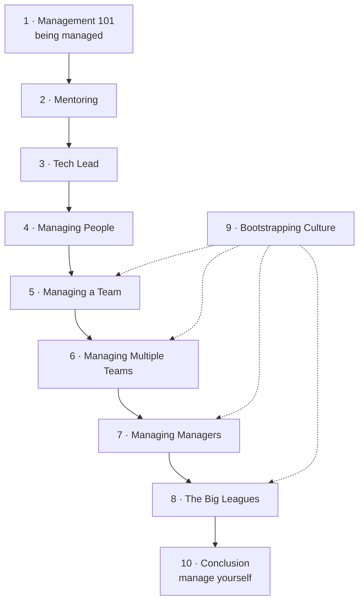

# The Manager's Path

**Open [`index.html`](index.html) in a browser** for the interactive version: one slide-by-slide lesson per chapter, with embedded simulations and self-checks. Everything here also reads fine on GitHub.

## About

*The Manager's Path: A Guide for Tech Leaders Navigating Growth and Change* follows the career of an engineering manager level by level, from being managed to running a technology organization. Each chapter covers one step up in management complexity — mentor, tech lead, manager of people, of a team, of multiple teams, of managers, and senior leadership — so readers can start at the chapter that matches their job and come back as it changes (Introduction, pp. xi–xiv). Chapter 9, on culture, is the "wildcard" that applies at every level.

Recurring boxes give the book its texture: **Ask the CTO** answers common questions, **Good Manager, Bad Manager** contrasts behaviours (the alpha geek, the process czar, the micromanager), and **Challenging Situations** walks through hard conversations. Each chapter ends with questions for *Assessing Your Own Experience*. The author began the book while CTO at Rent the Runway, and its examples come from there and from her earlier jobs.

## What's in this folder

| Path | What it is |
|---|---|
| [`chapters/NN-*.md`](chapters/01-management-101.md) | Chapter notes, **the source of truth**. Each `.md` has a generated `.html` lesson next to it |
| [`widgets/`](widgets/02-intern-project.html) | Hand-built simulations, embedded in the lessons; each also opens on its own |
| [`lab/`](lab/03-parallel-plan/README.md) | Runnable Python experiments with expected output |
| `index.html` | The book hub, generated from this README and the chapters |

## How the book fits together

The chapters climb the management ladder; the last two step back to culture and to managing yourself.

*The ladder order is the book's; the dotted links are the vault's reading of where Chapter 9 applies.*

Some threads run through the whole book:

- **1-1s and feedback** start as something you receive (1), become your main tool with people (4), and turn into skip-levels as you move away from the work (7).
- **Staying technical** shifts from writing code (3, 5) to code reviews and debugging (6) to setting technical standards and True North (8).
- **Delegation** grows from the tech lead's balance (3) through the delegation table (6) to managing managers you can't micromanage (7).
- **Culture and fear**: the alpha geek's culture of fear (2), team culture (5, 6), the senior leader's influence (8), and deliberate culture-building (9).

## Chapters

| # | Chapter | Pages |
|---:|---|---|
| 1 | [Management 101](chapters/01-management-101.md) | 1–10 |
| 2 | [Mentoring](chapters/02-mentoring.md) | 11–26 |
| 3 | [Tech Lead](chapters/03-tech-lead.md) | 27–48 |
| 4 | [Managing People](chapters/04-managing-people.md) | 49–74 |
| 5 | [Managing a Team](chapters/05-managing-a-team.md) | 75–97 |
| 6 | [Managing Multiple Teams](chapters/06-managing-multiple-teams.md) | 99–123 |
| 7 | [Managing Managers](chapters/07-managing-managers.md) | 125–157 |
| 8 | [The Big Leagues](chapters/08-the-big-leagues.md) | 159–189 |
| 9 | [Bootstrapping Culture](chapters/09-bootstrapping-culture.md) | 191–216 |
| 10 | [Conclusion](chapters/10-conclusion.md) | 217–218 |

Page ranges are printed pages. Front matter (acknowledgments and the introduction) takes pp. ix–xiv; the book ends with an index (p. 219).

## Key concepts

These ideas recur across chapters; each row lists the chapters that discuss them. The definitions are the vault's summaries of the book's explanations.

| Concept | Definition | Chapters |
|---|---|---|
| 1-1 meetings | Regular private meetings between manager and report: for human connection, feedback and coaching, not status updates. | [1](chapters/01-management-101.md) · [4](chapters/04-managing-people.md) · [7](chapters/07-managing-managers.md) |
| Continuous feedback | Small, frequent praise and correction, so reviews hold no surprises. | [1](chapters/01-management-101.md) · [4](chapters/04-managing-people.md) |
| Alpha geek | The engineer who must be the smartest in the room; creates a culture of fear, not excellence. | [2](chapters/02-mentoring.md) · [8](chapters/08-the-big-leagues.md) |
| Tech lead | A set of responsibilities, not a level: balancing your own technical work with what the team needs. | [3](chapters/03-tech-lead.md) · [9](chapters/09-bootstrapping-culture.md) |
| Process czar | The lead who believes the right process will solve every problem; the alternative is process fitted to the team. | [3](chapters/03-tech-lead.md) · [9](chapters/09-bootstrapping-culture.md) |
| Micromanagement | Controlling the details of delegated work; the delegator instead sets goals and checks in at the right depth. | [4](chapters/04-managing-people.md) · [6](chapters/06-managing-multiple-teams.md) · [7](chapters/07-managing-managers.md) |
| Sustaining engineering | About 20% of planned time reserved for testing, cleanup, migrations and on-call, so features don't slow down. | [5](chapters/05-managing-a-team.md) · [9](chapters/09-bootstrapping-culture.md) |
| Importance vs. urgency | Table 6-1: urgency is felt, importance must be judged; make time for the important but not urgent. | [6](chapters/06-managing-multiple-teams.md) |
| Delegation by complexity and frequency | Table 6-2: delegate simple frequent work, do simple rare work, teach complex work to grow the team. | [6](chapters/06-managing-multiple-teams.md) · [7](chapters/07-managing-managers.md) |
| Skip-level meetings | Meetings with your reports' reports — quarterly 1-1s or team lunches — to see past managers who manage up well. | [7](chapters/07-managing-managers.md) |
| First team | A leader's first team is their peers across the company, not the people who report to them. | [6](chapters/06-managing-multiple-teams.md) · [8](chapters/08-the-big-leagues.md) |
| True North | The standards a senior leader sets — such as production readiness — that teams internalize and weigh risks against. | [8](chapters/08-the-big-leagues.md) |
| Career ladder | Levels with written expectations and salary bands, written with the team and evolved as it grows. | [8](chapters/08-the-big-leagues.md) · [9](chapters/09-bootstrapping-culture.md) |
| Process as risk management | Heavy process only for rare or hidden-risk work; code review, blameless postmortems and architecture review depersonalize decisions. | [9](chapters/09-bootstrapping-culture.md) |

## How these notes work

- **Everything above *Beyond the book* in a chapter note restates the book**, with page references. Supplementary material, meaning outside sources and the vault's interpretation, lives under *Beyond the book* or in `> **Vault note:**` callouts.
- **Page numbers are printed pages** (PDF page − 16).
- The book's recurring boxes — Ask the CTO, Good Manager/Bad Manager, Challenging Situations and guest essays — appear as callouts or rows with their pages.
- Section outlines are the book's own table of contents, taken from the PDF's bookmarks.
- Mermaid diagrams are the vault's own summaries; captions say so.
- *Check yourself* questions and answers are the vault's, written from the notes; the answers cite pages.
- Simulations and experiments are the vault's own implementations of situations the book describes — the intern project, the tech lead's calendar, the quarter plan, the delegation tables, skip-level arithmetic, the career ladder. Each says which pages it illustrates and what it invents.

## Source

- **Primary source:** the publisher's PDF of the First Edition, April 2017 (first release 2017-03-08), © 2017 Camille Fournier, O'Reilly Media (243 PDF pages). The PDF is kept outside version control (see `.gitignore`).
- **Table of contents:** taken from the PDF's bookmark outline; printed page numbers come from the page footers.
- **Structure:** front matter (acknowledgments, introduction), ten chapters and an index.
- **Coverage:** all ten chapters are covered.
- **Figures:** the book has no figures, only two tables (Tables 6-1 and 6-2, Chapter 6), which the notes reproduce as Markdown tables.
