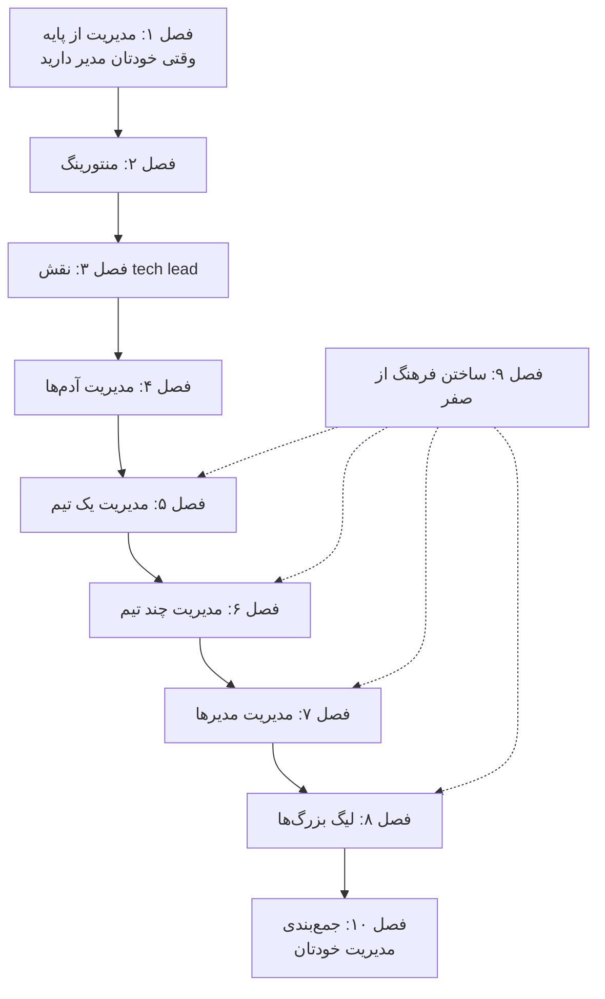

# The Manager's Path

**نسخه‌ی تعاملی را با باز کردن [`index.html`](index.html) در مرورگر ببینید**: برای هر فصل یک درس اسلاید‌به‌اسلاید، با شبیه‌سازی‌های جاسازی‌شده و خودسنجی. همین متن روی GitHub هم خوب خوانده می‌شود.

## درباره‌ی کتاب

کتاب *The Manager's Path: A Guide for Tech Leaders Navigating Growth and Change* مسیر شغلی یک مدیر مهندسی را پله به پله دنبال می‌کند: از جایی که خودتان مدیر دارید تا جایی که یک سازمان فنی را می‌گردانید. هر فصل یک پله بالاتر در پیچیدگی مدیریت است؛ منتور، tech lead، مدیر آدم‌ها، مدیر یک تیم، مدیر چند تیم، مدیر مدیرها و رهبری ارشد. برای همین می‌توانید از همان فصلی شروع کنید که با شغل امروزتان می‌خواند و وقتی شغلتان عوض شد برگردید (مقدمه، صص. xi–xiv). فصل ۹ درباره‌ی فرهنگ است و حکم کارت آزاد را دارد: در هر پله‌ای به کار می‌آید.

جعبه‌های تکرارشونده به کتاب بافت می‌دهند: **Ask the CTO** به پرسش‌های رایج پاسخ می‌دهد، **Good Manager, Bad Manager** رفتارها را رو‌به‌رو می‌گذارد؛ مثلاً alpha geek، process czar و مدیر ذره‌بین‌به‌دست، و **Challenging Situations** گفت‌وگوهای سخت را قدم به قدم می‌برد. هر فصل با چند پرسش زیر عنوان *Assessing Your Own Experience* تمام می‌شود. نویسنده نوشتن کتاب را وقتی CTO شرکت Rent the Runway بود شروع کرد و مثال‌ها از همان‌جا و از شغل‌های پیشینش می‌آیند.

## محتوای این پوشه

| مسیر | چیست |
|---|---|
| [`chapters/NN-*.md`](chapters/01-management-101.md) | یادداشت فصل‌ها، **منبع اصلی**. کنار هر `.md` یک درس `.html` ساخته می‌شود |
| [`widgets/`](widgets/02-intern-project.html) | شبیه‌سازی‌های دست‌ساز که در درس‌ها جاسازی شده‌اند؛ هر کدام جداگانه هم باز می‌شوند |
| [`lab/`](lab/03-parallel-plan/README.md) | آزمایش‌های اجراشدنی Python با خروجی مورد انتظار |
| `index.html` | صفحه‌ی کتاب که از همین README و فصل‌ها ساخته می‌شود |

## کتاب چطور به هم وصل است

فصل‌ها نردبان مدیریت را بالا می‌روند؛ دو فصل آخر یک قدم عقب می‌ایستند و به فرهنگ و به مدیریت خودتان می‌پردازند.

*ترتیب نردبان مال کتاب است؛ خط‌چین‌ها خوانش vault است از جاهایی که فصل ۹ به کار می‌آید.*

چند رشته در کل کتاب کشیده شده‌اند:

- **جلسه‌ی ۱-۱ و بازخورد** اول چیزی است که می‌گیرید (۱)، بعد ابزار اصلی‌تان با آدم‌ها می‌شود (۴) و وقتی از کار روزمره دور می‌شوید به skip-level تبدیل می‌شود (۷).
- **فنی ماندن** از نوشتن کد (۳، ۵) به code review و debug (۶) و بعد به تعیین استانداردهای فنی و True North می‌رسد (۸).
- **واگذاری کار** از تعادل tech lead (۳) شروع می‌شود، از جدول واگذاری (۶) می‌گذرد و به مدیرهایی می‌رسد که نمی‌توانید ذره‌بین رویشان بگذارید (۷).
- **فرهنگ و ترس**: فرهنگ ترسی که alpha geek می‌سازد (۲)، فرهنگ تیم (۵، ۶)، نفوذ رهبر ارشد (۸) و فرهنگ‌سازی عامدانه (۹).

## فصل‌ها

| # | فصل | صفحه‌ها |
|---:|---|---|
| ۱ | [مدیریت از پایه](chapters/01-management-101.md) | ۱–۱۰ |
| ۲ | [منتورینگ](chapters/02-mentoring.md) | ۱۱–۲۶ |
| ۳ | [نقش tech lead](chapters/03-tech-lead.md) | ۲۷–۴۸ |
| ۴ | [مدیریت آدم‌ها](chapters/04-managing-people.md) | ۴۹–۷۴ |
| ۵ | [مدیریت یک تیم](chapters/05-managing-a-team.md) | ۷۵–۹۷ |
| ۶ | [مدیریت چند تیم](chapters/06-managing-multiple-teams.md) | ۹۹–۱۲۳ |
| ۷ | [مدیریت مدیرها](chapters/07-managing-managers.md) | ۱۲۵–۱۵۷ |
| ۸ | [لیگ بزرگ‌ها](chapters/08-the-big-leagues.md) | ۱۵۹–۱۸۹ |
| ۹ | [ساختن فرهنگ از صفر](chapters/09-bootstrapping-culture.md) | ۱۹۱–۲۱۶ |
| ۱۰ | [جمع‌بندی](chapters/10-conclusion.md) | ۲۱۷–۲۱۸ |

شماره‌ها صفحه‌ی چاپی‌اند. مطالب ابتدای کتاب، یعنی قدردانی و مقدمه، صص. ix–xiv را می‌گیرند و کتاب با یک نمایه در ص. ۲۱۹ تمام می‌شود.

## مفهوم‌های کلیدی

این ایده‌ها در چند فصل تکرار می‌شوند و هر ردیف فصل‌هایی را که به آن می‌پردازند فهرست می‌کند. تعریف‌ها خلاصه‌ی vault از توضیح کتاب‌اند.

| مفهوم | تعریف | فصل‌ها |
|---|---|---|
| جلسه‌ی ۱-۱ | جلسه‌ی خصوصی و منظم مدیر با هر نفر: برای ارتباط انسانی، بازخورد و کوچینگ، نه گزارش وضعیت. | [۱](chapters/01-management-101.md) · [۴](chapters/04-managing-people.md) · [۷](chapters/07-managing-managers.md) |
| بازخورد پیوسته | تعریف و تذکرِ کوچک و پرتکرار، تا در ارزیابی دوره‌ای هیچ غافلگیری‌ای نماند. | [۱](chapters/01-management-101.md) · [۴](chapters/04-managing-people.md) |
| alpha geek | مهندسی که باید باهوش‌ترین آدم اتاق باشد؛ فرهنگ ترس می‌سازد، نه فرهنگ سرآمدی. | [۲](chapters/02-mentoring.md) · [۸](chapters/08-the-big-leagues.md) |
| tech lead | مجموعه‌ای از مسئولیت‌هاست، نه یک level: تعادل بین کار فنی خودتان و چیزی که تیم لازم دارد. | [۳](chapters/03-tech-lead.md) · [۹](chapters/09-bootstrapping-culture.md) |
| process czar | سرپرستی که باور دارد process درست هر مشکلی را حل می‌کند؛ جایگزینش، process دوخته‌شده به تن تیم است. | [۳](chapters/03-tech-lead.md) · [۹](chapters/09-bootstrapping-culture.md) |
| مدیریت ذره‌بینی | کنترل جزئیات کاری که واگذار کرده‌اید؛ به‌جایش هدف بگذارید و در عمق درست سر بزنید. | [۴](chapters/04-managing-people.md) · [۶](chapters/06-managing-multiple-teams.md) · [۷](chapters/07-managing-managers.md) |
| کار نگه‌دارنده | حدود ۲۰٪ از زمان برنامه‌ریزی‌شده که برای تست، تمیزکاری، مهاجرت و on-call کنار گذاشته می‌شود تا ساخت feature کند نشود. | [۵](chapters/05-managing-a-team.md) · [۹](chapters/09-bootstrapping-culture.md) |
| مهم در برابر فوری | جدول ۶-۱: فوریت حس می‌شود ولی اهمیت را باید تشخیص داد؛ برای کار مهمِ غیرفوری وقت بگذارید. | [۶](chapters/06-managing-multiple-teams.md) |
| واگذاری بر پایه‌ی پیچیدگی و تکرار | جدول ۶-۲: کار ساده‌ی پرتکرار را واگذار کنید، کار ساده‌ی نادر را خودتان بکنید و کار پیچیده را یاد بدهید تا تیم رشد کند. | [۶](chapters/06-managing-multiple-teams.md) · [۷](chapters/07-managing-managers.md) |
| جلسه‌ی skip-level | جلسه با آدم‌های زیردست مدیرهایتان، به شکل ۱-۱ فصلی یا ناهار تیمی، تا فراتر از مدیرهایی را ببینید که خوب گزارش می‌دهند. | [۷](chapters/07-managing-managers.md) |
| تیم اولِ شما | تیم اول هر رهبر، هم‌ترازهایش در کل شرکت‌اند، نه آدم‌هایی که به او گزارش می‌دهند. | [۶](chapters/06-managing-multiple-teams.md) · [۸](chapters/08-the-big-leagues.md) |
| True North | استانداردهایی که رهبر ارشد می‌گذارد؛ مثلاً آمادگی برای production، تا تیم‌ها درونی‌شان کنند و ریسک‌ها را با آن بسنجند. | [۸](chapters/08-the-big-leagues.md) |
| نردبان شغلی | levelها با انتظارهای نوشته‌شده و بازه‌های حقوقی، که با خود تیم نوشته می‌شوند و همراه رشدش عوض می‌شوند. | [۸](chapters/08-the-big-leagues.md) · [۹](chapters/09-bootstrapping-culture.md) |
| process به‌مثابه مدیریت ریسک | process سنگین فقط برای کار نادر یا کاری که ریسکش پنهان است؛ code review، postmortem بدون سرزنش و بازبینی معماری تصمیم‌ها را از آدم‌ها جدا می‌کنند. | [۹](chapters/09-bootstrapping-culture.md) |

## این یادداشت‌ها چطور نوشته شده‌اند

- **هر چیزی که در یادداشت یک فصل بالای *فراتر از کتاب* است، خود کتاب را بازگو می‌کند**، با ارجاع به صفحه. مطالب مکمل، یعنی منابع بیرونی و خوانش vault، زیر *فراتر از کتاب* یا در کادرهای `> **Vault note:**` می‌آیند.
- **شماره‌ی صفحه‌ها صفحه‌ی چاپی‌اند** (صفحه‌ی PDF منهای ۱۶).
- جعبه‌های تکرارشونده‌ی کتاب، یعنی Ask the CTO، Good Manager/Bad Manager، Challenging Situations و یادداشت‌های مهمان، به شکل کادر یا ردیف جدول با شماره‌ی صفحه‌شان می‌آیند.
- فهرست بخش‌ها همان فهرست مطالب خود کتاب است که از bookmarkهای PDF برداشته شده.
- نمودارهای Mermaid جمع‌بندی خود vault هستند و زیرنویس‌شان همین را می‌گوید.
- پرسش‌های *خودتان را بسنجید* و پاسخ‌هایشان مال vault است و از روی همین یادداشت‌ها نوشته شده؛ پاسخ‌ها به صفحه ارجاع می‌دهند.
- شبیه‌سازی‌ها و آزمایش‌ها پیاده‌سازی خود vault از موقعیت‌هایی‌اند که کتاب شرح می‌دهد: پروژه‌ی کارآموز، تقویم tech lead، برنامه‌ی یک فصل، جدول‌های واگذاری، حساب‌وکتاب skip-level و نردبان شغلی. هر کدام می‌گویند کدام صفحه‌ها را نشان می‌دهند و چه چیزی را خودشان ساخته‌اند.

## منبع

- **منبع اصلی:** نسخه‌ی PDF ناشر از ویراست اول، آوریل ۲۰۱۷ (انتشار اول در ۲۰۱۷-۰۳-۰۸)، © ۲۰۱۷ Camille Fournier، O'Reilly Media، با ۲۴۳ صفحه‌ی PDF. این PDF بیرون از version control نگه داشته می‌شود؛ `.gitignore` را ببینید.
- **فهرست مطالب:** از bookmarkهای PDF برداشته شده و شماره‌ی صفحه‌های چاپی از پانویس صفحه‌ها می‌آیند.
- **ساختار:** مطالب ابتدای کتاب شامل قدردانی و مقدمه، ده فصل، و یک نمایه.
- **پوشش:** هر ده فصل پوشش داده شده‌اند.
- **شکل‌ها:** کتاب شکلی ندارد و فقط دو جدول دارد، یعنی جدول‌های ۶-۱ و ۶-۲ در فصل ۶، که یادداشت‌ها آن‌ها را به شکل جدول Markdown بازسازی می‌کنند.
