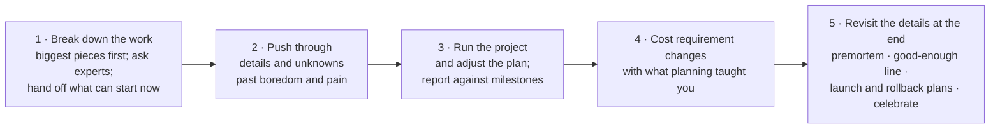

# فصل ۳: نقش tech lead

[فصل ۲: منتورینگ →](02-mentoring.md) · [کتاب](../README.md) · [فصل ۴: مدیریت آدم‌ها ←](04-managing-people.md)

## خلاصه

نقش tech lead یک نقش رهبری است که معمولاً نقش مدیریتی نیست، و اغلب به آدم اشتباهی داده می‌شود: باتجربه‌ترین مهندس، که ترجیح می‌دهد در کد خودش عمیق شود. این فصل نقش را مجموعه‌ای از مسئولیت‌ها تعریف می‌کند، نه پله‌ای روی نردبان، و «آن یک ترفند عجیبش» را نام می‌برد: این‌که حاضر باشید از کد فاصله بگیرید و بین کار فنی خودتان و چیزی که کل تیم لازم دارد تعادل برقرار کنید. کلاه‌هایی را مرور می‌کند که tech lead سرش می‌گذارد؛ معمار سیستم و تحلیل‌گر کسب‌وکار، برنامه‌ریز پروژه، و برنامه‌نویس و رهبر تیم، و استدلال می‌کند که حتی در تیم‌های agile هم مدیریت پروژه لازم است و روشی پنج‌قدمی می‌دهد. مقایسه‌ای رک میان زندگی خیالی و زندگی واقعی individual contributorهای ارشد و مدیرها به انتخاب بین دو مسیر کمک می‌کند؛ و process czar نشان می‌دهد وقتی process جای رهبری را بگیرد چه می‌شود (pp. 27–48).

## نکته‌های کلیدی

- **نقش tech lead مجموعه‌ای از مسئولیت‌هاست، نه یک level**، و جایزه‌ی بهترین کدنویس بودن نیست. ارتباط، اولویت‌بندی و یک جور «فوریت عمل‌گرا» می‌خواهد (pp. 27–29).
- **ترفندش تعادل است:** از کد فاصله بگیرید، بر وقتتان مسلط شوید و هم بلوک‌های تمرکز خودتان و هم تمرکز تیم را از جلسه‌های بی‌برنامه حفظ کنید (p. 31).
- **سه کلاه سرتان می‌گذارید:** معمار سیستم و تحلیل‌گر کسب‌وکار، برنامه‌ریز پروژه که کار را طوری می‌شکند که موازی پیش برود، و برنامه‌نویس و رهبر تیم که به‌جای قهرمان‌بازی، مانع‌ها را زود مطرح می‌کند (pp. 32–33).
- **روش agile مدیریت پروژه را حذف نمی‌کند.** ارزشش نظم فکر کردن پیش از شیرجه زدن است؛ خود برنامه کم‌اهمیت‌تر از برنامه‌ریزی است (pp. 35–36).
- **پروژه را در پنج قدم بگردانید:** کار را بشکنید، از دل ناشناخته‌ها رد شوید، اجرا کنید و برنامه را تنظیم کنید، با آموخته‌هایتان هزینه‌ی تغییر نیازمندی‌ها را بگویید، و آخر کار جزئیات را با premortem و خط «به‌اندازه‌ی کافی خوب» و برنامه‌ی launch و rollback دوباره مرور کنید (pp. 38–39).
- **هیچ‌کدام از دو مسیر مثل رؤیایش نیست.** individual contributorهای ارشد ایده می‌فروشند و دنبال پروژه‌های بزرگ می‌گردند؛ مدیرها کنترل روزشان را از دست می‌دهند و می‌بینند اقتدار چیزی بیش از عنوان می‌خواهد. می‌شود مسیر را عوض کرد (pp. 40–44).
- **فرد process czar نباشید:** processها باید نیاز تیم را برآورده کنند؛ به‌جای پلیس قانون بودن، دنبال processهای خودتنظیم بگردید (pp. 45–46).

## فهرست بخش‌ها

*از فهرست مطالب خود کتاب، از bookmarkهای PDF؛ شماره‌ها صفحه‌ی چاپی‌اند.*

- همه‌ی tech leadهای بزرگ این یک ترفند عجیب را بلدند — p. 31
- مبانی tech lead بودن — p. 31
  - نقش‌های اصلی یک tech lead — p. 32
- مدیریت پروژه‌ها — p. 34
- گرداندن یک پروژه — p. 38
- سر دوراهی: در مسیر فنی بمانید یا مدیر شوید — p. 40
  - زندگی خیالی یک individual contributor ارشد — p. 40
  - زندگی واقعی یک individual contributor ارشد — p. 41
  - زندگی خیالی یک مدیر — p. 42
  - زندگی واقعی یک مدیر — p. 43
- مدیر خوب، مدیر بد: process czar — p. 45
- چطور tech lead درخشانی باشیم — p. 46
  - معماری را بفهمید — p. 46
  - اهل تیم باشید — p. 46
  - تصمیم‌های فنی را پیش ببرید — p. 47
  - ارتباط بگیرید — p. 47
- سنجیدن تجربه‌ی خودتان — p. 48

## یادداشت‌ها

نویسنده بدون این‌که ارشدترین آدم تیمش باشد tech lead شد، چون خوب ارتباط می‌گرفت، اولویت‌بندی می‌کرد و حاضر بود «تکه‌های زمین‌مانده را بردارد»؛ یک جور فوریت عمل‌گرا. او مهندس درخشانی را هم دید که در نقش tech lead دست‌وپا زد: پشت refactoringها در لانه‌ی خرگوش می‌رفت و در همان حال product manager تیم را به تعهدی بدطراحی‌شده و بیش از حد جاه‌طلبانه می‌کشاند. دادن خودکار این نقش به باتجربه‌ترین مهندس یک برداشت غلط رایج است (p. 27).

در شرکت Rent the Runway نردبان شغلی، tech lead را **مجموعه‌ای از مسئولیت‌ها** تعریف می‌کرد که هر مهندسی از level ارشد به بعد می‌تواند بردارد، نه نقطه‌ای روی نردبان. اگر مدیریت آدم‌ها هم جزوش باشد، همان استانداردهای هر مدیری را دارد: جلسه‌ی ۱-۱ هفتگی، بازخورد منظم درباره‌ی رشد، و کمک به یاد گرفتن آدم‌های تیم. بدون زیردست هم باز tech lead منتور است. او مدیریت فنی پروژه را یاد می‌گیرد، بدون ذره‌بین گذاشتن کار واگذار می‌کند، روی بهره‌وری کل تیم تمرکز می‌کند و با product و analytics شریک می‌شود. این مسیر معمول رشد از senior engineer 1 به 2 است و برای engineering lead شدن لازم است (pp. 28–29). تعریف کوتاه‌تر Patrick Kua: رهبری که مسئول یک تیم توسعه است و دست‌کم ۳۰ درصد وقتش را با همان تیم کد می‌نویسد (p. 29).

مهارت تازه بیشتر انسانی است تا فنی، به‌علاوه‌ی یک مهارت فنی: **مدیریت پروژه**، که شکستن کار در آن شبیه طراحی سیستم است (p. 29).

> **کادر Being a Tech Lead** (یادداشت Caitie McCaffrey، p. 30). رهبری هم‌ترازهایی که به همان مدیر گزارش می‌دهند یعنی نفوذ بدون اختیار. او کار روی feature را متوقف کرد تا بدهی فنی را صاف کند و این کار را به هر کسی جور دیگری فروخت؛ reliability، سرعت iteration، خواب راحت در شیفت on-call، و به مدیرش به‌عنوان کاهش سربار عملیاتی. pageهای بحرانی ۵۰٪ کم شدند و deployها در فصل بعد تقریباً دو برابر.

### همه‌ی tech leadهای بزرگ این یک ترفند عجیب را بلدند

ترفند این است که **حاضر باشید از کد فاصله بگیرید** و تعهدهای فنی‌تان را با کاری که کل تیم لازم دارد متعادل کنید (p. 31). همین تعادل تا آخر مسیر شغلی‌تان چالش اصلی می‌ماند:

- اگر استقلال می‌خواهید، بر وقتتان مسلط شوید، هرچند یعنی وقت کمتری برای کاری که در آن خوبید، و این حس ناخوشایندی دارد.
- بعضی روزها روی **برنامه‌ی سازنده** می‌گذرند و بعضی روی **برنامه‌ی مدیر**؛ یاد بگیرید به خودتان بلوک‌هایی با اندازه‌ی درست بدهید. بدترین اشتباه این است که بی‌برنامه به جلسه‌ها کشیده شوید.
- کار خودتان را طوری بشکنید که به تمرکز چندروزه نیاز نداشته باشد، ولی برای تیم برنامه‌ای بگیرید که چنین تمرکزی را ممکن کند، و به رئیس و product manager کمک کنید به آن تمرکز احترام بگذارند (p. 31).

> **Try it:** [برنامه‌ی سازنده، برنامه‌ی مدیر](../widgets/03-focus-blocks.html)؛ جلسه‌ها را روی تقویم یک هفته بگذارید و ببینید وقتی همان جلسه‌ها پخش یا یک‌جا جمع می‌شوند، چند بلوک کدنویسی بی‌وقفه زنده می‌ماند.

### مبانی tech lead بودن

یک launch چندهفته‌ای را تصور کنید با یک product manager و چهار مهندس دیگر. کد و تصمیم‌های فنی فقط یکی از نقش‌های شماست و احتمالاً مهم‌ترینشان هم نیست؛ **بالاترین اولویت شما نگاهی فراخ به کار است که پروژه را در حرکت نگه می‌دارد** (pp. 31–32).

| نقش | شامل چیست (pp. 32–33) |
|---|---|
| **معمار سیستم و تحلیل‌گر کسب‌وکار** | سیستم‌های حیاتی‌ای که باید عوض شوند و featureهایی که باید ساخته شوند را مشخص کنید تا برای تخمین و ترتیب‌بندی ساختاری داشته باشید. حس خوبی از معماری می‌خواهد و توانایی تبدیل نیازمندی کسب‌وکار به نرم‌افزار |
| **برنامه‌ریز پروژه** | کار را به تحویل‌دادنی‌های درشت بشکنید که می‌توانند موازی پیش بروند، با انتزاع‌های توافق‌شده؛ frontend به‌جای منتظر ماندن برای API، روی قالب JSON توافق‌شده و با objectهای ساختگی کد می‌زند. از خبره‌ها بپرسید؛ تصمیم بگیرید چه چیزی حیاتی است و آن را زود انجام بدهید |
| **برنامه‌نویس و رهبر تیم** | کد نوشتن را ادامه بدهید، ولی نه خیلی زیاد. مانع‌ها را پیش از قهرمان‌بازی اعلام کنید؛ شاید product manager با خوشحالی سر یک feature کوتاه بیاید. هرچه به تحویل نزدیک‌تر می‌شوید بیشتر واگذار کنید، به‌خصوص تکه‌هایی را که قرار بود خودتان بسازید |

> **کادر Ask the CTO: از tech lead بودن متنفرم!** (pp. 33–34). همان «سنگ پیروزی»: قدردانی‌ای که بهای سنگینی دارد. tech lead به‌ندرت افزایش حقوق یا ارتقای عنوان می‌گیرد، دامنه‌ای به‌مراتب فراخ‌تر از یک individual contributor ارشد دارد، یعنی معماری، برنامه‌ریزی و اطمینان از این‌که تیم نیازمندی‌ها را فهمیده و خوب کار می‌کند، معمولاً هم بدون آموزش، و باز انتظار می‌رود تقریباً همان‌قدر کد بنویسد. این فقط افزایش مسئولیت است، و قوی‌ترتان می‌کند.

> **In practice:** tech lead تیم داده بیشتر وقتش را صرف کد نمی‌کند: صرف دیدن کل pipeline، dependencyها و ریسک‌ها می‌کند.
>
> **Your turn:** tech lead یک مهاجرت جدول‌های Silver به ReplacingMergeTree است. بیشترین ارزشش کجاست؟
>
> *Answer:* در دیدن کل: کدام داشبوردها و notebookها به این جدول‌ها وابسته‌اند، ترتیب مهاجرت، و برنامه‌ی rollback. کتاب می‌گوید کد فقط یکی از نقش‌های tech lead است و احتمالاً مهم‌ترینش نیست (pp. 31–32).

### مدیریت پروژه‌ها

اولین برنامه‌ی پروژه‌ی نویسنده، برای شکستن یک سیستم overload شده روی چند ماشین، «یکی از بدترین تجربه‌های عمرش» بود: جلسه‌هایی پشت یک میز چوبی بزرگ با رئیسش Mike، برای باز کردن گره وابستگی‌ها، framework تست، deployment، سفارش سخت‌افزار و زمان یکپارچه‌سازی، و در عین حال یکی از مهم‌ترین تجربه‌های یادگیری مسیر شغلی‌اش (pp. 34–35).

**مگر agile نیاز به مدیریت پروژه را از بین نمی‌برد؟ نه** (p. 35). روش agile کمک می‌کند کار را به تکه‌های کوچک بشکنید و پله‌پله تحویل بدهید، ولی بعضی پروژه‌ها چند sprint طول می‌کشند، برای مدیریت تخمین می‌خواهند، یا، مثل کار زیرساخت و platform و سیستم، به معماری و برنامه‌ریزی از پیش با ناشناخته‌های زیاد و ضرب‌الاجل‌های سفت نیاز دارند.

- مدیریت پروژه کسل‌کننده و کمی ترسناک است، ولی جایگزینش این است که پروژه کندتر شکست بخورد، نه سریع‌تر (p. 35).
- لازم نیست برای هر کاری با جزئیات انجامش بدهید؛ نویسنده از استخدام project manager پرهیز می‌کند، چون می‌توانند به عصای زیر بغل مهندس‌ها تبدیل شوند (p. 36).
- **ارزش برنامه‌ریزی، نظمی است که وادارتان می‌کند پیش از شیرجه زدن عمیق به پروژه فکر کنید. خودِ برنامه کم‌اهمیت‌تر از عمل برنامه‌ریزی است** (p. 36).

پروژه‌ی او دست‌انداز داشت ولی تقریباً سر وقت تحویل شد، بدون شب‌بیداری، آن هم در حالی که ۴۰ برنامه‌نویس دیگر روی همان شاخه‌ی master تغییر می‌دادند؛ چون تیم برنامه داشت، تصویری از موفقیت داشت و ریسک‌هایش را می‌شناخت (p. 36).

> **کادر Take the Time to Explain** (یادداشت Michael Marçal، pp. 37–38). ریاضی‌دان سرشناسی از او برای یک پایان‌نامه‌ی روشن تشکر کرد: توانسته بود دنبالش کند چون مبانی و انگیزه‌ها توضیح داده شده بودند. مدیرهای ارشد هم همه چیز را «نمی‌گیرند»؛ دو ساعت توضیح، بدون اسلاید، درباره‌ی این‌که چرا یک محصول fat-client باید به platform میزبانی‌شده برود، اعتماد ساخت و تغییر را رقم زد.

> **In practice:** پروژه‌ی داده هم شکستن کار، تخمین و پیدا کردن ناشناخته‌ها می‌خواهد.
>
> **Your turn:** پیش از شروع مهاجرت یک منبع بزرگ به dlt، چه ناشناخته‌هایی را فهرست می‌کنید؟
>
> *Answer:* نوع‌هایی که type mapping ندارند، حجم بار اول، دسترسی به replica منبع، و کدام کوئری‌های پایین‌دست به نام ستون‌های قدیمی وابسته‌اند. کتاب می‌گوید کار را تا حد کارهای کوچک بشکنید تا ناشناخته‌ها زود پیدا شوند (pp. 34–38).

### گرداندن یک پروژه

مدیریت پروژه یعنی شکستن یک هدف پیچیده به تکه‌ها، ترتیب دادنشان، پیدا کردن این‌که چه چیزی موازی پیش می‌رود و چه چیزی باید پشت سر هم بیاید، و بیرون کشیدن ناشناخته‌ها، با علم به این‌که باز هم بعضی‌شان را از دست خواهید داد (p. 38).

*تصویر vault از پنج رهنمود کتاب (pp. 38–39).*

- **کار را بشکنید** در یک spreadsheet یا نمودار Gantt، از بزرگ‌ترین تکه‌ها به پایین؛ آنچه را همین حالا می‌تواند شروع شود، با خود آدم‌هایی که انجامش می‌دهند به کارهای اندازه‌ی ticket تبدیل کنید (p. 38).
- **از دل جزئیات و ناشناخته‌ها رد شوید**، حتی از نقطه‌ای که کلافه می‌شوید؛ مدیر خوب کنارتان می‌نشیند و می‌پرسد کجا هنوز به‌اندازه‌ی کافی خوب نیست (p. 38).
- **پروژه را بگردانید و برنامه را تنظیم کنید.** همیشه چیزی عقب می‌افتد؛ با برنامه می‌توانید به milestoneهای رسیده و کار باقی‌مانده اشاره کنید، نه به حدس (pp. 38–39).
- **تغییر نیازمندی‌ها را با بینشی که برنامه‌ریزی داده مدیریت کنید:** درباره‌ی هزینه‌شان شفاف باشید، و روبه‌روی ضرب‌الاجل سفت اولویت بدهید، حذف کنید و ساده کنید (p. 39).
- **نزدیک پایان دوباره سراغ جزئیات بروید:** تست، راستی‌آزمایی، یک **premortem** که هر چیزی را فهرست می‌کند که ممکن است سر launch خراب شود، یک خط «به‌اندازه‌ی کافی خوب» که همه قبولش دارند و هرچه زیرش است حذف می‌شود، برنامه‌ی launch و برنامه‌ی rollback، و بعد جشن (p. 39).

> **Run it:** آزمایش [برنامه‌ی موازی](../lab/03-parallel-plan/README.md) یک launch کوچک را با و بدون قرارداد JSON توافق‌شده‌ای که کتاب پیشنهاد می‌دهد زمان‌بندی می‌کند و نشان می‌دهد مسیر بحرانی چقدر کوتاه می‌شود.

> **کادر Ask the CTO: مطمئن نیستم بخواهم tech lead شوم** (pp. 39–40). آدم‌ها را به زور به نقش‌های مدیریتی هل ندهید. «به‌اندازه‌ی کافی فنی نبودن» می‌تواند جلوی ارتقاهای بعدی را بگیرد، و یادگیری عمیق در نقش individual contributor از یادگیری هم‌زمانِ آن و مدیریت آسان‌تر است. احتمالاً بالاخره باید کار tech lead را بکنید، حتی در مسیر فنی، ولی نه لزوماً حالا؛ وقتی کار فردی دیگر چالش‌برانگیز نبود قبولش کنید.

### سر دوراهی: در مسیر فنی بمانید یا مدیر شوید

نویسنده تصویری اغراق‌شده می‌دهد از این‌که هر مسیر را چطور تصور می‌کرد و چه یافت (pp. 40–44):

| | خیالی | واقعی |
|---|---|---|
| **individual contributor ارشد** | مسئله‌های عمیق و جذاب؛ انتخاب کارتان؛ دقیقاً به‌اندازه جلسه؛ تازه‌کارها به حرفتان آویزان‌اند؛ رشد پیوسته؛ سخنرانی و کتاب و open source و شهرت؛ کسی به دست‌وپاچلفتی بودنتان کار ندارد | روی پروژه‌ی درست عالی است، ولی باید ایده بفروشید و به تیم‌های دیگر یاد بدهید سیستمتان را بردارند؛ پروژه‌های بزرگ کم‌اند و به شانس بسته‌اند و ممکن است لغو شوند؛ ارتقا کند است؛ هم‌ترازها رقیب‌اند؛ اطلاعات جلسه‌هایی را که نمی‌روید از دست می‌دهید؛ کار کسل‌کننده مثل ایمیل و مصاحبه و review باز هم از شما انتظار می‌رود. با این همه چیز می‌سازید، پروژه انتخاب می‌کنید، بین تیم‌ها جابه‌جا می‌شوید و شاید از مدیرتان بیشتر بگیرید |
| **مدیر** | کنترل و تصمیم؛ تیم هر چه بگویید می‌کند؛ انصاف را شما برقرار می‌کنید؛ آدم‌ها راحت بازخورد می‌دهند و می‌گیرند؛ مدیرهای دیگر نظرتان را می‌خواهند؛ هدف‌ها روشن و باثبات‌اند؛ ارتقا سریع است | تمام روز جلسه و فاصله گرفتن از کد؛ بیشتر می‌توانید دامنه‌ی تصمیم را تنگ کنید تا خودتان تصمیم بگیرید؛ هدف‌ها عوض می‌شوند و شما باید توضیحشان بدهید؛ تیم عیب‌های شما را آینه می‌کند؛ اقتدار چیزی بیش از عنوان می‌خواهد؛ آدم‌ها پیش از آن‌که بفهمید استعفا می‌دهند؛ در روزهای سخت قدرت کمی برای خوشحال کردن آدم‌ها دارید؛ هم‌ترازها نظرتان را فضولی می‌بینند؛ شاید یک staff engineer از شما بیشتر بگیرد |

می‌شود مسیر را عوض کرد؛ خیلی‌ها مدیریت را امتحان می‌کنند و برمی‌گردند. با چشم باز وارد شوید (p. 44).

### مدیر خوب، مدیر بد: process czar

فرد process czar باور دارد یک process حقیقی، چه agile و Kanban و Scrum و lean و حتی waterfall، یا یک شیوه‌ی درست برای on-call و review و release، اگر مو‌به‌مو دنبال شود همه چیز را درست می‌کند (p. 45).

- **نقطه‌ی قوت:** منظم است، به جزئیات دقت می‌کند و نمی‌گذارد کاری از قلم بیفتد؛ اغلب در QA و helpdesk و مدیریت محصول و مشاوره پیدا می‌شود (p. 45).
- **شکل‌های شکست:** هر مشکلی را به پیروی نکردن از process نسبت می‌دهد؛ نیاز به انعطاف را نمی‌بیند؛ چیزی را اندازه می‌گیرد که اندازه‌گیری‌اش آسان است، مثلاً ساعت حضور در دفتر؛ و در نقش tech lead تازه‌کار، همه‌ی کار را می‌خواباند تا ابزار بی‌نقص را پیدا کند، یا برای مسئله‌های درهم انسانی ابزار جلو می‌گذارد (p. 45).

نقطه‌ی مقابلش رها کردن process نیست، دوختنش به تن تیم و کار است. چهار ارزش Agile Manifesto رهبری سالم در process را خلاصه می‌کنند: افراد و تعامل‌ها بر processها و ابزارها؛ نرم‌افزار کارکننده بر مستندات جامع؛ همکاری با مشتری بر مذاکره‌ی قراردادی؛ پاسخ به تغییر بر پیروی از برنامه (pp. 45–46). توصیه‌ها (p. 46):

- از process برای وصله کردن شکاف‌های ارتباطی یا رهبری استفاده نکنید؛ هیچ دو تیم درخشانی شبیه هم نیستند.
- **دنبال processهای خودتنظیم بگردید.** اگر شما پلیس قانونید، process را طوری عوض کنید که پیروی از آن آسان‌تر شود؛ automation قانون‌ها را بدیهی می‌کند.
- اگر مدیرِ یک process czar هستید، فضایی بسازید که شکست خوردن و بی‌نقص نبودن در آن امن باشد، چون این وسواس اغلب ترس از شکست است، و جلویش را بگیرید که تیم را بابت پیروی نکردن از process تنبیه کند.

### چطور tech lead درخشانی باشیم

| ویژگی | یعنی چه (pp. 46–48) |
|---|---|
| **معماری را بفهمید** | اتصال‌هایش، این‌که داده کجا می‌نشیند و کجا جریان دارد، و منطق اصلی محصول‌ها کجاست. نمی‌توانید تغییر چیزی را رهبری کنید که نمی‌فهمیدش |
| **اهل تیم باشید** | همه‌ی کار جذاب را برای خودتان نگه ندارید؛ گره حوزه‌های دشوار و کسل‌کننده را باز کنید، که processهای خراب را هم رو می‌کند. ولی فقط کار کسل‌کننده هم برندارید؛ وقتی فرصت دارید خوب انجامش بدهید، یک کار جذاب هم به خودتان بدهید |
| **تصمیم‌های فنی را پیش ببرید** | دخیل بودن با تنها تصمیم گرفتن یکی نیست. مشخص کنید کدام تصمیم‌ها با شماست، کدام با آدم‌های خبره‌تر و کدام با کل تیم؛ بگویید سر چه چیزی تصمیم گرفته می‌شود و نتیجه را اعلام کنید |
| **ارتباط بگیرید** | بهره‌وری تیم از بهره‌وری شما مهم‌تر است؛ در جلسه‌ها نماینده‌ی تیمید. بنویسید، با دقت بخوانید، حرف بزنید؛ با design doc و وبلاگ و meetup تمرین کنید. گوش بدهید، حرف طرف را برایش تکرار کنید، یادداشت بردارید |

### سنجیدن تجربه‌ی خودتان

پرسش‌هایی برای تأمل (p. 48): در سازمانتان شرح نقش نوشته‌شده‌ای برای tech lead هست؟ آماده‌اید وقتی بیرون از کد بگذرانید؟ از مدیرتان پرسیده‌اید از یک tech lead چه انتظاری دارد؟ بهترین tech leadی که با او کار کرده‌اید چه چیزی را درخشان می‌کرد و کلافه‌کننده‌ترینشان چه چیزی را؟

## بده‌بستان‌ها در یک نگاه

| انتخاب | چه می‌دهد | چه می‌گیرد |
|---|---|---|
| بهترین کدنویس در نقش tech lead | عمق فنی | لانه‌ی خرگوش؛ تیم رانده می‌شود در حالی که سرپرست کد می‌زند |
| نوشتن بیشترِ کد توسط tech lead | خروجی شخصی | کسی پروژه را در حرکت نگه نمی‌دارد؛ قهرمان‌بازی مشکل‌ها را پنهان می‌کند |
| قهرمان‌بازی در برابر اعلام زودهنگام مانع | feature همان‌طور که خواسته شده تحویل می‌شود | کار اضافی روی چیزی که product manager حاضر بود حذفش کند |
| برنامه‌ی پروژه‌ی باجزئیات | پیشرفت معلوم، هزینه‌ی تغییر روشن، غافلگیری کمتر | کار پیش‌از‌شروعِ کسل‌کننده و ناخوشایند |
| بی‌برنامگی به بهانه‌ی «ما agile هستیم» | شروع فوری | پروژه‌ها کندتر شکست می‌خورند؛ مبنایی برای تخمین نیست |
| تنها تصمیم گرفتن / هرگز تصمیم نگرفتن | سرعت / اجماع | دلخوری و سرزنش / تصمیم‌ها کش می‌آیند |
| process خشک | چیزی از قلم نمی‌افتد | آدم‌ها را سرزنش می‌کند؛ تغییر را نمی‌بیند؛ چیز اشتباه را اندازه می‌گیرد |

## فراتر از کتاب

- **برنامه‌ی سازنده و برنامه‌ی مدیر** عنوان یادداشت Paul Graham در سال ۲۰۰۹ است: سازنده‌ها به بلوک‌های نیم‌روزه نیاز دارند و یک جلسه می‌تواند بعدازظهر را به تکه‌هایی ببرد که برای کار سخت خیلی کوچک‌اند. کتاب این اصطلاح‌ها را بدون ارجاع به آن یادداشت به کار می‌برد (p. 31).
- **روش premortem** از روان‌شناس Gary Klein می‌آید، در «Performing a Project Premortem»، *Harvard Business Review*، ۲۰۰۷: پیش از شروع پروژه تصور کنید شکست خورده و بپرسید چرا.
- **نقش‌های staff به بالا.** کتاب *Staff Engineer* از Will Larson در سال ۲۰۲۱ بعدتر برای individual contributorهای ارشد کهن‌الگوهایی نام برد؛ tech lead، architect، solver و right hand، که خیلی نزدیک به همان «زندگی واقعی»اند که این کتاب شرح می‌دهد.

## پیوندها

- **Run it:** [برنامه‌ی موازی: هزینه‌ی انتظار برای API](../lab/03-parallel-plan/README.md)؛ کارهای یک launch کوچک را با و بدون interface توافق‌شده زمان‌بندی می‌کند و مسیر بحرانی را چاپ می‌کند.
- **فصل‌های مرتبط:** [فصل ۲: منتورینگ](02-mentoring.md) که شنیدن و ارتباط گرفتن را حالا با یک تیم می‌بیند، [فصل ۴: مدیریت آدم‌ها](04-managing-people.md) که سمت انسانی‌ای را می‌گوید که tech lead ممکن است برعهده بگیرد، [فصل ۵: مدیریت یک تیم](05-managing-a-team.md) که قاعده‌های سرانگشتی پیشرفته‌ی مدیریت پروژه را دارد، و [فصل ۹: ساختن فرهنگ از صفر](09-bootstrapping-culture.md) که نوشتن نردبان شغلی را با tech lead در جایگاه مجموعه‌ای از مسئولیت‌ها می‌گوید.

## خودتان را بسنجید

*پرسش‌ها و پاسخ‌ها مال vault است و از روی یادداشت‌های بالا نوشته شده؛ پاسخ‌ها به صفحه‌ی چاپی کتاب ارجاع می‌دهند.*

1. **چرا دادن نقش tech lead به باتجربه‌ترین کدنویس یک برداشت غلط است؟**

   *Answer:* این نقش رهبری است، یعنی ارتباط و اولویت‌بندی و در حرکت نگه داشتن پروژه، نه آزادی برای تمرکز روی کد خود آدم؛ tech leadی که این کار را می‌کند، کارش را انجام نمی‌دهد (pp. 27, 29).

2. **«آن یک ترفند عجیب» tech lead چیست؟**
   - [ ] نوشتن سخت‌ترین کد به‌دست خودش
   - [x] این‌که حاضر باشد از کد فاصله بگیرد و کار فنی را با چیزی که تیم لازم دارد متعادل کند
   - [ ] برداشتن process درست agile

   *Answer:* p. 31.

3. **نقش برنامه‌ریز پروژه چطور اجازه می‌دهد frontend پیش از آماده شدن API شروع کند؟**

   *Answer:* سر یک انتزاع توافق کنید، یعنی قالب JSON، و با objectهای ساختگی روی همان کد بزنید تا تکه‌ها موازی پیش بروند (p. 32).

4. **به گفته‌ی کتاب، ارزش واقعی برنامه‌ریزی پروژه چیست؟**
   - [ ] اجرای بی‌نقص برنامه
   - [ ] پیش‌بینی دقیق تاریخ تحویل
   - [x] نظمی که وادارتان می‌کند پیش از شیرجه زدن عمیق به پروژه فکر کنید

   *Answer:* برنامه هر قدر هم دقیق باشد، از عمل برنامه‌ریزی کم‌اهمیت‌تر است (p. 36).

5. **در پنج قدم کتاب، آخر پروژه چه اتفاقی می‌افتد؟**

   *Answer:* دوباره سراغ جزئیات بروید: تست و راستی‌آزمایی، یک premortem از هر چیزی که ممکن است سر launch خراب شود، یک خط «به‌اندازه‌ی کافی خوب» که همه قبولش دارند و هرچه زیرش است حذف می‌شود، برنامه‌ی launch و rollback، و یک جشن (p. 39).

6. **کتاب به‌جای پلیس قانون بودن برای یک process چه پیشنهاد می‌دهد؟**

   *Answer:* دنبال processهای خودتنظیم بگردید: process را طوری عوض کنید که پیروی از آن آسان‌تر شود، اغلب با automation (p. 46).
