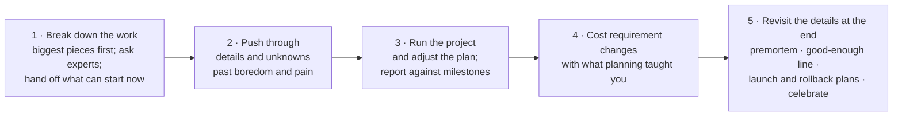

# 3. Tech Lead

[← 2. Mentoring](02-mentoring.md) · [Book](../README.md) · [4. Managing People →](04-managing-people.md)

## Summary

The tech lead is a leadership role that is usually not a management role, and it is often given to the wrong person: the most experienced engineer, who would rather go deep into their own code. The chapter defines the role as a set of responsibilities rather than a rung on the ladder, and names its "one weird trick": being willing to step away from the code and balance your own technical work with what the whole team needs. It walks through the hats a tech lead wears — systems architect and business analyst, project planner, developer and team leader — and makes the case for project management even on agile teams, with a five-step method. A frank comparison of the imagined and real lives of senior individual contributors and managers helps with the decision between the two tracks; the process czar shows what happens when process replaces leadership (pp. 27–48).

## Key takeaways

- **Tech lead is a set of responsibilities, not a level**, and it is not a reward for being the best coder. It needs communication, prioritization and "pragmatic urgency" (pp. 27–29).
- **The trick is balance:** step away from the code, master your time, and protect both your maker blocks and the team's focus from random meetings (p. 31).
- **Wear three hats:** systems architect and business analyst, project planner (break work down so it can run in parallel), and developer and team leader who raises obstacles early instead of heroics (pp. 32–33).
- **Agile doesn't remove project management.** Its value is the discipline of thinking before diving in; the plan matters less than the planning (pp. 35–36).
- **Manage a project in five steps:** break down the work, push through the unknowns, run it and adjust, use what you learned to cost requirement changes, and revisit the details at the end with a premortem, a "good enough" line, and launch and rollback plans (pp. 38–39).
- **Neither track matches the dream.** Senior ICs sell ideas and hunt for big projects; managers lose control of their days and find authority takes more than a title. You can switch tracks (pp. 40–44).
- **Don't be a process czar:** processes must meet the team's needs; look for self-regulating processes rather than playing rules cop (pp. 45–46).

## Section outline

*From the book’s own table of contents (PDF bookmarks); printed page numbers.*

- All Great Tech Leads Know This One Weird Trick — p. 31
- Being a Tech Lead 101 — p. 31
  - The Main Roles of a Tech Lead — p. 32
- Managing Projects — p. 34
- Managing a Project — p. 38
- Decision Point: Stay on the Technical Track or Become a Manager — p. 40
  - Imagined Life of a Senior Individual Contributor — p. 40
  - Real Life of a Senior Individual Contributor — p. 41
  - Imagined Life of a Manager — p. 42
  - Real Life of a Manager — p. 43
- Good Manager, Bad Manager: The Process Czar — p. 45
- How to Be a Great Tech Lead — p. 46
  - Understand the Architecture — p. 46
  - Be a Team Player — p. 46
  - Lead Technical Decisions — p. 47
  - Communicate — p. 47
- Assessing Your Own Experience — p. 48

## Notes

The author became a tech lead without being the most senior person on her team, because she communicated well, prioritized, and was willing to "pick up the pieces" — a pragmatic urgency. She also saw a brilliant engineer flounder as tech lead: he chased refactorings down rabbit holes while the product manager railroaded the team into a poorly designed, overly aggressive commitment. Giving the role automatically to the most experienced engineer is a common misconception (p. 27).

At Rent the Runway the career ladder defined tech lead as **a set of responsibilities any engineer may take on from the senior level**, not a point on the ladder. If it includes people management, it carries the same standards as any manager: weekly 1-1s, regular feedback on growth, and helping reports learn. Without reports, the tech lead still mentors. The tech lead learns technical project management, delegates without micromanaging, focuses on the whole team's productivity, and partners with product and analytics. It is the usual way to grow from senior engineer 1 to 2, and required to become engineering lead (pp. 28–29). Patrick Kua's shorter definition: a leader responsible for a development team who spends at least 30 percent of their time writing code with it (p. 29).

The new skill is less technical than human — plus one technical one: **project management**, whose breakdown work resembles systems design (p. 29).

> **Being a Tech Lead** (Caitie McCaffrey, p. 30). Leading peers who report to the same manager is influencing without authority. She stopped feature work to pay down technical debt, selling it differently to each person — reliability, iteration speed, sleeping through on-call — and to her manager as reduced operational overhead. Critical pages fell by 50% and deploys nearly doubled the next quarter.

### All Great Tech Leads Know This One Weird Trick

The trick is **the willingness to step away from the code** and balance your technical commitments with the work the whole team needs (p. 31). Balance will stay a core challenge for the rest of your career:

- If you want autonomy, master your time — even though it means spending less time on what you're good at, which feels uncomfortable.
- Some days are on a **maker's schedule**, some on a **manager's schedule**; learn to give yourself blocks of the right size. The worst mistake is getting pulled randomly into meetings.
- Break your own work down so it doesn't need multi-day focus — but get the team a schedule that does allow it, and help your boss and product manager respect that focus (p. 31).

> **Try it:** [Maker's schedule, manager's schedule](../widgets/03-focus-blocks.html) — place meetings on a week’s calendar and watch how many uninterrupted coding blocks survive when the same meetings are scattered or batched.

### Being a Tech Lead 101

Picture a multiweek launch with a product manager and four other engineers. Code and technical decisions are only one of your roles, and probably not the most important; **your highest priority is a wide view of the work that keeps the project moving** (pp. 31–32).

| Role | What it involves (pp. 32–33) |
|---|---|
| **Systems architect and business analyst** | Identify the critical systems to change and features to build, to give structure for estimates and ordering. Needs a good sense of the architecture and the ability to turn business requirements into software |
| **Project planner** | Break the work into rough deliverables that can run in parallel, using agreed abstractions — the frontend codes against an agreed JSON format with dummy objects instead of waiting for the API. Ask the experts; decide what is critical and do it early |
| **Software developer and team leader** | Keep writing code, but not too much. Communicate obstacles before trying heroics — the product manager may happily compromise on a feature. Delegate as delivery nears, especially parts you meant to build yourself |

> **Ask the CTO: I Hate Being a Tech Lead!** (pp. 33–34). The "Stone of Triumph": recognition that comes at a heavy price. The tech lead rarely gets a raise or title bump, has much wider scope than a senior IC — architecture, planning, making sure the team understands requirements and performs — usually without training, and is still expected to write almost as much code. It is a pure increase in responsibility, and it makes you stronger.

### Managing Projects

The author's first project plan, for splitting an overloaded system across several machines, was "one of the worst experiences ever": sessions across a big wooden desk with her boss Mike, untangling dependencies, test frameworks, deployment, hardware orders and integration time — and one of the most important learning experiences of her career (pp. 34–35).

**Doesn't agile remove the need for project management? No** (p. 35). Agile helps you break work into small chunks and deliver incrementally, but some projects span many sprints, need estimates for management, or — infrastructure, platform, system work — need architecture and advance planning with many unknowns and hard deadlines.

- Project management is tedious and a bit scary, but the alternative is the project failing slower, not faster (p. 35).
- It shouldn't be done in detail for every effort; the author avoids hiring project managers, who can become a crutch for engineers (p. 36).
- **The value of planning is the self-discipline to think about the project in depth before diving in. The plan matters less than the act of planning** (p. 36).

Her project hit bumps but shipped close to on time with no sleepless nights, while 40 other developers changed the same master branch — because the team had a plan, a picture of success and known risks (p. 36).

> **Take the Time to Explain** (Michael Marçal, pp. 37–38). A renowned mathematician thanked him for a lucid thesis: he could follow it only because the basics and motivations were explained. Senior managers don't "get" everything either; two hours explaining, without slides, why a fat-client product should move to a hosted platform earned trust and brought about change.

### Managing a Project

Project management is breaking a complex goal into pieces, ordering them, finding what can run in parallel and what must be sequential, and teasing out the unknowns — knowing you'll still miss some (p. 38).

*The vault's drawing of the book's five guidelines (pp. 38–39).*

- **Break down the work** in a spreadsheet or Gantt chart, from the biggest pieces down; turn what can start immediately into ticket-sized work with the people who'll do it (p. 38).
- **Push through the details and the unknowns** past the points of irritation; a good manager sits with you and asks where it isn't good enough (p. 38).
- **Run the project and adjust the plan.** Things always slip; with a plan you can point to milestones hit and work remaining instead of guessing (pp. 38–39).
- **Manage requirement changes** with the planning insights: be clear about their cost, and against a hard deadline prioritize, cut and simplify (p. 39).
- **Revisit the details near completion:** testing, verification, a **premortem** listing everything that could fail at launch, a socialized "good enough" line with the work below it cut, a launch plan and a rollback plan — then celebrate (p. 39).

> **Run it:** the [parallel plan](../lab/03-parallel-plan/README.md) experiment schedules a small launch with and without the agreed JSON contract the book recommends, and shows how much the critical path shrinks.

> **Ask the CTO: I'm Not Sure I Want to Be a Tech Lead** (pp. 39–40). Don't push people into management roles. Being "not technical enough" can block later promotion, and it is easier to learn deeply as an IC than while learning management. You'll probably need to do the tech lead job eventually, even on the IC track — but not necessarily now; take it when individual work no longer challenges you.

### Decision Point: Stay on the Technical Track or Become a Manager

The author offers caricatures of how she imagined each track and what she found (pp. 40–44):

| | Imagined | Real |
|---|---|---|
| **Senior individual contributor** | Deep, fun problems; choose your work; just the right meetings; juniors hang on your words; steady rise; talks, books, open source and fame; nobody minds that you're awkward | Great on the right project — but you sell ideas and coach other teams to adopt your system; big projects are rare and luck-driven and may be cancelled; slow promotion; peers compete; you miss information from meetings you skip; tedious work (email, interviews, reviews) still expected. Still, you build things, choose projects, move teams — and may earn more than your manager |
| **Manager** | Control and decisions; the team does what you say; you enforce fairness; reports give and take feedback openly; other managers want your advice; clear, stable goals; quick promotion | Meetings all day and lost touch with code; you can narrow decisions rather than make them; goals change and you explain them; the team mirrors your faults; authority takes more than a title; people quit before you notice; little power to make people happy when times are hard; peers find your advice meddling; a staff engineer may earn more than you |

You can switch tracks; many people try management and go back. Go in with your eyes open (p. 44).

### Good Manager, Bad Manager: The Process Czar

The process czar believes one true process — agile, Kanban, Scrum, lean or even waterfall; one way to do on-call, reviews or releases — will fix everything if followed precisely (p. 45).

- **Strengths:** organized, detail-oriented, makes sure no task is forgotten; often found in QA, helpdesk, product management and consulting (p. 45).
- **Failure modes:** blames every problem on not following the process; ignores the need for flexibility; measures what's easy, like hours in the office; as a new tech lead, stops all work to find the perfect tool, or pushes tools at messy human problems (p. 45).

The opposite isn't abandoning process but fitting it to the team and the work. The Agile Manifesto's four values summarize healthy process leadership: individuals and interactions over processes and tools; working software over comprehensive documentation; customer collaboration over contract negotiation; responding to change over following a plan (pp. 45–46). Advice (p. 46):

- Don't use process to fix communication or leadership gaps; no two great teams look alike.
- **Look for self-regulating processes.** If you're the rules cop, change the process so it's easier to follow; automation makes rules obvious.
- If you manage a process czar, make it safe to fail and be imperfect — the obsession is often fear of failure — and stop them punishing the team for not following process.

### How to Be a Great Tech Lead

| Trait | What it means (pp. 46–48) |
|---|---|
| **Understand the architecture** | Its connections, where data lives and flows, where the products' core logic lives. You can't lead changes to what you don't understand |
| **Be a team player** | Don't keep all the interesting work — unstick the tricky, boring areas, which also reveal broken process. But don't take only boring work either; give yourself a fun task when you have time to do it well |
| **Lead technical decisions** | Involved isn't the same as deciding alone. Decide which calls are yours, which go to people with more expertise, and which need the whole team; state what's being decided and communicate the outcome |
| **Communicate** | The team's productivity matters more than yours; you represent the team in meetings. Write, read carefully, speak; practise with design docs, blogs and meetups. Listen, repeat back, take notes |

### Assessing Your Own Experience

Questions for reflection (p. 48): is there a written tech lead description in your organization? Are you ready to spend time outside the code? Have you asked your manager what they expect from a tech lead? What made the best tech lead you worked with great, and the most frustrating one frustrating?

## Trade-offs at a glance

| Choice | Buys | Costs |
|---|---|---|
| Best coder as tech lead | Technical depth | Rabbit holes; team railroaded while the lead codes |
| Tech lead writes most of the code | Personal output | Nobody keeps the project moving; heroics hide problems |
| Heroics vs. raising obstacles early | Feature shipped as specified | Overwork on something the PM would have cut |
| Detailed project plan | Known progress, cost of change, fewer surprises | Tedious, uncomfortable up-front work |
| No plan ("we're agile") | Start immediately | Projects fail slower; no basis for estimates |
| Decide alone / never decide | Speed / consensus | Resentment and blame / decisions drag on |
| Rigid process | Nothing forgotten | Blames people; ignores change; measures the wrong things |

## Beyond the book

- **Maker's schedule, manager's schedule** is the title of Paul Graham's 2009 essay: makers need half-day blocks, and a single meeting can cut an afternoon into pieces too small for hard work. The book uses the terms without citing it (p. 31).
- **Premortems** come from psychologist Gary Klein ("Performing a Project Premortem," *Harvard Business Review*, 2007): imagine the project has failed and ask why, before it starts.
- **Staff-plus roles.** Will Larson's *Staff Engineer* (2021) later named archetypes for senior ICs — tech lead, architect, solver, right hand — which map closely onto the "real life" the book describes.

## Connections

- **Run it:** [Parallel plan: the cost of waiting for the API](../lab/03-parallel-plan/README.md) — schedules a small launch's tasks with and without an agreed interface and prints the critical path.
- **Related chapters:** [2. Mentoring](02-mentoring.md) (listening and communicating, now with a team), [4. Managing People](04-managing-people.md) (the people side the tech lead may take on), [5. Managing a Team](05-managing-a-team.md) (advanced project management rules of thumb), [9. Bootstrapping Culture](09-bootstrapping-culture.md) (writing a career ladder with tech lead as responsibilities).

## Check yourself

*Questions and answers are the vault's, written from the notes above; answers cite the book's printed pages.*

1. **Why is giving the tech lead role to the most experienced coder a misconception?**

   *Answer:* The role is leadership — communication, prioritization, keeping the project moving — not freedom to focus on one's own code; a tech lead who does that isn't doing the job (pp. 27, 29).

2. **What is the tech lead's "one weird trick"?**
   - [ ] Writing the hardest code personally
   - [x] Being willing to step away from the code and balance technical work with what the team needs
   - [ ] Adopting the right agile process

   *Answer:* p. 31.

3. **How does the project planner role let a frontend start before the API is done?**

   *Answer:* Agree on an abstraction — the JSON format — and code against it with dummy objects, so the pieces proceed in parallel (p. 32).

4. **According to the book, what is the real value of project planning?**
   - [ ] Executing the plan perfectly
   - [ ] Predicting the delivery date exactly
   - [x] The discipline to think about the project in depth before diving in

   *Answer:* The plan, however accurate, matters less than the act of planning (p. 36).

5. **What happens at the end of a project in the book's five steps?**

   *Answer:* Revisit the details: testing and verification, a premortem of what could fail at launch, a socialized "good enough" line with work below it cut, launch and rollback plans, and a celebration (p. 39).

6. **What does the book suggest instead of acting as a "rules cop" for a process?**

   *Answer:* Look for self-regulating processes: change the process so it's easier to follow, often with automation (p. 46).
