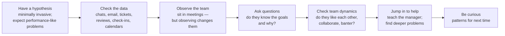

# 7. Managing Managers

[← 6. Managing Multiple Teams](06-managing-multiple-teams.md) · [Book](../README.md) · [8. The Big Leagues →](08-the-big-leagues.md)

## Summary

Managing managers looks like managing multiple teams at a larger magnitude, but it adds a new layer of abstraction: you are two levels from the work, depending on unreliable witnesses for problems you can't see. The chapter is about seeing through that layer — skip-level meetings instead of an open door, holding managers accountable for their teams even when the causes look external, coaching new managers and aligning experienced ones, hiring managers for skills and culture, and debugging organizations the way you'd debug a system. It closes with managing expectations about schedules, keeping teams steady through roadmap changes, and what "staying technically relevant" means when you no longer code: overseeing technical investment by asking informed questions (pp. 125–157).

## Key takeaways

- **Chase your discomfort and follow up on the little things** — recruiting, coaching, quarterly goals, postmortems — until you learn which you can stop following (p. 126).
- **An open-door policy doesn't surface problems.** Hold skip-level meetings — quarterly 1-1s while the organization is small, or team lunches — to catch managers who manage up well (pp. 127–131).
- **Managers are accountable for their team's health and productivity**, even with an unstable roadmap, an errant tech lead or constant firefighting; your part is to help once they bring the problem (pp. 131–133).
- **Watch for the people pleaser** — team-facing or external-facing — who says yes to everyone, hides problems, and sets the team up to fail (pp. 133–136).
- **New managers need real coaching**: watch for overwork (not letting go of old work) and control freaks; experienced managers need culture fit and room to shape strategy (pp. 136–140).
- **Hire managers like engineers — for skills and culture:** role-played 1-1s with future reports, debugging a team, a management philosophy, technical depth, and thorough reference checks (pp. 140–144).
- **Debug organizations like systems:** hypothesis, data, observation (mindful that observing changes the team), questions about goals, team dynamics, help, curiosity (pp. 145–148).
- **Share estimates proactively, cut scope near the end, and stay technical by guiding investment** — read code, attend postmortems, ask informed questions, make specific requests rather than relaying (pp. 149–156).

## Section outline

*From the book’s own table of contents (PDF bookmarks); printed page numbers.*

- Skip-Level Meetings — p. 128
- Manager Accountability — p. 131
- Good Manager, Bad Manager: The People Pleaser — p. 133
- Managing New Managers — p. 136
- Managing Experienced Managers — p. 138
- Hiring Managers — p. 140
- Debugging Dysfunctional Organizations — p. 145
  - Have a Hypothesis — p. 146
  - Check the Data — p. 146
  - Observe the Team — p. 146
  - Ask Questions — p. 147
  - Check the Team Dynamics — p. 148
  - Jump In to Help — p. 148
  - Be Curious — p. 148
- Setting Expectations and Delivering on Schedule — p. 149
- Challenging Situations: Roadmap Uncertainty — p. 151
  - Strategies for Handling Roadmap Uncertainty — p. 151
- Staying Technically Relevant — p. 153
  - Oversee Technical Investment — p. 154
  - Ask Informed Questions — p. 154
  - Analyze and Explain Engineering and Business Tradeoffs — p. 154
  - Make Specific Requests — p. 154
  - Use Your Experience as a Gut Check — p. 155
- Assessing Your Own Experience — p. 156

## Notes

The difference from managing multiple teams is one of magnitude: more teams, more projects, and often functions you've never run — an engineering manager who now also has operations (p. 125). The author once asked her coach how to manage managers without it taking all her time, and how to help with problems she wasn't in the room to see, "with unreliable witnesses" (p. 125).

- **Practise your instincts by following up on what merely seems off.** For a team outside your expertise, letting it roll until there's a problem means you'll find the problem too late (p. 126).
- **People who manage one team well can fall apart here**, retreating to the comfortable: playing individual contributor, or playing project manager instead of training their managers (p. 126).
- **Follow up on all the little things until you know which you can stop following:** Is recruiting happening? Are managers coaching? Are quarterly goals written — and did you review them? Did the postmortem happen, and did you read it (p. 126)?

This is the entry to senior leadership, not more of the same (p. 126).

> **Ask the CTO: The Fallacy of the Open-Door Policy** (pp. 127–128). Office hours and "my door is always open" rarely bring problems in: it takes a brave engineer to tell their boss — let alone their boss's boss — about a problem they may not even be able to articulate. The risk grows with distance, culminating in the clueless executive who relies on office hours and wonders why talent leaves. Some people are great at managing up and hiding problems. Being blindsided reflects on you; make room for real conversation in 1-1s and proactively hold skip-levels.

### Skip-Level Meetings

A skip-level is a meeting with the people who report to your reports; its purpose is perspective on the health and focus of your teams (p. 128).

| Form | How | Gains and limits (pp. 128–130) |
|---|---|---|
| **Quarterly skip-level 1-1s** | A short meeting with each person, for their benefit, with prompts: best/worst of the project; who's doing well; feedback on their manager; product changes; missed opportunities; how the organization is doing; strategy they don't understand; what keeps them from their best work; how happy they are; how to make work more fun | A personal relationship with everyone, so people don't become "resources." **Doesn't scale:** 60 people in a quarter of about 60 working days is one a day; at 1,000 people you'd do nothing else in a 40-hour week |
| **Skip-level team lunches** | Buy lunch for a whole team a couple of times a quarter. Group prompts: what can I provide? Is the team working poorly with any other team? Any questions about the larger organization? | Familiarity and group dynamics, but no individual coaching, and people won't criticize their manager in front of others. Familiarity made people more willing to use office hours |

The point, beyond trust and engagement, is to detect where you're **being "managed up" well, to the team's detriment** — those people reach you first, so you're predisposed to back them (p. 130). You're always trading expensive, deep engagements against cheap, shallow ones. And don't assume a team you used to manage will keep telling you things: teams change, and nobody brings you problems about their manager (pp. 130–131).

> **Run it:** the [skip-level load](../lab/07-skip-level-load/README.md) experiment reproduces the book's arithmetic — one skip-level 1-1 per person per quarter — for organizations of 15 to 1,000 people, and compares team lunches.

### Manager Accountability

The universal goal: your managers should **make your life easier**, freeing you for the bigger picture. But some do it by hiding problems and telling you what you want to hear, so you must hold them accountable — one of the biggest things to learn at this level, and hard because responsibility on complex teams is split among tech leads, product managers and other teams (p. 131).

| Scenario (pp. 131–132) | Is the manager accountable? | What they should do — and your part (pp. 132–133) |
|---|---|---|
| **Unstable product roadmap** — low productivity, unstable systems, attrition, goals that keep changing, everything urgent | **Yes** | Show product the cost of the churn and refocus; escalate to you if that fails. They may need your clout to push back |
| **Errant tech lead** — down a rabbit hole redesigning a core system, design doc barely started, work piling up | **Yes** | Bring the tech lead out, make the design process transparent, bring in senior people from other teams. You may help find those partners |
| **Full-time firefighting** — inherited legacy systems constantly broken, plus support requests from other teams, and no news on the migration roadmap | **Yes** | Plan to remove the causes of the fires; triage and refuse some support; ask for people if needed. You approve headcount or shift support elsewhere |

Making your life easier means bringing you clear problems before they become raging fires (pp. 132–133). Managers need coaching like anyone: know them as people and make time for feedback in 1-1s, since they'll make you look good or bad (p. 133).

### Good Manager, Bad Manager: The People Pleaser

| Marcus | Maria |
|---|---|
| Everyone's best friend, endless 1-1s with anyone, promises to fix every problem — and never does. The colleague you complained about still got promoted; product still railroads the team | Brusque, distant unless you report to her, impatient with gossip. But the roadmap has fewer, sensible objectives, meetings run better, the difficult colleague got feedback — and she goes home at a reasonable hour |

The people pleaser can't bear to make people unhappy, so says yes to everything and burns out (p. 133). **Signs** (p. 134): the team loves them as a person but is frustrated with them as a manager; they prefer smooth and mistake-free to excellent; their bad mood shows and shakes the team; they never push back but have many unfinished tasks and excuses; they overpromise and underdeliver without learning; contradictory messages to team and partners; they know every problem and address none.

| Team pleaser | External pleaser |
|---|---|
| A therapist who engages with emotions; the most open people get most of the time; inspires loyalty but **amplifies drama** and makes promises they can't keep, leaving a bitter team (pp. 134–135) | Pleases the boss and partners, **overcommits the team**, hides problems upward, and — surprisingly — gives little praise or feedback internally, avoiding hard conversations. A blind spot for their own manager (pp. 134–135) |

Neither creates safety: their fear of failure makes healthy failure hard (p. 135). What helps (pp. 135–136): make saying no safer and externalize decisions — strong partners who own the roadmap, agile planning owned by the team, promotion processes that go beyond the manager's discretion. Show them the behaviour and its costs, while honouring the selfless value behind it.

### Managing New Managers

Management is a career change; first-time managers don't know what they don't know (p. 136). Time spent with them is an up-front cost with long-term dividends — ask how their 1-1s are going, or just remind them to hold them (p. 136).

| Warning sign | What it means (pp. 136–138) |
|---|---|
| **Not managing** | Slipping on management details; people quit for lack of a career path — ultimately your responsibility. Use frequent skip-levels and say you will |
| **Overwork** | Not handing off old responsibilities — doing two jobs. Expect and help them to let go |
| **Control freak** | Taking the job as authority: domineers, makes every decision, assigns specific work; fights peers in product; hides what they're doing from you (skipping your 1-1s, evading questions). Different from the micromanager, who demands detail |
| **Helplessness about delivery** | Not realizing they now own the team's performance. Coach them through planning at first and state that you'll hold them accountable |

Making the wrong person a manager is a mistake; **keeping them there once you know is a critical error.** Small first steps (mentoring, tiny teams) help but don't reveal everything — control freaks often wait for the title. Expect to give strong corrective feedback in the first six months, and send new managers to internal or external training (p. 138).

### Managing Experienced Managers

The right experienced manager knows what needs doing and does it — but management is very culture-specific (pp. 138–139).

- **Culture fit over domain expertise.** Managers create subcultures. An enterprise warehouse-software expert used to shipping every six months with remote teams may not suit an agile, on-site logistics startup; industry knowledge is easier to acquire than a new way of working (p. 139).
- **Work out differences actively.** Learn from them, but give your own feedback; make sure they embody the values you want — transparency, exploration (pp. 139–140).
- **Inspire through scope.** Coach on strategy and direction rather than basics, delegate to them, treat them as advisers on organizational direction, and help grow their networks (p. 140).

### Hiring Managers

Ten engineers with under 3 years' experience and nobody willing or ready to manage them: time to hire a manager (p. 140). As with engineers, check skills and culture fit. Managers can talk a good game more easily — but engineers who code well in interviews also sometimes ship nothing, so separate the fear of a bad hire from what the interview can tell you (pp. 140–141).

| Evaluate | How (pp. 141–142) |
|---|---|
| **1-1s** | Role-play: future reports bring real current or recent problems; a good manager asks the right questions and suggests next steps. Also role-play an underperformer or a negative review |
| **Debugging teams** | A project that was behind and what she did; an employee thinking of quitting; coaching strugglers and growing stars |
| **Management philosophy** | An experienced manager with none is a red flag: what is the job, how does she stay hands-on and delegate? |
| **Presenting** (senior roles) | Commanding a room, structuring thoughts — but don't overvalue it; many excellent managers dislike speaking to strangers |
| **Technical skills** | Enough for credibility: a shortened technical interview for coding managers; design and architecture trade-offs, or mediating an engineering debate, for others |
| **Culture fit** | Hierarchy vs. informality; consensus vs. acting alone; servant leadership vs. marching orders. A misfit fails and is fired, or the team quits first. New-culture hires can drive deliberate change, with attrition |
| **References** | Always — even for people you've worked with: how they succeed and fail, would you work for them again, what you love and what drives you crazy |

Andy Grove's *High Output Management*: new hires act in self-interest until they know their colleagues, then shift to group interest, and cultural values guide decisions in uncertain situations — so managers who already share the company's values make the shift faster (p. 143).

> **Ask the CTO: Managing Outside Your Skill Set** (pp. 144–145). Taking on operations and QA isn't a small leap: you don't know which details to watch, and a manager can go the wrong way for a long time, especially on long projects. Be curious — ask the manager to teach you as if they were your mentor — and spend *more* time in the unfamiliar areas at first, or guilt and aversion will keep you from facing their problems.

### Debugging Dysfunctional Organizations

The best engineering managers are often great debuggers: relentless about *why*. The poor debugger adds a log line, can't reproduce the concurrency bug, and declares it fixed (p. 145). Teams are complex black boxes interacting with other black boxes (pp. 145–146). Example: a team that feels slow (p. 146).

*The vault's drawing of the book's seven steps (pp. 146–148).*

- **Have a hypothesis** about how the team got into this state, ideally reproducible; team problems are like performance issues — things slow down sometimes, people are happy but attrition is high (p. 146).
- **Check the data**, as you'd read logs: incidents eating time, sick people, style wars in code review, vague or badly sized tickets, joyless chat, too many meetings, a manager not doing 1-1s. Not smoking guns, but pointers (p. 146).
- **Observe the team.** Boring meetings, with the manager or product lead talking most, suggest poor planning, no real say in direction, or a lack of healthy conflict. But like Schrödinger's box — or a log statement that hides a race — **your presence changes what you observe** (pp. 146–147).
- **Ask questions.** Can they state their goals and why? Did they help set them? A team doing only engineering-sponsored projects probably doesn't value the product work (p. 147).
- **Check the team dynamics:** people who never talk and work solo aren't a team — fine if performing, a clue if not (p. 148).
- **Jump in to help**, as you'd help in a complex outage — it teaches the manager and can reveal deeper problems, like missing business leadership (p. 148).
- **Be curious.** Without asking why, you rely on charm and luck — and can't learn from mistakes (p. 148).

### Setting Expectations and Delivering on Schedule

"Why is this taking so long?" gets harder to answer two levels from the details (p. 149). It's fair when a project is far over plan, but is often asked when leadership disliked, or never asked for, the estimate (p. 149).

- **Be aggressive about sharing estimates and their updates**, unasked, for critical projects or anything over a few weeks (p. 149).
- **Estimate anyway.** Engineers resist estimating beyond a two-week sprint, reasonably if estimates must be accurate and requirements keep changing — but estimates escalate complexity, not every project's requirements churn, and up-front work cuts unknowns. Businesses need to plan costs; teams learn their systems' complexity. Learn from misses (pp. 149–150).
- **When blamed anyway**, patiently restate the schedule and show empathy for the stressed person; offer help (p. 150).
- **Cut scope near the end**, playing tiebreaker and taking the fall for cutting a favourite idea — and cut product features too, not only technical quality, which just slows the team after launch (p. 150).

### Challenging Situations: Roadmap Uncertainty

Shifting strategy is where middle management feels worst: you can't push back much, you break promises to the team, and they feel like cogs. Meanwhile technical debt never appears on product's roadmap (p. 151).

| Strategy | Detail (pp. 151–153) |
|---|---|
| **Be realistic about change** | If the startup replans every summer, don't promise continuity past it |
| **Break big projects into smaller deliverables** | Get some results even if the grand vision dies; re-examine with product what's most valuable now |
| **Don't overpromise future technical projects** | "Later" hasn't been written; schedule important work now, or accept it will compete with everything else |
| **Dedicate 20% to sustaining engineering** | Refactoring, bugs, process, cleanup, support — every planning session. Not enough for big rewrites, which need their own planning |
| **Know how important engineering projects really are** | Ask: how big, how important, can you articulate its value, what would success mean? Treat big technical work like product initiatives, with data and what becomes possible. Work on a rarely changed system that enables nothing probably isn't worth it |

When projects or teams change anyway, push for time to finish in-flight work and for engineering involvement in planning the new work; explain the reasons even if you disagree; stay calm. Faced with waves, "you can let them pull you under or you can learn how to surf" (p. 153).

### Staying Technically Relevant

What does technical relevance do for you? Start from your technical responsibility (pp. 153–155):

| Responsibility | What it means |
|---|---|
| **Oversee technical investment** | Development time is limited; match proposed projects to product and customer needs across the whole portfolio |
| **Ask informed questions** | You don't find every project; you ask what surprises current projects uncovered, who wants more engineers and why, which slow teams refuse help, why this project now |
| **Analyze and explain trade-offs** | Flag technically hard features and business-risky technical ideas; explain R&D uncertainty to nontechnical partners |
| **Make specific requests** | Filter infeasible ideas and map new initiatives onto ongoing work. The VP offers more engineers to improve search for active-user growth; search is being rewritten, so instead you have the team expose the new API early so product can run its tests. Managers who just **relay** requests up and down add no value |
| **Use your experience as a gut check** | Poor technical investment reflects on you; don't neglect technical instincts for people work |

How to invest your time (pp. 155–156): read the code and pull requests; pick an unknown area and have an engineer teach and pair with you; **attend postmortems**, where neglected standards, poor communication and harmful tooling show most clearly; follow industry practice in developing, testing, deploying and monitoring; keep a network of technical peers for the real story behind talks and sales pitches; never stop learning.

### Assessing Your Own Experience

Questions for reflection (pp. 156–157): how do you reach your skip-levels, and how much information do you seek rather than receive? Write your own job description for your managers and compare it with the company's. Which areas outside your comfort zone do you check? What does your smoothest team's manager do differently? How do you interview managers — values, philosophy, the team, references? Is your organization's mandate understood?

## Trade-offs at a glance

| Choice | Buys | Costs |
|---|---|---|
| Open-door policy | Feels accessible | Problems rarely arrive; managing-up hides them |
| Skip-level 1-1s | Depth, personal relationships | Linear in headcount; impossible at hundreds |
| Skip-level lunches | Scale, team dynamics | No individual coaching; people won't criticize their manager |
| Let unfamiliar teams roll | Your time; trust | Problems found far too late |
| Domain expert manager | Product knowledge | Culture and process mismatch |
| Culture-fit manager | Teams that work together | May need to learn the domain |
| Deep observation of a team | Direct evidence | Changes the behaviour you're observing |
| Relaying requests | Simple | Adds no value; distracts the team |
| Cutting only technical quality | Ships on time | Slows the team after launch |

## Beyond the book

- **The observer effect.** The book's Schrödinger analogy (p. 147) parallels the Hawthorne effect in organizational research: people change their behaviour when they know they're being studied.
- **Span of control.** The skip-level arithmetic is one reason organizations add layers as they grow; Andy Grove's *High Output Management*, which the book cites on culture (p. 143), also discusses managerial leverage and how many reports a manager can handle.

## Connections

- **Run it:** [Skip-level load](../lab/07-skip-level-load/README.md) — hours a week spent on quarterly skip-level 1-1s and on team lunches, by organization size.
- **Related chapters:** [4. Managing People](04-managing-people.md) (1-1s, micromanagement), [5. Managing a Team](05-managing-a-team.md) (debugging teams; 20% sustainability), [6. Managing Multiple Teams](06-managing-multiple-teams.md) (warning signs, delegation), [8. The Big Leagues](08-the-big-leagues.md) (strategy and bad news at the top), [9. Bootstrapping Culture](09-bootstrapping-culture.md) (screening for culture fit).

## Check yourself

*Questions and answers are the vault's, written from the notes above; answers cite the book's printed pages.*

1. **Why doesn't an open-door policy bring problems to a senior manager?**

   *Answer:* It takes a very brave engineer to tell their boss's boss about a problem they may not even be able to explain; the risk grows with distance, and people who manage up well hide problems (p. 127).

2. **Why don't skip-level 1-1s scale?**
   - [ ] People won't attend them
   - [x] With one per person per quarter, 60 people already means one a day; at 1,000 people they'd fill a 40-hour week
   - [ ] They duplicate the managers' 1-1s

   *Answer:* p. 129.

3. **The product team keeps changing a team's goals and the team is struggling. Is the team's manager accountable?**

   *Answer:* Yes. The manager is accountable for the team's health and productivity: they should show product the cost and refocus, and come to you if that fails (pp. 131–132).

4. **Name two signs of a people-pleaser manager.**

   *Answer:* Any two of: team loves them but is frustrated with them as a manager; prefers smooth over excellent; never pushes back yet leaves tasks unfinished with excuses; overpromises and underdelivers; contradictory messages; knows every problem and addresses none (p. 134).

5. **What is the danger of observing a slow team closely?**
   - [ ] It wastes your time
   - [x] Your presence changes the team's behaviour and can hide the problem, like a log statement that masks a race
   - [ ] The manager will feel undermined

   *Answer:* pp. 146–147.

6. **What is wrong with cutting only technical quality to make a deadline?**

   *Answer:* It slows the team down after launch; look at product features as well as technical nice-to-haves (p. 150).

7. **How does a technically relevant director respond to a VP's offer of more engineers to improve search during a rewrite?**

   *Answer:* By making a specific request: adding people won't help a system mid-rewrite, so prioritize exposing the new API early so product can run its tests — rather than relaying the request (p. 155).
