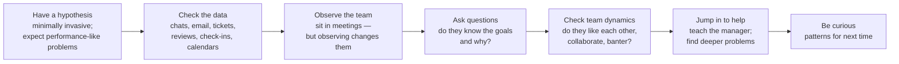

# فصل ۷: مدیریت مدیرها

[فصل ۶: مدیریت چند تیم →](06-managing-multiple-teams.md) · [کتاب](../README.md) · [فصل ۸: لیگ بزرگ‌ها ←](08-the-big-leagues.md)

## خلاصه

مدیریت مدیرها شبیه مدیریت چند تیم در مقیاسی بزرگ‌تر به نظر می‌رسد، ولی یک لایه‌ی انتزاع تازه اضافه می‌کند: دو پله از خود کار فاصله دارید و برای مشکل‌هایی که نمی‌بینید به شاهدهای نامطمئن تکیه می‌کنید. این فصل درباره‌ی دیدن از پس همین لایه است: جلسه‌های skip-level به‌جای سیاست در باز، پاسخ‌گو نگه داشتن مدیرها در برابر تیمشان حتی وقتی ریشه‌ی مشکل بیرونی به نظر می‌رسد، کوچ کردن مدیرهای تازه و هم‌سو کردن مدیرهای باتجربه، استخدام مدیر بر پایه‌ی مهارت و فرهنگ، و debug کردن سازمان همان‌طور که یک سیستم را debug می‌کنید. در پایان درباره‌ی مدیریت انتظارها از زمان‌بندی، نگه داشتن ثبات تیم‌ها وسط تغییر نقشه‌ی راه، و معنای «مرتبط ماندن فنی» وقتی دیگر کد نمی‌زنید حرف می‌زند: سرپرستی سرمایه‌گذاری فنی با پرسیدن پرسش‌های آگاهانه (pp. 125–157).

## نکته‌های کلیدی

- **دنبال حس ناخوشایندتان بروید و کارهای کوچک را پیگیری کنید**، مثل استخدام و کوچینگ و هدف‌های فصلی و postmortem، تا یاد بگیرید پیگیری کدامشان را می‌شود کنار گذاشت (p. 126).
- **سیاست در باز مشکل‌ها را رو نمی‌کند.** جلسه‌ی skip-level بگذارید، یعنی ۱-۱ فصلی تا وقتی سازمان کوچک است، یا ناهار تیمی، تا مدیرهایی را بگیرید که خوب رو به بالا گزارش می‌دهند (pp. 127–131).
- **مدیرها در برابر سلامت و بهره‌وری تیمشان پاسخ‌گویند**، حتی با نقشه‌ی راه بی‌ثبات و tech lead سرگردان و آتش‌نشانی دائم؛ سهم شما کمک کردن است، وقتی مسئله را پیش شما آوردند (pp. 131–133).
- **مراقب آدم خوشایندکننده باشید**، چه رو به تیم و چه رو به بیرون، که به همه بله می‌گوید، مشکل‌ها را پنهان می‌کند و تیم را به شکست می‌کشاند (pp. 133–136).
- **مدیرهای تازه به کوچینگ واقعی نیاز دارند**: مراقب کار بیش از حد باشید، که از رها نکردن کار قبلی می‌آید، و مراقب آدم‌های کنترل‌گر؛ مدیرهای باتجربه به تناسب فرهنگی و فضا برای شکل دادن به استراتژی نیاز دارند (pp. 136–140).
- **مدیرها را مثل مهندس‌ها استخدام کنید، برای مهارت و فرهنگ:** جلسه‌ی ۱-۱ نقش‌بازی‌شده با آدم‌هایی که زیردستش می‌شوند، debug کردن یک تیم، یک فلسفه‌ی مدیریتی، عمق فنی و بررسی دقیق مراجع (pp. 140–144).
- **سازمان را مثل سیستم debug کنید:** فرضیه، داده، مشاهده با این آگاهی که مشاهده تیم را عوض می‌کند، پرسش درباره‌ی هدف‌ها، پویایی تیم، کمک کردن و کنجکاوی (pp. 145–148).
- **تخمین‌ها را بی‌آن‌که بپرسند به اشتراک بگذارید، نزدیک پایان دامنه را کم کنید، و با هدایت سرمایه‌گذاری فنی فنی بمانید:** کد بخوانید، به postmortemها بروید، پرسش آگاهانه بپرسید و به‌جای پیام‌رسانی، درخواست مشخص بدهید (pp. 149–156).

## فهرست بخش‌ها

*از فهرست مطالب خود کتاب، از bookmarkهای PDF؛ شماره‌ها صفحه‌ی چاپی‌اند.*

- جلسه‌های skip-level — p. 128
- پاسخ‌گویی مدیر — p. 131
- مدیر خوب، مدیر بد: آدم خوشایندکننده — p. 133
- مدیریت مدیرهای تازه — p. 136
- مدیریت مدیرهای باتجربه — p. 138
- استخدام مدیر — p. 140
- دیباگ کردن سازمان‌های ناکارکرد — p. 145
  - فرضیه داشته باشید — p. 146
  - داده‌ها را وارسی کنید — p. 146
  - تیم را مشاهده کنید — p. 146
  - پرسش بپرسید — p. 147
  - پویایی تیم را وارسی کنید — p. 148
  - برای کمک وسط بپرید — p. 148
  - کنجکاو باشید — p. 148
- تنظیم انتظارها و تحویل سر وقت — p. 149
- موقعیت‌های دشوار: بلاتکلیفی نقشه‌ی راه — p. 151
  - راهبردهایی برای کنار آمدن با بلاتکلیفی نقشه‌ی راه — p. 151
- مرتبط ماندن فنی — p. 153
  - بر سرمایه‌گذاری فنی نظارت کنید — p. 154
  - پرسش آگاهانه بپرسید — p. 154
  - بده‌بستان‌های مهندسی و کسب‌وکار را تحلیل و تبیین کنید — p. 154
  - درخواست مشخص بدهید — p. 154
  - از تجربه‌تان به‌عنوان محک درونی استفاده کنید — p. 155
- سنجیدن تجربه‌ی خودتان — p. 156

## یادداشت‌ها

تفاوتش با مدیریت چند تیم در مقیاس است: تیم بیشتر، پروژه‌ی بیشتر، و اغلب کارکردهایی که هیچ‌وقت نگردانده‌اید؛ مدیر مهندسی‌ای که حالا عملیات هم دارد (p. 125). نویسنده یک‌بار از کوچش پرسید چطور مدیرها را مدیریت کند بی‌آن‌که همه‌ی وقتش را بگیرد، و چطور به مشکل‌هایی کمک کند که خودش در اتاقشان نبوده، «با شاهدهای نامطمئن» (p. 125).

- **با پیگیری چیزهایی که فقط کمی ناجور به نظر می‌رسند، حستان را تمرین بدهید.** برای تیمی بیرون از تخصصتان، رها کردن کار تا وقتی مشکلی پیش بیاید یعنی مشکل را خیلی دیر پیدا می‌کنید (p. 126).
- **کسانی که یک تیم را خوب می‌گردانند ممکن است این‌جا از هم بپاشند** و به منطقه‌ی امن عقب بنشینند؛ یا نقش individual contributor بازی می‌کنند یا به‌جای تربیت مدیرهایشان نقش project manager (p. 126).
- **همه‌ی کارهای کوچک را پیگیری کنید تا بفهمید پیگیری کدامشان را می‌شود کنار گذاشت:** استخدام جلو می‌رود؟ مدیرها کوچینگ می‌کنند؟ هدف‌های فصلی نوشته شده‌اند و خودتان مرورشان کرده‌اید؟ postmortem برگزار شد و خواندیدش (p. 126)؟

این دروازه‌ی ورود به رهبری ارشد است، نه ادامه‌ی همان چیزی که بود (p. 126).

> **کادر Ask the CTO: مغالطه‌ی سیاست در باز** (pp. 127–128). ساعت‌های ملاقات و «در اتاق من همیشه باز است» به‌ندرت مشکلی را به داخل می‌آورند: مهندس شجاعی لازم است که به رئیسش، چه برسد به رئیسِ رئیسش، از مشکلی بگوید که شاید حتی نتواند صورت‌بندی‌اش کند. ریسک با فاصله بیشتر می‌شود و سرش به مدیر ارشد بی‌خبری می‌رسد که به ساعت ملاقات تکیه می‌کند و تعجب می‌کند چرا استعدادها می‌روند. بعضی‌ها در مدیریت رو به بالا و پنهان کردن مشکل عالی‌اند. غافلگیر شدن به پای خودتان نوشته می‌شود؛ در جلسه‌های ۱-۱ جا برای گفت‌وگوی واقعی باز کنید و خودتان پیش‌دستانه skip-level بگذارید.

### جلسه‌های skip-level

جلسه‌ی skip-level جلسه با آدم‌هایی است که به زیردست‌های شما گزارش می‌دهند؛ هدفش به دست آوردن چشم‌اندازی از سلامت و تمرکز تیم‌هاست (p. 128).

| شکل | چطور | چه می‌دهد و کجا کم می‌آورد (pp. 128–130) |
|---|---|---|
| **جلسه‌ی ۱-۱ فصلی skip-level** | جلسه‌ای کوتاه با هر نفر، به نفع خودش، با پرسش‌های آماده: بهترین و بدترین چیز پروژه؛ چه کسی خوب کار می‌کند؛ بازخورد درباره‌ی مدیرش؛ تغییرهای محصول؛ فرصت‌های از دست رفته؛ سازمان چطور پیش می‌رود؛ کدام بخش استراتژی را نمی‌فهمد؛ چه چیزی نمی‌گذارد بهترین کارش را بکند؛ چقدر راضی است؛ و چطور کار جذاب‌تر شود | رابطه‌ای شخصی با همه، تا آدم‌ها به «منبع» تبدیل نشوند. **مقیاس نمی‌گیرد:** ۶۰ نفر در فصلی با حدود ۶۰ روز کاری یعنی روزی یکی؛ با ۱۰۰۰ نفر در هفته‌ی ۴۰ ساعته کار دیگری نمی‌توانید بکنید |
| **ناهار تیمی skip-level** | فصلی دو بار برای یک تیم کامل ناهار بخرید. پرسش‌های گروهی: چه چیزی می‌توانم برایتان فراهم کنم؟ تیم با تیم دیگری بد کار می‌کند؟ درباره‌ی سازمان بزرگ‌تر پرسشی هست؟ | صمیمیت و دیدن پویایی گروه، ولی بدون کوچینگ فردی، و آدم‌ها جلوی بقیه از مدیرشان انتقاد نمی‌کنند. همین صمیمیت باعث شد آدم‌ها راحت‌تر از ساعت‌های ملاقات استفاده کنند |

فایده‌اش فراتر از اعتماد و مشارکت این است که بفهمید کجا دارند **خوب «رو به بالا مدیریتتان می‌کنند»، به زیان تیم**؛ همان آدم‌ها اول به شما می‌رسند، پس پیشاپیش متمایلید پشتشان بایستید (p. 130). همیشه بین تعامل‌های عمیق و گران و تعامل‌های سطحی و ارزان معامله می‌کنید. و فرض نکنید تیمی که قبلاً مدیرش بودید باز هم همه چیز را به شما می‌گوید: تیم‌ها عوض می‌شوند و کسی مشکل مدیرش را پیش شما نمی‌آورد (pp. 130–131).

> **Run it:** آزمایش [بار جلسه‌های skip-level](../lab/07-skip-level-load/README.md) همان حساب‌وکتاب کتاب را بازمی‌سازد، یعنی فصلی یک ۱-۱ برای هر نفر، برای سازمان‌های ۱۵ تا ۱۰۰۰ نفره، و با ناهار تیمی مقایسه‌اش می‌کند.

### پاسخ‌گویی مدیر

هدف همگانی: مدیرهایتان باید **زندگی شما را آسان‌تر کنند** و وقتتان را برای تصویر بزرگ‌تر باز کنند. ولی بعضی‌ها این کار را با پنهان کردن مشکل و گفتن چیزی می‌کنند که دوست دارید بشنوید، پس باید پاسخ‌گو نگهشان دارید؛ یکی از بزرگ‌ترین چیزهایی که در این level باید یاد بگیرید، و سخت است چون در تیم‌های پیچیده مسئولیت بین tech leadها و product managerها و تیم‌های دیگر پخش است (p. 131).

| وضعیت (pp. 131–132) | مدیر پاسخ‌گوست؟ | او باید چه کند و سهم شما چیست (pp. 132–133) |
|---|---|---|
| **نقشه‌ی راه محصولِ بی‌ثبات**، یعنی بهره‌وری پایین، سیستم‌های بی‌ثبات، ریزش نیرو، هدف‌هایی که مدام عوض می‌شوند و همه چیز فوری است | **بله** | هزینه‌ی این آشفتگی را به product نشان بدهد و تمرکز را برگرداند؛ اگر نشد به شما ارجاع بدهد. شاید برای پافشاری به وزن شما نیاز داشته باشد |
| **tech lead سرگردان** که در لانه‌ی خرگوشِ بازطراحی یک سیستم اصلی رفته، design doc به‌زور شروع شده و کارها روی هم تل‌انبار شده‌اند | **بله** | tech lead را بیرون بکشد، process طراحی را شفاف کند و آدم‌های ارشد تیم‌های دیگر را بیاورد. شاید شما در پیدا کردن آن آدم‌ها کمک کنید |
| **آتش‌نشانی تمام‌وقت** با سیستم‌های قدیمیِ به‌ارث‌رسیده که مدام خراب‌اند، به‌علاوه‌ی درخواست پشتیبانی از تیم‌های دیگر و بی‌خبری از نقشه‌ی راه مهاجرت | **بله** | برای برداشتن علت آتش‌سوزی‌ها برنامه بریزد؛ triage کند و بعضی درخواست‌های پشتیبانی را رد کند؛ و اگر لازم است نیرو بخواهد. تأیید تعداد نیرو یا جابه‌جا کردن پشتیبانی با شماست |

آسان‌تر کردن زندگی شما یعنی مسئله‌های روشن را پیش از تبدیل شدن به آتش‌سوزی مهارناپذیر پیش شما بیاورند (pp. 132–133). مدیرها هم مثل هر کسی کوچینگ لازم دارند: آن‌ها را به‌عنوان آدم بشناسید و در ۱-۱ برای بازخورد وقت بگذارید، چون شما را خوب یا بد جلوه می‌دهند (p. 133).

### مدیر خوب، مدیر بد: آدم خوشایندکننده

| Marcus | Maria |
|---|---|
| بهترین دوست همه، با ۱-۱های بی‌پایان برای هر کسی، و قول رفع هر مشکلی، که هیچ‌وقت عملی نمی‌شود. همان همکاری که از او شکایت کردید باز ارتقا گرفت و product هنوز تیم را می‌راند | تندوتیز، و اگر زیردستش نباشید فاصله‌دار، و بی‌حوصله در برابر غیبت. ولی نقشه‌ی راه هدف‌های کمتر و معقول‌تری دارد، جلسه‌ها بهتر می‌گذرند، آن همکار دشوار بازخورد گرفته، و خودش هم سر ساعت معقولی می‌رود خانه |

آدم خوشایندکننده طاقت ناراحت کردن کسی را ندارد، پس به همه چیز بله می‌گوید و می‌سوزد (p. 133). **نشانه‌ها** (p. 134): تیم او را به‌عنوان آدم دوست دارد ولی از او به‌عنوان مدیر کلافه است؛ بی‌دردسر و بی‌اشتباه را به درخشان ترجیح می‌دهد؛ حال بدش پیداست و تیم را می‌لرزاند؛ هیچ‌وقت پافشاری نمی‌کند ولی کارهای نیمه‌تمام و بهانه‌های زیادی دارد؛ بیش از توان قول می‌دهد و کمتر تحویل می‌دهد و درس نمی‌گیرد؛ به تیم و به شریک‌ها پیام‌های متناقض می‌دهد؛ همه‌ی مشکل‌ها را می‌داند و به هیچ‌کدام نمی‌پردازد.

| خوشایندکننده‌ی تیم | خوشایندکننده‌ی بیرون |
|---|---|
| تراپیستی که با احساس‌ها درگیر می‌شود؛ گشاده‌ترین آدم‌ها بیشترین وقتش را می‌گیرند؛ وفاداری می‌سازد ولی **درام را تشدید می‌کند** و قول‌هایی می‌دهد که از پسشان برنمی‌آید و تیمی تلخ‌کام به جا می‌گذارد (pp. 134–135) | رئیس و شریک‌ها را راضی می‌کند، **بیش از توان تیم تعهد می‌دهد**، مشکل‌ها را رو به بالا پنهان می‌کند، و جالب این‌که داخل تیم کم تعریف و بازخورد می‌دهد و از گفت‌وگوی سخت فرار می‌کند. نقطه‌کوری برای مدیر خودش (pp. 134–135) |

هیچ‌کدام امنیت نمی‌سازند: ترسشان از شکست، شکست سالم را سخت می‌کند (p. 135). چه چیزی کمک می‌کند (pp. 135–136): نه گفتن را امن‌تر کنید و تصمیم‌ها را بیرونی کنید؛ شریک‌های قوی‌ای که صاحب نقشه‌ی راه‌اند، برنامه‌ریزی agile که مال خود تیم است، و processهای ارتقا که فراتر از صلاح‌دید مدیر می‌روند. رفتار و هزینه‌هایش را نشانشان بدهید، در حالی که ارزش از‌خودگذشته‌ی پشتش را هم به رسمیت می‌شناسید.

### مدیریت مدیرهای تازه

مدیریت تغییر مسیر شغلی است؛ مدیرهای بار اولی نمی‌دانند چه چیزی را نمی‌دانند (p. 136). وقتی که با آن‌ها می‌گذرانید هزینه‌ای از پیش است با سود بلندمدت؛ بپرسید جلسه‌های ۱-۱شان چطور پیش می‌رود، یا دست‌کم یادآوری کنید که برگزارشان کنند (p. 136).

| نشانه‌ی هشدار | یعنی چه (pp. 136–138) |
|---|---|
| **مدیریت نکردن** | از جزئیات مدیریتی جا می‌مانند؛ آدم‌ها به‌خاطر نبود مسیر شغلی می‌روند، که در نهایت مسئولیتش با شماست. skip-levelهای پرتکرار بگذارید و بگویید که می‌گذارید |
| **کار بیش از حد** | مسئولیت‌های قبلی را تحویل نداده‌اند و دو شغل را با هم می‌کنند. انتظارش را داشته باشید و کمک کنید رها کنند |
| **کنترل‌گر** | شغل را اقتدار می‌بینند: سلطه‌جو می‌شوند، هر تصمیمی را خودشان می‌گیرند، کار مشخص تعیین می‌کنند، با هم‌ترازها در product درمی‌افتند، و کارشان را از شما پنهان می‌کنند، مثلاً با رد کردن ۱-۱ شما و طفره رفتن از پرسش‌ها. با مدیر ذره‌بین‌به‌دست فرق دارد، چون او جزئیات می‌خواهد |
| **درماندگی درباره‌ی تحویل** | نفهمیده‌اند که حالا صاحب عملکرد تیم‌اند. اولش در برنامه‌ریزی کوچشان کنید و بگویید که پاسخ‌گو نگهشان می‌دارید |

مدیر کردن آدم اشتباه یک اشتباه است؛ **نگه داشتنش وقتی فهمیده‌اید، خطای حیاتی است.** قدم‌های کوچک اول، مثل منتورینگ و تیم‌های خیلی کوچک، کمک می‌کنند ولی همه چیز را رو نمی‌کنند؛ آدم‌های کنترل‌گر اغلب منتظر عنوان می‌مانند. انتظار داشته باشید در شش ماه اول بازخورد اصلاحی قوی بدهید، و مدیرهای تازه را به آموزش داخلی یا بیرونی بفرستید (p. 138).

### مدیریت مدیرهای باتجربه

مدیر باتجربه‌ی درست می‌داند چه باید بکند و می‌کند، ولی مدیریت خیلی به فرهنگ وابسته است (pp. 138–139).

- **تناسب فرهنگی بر تخصص حوزه مقدم است.** مدیرها خرده‌فرهنگ می‌سازند. خبره‌ی نرم‌افزار انبار سازمانی که عادت دارد هر شش ماه با تیم‌های دور تحویل بدهد، شاید به استارتاپ چابکِ لجستیکِ حضوری نخورد؛ دانش صنعت آسان‌تر از شیوه‌ی تازه‌ی کار کردن به دست می‌آید (p. 139).
- **تفاوت‌ها را فعالانه حل کنید.** از آن‌ها یاد بگیرید، ولی بازخورد خودتان را هم بدهید؛ مطمئن شوید ارزش‌هایی را که می‌خواهید، مثل شفافیت و کاوشگری، در خودشان دارند (pp. 139–140).
- **با دامنه الهام بدهید.** به‌جای مبانی، درباره‌ی استراتژی و جهت‌گیری کوچشان کنید، به آن‌ها واگذار کنید، مشاور جهت‌گیری سازمان بدانیدشان و کمک کنید شبکه‌شان را بزرگ کنند (p. 140).

### استخدام مدیر

ده مهندس با کمتر از ۳ سال تجربه و هیچ‌کس که بخواهد یا آماده‌ی مدیریتشان باشد: وقت استخدام مدیر است (p. 140). مثل مهندس‌ها، مهارت و تناسب فرهنگی را بسنجید. مدیرها راحت‌تر می‌توانند خوب حرف بزنند، ولی مهندس‌هایی هم که در مصاحبه خوب کد می‌زنند گاهی چیزی تحویل نمی‌دهند، پس ترس از استخدام بد را از چیزی که مصاحبه واقعاً می‌گوید جدا کنید (pp. 140–141).

| چه چیزی را بسنجید | چطور (pp. 141–142) |
|---|---|
| **جلسه‌ی ۱-۱** | نقش‌بازی کنید: آدم‌هایی که زیردستش می‌شوند مسئله‌ی واقعیِ حالا یا همین نزدیکی را می‌آورند؛ مدیر خوب پرسش‌های درست می‌پرسد و قدم بعد را پیشنهاد می‌دهد. نقش کسی با عملکرد پایین یا ارزیابی منفی را هم بازی کنید |
| **دیباگ کردن تیم** | پروژه‌ای که عقب بود و او چه کرد؛ کارمندی که به رفتن فکر می‌کرد؛ کوچ کردن آدم‌های گیرکرده و پروراندن ستاره‌ها |
| **فلسفه‌ی مدیریتی** | مدیر باتجربه‌ای که فلسفه‌ای ندارد پرچم قرمز است: این شغل چیست، چطور دست در کار می‌ماند و چطور واگذار می‌کند؟ |
| **ارائه دادن**، برای نقش‌های ارشد | تسلط بر اتاق و ساختار دادن به فکر، ولی بیش از حد به آن وزن ندهید؛ خیلی از مدیرهای درخشان از حرف زدن با غریبه‌ها خوششان نمی‌آید |
| **مهارت فنی** | به‌اندازه‌ی اعتبار داشتن: مصاحبه‌ی فنی کوتاه‌شده برای مدیری که کد می‌زند؛ بده‌بستان‌های طراحی و معماری، یا میانجی‌گری در یک بحث مهندسی، برای بقیه |
| **تناسب فرهنگی** | سلسله‌مراتب در برابر بی‌تکلفی؛ اجماع در برابر تصمیم تنها؛ رهبری خدمتگزار در برابر دستور دادن. آدم ناهم‌خوان شکست می‌خورد و اخراج می‌شود، یا تیم زودتر می‌رود. استخدام از فرهنگ دیگر می‌تواند تغییر عامدانه بیاورد، به قیمت ریزش نیرو |
| **مراجع** | همیشه، حتی برای کسی که با او کار کرده‌اید: چطور موفق می‌شود و چطور شکست می‌خورد، دوباره برایش کار می‌کردید، چه چیزش را دوست دارید و چه چیزش دیوانه‌تان می‌کند |

کتاب *High Output Management* از Andy Grove: آدم‌های تازه تا وقتی همکارهایشان را نشناخته‌اند به نفع خودشان عمل می‌کنند و بعد به نفع گروه می‌چرخند، و ارزش‌های فرهنگی در موقعیت‌های مبهم راهنمای تصمیم‌اند، پس مدیرهایی که از قبل ارزش‌های شرکت را دارند سریع‌تر می‌چرخند (p. 143).

> **کادر Ask the CTO: مدیریت بیرون از مهارت خودتان** (pp. 144–145). برداشتن عملیات و QA جهش کوچکی نیست: نمی‌دانید کدام جزئیات را باید بپایید و یک مدیر می‌تواند مدت‌ها راه اشتباه برود، به‌خصوص در پروژه‌های بلند. کنجکاو باشید و از مدیر بخواهید طوری یادتان بدهد که انگار منتور شماست، و اولش وقت *بیشتری* در حوزه‌های ناآشنا بگذارید، وگرنه حس گناه و بیزاری نمی‌گذارد با مشکل‌هایشان روبه‌رو شوید.

### دیباگ کردن سازمان‌های ناکارکرد

بهترین مدیرهای مهندسی اغلب debuggerهای خوبی‌اند: سمج در پرسیدن *چرا*. debugger ضعیف یک خط log اضافه می‌کند، باگ concurrency را بازتولید نمی‌کند و اعلام می‌کند که درست شد (p. 145). تیم‌ها جعبه‌های سیاه پیچیده‌ای‌اند که با جعبه‌های سیاه دیگر تعامل می‌کنند (pp. 145–146). نمونه: تیمی که حس می‌کند کند است (p. 146).

*تصویر vault از هفت قدم کتاب (pp. 146–148).*

- **فرضیه داشته باشید** درباره‌ی این‌که تیم چطور به این حال افتاده، در حالت ایده‌آل فرضیه‌ای بازتولیدپذیر؛ مشکل‌های تیمی مثل مشکل‌های performance‌اند؛ گاهی کند می‌شود، آدم‌ها راضی‌اند ولی ریزش بالاست (p. 146).
- **داده‌ها را وارسی کنید**، همان‌طور که log می‌خوانید: حادثه‌هایی که وقت می‌خورند، آدم‌های مریض، جنگ سر سبک کد در review، ticketهای مبهم یا بدقواره، چت بی‌روح، جلسه‌ی زیاد، مدیری که ۱-۱ نمی‌گذارد. این‌ها مدرک قطعی نیستند ولی راهنمایند (p. 146).
- **تیم را مشاهده کنید.** جلسه‌های کسل‌کننده که بیشترش را مدیر یا product lead حرف می‌زند، یعنی برنامه‌ریزی ضعیف است، یا تیم واقعاً در جهت‌گیری حرفی ندارد، یا تعارض سالم نیست. ولی مثل جعبه‌ی Schrödinger، یا مثل خط logی که یک race را پنهان می‌کند، **حضور شما همان چیزی را عوض می‌کند که مشاهده می‌کنید** (pp. 146–147).
- **پرسش بپرسید.** می‌توانند هدف‌هایشان و دلیلشان را بگویند؟ در تعیینشان کمک کرده‌اند؟ تیمی که فقط پروژه‌های پیشنهادیِ مهندسی را انجام می‌دهد، احتمالاً برای کار محصول ارزشی قائل نیست (p. 147).
- **پویایی تیم را وارسی کنید:** آدم‌هایی که هیچ‌وقت حرف نمی‌زنند و تنها کار می‌کنند تیم نیستند؛ اگر عملکرد خوب است اشکالی ندارد، و اگر نه سرنخ است (p. 148).
- **برای کمک وسط بپرید**، همان‌طور که در یک قطعی پیچیده کمک می‌کنید؛ هم به مدیر یاد می‌دهد و هم می‌تواند مشکل‌های عمیق‌تری مثل نبود رهبری کسب‌وکار را رو کند (p. 148).
- **کنجکاو باشید.** بدون پرسیدن چرا، به جذابیت شخصی و شانس تکیه می‌کنید و از اشتباه‌ها هم یاد نمی‌گیرید (p. 148).

> **In practice:** debug کردن سازمان مثل debug کردن pipeline است: علت را پیدا کنید، نه نشانه را.
>
> **Your turn:** تیم داده و تیم backend مدام درباره‌ی تغییر schema منبع دعوا دارند. «چرا» را تا کجا می‌پرسید؟
>
> *Answer:* تا جایی که ریشه پیدا شود، مثلاً نبود یک data contract یا نبود هشدار پیش از تغییر schema؛ بعد آن را در سیستم درست کنید، مثلاً با schema contract در dlt و یک check در CI تیم backend. کتاب بهترین مدیرها را debuggerهای سمج در پرسیدن «چرا» می‌داند (p. 145).

### تنظیم انتظارها و تحویل سر وقت

پاسخ دادن به «چرا این‌قدر طول می‌کشد؟» از دو پله بالاتر از جزئیات سخت‌تر است (p. 149). وقتی پروژه خیلی از برنامه عقب است پرسش منصفانه‌ای است، ولی اغلب وقتی پرسیده می‌شود که رهبری از تخمین خوشش نیامده یا اصلاً تخمینی نخواسته بوده (p. 149).

- **در اشتراک‌گذاری تخمین‌ها و به‌روزرسانی‌هایشان پیش‌دستی کنید**، بی‌آن‌که بپرسند، برای پروژه‌های حیاتی یا هر چیزی بیش از چند هفته (p. 149).
- **به‌هر‌حال تخمین بزنید.** مهندس‌ها در برابر تخمین فراتر از sprint دوهفته‌ای مقاومت می‌کنند، و اگر قرار باشد تخمین دقیق باشد و نیازمندی‌ها مدام عوض شوند حق هم دارند، ولی تخمین پیچیدگی را رو می‌کند، نیازمندی هر پروژه‌ای آشفته نمی‌شود، و کار اولیه ناشناخته‌ها را کم می‌کند. کسب‌وکار باید هزینه‌ها را برنامه‌ریزی کند و تیم‌ها پیچیدگی سیستم‌هایشان را یاد می‌گیرند. از تخمین‌های غلط درس بگیرید (pp. 149–150).
- **وقتی باز هم سرزنش می‌شوید**، با حوصله زمان‌بندی را دوباره بگویید و با آدم پرفشار همدلی کنید؛ کمک پیشنهاد بدهید (p. 150).
- **نزدیک پایان دامنه را کم کنید** و در نقش رأی تعیین‌کننده، بار حذف کردن ایده‌ی محبوبی را به دوش بکشید، و featureهای محصول را هم کم کنید، نه فقط کیفیت فنی را، که فقط بعد از launch تیم را کند می‌کند (p. 150).

> **In practice:** «چرا این داشبورد این‌قدر طول می‌کشد؟» در تیم داده پرسش هر هفته است.
>
> **Your turn:** چطور پیش از این‌که پرسیده شود، انتظار را تنظیم می‌کنید؟
>
> *Answer:* کار پنهان را دیدنی کنید: dependencyها، دسترسی به منبع و کیفیت داده را در برآورد بگویید و پیشرفت را منظم گزارش دهید. کتاب می‌گوید پاسخ به این پرسش از دو پله بالاتر سخت‌تر است و بهتر است زودتر از آن جلو بیفتید (pp. 149–150).

### موقعیت‌های دشوار: بلاتکلیفی نقشه‌ی راه

تغییر استراتژی همان جایی است که مدیریت میانی بدترین حالش را دارد: نمی‌توانید زیاد پافشاری کنید، قول‌هایتان به تیم می‌شکند و آن‌ها حس چرخ‌دنده بودن می‌کنند. در همین حال بدهی فنی هیچ‌وقت روی نقشه‌ی راه product پیدایش نمی‌شود (p. 151).

| راهبرد | جزئیات (pp. 151–153) |
|---|---|
| **درباره‌ی تغییر واقع‌بین باشید** | اگر استارتاپ هر تابستان برنامه را از نو می‌چیند، تداوم فراتر از تابستان را قول ندهید |
| **پروژه‌های بزرگ را به تحویل‌دادنی‌های کوچک بشکنید** | حتی اگر چشم‌انداز بزرگ بمیرد، چیزی به دست می‌آورید؛ با product دوباره بسنجید حالا چه چیزی بیشترین ارزش را دارد |
| **برای پروژه‌های فنی آینده بیش از توان قول ندهید** | «بعداً» هنوز نوشته نشده؛ کار مهم را همین حالا زمان‌بندی کنید، یا بپذیرید که با همه چیز رقابت خواهد کرد |
| **۲۰٪ را به کار نگه‌دارنده بدهید** | refactoring، باگ، process، تمیزکاری و پشتیبانی، در هر جلسه‌ی برنامه‌ریزی. برای بازنویسی‌های بزرگ کافی نیست؛ آن‌ها برنامه‌ریزی خودشان را می‌خواهند |
| **بدانید پروژه‌های مهندسی واقعاً چقدر مهم‌اند** | بپرسید چقدر بزرگ است، چقدر مهم است، می‌توانید ارزشش را بیان کنید، و موفقیتش یعنی چه؟ کار فنی بزرگ را مثل طرح‌های محصول ببینید، با داده و با گفتن این‌که چه چیزی را ممکن می‌کند. کار روی سیستمی که کم عوض می‌شود و چیزی را ممکن نمی‌کند احتمالاً نمی‌ارزد |

وقتی پروژه‌ها یا تیم‌ها به‌هر‌حال عوض شدند، برای وقت تمام کردن کار در جریان و برای حضور مهندسی در برنامه‌ریزی کار تازه پافشاری کنید؛ دلیل‌ها را حتی وقتی مخالفید توضیح بدهید؛ و آرام بمانید. روبه‌روی موج، «می‌توانید بگذارید زیر آب بکشدتان یا می‌توانید موج‌سواری یاد بگیرید» (p. 153).

### مرتبط ماندن فنی

مرتبط ماندن فنی به چه دردتان می‌خورد؟ از مسئولیت فنی‌تان شروع کنید (pp. 153–155):

| مسئولیت | یعنی چه |
|---|---|
| **نظارت بر سرمایه‌گذاری فنی** | وقت توسعه محدود است؛ پروژه‌های پیشنهادی را در کل سبد با نیاز محصول و مشتری جور کنید |
| **پرسیدن پرسش آگاهانه** | همه‌ی پروژه‌ها را خودتان پیدا نمی‌کنید؛ می‌پرسید پروژه‌های جاری چه غافلگیری‌هایی رو کرده‌اند، چه کسی مهندس بیشتر می‌خواهد و چرا، کدام تیم کند است و کمک را رد می‌کند، و چرا این پروژه همین حالا |
| **تحلیل و تبیین بده‌بستان‌ها** | featureهای فنیِ سخت و ایده‌های فنیِ پرریسک برای کسب‌وکار را علامت بزنید؛ بلاتکلیفی تحقیق و توسعه را برای شریک‌های غیرفنی توضیح بدهید |
| **دادن درخواست مشخص** | ایده‌های نشدنی را فیلتر کنید و طرح‌های تازه را روی کار جاری نگاشت کنید. مثلاً VP برای رشد کاربر فعال مهندس بیشتری برای بهبود search پیشنهاد می‌دهد؛ search در حال بازنویسی است، پس به‌جایش می‌خواهید تیم API تازه را زود در دسترس بگذارد تا product تست‌هایش را اجرا کند. مدیری که فقط درخواست‌ها را بالا و پایین **منتقل** می‌کند ارزشی اضافه نمی‌کند |
| **استفاده از تجربه به‌عنوان محک درونی** | سرمایه‌گذاری فنی بد به پای شما نوشته می‌شود؛ به‌خاطر کار انسانی، حس فنی‌تان را زمین نگذارید |

وقتتان را چطور خرج کنید (pp. 155–156): کد و pull requestها را بخوانید؛ حوزه‌ای ناآشنا را انتخاب کنید و از یک مهندس بخواهید یادتان بدهد و با شما pair کند؛ **به postmortemها بروید**، که استانداردهای زمین‌مانده و ارتباط ضعیف و ابزار آسیب‌زا آن‌جا بیش از هر جایی دیده می‌شوند؛ شیوه‌های صنعت در توسعه و تست و deploy و monitoring را دنبال کنید؛ شبکه‌ای از هم‌ترازهای فنی نگه دارید تا داستان واقعی پشت سخنرانی‌ها و ارائه‌های فروش را بشنوید؛ و هیچ‌وقت یاد گرفتن را متوقف نکنید.

### سنجیدن تجربه‌ی خودتان

پرسش‌هایی برای تأمل (pp. 156–157): چطور به آدم‌های skip-levelتان می‌رسید و چقدر از اطلاعات را خودتان می‌جویید به‌جای این‌که دریافت کنید؟ شرح شغل مدیرهایتان را خودتان بنویسید و با نسخه‌ی شرکت مقایسه کنید. کدام حوزه‌های بیرون از منطقه‌ی امنتان را وارسی می‌کنید؟ مدیر روان‌ترین تیمتان چه کار متفاوتی می‌کند؟ مدیرها را چطور مصاحبه می‌کنید، یعنی ارزش‌ها و فلسفه و تیم و مراجع؟ مأموریت سازمانتان فهمیده شده؟

## بده‌بستان‌ها در یک نگاه

| انتخاب | چه می‌دهد | چه می‌گیرد |
|---|---|---|
| سیاست در باز | حس در دسترس بودن | مشکل‌ها به‌ندرت می‌رسند؛ مدیریت رو به بالا پنهانشان می‌کند |
| جلسه‌ی ۱-۱ skip-level | عمق، رابطه‌ی شخصی | با تعداد نیرو خطی بالا می‌رود؛ در صدها نفر ناممکن است |
| ناهار skip-level | مقیاس، دیدن پویایی تیم | بدون کوچینگ فردی؛ کسی جلوی جمع از مدیرش انتقاد نمی‌کند |
| رها کردن تیم‌های ناآشنا | وقت شما؛ اعتماد | مشکل‌ها خیلی دیر پیدا می‌شوند |
| مدیر خبره‌ی حوزه | دانش محصول | ناهم‌خوانی فرهنگ و process |
| مدیر هم‌خوان با فرهنگ | تیم‌هایی که با هم کار می‌کنند | شاید لازم باشد حوزه را یاد بگیرد |
| مشاهده‌ی عمیق یک تیم | شاهد دست‌اول | رفتاری را که مشاهده می‌کنید عوض می‌کند |
| منتقل کردن درخواست‌ها | ساده است | ارزشی اضافه نمی‌کند؛ حواس تیم را پرت می‌کند |
| کم کردن فقط کیفیت فنی | سر وقت تحویل می‌دهید | بعد از launch تیم را کند می‌کند |

## فراتر از کتاب

- **اثر مشاهده‌گر.** قیاس Schrödinger در کتاب (p. 147) هم‌تراز اثر Hawthorne در پژوهش سازمانی است: آدم‌ها وقتی بدانند مطالعه می‌شوند رفتارشان را عوض می‌کنند.
- **گستره‌ی کنترل.** حساب‌وکتاب skip-level یکی از دلیل‌هایی است که سازمان‌ها با رشد لایه اضافه می‌کنند؛ کتاب *High Output Management* از Andy Grove، که کتاب درباره‌ی فرهنگ به آن ارجاع می‌دهد (p. 143)، درباره‌ی اهرم مدیریتی و تعداد زیردست‌های قابل‌مدیریت هم حرف می‌زند.

## پیوندها

- **Run it:** [بار جلسه‌های skip-level](../lab/07-skip-level-load/README.md)؛ ساعت‌های هفتگیِ صرف‌شده برای ۱-۱های فصلی skip-level و برای ناهارهای تیمی، به تفکیک اندازه‌ی سازمان.
- **فصل‌های مرتبط:** [فصل ۴: مدیریت آدم‌ها](04-managing-people.md) که ۱-۱ و مدیریت ذره‌بینی را می‌گوید، [فصل ۵: مدیریت یک تیم](05-managing-a-team.md) که دیباگ کردن تیم و ۲۰٪ پایداری را دارد، [فصل ۶: مدیریت چند تیم](06-managing-multiple-teams.md) که نشانه‌های هشدار و واگذاری را می‌گوید، [فصل ۸: لیگ بزرگ‌ها](08-the-big-leagues.md) که استراتژی و خبر بد در بالاترین سطح را دارد، و [فصل ۹: ساختن فرهنگ از صفر](09-bootstrapping-culture.md) که غربال کردن تناسب فرهنگی را می‌گوید.

## خودتان را بسنجید

*پرسش‌ها و پاسخ‌ها مال vault است و از روی یادداشت‌های بالا نوشته شده؛ پاسخ‌ها به صفحه‌ی چاپی کتاب ارجاع می‌دهند.*

1. **چرا سیاست در باز مشکل‌ها را به مدیر ارشد نمی‌رساند؟**

   *Answer:* مهندس خیلی شجاعی لازم است که به رئیسِ رئیسش از مشکلی بگوید که شاید حتی نتواند توضیحش بدهد؛ ریسک با فاصله بیشتر می‌شود و کسانی که خوب رو به بالا مدیریت می‌کنند مشکل‌ها را پنهان می‌کنند (p. 127).

2. **چرا جلسه‌های ۱-۱ skip-level مقیاس نمی‌گیرند؟**
   - [ ] آدم‌ها در آن‌ها شرکت نمی‌کنند
   - [x] با فصلی یکی برای هر نفر، ۶۰ نفر یعنی روزی یکی؛ با ۱۰۰۰ نفر کل هفته‌ی ۴۰ ساعته پر می‌شود
   - [ ] جلسه‌های ۱-۱ مدیرها را تکرار می‌کنند

   *Answer:* p. 129.

3. **تیم product مدام هدف‌های یک تیم را عوض می‌کند و تیم به زحمت افتاده. مدیر آن تیم پاسخ‌گوست؟**

   *Answer:* بله. مدیر در برابر سلامت و بهره‌وری تیمش پاسخ‌گوست: باید هزینه را به product نشان بدهد و تمرکز را برگرداند، و اگر نشد پیش شما بیاید (pp. 131–132).

4. **دو نشانه‌ی مدیر خوشایندکننده بگویید.**

   *Answer:* هر دو مورد از این‌ها: تیم او را دوست دارد ولی از او به‌عنوان مدیر کلافه است؛ بی‌دردسر را به درخشان ترجیح می‌دهد؛ هیچ‌وقت پافشاری نمی‌کند ولی کارهای نیمه‌تمام و بهانه دارد؛ بیش از توان قول می‌دهد و کمتر تحویل می‌دهد؛ پیام‌های متناقض می‌دهد؛ همه‌ی مشکل‌ها را می‌داند و به هیچ‌کدام نمی‌پردازد (p. 134).

5. **خطر مشاهده‌ی نزدیک یک تیم کند چیست؟**
   - [ ] وقتتان را هدر می‌دهد
   - [x] حضور شما رفتار تیم را عوض می‌کند و می‌تواند مشکل را پنهان کند، مثل خط logی که یک race را می‌پوشاند
   - [ ] مدیر حس می‌کند زیر پایش را خالی کرده‌اید

   *Answer:* pp. 146–147.

6. **کم کردن فقط کیفیت فنی برای رسیدن به ضرب‌الاجل چه ایرادی دارد؟**

   *Answer:* بعد از launch تیم را کند می‌کند؛ کنار چیزهای فنیِ خوب‌است‌باشد، featureهای محصول را هم ببینید (p. 150).

7. **یک director مرتبط از نظر فنی، به پیشنهاد VP برای افزودن مهندس به بهبود search وسط بازنویسی چطور پاسخ می‌دهد؟**

   *Answer:* با یک درخواست مشخص: اضافه کردن آدم به سیستمی که وسط بازنویسی است کمکی نمی‌کند، پس اولویت را می‌گذارد روی زود در دسترس گذاشتن API تازه تا product تست‌هایش را اجرا کند، به‌جای این‌که فقط درخواست را منتقل کند (p. 155).
