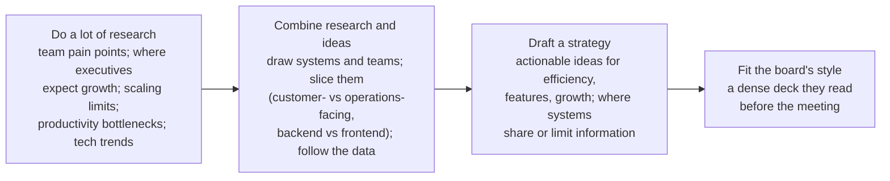

# 8. The Big Leagues

[← 7. Managing Managers](07-managing-managers.md) · [Book](../README.md) · [9. Bootstrapping Culture →](09-bootstrapping-culture.md)

## Summary

Senior technology leadership differs wildly between a 70-person startup engineering team and a Fortune 500 division, so the chapter offers models rather than rules. It breaks senior leadership into common roles — R&D, technology strategy, organization, execution, external face, infrastructure, business executive — and shows how companies combine them into CTOs and VPs of Engineering. It defines the CTO as the strategic technical executive the company needs at its current stage, a business-and-management job first. The rest is about operating at the top: changing priorities without whiplash, writing a technology strategy (the author's own path to CTO), delivering bad news, working with peers in other functions, managing "the echo" of your every word, replacing a culture of fear with trust, and setting the "True North" standard for your function (pp. 159–189).

## Key takeaways

- **Your first job is to be a leader:** make hard decisions with imperfect information, plan for possible futures, play politics productively, disagree and commit, hold people accountable (pp. 159–160).
- **Grove's four tasks shape senior days:** information gathering and sharing, nudging, decision making, and role modeling (pp. 160–161).
- **Senior roles are combinations of building blocks;** a VP of Engineering usually has the "ground game" of execution and organization, a CTO the strategy (pp. 162–166).
- **The CTO is the strategic technical executive the company needs now** — not the best engineer, not the top of the technical ladder; give up management and you give up the power to shape strategy (pp. 166–168).
- **Changing priorities means explicitly cutting work in flight**, communicating at least three times, and keeping the CEO informed about what's happening and why (pp. 169–172).
- **Technology strategy "enables the many potential futures of the business":** research, combine, draft — and fit the board's communication style (pp. 172–174).
- **At the top, you're watched:** your peers are your first team, disagreements stay in the room, you detach socially, and your behaviour is copied — so replace fear with relatedness, apologies and curiosity (pp. 178–185).
- **Set True North** for your function: the standards — such as production readiness — your teams internalize and weigh risks against (pp. 185–187).

## Section outline

*From the book’s own table of contents (PDF bookmarks); printed page numbers.*

- Models for Thinking About Tech Senior Leadership — p. 162
- What’s a VP of Engineering? — p. 164
- What’s a CTO? — p. 166
- Changing Priorities — p. 169
- Setting the Strategy — p. 172
  - Do a Lot of Research — p. 172
  - Combine Your Research and Your Ideas — p. 173
  - Draft a Strategy — p. 173
  - Consider Your Board’s Communication Style — p. 173
- Challenging Situations: Delivering Bad News — p. 174
- Senior Peers in Other Functions — p. 178
- The Echo — p. 180
- Ruling with Fear, Guiding with Trust — p. 182
  - Correcting a Culture of Fear — p. 183
- True North — p. 185
- Recommended Reading — p. 187
- Assessing Your Own Experience — p. 188

## Notes

Running a 70-person startup engineering organization is not the same job as running thousands at a Fortune 500 company (p. 159). As *technology* senior leaders, we bring a willingness to embrace and drive change, but must also build an organization that can follow through on it (p. 159). The company looks to you for what to do, where to go, how to act and what to value; people join because they believe in you (p. 159).

What a senior leader can do (p. 160): make hard decisions without perfect information and face the consequences; understand the current business and see its possible futures; plan months and years ahead; understand how structure affects teams; play politics productively; work well with peers outside engineering; **disagree with a decision and commit to deliver it**; hold individuals and organizations accountable.

Andy Grove's *High Output Management* splits management into four tasks that shape every senior day (pp. 160–161):

| Task | What it means |
|---|---|
| **Information gathering and sharing** | Meetings, email, 1-1s; synthesize lots of information fast, pick out what's critical, pass it on in a form others understand |
| **Nudging** | Remind people of commitments with questions, not orders — a large team can't be forcefully steered |
| **Decision making** | Set direction from conflicting views and incomplete information; one of the most draining parts of the job |
| **Role modeling** | Show the company's values; show up for your commitments, even when you don't feel like it |

> **What Is My Job?** (James Turnbull, pp. 161–162). Impostor syndrome from a nontraditional background and a desire to be "right" made him argue languages on technical merit — just another engineer in the room. His job was not to be the smartest person but to help the team make and sustainably implement the best decisions, bringing in strategy and nontechnical implications.

### Models for Thinking About Tech Senior Leadership

Rather than defining every title, the author lists the roles senior leaders play; some people play several, some companies need only a few, and all of them break down at very large companies (p. 162).

| Role | Focus (pp. 162–163) |
|---|---|
| **Research and development (R&D)** | Experimentation, research, new technology; may own technology strategy or just find new ideas |
| **Technology strategy / visionary** | How technology grows the business; predicts technology's evolution in the industry; often also runs product |
| **Organization** | Structure and people: staffing plans, org structure, project staffing |
| **Execution** | Making things actually get done: aligning roadmaps, planning, prioritizing, breaking roadblocks, resolving conflicts |
| **Face of technology, external** | Sales meetings for software sold to businesses; conference talks; the engineering brand for hiring |
| **Infrastructure and technical operations** | All infrastructure and its operation — cost-, security- or scaling-focused depending on stage |
| **Business executive** | The business first: the industry and other functions; balances internal development against growth; owns high-level prioritization |

Combinations the author has seen (pp. 163–164):

| Combination | Typical title |
|---|---|
| Business executive + technology strategy + organization + execution | CTO or Head of Engineering (VP/SVP) |
| R&D + technology strategy + external face | CTO, Chief Scientist, Chief Architect, sometimes Chief Product Officer — usually selling a software product |
| Organization + execution + business executive | VP of Engineering, General Manager |
| Infrastructure + organization + execution | CTO/CIO, possibly VP of Technical Operations |
| Technology strategy + business executive + execution | Head of Product / Chief Product Officer, sometimes CTO |
| R&D + business executive | CTO or Chief Scientist, cofounder |
| Organization + execution | VP of Engineering, sometimes Chief of Staff |

Most strong CTOs keep a strategic function — business, technology, or both (p. 164).

> **Try it:** [Which senior role is this?](../widgets/08-leadership-roles.html) — tick the building blocks a job involves and see which of the book's combinations and titles match.

### What's a VP of Engineering?

The VP is usually the top of the *management* ladder, so an experienced manager of people, projects, teams and departments. In larger companies there may be several, acting as mini-CTOs for divisions while directors take on the organizational management (p. 164). In a company with one (pp. 165–166):

- **A good "ground game":** handles processes and details, tracks many initiatives, drops into the details to make things happen; pushes execution while the CTO focuses on strategy.
- **Management:** aligns the roadmap to the hiring plan, runs hiring with recruiting, coaches the engineering managers and arranges training with HR.
- **Organizational strategy:** helps teams set goals that deliver business results, closely with product; keeps the roadmap realistic; negotiates deliverables.
- **Hard to hire:** usually hired from outside, must win trust quickly — yet engineers distrust people without technical credibility, and senior managers rarely want a hard technical interview for an organizational job.

People who excel are capable engineers who care deeply about their teams, prefer to stay out of the spotlight, tie happiness to accomplishment, and handle complex detailed work without being overwhelmed (pp. 165–166).

### What's a CTO?

The least well-defined role. Start with what it isn't: **not an engineering role, not the top of the technical ladder, not the natural goal of engineers, and not necessarily the best engineer** (p. 166). CTOs are cofounders, early engineers, hires or promotions; some run people and process, others architecture, product or the external face; some have no reports (p. 166).

The author's definition: **the strategic technical executive the company needs in its current stage of evolution** — *strategic* thinks long-term about the business's future; *executive* makes that operational by breaking down problems and directing people (pp. 166–167).

- **An executive first, a technologist second:** needs a seat at the executive table and must shape business strategy through technology — new lines of business, or technology that anticipates the roadmap's futures — focusing on the biggest technical opportunities and risks (p. 167).
- **Management is power.** Other executives will treat technology as an execution arm for their ideas; the CTO protects its own needs and ideas. CTOs who hand all management to VPs — sometimes with the VPs not even reporting to them — lose influence. At a previous employer, area "CTOs" without teams were respected but lacked strategic influence: "at best at the mercy of your influence… and at worst a figurehead" (pp. 167–168).

CTO is a business strategy job first and a management job; if you don't care about the business or won't take ultimate responsibility for a large team attacking it, it isn't for you (p. 168).

> **Ask the CTO: Where Do I Fit?** (pp. 168–169). Might you cofound a company; oversee architecture and its evolution grounded in the business; speak, sell and recruit senior people; manage senior ICs? Perhaps CTO. Enjoy managing people, making processes efficient, prioritizing, org structure, partnering with product — and prefer a roadmap meeting to an architecture review? Perhaps VP of Engineering. The fastest route to CTO is technical cofounder (only while you grow together); to VP, management experience at a larger company then a growing startup. Her VP's advice: wanting the title is like wanting to be married — the company and people matter.

### Changing Priorities

The CEO wakes with a revelation about a new product line; leadership agrees; but in-flight projects linger, until the question arrives: why aren't you working on the top priority (pp. 169–170)? Leaders far from day-to-day schedules forget teams have priority lists mapped weeks or months ahead (p. 170).

- **If you ask your teams this, ask yourself first** whether you knew and communicated the priority clearly and urgently — and **explicitly killed or postponed work in flight** to make room. Saying "top priority" is not the same as making the schedule trade-offs (p. 170).
- **Being asked means your view of reality and the CEO's are misaligned.** If the team must finish stabilizing a system or a long project first, say so with value, status and timeline — but expect to compromise (pp. 170–171).
- **Ask teams for the list of affected projects** to send upward, and ask the initiative's originator for its goals to combine with work in flight (p. 171).
- **Say it at least three times:** most people need to hear something three times. Tell your leadership, hold an all-hands, send email; anticipate questions; sell the change. Upward too: your boss may need to hear something three times before acting — and you may find yourself doing the same (p. 171).
- **Large organizations change slowly**; keep a founder CEO informed about what's happening and why, with concrete steps (pp. 171–172).

### Setting the Strategy

In the summer of 2014, as SVP of Engineering at Rent the Runway, the author was told she'd be put up for CTO if she presented a technology strategy to the board — and the CEO sent back every attempt until it met her standard. With help from the CEO, an executive CTO coach, peers and senior engineers, she went from a vague idea of strategy to one covering architecture and team structure that influenced how the company structured itself (p. 172).

*The vault's drawing of the four steps (pp. 172–174).*

- Her rejected first draft was almost all system and architecture detail with little beyond 6 to 12 months, and ignored business drivers; her sparse speaker's deck didn't suit a board that read dense decks beforehand (pp. 173–174).
- **Technology strategy "enables the many potential futures of the business"**: architecture, team structure and the business's direction — not deciding the product, but enabling the roadmap (p. 174).
- The hardest parts were getting started and guessing about the future with imperfect information; afterward she could lead forward rather than reactively, and show engineers a platform vision, not just a product roadmap (p. 174).

### Challenging Situations: Delivering Bad News

Layoffs, a disbanded team, an unpopular policy — you're the messenger (pp. 174–175).

| Do / don't | Why (pp. 175–176) |
|---|---|
| **Don't blast an impersonal message** to a large group | Email and chat — especially with comments — breed misunderstanding; the second-worst is everyone in one room, where one or two angry people rile the rest |
| **Do talk to individuals** as much as possible | Start with those likely to react most; give space to react and ask; make clear these are the marching orders. For a whole organization, brief managers with talking points first |
| **Don't deliver a message you can't stand behind** | Get another executive, HR or a trusted lieutenant to help — you must handle decisions you disagree with maturely, but not alone |
| **Do be honest about likely outcomes** | Layoffs aren't fun but the company must survive; a disbanded team had real accomplishments and gains new opportunities |
| **Do think how you'd like to be told** | As when you resign: face-to-face first, perhaps a farewell — sad changes can be marked with grace |

> **Ask the CTO: I Have a Nontechnical Boss** (pp. 176–178). From reporting to her CEO: drop jargon and excess detail; run your own 1-1s with prepared topics (and befriend the executive assistant); bring solutions, not problems — and get management coaching elsewhere, without shying away from bad news; ask for advice, which shows respect; repeat important issues ("three times is often the magic number"); be supportive; and find coaching, training and outside peers — "you no longer have a manager; you have a boss."

### Senior Peers in Other Functions

Senior leaders must practise first-team focus most of all: the business first, their department second. With few or no engineers among your peers, it can feel isolating (p. 178). Working well with them (pp. 178–180):

- **Let them own their areas**, as they let you own yours. Disagreement with how they run things that doesn't affect your team is like a friend dating someone you don't love: stay out unless asked, and be kind.
- **Disagree one-on-one or in leadership meetings** — ask the CFO when numbers don't add up, and defend your own roadmap there.
- **Trust their intentions.** Patrick Lencioni's *The Five Dysfunctions of a Team* names absence of trust as fundamental: assume peers are trying to do their best, not manipulating you. Expect clashes between analytical and intuitive people, and between agility and long-term planning.
- **Respect and translate.** Peers who aren't analytically driven are not stupid; jargon to people who don't need it makes *us* look stupid.
- **The cone of silence.** Leadership-team disagreements don't exist outside it; once decided, present a united front. Fall in line or quit — openly disagreeing with peers makes everything worse.

### The Echo

As the senior-most person, you're watched more closely than ever; people seek your approval and avoid your criticism (p. 180). Your first team is your peers; your organization is your second (p. 180).

- **Detach socially:** have the drink, then leave; closing the bar with your organization goes badly. Close friendships with reports lead to favouritism, real or perceived (p. 180).
- **Your words carry weight.** A throwaway comment can redirect someone's whole focus; a "buddy" image blurs thinking aloud and instructions. You suck the oxygen out of a room, and one brainstorm in a meeting you drop into can redirect a project (pp. 180–181).
- **Your behaviour is copied** — as Apple employees invoked "Steve." If you yell, yelling is OK; if you apologize for mistakes, mistakes are OK; your questions become everyone's; the roles you value attract the ambitious (p. 181).
- **Don't share your stress downward.** Worries your team can't act on undermine their confidence; transparency that helped at lower levels can damage stability here (p. 181).
- **Care about people more, not less** — families, hobbies — or you'll start treating them as cogs, and they can tell (pp. 181–182).

### Ruling with Fear, Guiding with Trust

"Camille" — technical, charismatic, decisive, short-tempered — makes people afraid; they take fewer risks and hide mistakes. "Michael" stays calm, gets curious and asks questions. The story is true: it's the author's own, and her first review as a senior leader said people feared being publicly reprimanded in front of peers, creating "a vicious cycle of you not trusting them and them making mistakes" (pp. 182–183). Fear comes from valuing correctness and rules, a taste for hierarchy, and backgrounds where open conflict is normal — engineering's tolerance for sparring included; as leader, people who once fought back now feel threatened (p. 183).

**Correcting a culture of fear** (pp. 183–185):

| Practice | How |
|---|---|
| **Practise relatedness** | Too much efficiency and no small talk made her impersonal. Belonging and safety let people take risks |
| **Apologize** | Honestly and briefly — "I'm sorry, I should not have yelled at you" — taking responsibility without excuses; it makes the team stronger |
| **Get curious** | Not every disagreement undermines your authority; attacking makes people hide information, questioning opens them up |
| **Hold people accountable without making them bad** | Between responsibility and consequences come measures of success, capabilities and feedback. Did you set them up to succeed? |

A culture of fear survives best when things are otherwise going well — growth and interesting problems mask it — and people with options leave when any of that changes (p. 185).

### True North

The senior leader of each function sets the baseline of what excellence looks like there: its **True North** (p. 185).

| Function | True North (pp. 185–186) |
|---|---|
| **Product** | Users and their needs first; measure and experiment; push back on projects that don't serve stated goals |
| **Finance** | The numbers: costs and value; no accidental overspending; warn when budgets are at risk |
| **Technology** | Production readiness: honour agreed review, operational oversight and testing policies; ship nothing you don't believe is ready for users; build systems you're proud of |

It is a lens for risk analysis, not a ban on risk. Single points of failure, known bugs, inability to take high load, data loss, undertested code and slow performance can all be acceptable somewhere — but must always be considered (p. 186). It's an underlying pull that teams internalize so they can follow it without nudging; different functions' True Norths create a **healthy tension** that forces everyone to reckon with all the risks (p. 186). As a commerce CTO, the author set True North for production readiness, scaling, design, architecture, testing and language choice, delegating mobile and UI standards to senior staff (pp. 186–187). Fast judgement calls rely on instincts honed by staying technical early and long enough (p. 187).

**Recommended reading** (p. 187): Arbinger Institute, *Leadership and Self-Deception*; Brené Brown, *Daring Greatly*; Peter Drucker, *The Effective Executive*; Marshall Goldsmith and Mark Reiter, *What Got You Here Won't Get You There*; Andy Grove, *High Output Management*; L. David Marquet, *Turn the Ship Around!*

### Assessing Your Own Experience

Questions for reflection (pp. 188–189): do you have a professional coach and a peer network outside the company? Which senior leaders do you admire, and why? How did your last priority change go? Do you understand where the business is going and the technology strategy to get there? Could your team tell which executives you dislike? Can you support decisions you disagreed with? Would you be happy to see people emulate you daily? What principles should your senior engineers or managers use to evaluate work?

## Trade-offs at a glance

| Choice | Buys | Costs |
|---|---|---|
| CTO keeps management | Power over strategy and staffing | Time away from pure technology |
| CTO without reports | Freedom for technology | Influence only; risk of figurehead |
| Announce a new priority | Speed | Nothing changes unless work in flight is cut |
| Bad news by email or all-hands | Fast, simultaneous | Impersonal; misunderstandings; contagious anger |
| Bad news one-on-one | Space to react; trust | Time; news may leak |
| Cone of silence | United front | Must let go when you lose an argument |
| Socializing heavily with reports | Closeness | Favouritism; blurred instructions |
| Sharp, sparring style | Fast, "correct" decisions | Culture of fear; hidden mistakes; attrition |
| One function's True North alone | Clear standard | Ignores other functions' risks — tension is healthy |

## Beyond the book

- **"Disagree and commit"** (p. 160) is a phrase associated with Intel under Andy Grove and later Amazon's leadership principles.
- **Will Larson's** *An Elegant Puzzle* (2019) and *The Engineering Executive's Primer* (2024) later covered several of these topics — strategy writing, the first 90 days as an executive, working with the CEO and peers — at greater length.
- **Engineering Leadership: The Hard Parts.** The second book in this vault, co-written by James Turnbull — whose sidebar appears on pp. 161–162 here — picks up senior leadership in chaotic organizations; its Chapter 8 also discusses CTO and VP of Engineering roles.

## Connections

- **Related chapters:** [6. Managing Multiple Teams](06-managing-multiple-teams.md) (first-team focus, saying no), [7. Managing Managers](07-managing-managers.md) (roadmap uncertainty, technical relevance), [9. Bootstrapping Culture](09-bootstrapping-culture.md) (values and culture you set from the top), [5. Managing a Team](05-managing-a-team.md) (being kind, not nice).

## Check yourself

*Questions and answers are the vault's, written from the notes above; answers cite the book's printed pages.*

1. **What are Andy Grove's four categories of management tasks?**

   *Answer:* Information gathering or sharing, nudging, decision making, and role modeling (pp. 160–161).

2. **Which description best fits the book's definition of a CTO?**
   - [ ] The best engineer in the company
   - [ ] The top of the technical career ladder
   - [x] The strategic technical executive the company needs at its current stage

   *Answer:* pp. 166–167.

3. **Why does the author warn CTOs against giving up all management responsibility?**

   *Answer:* Management is the power to allocate people to what matters; without it a CTO relies purely on influence — at best at others' mercy, at worst a figurehead (pp. 167–168).

4. **The CEO asks why your teams aren't working on the new top priority. What is the likely real problem?**

   *Answer:* The priority wasn't communicated clearly and urgently, and nobody explicitly killed or postponed work in flight to make room; your view of reality and the CEO's are misaligned (p. 170).

5. **How should you deliver bad news to a large team?**
   - [ ] One email so everyone hears at once
   - [ ] One all-hands meeting
   - [x] Individually where possible, starting with those most affected, with managers briefed first

   *Answer:* p. 175.

6. **What is "the cone of silence"?**

   *Answer:* Disagreements within the leadership team stay there; once a decision is made, leaders commit and present a united front (p. 180).

7. **Name two ways to correct a culture of fear.**

   *Answer:* Practise relatedness, apologize briefly and honestly, get curious instead of attacking, and hold people accountable without making them "bad" (pp. 183–185).

8. **What is True North for a technical leader?**

   *Answer:* The production-readiness standard — honouring agreed policies for review, operational oversight and testing, and shipping only what you believe is ready — against which risks like single points of failure are weighed (pp. 185–186).
