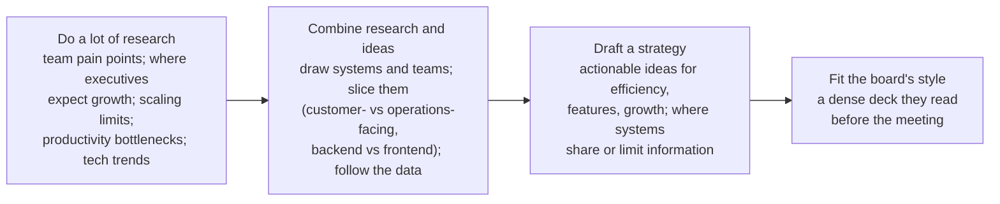

# فصل ۸: لیگ بزرگ‌ها

[فصل ۷: مدیریت مدیرها →](07-managing-managers.md) · [کتاب](../README.md) · [فصل ۹: ساختن فرهنگ از صفر ←](09-bootstrapping-culture.md)

## خلاصه

رهبری ارشد فناوری در یک تیم مهندسی ۷۰ نفره‌ی استارتاپی با یک بخش از شرکتی در فهرست Fortune 500 زمین تا آسمان فرق دارد، پس این فصل به‌جای قاعده، مدل می‌دهد. رهبری ارشد را به نقش‌های رایجش می‌شکند، یعنی تحقیق و توسعه، استراتژی فناوری، سازمان، اجرا، چهره‌ی بیرونی، زیرساخت و مدیر اجرایی کسب‌وکار، و نشان می‌دهد شرکت‌ها چطور این‌ها را در قالب CTO و VP of Engineering ترکیب می‌کنند. CTO را مدیر اجرایی فنیِ استراتژیکی تعریف می‌کند که شرکت در مرحله‌ی فعلی‌اش لازم دارد؛ پیش از هر چیز شغلی در کسب‌وکار و مدیریت. بقیه‌ی فصل درباره‌ی کار کردن در بالاترین سطح است: عوض کردن اولویت‌ها بدون ضربه زدن به تیم، نوشتن استراتژی فناوری که راه خود نویسنده به CTO شدن بود، رساندن خبر بد، کار با هم‌ترازها در کارکردهای دیگر، مدیریت «پژواک» هر کلمه‌تان، جایگزین کردن فرهنگ ترس با اعتماد، و گذاشتن استاندارد «True North» برای کارکردتان (pp. 159–189).

## نکته‌های کلیدی

- **اولین کار شما رهبر بودن است:** تصمیم سخت با اطلاعات ناقص، برنامه‌ریزی برای آینده‌های ممکن، سیاست‌ورزی سازنده، مخالفت و بعد تعهد به اجرا، و پاسخ‌گو نگه داشتن آدم‌ها (pp. 159–160).
- **چهار کار Grove به روزهای ارشد شکل می‌دهند:** جمع کردن و به اشتراک گذاشتن اطلاعات، تلنگر زدن، تصمیم گرفتن و الگو بودن (pp. 160–161).
- **نقش‌های ارشد ترکیبی از بلوک‌های سازنده‌اند؛** یک VP of Engineering معمولاً «بازی زمینی» اجرا و سازمان را دارد و یک CTO استراتژی را (pp. 162–166).
- **نقش CTO یعنی مدیر اجرایی فنیِ استراتژیکی که شرکت همین حالا لازم دارد**، نه بهترین مهندس و نه بالاترین پله‌ی نردبان فنی؛ اگر مدیریت را رها کنید، قدرت شکل دادن به استراتژی را رها کرده‌اید (pp. 166–168).
- **عوض کردن اولویت یعنی کار در جریان را صریحاً قطع کنید**، دست‌کم سه بار اعلامش کنید، و CEO را در جریان بگذارید که چه خبر است و چرا (pp. 169–172).
- **استراتژی فناوری «آینده‌های بالقوه‌ی زیاد کسب‌وکار را ممکن می‌کند»:** تحقیق کنید، ترکیب کنید، پیش‌نویس بنویسید، و با سبک ارتباطی هیئت‌مدیره جورش کنید (pp. 172–174).
- **در بالا، زیر نگاه‌ها هستید:** هم‌ترازهایتان تیم اولتانند، اختلاف‌ها از اتاق بیرون نمی‌روند، از نظر اجتماعی فاصله می‌گیرید و رفتارتان تقلید می‌شود، پس ترس را با حس تعلق و عذرخواهی و کنجکاوی عوض کنید (pp. 178–185).
- **برای کارکردتان True North بگذارید:** استانداردهایی مثل آمادگی برای production که تیم‌ها درونی می‌کنند و ریسک‌ها را با آن می‌سنجند (pp. 185–187).

## فهرست بخش‌ها

*از فهرست مطالب خود کتاب، از bookmarkهای PDF؛ شماره‌ها صفحه‌ی چاپی‌اند.*

- مدل‌هایی برای فکر کردن به رهبری ارشد فناوری — p. 162
- نقش VP of Engineering چیست؟ — p. 164
- نقش CTO چیست؟ — p. 166
- عوض شدن اولویت‌ها — p. 169
- تعیین استراتژی — p. 172
  - کلی تحقیق کنید — p. 172
  - تحقیق و ایده‌هایتان را ترکیب کنید — p. 173
  - استراتژی را پیش‌نویس کنید — p. 173
  - سبک ارتباطی هیئت‌مدیره را در نظر بگیرید — p. 173
- موقعیت‌های دشوار: رساندن خبر بد — p. 174
- هم‌ترازهای ارشد در کارکردهای دیگر — p. 178
- پژواک — p. 180
- حکومت با ترس، هدایت با اعتماد — p. 182
  - اصلاح فرهنگ ترس — p. 183
- شمال حقیقی — p. 185
- خواندنی‌های پیشنهادی — p. 187
- سنجیدن تجربه‌ی خودتان — p. 188

## یادداشت‌ها

گرداندن سازمان مهندسی ۷۰ نفره‌ی یک استارتاپ همان شغلِ گرداندن هزاران نفر در شرکتی از فهرست Fortune 500 نیست (p. 159). ما به‌عنوان رهبران ارشد *فناوری* آمادگی پذیرفتن و پیش بردن تغییر را می‌آوریم، ولی باید سازمانی هم بسازیم که بتواند تا تهش برود (p. 159). شرکت از شما می‌پرسد چه باید کرد، کجا باید رفت، چطور باید رفتار کرد و به چه چیزی باید ارزش داد؛ آدم‌ها می‌آیند چون به شما باور دارند (p. 159).

رهبر ارشد چه می‌تواند بکند (p. 160): تصمیم‌های سخت را بدون اطلاعات کامل بگیرد و پای پیامدشان بایستد؛ کسب‌وکار امروز را بفهمد و آینده‌های ممکنش را ببیند؛ ماه‌ها و سال‌ها جلوتر را برنامه بریزد؛ بفهمد ساختار چطور روی تیم‌ها اثر می‌گذارد؛ سیاست را سازنده بازی کند؛ با هم‌ترازهای بیرون از مهندسی خوب کار کند؛ **با یک تصمیم مخالف باشد و به تحویلش متعهد شود**؛ و افراد و سازمان‌ها را پاسخ‌گو نگه دارد.

کتاب *High Output Management* از Andy Grove مدیریت را به چهار کار می‌شکند که به هر روزِ یک آدم ارشد شکل می‌دهند (pp. 160–161):

| کار | یعنی چه |
|---|---|
| **جمع کردن و به اشتراک گذاشتن اطلاعات** | جلسه و ایمیل و ۱-۱؛ حجم زیادی اطلاعات را سریع جمع‌بندی کنید، حیاتی‌ها را بیرون بکشید و به شکلی منتقلشان کنید که بقیه بفهمند |
| **تلنگر زدن** | تعهدها را با پرسش به آدم‌ها یادآوری کنید، نه با دستور؛ تیم بزرگ را نمی‌شود با زور هدایت کرد |
| **تصمیم گرفتن** | از دل نظرهای متضاد و اطلاعات ناقص جهت تعیین کنید؛ یکی از فرساینده‌ترین بخش‌های شغل |
| **الگو بودن** | ارزش‌های شرکت را نشان بدهید؛ سر تعهدهایتان حاضر شوید، حتی وقتی حالش را ندارید |

> **کادر What Is My Job?** (یادداشت James Turnbull، pp. 161–162). سندرم ایمپاستر به‌خاطر پیشینه‌ی غیرمعمول، به‌علاوه‌ی میل به «درست بودن»، او را وامی‌داشت سر برتری فنی زبان‌ها بحث کند؛ یعنی فقط یک مهندس دیگر در اتاق. کارش این نبود که باهوش‌ترین آدم باشد، بلکه این بود که کمک کند تیم بهترین تصمیم‌ها را بگیرد و پایدار پیاده‌شان کند، با آوردن استراتژی و پیامدهای غیرفنی به بحث.

### مدل‌هایی برای فکر کردن به رهبری ارشد فناوری

نویسنده به‌جای تعریف کردن هر عنوان، نقش‌هایی را فهرست می‌کند که رهبران ارشد بازی می‌کنند؛ بعضی‌ها چند نقش را با هم دارند، بعضی شرکت‌ها فقط چندتا را لازم دارند، و همه‌شان در شرکت‌های خیلی بزرگ از هم می‌پاشند (p. 162).

| نقش | تمرکز (pp. 162–163) |
|---|---|
| **تحقیق و توسعه** | آزمایشگری، پژوهش، فناوری تازه؛ ممکن است صاحب استراتژی فناوری باشد یا فقط ایده‌های تازه پیدا کند |
| **استراتژی فناوری و چشم‌انداز** | این‌که فناوری چطور کسب‌وکار را بزرگ می‌کند؛ تکامل فناوری در صنعت را پیش‌بینی می‌کند؛ اغلب product را هم می‌گرداند |
| **سازمان** | ساختار و آدم‌ها: برنامه‌ی نیرو، ساختار سازمانی، چیدن آدم‌ها روی پروژه‌ها |
| **اجرا** | این‌که کارها واقعاً انجام شوند: هم‌سو کردن نقشه‌های راه، برنامه‌ریزی، اولویت‌بندی، برداشتن سد و حل تعارض |
| **چهره‌ی بیرونی فناوری** | جلسه‌های فروش برای نرم‌افزاری که به کسب‌وکارها فروخته می‌شود؛ سخنرانی کنفرانس؛ برند مهندسی برای استخدام |
| **زیرساخت و عملیات فنی** | همه‌ی زیرساخت و گرداندنش، که بسته به مرحله تمرکزش روی هزینه یا امنیت یا scaling است |
| **مدیر اجرایی کسب‌وکار** | اول کسب‌وکار: صنعت و کارکردهای دیگر؛ تعادل بین توسعه‌ی داخلی و رشد؛ صاحب اولویت‌بندی سطح بالا |

ترکیب‌هایی که نویسنده دیده (pp. 163–164):

| ترکیب | عنوان معمول |
|---|---|
| مدیر اجرایی کسب‌وکار + استراتژی فناوری + سازمان + اجرا | CTO یا Head of Engineering در سطح VP/SVP |
| تحقیق و توسعه + استراتژی فناوری + چهره‌ی بیرونی | CTO، Chief Scientist، Chief Architect و گاهی Chief Product Officer؛ معمولاً در فروش یک محصول نرم‌افزاری |
| سازمان + اجرا + مدیر اجرایی کسب‌وکار | VP of Engineering، General Manager |
| زیرساخت + سازمان + اجرا | CTO یا CIO و شاید VP of Technical Operations |
| استراتژی فناوری + مدیر اجرایی کسب‌وکار + اجرا | Head of Product یا Chief Product Officer و گاهی CTO |
| تحقیق و توسعه + مدیر اجرایی کسب‌وکار | CTO یا Chief Scientist، هم‌بنیان‌گذار |
| سازمان + اجرا | VP of Engineering و گاهی Chief of Staff |

بیشتر CTOهای قوی یک کارکرد استراتژیک را نگه می‌دارند، چه کسب‌وکاری، چه فناورانه، چه هر دو (p. 164).

> **Try it:** [این کدام نقش ارشد است؟](../widgets/08-leadership-roles.html)؛ بلوک‌های سازنده‌ای را که یک شغل در بر می‌گیرد تیک بزنید و ببینید با کدام ترکیب و عنوان کتاب می‌خواند.

### نقش VP of Engineering چیست؟

نقش VP معمولاً بالاترین پله‌ی نردبان *مدیریتی* است، پس مدیری باتجربه در آدم‌ها و پروژه‌ها و تیم‌ها و دپارتمان‌ها. در شرکت‌های بزرگ‌تر ممکن است چند نفر باشند که برای هر بخش مثل CTOهای کوچک عمل می‌کنند و directorها مدیریت سازمانی را برمی‌دارند (p. 164). در شرکتی که فقط یکی دارد (pp. 165–166):

- **بازی زمینیِ خوب:** processها و جزئیات را می‌گرداند، طرح‌های زیادی را دنبال می‌کند و برای به سرانجام رساندن کار وارد جزئیات می‌شود؛ اجرا را هل می‌دهد در حالی که CTO روی استراتژی تمرکز دارد.
- **مدیریت:** نقشه‌ی راه را با برنامه‌ی استخدام هم‌تراز می‌کند، استخدام را با واحد recruiting می‌گرداند، مدیرهای مهندسی را کوچ می‌کند و با HR آموزش ترتیب می‌دهد.
- **استراتژی سازمانی:** کمک می‌کند تیم‌ها هدف‌هایی بگذارند که نتیجه‌ی کسب‌وکاری بدهند، تنگاتنگ با product؛ نقشه‌ی راه را واقع‌بینانه نگه می‌دارد و سر تحویل‌دادنی‌ها مذاکره می‌کند.
- **استخدامش سخت است:** معمولاً از بیرون می‌آید و باید زود اعتماد بسازد، در حالی که مهندس‌ها به آدم بدون اعتبار فنی بی‌اعتمادند و مدیرهای ارشد هم کمتر حاضرند برای شغلی سازمانی مصاحبه‌ی فنی سخت بدهند.

کسانی که در این نقش می‌درخشند مهندس‌های توانمندی‌اند که عمیقاً به تیمشان اهمیت می‌دهند، ترجیح می‌دهند زیر نور نباشند، خوشحالی‌شان به تحقق کار گره خورده و حجم کار پیچیده و پرجزئیات غرقشان نمی‌کند (pp. 165–166).

### نقش CTO چیست؟

کم‌تعریف‌شده‌ترین نقش. از این شروع کنید که چه نیست: **نقش مهندسی نیست، بالاترین پله‌ی نردبان فنی نیست، هدف طبیعی مهندس‌ها نیست و لزوماً بهترین مهندس هم نیست** (p. 166). CTOها گاهی هم‌بنیان‌گذارند، گاهی مهندس‌های اولیه، گاهی استخدام بیرونی و گاهی ارتقایافته؛ بعضی آدم‌ها و process را می‌گردانند، بعضی معماری یا محصول یا چهره‌ی بیرونی را، و بعضی اصلاً زیردست ندارند (p. 166).

تعریف نویسنده: **مدیر اجرایی فنیِ استراتژیکی که شرکت در مرحله‌ی فعلی تکاملش لازم دارد**؛ *استراتژیک* یعنی بلندمدت به آینده‌ی کسب‌وکار فکر می‌کند و *مدیر اجرایی* یعنی آن را با شکستن مسئله‌ها و هدایت آدم‌ها عملیاتی می‌کند (pp. 166–167).

- **اول مدیر اجرایی است و بعد فناور:** به صندلی‌ای سر میز مدیران اجرایی نیاز دارد و باید با فناوری به استراتژی کسب‌وکار شکل بدهد، چه با خط‌های تازه‌ی کسب‌وکار و چه با فناوری‌ای که آینده‌های نقشه‌ی راه را پیش‌بینی می‌کند، و روی بزرگ‌ترین فرصت‌ها و ریسک‌های فنی تمرکز کند (p. 167).
- **مدیریت یعنی قدرت.** مدیران اجرایی دیگر فناوری را بازوی اجرای ایده‌های خودشان می‌بینند؛ CTO از نیازها و ایده‌های خود فناوری دفاع می‌کند. CTOهایی که همه‌ی مدیریت را به VPها می‌سپارند، و گاهی آن VPها حتی به آن‌ها گزارش نمی‌دهند، نفوذشان را از دست می‌دهند. در یکی از شرکت‌های قبلی، «CTO»های حوزه‌ای که تیم نداشتند محترم بودند ولی نفوذ استراتژیک نداشتند: «در بهترین حالت دست‌بسته‌ی نفوذتان… و در بدترین حالت یک نماد تشریفاتی» (pp. 167–168).

نقش CTO اول شغلی در استراتژی کسب‌وکار است و بعد شغلی مدیریتی؛ اگر کسب‌وکار برایتان مهم نیست یا حاضر نیستید مسئولیت نهایی تیمی بزرگ را که به آن حمله می‌برد بپذیرید، این نقش مال شما نیست (p. 168).

> **کادر Ask the CTO: من کجای این تصویرم؟** (pp. 168–169). ممکن است شرکتی را هم‌بنیان بگذارید؟ بر معماری و تکاملش با ریشه در کسب‌وکار نظارت کنید؟ سخنرانی و فروش و جذب آدم‌های ارشد را دوست دارید؟ individual contributorهای ارشد را مدیریت می‌کنید؟ شاید CTO. از مدیریت آدم‌ها و کارآمد کردن process و اولویت‌بندی و ساختار سازمانی و شراکت با product لذت می‌برید و جلسه‌ی نقشه‌ی راه را به بازبینی معماری ترجیح می‌دهید؟ شاید VP of Engineering. سریع‌ترین راه به CTO شدن، هم‌بنیان‌گذار فنی بودن است، البته فقط تا وقتی با هم رشد کنید؛ و به VP شدن، تجربه‌ی مدیریت در شرکتی بزرگ‌تر و بعد یک استارتاپ در حال رشد. توصیه‌ی VP خودش: خواستن عنوان مثل خواستنِ ازدواج است؛ شرکت و آدم‌ها مهم‌اند.

### عوض شدن اولویت‌ها

مدیرعامل با مکاشفه‌ای درباره‌ی خط محصول تازه از خواب بیدار می‌شود؛ تیم رهبری موافقت می‌کند؛ ولی پروژه‌های در جریان همچنان کش می‌آیند تا پرسش برسد: چرا روی اولویت اول کار نمی‌کنید (pp. 169–170)؟ رهبرانی که از زمان‌بندی روزمره دورند فراموش می‌کنند تیم‌ها فهرست اولویتی دارند که هفته‌ها یا ماه‌ها جلوتر چیده شده (p. 170).

- **اگر همین را از تیم‌هایتان می‌پرسید، اول از خودتان بپرسید** که آیا اولویت را روشن و فوری می‌دانستید و اعلام کردید، و آیا **کار در جریان را صریحاً کشتید یا عقب انداختید** تا جا باز شود. گفتن «اولویت اول» همان معامله کردن در زمان‌بندی نیست (p. 170).
- **این‌که چنین پرسشی از شما بشود یعنی تصویر شما از واقعیت با تصویر مدیرعامل هم‌تراز نیست.** اگر تیم باید اول تثبیت یک سیستم یا پروژه‌ای طولانی را تمام کند، با ارزش و وضعیت و زمان‌بندی بگویید، ولی انتظار داشته باشید کوتاه بیایید (pp. 170–171).
- **از تیم‌ها فهرست پروژه‌های اثرپذیر را بخواهید** تا بالا بفرستید، و از صاحب طرح تازه هدف‌هایش را بخواهید تا با کار در جریان ترکیب کنید (p. 171).
- **دست‌کم سه بار بگوییدش:** بیشتر آدم‌ها باید چیزی را سه بار بشنوند. به تیم رهبری بگویید، جلسه‌ی همگانی بگذارید، ایمیل بفرستید؛ پرسش‌ها را پیش‌بینی کنید؛ تغییر را بفروشید. رو به بالا هم همین است: شاید رئیستان باید چیزی را سه بار بشنود تا کاری بکند، و شاید خودتان را هم در همین کار ببینید (p. 171).
- **سازمان‌های بزرگ کند عوض می‌شوند**؛ مدیرعامل بنیان‌گذار را با قدم‌های مشخص در جریان بگذارید که چه خبر است و چرا (pp. 171–172).

> **In practice:** وقتی اولویت سازمان عوض می‌شود، backlog تیم داده پر از کار نیمه‌تمامی است که دیگر کسی نمی‌خواهد.
>
> **Your turn:** اولویت تازه آمده. با DAGها و جدول‌هایی که برای اولویت قدیمی ساخته شده‌اند چه می‌کنید؟
>
> *Answer:* صریحاً متوقفشان کنید و بایگانی کنید، و آن‌چه نگه می‌دارید مالک داشته باشد؛ وگرنه هزینه‌ی نگهداری و on-call می‌ماند. کتاب می‌گوید پروژه‌های در جریان کش می‌آیند مگر کسی صریحاً تمامشان کند (pp. 169–171).

### تعیین استراتژی

تابستان ۲۰۱۴، وقتی SVP of Engineering در Rent the Runway بود، به او گفتند اگر استراتژی فناوری را به هیئت‌مدیره ارائه کند نامزد CTO شدن می‌شود، و مدیرعامل هر تلاشش را برگرداند تا به استانداردش رسید. با کمک مدیرعامل و یک کوچ اجرایی در سطح CTO و هم‌ترازها و مهندس‌های ارشد، از تصوری مبهم از استراتژی به استراتژی‌ای رسید که معماری و ساختار تیم را پوشش می‌داد و روی شکل‌گیری خود شرکت اثر گذاشت (p. 172).

*تصویر vault از چهار قدم (pp. 172–174).*

- پیش‌نویس اول که رد شد تقریباً همه‌اش جزئیات سیستم و معماری بود، چیز کمی فراتر از ۶ تا ۱۲ ماه داشت و محرک‌های کسب‌وکار را نادیده می‌گرفت؛ و اسلایدهای کم‌متنِ مخصوص سخنرانی به هیئت‌مدیره‌ای نمی‌خورد که اسلایدهای پرمتن را پیش از جلسه می‌خواند (pp. 173–174).
- **استراتژی فناوری «آینده‌های بالقوه‌ی زیاد کسب‌وکار را ممکن می‌کند»:** معماری و ساختار تیم و جهت کسب‌وکار؛ محصول را تعیین نمی‌کند، نقشه‌ی راه را ممکن می‌کند (p. 174).
- سخت‌ترین بخش‌ها شروع کردن و حدس زدن آینده با اطلاعات ناقص بود؛ بعد از آن می‌توانست به‌جای واکنشی بودن رو به جلو رهبری کند و به مهندس‌ها چشم‌اندازی از platform نشان بدهد، نه فقط نقشه‌ی راه محصول (p. 174).

### موقعیت‌های دشوار: رساندن خبر بد

تعدیل نیرو، منحل شدن یک تیم، سیاستی نامحبوب: شما پیام‌آورید (pp. 174–175).

| بکنید / نکنید | چرا (pp. 175–176) |
|---|---|
| **پیام بی‌روح را برای گروه بزرگ نفرستید** | ایمیل و چت، به‌خصوص با امکان نظر دادن، سوءتفاهم می‌سازند؛ بدترین گزینه‌ی بعدی جمع کردن همه در یک اتاق است، جایی که یکی دو نفر عصبانی بقیه را هم می‌شورانند |
| **تا جای ممکن با تک‌تک آدم‌ها حرف بزنید** | از کسانی شروع کنید که احتمالاً بیشترین واکنش را دارند؛ فضا بدهید واکنش نشان بدهند و بپرسند؛ روشن کنید که این تصمیم گرفته شده است. برای یک سازمان کامل، اول به مدیرها با نکته‌های کلیدی توضیح بدهید |
| **پیامی را نرسانید که نمی‌توانید پایش بایستید** | از مدیر اجرایی دیگری یا HR یا معاون مورد اعتمادتان کمک بگیرید؛ باید با تصمیم‌هایی که با آن‌ها مخالفید بالغانه برخورد کنید، ولی نه به‌تنهایی |
| **درباره‌ی نتیجه‌های محتمل صادق باشید** | تعدیل نیرو خوشایند نیست ولی شرکت باید زنده بماند؛ تیمی که منحل می‌شود دستاوردهای واقعی داشته و فرصت‌های تازه‌ای پیدا می‌کند |
| **فکر کنید خودتان دوست داشتید چطور بشنوید** | مثل وقتی استعفا می‌دهید: اول رودررو و شاید یک خداحافظی؛ تغییرهای غم‌انگیز را هم می‌شود با وقار بدرقه کرد |

> **کادر Ask the CTO: رئیس من غیرفنی است** (pp. 176–178). از تجربه‌ی گزارش دادن به مدیرعامل: اصطلاح‌های تخصصی و جزئیات اضافه را کنار بگذارید؛ جلسه‌های ۱-۱ خودتان را با موضوع‌های آماده بگردانید و با دستیار اجرایی رفیق شوید؛ راه‌حل ببرید، نه مسئله، و کوچینگ مدیریتی را جای دیگری بگیرید، البته بدون پنهان کردن خبر بد؛ نظر بخواهید، که نشانه‌ی احترام است؛ مسئله‌های مهم را تکرار کنید، چون «سه بار اغلب عدد جادویی است»؛ پشتیبان باشید؛ و کوچ و آموزش و هم‌ترازهای بیرونی پیدا کنید، چون «دیگر مدیر ندارید؛ رئیس دارید».

> **In practice:** incident داده‌ای که عدد غلطی به مدیریت رسانده هم خبر بد است.
>
> **Your turn:** گزارش ماهانه‌ای که منتشر شده عدد غلط داشته. خبر را چطور می‌رسانید؟
>
> *Answer:* زود، مستقیم و با جزئیات: چه عددی، از کِی، علت، و چه کار کرده‌اید که تکرار نشود؛ نه با یک پیام کوتاه در کانال عمومی. کتاب می‌گوید پیام بی‌روح را برای گروه بزرگ نفرستید (pp. 174–176).

### هم‌ترازهای ارشد در کارکردهای دیگر

رهبران ارشد بیش از همه باید تیم‌اول‌محوری را تمرین کنند: اول کسب‌وکار، بعد دپارتمان خودشان. وقتی بین هم‌ترازهایتان مهندس کم است یا نیست، می‌تواند حس انزوا بدهد (p. 178). خوب کار کردن با آن‌ها (pp. 178–180):

- **بگذارید صاحب حوزه‌ی خودشان باشند**، همان‌طور که آن‌ها می‌گذارند شما صاحب حوزه‌تان باشید. مخالفت با شیوه‌ی کار کردنشان وقتی به تیم شما ربطی ندارد، مثل دوستی است که با کسی دوست شده که شما نمی‌پسندید: تا نپرسیده‌اند دخالت نکنید و مهربان باشید.
- **اختلاف را خصوصی یا در جلسه‌ی رهبری مطرح کنید**؛ وقتی عددها جور نیستند از CFO بپرسید و همان‌جا از نقشه‌ی راه خودتان دفاع کنید.
- **به نیتشان اعتماد کنید.** کتاب *The Five Dysfunctions of a Team* از Patrick Lencioni نبود اعتماد را بنیادی‌ترین ناکارکردی می‌داند: فرض کنید هم‌ترازها بهترین کارشان را می‌کنند، نه این‌که دارند دستکاری‌تان می‌کنند. انتظار برخورد بین آدم‌های تحلیلی و شهودی و بین چابکی و برنامه‌ریزی بلندمدت را داشته باشید.
- **احترام بگذارید و ترجمه کنید.** هم‌ترازی که تحلیلی نیست احمق نیست؛ اصطلاح تخصصی گفتن به کسی که لازمش ندارد *ما* را احمق نشان می‌دهد.
- **حباب سکوت.** اختلاف‌های تیم رهبری بیرون از آن اتاق وجود ندارند؛ وقتی تصمیم گرفته شد، جبهه‌ی واحد نشان بدهید. یا همراه شوید یا بروید؛ مخالفت علنی با هم‌ترازها همه چیز را بدتر می‌کند.

### پژواک

به‌عنوان ارشدترین آدم، بیش از همیشه زیر نگاه‌اید؛ آدم‌ها دنبال تأیید شمایند و از انتقادتان فرار می‌کنند (p. 180). تیم اول شما هم‌ترازهایتان‌اند و سازمانتان تیم دوم (p. 180).

- **از نظر اجتماعی فاصله بگیرید:** یک نوشیدنی بخورید و بروید؛ بستن بار همراه سازمانتان بد تمام می‌شود. دوستی نزدیک با زیردست‌ها به جانب‌داری می‌انجامد، واقعی یا در ذهن بقیه (p. 180).
- **حرفتان وزن دارد.** یک جمله‌ی گذری می‌تواند کل تمرکز کسی را عوض کند؛ تصویر «رفیق» مرز بین بلند فکر کردن و دستور دادن را محو می‌کند. اکسیژن اتاق را می‌کشید و یک ایده‌پردازی در جلسه‌ای که سرزده می‌روید می‌تواند مسیر یک پروژه را عوض کند (pp. 180–181).
- **رفتارتان تقلید می‌شود**، همان‌طور که کارکنان Apple به «Steve» استناد می‌کردند. اگر داد بزنید، داد زدن مجاز می‌شود؛ اگر بابت اشتباه‌هایتان عذرخواهی کنید، اشتباه کردن مجاز می‌شود؛ پرسش‌های شما پرسش همه می‌شوند؛ و نقش‌هایی که برایشان ارزش قائلید جاه‌طلب‌ها را جذب می‌کنند (p. 181).
- **فشار و استرستان را رو به پایین پخش نکنید.** نگرانی‌هایی که تیم کاری درباره‌شان نمی‌تواند بکند اعتمادبه‌نفسشان را می‌برد؛ شفافیتی که در levelهای پایین‌تر کمک می‌کرد، این‌جا می‌تواند به ثبات آسیب بزند (p. 181).
- **به آدم‌ها بیشتر اهمیت بدهید، نه کمتر**، به خانواده و سرگرمی‌شان، وگرنه کم‌کم آن‌ها را چرخ‌دنده می‌بینید و خودشان هم می‌فهمند (pp. 181–182).

### حکومت با ترس، هدایت با اعتماد

«کادر Camille» فنی و جذاب و قاطع و کم‌حوصله است و آدم‌ها از او می‌ترسند؛ کمتر ریسک می‌کنند و اشتباه‌هایشان را پنهان می‌کنند. «Michael» آرام می‌ماند، کنجکاو می‌شود و پرسش می‌پرسد. داستان واقعی است: مال خود نویسنده است، و در اولین ارزیابی‌اش به‌عنوان رهبر ارشد نوشته بودند آدم‌ها می‌ترسند جلوی هم‌ترازها علنی توبیخ شوند و همین «چرخه‌ی معیوبی می‌سازد از این‌که شما به آن‌ها اعتماد نمی‌کنید و آن‌ها اشتباه می‌کنند» (pp. 182–183). ترس از ارزش دادن به درستی و قاعده، از ذائقه‌ی سلسله‌مراتبی، و از پیشینه‌هایی می‌آید که تعارض علنی در آن‌ها عادی است، از جمله تحمل مهندسی در برابر کل‌کل؛ وقتی رهبر شوید، آدم‌هایی که قبلاً جواب می‌دادند حالا حس خطر می‌کنند (p. 183).

**اصلاح فرهنگ ترس** (pp. 183–185):

| کار | چطور |
|---|---|
| **حس تعلق را تمرین کنید** | کارآمدی بیش از حد و نبود گپ‌وگفت او را بی‌روح کرده بود. تعلق و امنیت است که به آدم‌ها اجازه‌ی ریسک کردن می‌دهد |
| **عذرخواهی کنید** | صادقانه و کوتاه: «متأسفم، نباید سرت داد می‌زدم»، با پذیرش مسئولیت و بدون بهانه؛ تیم را قوی‌تر می‌کند |
| **کنجکاو شوید** | هر مخالفتی اقتدارتان را زیر سؤال نمی‌برد؛ حمله کردن آدم‌ها را وامی‌دارد اطلاعات را پنهان کنند و پرسیدن بازشان می‌کند |
| **پاسخ‌گو نگهشان دارید بدون این‌که بدشان کنید** | بین مسئولیت و پیامد، سنجه‌های موفقیت و توانمندی‌ها و بازخورد می‌نشینند. شما زمینه‌ی موفقیتشان را فراهم کرده بودید؟ |

فرهنگ ترس وقتی بیشترین دوام را دارد که بقیه‌ی چیزها خوب پیش می‌روند، چون رشد و مسئله‌های جذاب پنهانش می‌کنند، و آدم‌هایی که گزینه دارند به‌محض تغییر هر کدام از این‌ها می‌روند (p. 185).

### شمال حقیقی

رهبر ارشد هر کارکرد، خط پایه‌ی این‌که سرآمدی در آن حوزه چه شکلی است را تعیین می‌کند: همان **True North** (p. 185).

| کارکرد | شمال حقیقی (pp. 185–186) |
|---|---|
| **محصول** | اول کاربرها و نیازشان؛ اندازه بگیرید و آزمایش کنید؛ روبه‌روی پروژه‌هایی که به هدف‌های اعلام‌شده خدمت نمی‌کنند بایستید |
| **مالی** | خود عددها: هزینه و ارزش؛ خرج اضافیِ ناخواسته نباید پیش بیاید؛ وقتی بودجه در خطر است هشدار بدهید |
| **فناوری** | آمادگی برای production: به سیاست‌های توافق‌شده‌ی review و نظارت عملیاتی و تست پایبند باشید؛ چیزی را که باور ندارید برای کاربر آماده است تحویل ندهید؛ سیستم‌هایی بسازید که به آن‌ها افتخار کنید |

این یک عدسی برای تحلیل ریسک است، نه ممنوعیت ریسک. نقطه‌ی تکیِ شکست، باگ شناخته‌شده، ناتوانی در تحمل بار زیاد، از دست رفتن داده، کد کم‌تست و performance کند، همه جایی می‌توانند قابل‌قبول باشند، ولی همیشه باید در نظر گرفته شوند (p. 186). این کششی زیرین است که تیم‌ها درونی‌اش می‌کنند تا بدون تلنگر دنبالش بروند؛ و شمال حقیقیِ متفاوت کارکردها **کششی سالم** می‌سازد که همه را وادار می‌کند با همه‌ی ریسک‌ها تسویه‌حساب کنند (p. 186). نویسنده به‌عنوان CTO یک شرکت تجارت الکترونیک، شمال حقیقی را برای آمادگی production و scaling و طراحی و معماری و تست و انتخاب زبان تعیین کرد و استانداردهای موبایل و UI را به آدم‌های ارشد سپرد (pp. 186–187). قضاوت‌های سریع به حس‌هایی تکیه دارند که با فنی ماندنِ زودهنگام و به‌اندازه‌ی کافی طولانی تیز شده‌اند (p. 187).

**خواندنی‌های پیشنهادی** (p. 187): مؤسسه‌ی Arbinger، *Leadership and Self-Deception*؛ Brené Brown، *Daring Greatly*؛ Peter Drucker، *The Effective Executive*؛ Marshall Goldsmith و Mark Reiter، *What Got You Here Won't Get You There*؛ Andy Grove، *High Output Management*؛ L. David Marquet، *Turn the Ship Around!*

### سنجیدن تجربه‌ی خودتان

پرسش‌هایی برای تأمل (pp. 188–189): کوچ حرفه‌ای و شبکه‌ی هم‌ترازِ بیرون از شرکت دارید؟ کدام رهبران ارشد را تحسین می‌کنید و چرا؟ آخرین تغییر اولویتتان چطور پیش رفت؟ می‌دانید کسب‌وکار به کجا می‌رود و استراتژی فناوری برای رسیدن به آن چیست؟ تیمتان می‌تواند بفهمد از کدام مدیران اجرایی خوشتان نمی‌آید؟ می‌توانید از تصمیم‌هایی که با آن‌ها مخالف بودید پشتیبانی کنید؟ خوشحال می‌شدید آدم‌ها هر روز از شما تقلید کنند؟ مهندس‌ها یا مدیرهای ارشدتان باید با چه اصولی کار را بسنجند؟

## بده‌بستان‌ها در یک نگاه

| انتخاب | چه می‌دهد | چه می‌گیرد |
|---|---|---|
| CTOای که مدیریت را نگه می‌دارد | قدرت بر استراتژی و چیدن نیرو | وقت کمتر برای خود فناوری |
| CTOای بدون زیردست | آزادی برای فناوری | فقط نفوذ؛ خطر تبدیل شدن به نماد تشریفاتی |
| اعلام اولویت تازه | سرعت | تا کار در جریان قطع نشود هیچ چیز عوض نمی‌شود |
| خبر بد با ایمیل یا جلسه‌ی همگانی | سریع و هم‌زمان | بی‌روح؛ سوءتفاهم؛ عصبانیت مسری |
| خبر بد به شکل تک‌نفره | فضا برای واکنش؛ اعتماد | وقت؛ خبر ممکن است درز کند |
| حباب سکوت | جبهه‌ی واحد | وقتی بحث را می‌بازید باید رها کنید |
| معاشرت زیاد با زیردست‌ها | نزدیکی | جانب‌داری؛ مرز محوشده‌ی دستور و گپ |
| سبک تند و کل‌کلی | تصمیم‌های سریع و «درست» | فرهنگ ترس؛ اشتباه‌های پنهان؛ ریزش نیرو |
| شمال حقیقیِ یک کارکرد به‌تنهایی | استاندارد روشن | ریسک کارکردهای دیگر را نمی‌بیند؛ این کشش سالم است |

## فراتر از کتاب

- **عبارت «disagree and commit»** (p. 160) با Intel در دوران Andy Grove و بعدتر با اصول رهبری Amazon گره خورده است.
- **کتاب‌های Will Larson.** *An Elegant Puzzle* در سال ۲۰۱۹ و *The Engineering Executive's Primer* در سال ۲۰۲۴ بعدتر چند تا از همین موضوع‌ها را مفصل‌تر گفتند: نوشتن استراتژی، ۹۰ روز اول در نقش مدیر اجرایی، و کار با مدیرعامل و هم‌ترازها.
- **کتاب Engineering Leadership: The Hard Parts.** کتاب دوم این vault که James Turnbull هم‌نویسنده‌اش است، همان کسی که یادداشتش در صص. ۱۶۱–۱۶۲ همین فصل آمده، رهبری ارشد در سازمان‌های آشفته را پی می‌گیرد؛ فصل ۸ آن هم درباره‌ی نقش‌های CTO و VP of Engineering است.

## پیوندها

- **فصل‌های مرتبط:** [فصل ۶: مدیریت چند تیم](06-managing-multiple-teams.md) که تیم‌اول‌محوری و نه گفتن را می‌گوید، [فصل ۷: مدیریت مدیرها](07-managing-managers.md) که بلاتکلیفی نقشه‌ی راه و مرتبط ماندن فنی را دارد، [فصل ۹: ساختن فرهنگ از صفر](09-bootstrapping-culture.md) که ارزش‌ها و فرهنگی را می‌گوید که از بالا تعیین می‌کنید، و [فصل ۵: مدیریت یک تیم](05-managing-a-team.md) که مهربان بودن به‌جای خوش‌برخورد بودن را می‌گوید.

## خودتان را بسنجید

*پرسش‌ها و پاسخ‌ها مال vault است و از روی یادداشت‌های بالا نوشته شده؛ پاسخ‌ها به صفحه‌ی چاپی کتاب ارجاع می‌دهند.*

1. **چهار دسته‌ی کار مدیریتی از نگاه Andy Grove کدام‌اند؟**

   *Answer:* جمع کردن یا به اشتراک گذاشتن اطلاعات، تلنگر زدن، تصمیم گرفتن و الگو بودن (pp. 160–161).

2. **کدام توصیف با تعریف کتاب از CTO می‌خواند؟**
   - [ ] بهترین مهندس شرکت
   - [ ] بالاترین پله‌ی نردبان شغلی فنی
   - [x] مدیر اجرایی فنیِ استراتژیکی که شرکت در مرحله‌ی فعلی‌اش لازم دارد

   *Answer:* pp. 166–167.

3. **چرا نویسنده به CTOها هشدار می‌دهد همه‌ی مسئولیت مدیریتی را رها نکنند؟**

   *Answer:* مدیریت همان قدرت تخصیص آدم‌ها به کارهای مهم است؛ بدون آن، CTO فقط به نفوذ تکیه می‌کند، یعنی در بهترین حالت دست‌بسته‌ی دیگران و در بدترین حالت یک نماد تشریفاتی (pp. 167–168).

4. **مدیرعامل می‌پرسد چرا تیم‌هایتان روی اولویت اول تازه کار نمی‌کنند. مشکل واقعی احتمالاً چیست؟**

   *Answer:* اولویت روشن و فوری اعلام نشده و کسی کار در جریان را صریحاً نکشته یا عقب نینداخته تا جا باز شود؛ تصویر شما از واقعیت با تصویر مدیرعامل هم‌تراز نیست (p. 170).

5. **خبر بد را به یک تیم بزرگ چطور باید رساند؟**
   - [ ] یک ایمیل تا همه هم‌زمان بشنوند
   - [ ] یک جلسه‌ی همگانی
   - [x] تا جای ممکن تک‌نفره، با شروع از اثرپذیرترین آدم‌ها و با توضیح قبلی به مدیرها

   *Answer:* p. 175.

6. **«حباب سکوت» چیست؟**

   *Answer:* اختلاف‌های داخل تیم رهبری همان‌جا می‌مانند؛ وقتی تصمیم گرفته شد، رهبرها متعهد می‌شوند و جبهه‌ی واحد نشان می‌دهند (p. 180).

7. **دو راه اصلاح فرهنگ ترس بگویید.**

   *Answer:* تمرین حس تعلق، عذرخواهی کوتاه و صادقانه، کنجکاو شدن به‌جای حمله کردن، و پاسخ‌گو نگه داشتن آدم‌ها بدون «بد» کردنشان (pp. 183–185).

8. **شمال حقیقی برای یک رهبر فنی چیست؟**

   *Answer:* استاندارد آمادگی برای production، یعنی پایبندی به سیاست‌های توافق‌شده‌ی review و نظارت عملیاتی و تست و تحویل دادن فقط چیزی که باور دارید آماده است، که ریسک‌هایی مثل نقطه‌ی تکیِ شکست با آن سنجیده می‌شوند (pp. 185–186).
