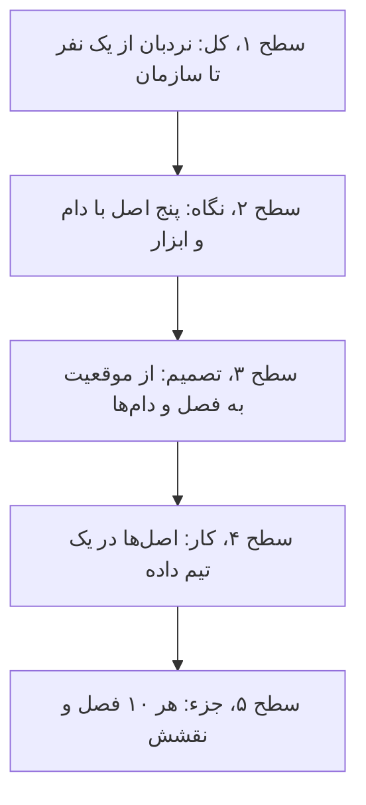
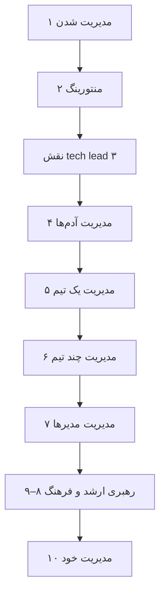
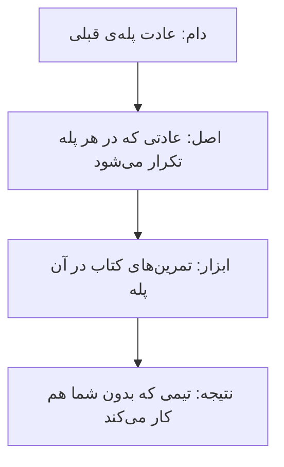
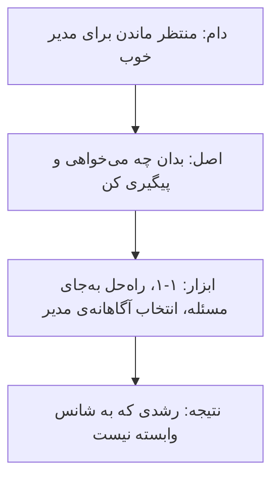
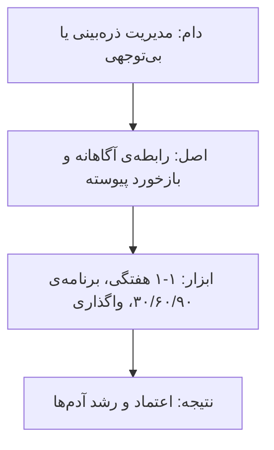
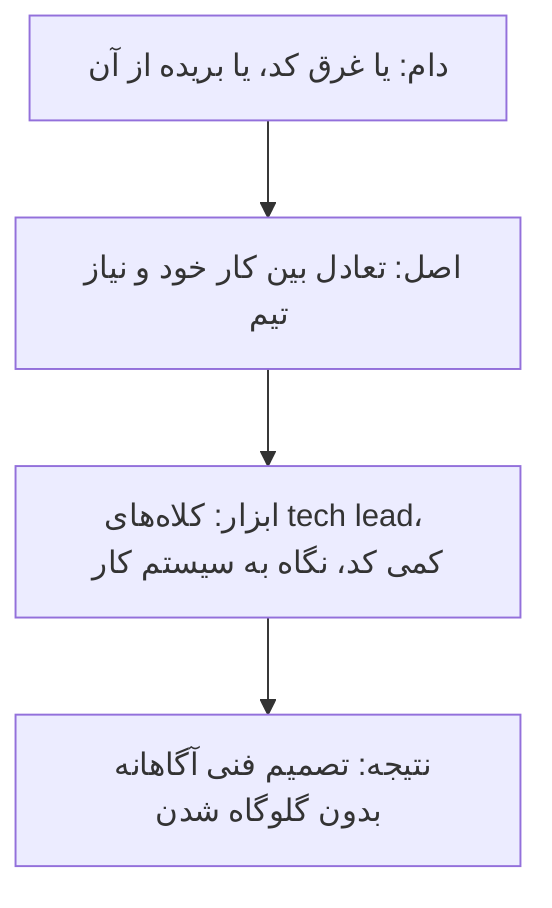
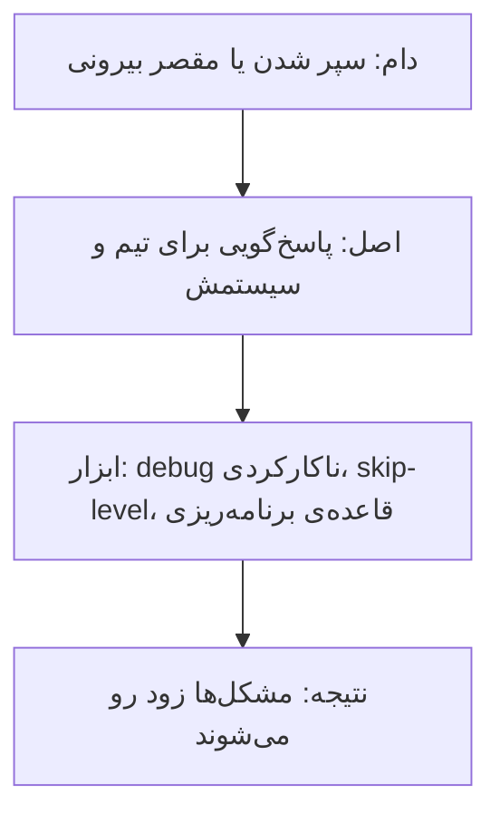
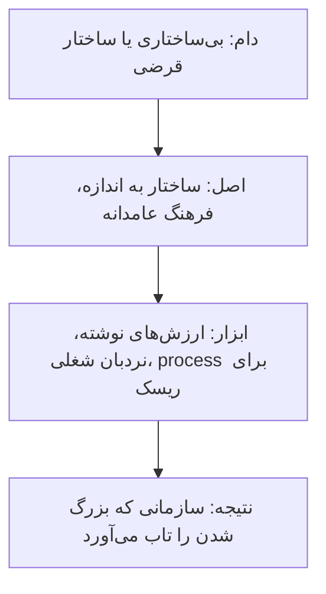

# چارچوب کتاب: نردبان مدیریت، از یک نفر تا یک سازمان

[کتاب](README.md) · [فصل ۱ ←](chapters/01-management-101.md)

این صفحه **سنتز خود vault** است، نه بخشی از کتاب. کتاب پله‌پله بالا می‌رود: مدیریت شدن، منتورینگ، tech lead، مدیریت آدم‌ها، یک تیم، چند تیم، مدیرها و رهبری ارشد. هر پله مهارت تازه‌ای می‌خواهد ولی چند عادت در همه‌ی پله‌ها تکرار می‌شوند. این چارچوب آن عادت‌ها را پیدا می‌کند تا ببینید هر فصل کدام را در ارتفاع تازه‌ای تمرین می‌دهد.

چارچوب سه لایه دارد. **نقشه‌ی کتاب** نردبان را با فاصله‌ی هر پله از خود کار نشان می‌دهد. **پنج اصل** عادت‌های تکرارشونده‌اند، هر کدام با دام و ابزار و نتیجه. **راهنمای تصمیم و stack** می‌گوید در هر موقعیت کدام فصل را باز کنید و هر اصل در یک تیم داده کجا می‌نشیند. پله‌ها مال نویسنده‌اند؛ اصل‌ها و پیوندها مال vault است.

## تصویر کل

### کل کتاب در سه جمله

خوانش vault از کتاب، پیش از هر جزئی:

1. **مدیریت از گیرنده بودن شروع می‌شود و با مدیریت خود تمام می‌شود.** مسئول مسیر شغلی‌تان خودتانید و برای مدیریت دیگران اول باید خودتان را مدیریت کنید ([۱](chapters/01-management-101.md)، [۱۰](chapters/10-conclusion.md)).
2. **هر پله شغلی تازه است، نه ارتقای همان شغل.** از کد فاصله می‌گیرید ولی آن‌قدر فنی می‌مانید که گلوگاه‌ها را حس کنید ([۳](chapters/03-tech-lead.md)-[۶](chapters/06-managing-multiple-teams.md)).
3. **هرچه بالاتر، کار بیشتر طراحی سیستم کار و فرهنگ است.** سازمان را مثل سیستم debug می‌کنید و فرهنگ را مثل زیرساخت می‌سازید ([۶](chapters/06-managing-multiple-teams.md)-[۹](chapters/09-bootstrapping-culture.md)).

### از کل به جزء

## نقشه‌ی کتاب

### نردبان

*سطح ۱ از ۵: کل.*

هر پله یک لایه از خود کار دورتر است. فصل آخر به خود فرد برمی‌گردد.

### پله‌ها و فاصله از کار

| پله | فاصله از کد | مهارت تازه | فصل‌ها |
|---|---|---|---|
| گیرنده و منتور | در کد | خواستن، شنیدن، شفاف گفتن | [۱](chapters/01-management-101.md)، [۲](chapters/02-mentoring.md) |
| نقش tech lead | نیمی در کد | تعادل، مدیریت پروژه | [۳](chapters/03-tech-lead.md) |
| مدیر آدم‌ها و تیم | کمی در کد | جلسه‌ی ۱-۱، بازخورد، تصمیم، تعارض | [۴](chapters/04-managing-people.md)، [۵](chapters/05-managing-a-team.md) |
| مدیر چند تیم | بیرون از کد، فنی | وقت، واگذاری، نه گفتن، سیستم کار | [۶](chapters/06-managing-multiple-teams.md) |
| مدیر مدیرها | دو لایه دور | جلسه‌ی skip-level، پاسخ‌گویی، استخدام مدیر | [۷](chapters/07-managing-managers.md) |
| رهبر ارشد | استراتژی | نقش CTO و VP، استراتژی فناوری، فرهنگ | [۸](chapters/08-the-big-leagues.md)، [۹](chapters/09-bootstrapping-culture.md) |
| همه‌ی پله‌ها | — | خودآگاهی و کنجکاوی | [۱۰](chapters/10-conclusion.md) |

## پنج اصل

*سطح ۲ از ۵: نگاه.*

هر اصل با یک زنجیره‌ی چهارتایی شروع می‌شود: **دام** رایج، **اصل**، **ابزاری** از کتاب که اصل را عملی می‌کند و **نتیجه**.

### اصل ۱: مالک مسیر خودت باش

- **مسئول خودتان، خودتانید**؛ به مدیرتان هم فرصت بدهید ([۱](chapters/01-management-101.md)).
- **مدیرها را به همان دقت شغل‌ها انتخاب کنید** ([۱](chapters/01-management-101.md)).
- **خودتان را مدیریت کنید تا دیگران را مدیریت کنید**: ایگو را از تعارض بیرون بگذارید و کنجکاو شوید ([۱۰](chapters/10-conclusion.md)).

### اصل ۲: رابطه پیش از کنترل

- **منتورینگ تمرین کم‌ریسک مدیریت است**: گوش بدهید، شفاف بگویید، تنظیم شوید ([۲](chapters/02-mentoring.md)).
- **هر رابطه‌ی گزارش‌دهی را آگاهانه شروع کنید** و جلسه‌ی ۱-۱ هفتگی را پیش‌فرض بگذارید ([۴](chapters/04-managing-people.md)).
- **واگذاری یعنی رها کردن مسئولیت نیست** و بازخورد پیوسته شما را حواس‌جمع نگه می‌دارد ([۴](chapters/04-managing-people.md)).

### اصل ۳: آن‌قدر فنی بمان که گلوگاه را حس کنی

- **ترفند tech lead تعادل است**: از کد فاصله بگیرید تا تیم جلو برود ([۳](chapters/03-tech-lead.md)).
- **آن‌قدر فنی بمانید که گلوگاه‌ها را حس کنید** ([۵](chapters/05-managing-a-team.md)).
- **مدیر چند تیم کد نمی‌زند ولی فنی می‌ماند** و سلامت تیم را از دل خود کار می‌سنجد ([۶](chapters/06-managing-multiple-teams.md)).

### اصل ۴: پاسخ‌گوی سیستم کار باش

- **ناکارکردی‌های پایه را debug کنید** و تعارض را رام کنید، نه این که از آن فرار کنید ([۵](chapters/05-managing-a-team.md)).
- **اهمیت را از فوریت جدا کنید** و خوب نه بگویید ([۶](chapters/06-managing-multiple-teams.md)).
- **سیاست در باز مشکل‌ها را رو نمی‌کند**؛ مدیرها پاسخ‌گوی سلامت تیمشان‌اند و سازمان را مثل سیستم debug کنید ([۷](chapters/07-managing-managers.md)).

### اصل ۵: فرهنگ را مثل زیرساخت بساز

- **بی‌ساختاری قدرت را پنهان می‌کند**؛ ساختار را به اندازه بدوزید ([۹](chapters/09-bootstrapping-culture.md)).
- **مفهوم process یعنی مدیریت ریسک**؛ از یادگیری و شفافیت حرف بزنید ([۹](chapters/09-bootstrapping-culture.md)).
- **نقش‌های ارشد ترکیبی از بلوک‌های سازنده‌اند** و عوض کردن اولویت یعنی قطع صریح کار در جریان ([۸](chapters/08-the-big-leagues.md)).

## از موقعیت به فصل

*سطح ۳ از ۵: تصمیم.*

| موقعیت | اول بخوانید | بعد |
|---|---|---|
| مدیرتان کم وقت می‌گذارد | [۱](chapters/01-management-101.md) | [۱۰](chapters/10-conclusion.md) |
| یک کارآموز یا تازه‌وارد به شما سپرده‌اند | [۲](chapters/02-mentoring.md) | [۴](chapters/04-managing-people.md) |
| نقش tech lead گرفته‌اید و وقت کد زدن ندارید | [۳](chapters/03-tech-lead.md) | [۵](chapters/05-managing-a-team.md) |
| اولین گزارش مستقیمتان را گرفته‌اید | [۴](chapters/04-managing-people.md) | [۲](chapters/02-mentoring.md) |
| تیم تحویل نمی‌دهد یا درام دارد | [۵](chapters/05-managing-a-team.md) | [۷](chapters/07-managing-managers.md) |
| روزتان پر از جلسه شده | [۶](chapters/06-managing-multiple-teams.md) | [۳](chapters/03-tech-lead.md) |
| از مشکل‌های تیم‌های زیر دستتان خبر ندارید | [۷](chapters/07-managing-managers.md) | [۶](chapters/06-managing-multiple-teams.md) |
| باید بین CTO و VP یکی را تعریف کنید | [۸](chapters/08-the-big-leagues.md) | [۹](chapters/09-bootstrapping-culture.md) |
| تیم بزرگ شده و قاعده‌ها نانوشته‌اند | [۹](chapters/09-bootstrapping-culture.md) | [۸](chapters/08-the-big-leagues.md) |
| در یک تعارض گیر کرده‌اید | [۱۰](chapters/10-conclusion.md) | [۵](chapters/05-managing-a-team.md) |

## دام‌ها

1. **بسنده کردن به «بی‌توجهی خوش‌خیم»** مدیر ([۱](chapters/01-management-101.md)).
2. **ساختن فرهنگ ترس** با alpha geek ([۲](chapters/02-mentoring.md)).
3. **شدن process czar** به‌جای tech lead ([۳](chapters/03-tech-lead.md)).
4. **دیدن مدیریت به‌عنوان ارتقا** و نه شغل تازه ([۴](chapters/04-managing-people.md)).
5. **سپر کردن تیم از زمینه** به‌جای سپر کردن از درام ([۵](chapters/05-managing-a-team.md)).
6. **واگذار نکردن کار ساده و پرتکرار** ([۶](chapters/06-managing-multiple-teams.md)).
7. **تکیه بر سیاست در باز** ([۷](chapters/07-managing-managers.md)).
8. **اعتماد به آدم خوشایندکننده** ([۷](chapters/07-managing-managers.md)).
9. **عوض کردن اولویت بدون قطع صریح کار قبلی** ([۸](chapters/08-the-big-leagues.md)).
10. **قرض گرفتن نردبان شغلی** بدون دوختن آن ([۹](chapters/09-bootstrapping-culture.md)).
11. **آوردن ایگو به تعارض** ([۱۰](chapters/10-conclusion.md)).

## در stack شما

*سطح ۴ از ۵: کار.*

هر اصل در [stack مرجع](../../practice/reference-stack.md)، به‌ویژه بخش «تیم چطور کار می‌کند»، یک جای مشخص دارد. کادرهای *In practice* هر فصل جزئیاتش را می‌دهند.

| بخش stack | اصل | فصل‌ها | یادآوری |
|---|---|---|---|
| تازه‌وارد به تیم داده | ۲ | [۲](chapters/02-mentoring.md)، [۴](chapters/04-managing-people.md) | پروژه‌ی آماده، milestone، و یک منتور |
| merge request و review | ۲، ۳ | [۳](chapters/03-tech-lead.md)، [۵](chapters/05-managing-a-team.md) | بازخورد پیوسته و دانش مشترک |
| board و برنامه‌ریزی کوتاه | ۴ | [۵](chapters/05-managing-a-team.md)، [۶](chapters/06-managing-multiple-teams.md) | قاعده‌ی سرانگشتی برای ظرفیت و نه گفتن |
| on-call و incident review | ۴ | [۵](chapters/05-managing-a-team.md)، [۷](chapters/07-managing-managers.md) | مشکل را از سیستم کار بخوانید، نه از آدم |
| lead time و تکرار deploy و حادثه | ۳، ۴ | [۶](chapters/06-managing-multiple-teams.md) | سلامت تیم از دل خود کار |
| نقش‌ها و ارتقا در تیم کوچک | ۵ | [۴](chapters/04-managing-people.md)، [۹](chapters/09-bootstrapping-culture.md) | نردبان شغلی دوخته به تیم، نه قرضی |
| ذی‌نفع‌های product و finance و risk | ۱، ۴ | [۶](chapters/06-managing-multiple-teams.md)، [۸](chapters/08-the-big-leagues.md) | اهمیت را از فوریت جدا کنید |

> **In practice:** یک مهندس داده‌ی باتجربه تازه نقش tech lead را گرفته و هنوز بیشتر pipelineهای مهم را خودش می‌نویسد.
>
> **Your turn:** با این چارچوب، در ماه اول چه چیزی را عوض کند؟
>
> *Answer:* تعادل را برگرداند: از مسیر بحرانی کد کنار برود و کار را به دیگران بسپارد، ولی آن‌قدر در review بماند که گلوگاه‌ها را حس کند ([۳](chapters/03-tech-lead.md)، [۵](chapters/05-managing-a-team.md)). با هر عضو تیم ۱-۱ منظم بگذارد و بازخورد را زود بدهد ([۴](chapters/04-managing-people.md)). و از مدیرش بپرسد انتظار از این نقش دقیقاً چیست ([۱](chapters/01-management-101.md)).

## نقشه‌ی فصل‌ها

*سطح ۵ از ۵: جزء.*

| فصل | پله | اصل | نقش در چارچوب |
|---|---|---|---|
| [۱](chapters/01-management-101.md) | گیرنده | ۱ | چه چیزی از مدیر بخواهید و چطور مدیریت شوید |
| [۲](chapters/02-mentoring.md) | منتور | ۲ | تمرین کم‌ریسک شنیدن و شفاف گفتن |
| [۳](chapters/03-tech-lead.md) | نقش tech lead | ۳ | تعادل، سه کلاه و مدیریت پروژه |
| [۴](chapters/04-managing-people.md) | مدیر آدم‌ها | ۲ | جلسه‌ی ۱-۱، واگذاری، بازخورد، ارزیابی، ارتقا |
| [۵](chapters/05-managing-a-team.md) | مدیر تیم | ۳، ۴ | فنی ماندن، debug ناکارکردی، تعارض |
| [۶](chapters/06-managing-multiple-teams.md) | مدیر چند تیم | ۳، ۴ | وقت، واگذاری، نه گفتن، سیستم کار |
| [۷](chapters/07-managing-managers.md) | مدیر مدیرها | ۴ | جلسه‌ی skip-level، پاسخ‌گویی، debug سازمان |
| [۸](chapters/08-the-big-leagues.md) | رهبر ارشد | ۵ | نقش CTO و VP و استراتژی فناوری |
| [۹](chapters/09-bootstrapping-culture.md) | رهبر ارشد | ۵ | فرهنگ، ساختار و process |
| [۱۰](chapters/10-conclusion.md) | همه | ۱ | مدیریت خود و کنجکاوی |
