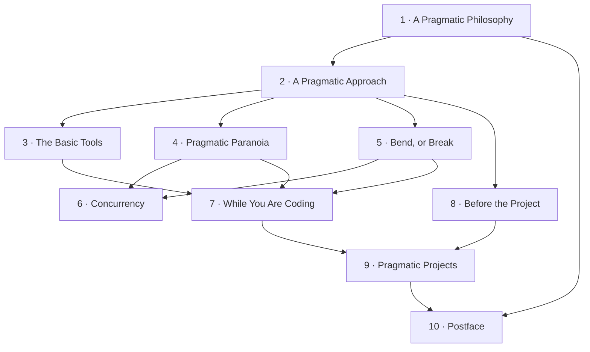

# The Pragmatic Programmer

**Open [`index.html`](index.html) in a browser** for the interactive version: one slide-by-slide lesson per chapter, with embedded simulations and self-checks. Everything here also reads fine on GitHub.

## About

*The Pragmatic Programmer* is a book of practical advice for developers, organized as 53 short, self-contained **topics** grouped into nine chapters and a postface. Topics cross-reference each other, so the book can be read in any order (Preface to the Second Edition, pp. 17–20). The advice is distilled into 100 numbered **tips**, set off in boxes in the text. Many topics end with *exercises*, whose possible answers are in an appendix, and open-ended *challenges* (p. 20).

The second edition, published twenty years after the first, is a "Ship of Theseus" rewrite: about a third of the topics are new and most of the rest were rewritten (p. 18). The first edition's preface, reprinted from p. 26, sets out the attitude behind the whole book:

- **Tip 1, Care About Your Craft**, and **Tip 2, Think! About Your Work** (p. 30).
- Continuous small improvement, *kaizen* (p. 33).

## What's in this folder

| Path | What it is |
|---|---|
| [`chapters/NN-*.md`](chapters/01-a-pragmatic-philosophy.md) | Chapter notes, **the source of truth**. Each `.md` has a generated `.html` lesson next to it |
| [`widgets/`](widgets/01-broken-windows.html) | Hand-built simulations, embedded in the lessons; each also opens on its own |
| [`lab/`](lab/03-binary-chop/README.md) | Runnable Python experiments with expected output |
| `index.html` | The book hub, generated from this README and the chapters |

## How the book fits together

The chapters move outward from the individual to the project:

- Chapter 1 sets out the philosophy (responsibility, entropy, good-enough software, learning, communication).
- Chapter 2 gives the design principles the rest of the book leans on: ETC, DRY, orthogonality, reversibility, tracer bullets and estimating.
- Chapters 3–6 are the developer's toolkit and defences: tools, paranoia, decoupling and concurrency.
- Chapter 7 is about the act of coding.
- Chapters 8–9 cover requirements, agility and teams.
- The postface turns to ethics.

*The arrows are the vault's reading of the cross-references between topics; the chapter order is the book's.*

Some threads run through the whole book:

- **Easier to Change (ETC)** is the value behind DRY, orthogonality, decoupling, refactoring and agility (2, 5, 7, 8).
- **Feedback loops** connect tracer bullets and prototypes, "don't outrun your headlights," testing, requirements and the agile recipe (2, 4, 7, 8).
- **Broken windows and boiled frogs** apply to code, then to teams (1, 7, 9).
- **Contracts and assumptions** link design by contract, assertions, programming by coincidence and property-based tests (4, 7).

## Chapters

| # | Chapter | Pages |
|---:|---|---|
| 1 | [A Pragmatic Philosophy](chapters/01-a-pragmatic-philosophy.md) | 34–72 |
| 2 | [A Pragmatic Approach](chapters/02-a-pragmatic-approach.md) | 73–142 |
| 3 | [The Basic Tools](chapters/03-the-basic-tools.md) | 143–187 |
| 4 | [Pragmatic Paranoia](chapters/04-pragmatic-paranoia.md) | 188–225 |
| 5 | [Bend, or Break](chapters/05-bend-or-break.md) | 226–288 |
| 6 | [Concurrency](chapters/06-concurrency.md) | 289–323 |
| 7 | [While You Are Coding](chapters/07-while-you-are-coding.md) | 324–402 |
| 8 | [Before the Project](chapters/08-before-the-project.md) | 403–434 |
| 9 | [Pragmatic Projects](chapters/09-pragmatic-projects.md) | 435–468 |
| 10 | [Postface](chapters/10-postface.md) | 469–473 |

Page ranges are PDF pages. Front matter takes pp. 1–33:

- Foreword (p. 13).
- Preface to the Second Edition (p. 17).
- From the Preface to the First Edition (p. 26).

The book ends with a bibliography (p. 474) and possible answers to the exercises (p. 476).

## Key concepts

These ideas recur across chapters; each row lists the chapters that discuss them. The definitions are the vault's summaries of the book's explanations.

| Concept | Definition | Chapters |
|---|---|---|
| Broken windows | Small unrepaired imperfections signal that nobody cares and speed decay (software entropy). Fix them, or board them up, as soon as you see them. | [1](chapters/01-a-pragmatic-philosophy.md) · [7](chapters/07-while-you-are-coding.md) · [9](chapters/09-pragmatic-projects.md) |
| Knowledge portfolio | Treat what you know like a financial portfolio: invest regularly, diversify, manage risk, buy low and rebalance. | [1](chapters/01-a-pragmatic-philosophy.md) · [9](chapters/09-pragmatic-projects.md) |
| ETC (Easier to Change) | Good design is design that is easier to change; the value behind most other principles. | [2](chapters/02-a-pragmatic-approach.md) · [5](chapters/05-bend-or-break.md) · [7](chapters/07-while-you-are-coding.md) · [8](chapters/08-before-the-project.md) |
| DRY | Every piece of knowledge has a single, unambiguous, authoritative representation. It's about knowledge and intent, not about copied text. | [2](chapters/02-a-pragmatic-approach.md) · [7](chapters/07-while-you-are-coding.md) · [9](chapters/09-pragmatic-projects.md) |
| Orthogonality | Changing one component doesn't affect others; independent, decoupled parts with focused responsibilities. | [2](chapters/02-a-pragmatic-approach.md) · [5](chapters/05-bend-or-break.md) |
| Reversibility | There are no final decisions; keep architecture flexible so choices of vendor or technology can be undone. | [2](chapters/02-a-pragmatic-approach.md) · [8](chapters/08-before-the-project.md) |
| Tracer bullets | A thin, real, end-to-end slice of the system that you keep and extend, as opposed to a throwaway prototype. | [2](chapters/02-a-pragmatic-approach.md) · [9](chapters/09-pragmatic-projects.md) |
| Design by contract | Preconditions, postconditions and class invariants that state what a routine requires and guarantees. | [4](chapters/04-pragmatic-paranoia.md) · [7](chapters/07-while-you-are-coding.md) |
| Crash early | A dead program does less damage than a crippled one; fail at the point of the problem. | [4](chapters/04-pragmatic-paranoia.md) · [6](chapters/06-concurrency.md) |
| Don't outrun your headlights | Take small steps and get feedback before the next; don't predict far beyond what you can see. | [4](chapters/04-pragmatic-paranoia.md) · [7](chapters/07-while-you-are-coding.md) · [8](chapters/08-before-the-project.md) |
| Decoupling | Shy code that talks only to what it knows directly: tell, don't ask; avoid train wrecks and global data. | [5](chapters/05-bend-or-break.md) · [6](chapters/06-concurrency.md) |
| Transformations | Think of programs as pipelines that transform data, not as objects holding state. | [5](chapters/05-bend-or-break.md) |
| Temporal coupling | Coupling in time: imposing an order or simultaneity that the problem doesn't require. | [6](chapters/06-concurrency.md) |
| Shared state | Mutable data reachable from more than one place; every reader's view can go stale. Actors and blackboards avoid it. | [5](chapters/05-bend-or-break.md) · [6](chapters/06-concurrency.md) |
| Programming by coincidence | Relying on luck and undocumented behaviour; the opposite of programming deliberately. | [7](chapters/07-while-you-are-coding.md) |
| Property-based testing | Generated inputs check contracts and invariants, so the computer tests assumptions you and your code share. | [7](chapters/07-while-you-are-coding.md) · [9](chapters/09-pragmatic-projects.md) |
| Policy is metadata | Implement the general mechanism and keep today's business rules as data. | [5](chapters/05-bend-or-break.md) · [8](chapters/08-before-the-project.md) |
| Pragmatic Starter Kit | Version control, ruthless regression testing and full automation: the three legs of every project. | [3](chapters/03-the-basic-tools.md) · [9](chapters/09-pragmatic-projects.md) |

## How these notes work

- **Everything above *Beyond the book* in a chapter note restates the book**, with page references. Supplementary material, meaning outside sources and the vault's interpretation, lives under *Beyond the book* or in `> **Vault note:**` callouts.
- **Page numbers are PDF pages.** This edition's text is reflowed and carries no printed page numbers, so references count PDF pages (p. 1 is the cover).
- The book's **tips are numbered 1–100** across the book. Each chapter note lists its tips with the page where each appears.
- Section outlines are the book's own table of contents, taken from the PDF's bookmarks.
- Mermaid diagrams are the vault's redrawings of the book's figures, or its own summaries. Captions say which.
- *Check yourself* questions and answers are the vault's, written from the notes; the answers cite pages. They don't reproduce the book's own exercises, which are only referenced.
- Simulations and experiments are the vault's own implementations of examples the book uses: the blender, the turtle, the piña colada, the pie case, the warehouse. Each says which pages it illustrates and what it simplifies.

## Source

- **Primary source:** the publisher's PDF of the 20th Anniversary Edition (second edition), version P1.0 of September 13, 2019, © 2020 Pearson Education (497 PDF pages). The PDF is kept outside version control (see `.gitignore`).
- **Table of contents:** taken from the PDF's bookmark outline, which gives each chapter's topics.
- **Structure:** front matter (foreword, the two prefaces), nine chapters of 53 topics, a postface, a bibliography and possible answers to the exercises.
- **Coverage:** all ten chapters, including the postface, are covered.
- **Figures:** this PDF carries no images — each figure is an empty box holding only its file name (e.g. `images/wc-pipeline.png`, PDF p. 257) — so the notes show none of the book's figures.
