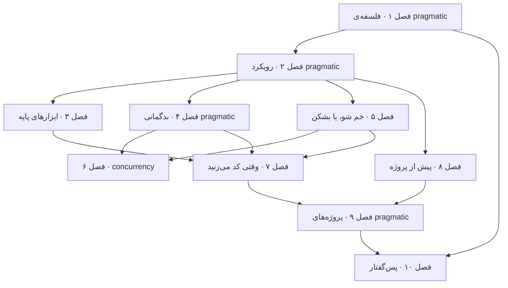

# The Pragmatic Programmer

**فایل [`index.html`](index.html) را در مرورگر باز کنید** تا نسخه‌ی تعاملی را ببینید: برای هر فصل یک درس اسلاید‌به‌اسلاید، با شبیه‌سازی‌های جاسازی‌شده و خودسنجی. هر چیزی که این‌جاست روی GitHub هم خوب خوانده می‌شود.

## درباره‌ی کتاب

کتاب *The Pragmatic Programmer* کتابی از توصیه‌های عملی برای developerها است که به شکل ۵۳ **موضوع** کوتاه و خودبسنده در نُه فصل و یک پس‌گفتار سازمان یافته. موضوع‌ها به هم ارجاع متقابل می‌دهند، پس کتاب را می‌شود به هر ترتیبی خواند (پیش‌گفتار ویراست دوم، صص. ۱۷–۲۰). توصیه‌ها در صد **tip** شماره‌دار چکیده شده‌اند که در متن در کادر آمده‌اند. خیلی از موضوع‌ها با *تمرین* تمام می‌شوند، که پاسخ‌های ممکنشان در یک پیوست است، و با چالش‌های سربسته (p. 20).

ویراست دوم، که بیست سال بعد از اولی منتشر شد، بازنویسی‌ای از جنس «کشتی تسئوس» است: حدود یک‌سوم موضوع‌ها تازه‌اند و بیشتر بقیه بازنویسی شده‌اند (p. 18). پیش‌گفتار ویراست اول، که از ص. ۲۶ بازچاپ شده، نگرش پشت کل کتاب را می‌گذارد:

- شماره‌ی **tip ۱، به صنعتت اهمیت بده**، و **tip ۲، درباره‌ی کارت فکر کن!** (p. 30).
- بهبود کوچک پیوسته، یعنی *kaizen* (p. 33).

## محتوای این پوشه

| مسیر | چه چیزی است |
|---|---|
| [`chapters/NN-*.md`](chapters/01-a-pragmatic-philosophy.md) | یادداشت‌های فصل، **منبع حقیقت**. هر `.md` یک درس `.html` ساخته‌شده کنارش دارد |
| [`widgets/`](widgets/01-broken-windows.html) | شبیه‌سازی‌های دست‌ساز، جاسازی‌شده در درس‌ها؛ هر کدام جدا هم باز می‌شود |
| [`lab/`](lab/03-binary-chop/README.md) | آزمایش‌های اجرا‌شدنی Python با خروجی مورد انتظار |
| `index.html` | صفحه‌ی اصلی کتاب، ساخته‌شده از این README و فصل‌ها |

## کتاب چطور به هم وصل است

فصل‌ها از فرد به سمت پروژه بیرون می‌روند:

- فصل ۱ فلسفه را می‌گذارد، یعنی مسئولیت و آنتروپی و نرم‌افزار به‌اندازه‌ی‌کافی‌خوب و یاد گرفتن و ارتباط.
- فصل ۲ اصل‌های طراحی‌ای را می‌دهد که بقیه‌ی کتاب رویشان تکیه دارد: ETC و DRY و orthogonality و برگشت‌پذیری و tracer bullet و تخمین زدن.
- فصل‌های ۳ تا ۶ جعبه‌ابزار و دفاع‌های developer‌اند: ابزار و بدگمانی و decoupling و concurrency.
- فصل ۷ درباره‌ی خود عمل کد زدن است.
- فصل‌های ۸ و ۹ نیازمندی‌ها و چابکی و تیم‌ها را می‌پوشانند.
- پس‌گفتار به اخلاق می‌پردازد.

*فلش‌ها خوانش vault از ارجاع‌های متقابل بین موضوع‌هاست؛ ترتیب فصل‌ها مال خود کتاب است.*

چند رشته در کل کتاب می‌دوند:

- **آسان‌تر برای تغییر**، یعنی ETC، ارزش پشت DRY و orthogonality و decoupling و refactoring و چابکی است (فصل‌های ۲ و ۵ و ۷ و ۸).
- **حلقه‌های بازخورد** tracer bullet و prototype و «از نور چراغ‌هایت جلو نزن» و تست و نیازمندی‌ها و دستور آشپزی چابک را به هم وصل می‌کنند (فصل‌های ۲ و ۴ و ۷ و ۸).
- **پنجره‌های شکسته و قورباغه‌های آب‌پز** اول به کد و بعد به تیم‌ها می‌خورند (فصل‌های ۱ و ۷ و ۹).
- **قرارداد و فرض** طراحی با قرارداد و assertion و برنامه‌نویسی تصادفی و تست property‌محور را پیوند می‌دهند (فصل‌های ۴ و ۷).

## فصل‌ها

| # | فصل | صفحه |
|---:|---|---|
| ۱ | [فلسفه‌ی pragmatic](chapters/01-a-pragmatic-philosophy.md) | ۳۴–۷۲ |
| ۲ | [رویکرد pragmatic](chapters/02-a-pragmatic-approach.md) | ۷۳–۱۴۲ |
| ۳ | [ابزارهای پایه](chapters/03-the-basic-tools.md) | ۱۴۳–۱۸۷ |
| ۴ | [بدگمانی pragmatic](chapters/04-pragmatic-paranoia.md) | ۱۸۸–۲۲۵ |
| ۵ | [خم شو، یا بشکن](chapters/05-bend-or-break.md) | ۲۲۶–۲۸۸ |
| ۶ | [concurrency](chapters/06-concurrency.md) | ۲۸۹–۳۲۳ |
| ۷ | [وقتی کد می‌زنید](chapters/07-while-you-are-coding.md) | ۳۲۴–۴۰۲ |
| ۸ | [پیش از پروژه](chapters/08-before-the-project.md) | ۴۰۳–۴۳۴ |
| ۹ | [پروژه‌های pragmatic](chapters/09-pragmatic-projects.md) | ۴۳۵–۴۶۸ |
| ۱۰ | [پس‌گفتار](chapters/10-postface.md) | ۴۶۹–۴۷۳ |

بازه‌های صفحه، صفحه‌های PDF‌اند. صفحه‌های اول کتاب صص. ۱–۳۳ را می‌گیرند:

- دیباچه (p. 13).
- پیش‌گفتار ویراست دوم (p. 17).
- از پیش‌گفتار ویراست اول (p. 26).

کتاب با یک کتاب‌شناسی (p. 474) و پاسخ‌های ممکن تمرین‌ها (p. 476) تمام می‌شود.

## مفهوم‌های کلیدی

این ایده‌ها در فصل‌ها تکرار می‌شوند؛ هر ردیف فصل‌هایی را می‌آورد که بحثشان می‌کنند. تعریف‌ها خلاصه‌های vault از توضیح‌های کتاب‌اند.

| مفهوم | تعریف | فصل‌ها |
|---|---|---|
| پنجره‌ی شکسته | نقص‌های کوچک تعمیر‌نشده نشان می‌دهند کسی اهمیت نمی‌دهد و پوسیدگی را تند می‌کنند، یعنی آنتروپی نرم‌افزار. همین که دیدیدشان تعمیرشان کنید یا تخته بزنید. | [۱](chapters/01-a-pragmatic-philosophy.md) · [۷](chapters/07-while-you-are-coding.md) · [۹](chapters/09-pragmatic-projects.md) |
| سبد دانش | آن چیزی را که می‌دانید مثل یک سبد مالی ببینید: منظم سرمایه‌گذاری کنید، متنوع کنید، خطر را مدیریت کنید، ارزان بخرید و دوباره متوازن کنید. | [۱](chapters/01-a-pragmatic-philosophy.md) · [۹](chapters/09-pragmatic-projects.md) |
| ویژگی ETC، یعنی آسان‌تر برای تغییر | طراحی خوب طراحی‌ای است که تغییرش آسان‌تر است؛ ارزش پشت بیشتر اصل‌های دیگر. | [۲](chapters/02-a-pragmatic-approach.md) · [۵](chapters/05-bend-or-break.md) · [۷](chapters/07-while-you-are-coding.md) · [۸](chapters/08-before-the-project.md) |
| اصل DRY | هر تکه دانش یک نمایش یکتا و بی‌ابهام و معتبر دارد. درباره‌ی دانش و قصد است و نه درباره‌ی متن کپی‌شده. | [۲](chapters/02-a-pragmatic-approach.md) · [۷](chapters/07-while-you-are-coding.md) · [۹](chapters/09-pragmatic-projects.md) |
| ویژگی orthogonality | عوض کردن یک مؤلفه روی بقیه اثر ندارد؛ بخش‌های مستقل و decouple‌شده با مسئولیت‌های متمرکز. | [۲](chapters/02-a-pragmatic-approach.md) · [۵](chapters/05-bend-or-break.md) |
| برگشت‌پذیری | تصمیم نهایی وجود ندارد؛ معماری را انعطاف‌پذیر نگه دارید تا انتخاب vendor یا فناوری برگشت‌پذیر بماند. | [۲](chapters/02-a-pragmatic-approach.md) · [۸](chapters/08-before-the-project.md) |
| گلوله‌ی رسام، یعنی tracer bullet | برشی نازک و واقعی و سر‌تا‌سری از سیستم که نگهش می‌دارید و گسترشش می‌دهید، در برابر prototype دور‌انداختنی. | [۲](chapters/02-a-pragmatic-approach.md) · [۹](chapters/09-pragmatic-projects.md) |
| طراحی با قرارداد | پیش‌شرط و پس‌شرط و ناوردای کلاس که می‌گویند یک routine چه می‌خواهد و چه تضمین می‌کند. | [۴](chapters/04-pragmatic-paranoia.md) · [۷](chapters/07-while-you-are-coding.md) |
| زود crash کن | برنامه‌ی مرده آسیب کمتری از برنامه‌ی زمین‌گیر می‌زند؛ همان‌جا که مسئله هست شکست بخورید. | [۴](chapters/04-pragmatic-paranoia.md) · [۶](chapters/06-concurrency.md) |
| از نور چراغ‌هایت جلو نزن | قدم‌های کوچک بردارید و پیش از قدم بعدی بازخورد بگیرید؛ خیلی فراتر از آن چیزی که می‌بینید پیش‌بینی نکنید. | [۴](chapters/04-pragmatic-paranoia.md) · [۷](chapters/07-while-you-are-coding.md) · [۸](chapters/08-before-the-project.md) |
| ویژگی decoupling | کد خجالتی که فقط با چیزی حرف می‌زند که مستقیم می‌شناسد: بگو، نپرس؛ از تصادف قطار و داده‌ی سراسری بپرهیزید. | [۵](chapters/05-bend-or-break.md) · [۶](chapters/06-concurrency.md) |
| تبدیل‌ها | برنامه‌ها را pipelineهایی ببینید که داده را تبدیل می‌کنند، نه objectهایی که حالت نگه می‌دارند. | [۵](chapters/05-bend-or-break.md) |
| coupling زمانی | coupling در زمان: تحمیل ترتیب یا concurrencyی که مسئله لازمش ندارد. | [۶](chapters/06-concurrency.md) |
| shared state | داده‌ی mutability که از بیشتر از یک جا در دسترس است؛ نگاه هر خواننده می‌تواند کهنه شود. actorها و blackboardها از آن می‌پرهیزند. | [۵](chapters/05-bend-or-break.md) · [۶](chapters/06-concurrency.md) |
| برنامه‌نویسی تصادفی | تکیه کردن به شانس و رفتار بی‌مستند؛ عکس برنامه‌نویسی آگاهانه. | [۷](chapters/07-while-you-are-coding.md) |
| تست property‌محور | ورودی‌های ساخته‌شده قرارداد و ناوردا را بررسی می‌کنند، پس کامپیوتر فرض‌هایی را می‌سنجد که شما و کدتان شریکش هستید. | [۷](chapters/07-while-you-are-coding.md) · [۹](chapters/09-pragmatic-projects.md) |
| سیاست همان metadata است | سازوکار عمومی را پیاده کنید و قاعده‌های کسب‌وکار امروز را به‌عنوان داده نگه دارید. | [۵](chapters/05-bend-or-break.md) · [۸](chapters/08-before-the-project.md) |
| جعبه‌ی شروع pragmatic | کنترل نسخه، تست رگرسیون بی‌رحم، و خودکارسازی کامل: سه پایه‌ی هر پروژه. | [۳](chapters/03-the-basic-tools.md) · [۹](chapters/09-pragmatic-projects.md) |

## این یادداشت‌ها چطور نوشته شده‌اند

- **هر چیزی بالای *فراتر از کتاب* در یک یادداشت فصل، خود کتاب را بازگو می‌کند**، با ارجاع صفحه. مطالب تکمیلی، یعنی منبع‌های بیرونی و تفسیر vault، زیر *فراتر از کتاب* یا در کادرهای `> **Vault note:**` می‌نشینند.
- **شماره‌ی صفحه‌ها صفحه‌ی PDF‌اند.** متن این ویراست بازچینش شده و شماره‌ی صفحه‌ی چاپی ندارد، پس ارجاع‌ها صفحه‌های PDF را می‌شمارند؛ ص. ۱ جلد است.
- **همه‌ی tipهای کتاب از ۱ تا ۱۰۰ شماره خورده‌اند**، در کل کتاب. هر یادداشت فصل tipهای خودش را با صفحه‌ای که هر کدام در آن می‌آید فهرست می‌کند.
- فهرست‌های بخش، همان فهرست مطالب خود کتاب‌اند که از bookmarkهای PDF گرفته شده.
- نمودارهای Mermaid، بازکشی‌های vault از شکل‌های کتاب‌اند یا خلاصه‌های خودش. زیرنویس‌ها می‌گویند کدام است.
- پرسش و پاسخ‌های *خودتان را بسنجید* مال vault است و از روی یادداشت‌ها نوشته شده؛ پاسخ‌ها به صفحه ارجاع می‌دهند. تمرین‌های خود کتاب را بازتولید نمی‌کنند و فقط به آن‌ها ارجاع می‌دهند.
- شبیه‌سازی‌ها و آزمایش‌ها پیاده‌سازی‌های خود vault از نمونه‌هایی‌اند که کتاب به کار می‌برد: مخلوط‌کن، لاک‌پشت، پینا کولادا، پرونده‌ی پای، و انبار. هر کدام می‌گوید کدام صفحه‌ها را نشان می‌دهد و چه چیزی را ساده کرده.

## منبع

- **منبع اصلی:** فایل PDF ناشر از ویراست ویژه‌ی بیستمین سالگرد، یعنی ویراست دوم، نسخه‌ی P1.0 از ۱۳ سپتامبر ۲۰۱۹، © 2020 Pearson Education، با ۴۹۷ صفحه‌ی PDF. فایل PDF بیرون از کنترل نسخه نگه داشته می‌شود؛ `.gitignore` را ببینید.
- **فهرست مطالب:** از فهرست bookmarkهای PDF گرفته شده، که موضوع‌های هر فصل را می‌دهد.
- **ساختار:** صفحه‌های اول، یعنی دیباچه و دو پیش‌گفتار، بعد نُه فصل با ۵۳ موضوع، یک پس‌گفتار، یک کتاب‌شناسی، و پاسخ‌های ممکن تمرین‌ها.
- **پوشش:** همه‌ی ده فصل، از جمله پس‌گفتار، پوشانده شده‌اند.
- **شکل‌ها:** این فایل PDF هیچ تصویری ندارد و هر شکل کادری خالی است که فقط نام فایلش را دارد، مثل `images/wc-pipeline.png` در ص. ۲۵۷ PDF، پس یادداشت‌ها هیچ‌کدام از شکل‌های کتاب را نشان نمی‌دهند.
