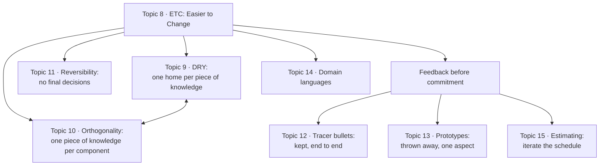

# 2. A Pragmatic Approach

[← 1. A Pragmatic Philosophy](01-a-pragmatic-philosophy.md) · [Book](../README.md) · [3. The Basic Tools →](03-the-basic-tools.md)

## Summary

This chapter collects ideas that apply at every level of software development (p. 73). It opens with the one everything else follows from: **good design is easier to change** (ETC). Then come two closely related principles. **DRY** says not to duplicate knowledge; **orthogonality** says not to split one piece of knowledge across components (p. 73). **Reversibility** keeps decisions changeable (p. 73). **Tracer bullets** and **prototypes** are two ways to get feedback before committing: one is kept, the other thrown away (p. 74). **Domain languages** let you program in the vocabulary of the problem, and **estimating** helps you survive limited time and resources (p. 74).

## Key takeaways

- **ETC, Easier to Change, is a value, not a rule.** Every design principle the authors know is a special case of it. When you can't tell which path is easier to change, make the code replaceable (Tip 14, pp. 75–76).
- **DRY is about knowledge, not code.** Every piece of knowledge must have a single, unambiguous, authoritative representation. Identical code can represent different knowledge, and different code can duplicate the same knowledge (Tip 15, pp. 80–85).
- **Orthogonal components can change independently.** The test: if one requirement changes dramatically, how many modules are affected? Ideally one (Tip 17, pp. 94–96).
- **There are no final decisions.** Hide third-party APIs behind your own abstractions, so a database, vendor or architecture can change (Tips 18–19, pp. 106–108).
- **Tracer code is kept; prototypes are thrown away.** Tracer bullets build a thin end-to-end skeleton of the real system; prototypes explore one risky aspect cheaply (Tips 20–21, pp. 111–120).
- **Program close to the problem domain,** but don't spend more effort on a domain language than it saves (Tip 22, pp. 124–129).
- **Choose estimate units to match their accuracy, and iterate the schedule with the code.** When asked for an estimate, say "I'll get back to you" (Tips 23–24, pp. 133–141).

## Section outline

*From the book’s own table of contents (PDF bookmarks). Page numbers are PDF pages: this edition's reflowed text has no printed page numbers.*

- Topic 8. The Essence of Good Design — p. 75
- Topic 9. DRY—The Evils of Duplication — p. 79
- Topic 10. Orthogonality — p. 92
- Topic 11. Reversibility — p. 104
- Topic 12. Tracer Bullets — p. 109
- Topic 13. Prototypes and Post-it Notes — p. 118
- Topic 14. Domain Languages — p. 124
- Topic 15. Estimating — p. 133

## Notes

| Tip | Statement | Page |
|---:|---|---|
| 14 | Good Design Is Easier to Change Than Bad Design | 75 |
| 15 | DRY—Don't Repeat Yourself | 80 |
| 16 | Make It Easy to Reuse | 90 |
| 17 | Eliminate Effects Between Unrelated Things | 94 |
| 18 | There Are No Final Decisions | 106 |
| 19 | Forgo Following Fads | 108 |
| 20 | Use Tracer Bullets to Find the Target | 111 |
| 21 | Prototype to Learn | 120 |
| 22 | Program Close to the Problem Domain | 124 |
| 23 | Estimate to Avoid Surprises | 133 |
| 24 | Iterate the Schedule with the Code | 140 |

*The vault's map of the chapter, after its introduction (pp. 73–74) and Topic 8's claim that the other topics are motivated by ETC (p. 77).*

### Topic 8. The Essence of Good Design

**Tip 14, Good Design Is Easier to Change Than Bad Design** (p. 75). A thing is well designed if it adapts to the people who use it; for code, that means it adapts by changing. Hence the **ETC principle: Easier to Change** (p. 75). As far as the authors can tell, every design principle is a special case of it (pp. 75–76):

- **Decoupling** isolates concerns, so each is easier to change.
- **The single responsibility principle** mirrors a change in requirements by a change in one module.
- **Good naming** makes code easier to read, and you have to read code to change it.

ETC is a **value, not a rule**: it helps you choose between paths. To internalize it, spend a week asking "did the thing I just did make the overall system easier or harder to change?" when you save a file, write a test, or fix a bug (p. 76). When you can't tell which path is easier to change (pp. 76–77):

1. Fall back on making what you write **replaceable**, which means keeping it decoupled and cohesive.
2. Treat it as a way to develop instincts: record the choice and your guesses in your engineering daybook, leave a tag in the source, and give yourself feedback when the code later changes.

### Topic 9. DRY—The Evils of Duplication

Knowledge isn't stable, so programmers are **constantly in maintenance mode**, not only after release (p. 79). The DRY principle (p. 80): every piece of knowledge must have a single, unambiguous, authoritative representation within a system. **Tip 15, DRY—Don't Repeat Yourself** (p. 80). With two copies, the question isn't whether you'll remember to change both, but when you'll forget (p. 80).

**DRY is more than code** (p. 81). The authors admit the first edition explained it poorly: it is about duplication of *knowledge and intent*, possibly expressed in totally different ways. The acid test: when one facet must change, do you change it in multiple places and formats, such as code and documentation, or a schema and the structure that holds it?

| Kind of duplication | The book's example | Remedy (pp. 81–90) |
|---|---|---|
| **In code** | `print_balance` repeats negative-number handling, the field width and the label format | Extract `format_amount`, `print_line` and `report_line`: each format then has one home. The separator's hyphen count is a *different* intent (the customer's), so it stays separate |
| **Coincidental, not duplication** | `validate_age` and `validate_quantity` have identical bodies | Leave them: same code, different knowledge |
| **In documentation** | A comment restates the fee rules that the code implements | Better names and layout (`calculate_account_fees`) make the comment redundant |
| **In data** | A `Line` class stores `start`, `end` *and* `length` | Calculate `length`; if you must cache it for performance, keep the violation private to the class. Use accessors (Meyer's Uniform Access principle) |
| **Representational** | Your code and an external API, service or schema both know the interface | Neutral API specifications that generate clients and tests; OpenAPI for external APIs; introspect schemas, or use maps plus a table-driven validation suite |
| **Interdeveloper** | A U.S. state's Y2K survey found more than 10,000 programs, each with its own Social Security Number validation | Tight-knit teams, frequent communication, forums, a project librarian, a central place for utilities, reading each other's code |

**Tip 16, Make It Easy to Reuse** (p. 90): if finding and reusing existing code isn't easier than writing it, people won't reuse it, and knowledge gets duplicated.

### Topic 10. Orthogonality

Two things are **orthogonal** if changes in one don't affect the others. In a well-designed system, the database code is orthogonal to the user interface (p. 92).

**A nonorthogonal system** (pp. 93–94): when a helicopter pilot faints, you find that lowering the collective pitch lever makes the nose drop and the craft spiral left, so you must compensate with the cyclic and the pedals, each of which affects all the others. Helicopter controls are not orthogonal, and with interdependent components there is no such thing as a local fix (p. 94).

**Tip 17, Eliminate Effects Between Unrelated Things** (p. 94). Self-contained components with one well-defined purpose (*cohesion*, after Yourdon and Constantine) bring two benefits (pp. 94–95):

| Benefit | Why |
|---|---|
| **Productivity** | Changes are localized; small components can be designed, coded, tested and forgotten; orthogonal components combine to give more functionality per unit of effort, because there's no overlap |
| **Reduced risk** | Diseased code is isolated and easy to replace; fixes stay local; components are easier to test; you're less tied to one vendor |

Where to apply it (pp. 95–101):

- **Design.** Layers that use only the abstractions below them. The test: if the requirements behind one function change dramatically, how many modules are affected? In an orthogonal system, one (p. 96). Adding a mobile interface to a heating-plant controller should touch only the UI modules (p. 97). Don't rely on properties of things you can't control, such as phone numbers or email addresses as identifiers (p. 97).
- **Toolkits and libraries.** Ask whether they impose changes on your code that shouldn't be there. EJB's declarative transactions are an example of orthogonality, a form of the Decorator pattern (pp. 97–98).
- **Coding.** Write *shy* code and follow the Law of Demeter, avoid global data (including singletons used as globals), and avoid similar functions (consider the Strategy pattern) (pp. 98–99).
- **Testing.** If a unit test needs much of the rest of the system to build, the module isn't decoupled. Track how many files each bug fix touches (p. 100).
- **Documentation.** Content and presentation are the axes; the authors write in Markdown, and this book is typeset from it (p. 101).

Orthogonality and DRY are closely related: DRY minimizes duplication, orthogonality minimizes interdependency (p. 101). Exercise 1 asks which of two line-splitting classes is more orthogonal (pp. 102–103).

> **Try it:** [Orthogonality and the ripple of a change](../widgets/02-orthogonality.html) — wire up a small system with or without shared globals and cross-layer calls, change one requirement, and count how many modules have to change.

### Topic 11. Reversibility

There is always more than one way to implement something, and critical decisions aren't easily reversible: each one commits the project to a smaller target that can be missed if it moves (pp. 104–105). Following DRY, decoupling and external configuration means fewer irreversible decisions (p. 105).

- If the database is abstracted to "persistence as a service", a too-slow relational database from vendor A can be swapped for vendor B's document database (p. 106).
- **Tip 18, There Are No Final Decisions** (p. 106): decisions are written in the sand, not carved in stone.
- **Flexible architecture** (p. 107). Since 2000 the authors list a parade of "best practice" server architectures: big iron, federations of it, commodity clusters, cloud VMs, containers, serverless, and back to big iron. You can't plan for this; you can make it easy to change. Hide third-party APIs behind your own abstraction layers, and break code into components even if they're deployed on one server.
- **Tip 19, Forgo Following Fads** (p. 108).

### Topic 12. Tracer Bullets

Tracer rounds show where bullets are going, giving real-time feedback under actual conditions (p. 109). The alternative is to specify the system to death and fire by dead reckoning (p. 110).

**Tip 20, Use Tracer Bullets to Find the Target** (p. 111). Find the important requirements and the riskiest areas and code them first. The very first tracer is creating the project with a "hello world!" that compiles and runs (p. 111). A simple feature then exercises every architectural layer end to end, implementing only what it needs in each (pp. 111–112). In the authors' temporal-query project, the first build could only list all rows of a table, but it proved that UI, libraries, serialization and SQL generation worked together (pp. 112–113).

**Tracer code is not disposable**: it has full error checking, structure and documentation; it just isn't fully functional (p. 113). Its advantages (pp. 113–115):

- Users see something working early, and their buy-in grows.
- Developers get a structure to work in.
- You have an integration platform, so you integrate daily instead of in a big bang.
- You always have something to demonstrate.
- You have a better feel for progress, avoiding code reported "95% complete" week after week.

Tracers don't always hit the target; adjusting the aim is the point, and a small body of code has low inertia (p. 115).

| | **Prototype** | **Tracer code** (pp. 115–117) |
|---|---|---|
| Purpose | Explore specific aspects of the final system | Show how the whole application hangs together |
| Code | Disposable: thrown away and recoded properly | Lean but complete: part of the final skeleton |
| Packing example | Prototype the UI in a UI tool; try packing algorithms in Python | A trivial first-come, first-served packer plus a simple working UI |
| Analogy | Reconnaissance before firing | The first tracer bullets |

### Topic 13. Prototypes and Post-it Notes

Like carmakers' clay and balsa models, software prototypes analyze and expose risk cheaply (p. 118). They needn't be code: Post-it notes suit workflow and application logic; whiteboards, drawings and interface builders suit UIs (p. 118).

- **What to prototype** (p. 119): anything risky, untried, critical or doubtful, including architecture, new functionality, external data, third-party tools, performance and UI design.
- **Tip 21, Prototype to Learn** (p. 120): the value is in the lessons, not the code.
- **What to ignore** (p. 120): correctness (dummy data), completeness, robustness and style. A high-level scripting language helps (pp. 120–121).
- **Architecture prototypes** (pp. 121–122) check responsibilities, collaborations, coupling, duplication, interfaces, and whether every module can reach the data it needs when it needs it. That last check generates the most surprises.
- **How not to use them** (p. 122): make sure everyone knows the code is disposable. You can build a car prototype from balsa wood and duct tape, but you wouldn't drive it in rush-hour traffic. If prototypes might be misunderstood, use tracer bullets instead.

### Topic 14. Domain Languages

Languages influence how you think about a problem; the language of the problem domain can suggest a programming solution too (p. 124). **Tip 22, Program Close to the Problem Domain** (p. 124).

| Example | Kind | What it does (pp. 125–127) |
|---|---|---|
| **RSpec** | Internal (Ruby) | Tests that read as expected behavior |
| **Cucumber** | External | Natural-language test scenarios, mapped to code by matchers |
| **Phoenix routes** | Internal (Elixir) | Map HTTP requests to handler functions |
| **Ansible** | External (YAML) | Declarative server configuration |

An aside asks why business users rarely read Cucumber features: they don't know the detailed requirements, and asking them to sign off on a spec is like asking them to check the spelling of an essay in Sumerian. Give them running code instead (pp. 125–126).

**Internal vs. external** (pp. 128–129):

- An **internal** language gets its host language's power for free: Ruby loops can generate 100 RSpec tests. But it's bound by the host's syntax.
- An **external** language has no such restriction, but needs a parser, and writing a good one isn't trivial.
- The advice: don't spend more effort than you save. Use off-the-shelf external languages (YAML, JSON, CSV) if you can, then internal ones. Use a custom external language only when your users will write it.
- **An internal language on the cheap:** just write functions. RSpec's `describe`, `it` and `expect` are ordinary Ruby methods (pp. 129–130).

Exercises 4–8 build a turtle-graphics mini-language (P, D, W, N, E, S, U), first as an external and then as an internal language, and a parser for times such as 4pm, 7:38pm and 23:42 (pp. 130–132).

> **Try it:** [A turtle-graphics mini-language](../widgets/02-turtle-language.html) — run the book's Exercise 4 rectangle, write your own commands, see each line parsed into a command or an error, and add a new command by extending a table.

### Topic 15. Estimating

Learn to estimate until you have an intuitive feel for magnitudes, so you can tell whether a plan is feasible: **Tip 23, Estimate to Avoid Surprises** (p. 133).

**Units signal accuracy** (pp. 134–135). "130 working days" sounds precise; "about six months" signals five to seven.

| Duration | Quote the estimate in |
|---|---|
| 1–15 days | Days |
| 3–6 weeks | Weeks |
| 8–20 weeks | Months |
| 20+ weeks | Think hard before giving an estimate |

**Where estimates come from** (pp. 135–138):

1. Ask someone who has already done it.
2. Understand what's being asked, including the scope ("assuming there's gas in the car…").
3. Build a rough model of the system. Building it may reveal a cheaper variant of the question.
4. Break the model into components and identify their parameters.
5. Give each parameter a value. Concentrate on the ones that are multiplied or divided; added ones matter less.
6. Calculate answers, varying the critical parameters, and couch the answer in terms of them. A strange answer means your model or understanding is probably wrong.
7. Keep track of your estimating prowess and find out why wrong estimates were wrong.

**Project schedules** (pp. 138–140):

- **Painting the missile.** Real people estimate with scenarios: 10 hours if all goes right, 18 realistically, 30 if the weather turns. The U.S. Navy's **PERT** gives each task optimistic, most likely and pessimistic estimates in a dependency network. The authors aren't big fans: people trust wall-sized charts because they used a formula (p. 139).
- **Eating the elephant.** Often the only way to know a project's timetable is experience on that same project. Repeat thin slices: check requirements, analyze risk (riskiest first), design, implement and integrate, validate with users. Refine the estimate of the remaining iterations after each one (pp. 139–140). **Tip 24, Iterate the Schedule with the Code** (p. 140).

**What to say when asked for an estimate:** "I'll get back to you." Estimates given at the coffee machine come back to haunt you (p. 141).

> **Try it:** [Iterating the schedule](../widgets/02-iterate-schedule.html) — estimate a project up front, then run it one iteration at a time and watch the forecast built from the team's measured pace close in on the real finish.

## Trade-offs at a glance

| Choice | Buys | Costs |
|---|---|---|
| Removing knowledge duplication | One place to change; no contradictions | An extra function or abstraction; risk of merging coincidental duplicates |
| Caching a derived value (deliberate DRY violation) | Performance | Must be kept private and consistent |
| Orthogonal, layered design | Local changes, easier tests, reuse | Upfront thought; some indirection |
| Abstracting third-party APIs | Reversible vendor and architecture choices | A layer to maintain |
| Tracer code | A working skeleton, early feedback, daily integration | Must be production quality from the start |
| Prototype | Cheap answers to specific risks | Must be thrown away; can be mistaken for the product |
| Internal domain language | Host language power for free | Bound by the host's syntax |
| External domain language | Any syntax you like | Writing and maintaining a parser |
| Up-front schedule (e.g. PERT) | A number before work starts | False confidence on unfamiliar projects |
| Iterating the schedule | Estimates based on real experience | No firm number at the start |

## Beyond the book

- **"Duplication is far cheaper than the wrong abstraction."** Sandi Metz's well-known 2016 essay makes the same point as the book's `validate_age` example from the other side: merging code that only looks alike creates an abstraction every caller must bend. The book's rule, *knowledge* not *text*, is the test for which case you're in.
- **Cone of uncertainty.** Steve McConnell's *Software Estimation* (2006) describes estimates early in a project as varying by a factor of about four either way, narrowing as the project proceeds. That is the effect "iterate the schedule with the code" exploits. The [schedule widget](../widgets/02-iterate-schedule.html) shows a simplified version.
- **How often does duplication bite?** The vault's [duplication-drift lab](../lab/02-duplication-drift/README.md) puts a number on "it's a question of when you'll forget".

## Connections

- **Related chapters:** [1. A Pragmatic Philosophy](01-a-pragmatic-philosophy.md) (Topic 7 applies DRY and ETC to writing), [3. The Basic Tools](03-the-basic-tools.md) (plain text and the engineering daybook used for ETC instincts), [5. Bend, or Break](05-bend-or-break.md) (decoupling and the Law of Demeter, configuration), [7. While You Are Coding](07-while-you-are-coding.md) (refactoring, algorithm speed estimates), [8. Before the Project](08-before-the-project.md) (requirements and the glossary), [9. Pragmatic Projects](09-pragmatic-projects.md) (tracer bullets for teams).
- **Run it:** [Duplication drift](../lab/02-duplication-drift/README.md) — simulates a fact copied into several places and changed over time by developers who sometimes forget a copy, and counts how often the copies contradict each other.

## Check yourself

*Questions and answers are the vault's, written from the notes above; answers cite the book's PDF pages.*

1. **What do the authors claim about every design principle they know?**

   *Answer:* It's a special case of ETC, Easier to Change (pp. 75–76).

2. **`validate_age` and `validate_quantity` have identical bodies. Is that a DRY violation?**
   - [ ] Yes: extract a shared function
   - [x] No: the code is the same, but the knowledge is different

   *Answer:* They validate two things that happen to share rules; that's coincidence, not duplication (pp. 84–85).

3. **A `Line` stores its start, its end and its length. What's wrong, and when is it acceptable?**

   *Answer:* The length duplicates knowledge in the two points. It's acceptable as a performance cache only if the violation is kept private to the class (pp. 86–87).

4. **What is the quick test for an orthogonal design?**

   *Answer:* If the requirements behind one function change dramatically, how many modules are affected? Ideally one (p. 96).

5. **How does tracer code differ from a prototype?**

   *Answer:* Tracer code is kept: lean but complete, part of the final system's skeleton. Prototype code is disposable and explores one aspect (pp. 113, 117).

6. **Someone gets a 25-week estimate. How should it be quoted?**

   *Answer:* As about six months: units should reflect the intended accuracy (pp. 134–135).

7. **Why are the authors wary of PERT charts?**

   *Answer:* People trust the formula and the wall-sized chart, but on an unfamiliar project the inputs are guesses (p. 139).

8. **What should you say when asked for an estimate?**

   *Answer:* "I'll get back to you" (p. 141).
