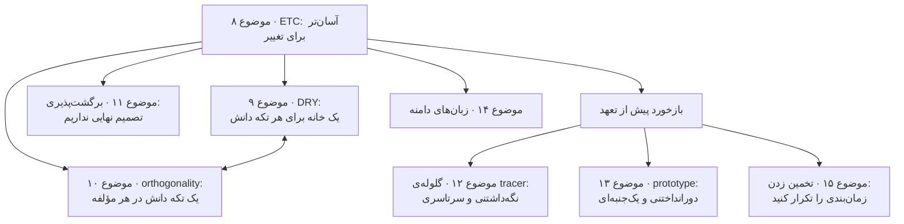

# فصل ۲: رویکرد pragmatic

[فصل ۱: فلسفه‌ی pragmatic →](01-a-pragmatic-philosophy.md) · [کتاب](../README.md) · [فصل ۳: ابزارهای پایه ←](03-the-basic-tools.md)

## خلاصه

این فصل ایده‌هایی را جمع می‌کند که در هر سطحی از توسعه‌ی نرم‌افزار به کار می‌آیند (p. 73). با همان ایده‌ای باز می‌شود که بقیه از آن می‌آیند: **طراحی خوب طراحی‌ای است که تغییرش آسان‌تر است**، یعنی ETC. بعد دو اصل نزدیک به هم می‌آیند. اصل **DRY** می‌گوید دانش را تکرار نکنید؛ ویژگی **orthogonality** می‌گوید یک تکه دانش را بین مؤلفه‌ها نشکنید (p. 73). **برگشت‌پذیری** تصمیم‌ها را عوض‌شدنی نگه می‌دارد (p. 73). **tracer bullet** و **prototype** دو راه گرفتن بازخورد پیش از تعهدند: یکی نگه داشته می‌شود و دیگری دور انداخته (p. 74). **زبان‌های دامنه** می‌گذارند با واژگان مسئله برنامه بنویسید، و **تخمین زدن** کمک می‌کند با وقت و منابع محدود جان سالم ببرید (p. 74).

## نکته‌های کلیدی

- **ویژگی ETC، یعنی آسان‌تر برای تغییر، یک ارزش است و نه یک قاعده.** هر اصل طراحی‌ای که نویسنده‌ها می‌شناسند حالتی ویژه از آن است. وقتی نمی‌توانید بگویید کدام راه تغییرش آسان‌تر است، کد را جابه‌جا‌شدنی بسازید (tip ۱۴، صص. ۷۵–۷۶).
- **اصل DRY درباره‌ی دانش است و نه کد.** هر تکه دانش باید یک نمایش یکتا و بی‌ابهام و معتبر داشته باشد. کد یکسان می‌تواند دانش مختلفی را نمایش بدهد، و کد مختلف می‌تواند همان دانش را تکرار کند (tip ۱۵، صص. ۸۰–۸۵).
- **مؤلفه‌های orthogonal مستقل از هم عوض می‌شوند.** سنجه: اگر یک نیازمندی خیلی عوض شود، چند ماژول اثر می‌گیرند؟ در حالت آرمانی، یکی (tip ۱۷، صص. ۹۴–۹۶).
- **تصمیم نهایی وجود ندارد.** APIهای طرف سوم را پشت انتزاع‌های خودتان قایم کنید، تا دیتابیس و vendor و معماری عوض‌شدنی بمانند (tipهای ۱۸ و ۱۹، صص. ۱۰۶–۱۰۸).
- **کد tracer نگه داشته می‌شود و prototype دور انداخته.** گلوله‌های tracer یک اسکلت نازک سر‌تا‌سری از سیستم واقعی می‌سازند، و prototypeها یک جنبه‌ی پرخطر را ارزان می‌کاوند (tipهای ۲۰ و ۲۱، صص. ۱۱۱–۱۲۰).
- **نزدیک به دامنه‌ی مسئله برنامه بنویسید،** ولی روی یک زبان دامنه بیشتر از آن چیزی که صرفه‌جویی می‌کند تلاش نگذارید (tip ۲۲، صص. ۱۲۴–۱۲۹).
- **واحد تخمین را به اندازه‌ی دقتش انتخاب کنید، و زمان‌بندی را همراه کد تکرار کنید.** وقتی تخمین خواستند، بگویید «برمی‌گردم خدمتتان» (tipهای ۲۳ و ۲۴، صص. ۱۳۳–۱۴۱).

## فهرست بخش‌ها

*از فهرست مطالب خود کتاب، از bookmarkهای PDF. شماره‌ها صفحه‌ی PDF‌اند، چون متن بازچینش‌شده‌ی این ویراست شماره‌ی صفحه‌ی چاپی ندارد.*

- موضوع ۸. جوهر طراحی خوب — ص. ۷۵
- موضوع ۹. اصل DRY و بدی‌های تکرار — ص. ۷۹
- موضوع ۱۰. ویژگی orthogonality — ص. ۹۲
- موضوع ۱۱. برگشت‌پذیری — ص. ۱۰۴
- موضوع ۱۲. گلوله‌های tracer — ص. ۱۰۹
- موضوع ۱۳. prototypeها و کاغذ‌چسب‌دارها — ص. ۱۱۸
- موضوع ۱۴. زبان‌های دامنه — ص. ۱۲۴
- موضوع ۱۵. تخمین زدن — ص. ۱۳۳

## یادداشت‌ها

| tip | عبارت | صفحه |
|---:|---|---|
| ۱۴ | طراحی خوب از طراحی بد آسان‌تر عوض می‌شود | ۷۵ |
| ۱۵ | اصل DRY، یعنی خودت را تکرار نکن | ۸۰ |
| ۱۶ | استفاده‌ی دوباره را آسان کنید | ۹۰ |
| ۱۷ | اثر بین چیزهای بی‌ربط را از بین ببرید | ۹۴ |
| ۱۸ | تصمیم نهایی وجود ندارد | ۱۰۶ |
| ۱۹ | دنبال مُد نروید | ۱۰۸ |
| ۲۰ | برای پیدا کردن هدف از گلوله‌ی tracer استفاده کنید | ۱۱۱ |
| ۲۱ | برای یاد گرفتن prototype بسازید | ۱۲۰ |
| ۲۲ | نزدیک به دامنه‌ی مسئله برنامه بنویسید | ۱۲۴ |
| ۲۳ | تخمین بزنید تا غافلگیر نشوید | ۱۳۳ |
| ۲۴ | زمان‌بندی را همراه کد تکرار کنید | ۱۴۰ |

*نقشه‌ی vault از این فصل، بر پایه‌ی مقدمه‌اش (pp. 73–74) و این ادعای موضوع ۸ که بقیه‌ی موضوع‌ها از ETC انگیزه می‌گیرند (p. 77).*

### موضوع ۸. جوهر طراحی خوب

**نکته‌ی ۱۴، طراحی خوب از طراحی بد آسان‌تر عوض می‌شود** (p. 75). چیزی خوب طراحی شده اگر با مردمی که به کارش می‌برند سازگار شود؛ برای کد، این یعنی با عوض شدن سازگار می‌شود. از همین‌جا **اصل ETC: آسان‌تر برای تغییر** می‌آید (p. 75). تا جایی که نویسنده‌ها می‌فهمند، هر اصل طراحی حالتی ویژه از آن است (pp. 75–76):

- **ویژگی decoupling** دغدغه‌ها را جدا می‌کند، پس تغییر هر کدام آسان‌تر است.
- **اصل مسئولیت یگانه** تغییر در نیازمندی‌ها را با تغییر در یک ماژول بازتاب می‌دهد.
- **نام‌گذاری خوب** خواندن کد را آسان‌تر می‌کند، و برای عوض کردن کد باید بخوانیدش.

ویژگی ETC یک **ارزش است و نه قاعده**: کمک می‌کند بین راه‌ها انتخاب کنید. برای درونی کردنش، یک هفته وقت بگذارید و هر بار که فایلی ذخیره می‌کنید یا تستی می‌نویسید یا باگی را درست می‌کنید بپرسید «کاری که همین حالا کردم، کل سیستم را برای تغییر آسان‌تر کرد یا سخت‌تر؟» (p. 76). وقتی نمی‌توانید بگویید کدام راه تغییرش آسان‌تر است (pp. 76–77):

۱. به این برگردید که آن چیزی را که می‌نویسید **جابه‌جا‌شدنی** کنید، که یعنی decouple و منسجم نگهش دارید.
۲. آن را راهی برای ساختن شهود ببینید: انتخاب و حدس‌هایتان را در دفتر روزنگار مهندسی‌تان ثبت کنید، در کد منبع یک tag بگذارید، و وقتی کد بعداً عوض شد به خودتان بازخورد بدهید.

### موضوع ۹. اصل DRY و بدی‌های تکرار

دانش پایدار نیست، پس برنامه‌نویس‌ها **مدام در حالت نگه‌داری‌اند**، نه فقط بعد از release (p. 79). اصل DRY (p. 80): هر تکه دانش باید داخل یک سیستم یک نمایش یکتا و بی‌ابهام و معتبر داشته باشد. **tip ۱۵، اصل DRY، یعنی خودت را تکرار نکن** (p. 80). با دو نسخه، پرسش این نیست که یادتان می‌ماند هر دو را عوض کنید، بلکه این است که کِی یادتان می‌رود (p. 80).

**اصل DRY بیشتر از کد است** (p. 81). نویسنده‌ها اعتراف می‌کنند که ویراست اول بد توضیحش داده بود: این اصل درباره‌ی تکرار *دانش و قصد* است، که ممکن است به شکل‌هایی کاملاً مختلف بیان شوند. سنجه‌ی تیزاب: وقتی یک وجه باید عوض شود، آن را در چند جا و چند قالب عوض می‌کنید، مثل کد و مستند، یا یک schema و ساختاری که نگهش می‌دارد؟

| گونه‌ی تکرار | نمونه‌ی کتاب | راه چاره (pp. 81–90) |
|---|---|---|
| **در کد** | تابع `print_balance` برخورد با عدد منفی و عرض فیلد و قالب برچسب را تکرار می‌کند | توابع `format_amount` و `print_line` و `report_line` را بیرون بکشید: آن‌وقت هر قالب یک خانه دارد. شمار خط‌تیره‌های جداکننده قصد *دیگری* است، یعنی قصد مشتری، پس جدا می‌ماند |
| **تصادفی و نه تکرار** | توابع `validate_age` و `validate_quantity` بدنه‌ی یکسانی دارند | رهایشان کنید: کد یکی است و دانش دیگری |
| **در مستند** | یک comment قاعده‌های کارمزدی را بازگو می‌کند که کد پیاده‌اش می‌کند | نام و چیدمان بهتر، مثل `calculate_account_fees`، آن comment را زیادی می‌کند |
| **در داده** | کلاس `Line` مقدارهای `start` و `end` *و* `length` را ذخیره می‌کند | مقدار `length` را حساب کنید؛ و اگر برای performance مجبورید cache کنید، نقض را خصوصیِ کلاس نگه دارید. از accessor استفاده کنید، یعنی اصل Uniform Access از Meyer |
| **نمایشی** | کد شما و یک API یا سرویس یا schema بیرونی هر دو interface را می‌دانند | مشخصات بی‌طرف API که client و تست می‌سازند؛ OpenAPI برای APIهای بیرونی؛ درون‌بینی schemaها، یا map به‌علاوه‌ی مجموعه‌ی اعتبارسنجی جدول‌محور |
| **بین developerها** | پیمایش Y2K در یکی از ایالت‌های آمریکا بیشتر از ده هزار برنامه پیدا کرد که هر کدام اعتبارسنجی شماره‌ی تأمین اجتماعی خودش را داشت | تیم‌های هم‌بافت، ارتباط مکرر، forum، یک کتابدار پروژه، جایی مرکزی برای ابزارها، و خواندن کد همدیگر |

**نکته‌ی ۱۶، استفاده‌ی دوباره را آسان کنید** (p. 90): اگر پیدا کردن و استفاده‌ی دوباره از کد موجود از نوشتنش آسان‌تر نباشد، مردم دوباره به کارش نمی‌برند و دانش تکرار می‌شود.

> **In practice:** DRY در stack ما بیشتر از کد، درباره‌ی دانش است: تعریف یک metric، فهرست ستون‌های PII، نسخه‌ی یک image.
>
> **Your turn:** «درآمد خالص» در یک مدل Gold، در یک سؤال Metabase و در یک notebook جداگانه تعریف شده و اعدادشان فرق دارد. DRY چه می‌گوید؟
>
> *Answer:* یک دانش سه نمایش دارد؛ تعریف را در یک مدل Gold نگه دارید و Metabase و notebook فقط آن را بخوانند. DRY درباره‌ی تکرار دانش است، نه تکرار متن (pp. 79–91).

### موضوع ۱۰. ویژگی orthogonality

دو چیز **orthogonal**اند اگر تغییر در یکی روی بقیه اثر نگذارد. در سیستمی خوش‌طراحی، کد دیتابیس به user interface orthogonal است (p. 92).

**یک سیستم غیر‌orthogonal** (pp. 93–94): وقتی خلبان هلی‌کوپتر از حال می‌رود، می‌بینید پایین آوردن اهرم گام جمعی، دماغه را پایین می‌آورد و پرنده را به چپ می‌پیچاند، پس باید با cyclic و پدال‌ها جبرانش کنید، که هر کدامشان روی همه‌ی بقیه اثر دارند. کنترل‌های هلی‌کوپتر orthogonal نیستند، و با مؤلفه‌های وابسته به هم، چیزی به نام اصلاح محلی وجود ندارد (p. 94).

**نکته‌ی ۱۷، اثر بین چیزهای بی‌ربط را از بین ببرید** (p. 94). مؤلفه‌های خودبسنده با یک هدف خوب‌تعریف‌شده، که *انسجام* نامیده می‌شود به پیروی از Yourdon و Constantine، دو سود می‌آورند (pp. 94–95):

| سود | چرا |
|---|---|
| **بهره‌وری** | تغییرها محلی می‌مانند؛ مؤلفه‌های کوچک را می‌شود طراحی و کد و تست کرد و فراموش؛ و مؤلفه‌های orthogonal با هم ترکیب می‌شوند و در هر واحد تلاش قابلیت بیشتری می‌دهند، چون هم‌پوشانی نیست |
| **خطر کمتر** | کد بیمار جدا می‌ماند و جابه‌جایی‌اش آسان است؛ اصلاح‌ها محلی می‌مانند؛ تست مؤلفه‌ها آسان‌تر است؛ و کمتر به یک vendor بسته‌اید |

کجا اعمالش کنیم (pp. 95–101):

- **طراحی.** لایه‌هایی که فقط انتزاع‌های پایین‌تر از خودشان را به کار می‌برند. سنجه: اگر نیازمندی‌های پشت یک تابع خیلی عوض شوند، چند ماژول اثر می‌گیرند؟ در سیستمی orthogonal، یکی (p. 96). اضافه کردن یک interface موبایل به کنترل‌کننده‌ی نیروگاه حرارتی باید فقط به ماژول‌های UI بخورد (p. 97). به ویژگی‌های چیزهایی که کنترلشان نمی‌کنید تکیه نکنید، مثل شماره‌ی تلفن یا آدرس ایمیل به‌عنوان شناسه (p. 97).
- **جعبه‌ابزار و کتابخانه.** بپرسید آیا تغییرهایی را به کدتان تحمیل می‌کنند که نباید آن‌جا باشند. تراکنش‌های اعلانی EJB نمونه‌ای از orthogonality‌اند، یعنی شکلی از الگوی Decorator (pp. 97–98).
- **کد زدن.** کد *خجالتی* بنویسید و قانون Demeter را رعایت کنید، از داده‌ی سراسری بپرهیزید، از جمله singletonهایی که مثل سراسری به کار می‌روند، و از توابع شبیه به هم بپرهیزید؛ الگوی Strategy را در نظر بگیرید (pp. 98–99).
- **تست.** اگر یک unit test برای build شدن به بخش بزرگی از بقیه‌ی سیستم نیاز دارد، ماژول decouple نیست. دنبال کنید هر اصلاح باگ به چند فایل می‌خورد (p. 100).
- **مستند.** محتوا و نمایش دو محورند؛ نویسنده‌ها با Markdown می‌نویسند و همین کتاب از آن حروف‌چینی شده (p. 101).

ویژگی orthogonality و اصل DRY نزدیک به هم‌اند: DRY تکرار را کمینه می‌کند و orthogonality وابستگی متقابل را (p. 101). تمرین ۱ می‌پرسد کدام یکی از دو کلاس شکستن خط orthogonal‌تر است (pp. 102–103).

> **Try it:** [ویژگی orthogonality و موج یک تغییر](../widgets/02-orthogonality.html)؛ سیستم کوچکی را با داده‌ی سراسری مشترک و فراخوانی بین‌لایه‌ای یا بی آن‌ها سیم‌کشی کنید، یک نیازمندی را عوض کنید، و بشمارید چند ماژول باید عوض شوند.

### موضوع ۱۱. برگشت‌پذیری

همیشه بیشتر از یک راه برای پیاده کردن چیزی هست، و تصمیم‌های حیاتی آسان برنمی‌گردند: هر کدام پروژه را به هدفی کوچک‌تر متعهد می‌کند که اگر جابه‌جا شود می‌شود از دستش داد (pp. 104–105). رعایت DRY و decoupling و تنظیم بیرونی یعنی تصمیم‌های برنگشتنی کمتر (p. 105).

- اگر دیتابیس به «ماندگاری به‌عنوان سرویس» انتزاع شود، یک دیتابیس رابطه‌ای زیادی کند از vendor A را می‌شود با دیتابیس document از vendor B عوض کرد (p. 106).
- **نکته‌ی ۱۸، تصمیم نهایی وجود ندارد** (p. 106): تصمیم‌ها روی شن نوشته می‌شوند و نه روی سنگ کنده.
- **معماری انعطاف‌پذیر** (p. 107). نویسنده‌ها از سال ۲۰۰۰ رگباری از معماری‌های سرور «بهترین‌روش» را فهرست می‌کنند: آهن بزرگ، فدراسیونی از آن، cluster کالایی، VM در cloud، container، serverless، و برگشت به آهن بزرگ. نمی‌توانید برای این برنامه بریزید؛ می‌توانید تغییرش را آسان کنید. APIهای طرف سوم را پشت لایه‌های انتزاع خودتان قایم کنید، و کد را به مؤلفه بشکنید حتی اگر روی یک سرور deploy شوند.
- **نکته‌ی ۱۹، دنبال مُد نروید** (p. 108).

> **In practice:** GitOps با Argo CD هر deploy را برگشت‌پذیر می‌کند، ولی تغییر schema در ClickHouse نه.
>
> **Your turn:** کدام تصمیم در pipeline کمتر برگشت‌پذیر است: تغییر نسخه‌ی loader یا تغییر `ORDER BY` یک جدول Silver؟
>
> *Answer:* `ORDER BY`: عوض کردنش یعنی ساختن جدول تازه و کپی همه‌ی داده. آن را پشت یک view بگذارید تا خواننده‌ها به نام جدول وابسته نباشند. کتاب می‌گوید تصمیم نهایی وجود ندارد؛ جوری بسازید که عوض کردنش ارزان باشد (pp. 104–108).

### موضوع ۱۲. گلوله‌های tracer

گلوله‌ی رسام نشان می‌دهد گلوله‌ها کجا می‌روند و زیر شرایط واقعی بازخورد بی‌درنگ می‌دهد (p. 109). جایگزینش این است که سیستم را تا حد مرگ مشخص کنید و با حساب کور شلیک (p. 110).

**نکته‌ی ۲۰، برای پیدا کردن هدف از گلوله‌ی tracer استفاده کنید** (p. 111). نیازمندی‌های مهم و پرخطرترین نواحی را پیدا کنید و اول کدشان بزنید. اولین tracer همین است که پروژه را با یک «hello world!» بسازید که compile و اجرا می‌شود (p. 111). بعد یک قابلیت ساده هر لایه‌ی معماری را سر‌تا‌سر تمرین می‌دهد و در هر کدام فقط آن چیزی را پیاده می‌کند که لازم دارد (pp. 111–112). در پروژه‌ی کوئری زمانی نویسنده‌ها، اولین build فقط می‌توانست همه‌ی ردیف‌های یک جدول را فهرست کند، ولی ثابت کرد که UI و کتابخانه‌ها و serialization و ساختن SQL با هم کار می‌کنند (pp. 112–113).

**کد tracer دور‌انداختنی نیست**: بررسی خطای کامل و ساختار و مستند دارد و فقط کامل کارآ نیست (p. 113). سودهایش (pp. 113–115):

- کاربرها زود چیزی را می‌بینند که کار می‌کند، و هم‌دلی‌شان بیشتر می‌شود.
- همه‌ی developerها ساختاری برای کار کردن در آن می‌گیرند.
- یک بستر یکپارچه‌سازی دارید، پس هر روز یکپارچه می‌کنید و نه با یک انفجار بزرگ.
- همیشه چیزی برای نشان دادن دارید.
- حس بهتری از پیشرفت دارید و از کدی که هفته‌به‌هفته «۹۵٪ کامل» خبر می‌شود می‌پرهیزید.

گلوله‌های tracer همیشه به هدف نمی‌خورند؛ تنظیم نشانه‌روی همان نکته است، و پیکره‌ی کوچک کد لختی کمی دارد (p. 115).

| | **prototype** | **کد tracer** (pp. 115–117) |
|---|---|---|
| هدف | کاویدن جنبه‌های معینی از سیستم نهایی | نشان دادن این که کل برنامه چطور به هم وصل می‌شود |
| کد | دور‌انداختنی: دور انداخته می‌شود و درست دوباره کد می‌شود | لاغر ولی کامل: بخشی از اسکلت نهایی |
| نمونه‌ی بسته‌بندی | prototype گرفتن UI در یک ابزار UI؛ امتحان الگوریتم‌های بسته‌بندی در Python | یک بسته‌بندِ ساده‌ی اول‌آمده‌اول‌خدمت به‌علاوه‌ی یک UI ساده‌ی کارآ |
| قیاس | شناسایی پیش از شلیک | اولین گلوله‌های tracer |

> **In practice:** منبع تازه را با یک tracer bullet شروع کنید: یک جدول، از منبع تا داشبورد، از همه‌ی لایه‌ها.
>
> **Your turn:** چرا اول یک جدول را تا Metabase می‌برید، پیش از آن‌که همه‌ی جدول‌های منبع را در Bronze بار کنید؟
>
> *Answer:* tracer مسیر کامل را زود آزمایش می‌کند: دسترسی، hash کردن PII، type mapping در ClickHouse، Authentik و نیاز واقعی کاربر. مشکلات لایه‌های آخر زود پیدا می‌شوند و کاربر زود بازخورد می‌دهد (pp. 109–117).

### موضوع ۱۳. prototypeها و کاغذ‌چسب‌دارها

مثل مدل‌های گلی و بالسای خودروسازها، prototypeهای نرم‌افزار خطر را ارزان تحلیل و آشکار می‌کنند (p. 118). لازم نیست کد باشند: کاغذ‌چسب‌دار به گردش‌کار و منطق برنامه می‌خورد، و وایت‌برد و طرح و interface builder به UI (p. 118).

- **از چه چیزی prototype بگیریم** (p. 119): هر چیزی پرخطر یا نیازموده یا حیاتی یا مشکوک، از جمله معماری و قابلیت تازه و داده‌ی بیرونی و ابزار طرف سوم و performance و طراحی UI.
- **نکته‌ی ۲۱، برای یاد گرفتن prototype بسازید** (p. 120): ارزش در درس‌هاست و نه در کد.
- **چه چیزی را نادیده بگیریم** (p. 120): درستی با داده‌ی ساختگی، کامل بودن، استواری، و سبک. یک زبان اسکریپت سطح‌بالا کمک می‌کند (pp. 120–121).
- **همه‌ی prototypeهای معماری** (pp. 121–122) مسئولیت‌ها و همکاری‌ها و coupling و تکرار و interfaceها را بررسی می‌کنند، و این که هر ماژول بتواند هر وقت لازم است به داده‌ی لازمش برسد. همین بررسی آخر بیشترین غافلگیری را می‌سازد.
- **چطور به کارشان نبریم** (p. 122): مطمئن شوید همه می‌دانند کد دور‌انداختنی است. می‌شود prototype یک خودرو را از چوب بالسا و چسب‌نواری ساخت، ولی در ترافیک ساعت شلوغی نمی‌رانیدش. اگر ممکن است prototypeها بد فهمیده شوند، به‌جایش از گلوله‌ی tracer استفاده کنید.

### موضوع ۱۴. زبان‌های دامنه

زبان‌ها روی شکل فکر کردنتان به یک مسئله اثر دارند؛ زبان دامنه‌ی مسئله هم می‌تواند راه‌حلی برنامه‌نویسی پیشنهاد بدهد (p. 124). **tip ۲۲، نزدیک به دامنه‌ی مسئله برنامه بنویسید** (p. 124).

| نمونه | گونه | چه می‌کند (pp. 125–127) |
|---|---|---|
| ابزار **RSpec** | درونی، در Ruby | تست‌هایی که مثل رفتار انتظاری خوانده می‌شوند |
| ابزار **Cucumber** | بیرونی | صحنه‌های تست به زبان طبیعی، که با matcher به کد map می‌شوند |
| قابلیت **Phoenix routes** | درونی، در Elixir | mapping درخواست‌های HTTP به توابع handler |
| ابزار **Ansible** | بیرونی، در YAML | تنظیم اعلانی سرور |

یک حاشیه می‌پرسد چرا کاربرهای کسب‌وکار کم featureهای Cucumber را می‌خوانند: نیازمندی‌های جزئی را نمی‌دانند، و خواستن از آن‌ها که یک spec را تأیید کنند مثل این است که از آن‌ها بخواهید غلط املایی مقاله‌ای به زبان سومری را بررسی کنند. به‌جایش کد در حال اجرا به آن‌ها بدهید (pp. 125–126).

**درونی در برابر بیرونی** (pp. 128–129):

- زبان **درونی** توان زبان میزبانش را مجانی می‌گیرد: حلقه‌های Ruby می‌توانند صد تست RSpec بسازند. ولی به syntax میزبان بسته است.
- زبان **بیرونی** چنین محدودیتی ندارد، ولی parser می‌خواهد، و نوشتن یک parser خوب بی‌دردسر نیست.
- توصیه: بیشتر از آن چیزی که صرفه‌جویی می‌کنید تلاش نگذارید. اگر می‌شود از زبان‌های بیرونی آماده استفاده کنید، یعنی YAML و JSON و CSV، و بعد از درونی‌ها. زبان بیرونی سفارشی را فقط وقتی به کار ببرید که کاربرهایتان خودشان می‌نویسندش.
- **یک زبان درونی ارزان:** فقط تابع بنویسید. متدهای `describe` و `it` و `expect` در RSpec متدهای معمولی Ruby‌اند (pp. 129–130).

تمرین‌های ۴ تا ۸ یک زبان کوچک گرافیک لاک‌پشتی می‌سازند، با دستورهای P و D و W و N و E و S و U، اول به‌عنوان زبان بیرونی و بعد درونی، و یک parser برای زمان‌هایی مثل ۴pm و ۷:۳۸pm و ۲۳:۴۲ (pp. 130–132).

> **Try it:** [یک زبان کوچک گرافیک لاک‌پشتی](../widgets/02-turtle-language.html)؛ مستطیل تمرین ۴ کتاب را اجرا کنید، دستورهای خودتان را بنویسید، ببینید هر خط به یک دستور یا یک خطا تجزیه می‌شود، و با گسترش یک جدول دستور تازه‌ای اضافه کنید.

### موضوع ۱۵. تخمین زدن

آن‌قدر تخمین زدن را یاد بگیرید که حس شهودی از بزرگی‌ها پیدا کنید، تا بتوانید بگویید یک برنامه شدنی است یا نه: **tip ۲۳، تخمین بزنید تا غافلگیر نشوید** (p. 133).

**واحدها از دقت خبر می‌دهند** (pp. 134–135). «۱۳۰ روز کاری» دقیق به گوش می‌آید، و «حدود شش ماه» از پنج تا هفت ماه خبر می‌دهد.

| مدت | تخمین را با چه واحدی بگویید |
|---|---|
| ۱ تا ۱۵ روز | روز |
| ۳ تا ۶ هفته | هفته |
| ۸ تا ۲۰ هفته | ماه |
| بیشتر از ۲۰ هفته | پیش از دادن تخمین خوب فکر کنید |

**تخمین‌ها از کجا می‌آیند** (pp. 135–138):

۱. از کسی بپرسید که از قبل انجامش داده.
۲. بفهمید چه چیزی خواسته شده، از جمله دامنه‌اش، یعنی «به فرض آن که بنزین در ماشین باشد…».
۳. مدلی خام از سیستم بسازید. ساختنش می‌تواند گونه‌ی ارزان‌تری از پرسش را آشکار کند.
۴. مدل را به مؤلفه بشکنید و پارامترهایشان را بشناسید.
۵. به هر پارامتر مقداری بدهید. روی آن‌هایی تمرکز کنید که ضرب یا تقسیم می‌شوند؛ آن‌هایی که جمع می‌شوند کمتر مهم‌اند.
۶. پاسخ‌ها را حساب کنید، پارامترهای حیاتی را تغییر بدهید، و پاسخ را بر حسب آن‌ها بیان کنید. پاسخ عجیب یعنی احتمالاً مدل یا فهم شما غلط است.
۷. توانایی تخمین زدنتان را پی بگیرید و بفهمید تخمین‌های غلط چرا غلط بودند.

**زمان‌بندی پروژه** (pp. 138–140):

- **رنگ کردن موشک.** آدم‌های واقعی با صحنه تخمین می‌زنند: ده ساعت اگر همه چیز درست پیش برود، هجده ساعت واقع‌بینانه، و سی ساعت اگر هوا برگردد. روش **PERT** در نیروی دریایی آمریکا به هر task سه تخمین خوش‌بینانه و محتمل و بدبینانه در یک شبکه‌ی وابستگی می‌دهد. نویسنده‌ها طرفدار پر‌و‌پا‌قرصش نیستند: مردم به نمودارهای دیوار‌اندازه اعتماد می‌کنند چون از فرمولی استفاده شده (p. 139).
- **خوردن فیل.** اغلب تنها راه دانستن جدول زمانی یک پروژه، تجربه روی همان پروژه است. برش‌های نازک را تکرار کنید: نیازمندی‌ها را بررسی کنید، خطر را تحلیل کنید و پرخطرترین را اول بگیرید، طراحی و پیاده و یکپارچه کنید، و با کاربرها اعتبارسنجی. بعد از هر تکرار، تخمین تکرارهای مانده را دقیق‌تر کنید (pp. 139–140). **tip ۲۴، زمان‌بندی را همراه کد تکرار کنید** (p. 140).

**وقتی تخمین خواستند چه بگویید:** «برمی‌گردم خدمتتان.» تخمین‌هایی که سر دستگاه قهوه داده می‌شوند برمی‌گردند و سر وقتتان می‌آیند (p. 141).

> **Try it:** [تکرار کردن زمان‌بندی](../widgets/02-iterate-schedule.html)؛ پروژه‌ای را از اول تخمین بزنید، بعد تکرار‌به‌تکرار اجرایش کنید و ببینید پیش‌بینی‌ای که از سرعت اندازه‌گیری‌شده‌ی تیم ساخته می‌شود چطور به پایان واقعی نزدیک می‌شود.

## بده‌بستان‌ها در یک نگاه

| انتخاب | چه می‌دهد | چه می‌گیرد |
|---|---|---|
| برداشتن تکرار دانش | یک جا برای عوض کردن؛ بی تناقض | یک تابع یا انتزاع اضافه؛ خطر merge تکراری‌های تصادفی |
| cache کردن یک مقدار مشتق، یعنی نقض آگاهانه‌ی DRY | performance | باید خصوصی و سازگار نگه داشته شود |
| طراحی orthogonal و لایه‌ای | تغییرهای محلی، تست آسان‌تر، استفاده‌ی دوباره | فکر اولیه؛ کمی واسطه‌گری |
| انتزاع APIهای طرف سوم | انتخاب برگشت‌پذیر vendor و معماری | یک لایه برای نگه‌داری |
| کد tracer | اسکلتی کارآ، بازخورد زودهنگام، یکپارچه‌سازی روزانه | باید از اول کیفیت تولید داشته باشد |
| ساختن prototype | پاسخ ارزان به خطرهای معین | باید دور انداخته شود؛ می‌شود با محصول اشتباهش گرفت |
| زبان دامنه‌ی درونی | توان زبان میزبان مجانی | به syntax میزبان بسته است |
| زبان دامنه‌ی بیرونی | هر syntaxی که بخواهید | نوشتن و نگه‌داری یک parser |
| زمان‌بندی اولیه، مثل PERT | عددی پیش از شروع کار | اعتماد دروغین در پروژه‌های ناآشنا |
| تکرار کردن زمان‌بندی | تخمین بر پایه‌ی تجربه‌ی واقعی | در شروع هیچ عدد قطعی‌ای نیست |

## فراتر از کتاب

- **«تکرار خیلی ارزان‌تر از انتزاع غلط است.»** یادداشت معروف Sandi Metz در سال ۲۰۱۶ همان نکته‌ی نمونه‌ی `validate_age` کتاب را از سمت دیگر می‌گوید: merge کدی که فقط شبیه به نظر می‌آید انتزاعی می‌سازد که هر فراخواننده باید خمش کند. قاعده‌ی کتاب، یعنی *دانش* و نه *متن*، سنجه‌ی این است که در کدام حالتید.
- **مخروط بلاتکلیفی.** کتاب *Software Estimation* از Steve McConnell (سال ۲۰۰۶) تخمین‌های اول پروژه را توصیف می‌کند که تا حدود چهار برابر در هر دو جهت تغییر می‌کنند و با پیش رفتن پروژه باریک می‌شوند. همین اثر است که «زمان‌بندی را همراه کد تکرار کنید» از آن بهره می‌برد. [ویجت زمان‌بندی](../widgets/02-iterate-schedule.html) نسخه‌ای ساده‌شده را نشان می‌دهد.
- **تکرار چند وقت یک‌بار گاز می‌گیرد؟** [آزمایش رانش تکرار](../lab/02-duplication-drift/README.md) در vault روی «پرسش این است که کِی یادتان می‌رود» عدد می‌گذارد.

## پیوندها

- **فصل‌های مرتبط:** [فصل ۱: فلسفه‌ی pragmatic](01-a-pragmatic-philosophy.md) که موضوع ۷ آن DRY و ETC را روی نوشتن اعمال می‌کند، [فصل ۳: ابزارهای پایه](03-the-basic-tools.md) که متن ساده و دفتر روزنگار مهندسی را برای شهود ETC دارد، [فصل ۵: خم شو، یا بشکن](05-bend-or-break.md) که decoupling و قانون Demeter و تنظیم را دارد، [فصل ۷: وقتی کد می‌زنید](07-while-you-are-coding.md) که refactoring و تخمین سرعت الگوریتم را دارد، [فصل ۸: پیش از پروژه](08-before-the-project.md) که نیازمندی‌ها و واژه‌نامه را دارد، و [فصل ۹: پروژه‌های pragmatic](09-pragmatic-projects.md) که گلوله‌ی tracer را برای تیم‌ها دارد.
- **Run it:** [رانش تکرار](../lab/02-duplication-drift/README.md)؛ شبیه‌سازی می‌کند که واقعیتی در چند جا کپی شده و در طول زمان توسط developerهایی عوض می‌شود که گاهی یک نسخه را یادشان می‌رود، و می‌شمارد نسخه‌ها چند وقت یک‌بار با هم تناقض پیدا می‌کنند.

## خودتان را بسنجید

*پرسش‌ها و پاسخ‌ها مال vault است و از روی یادداشت‌های بالا نوشته شده؛ پاسخ‌ها به صفحه‌های PDF کتاب ارجاع می‌دهند.*

1. **نویسنده‌ها درباره‌ی هر اصل طراحی‌ای که می‌شناسند چه ادعایی دارند؟**

   *Answer:* حالتی ویژه از ETC است، یعنی آسان‌تر برای تغییر (pp. 75–76).

2. **توابع `validate_age` و `validate_quantity` بدنه‌ی یکسانی دارند. این نقض DRY است؟**
   - [ ] بله: یک تابع مشترک بیرون بکشید
   - [x] نه: کد یکی است ولی دانش دیگری است

   *Answer:* دو چیز را اعتبارسنجی می‌کنند که اتفاقاً قاعده‌هایشان یکی است؛ این تصادف است و نه تکرار (pp. 84–85).

3. **یک `Line` نقطه‌ی شروع و پایان و طولش را ذخیره می‌کند. اشکال چیست و کِی پذیرفتنی است؟**

   *Answer:* مقدار طول، دانشی را تکرار می‌کند که در آن دو نقطه هست. فقط به‌عنوان cache برای performance پذیرفتنی است، و فقط اگر نقض، خصوصیِ کلاس نگه داشته شود (pp. 86–87).

4. **سنجه‌ی تند طراحی orthogonal چیست؟**

   *Answer:* اگر نیازمندی‌های پشت یک تابع خیلی عوض شوند، چند ماژول اثر می‌گیرند؟ در حالت آرمانی، یکی (p. 96).

5. **کد tracer با prototype چه تفاوتی دارد؟**

   *Answer:* کد tracer نگه داشته می‌شود: لاغر ولی کامل و بخشی از اسکلت سیستم نهایی. کد prototype دور‌انداختنی است و یک جنبه را می‌کاود (pp. 113, 117).

6. **کسی تخمین ۲۵ هفته‌ای می‌گیرد. چطور باید بیانش کرد؟**

   *Answer:* به‌عنوان حدود شش ماه: واحدها باید دقت موردنظر را بازتاب بدهند (pp. 134–135).

7. **چرا نویسنده‌ها به نمودارهای PERT بدگمان‌اند؟**

   *Answer:* مردم به فرمول و نمودار دیوار‌اندازه اعتماد می‌کنند، ولی در پروژه‌ای ناآشنا، ورودی‌ها حدس‌اند (p. 139).

8. **وقتی تخمین خواستند چه باید گفت؟**

   *Answer:* «برمی‌گردم خدمتتان» (p. 141).
