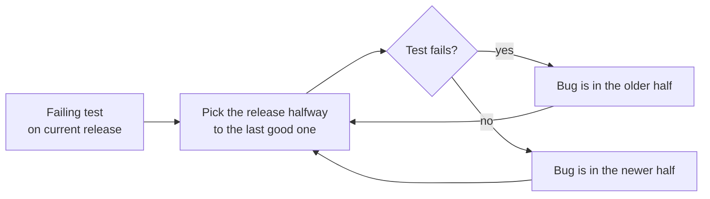

# 3. The Basic Tools

[← 2. A Pragmatic Approach](02-a-pragmatic-approach.md) · [Book](../README.md) · [4. Pragmatic Paranoia →](04-pragmatic-paranoia.md)

## Summary

Like a woodworker's well-worn tools, a programmer's tools become extensions of their hands, and tools amplify talent (pp. 143–144). The chapter warns against living inside one IDE and walks through a basic toolbox (p. 144):

- the raw material, **plain text** (Topic 16);
- the workbench, the **command shell** (Topic 17);
- the most-used tool, the **editor** (Topic 18);
- **version control** for everything (Topic 19);
- **debugging** as plain problem solving, with the binary chop, tracing and rubber ducking (Topic 20);
- a **text manipulation language** as glue (Topic 21);
- an **engineering daybook**, because the palest ink is better than the best memory (Topic 22).

## Key takeaways

- **Keep knowledge in plain text.** It outlives the applications that made it, works with every tool, and makes testing easier; binary formats divorce data from its meaning (Tip 25, pp. 146–150).
- **GUIs show you what you get, and that's all you get.** The shell lets you combine tools and automate (Tip 26, pp. 152–153).
- **Fluency, not speed, is the point of editor mastery.** When editing is automatic, thoughts flow straight into code (Tip 27, pp. 156–157).
- **Always use version control,** for everything, including throwaway prototypes and your machine's configuration (Tip 28, pp. 163–165).
- **Debugging is problem solving.** Fix the problem, not the blame; don't panic; write a failing test before fixing code; read the error message (Tips 29–32, pp. 169–172).
- **Binary chop** stack frames, datasets and releases to isolate a bug in logarithmic time (pp. 174–175).
- **"select" isn't broken.** Suspect your own code before the OS or the library, and prove your assumptions rather than trusting them (Tips 33–34, pp. 177–179).

## Section outline

*From the book’s own table of contents (PDF bookmarks). Page numbers are PDF pages: this edition's reflowed text has no printed page numbers.*

- Topic 16. The Power of Plain Text — p. 146
- Topic 17. Shell Games — p. 152
- Topic 18. Power Editing — p. 156
- Topic 19. Version Control — p. 161
- Topic 20. Debugging — p. 168
- Topic 21. Text Manipulation — p. 181
- Topic 22. Engineering Daybooks — p. 185

## Notes

| Tip | Statement | Page |
|---:|---|---|
| 25 | Keep Knowledge in Plain Text | 147 |
| 26 | Use the Power of Command Shells | 153 |
| 27 | Achieve Editor Fluency | 156 |
| 28 | Always Use Version Control | 163 |
| 29 | Fix the Problem, Not the Blame | 169 |
| 30 | Don't Panic | 169 |
| 31 | Failing Test Before Fixing Code | 172 |
| 32 | Read the Damn Error Message | 172 |
| 33 | "select" Isn't Broken | 178 |
| 34 | Don't Assume It—Prove It | 179 |
| 35 | Learn a Text Manipulation Language | 182 |

Start with a basic set of general tools, add to it as needs arise, and note each time your tools can't cut it: let need drive acquisitions (p. 144).

### Topic 16. The Power of Plain Text

Programmers' raw material is knowledge, and the best format for storing it persistently is **plain text**: printable characters that convey information, understandable to humans (pp. 146–147). `Field19=467abe` is plain text but not useful (p. 147). **Tip 25, Keep Knowledge in Plain Text** (p. 147). Plain text can be structured: HTML, JSON, YAML, HTTP, SMTP and IMAP are all text (p. 147).

| Reason | What the book says (pp. 147–150) |
|---|---|
| **Insurance against obsolescence** | Human-readable, self-describing data outlives its applications. You can parse it with partial knowledge of the format. `<SOCIAL-SECURITY-NO>123-45-6789</…>` is human *understandable*; `AC27123456789B11P` is not even readable |
| **Leverage** | Every tool works on text: version control, diff, checksums, grep. The Unix philosophy of small sharp tools relies on line-oriented text files |
| **Easier testing** | Synthetic test data and regression output in text can be edited and analyzed with ordinary tools |
| **Lowest common denominator** | In heterogeneous environments, text is the common standard |

### Topic 17. Shell Games

For a programmer, the workbench is the **command shell**: invoke any tool, combine tools with pipes, and build macro commands (p. 152). GUIs are fine for some tasks, but their benefit, WYSIWYG, comes with a cost: **WYSIAYG**, what you see is all you get. They're limited to what their designers intended (pp. 152–153). **Tip 26, Use the Power of Command Shells** (p. 153). The book's example lists the unique Java packages imported in a directory with one `grep | sed | sort -u` pipeline (p. 153).

**Make the shell your own** (pp. 154–155): color themes, a useful prompt (the authors like a short directory, version-control status and the time), aliases and shell functions (`alias rm='rm -iv'`), and context-specific command completion. "Be like a hermit crab" (p. 155).

### Topic 18. Power Editing

The authors have softened the first edition's "one editor for everything" advice: use as many editors as you like, but work toward fluency in each (p. 156). **Tip 27, Achieve Editor Fluency** (p. 156).

- Editing 20 hours a week, a 4% gain is an extra week a year, but the real gain is not having to think about the mechanics of editing (p. 156).
- **The fluency checklist** (p. 157): move and select by character, word, line and paragraph, and by syntactic unit; reindent; comment blocks; undo and redo; split windows; go to a line; sort lines; search by string and regex; use multiple cursors; show compilation errors; run tests. Can you do all of it without the mouse?
- **Moving toward fluency** (p. 158): watch yourself editing; when you repeat yourself, think "there must be a better way", find it, then use it deliberately until it becomes muscle memory.
- **Growing your editor** (pp. 158–159): search for extensions, learn the extension language, and publish what you write.

The challenges: turn off autorepeat, and edit for a week without the mouse (p. 159).

### Topic 19. Version Control

A version control system (VCS) is a giant undo key, a project-wide time machine, and also a hub for collaboration, pipelines and issue tracking (p. 161).

- **Shared directories are not version control** (p. 162). Sharing source on a network drive is like concurrent code with shared data and no synchronization. Keeping a repository *on* a cloud drive is worse: simultaneous changes can corrupt it.
- **What a VCS gives you** (pp. 162–163): who changed this line, the difference from last week, churn per release, the most-changed files, reproducible releases, archiving, and concurrent work with merging.
- **Tip 28, Always Use Version Control** (p. 163). Always: single-person projects, throwaway prototypes, documents, phone lists, build procedures, the little log-tidying script.
- **Branches** isolate work and often sit at the heart of a team's workflow. Most workflow advice is "this is what worked for me", so adapt as you learn (pp. 163–164).
- **A thought experiment** (pp. 164–165). After a cup of tea killed a laptop, one author restored a new machine by the end of the afternoon, because dotfiles, editor configuration, the Homebrew list, the Ansible script and current projects were all in version control.
- **A project hub** (pp. 165–166). Prefer third-party hosting with access control, a CLI, automated builds and tests, pull requests, integrated issues, reporting and notifications. A push to a branch can build, test and deploy; that's not scary when you can always roll back.

### Topic 20. Debugging

Bugs are inevitable, so debugging takes a large part of every day (p. 168). Grace Hopper is credited with the first literal computer bug, a moth taped into a log book (p. 168).

**Psychology and mindset** (pp. 169–170):

- **Tip 29, Fix the Problem, Not the Blame** (p. 169). Whoever wrote it, it's your problem now.
- **Tip 30, Don't Panic** (p. 169). If your first reaction is "that's impossible", you're plainly wrong: it happened.
- Beware of myopia: find the **root cause**, not just this appearance of it (p. 170).

**Where to start** (pp. 170–171): build cleanly with warnings turned up, gather accurate data, and watch the user if necessary. In Andy's graphics application, the crash only happened with brush strokes from upper right to lower left, the direction the programmer never tried. Test boundary conditions and realistic usage, systematically.

**Strategies** (pp. 171–177):

| Strategy | How |
|---|---|
| **Reproduce with one command** | **Tip 31, Failing Test Before Fixing Code** (p. 172). Isolating the bug often reveals the fix |
| **Read the error message** | **Tip 32, Read the Damn Error Message** (p. 172) |
| **Bad results** | Use the failing test in a debugger, confirm you see the wrong value, move up and down the call stack, and jot down where each chase started (p. 173) |
| **Sensitivity to input** | Reproduce with a copy of the dataset, then binary chop the data (pp. 173–174) |
| **Regressions across releases** | Binary chop the releases (p. 174) |
| **Logging and tracing** | Watch state over time, which a debugger can't. Use a regular format so traces can be parsed: trace every open and close to find a leak (pp. 175–176) |
| **Rubber ducking** | Explain the code step by step to someone, or something; stating your assumptions exposes them (pp. 176–177) |
| **Process of elimination** | Assume your code misuses the library before assuming the library is broken (p. 177) |

**The binary chop** (pp. 174–175). Linear search looks at about half the entries; a binary chop halves the range each time. Applied to debugging:

- **Stack frames:** check a frame in the middle of a long stack trace; with 64 frames you need at most six attempts.
- **Data:** split the dataset in two, feed each half through the app, and keep dividing to a minimal failing set.
- **Releases:** with a test that fails now, try a release halfway back to the last good one. Many version control systems automate this.

*The vault's diagram of the release chop described on p. 175.*

> **Try it:** [Binary chop](../widgets/03-binary-chop.html) — hunt a regression through a history of releases and a crash through a dataset, chopping in half or stepping one at a time, and compare how many test runs each takes.

**"select" isn't broken** (pp. 177–178). A senior engineer spent weeks working around a supposedly broken `select` system call, until reading its documentation fixed the problem in minutes. **Tip 33, "select" Isn't Broken**: if you see hoof prints, think horses, not zebras. If you "changed only one thing", that thing is likely responsible, even when the change is an upgrade outside your control (p. 178).

**The element of surprise** (pp. 178–180). Surprise is proportional to your trust in the code, so a surprising bug means an assumption is wrong. **Tip 34, Don't Assume It—Prove It** (p. 179). After the fix: ask why tests didn't catch it, whether earlier parameter checks would have, where else the same bug lurks, how to make the next fix faster, and whether the wrong assumption is shared by the team. The chapter ends with a debugging checklist (p. 180).

### Topic 21. Text Manipulation

Text manipulation languages are the programmer's router: noisy and brute force, but powerful in the right hands (p. 181). With them you can prototype ideas five or ten times faster, and spending 30 minutes on a crazy idea beats spending five hours (pp. 181–182). Kernighan and Pike's Perl version of a program was 17 lines against C's 150 (p. 182). **Tip 35, Learn a Text Manipulation Language** (p. 182).

Applied to this book (pp. 182–183): the Pragmatic Bookshelf's Ruby build system; a script that includes tested code by named segment (DRY, so examples can't drift from the programs); website updates; LaTeX-to-text equations; and an index marked up in the text and collated by script. Exercises 11–13 convert YAML to JSON and rename camelCase variables to snake_case (p. 184).

### Topic 22. Engineering Daybooks

Dave's colleagues among electronic and mechanical engineers kept paper **daybooks**: what they did, what they learned, sketches, meter readings (p. 185). Its benefits (pp. 185–186):

- It's more reliable than memory.
- It stores ideas that aren't relevant right now, so you can keep concentrating.
- It acts as a rubber duck: writing a note can make you realize what you just did is wrong.

The authors recommend paper over a file or wiki, and suggest trying it for a month (p. 186).

## Trade-offs at a glance

| Choice | Buys | Costs |
|---|---|---|
| Plain text | Longevity, every tool, easy testing | Size and parsing speed compared with binary |
| Binary format | Compact, fast | Meaningless without the application; brittle |
| GUI | Convenient for simple tasks | What you see is all you get; hard to automate |
| Command shell | Combinable tools, automation | Learning curve |
| Linear search through releases or data | Simple | Up to n test runs |
| Binary chop | About log₂ n test runs | Needs a reliable one-command test |
| Debugger | The state of the program now | Can't show history or timing |
| Tracing | State over time; works for concurrency and events | Noise; needs a parseable format |

## Beyond the book

- **`git bisect`** automates the release chop the book describes: mark a good and a bad commit, and Git checks out the midpoints, optionally running a test script (`git bisect run`) to decide each step.
- **Delta debugging.** Andreas Zeller's *ddmin* algorithm (2002) generalizes the data chop: when neither half fails alone, it tries smaller chunks and complements, and finds a failing input that is minimal in the sense that removing any one element makes it pass. The vault's [binary-chop lab](../lab/03-binary-chop/README.md) compares it with a plain halving chop.
- **Flaky tests break the chop.** A bisection assumes the test is deterministic: one wrong answer sends the search into the wrong half. That's another reason for the book's insistence on a single-command, reliable reproduction.

## Connections

- **Related chapters:** [2. A Pragmatic Approach](02-a-pragmatic-approach.md) (DRY in the book's own build; the daybook for ETC instincts), [4. Pragmatic Paranoia](04-pragmatic-paranoia.md) (crash early and assertions, which isolate bad data earlier), [5. Bend, or Break](05-bend-or-break.md) (configuration as plain text), [7. While You Are Coding](07-while-you-are-coding.md) (algorithm speed, testing), [9. Pragmatic Projects](09-pragmatic-projects.md) (version control in the starter kit).
- **Run it:** [Binary chop](../lab/03-binary-chop/README.md) — measures test runs to find a regression among 1,000 commits (linear vs. bisection) and to shrink a 1,000-record crashing dataset (halving vs. delta debugging).

## Check yourself

*Questions and answers are the vault's, written from the notes above; answers cite the book's PDF pages.*

1. **What is the difference between human-readable and human-understandable data?**

   *Answer:* `AC27123456789B11P` is readable characters with no evident meaning; `<SOCIAL-SECURITY-NO>123-45-6789</…>` is self-describing (p. 148).

2. **What does WYSIAYG mean, and why does it matter?**

   *Answer:* What you see is all you get: a GUI is limited to what its designers intended, so you can't combine or automate beyond it (p. 153).

3. **What is the real benefit of editor fluency?**

   *Answer:* Not the time saved but not having to think about editing mechanics, so thoughts flow into the editor (p. 156).

4. **Why is keeping a Git repository on a shared cloud drive worse than not using version control at all?**

   *Answer:* The VCS uses interacting files; simultaneous changes from two machines can corrupt the repository (p. 162).

5. **What is the most important rule of debugging, according to Topic 20?**
   - [ ] Don't panic
   - [x] Failing test before fixing code
   - [ ] Read the error message

   *Answer:* Tip 31: make the bug reproducible with a single command (p. 172). "Don't Panic" is the one the book calls the *first* rule (p. 169).

6. **A stack trace has 64 frames. How many checks does a binary chop need at most?**

   *Answer:* Six (p. 175).

7. **What does "select is broken" remind the authors of?**

   *Answer:* That the bug is far more likely in your code than in the OS or a library: think horses, not zebras (pp. 177–178).

8. **Give the three benefits of an engineering daybook.**

   *Answer:* It's more reliable than memory, it parks ideas that aren't relevant yet, and writing acts as a rubber duck (pp. 185–186).
