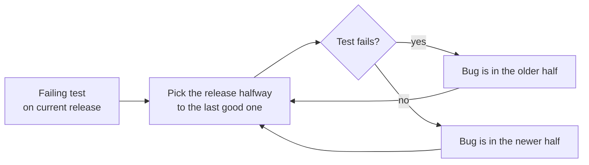

# فصل ۳: ابزارهای پایه

[فصل ۲: رویکرد pragmatic →](02-a-pragmatic-approach.md) · [کتاب](../README.md) · [فصل ۴: بدگمانی pragmatic ←](04-pragmatic-paranoia.md)

## خلاصه

مثل ابزارهای دست‌سوده‌ی یک نجار، ابزارهای یک برنامه‌نویس امتداد دست‌هایش می‌شوند، و ابزار استعداد را تقویت می‌کند (pp. 143–144). این فصل نسبت به زندگی کردن داخل یک IDE هشدار می‌دهد و یک جعبه‌ابزار پایه را می‌گردد (p. 144):

- ماده‌ی خام، یعنی **متن ساده** (موضوع ۱۶)؛
- میزکار، یعنی **shell فرمان** (موضوع ۱۷)؛
- پراستفاده‌ترین ابزار، یعنی **editor** (موضوع ۱۸)؛
- **کنترل نسخه** برای همه چیز (موضوع ۱۹)؛
- **عمل debug کردن** به‌عنوان حل مسئله‌ی ساده، با نصف کردن دودویی و trace و اردک پلاستیکی (موضوع ۲۰)؛
- یک **زبان دست‌کاری متن** به‌عنوان چسب (موضوع ۲۱)؛
- یک **دفتر روزنگار مهندسی**، چون کم‌رنگ‌ترین مرکب از بهترین حافظه بهتر است (موضوع ۲۲).

## نکته‌های کلیدی

- **دانش را در متن ساده نگه دارید.** از برنامه‌هایی که ساختندش بیشتر عمر می‌کند، با هر ابزاری کار می‌کند، و تست را آسان‌تر؛ قالب‌های دودویی داده را از معنایش جدا می‌کنند (tip ۲۵، صص. ۱۴۶–۱۵۰).
- **همه‌ی interfaceهای GUI آن چیزی را نشان می‌دهند که می‌گیرید، و همه‌ی آن چیزی که می‌گیرید همان است.** ابزار shell می‌گذارد ابزارها را ترکیب و خودکار کنید (tip ۲۶، صص. ۱۵۲–۱۵۳).
- **روانی، و نه سرعت، نکته‌ی تسلط بر editor است.** وقتی ویرایش خودکار شود، فکر یک‌راست به کد سرازیر می‌شود (tip ۲۷، صص. ۱۵۶–۱۵۷).
- **همیشه کنترل نسخه به کار ببرید،** برای همه چیز، از جمله prototypeهای دور‌انداختنی و تنظیم ماشین خودتان (tip ۲۸، صص. ۱۶۳–۱۶۵).
- **کار debug همان حل مسئله است.** مسئله را درست کنید، نه تقصیر را؛ هول نکنید؛ پیش از درست کردن کد یک تست شکست‌خورده بنویسید؛ پیام خطا را بخوانید (tipهای ۲۹ تا ۳۲، صص. ۱۶۹–۱۷۲).
- **نصف کردن دودویی** را روی frameهای stack و مجموعه‌داده‌ها و releaseها اعمال کنید تا باگ را در زمان لگاریتمی جدا کنید (pp. 174–175).
- **فراخوانی «select» خراب نیست.** پیش از OS و کتابخانه به کد خودتان شک کنید، و فرض‌هایتان را ثابت کنید و نه به آن‌ها اعتماد (tipهای ۳۳ و ۳۴، صص. ۱۷۷–۱۷۹).

## فهرست بخش‌ها

*از فهرست مطالب خود کتاب، از bookmarkهای PDF. شماره‌ها صفحه‌ی PDF‌اند، چون متن بازچینش‌شده‌ی این ویراست شماره‌ی صفحه‌ی چاپی ندارد.*

- موضوع ۱۶. قدرت متن ساده — ص. ۱۴۶
- موضوع ۱۷. بازی‌های shell — ص. ۱۵۲
- موضوع ۱۸. ویرایش قدرتمند — ص. ۱۵۶
- موضوع ۱۹. کنترل نسخه — ص. ۱۶۱
- موضوع ۲۰. debug کردن — ص. ۱۶۸
- موضوع ۲۱. دست‌کاری متن — ص. ۱۸۱
- موضوع ۲۲. دفترهای روزنگار مهندسی — ص. ۱۸۵

## یادداشت‌ها

| tip | عبارت | صفحه |
|---:|---|---|
| ۲۵ | دانش را در متن ساده نگه دارید | ۱۴۷ |
| ۲۶ | از قدرت shellهای فرمان استفاده کنید | ۱۵۳ |
| ۲۷ | در editor به روانی برسید | ۱۵۶ |
| ۲۸ | همیشه کنترل نسخه به کار ببرید | ۱۶۳ |
| ۲۹ | مسئله را درست کنید، نه تقصیر را | ۱۶۹ |
| ۳۰ | هول نکنید | ۱۶۹ |
| ۳۱ | پیش از درست کردن کد، تست شکست‌خورده | ۱۷۲ |
| ۳۲ | آن پیام خطای لعنتی را بخوانید | ۱۷۲ |
| ۳۳ | فراخوانی «select» خراب نیست | ۱۷۸ |
| ۳۴ | فرضش نکنید، ثابتش کنید | ۱۷۹ |
| ۳۵ | یک زبان دست‌کاری متن یاد بگیرید | ۱۸۲ |

با مجموعه‌ای پایه از ابزارهای عمومی شروع کنید، هر وقت نیازی پیدا شد به آن اضافه کنید، و هر بار که ابزارهایتان کم آوردند یادداشتش کنید: بگذارید نیاز، خریدها را براند (p. 144).

### موضوع ۱۶. قدرت متن ساده

ماده‌ی خام برنامه‌نویس‌ها دانش است، و بهترین قالب برای ذخیره‌ی ماندگارش **متن ساده** است: کاراکترهای چاپ‌شدنی که اطلاعات می‌رسانند و برای انسان فهمیدنی‌اند (pp. 146–147). عبارت `Field19=467abe` متن ساده است ولی به‌کار‌آمدنی نیست (p. 147). **tip ۲۵، دانش را در متن ساده نگه دارید** (p. 147). متن ساده می‌تواند ساختار داشته باشد: HTML و JSON و YAML و HTTP و SMTP و IMAP همه متن‌اند (p. 147).

| دلیل | کتاب چه می‌گوید (pp. 147–150) |
|---|---|
| **بیمه در برابر منسوخ شدن** | داده‌ی انسان‌خوان و خودتوصیف از برنامه‌هایش بیشتر عمر می‌کند. می‌توانید با دانشی جزئی از قالب تجزیه‌اش کنید. عبارت `<SOCIAL-SECURITY-NO>123-45-6789</…>` برای انسان *فهمیدنی* است و `AC27123456789B11P` حتی خواندنی هم نیست |
| **اهرم** | هر ابزاری روی متن کار می‌کند: کنترل نسخه، diff، checksum، grep. فلسفه‌ی ابزارهای کوچک و تیز Unix روی فایل‌های متنی خط‌محور تکیه دارد |
| **تست آسان‌تر** | داده‌ی تست ساختگی و خروجی رگرسیون در متن را می‌شود با ابزارهای معمولی ویرایش و تحلیل کرد |
| **کوچک‌ترین مخرج مشترک** | در محیط‌های ناهمگون، متن استاندارد مشترک است |

> **In practice:** هر چیز stack ما در متن ساده است: DAGها، SQL، manifestهای Kubernetes، playbookهای Ansible، dashboardهای Grafana به‌شکل JSON.
>
> **Your turn:** چرا dashboardهای Grafana را از UI می‌کشید و به‌شکل JSON در git نگه می‌دارید؟
>
> *Answer:* تا بازبینی، diff، تاریخچه و بازسازی داشته باشند و Argo CD یا provisioning آن‌ها را deploy کند؛ dashboardی که فقط در UI است با یک حذف از دست می‌رود. متن ساده از ابزاری که آن را ساخته بیشتر عمر می‌کند (pp. 146–151).

### موضوع ۱۷. بازی‌های shell

برای یک برنامه‌نویس، میزکار همان **shell فرمان** است: هر ابزاری را صدا بزنید، ابزارها را با pipe ترکیب کنید، و فرمان‌های macro بسازید (p. 152). interfaceهای GUI برای بعضی کارها خوب‌اند، ولی سودشان، یعنی WYSIWYG، هزینه‌ای دارد: **WYSIAYG**، یعنی هر چه می‌بینید همه‌ی آن چیزی است که می‌گیرید. به آن چیزی محدودند که طراحانشان در نظر داشتند (pp. 152–153). **tip ۲۶، از قدرت shellهای فرمان استفاده کنید** (p. 153). نمونه‌ی کتاب، بسته‌های یکتای Java که در یک پوشه import شده‌اند را با یک pipeline از `grep | sed | sort -u` فهرست می‌کند (p. 153).

**مفهوم shell را مال خودتان کنید** (pp. 154–155): قالب رنگ، یک prompt به‌کار‌آمدنی که نویسنده‌ها پوشه‌ی کوتاه و وضعیت کنترل نسخه و ساعت را در آن دوست دارند، alias و تابع shell مثل `alias rm='rm -iv'`، و کامل کردن فرمان وابسته به زمینه. «مثل خرچنگ راهب باشید» (p. 155).

### موضوع ۱۸. ویرایش قدرتمند

نویسنده‌ها توصیه‌ی «یک editor برای همه چیز» ویراست اول را نرم‌تر کرده‌اند: هر چند editorی که می‌خواهید به کار ببرید، ولی به سمت روانی در هر کدام کار کنید (p. 156). **tip ۲۷، در editor به روانی برسید** (p. 156).

- با بیست ساعت ویرایش در هفته، چهار درصد بهبود یعنی یک هفته‌ی اضافه در سال، ولی سود واقعی این است که لازم نیست به مکانیک ویرایش فکر کنید (p. 156).
- **فهرست بررسی روانی** (p. 157): حرکت و انتخاب در سطح کاراکتر و کلمه و خط و بند، و در سطح واحد نحوی؛ دوباره تو رفتن؛ comment کردن بلوک؛ undo و redo؛ شکستن پنجره؛ رفتن به یک خط؛ مرتب کردن خط‌ها؛ جست‌و‌جو با رشته و regex؛ چند cursor؛ نشان دادن خطای compile؛ اجرای تست. می‌توانید همه‌ی این‌ها را بی ماوس بکنید؟
- **حرکت به سمت روانی** (p. 158): خودتان را در حال ویرایش تماشا کنید؛ وقتی خودتان را تکرار می‌کنید فکر کنید «باید راه بهتری باشد»، پیدایش کنید، و آن‌قدر آگاهانه به کارش ببرید تا حافظه‌ی عضلانی شود.
- **پروردن editor** (pp. 158–159): دنبال افزونه بگردید، زبان افزونه را یاد بگیرید، و آن چیزی را که می‌نویسید منتشر کنید.

چالش‌ها: تکرار خودکار کلید را خاموش کنید، و یک هفته بی ماوس ویرایش کنید (p. 159).

### موضوع ۱۹. کنترل نسخه

یک سیستم کنترل نسخه، یعنی VCS، یک کلید undo غول‌آسا و یک ماشین زمان در سطح پروژه است، و همچنین مرکزی برای همکاری و pipeline و پی‌گیری issue (p. 161).

- **پوشه‌ی مشترک کنترل نسخه نیست** (p. 162). به اشتراک گذاشتن کد منبع روی یک درایو شبکه مثل کد هم‌زمان با داده‌ی مشترک و بی synchronization است. نگه داشتن repository *روی* یک درایو cloud بدتر است: تغییرهای هم‌زمان می‌توانند خرابش کنند.
- **یک VCS چه می‌دهد** (pp. 162–163): چه کسی این خط را عوض کرد، تفاوت با هفته‌ی پیش، تلاطم در هر release، پرتغییرترین فایل‌ها، releaseهای بازتولید‌شدنی، بایگانی، و کار هم‌زمان با merge.
- **نکته‌ی ۲۸، همیشه کنترل نسخه به کار ببرید** (p. 163). همیشه: پروژه‌های یک‌نفره، prototypeهای دور‌انداختنی، سندها، فهرست تلفن، رویه‌ی build، و همان اسکریپت کوچک مرتب کردن log.
- **همه‌ی branchها** کار را جدا می‌کنند و اغلب در قلب گردش‌کار یک تیم می‌نشینند. بیشتر توصیه‌های گردش‌کار «این چیزی است که برای من کار کرد»اند، پس با یاد گرفتن سازگارشان کنید (pp. 163–164).
- **یک آزمایش ذهنی** (pp. 164–165). بعد از آن که یک فنجان چای یک laptop را کشت، یکی از نویسنده‌ها تا آخر همان بعد از ظهر ماشینی تازه را برگرداند، چون dotfileها و تنظیم editor و فهرست Homebrew و اسکریپت Ansible و پروژه‌های فعلی همه در کنترل نسخه بودند.
- **یک مرکز پروژه** (pp. 165–166). میزبانی طرف سومی را ترجیح بدهید که کنترل دسترسی و CLI و build و تست خودکار و pull request و issue یکپارچه و گزارش و اطلاع‌رسانی دارد. یک push به یک branch می‌تواند build و تست و deploy کند؛ و این وقتی ترسناک نیست که همیشه بتوانید برگردید.

### موضوع ۲۰. debug کردن

باگ ناگزیر است، پس debug کردن بخش بزرگی از هر روز را می‌گیرد (p. 168). اولین باگ واقعی کامپیوتر، یعنی پروانه‌ای که در دفتر log چسبانده شده بود، به Grace Hopper نسبت داده می‌شود (p. 168).

**روان‌شناسی و ذهنیت** (pp. 169–170):

- **نکته‌ی ۲۹، مسئله را درست کنید، نه تقصیر را** (p. 169). هر کسی نوشته باشدش، حالا مسئله‌ی شماست.
- **نکته‌ی ۳۰، هول نکنید** (p. 169). اگر اولین واکنشتان «این ناممکن است» باشد، آشکارا اشتباه می‌کنید: اتفاق افتاده.
- از نزدیک‌بینی برحذر باشید: **ریشه‌ی علت** را پیدا کنید، نه فقط همین ظاهر شدنش را (p. 170).

**از کجا شروع کنیم** (pp. 170–171): با هشدارهای بالا تمیز build کنید، داده‌ی دقیق جمع کنید، و اگر لازم شد کاربر را تماشا. در برنامه‌ی گرافیکی Andy، crash فقط با ضربه‌قلم‌هایی از بالا‌راست به پایین‌چپ می‌افتاد، یعنی همان جهتی که برنامه‌نویس هیچ‌وقت امتحانش نکرده بود. شرط‌های مرزی و استفاده‌ی واقع‌بینانه را نظام‌مند تست کنید.

**راهبردها** (pp. 171–177):

| راهبرد | چطور |
|---|---|
| **بازتولید با یک فرمان** | **tip ۳۱، پیش از درست کردن کد، تست شکست‌خورده** (p. 172). جدا کردن باگ اغلب خود اصلاح را آشکار می‌کند |
| **خواندن پیام خطا** | **tip ۳۲، آن پیام خطای لعنتی را بخوانید** (p. 172) |
| **نتیجه‌های بد** | تست شکست‌خورده را در یک debugger به کار ببرید، تأیید کنید که مقدار غلط را می‌بینید، در call stack بالا و پایین بروید، و یادداشت کنید هر تعقیب از کجا شروع شد (p. 173) |
| **حساسیت به ورودی** | با نسخه‌ای از مجموعه‌داده بازتولید کنید و بعد داده را دودویی نصف (pp. 173–174) |
| **پس‌رفت بین releaseها** | releaseها را دودویی نصف کنید (p. 174) |
| **log و trace** | حالت را در طول زمان تماشا کنید، که debugger نمی‌تواند. قالبی منظم به کار ببرید تا traceها تجزیه‌شدنی بمانند: هر باز و بسته شدن را trace کنید تا نشتی پیدا شود (pp. 175–176) |
| **اردک پلاستیکی** | کد را قدم‌به‌قدم برای کسی، یا چیزی، توضیح بدهید؛ بیان کردن فرض‌هایتان آشکارشان می‌کند (pp. 176–177) |
| **فرایند حذف** | پیش از فرض این که کتابخانه خراب است، فرض کنید کد شما بد به کارش می‌برد (p. 177) |

**نصف کردن دودویی** (pp. 174–175). جست‌و‌جوی خطی حدود نصف ورودی‌ها را نگاه می‌کند، در حالی که نصف کردن دودویی هر بار بازه را نصف می‌کند. وقتی روی debug کردن اعمال شود:

- **همه‌ی frameهای stack:** frameی در میانه‌ی یک stack trace بلند را بررسی کنید؛ با ۶۴ frame حداکثر شش تلاش لازم دارید.
- **داده:** مجموعه‌داده را دو نیم کنید، هر نیم را از برنامه بگذرانید، و تا یک مجموعه‌ی کمینه‌ی شکست‌خورده تقسیم را ادامه بدهید.
- **همه‌ی releaseها:** با تستی که حالا شکست می‌خورد، releaseی را امتحان کنید که نصف راه تا آخرین release سالم است. خیلی از سیستم‌های کنترل نسخه این را خودکار می‌کنند.

*نمودار vault از نصف کردن releaseها که در ص. ۱۷۵ توضیح داده شده.*

> **Try it:** [نصف کردن دودویی](../widgets/03-binary-chop.html)؛ یک پس‌رفت را در تاریخچه‌ای از releaseها و یک crash را در یک مجموعه‌داده شکار کنید، یک‌بار با نصف کردن و یک‌بار قدم‌به‌قدم، و مقایسه کنید هر کدام چند اجرای تست می‌برد.

**فراخوانی «select» خراب نیست** (pp. 177–178). یک مهندس ارشد هفته‌ها دور یک فراخوانی سیستمی `select` که به‌گمانش خراب بود راه پیچید، تا این که خواندن مستندش ظرف چند دقیقه مسئله را درست کرد. **tip ۳۳، فراخوانی «select» خراب نیست**: اگر جای سم دیدید، به اسب فکر کنید و نه گورخر. اگر «فقط یک چیز را عوض کردید»، همان چیز احتمالاً مسئول است، حتی وقتی آن تغییر، ارتقایی بیرون از کنترلتان باشد (p. 178).

**عنصر غافلگیری** (pp. 178–180). غافلگیری به اعتمادتان به کد نسبت دارد، پس باگی غافلگیرکننده یعنی فرضی غلط است. **tip ۳۴، فرضش نکنید، ثابتش کنید** (p. 179). بعد از اصلاح: بپرسید چرا تست‌ها نگرفتندش، آیا بررسی پارامتر زودتر می‌گرفتش، همین باگ کجای دیگری کمین کرده، چطور اصلاح بعدی را تندتر کنیم، و آیا تیم در آن فرض غلط شریک است. فصل با یک فهرست بررسی debug کردن تمام می‌شود (p. 180).

> **In practice:** debug کردن pipeline یعنی پیدا کردن اولین لایه‌ای که داده‌اش غلط است.
>
> **Your turn:** عدد Gold غلط است. از کجا شروع می‌کنید؟
>
> *Answer:* عقب بروید: Silver، Bronze، Parquet staging، منبع. هر لایه را با یک کوئری شمارش یا مجموع مقایسه کنید تا اولین جایی که عدد عوض می‌شود پیدا شود؛ این جست‌وجوی دودویی کتاب روی لایه‌هاست و خودش باگ را محلی می‌کند (pp. 168–180).

### موضوع ۲۱. دست‌کاری متن

زبان‌های دست‌کاری متن، router برنامه‌نویس‌اند: پرسر‌و‌صدا و زورکی، ولی در دست درست قدرتمند (p. 181). با آن‌ها می‌توانید ایده‌ها را پنج یا ده برابر تندتر prototype کنید، و گذاشتن سی دقیقه روی ایده‌ای دیوانه از گذاشتن پنج ساعت بهتر است (pp. 181–182). نسخه‌ی Perl یک برنامه در کار Kernighan و Pike هفده خط بود در برابر صد و پنجاه خط C (p. 182). **tip ۳۵، یک زبان دست‌کاری متن یاد بگیرید** (p. 182).

وقتی روی همین کتاب اعمال شود (pp. 182–183): سیستم build به زبان Ruby در Pragmatic Bookshelf؛ اسکریپتی که کد تست‌شده را با نام بخش می‌آورد، یعنی DRY، تا نمونه‌ها از برنامه‌ها رانش نکنند؛ به‌روزرسانی وب‌سایت؛ تبدیل معادله از LaTeX به متن؛ و یک فهرست راهنما که در متن علامت خورده و با اسکریپت جمع‌آوری شده. تمرین‌های ۱۱ تا ۱۳ فایل YAML را به JSON تبدیل می‌کنند و نام متغیرهای camelCase را به snake_case (p. 184).

### موضوع ۲۲. دفترهای روزنگار مهندسی

همکارهای Dave بین مهندس‌های برق و مکانیک **دفتر روزنگار** کاغذی نگه می‌داشتند: چه کردند، چه یاد گرفتند، طرح‌ها، و خوانش دستگاه‌ها (p. 185). سودهایش (pp. 185–186):

- از حافظه قابل‌اعتمادتر است.
- ایده‌هایی را ذخیره می‌کند که همین حالا مربوط نیستند، پس می‌توانید تمرکزتان را نگه دارید.
- مثل اردک پلاستیکی عمل می‌کند: نوشتن یک یادداشت می‌تواند باعث شود بفهمید کاری که همین حالا کردید غلط است.

نویسنده‌ها کاغذ را به فایل یا wiki ترجیح می‌دهند و پیشنهاد می‌کنند یک ماه امتحانش کنید (p. 186).

## بده‌بستان‌ها در یک نگاه

| انتخاب | چه می‌دهد | چه می‌گیرد |
|---|---|---|
| متن ساده | عمر طولانی، هر ابزاری، تست آسان | اندازه و سرعت تجزیه در مقایسه با دودویی |
| قالب دودویی | جمع‌و‌جور و تند | بی آن برنامه بی‌معناست؛ شکننده |
| interface GUI | راحت برای کارهای ساده | هر چه می‌بینید همه‌ی آن چیزی است که می‌گیرید؛ خودکار کردنش سخت است |
| ابزار shell فرمان | ابزارهای ترکیب‌شدنی، خودکارسازی | شیب یاد گرفتن |
| جست‌و‌جوی خطی در releaseها یا داده | ساده | تا n اجرای تست |
| نصف کردن دودویی | حدود log₂ n اجرای تست | به تستی قابل‌اعتماد با یک فرمان نیاز دارد |
| ابزار debugger | حالت برنامه در همین لحظه | تاریخچه یا زمان‌بندی را نشان نمی‌دهد |
| ابزار trace | حالت در طول زمان؛ برای concurrency و رویداد کار می‌کند | سر‌و‌صدا؛ قالب تجزیه‌شدنی می‌خواهد |

## فراتر از کتاب

- **فرمان `git bisect`** همان نصف کردن releaseی را خودکار می‌کند که کتاب توضیح می‌دهد: یک commit سالم و یک خراب را علامت بزنید، و Git نقطه‌های میانی را checkout می‌کند و اختیاری یک اسکریپت تست را اجرا، یعنی `git bisect run`، تا هر قدم را تصمیم بگیرد.
- **عمل debug کردن دلتا.** الگوریتم *ddmin* از Andreas Zeller (سال ۲۰۰۲) نصف کردن داده را تعمیم می‌دهد: وقتی هیچ نیمی به‌تنهایی شکست نمی‌خورد، تکه‌های کوچک‌تر و مکمل‌ها را امتحان می‌کند، و ورودی شکست‌خورده‌ای پیدا می‌کند که به این معنا کمینه است که برداشتن هر یک عنصرش باعث می‌شود قبول شود. [آزمایش نصف کردن دودویی](../lab/03-binary-chop/README.md) در vault آن را با نصف کردن ساده مقایسه می‌کند.
- **تست‌های لرزان نصف کردن را می‌شکنند.** یک bisection فرض می‌کند تست قطعی است: یک پاسخ غلط، جست‌و‌جو را به نیم غلط می‌فرستد. این دلیل دیگری است برای پافشاری کتاب روی بازتولیدی قابل‌اعتماد با یک فرمان.

## پیوندها

- **فصل‌های مرتبط:** [فصل ۲: رویکرد pragmatic](02-a-pragmatic-approach.md) که DRY در build خود کتاب و دفتر روزنگار برای شهود ETC را دارد، [فصل ۴: بدگمانی pragmatic](04-pragmatic-paranoia.md) که زود crash کردن و assertion را دارد که داده‌ی بد را زودتر جدا می‌کنند، [فصل ۵: خم شو، یا بشکن](05-bend-or-break.md) که تنظیم به‌عنوان متن ساده را دارد، [فصل ۷: وقتی کد می‌زنید](07-while-you-are-coding.md) که سرعت الگوریتم و تست را دارد، و [فصل ۹: پروژه‌های pragmatic](09-pragmatic-projects.md) که کنترل نسخه را در جعبه‌ی شروع دارد.
- **Run it:** [نصف کردن دودویی](../lab/03-binary-chop/README.md)؛ اجراهای تست لازم را برای یافتن یک پس‌رفت بین هزار commit اندازه می‌گیرد، یعنی خطی در برابر bisection، و برای کوچک کردن مجموعه‌داده‌ی هزار‌رکوردی crash‌کننده، یعنی نصف کردن در برابر debug دلتا.

## خودتان را بسنجید

*پرسش‌ها و پاسخ‌ها مال vault است و از روی یادداشت‌های بالا نوشته شده؛ پاسخ‌ها به صفحه‌های PDF کتاب ارجاع می‌دهند.*

1. **تفاوت داده‌ی انسان‌خوان و داده‌ی انسان‌فهم چیست؟**

   *Answer:* عبارت `AC27123456789B11P` کاراکترهای خواندنی بی معنای آشکار است، در حالی که `<SOCIAL-SECURITY-NO>123-45-6789</…>` خودتوصیف است (p. 148).

2. **عبارت WYSIAYG یعنی چه و چرا مهم است؟**

   *Answer:* هر چه می‌بینید همه‌ی آن چیزی است که می‌گیرید: یک GUI به آن چیزی محدود است که طراحانش در نظر داشتند، پس فراتر از آن نمی‌توانید ترکیب یا خودکار کنید (p. 153).

3. **سود واقعی روانی در editor چیست؟**

   *Answer:* نه وقتی که صرفه‌جویی می‌شود، بلکه این که لازم نیست به مکانیک ویرایش فکر کنید، پس فکرها به editor سرازیر می‌شوند (p. 156).

4. **چرا نگه داشتن یک repository گیت روی درایو cloud مشترک از نداشتن کنترل نسخه هم بدتر است؟**

   *Answer:* سیستم VCS از فایل‌هایی استفاده می‌کند که با هم در تعامل‌اند؛ تغییرهای هم‌زمان از دو ماشین می‌توانند repository را خراب کنند (p. 162).

5. **به گفته‌ی موضوع ۲۰، مهم‌ترین قاعده‌ی debug کردن چیست؟**
   - [ ] هول نکنید
   - [x] پیش از درست کردن کد، تست شکست‌خورده
   - [ ] پیام خطا را بخوانید

   *Answer:* شماره‌ی tip ۳۱: باگ را با یک فرمان بازتولید‌شدنی کنید (p. 172). عبارت «هول نکنید» همان است که کتاب قاعده‌ی *اول* می‌نامدش (p. 169).

6. **یک stack trace شصت‌و‌چهار frame دارد. نصف کردن دودویی حداکثر چند بررسی لازم دارد؟**

   *Answer:* شش بررسی (p. 175).

7. **جمله‌ی «select خراب است» نویسنده‌ها را به یاد چه چیزی می‌اندازد؟**

   *Answer:* این که باگ خیلی محتمل‌تر است در کد خودتان باشد تا در OS یا یک کتابخانه: به اسب فکر کنید و نه گورخر (pp. 177–178).

8. **سه سود دفتر روزنگار مهندسی را بگویید.**

   *Answer:* از حافظه قابل‌اعتمادتر است، ایده‌هایی را که هنوز مربوط نیستند پارک می‌کند، و خود نوشتن مثل اردک پلاستیکی عمل می‌کند (pp. 185–186).
