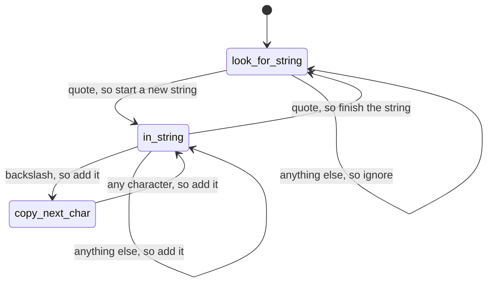

# فصل ۵: خم شو، یا بشکن

[فصل ۴: بدگمانی pragmatic →](04-pragmatic-paranoia.md) · [کتاب](../README.md) · [فصل ۶: concurrency ←](06-concurrency.md)

## خلاصه

کد باید پا‌به‌پای تغییری تقریباً دیوانه‌وار برود، پس باید تا جای ممکن شل و انعطاف‌پذیر باشد؛ این فصل نشان می‌دهد چطور تصمیم‌ها را برگشت‌پذیر کنید (p. 226). پنج راه انعطاف‌پذیر ماندن را می‌پوشاند:

- **الگوی decoupling:** از تصادف قطار و داده‌ی سراسری و وراثت بپرهیزید (موضوع ۲۸).
- **رویدادها:** چهار راهبرد برای تردستی با آن‌ها، یعنی state machine متناهی، الگوی observer، انتشار و اشتراک، و streamهای reactive (موضوع ۲۹).
- **تبدیل‌ها:** دیدن برنامه‌ها به‌عنوان pipelineهایی که داده را تبدیل می‌کنند (موضوع ۳۰).
- **جایگزین‌های وراثت:** interface و واگذاری و mixin (موضوع ۳۱).
- **تنظیم بیرونی،** که جزئیات را کاملاً از کد بیرون می‌برد (موضوع ۳۲).

## نکته‌های کلیدی

- **مفهوم coupling دشمن تغییر است، و گذراست.** کد decouple‌شده آسان‌تر عوض می‌شود (tip ۴۴، صص. ۲۲۸–۲۲۹).
- **بگو، نپرس؛ و فراخوانی متدها را زنجیر نکنید.** از درون یک object تصمیم نگیرید و بعد به‌روزش کنید؛ هدفتان یک نقطه در هر دسترسی باشد، جز برای APIهای خیلی پایدار (tipهای ۴۵ و ۴۶، صص. ۲۳۱–۲۳۴).
- **داده‌ی سراسری شامل singleton و منابع بیرونی هم می‌شود.** اگر چیزی باید سراسری باشد، در یک API بپیچیدش (tipهای ۴۷ و ۴۸، صص. ۲۳۶–۲۳۷).
- **مفهوم state machine متناهی فقط داده است:** جدولی از حالت و رویداد به حالت تازه، به‌علاوه‌ی کنش‌های اختیاری (pp. 240–245).
- **انتشار و اشتراک، منتشر‌کننده‌ها را از مشترک‌ها decouple می‌کند** از راه کانال‌های نام‌دار، به قیمت دیده شدن؛ و **streamها** رویدادها را مثل مجموعه‌های asynchronous می‌بینند (pp. 247–253).
- **برنامه‌ها درباره‌ی داده‌اند.** آن‌ها را به شکل pipelineهایی از تبدیل بسازید؛ حالت را احتکار نکنید و دستش بدهید؛ مقدارها را به‌عنوان ok یا error بپیچید و قدم‌ها را با `and_then` ببندید (tipهای ۴۹ و ۵۰، صص. ۲۵۵–۲۷۰).
- **مالیات وراثت ندهید.** برای چند‌ریختی از interface استفاده کنید، و از واگذاری، یعنی has-a از is-a بهتر است، و از mixin برای شریک شدن قابلیت (tipهای ۵۱ تا ۵۴، صص. ۲۷۲–۲۸۳).
- **برنامه را با تنظیم بیرونی پارامتری کنید،** پشت یک API، در حالت آرمانی به‌عنوان سرویسی پویا، ولی زیاده‌روی نکنید (tip ۵۵، صص. ۲۸۴–۲۸۷).

## فهرست بخش‌ها

*از فهرست مطالب خود کتاب، از bookmarkهای PDF. شماره‌ها صفحه‌ی PDF‌اند، چون متن بازچینش‌شده‌ی این ویراست شماره‌ی صفحه‌ی چاپی ندارد.*

- موضوع ۲۸. ویژگی decoupling — ص. ۲۲۸
- موضوع ۲۹. تردستی با دنیای واقعی — ص. ۲۳۹
- موضوع ۳۰. برنامه‌نویسی تبدیلی — ص. ۲۵۵
- موضوع ۳۱. مالیات وراثت — ص. ۲۷۲
- موضوع ۳۲. تنظیم — ص. ۲۸۴

## یادداشت‌ها

| tip | عبارت | صفحه |
|---:|---|---|
| ۴۴ | کد decouple‌شده آسان‌تر عوض می‌شود | ۲۲۹ |
| ۴۵ | بگو، نپرس | ۲۳۱ |
| ۴۶ | فراخوانی متدها را زنجیر نکنید | ۲۳۴ |
| ۴۷ | از داده‌ی سراسری بپرهیزید | ۲۳۶ |
| ۴۸ | اگر آن‌قدر مهم است که سراسری باشد، در یک API بپیچیدش | ۲۳۷ |
| ۴۹ | برنامه‌نویسی درباره‌ی کد است، ولی برنامه‌ها درباره‌ی داده‌اند | ۲۵۸ |
| ۵۰ | حالت را احتکار نکنید؛ دستش بدهید | ۲۶۵ |
| ۵۱ | مالیات وراثت ندهید | ۲۷۶ |
| ۵۲ | برای بیان چند‌ریختی، interface را ترجیح بدهید | ۲۷۸ |
| ۵۳ | به سرویس‌ها واگذار کنید: has-a از is-a بهتر است | ۲۷۹ |
| ۵۴ | برای شریک شدن قابلیت از mixin استفاده کنید | ۲۸۲ |
| ۵۵ | برنامه‌تان را با تنظیم بیرونی پارامتری کنید | ۲۸۴ |

### موضوع ۲۸. ویژگی decoupling

مفهوم coupling چیزهایی را به هم وصل می‌کند که باید موازی عوض شوند (p. 228). پل‌ها باید سفت باشند، پس مؤلفه‌هایشان جفت‌اند؛ نرم‌افزار باید انعطاف‌پذیر باشد، پس هر مؤلفه باید به کمترین تعداد مؤلفه‌ی دیگر جفت باشد (pp. 228–229). **coupling گذراست**: اگر A به B و C جفت باشد و آن‌ها به M و N و X و Y، پس A به هر شش‌تا جفت است (p. 229). **tip ۴۴، کد decouple‌شده آسان‌تر عوض می‌شود** (p. 229).

**نشانه‌های coupling** (p. 230): وابستگی‌های عجیب بین ماژول‌های بی‌ربط؛ تغییرهای «ساده»ای که چیزهای بی‌ربط را می‌شکنند؛ developerهایی که از عوض کردن کد می‌ترسند؛ و جلسه‌هایی که همه باید در آن‌ها باشند چون کسی نمی‌داند چه کسی اثر می‌گیرد.

**تصادف قطار** (pp. 230–235). عبارت `customer.orders.find(order_id).getTotals()` و بعد به‌روز کردن `grandTotal` و `discount` از پنج سطح انتزاع رد می‌شود. همه‌اش باید دست‌نخورده بماند تا کد کار کند، و یک قاعده‌ی تازه، مثل «تخفیف بیشتر از چهل درصد نداریم»، اعمال‌شدنی نیست، چون هر کسی می‌تواند فیلدهای totals را بگذارد (pp. 230–231).

- **نکته‌ی ۴۵، بگو، نپرس** (p. 231): بر پایه‌ی حالت درونی یک object تصمیم نگیرید و بعد به‌روزش کنید. قدم‌به‌قدم refactor کنید: `totals.applyDiscount(discount)`، بعد `customer.findOrder(id)`، بعد `order.applyDiscount(discount)` (pp. 231–232).
- روش TDA یک الگو است و نه قانون طبیعت: مشتری و سفارش مفهوم‌های سطح‌بالای جهان‌شمول‌اند، پس نشان دادنشان انتخابی pragmatic است (pp. 232–233).
- **قانون Demeter**، از Ian Holland در اواخر دهه‌ی ۱۹۸۰، می‌گوید یک متد از کلاس C باید فقط متدهای دیگر C و پارامترهایش و objectهایی را که می‌سازد و سراسری‌ها را صدا بزند. نویسنده‌ها حالا از بند سراسری خوششان نمی‌آید و قانون را سخت‌اعمال می‌دانند، مثل تجزیه‌ی یک سند حقوقی برای هر فراخوانی (pp. 233–234).
- **نکته‌ی ۴۶، فراخوانی متدها را زنجیر نکنید** (p. 234): بکوشید در هر دسترسی بیشتر از یک نقطه نداشته باشید، و متغیر میانی دورش نمی‌زند. استثنا چیزهایی‌اند که خیلی بعید است عوض شوند، مثل کتابخانه‌ی استاندارد زبان؛ کتابخانه‌های طرف سوم ناپایدار حساب می‌شوند (p. 234).
- **زنجیره در برابر pipeline** (p. 235): یک pipeline فقط از راه قالب داده جفت می‌شود و نه جزئیات پنهان پیاده‌سازی، که مانع خیلی کمتری برای تغییر است.

**بدی‌های جهانی‌سازی** (pp. 235–237). داده‌ی سراسری مثل یک پارامتر اضافه روی هر متد است. بیرون کشیدن کد را سخت می‌کند و تست کردنش را بی ساختن یک محیط سراسری (pp. 235–236).

- **نکته‌ی ۴۷، از داده‌ی سراسری بپرهیزید** (p. 236).
- یک **singleton** با داده‌ی بیرون‌داده باز هم داده‌ی سراسری است، فقط با نامی بلندتر. قایم کردنش پشت متدها کمک می‌کند، ولی باز هم یک مجموعه داده هست (pp. 236–237).
- هر **منبع بیرونی mutable**، یعنی دیتابیس و سیستم فایل و API سرویس، هم داده‌ی سراسری است (p. 237).
- **نکته‌ی ۴۸، اگر آن‌قدر مهم است که سراسری باشد، در یک API بپیچیدش** (p. 237).

وراثت، سومین سرچشمه‌ی جفت‌شدگی، موضوع خودش را می‌گیرد (p. 237). کد خجالتی، که فقط با آن چیزی سر‌و‌کار دارد که مستقیم می‌شناسد، برنامه‌ها را decouple نگه می‌دارد (p. 237).

> **In practice:** لایه‌های Bronze، Silver و Gold یعنی decoupling: هر لایه فقط به لایه‌ی پیش از خودش وابسته است.
>
> **Your turn:** داشبوردی در Metabase مستقیم از Bronze می‌خواند. چه مشکلی پیش می‌آید؟
>
> *Answer:* هر تغییر منبع داشبورد را می‌شکند، چون داشبورد به جزئیات لایه‌ای وابسته است که قراری با او نبسته. داشبوردها فقط Gold بخوانند. کتاب درباره‌ی «train wreck» همین را می‌گوید: فقط با همسایه‌ی مستقیمت حرف بزن (pp. 228–238).

### موضوع ۲۹. تردستی با دنیای واقعی

یک **رویداد** نمایانگر در دسترس بودن اطلاعات است، از دنیای بیرون یا از درون، تا همان گرفتن عنصر بعدی یک فهرست. برنامه‌هایی که به رویداد پاسخ می‌دهند در دنیای واقعی بهتر کار می‌کنند (pp. 239–240). چهار راهبرد (p. 240):

| راهبرد | ایده | نقطه‌ی قوت | نقطه‌ی ضعف |
|---|---|---|---|
| **state machine متناهی** | جدولی از (حالت، رویداد) به حالت تازه، اختیاری با یک کنش | مدیریت رویداد را در چند خط باز می‌کند؛ می‌تواند داده‌ی خالص باشد | هر مسئله‌ی رویدادی را حل نمی‌کند (p. 246) |
| **الگوی observer** | observerها callback را در یک observable ثبت می‌کنند | پیاده‌سازی‌اش ریز است و کتابخانه نمی‌خواهد؛ در UI رایج است | observerها به observable جفت‌اند؛ callback synchronous می‌تواند گلوگاه شود (p. 247) |
| **انتشار و اشتراک** | منتشر‌کننده‌ها و مشترک‌ها از راه کانال‌های نام‌دار به هم می‌رسند | decouple می‌کند و می‌تواند asynchronous باشد؛ بخش‌ها را می‌شود در حال اجرا اضافه یا جابه‌جا کرد | دیدن این که کدام مشترک پیامی را می‌گیرد سخت است (p. 248) |
| **streamهای reactive** | رویدادها به‌عنوان مجموعه‌ای در حال رشد و احتمالاً asynchronous | رویدادها را مثل داده filter و zip و merge کنید؛ synchronous و asynchronous را یکی می‌کند | کتابخانه می‌خواهد، یعنی RxJS در نمونه‌های کتاب |

**ماشین‌های حالت متناهی** (pp. 240–246). Dave تقریباً هر هفته یکی می‌نویسد، اغلب در چند خط (p. 240).

- یک parser **پیام چند‌بخشی**: از *initial*، یک header به *reading* می‌رود؛ داده در *reading* می‌ماند؛ یک trailer به *done* می‌رود؛ و هر چیز دیگری خطاست. کل ماشین یک جدول گذار است، و حلقه یک خط: `state = TRANSITIONS[state][msg.msg_type] || :error` (pp. 241–243).
- **افزودن کنش:** یک بیرون‌کشنده‌ی رشته که هر گذارش یک کنش هم نام می‌برد. نقل‌قول رشته‌ی تازه‌ای شروع می‌کند، کاراکترها اضافه می‌شوند، یک backslash به `copy_next_char` می‌رود تا کاراکتر بعدی هر چه باشد کپی شود، و نقل‌قول بسته رشته را تمام می‌کند. یک ورودی `:default` رویدادهای فهرست‌نشده را می‌گیرد (pp. 243–245).
- حالت می‌تواند در ذخیره‌سازی بیرونی بنشیند و گردش‌کارهای چند‌مرحله‌ای مثل ثبت‌نام کاربر را براند (p. 245).

*بازکشی vault از state machine بیرون‌کشنده‌ی رشته‌ی کتاب (pp. 243–244).*

> **Try it:** [ماشین‌های حالت جدول‌محور](../widgets/05-message-fsm.html)؛ به بیرون‌کشنده‌ی رشته‌ی کتاب کاراکتر بدهید، یا به parser چند‌بخشی‌اش نوع پیام، رویداد‌به‌رویداد، و ببینید جدول گذار هر حالت و کنش بعدی را چطور انتخاب می‌کند.

**الگوی observer** (pp. 246–247): ماژول `Terminator` پیش از خروج هر callback ثبت‌شده را صدا می‌زند، که نشان می‌دهد یک observable تقریباً هیچ کدی نمی‌خواهد. **انتشار و اشتراک** آن را با کانال‌هایی تعمیم می‌دهد که بیرون از کد شما پیاده شده‌اند، اغلب با سرویس‌های cloud (pp. 247–248). **streamهای reactive** (pp. 249–253): مثل خانه‌های spreadsheet، مقدارها به مقدارهایی که به کار می‌برند واکنش نشان می‌دهند. در RxJS، zip کردن پنج نام حیوان با فاصله‌ی ۵۰۰ میلی‌ثانیه هر نیم ثانیه یک زوج منتشر می‌کند؛ و گرفتن کاربرهای ۳ و ۲ و ۱ با `mergeMap` درخواست‌ها را موازی اجرا می‌کند. streamها مجموعه‌های asynchronous‌اند، پس دیگر لازم نیست زمان را دستی مدیریت کنید (p. 253).

تمرین ۲۰ می‌پرسد کدام فناوری به چهار موقعیت می‌خورد، مثل خبر دادن به تیم عملیات بعد از سه رویداد قطع شبکه در پنج دقیقه (pp. 253–254).

### موضوع ۳۰. برنامه‌نویسی تبدیلی

هر برنامه‌ای داده را تبدیل می‌کند، و با این حال طراحی کم از تبدیل‌ها شروع می‌شود (p. 255). یک برنامه‌نویس Unix در دهه‌ی ۱۹۷۰ پنج فایل بلند یک درخت را با `find . -type f | xargs wc -l | sort -n | tail -5` فهرست می‌کرد، و بعد `tail -6 | head -5` اضافه می‌کرد تا خط جمع `wc` بیفتد (pp. 255–257). **tip ۴۹، برنامه‌نویسی درباره‌ی کد است، ولی برنامه‌ها درباره‌ی داده‌اند** (p. 258).

**یافتن تبدیل‌ها** (pp. 258–264): از ورودی و خروجی نیازمندی شروع کنید و قدم‌های بینشان را از بالا به پایین پیدا کنید. **یابنده‌ی آناگرام** کتاب، حروف را به کلمه‌هایی تبدیل می‌کند که بر حسب طول گروه شده‌اند، با یک دیکشنری که کلیدش **امضا**ست، یعنی حروف مرتب‌شده‌ی یک کلمه:

| قدم | تبدیل | برای «lvyin» |
|---|---|---|
| ۱ | همه‌ی ترکیب‌های سه حرف یا بیشتر | vin، viy، … vinyl |
| ۲ | امضای هر ترکیب | inv، ivy، … ilnvy |
| ۳ | کلمه‌های دیکشنری که با امضایی می‌خورند | ivy، yin، nil، lin، viny، liny، inly، vinyl |
| ۴ | گروه‌بندی بر حسب طول | ۳ ⇐ ivy، lin، nil، yin · ۴ ⇐ inly، liny، viny · ۵ ⇐ vinyl |

هر قدم خودش یک pipeline است؛ قدم ۱: کاراکترها ← زیرمجموعه‌ها ← نگه داشتن طول سه و بیشتر ← رشته‌ها. در Elixir با عملگر `|>` نوشته می‌شود، که مقدار چپ را به‌عنوان اولین آرگومان تابع راست می‌دهد (pp. 260–261). خیلی از زبان‌ها pipe دارند؛ و بی آن، قدم‌ها را به شکل زنجیره‌ای از انتساب بنویسید (pp. 261–263). تابع اصلی مثل خود نیازمندی خوانده می‌شود: `word |> all_subsets… |> as_unique_signatures |> find_in_dictionary |> group_by_length` (pp. 263–264).

**چرا مهم است** (pp. 264–265): شیءگرایی داده را در objectهایی قایم می‌کند که حالت همدیگر را عوض می‌کنند، و همین coupling اضافه می‌کند. **tip ۵۰، حالت را احتکار نکنید؛ دستش بدهید**: داده یک رود است، و یک تابع را می‌شود هر جایی دوباره به کار برد که پارامترهایش با خروجی تابع دیگری بخورد.

**مدیریت خطا** (pp. 265–270): هیچ‌وقت مقدار خام ندهید؛ به‌عنوان `{:ok, value}` یا `{:error, reason}` بپیچیدشان، مثل `Maybe` در Haskell یا `Option` در Scala.

- **داخل هر تبدیل:** هر تابع روی خطا الگو‌تطبیق می‌کند و جلو می‌فرستدش، پس خطا در هر جایی به مقدار pipeline تبدیل می‌شود (pp. 266–268).
- **در خود pipeline:** یک تابع **bind** به نام `and_then` قدم بعدی را فقط روی `:ok` صدا می‌زند، پس هر قدم به‌سادگی مقداری می‌گیرد و ok یا error برمی‌گرداند (pp. 268–270).

> **Try it:** [pipeline آناگرام](../widgets/05-anagram-pipeline.html)؛ حرف تایپ کنید و ببینید از چهار تبدیل کتاب رد می‌شوند، بعد یک قدم را بشکنید و ببینید `{:error, …}` بقیه‌ی pipeline را قطع می‌کند.

### موضوع ۳۱. مالیات وراثت

به گفته‌ی Joe Armstrong، شما موز می‌خواستید ولی گوریلی که نگهش داشته و کل جنگل را گرفتید (p. 272). وراثت در Simula 67 به‌عنوان **کلاس‌های پیشوندی** شروع شد تا خودرو و دوچرخه بتوانند یک صف پیوندی را شریک شوند؛ Smalltalk برای «برنامه‌نویسی تفاضلی» به کارش برد، یعنی این‌مثل‌آن‌است‌جز (pp. 272–273). developerها حالا ارث می‌برند چون از تایپ کردن خوششان نمی‌آید، یعنی شریک شدن کد، یا چون از نوع‌ها خوششان می‌آید، یعنی گونه‌ای‌از‌هست (pp. 273–274). هر دو مسئله دارند:

| کاربرد | مسئله (pp. 274–276) |
|---|---|
| **شریک شدن کد** | وراثت coupling است، حتی برای کدی که فقط از فرزند استفاده می‌کند. وقتی `Vehicle` نام `move_at` را به `set_velocity` و `@speed` را به `@velocity` عوض می‌کند، کدی که `Car` را به کار می‌برد می‌شکند، و خود `Car` هم |
| **ساختن نوع** | سلسله‌مراتب‌ها به نمودارهای دیوار‌اندازه بزرگ می‌شوند که تغییر در آن‌ها از لایه‌ها موج می‌زند؛ یک Car همچنین Asset و InsuredItem و LoanCollateral است، که به وراثت چندگانه نیاز دارد که بیشتر زبان‌ها ندارند |

**نکته‌ی ۵۱، مالیات وراثت ندهید** (p. 276). جایگزین‌ها (pp. 276–283):

- **مفهوم interface و protocol.** عبارت `Car implements Drivable, Locatable` رفتارها را بی کد اعلان می‌کند؛ یک `List<Locatable>` می‌تواند خودرو و تلفن را نگه دارد. **tip ۵۲، برای بیان چند‌ریختی، interface را ترجیح بدهید** (p. 278).
- **واگذاری.** زیرکلاس کردن یک کلاس پایه‌ی ماندگاری، کل API آن را به `Account` می‌کشاند. نگه داشتن یک `Persister` و نشان دادن فقط `save` کنترل interface را حفظ می‌کند؛ و جدا کردن `Account` از `AccountRecord` جلوتر می‌رود، به قیمت کد تکراری. **tip ۵۳، به سرویس‌ها واگذار کنید: has-a از is-a بهتر است** (p. 279).
- **الگوی mixin و trait.** یک مجموعه‌ی `CommonFinders` از توابع را به هر کلاس رکورد اضافه کنید؛ و `AccountForCustomer` و `AccountForAdmin` را از mixinهای اعتبارسنجی مشترک و وابسته‌به‌موقعیت بسازید، به‌جای یک کلاس پر از پرچم. **tip ۵۴، برای شریک شدن قابلیت از mixin استفاده کنید** (p. 282).

بر حسب قصد انتخاب کنید: شریک شدن اطلاعات نوع، افزودن قابلیت، یا شریک شدن متد (pp. 282–283).

### موضوع ۳۲. تنظیم

مقدارهایی که ممکن است بعد از زنده شدن عوض شوند، یا در هر محیط یا مشتری فرق کنند، بیرون از کد تعلق دارند. **tip ۵۵، برنامه‌تان را با تنظیم بیرونی پارامتری کنید** (p. 284). نامزدها: credentialها، سطح و مقصد log، port و نام ماشین، اعتبارسنجی وابسته به محیط، نرخ مالیات، قالب‌بندی وابسته به سایت، و کلید license (pp. 284–285).

- **تنظیم ایستا** در فایل‌های YAML یا JSON می‌نشیند، یا در جدول‌های دیتابیس اگر مشتری‌ها عوضش می‌کنند. ساختار بار‌شده را سراسری نکنید: پشت یک API نازک بپیچیدش (p. 285).
- **تنظیم به‌عنوان سرویس** (pp. 285–286)، که ترجیح فعلی نویسنده‌هاست: بین برنامه‌ها مشترک با کنترل دسترسی، سراسری عوض‌شدنی، از راه یک UI نگه‌داری‌شدنی، و **پویا**، که به مؤلفه‌ها تغییر خبر داده می‌شود و نیازی به راه‌اندازی دوباره نیست.
- **کد دودو ننویسید** (pp. 286–287): گونه‌هایی که سازگار نمی‌شوند می‌میرند.
- **زیاده‌روی نکنید** (کادر کناری، ص. ۲۸۷). یک مشتری هر فیلدی را تنظیم‌شدنی کرد، چیزی حدود چهل هزار متغیر تنظیم داشت، و کوچک‌ترین تغییر هفته‌ها می‌برد. و از تنبلی تصمیم‌ها را به تنظیم هل ندهید: یک راه را امتحان کنید و بازخورد بگیرید.

> **In practice:** config بیرون از کد: نام جدول‌ها، زمان‌بندی‌ها و آدرس‌ها در YAML و ConfigMap، و secretها از Kubernetes Secret.
>
> **Your turn:** کجا رمز اتصال loader به دیتابیس منبع را نگه می‌دارید؟
>
> *Answer:* نه در کد و نه در repo؛ در Kubernetes Secret که هنگام deploy تزریق می‌شود و image همه‌جا یکی است. کتاب config را بیرون از کد می‌گذارد تا رفتار بدون build تازه عوض شود (pp. 284–288).

## بده‌بستان‌ها در یک نگاه

| انتخاب | چه می‌دهد | چه می‌گیرد |
|---|---|---|
| بگو، نپرس | قاعده‌ها در یک جا اعمال می‌شوند؛ کپسوله‌سازی | متدهای بیشتر روی objectهای دامنه |
| زنجیره‌ی فراخوانی متد | نوشتنش تند است | جفت به هر کلاسی در طول زنجیره |
| داده‌ی سراسری یا singleton | دسترسی آسان از هر جا | coupling پنهان؛ تست و بیرون کشیدنش سخت است |
| سراسریِ پیچیده در یک API | نمایش می‌تواند عوض شود | باز هم یک مجموعه داده‌ی مشترک |
| الگوی observer | کد کمینه | coupling ثبت؛ callback synchronous |
| انتشار و اشتراک | decouple و asynchronous و با بخش‌های جابه‌جا‌شدنی | ردیابی این که چه کسی چه چیزی را می‌گیرد سخت است |
| pipeline تبدیل‌ها | جریان روشن؛ توابع دوباره‌به‌کار‌رفتنی؛ coupling کمتر | coupling از راه قالب داده؛ پیچیدن خطا لازم است |
| وراثت | استفاده‌ی دوباره از کد با تایپ کم | coupling به هر نیایی؛ سلسله‌مراتب شکننده |
| interface و واگذاری و mixin | چند‌ریختی و استفاده‌ی دوباره بی نیا | کمی کد تکراری، در واگذاری |
| تنظیم به‌عنوان سرویس | پویا و مشترک و بی راه‌اندازی دوباره | سرویسی برای اجرا کردن؛ تنظیم‌شدنی بودن همه چیز زیادی است |

## فراتر از کتاب

- **برنامه‌نویسی ریل‌محور.** نام Scott Wlaschin برای سبک `and_then`: هر تابع یک سوزن است با یک ریل موفقیت و یک ریل شکست، و bind سوزن‌ها را به هم می‌رساند. عملگر `?` و `Result::and_then` در Rust، و زنجیره‌های `.then` در promiseهای جاوااسکریپت، همین ایده‌اند که داخل زبان ساخته شده.
- **ترکیب بر وراثت** همچنین اولین اصل در کتاب *Design Patterns* است (Gamma و همکاران، سال ۱۹۹۴): «ترکیب object را بر وراثت کلاس ترجیح بدهید». سه جایگزین کتاب، سه راه ترکیب کردن‌اند.
- **اندازه‌گیری coupling transient.** [آزمایش coupling transient](../lab/05-transitive-coupling/README.md) نشان می‌دهد «A به هر چیزی جفت است که B و C به آن جفت‌اند» چقدر تند بزرگ می‌شود: چند وابستگی مستقیم در هر ماژول می‌تواند به بیشتر یک codebase برسد.

## پیوندها

- **فصل‌های مرتبط:** [فصل ۲: رویکرد pragmatic](02-a-pragmatic-approach.md) که ETC و orthogonality و برگشت‌پذیری را دارد، که این فصل عینی‌شان می‌کند، [فصل ۳: ابزارهای پایه](03-the-basic-tools.md) که pipelineهای shell و تنظیم در متن ساده را دارد، [فصل ۴: بدگمانی pragmatic](04-pragmatic-paranoia.md) که نمونه‌ی منابع جفت‌شده را دارد، [فصل ۶: concurrency](06-concurrency.md) که shared state را به‌عنوان داده‌ی سراسری و actor و blackboard را دارد، و [فصل ۷: وقتی کد می‌زنید](07-while-you-are-coding.md) که refactoring به سمت همین طراحی‌ها را دارد.
- **Run it:** [coupling transient](../lab/05-transitive-coupling/README.md)؛ گراف‌های وابستگی لایه‌ای تصادفی می‌سازد و با رشد وابستگی‌های مستقیم اندازه می‌گیرد هر ماژول به چند ماژول transient جفت است.

## خودتان را بسنجید

*پرسش‌ها و پاسخ‌ها مال vault است و از روی یادداشت‌های بالا نوشته شده؛ پاسخ‌ها به صفحه‌های PDF کتاب ارجاع می‌دهند.*

1. **ماژول A به B و C جفت است؛ B به M و N؛ و C به X و Y. ماژول A به چه چیزهایی جفت است؟**

   *Answer:* به B و C و M و N و X و Y: coupling گذراست (p. 229).

2. **چرا قاعده‌ی تخفیف چهل درصد در نسخه‌ی تصادف قطار قابل‌اعتماد اعمال نمی‌شود؟**

   *Answer:* هر کدی در هر جایی می‌تواند فیلدهای totals را مستقیم بگذارد؛ خود object به نام totals مسئول قاعده‌های خودش نیست (p. 231).

3. **آیا `people.sort_by{…}.first(10).map{…}` تصادف قطار است؟**
   - [ ] بله: بیشتر از یک نقطه دارد
   - [x] نه: متدهای کتابخانه‌ی استاندارد را زنجیر می‌کند که خیلی بعید است عوض شوند

   *Answer:* قاعده‌ی یک‌نقطه برای APIهای خیلی پایدار مثل کتابخانه‌ی خود زبان استثنا دارد (p. 234).

4. **کسی همه‌ی سراسری‌هایش را در یک singleton با متغیرهای نمونه‌ی بیرون‌داده می‌پیچد. کتاب چه می‌گوید؟**

   *Answer:* باز هم داده‌ی سراسری است، فقط با نامی بلندتر (p. 236).

5. **اشکال اصلی انتشار و اشتراک در مقایسه با الگوی observer چیست؟**

   *Answer:* دیدن این که چه خبر است سخت است: نمی‌توانید به یک منتشر‌کننده نگاه کنید و ببینید کدام مشترک‌ها پیامی را می‌گیرند (p. 248).

6. **تابع `and_then` در موضوع ۳۰ چه می‌کند؟**

   *Answer:* یک bind است: با `{:ok, value}` تابع بعدی را با آن مقدار صدا می‌زند، و با هر چیز دیگری عبورش می‌دهد، پس خطاها pipeline را قطع می‌کنند (pp. 269–270).

7. **چرا کدی که فقط `Car` را به کار می‌برد وقتی `Vehicle` نام `move_at` را عوض می‌کند می‌شکند؟**

   *Answer:* وراثت، کاربرهای فرزند را به همه‌ی نیاهایش جفت می‌کند (pp. 274–275).

8. **برای مشتری‌ای با چهل هزار متغیر تنظیم چه پیش آمد؟**

   *Answer:* هر فیلدی تنظیم‌شدنی بود، پس کوچک‌ترین تغییر هفته‌ها کد فیلد و کد مدیریت می‌برد (p. 287).
