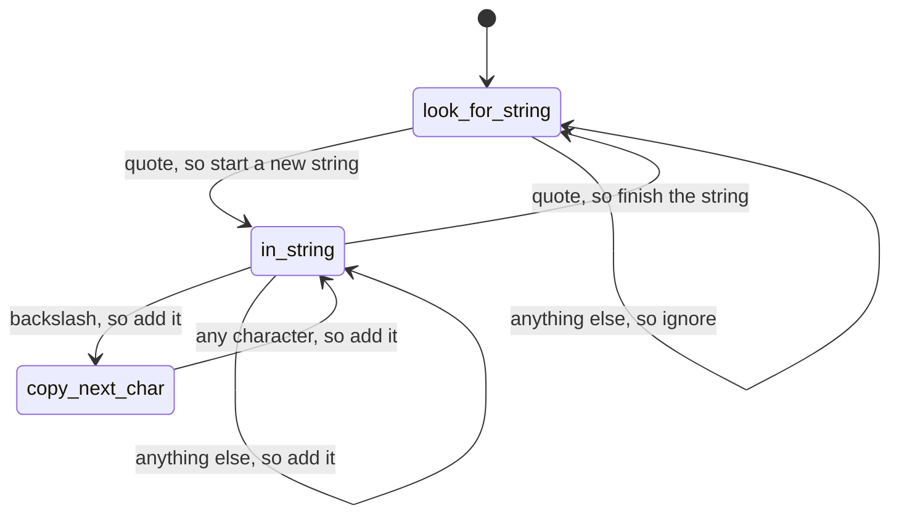

# 5. Bend, or Break

[← 4. Pragmatic Paranoia](04-pragmatic-paranoia.md) · [Book](../README.md) · [6. Concurrency →](06-concurrency.md)

## Summary

Code has to keep up with near-frantic change, so it must be as loose and flexible as possible; this chapter shows how to make decisions reversible (p. 226). It covers five ways to stay flexible:

- **Decoupling:** avoid train wrecks, globals and inheritance (Topic 28).
- **Events:** four strategies for juggling them, namely finite state machines, the observer pattern, publish/subscribe, and reactive streams (Topic 29).
- **Transformations:** thinking of programs as pipelines that transform data (Topic 30).
- **Alternatives to inheritance:** interfaces, delegation and mixins (Topic 31).
- **External configuration,** which moves details out of the code entirely (Topic 32).

## Key takeaways

- **Coupling is the enemy of change, and it's transitive.** Decoupled code is easier to change (Tip 44, pp. 228–229).
- **Tell, don't ask; don't chain method calls.** Don't make decisions from an object's internals and then update it; aim for one "." per access, except for very stable APIs (Tips 45–46, pp. 231–234).
- **Global data includes singletons and external resources.** If something must be global, wrap it in an API (Tips 47–48, pp. 236–237).
- **A finite state machine is just data:** a table from state and event to new state, plus optional actions (pp. 240–245).
- **Pubsub decouples publishers from subscribers** through named channels, at the cost of visibility; **streams** treat events as asynchronous collections (pp. 247–253).
- **Programs are about data.** Build them as pipelines of transformations; don't hoard state, pass it around; wrap values as ok or error and bind steps with `and_then` (Tips 49–50, pp. 255–270).
- **Don't pay inheritance tax.** Use interfaces for polymorphism, delegation (has-a beats is-a) and mixins to share functionality (Tips 51–54, pp. 272–283).
- **Parameterize the app with external configuration,** behind an API, ideally as a dynamic service, but don't overdo it (Tip 55, pp. 284–287).

## Section outline

*From the book’s own table of contents (PDF bookmarks). Page numbers are PDF pages: this edition's reflowed text has no printed page numbers.*

- Topic 28. Decoupling — p. 228
- Topic 29. Juggling the Real World — p. 239
- Topic 30. Transforming Programming — p. 255
- Topic 31. Inheritance Tax — p. 272
- Topic 32. Configuration — p. 284

## Notes

| Tip | Statement | Page |
|---:|---|---|
| 44 | Decoupled Code Is Easier to Change | 229 |
| 45 | Tell, Don't Ask | 231 |
| 46 | Don't Chain Method Calls | 234 |
| 47 | Avoid Global Data | 236 |
| 48 | If It's Important Enough to Be Global, Wrap It in an API | 237 |
| 49 | Programming Is About Code, But Programs Are About Data | 258 |
| 50 | Don't Hoard State; Pass It Around | 265 |
| 51 | Don't Pay Inheritance Tax | 276 |
| 52 | Prefer Interfaces to Express Polymorphism | 278 |
| 53 | Delegate to Services: Has-A Trumps Is-A | 279 |
| 54 | Use Mixins to Share Functionality | 282 |
| 55 | Parameterize Your App Using External Configuration | 284 |

### Topic 28. Decoupling

Coupling links things that must change in parallel (p. 228). Bridges should be rigid, so their components are coupled; software should be flexible, so each component should be coupled to as few others as possible (pp. 228–229). **Coupling is transitive**: if A is coupled to B and C, and they to M, N, X and Y, then A is coupled to all six (p. 229). **Tip 44, Decoupled Code Is Easier to Change** (p. 229).

**Symptoms of coupling** (p. 230): wacky dependencies between unrelated modules; "simple" changes that break unrelated things; developers afraid to change code; meetings everyone must attend because nobody knows who's affected.

**Train wrecks** (pp. 230–235). `customer.orders.find(order_id).getTotals()` and then updating `grandTotal` and `discount` crosses five levels of abstraction. All of it must stay unchanged for the code to keep working, and a new rule ("no discount over 40%") can't be enforced, because anyone can set the totals' fields (pp. 230–231).

- **Tip 45, Tell, Don't Ask** (p. 231): don't make decisions based on an object's internal state and then update it. Refactor step by step: `totals.applyDiscount(discount)`, then `customer.findOrder(id)`, then `order.applyDiscount(discount)` (pp. 231–232).
- TDA is a pattern, not a law of nature: customers and orders are universal top-level concepts, so exposing them is a pragmatic choice (pp. 232–233).
- **The Law of Demeter**, from Ian Holland in the late 1980s, says a method of class C should only call C's other methods, its parameters, objects it creates, and globals. The authors now dislike the global clause and find the law hard to apply, like parsing a legal document for each call (pp. 233–234).
- **Tip 46, Don't Chain Method Calls** (p. 234): try not to have more than one "." per access, and intermediate variables don't get around it. The exception is things very unlikely to change, such as the language's standard library; third-party libraries count as volatile (p. 234).
- **Chains vs. pipelines** (p. 235): a pipeline couples only through data formats, not hidden implementation details, which is far less of a barrier to change.

**The evils of globalization** (pp. 235–237). Global data is like an extra parameter on every method. It makes code hard to extract and hard to test without building a global environment (pp. 235–236).

- **Tip 47, Avoid Global Data** (p. 236).
- A **singleton** with exported data is still global data with a longer name. Hiding it behind methods helps, but there's still one set of data (pp. 236–237).
- Any **mutable external resource** (database, file system, service API) is global data too (p. 237).
- **Tip 48, If It's Important Enough to Be Global, Wrap It in an API** (p. 237).

Inheritance, the third source of coupling, gets its own topic (p. 237). Shy code, which deals only with what it directly knows about, keeps applications decoupled (p. 237).

### Topic 29. Juggling the Real World

An **event** represents the availability of information, from the outside world or internally, down to fetching the next list element. Applications that respond to events work better in the real world (pp. 239–240). The four strategies (p. 240):

| Strategy | Idea | Strength | Weakness |
|---|---|---|---|
| **Finite state machine** | A table from (state, event) to new state, optionally with an action | Untangles event handling in a few lines; can be pure data | Doesn't solve every event problem (p. 246) |
| **Observer** | Observers register callbacks with an observable | Tiny to implement, no library needed; common in UIs | Observers are coupled to the observable; synchronous callbacks can bottleneck (p. 247) |
| **Publish/subscribe** | Publishers and subscribers meet through named channels | Decouples and can be asynchronous; parts can be added or replaced while running | Hard to see which subscribers handle a message (p. 248) |
| **Reactive streams** | Events as a growing, possibly asynchronous collection | Filter, zip and merge events like data; unifies sync and async | Needs a library (RxJS in the book's examples) |

**Finite state machines** (pp. 240–246). Dave writes one almost every week, often in a couple of lines (p. 240).

- A **multipart message** parser: from *initial*, a header moves to *reading*; data stays in *reading*; a trailer moves to *done*; anything else is an error. The whole machine is a transition table, and the loop is one line: `state = TRANSITIONS[state][msg.msg_type] || :error` (pp. 241–243).
- **Adding actions:** a string extractor where each transition also names an action. A quote starts a new string, characters are added, a backslash moves to `copy_next_char` so the next character is copied whatever it is, and a closing quote finishes the string. A `:default` entry handles unlisted events (pp. 243–245).
- State can live in external storage and drive multi-step workflows such as user sign-up (p. 245).

*The vault's redrawing of the book's string-extracting FSM (pp. 243–244).*

> **Try it:** [Table-driven state machines](../widgets/05-message-fsm.html) — feed characters to the book's string extractor, or message types to its multipart parser, one event at a time, and watch the transition table pick each next state and action.

**Observer** (pp. 246–247): the `Terminator` module calls every registered callback before exiting, which shows that an observable needs almost no code. **Pubsub** generalizes it through channels implemented outside your code, often by cloud services (pp. 247–248). **Reactive streams** (pp. 249–253): like spreadsheet cells, values react to the values they use. In RxJS, zipping five animal names with a 500 ms interval emits one pair every half second; fetching users 3, 2 and 1 with `mergeMap` runs the requests in parallel. Streams are asynchronous collections, so time no longer has to be managed by hand (p. 253).

Exercise 20 asks which technologies fit four situations, such as notifying operations staff after three network-down events in five minutes (pp. 253–254).

### Topic 30. Transforming Programming

All programs transform data, yet design rarely starts from transformations (p. 255). A 1970s Unix programmer would list the five longest files in a tree with `find . -type f | xargs wc -l | sort -n | tail -5`, then add `tail -6 | head -5` to drop `wc`'s total line (pp. 255–257). **Tip 49, Programming Is About Code, But Programs Are About Data** (p. 258).

**Finding transformations** (pp. 258–264): start from the requirement's input and output and find the steps between them, top down. The book's **anagram finder** turns letters into words grouped by length using a dictionary keyed by **signature**, the sorted letters of a word:

| Step | Transformation | For "lvyin" |
|---|---|---|
| 1 | All combinations of three or more letters | vin, viy, … vinyl |
| 2 | Signature of each combination | inv, ivy, … ilnvy |
| 3 | Dictionary words matching any signature | ivy, yin, nil, lin, viny, liny, inly, vinyl |
| 4 | Group by length | 3 ⇒ ivy, lin, nil, yin · 4 ⇒ inly, liny, viny · 5 ⇒ vinyl |

Each step is itself a pipeline (step 1: characters → subsets → keep length ≥ 3 → strings), written in Elixir with the `|>` operator, which passes the left value as the first argument of the function on the right (pp. 260–261). Many languages have a pipe; without one, write the steps as a series of assignments (pp. 261–263). The main function reads as the requirement: `word |> all_subsets… |> as_unique_signatures |> find_in_dictionary |> group_by_length` (pp. 263–264).

**Why it matters** (pp. 264–265): object orientation hides data in objects that change each other's state, which adds coupling. **Tip 50, Don't Hoard State; Pass It Around**: data is a river, and a function can be reused wherever its parameters match another's output.

**Error handling** (pp. 265–270): never pass raw values; wrap them as `{:ok, value}` or `{:error, reason}` (like Haskell's `Maybe` or Scala's `Option`).

- **Inside each transformation:** every function pattern-matches an error and passes it on, so an error anywhere becomes the pipeline's value (pp. 266–268).
- **In the pipeline:** an `and_then` **bind** function calls the next step only on `:ok`, so each step simply takes a value and returns ok or error (pp. 268–270).

> **Try it:** [The anagram pipeline](../widgets/05-anagram-pipeline.html) — type letters and watch them flow through the book's four transformations, then break a step and see an `{:error, …}` short-circuit the rest of the pipeline.

### Topic 31. Inheritance Tax

Joe Armstrong: you wanted a banana but got the gorilla holding it and the whole jungle (p. 272). Inheritance began in Simula 67 as **prefix classes**, so cars and bicycles could share a linked-list queue; Smalltalk used it for "differential programming", this-is-like-that-except (pp. 272–273). Developers now inherit because they don't like typing (sharing code) or because they like types (is-a-kind-of) (pp. 273–274). Both have problems:

| Use | Problem (pp. 274–276) |
|---|---|
| **Sharing code** | Inheritance is coupling, including for code that only uses the child. When `Vehicle` renames `move_at` to `set_velocity` and `@speed` to `@velocity`, code that uses `Car` breaks, and so does `Car` itself |
| **Building types** | Hierarchies grow into wall-sized diagrams where changes ripple through layers; a Car is also an Asset, InsuredItem and LoanCollateral, which needs multiple inheritance most languages lack |

**Tip 51, Don't Pay Inheritance Tax** (p. 276). The alternatives (pp. 276–283):

- **Interfaces and protocols.** `Car implements Drivable, Locatable` declares behaviors without code; a `List<Locatable>` can hold cars and phones. **Tip 52, Prefer Interfaces to Express Polymorphism** (p. 278).
- **Delegation.** Subclassing a persistence base class drags its whole API into `Account`. Holding a `Persister` and exposing only `save` keeps control of the interface; separating `Account` from `AccountRecord` goes further, at the cost of boilerplate. **Tip 53, Delegate to Services: Has-A Trumps Is-A** (p. 279).
- **Mixins and traits.** Add a `CommonFinders` set of functions to every record class; build `AccountForCustomer` and `AccountForAdmin` from common and situation-specific validation mixins instead of one class full of flags. **Tip 54, Use Mixins to Share Functionality** (p. 282).

Choose by intent: sharing type information, adding functionality or sharing methods (pp. 282–283).

### Topic 32. Configuration

Values that may change after going live, or differ per environment or customer, belong outside the code. **Tip 55, Parameterize Your App Using External Configuration** (p. 284). Candidates: credentials, logging levels and destinations, ports and machine names, environment-specific validation, tax rates, site-specific formatting, license keys (pp. 284–285).

- **Static configuration** lives in YAML or JSON files, or in database tables if customers change it. Don't make the loaded structure global: wrap it behind a thin API (p. 285).
- **Configuration as a service** (pp. 285–286), the authors' current preference: shared across applications with access control, changed globally, maintained through a UI, and **dynamic**, with components notified of changes instead of restarting.
- **Don't write dodo-code** (pp. 286–287): species that don't adapt die.
- **Don't overdo it** (sidebar, p. 287). One client made every field configurable, had some 40,000 configuration variables, and took weeks for the smallest change. And don't push decisions into configuration out of laziness: try one way and get feedback.

## Trade-offs at a glance

| Choice | Buys | Costs |
|---|---|---|
| Tell, don't ask | Rules enforced in one place; encapsulation | More methods on domain objects |
| Method-call chains | Quick to write | Coupled to every class along the chain |
| Global data or singletons | Easy access anywhere | Hidden coupling; hard to test and extract |
| Global wrapped in an API | Representation can change | Still one shared set of data |
| Observer | Minimal code | Registration coupling; synchronous callbacks |
| Pubsub | Decoupled, asynchronous, replaceable parts | Hard to trace who handles what |
| Pipelines of transformations | Clear flow; reusable functions; less coupling | Coupling through data formats; error wrapping needed |
| Inheritance | Code reuse with little typing | Coupling to every ancestor; brittle hierarchies |
| Interfaces, delegation, mixins | Polymorphism and reuse without ancestors | Some boilerplate (delegation) |
| Configuration as a service | Dynamic, shared, no restarts | A service to run; everything configurable is too much |

## Beyond the book

- **Railway-oriented programming.** Scott Wlaschin's name for the `and_then` style: each function is a switch with a success track and a failure track, and bind joins the switches. Rust's `?` operator and `Result::and_then`, and JavaScript's promise `.then` chains, are the same idea built into languages.
- **Composition over inheritance** is also the first principle in *Design Patterns* (Gamma et al., 1994): "favor object composition over class inheritance". The book's three alternatives are three ways to compose.
- **Measuring transitive coupling.** The [transitive-coupling lab](../lab/05-transitive-coupling/README.md) shows how fast "A is coupled to everything B and C are coupled to" grows: a few direct dependencies per module can reach most of a codebase.

## Connections

- **Related chapters:** [2. A Pragmatic Approach](02-a-pragmatic-approach.md) (ETC, orthogonality and reversibility, which this chapter makes concrete), [3. The Basic Tools](03-the-basic-tools.md) (shell pipelines and plain-text configuration), [4. Pragmatic Paranoia](04-pragmatic-paranoia.md) (the coupled resource example), [6. Concurrency](06-concurrency.md) (shared state as global data; actors and blackboards), [7. While You Are Coding](07-while-you-are-coding.md) (refactoring toward these designs).
- **Run it:** [Transitive coupling](../lab/05-transitive-coupling/README.md) — builds random layered dependency graphs and measures how many modules each one is transitively coupled to as direct dependencies grow.

## Check yourself

*Questions and answers are the vault's, written from the notes above; answers cite the book's PDF pages.*

1. **A is coupled to B and C; B is coupled to M and N; C to X and Y. What is A coupled to?**

   *Answer:* B, C, M, N, X and Y: coupling is transitive (p. 229).

2. **Why can't the 40% discount rule be enforced reliably in the train-wreck version?**

   *Answer:* Any code anywhere can set the totals' fields directly; the totals object isn't responsible for its own rules (p. 231).

3. **Is `people.sort_by{…}.first(10).map{…}` a train wreck?**
   - [ ] Yes: it has more than one dot
   - [x] No: it chains standard-library methods that are very unlikely to change

   *Answer:* The one-dot rule has an exception for very stable APIs such as the language's own library (p. 234).

4. **Someone wraps all their globals in a singleton with exported instance variables. What does the book say?**

   *Answer:* It's still global data, just with a longer name (p. 236).

5. **What is the main drawback of pubsub compared with the observer pattern?**

   *Answer:* It's hard to see what's going on: you can't look at a publisher and see which subscribers handle a message (p. 248).

6. **What does the `and_then` function do in Topic 30?**

   *Answer:* It's a bind: given `{:ok, value}` it calls the next function with the value; given anything else it passes it through, so errors short-circuit the pipeline (pp. 269–270).

7. **Why does code that only uses `Car` break when `Vehicle` renames `move_at`?**

   *Answer:* Inheritance couples users of the child to all its ancestors (pp. 274–275).

8. **What went wrong for the client with 40,000 configuration variables?**

   *Answer:* Every field was configurable, so the smallest change took weeks of field and admin code (p. 287).
