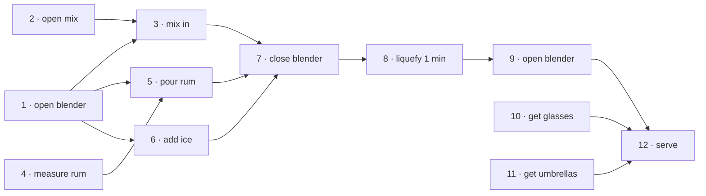
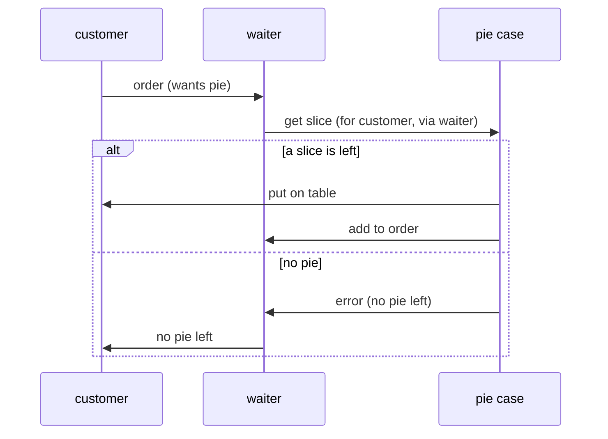

# 6. Concurrency

[← 5. Bend, or Break](05-bend-or-break.md) · [Book](../README.md) · [7. While You Are Coding →](07-while-you-are-coding.md)

## Summary

**Concurrency** is when two or more pieces of code act as if they run at the same time; **parallelism** is when they really do (p. 289). Concurrency needs an environment that switches between code, such as fibers, threads or processes; parallelism needs hardware that does two things at once (p. 289). Almost every decent-sized system is concurrent, explicitly or inside a library (p. 290). The chapter covers four topics:

- **Temporal coupling,** which imposes an order the problem doesn't need (Topic 33).
- **Shared mutable state,** the biggest culprit, whose workarounds are all error-prone (Topic 34).
- **Actors,** which share nothing and communicate by messages (Topic 35).
- **Blackboards,** which coordinate independent agents through a shared store of facts (Topic 36).

## Key takeaways

- **Temporal coupling is coupling in time:** "tick must happen before tock". Analyze workflow, for example with an activity diagram, to find what can happen at once (Tip 56, pp. 290, 292–295).
- **Look for activities that take time, but not time in your code,** such as database queries, external services and user input; split independent work across processors for parallelism (pp. 296–297).
- **Shared state is incorrect state.** The problem isn't two writers but that nobody's *view* of the data stays consistent; check-then-act isn't atomic (Tip 57, pp. 299–301).
- **Semaphores only work if everyone follows the convention.** Better: make the resource transactional, release locks in `ensure`, and treat composite resources (pie à la mode) as resources of their own (pp. 301–306).
- **Random failures are often concurrency issues,** even with non-obvious shared resources such as the current directory (Tip 58, pp. 306–307).
- **Use actors for concurrency without shared state.** Each processes one message at a time with private state, and the same code runs on one core or many machines (Tip 59, pp. 309–316).
- **Use blackboards to coordinate workflow** when facts arrive in any order. Modern messaging systems such as Kafka and NATS can act as blackboards, but indirect systems are harder to trace (Tip 60, pp. 317–322).

## Section outline

*From the book’s own table of contents (PDF bookmarks). Page numbers are PDF pages: this edition's reflowed text has no printed page numbers.*

- Topic 33. Breaking Temporal Coupling — p. 292
- Topic 34. Shared State Is Incorrect State — p. 299
- Topic 35. Actors and Processes — p. 309
- Topic 36. Blackboards — p. 317

## Notes

| Tip | Statement | Page |
|---:|---|---|
| 56 | Analyze Workflow to Improve Concurrency | 293 |
| 57 | Shared State Is Incorrect State | 299 |
| 58 | Random Failures Are Often Concurrency Issues | 307 |
| 59 | Use Actors For Concurrency Without Shared State | 310 |
| 60 | Use Blackboards to Coordinate Workflow | 321 |

We learned to program on sequential systems, and language features that are safe sequentially become liabilities when two things can happen at once (pp. 290–291). Shared state isn't only global variables: any two pieces of code holding references to the same mutable data share state (p. 291).

### Topic 33. Breaking Temporal Coupling

Time matters in two ways: **concurrency** (things at the same time) and **ordering** (relative positions in time) (p. 292). Linear thinking produces **temporal coupling**: method A must be called before B, only one report can run at once, the screen must redraw before a click is received (p. 292). Decoupling time and order dependencies gives more flexible, faster and more reliable systems (pp. 292–293).

**Looking for concurrency** (pp. 293–295). **Tip 56, Analyze Workflow to Improve Concurrency** (p. 293). In an **activity diagram**, actions are rounded boxes; an arrow means the next action can start once this one finishes; a thick **synchronization bar** waits for all incoming actions; an action with no incoming arrows can start at any time (p. 293).

The book's example is a robotic **piña colada** maker with twelve steps (pp. 293–294): 1 open blender, 2 open piña colada mix, 3 put mix in blender, 4 measure ½ cup white rum, 5 pour in rum, 6 add 2 cups of ice, 7 close blender, 8 liquefy for 1 minute, 9 open blender, 10 get glasses, 11 get pink umbrellas, 12 serve. A bartender who did them one by one would lose their job: tasks 1, 2, 4, 10 and 11 can all start up front, and 3, 5 and 6 can run in parallel later (p. 295).

*The vault's reading of the piña colada activity diagram, consistent with the concurrency the book identifies on p. 295; the book's figure is an image.*

**Faster formatting** (sidebar, p. 296): the book's own build pipeline runs each processing step concurrently, and converts each mathematical formula, which can take up to 500 ms, in its own parallel process. The authors found several concurrency errors along the way.

**Opportunities for concurrency** (pp. 296–297). An activity diagram shows *potential* concurrency, not whether it's worth it: a bartender would need five hands to start all the initial tasks. But liquefying takes a minute, during which they can fetch glasses and umbrellas and serve another customer. Look for activities that **take time, but not time in your code**.

**Opportunities for parallelism** (p. 297). Concurrency is a software mechanism; parallelism is a hardware concern. Split large work into independent chunks, process them in parallel, and combine the results. The Elixir compiler compiles every module in parallel, pausing a module only while a module it depends on finishes.

> **Try it:** [The piña colada scheduler](../widgets/06-pina-colada.html) — give the bartender one, two or more hands and schedule the book's twelve steps serially or by their dependencies, and see where the one-minute liquefy frees hands for other work.

### Topic 34. Shared State Is Incorrect State

Two servers in a diner each see the last slice of apple pie in the display case and promise it to their customers; one customer will be disappointed. Swap in a joint bank account and two point-of-sale devices, and someone ends up very unhappy (p. 299). **Tip 57, Shared State Is Incorrect State** (p. 299).

**Nonatomic updates** (pp. 299–301). Each waiter runs `if display_case.pie_count > 0` → promise → `take_pie` → give. The problem isn't that two processes can write the same memory; it's that neither can guarantee its view is consistent. Reading the count copies it into the waiter's own memory, where it goes stale. Fetching and updating aren't atomic.

| Fix | How | Remaining problem (pp. 301–306) |
|---|---|---|
| **Semaphore** | Only one holder at a time. The diner puts a plastic leprechaun on the pie case; a waiter must hold it to sell pie. Classically P and V, now lock and unlock | Works only if everyone follows the convention |
| **Transactional resource** | The case offers `get_pie_if_available()`, which checks and takes in one call | The method itself can still run concurrently, so it needs its own lock |
| **Lock with `ensure`** | Unlock in an `ensure` (finally) block, or use a library's `protect { … }` | Without it, an exception in `update_sales_data` leaves the case locked forever |
| **Composite resource** | Pie à la mode needs pie *and* ice cream. Taking them one at a time leaves you holding pie you can't use, and give-back code buries the business logic | Make "apple pie à la mode", or a generic menu item, a resource of its own that succeeds or fails as a whole |

**Non-transactional updates** (pp. 306–307). Any shared mutable resource counts: files, databases, external services. When the authors parallelized their toolchain, builds failed randomly with missing files: some code temporarily changed the **current directory**, which all threads share. **Tip 58, Random Failures Are Often Concurrency Issues** (p. 307).

**Other kinds of exclusive access** (p. 307): mutexes, monitors and semaphores are libraries; Rust builds in ownership, so only one reference may hold mutable data; functional languages make data immutable but still meet the mutable world.

**Doctor, it hurts when I do this. Then don't do that** (pp. 307–308): managing concurrency over shared resources yourself is fraught, so the next topics avoid it.

> **Try it:** [The last slice of pie](../widgets/06-pie-case.html) — step two waiters through every interleaving of their code with no lock, with a semaphore, or with a transactional `get_pie_if_available`, and count how often two customers are promised one slice.

### Topic 35. Actors and Processes

An **actor** is an independent virtual processor with private state and a mailbox. When idle and a message arrives, it processes it; while doing so it can create actors, send messages to actors it knows, and produce its next state (p. 309). A **process** here is a more general virtual processor constrained by convention to behave like an actor (p. 309).

What the actor model leaves out (p. 310):

- Nothing is in control: no scheduler orchestrates the flow.
- The only state is in messages and actors' private state.
- Messages are one-way. For a reply, include your own mailbox address.
- Each actor processes one message at a time, to completion.

So actors run concurrently and asynchronously and share nothing, on one processor or many, with the same code. **Tip 59, Use Actors For Concurrency Without Shared State** (p. 310).

**The diner with actors** (pp. 310–315), in JavaScript with the Nact library:

- The **customer** handles "hungry for pie" (orders from the waiter), "put on table" and "no pie left".
- The **waiter** handles "order" (asks the pie case to get a slice to this customer), "add to order", and "error" (apologizes to the customer).
- The **pie case** holds the slices. On "get slice" it either sends a slice to the customer and tells the waiter to bill it, or tells the waiter there is none.
- With apple, peach and cherry slices, and customers asking for three and two slices, the run serves three and both customers end up sulking; the order of the output may vary.

*The vault's diagram of the message flow described on pp. 310–311.*

There is **no explicit concurrency** code and no end-to-end "do this, then that" logic, and nothing about the architecture (p. 315). **Erlang** sets the stage: lightweight isolated processes (millions per machine), message passing, **supervision**, hot code loading, and claims of nine nines availability (pp. 315–316). The challenge asks you to add pie à la mode with separate pie and ice-cream actors (p. 316).

### Topic 36. Blackboards

Detectives investigating whether Humpty Dumpty fell or was pushed post facts, statements and evidence on a shared blackboard; someone links his gambling debts to the phone logs (pp. 317–318). The features (pp. 318–319):

- Detectives don't need to know each other exist; they watch the board and add findings.
- They may have different training and expertise, and work in different places.
- They come and go and work different shifts.
- Anything can go on the board.

This is **laissez-faire concurrency** (p. 319). Computer blackboards began in AI (speech recognition, knowledge-based reasoning). Gelernter's **Linda** stored typed tuples queried by pattern matching; **JavaSpaces** and **T Spaces** stored active objects matched by templates and subtypes, so an `Author` template with last name "Shakespeare" finds the author, not the gardener. They never took off, perhaps because the need hadn't developed yet (pp. 319–320).

**A blackboard in action** (pp. 320–321): mortgage or loan applications under odiously complex law, with answers arriving in any order, from different people and systems, with dependencies (no title search without proof of ownership), and new data raising new questions. Hard-wired workflows must be rewritten as regulations change. A blackboard plus a **rules engine** makes arrival order irrelevant: posting a fact triggers rules, whose output can trigger more rules. **Tip 60, Use Blackboards to Coordinate Workflow** (p. 321).

**Messaging systems can be like blackboards** (p. 321): Kafka and NATS persist an event log and support retrieval by pattern matching, so they can serve as a blackboard or as a platform for actors.

**But it's not that simple** (pp. 321–322). Actor, blackboard and microservice architectures remove a class of concurrency problems but are harder to reason about, because much of the action is indirect:

- Keep a central repository of message formats or APIs, ideally generating code and documentation.
- Use good tracing: add a unique trace ID when a business function starts and propagate it, so logs can reconstruct what happened.
- Expect harder deployment, offset by being able to replace individual actors.

## Trade-offs at a glance

| Approach | Buys | Costs |
|---|---|---|
| Serial workflow | Simple to reason about | Slow; temporal coupling |
| Concurrent workflow from an activity diagram | Faster; uses waiting time | Needs resources (hands) and coordination |
| Shared state with semaphores | Familiar; fine-grained | Relies on convention; deadlocks; forgotten unlocks |
| Transactional resource | Atomic check-and-take in one place | Composite operations need their own resources |
| Actors | No shared state; location-transparent | Indirect flow; one-way messages; harder to trace |
| Blackboard with rules | Order-independent; agents come and go | Hard to reason about; needs tracing and message schemas |

## Beyond the book

- **Amdahl's law** bounds the speedup from parallelism: if a fraction s of the work is serial, n processors give at most 1 / (s + (1 − s)/n). In the piña colada, the one-minute liquefy is serial whatever the number of hands, which the [scheduler widget](../widgets/06-pina-colada.html) makes visible.
- **Check-then-act** is the textbook name for the waiters' race; its database cousin is the *lost update* or *write skew*, covered in [DDIA Ch. 8](../../designing-data-intensive-applications/chapters/08-transactions.md), and an `UPDATE … WHERE count > 0` that checks and takes in one statement is the database version of `get_pie_if_available`.
- **Actors and back-pressure.** Unbounded mailboxes hide overload until memory runs out; production actor systems (Akka, Erlang/OTP) add bounded mailboxes or demand signalling. [Think Distributed Systems](../../think-distributed-systems/README.md) treats the message-delivery guarantees that actor messages inherit.

## Connections

- **Related chapters:** [4. Pragmatic Paranoia](04-pragmatic-paranoia.md) (resource balancing and lock ordering; crash early and Erlang supervisors), [5. Bend, or Break](05-bend-or-break.md) (decoupling, global data, events and pubsub, transformations), [7. While You Are Coding](07-while-you-are-coding.md) (programming by coincidence, which concurrency bugs punish).
- **Run it:** [Every interleaving of the pie case](../lab/06-pie-interleavings/README.md) — enumerates every interleaving of two or three waiters' steps and counts oversold pies with no lock, with a lock, and with a transactional take.

## Check yourself

*Questions and answers are the vault's, written from the notes above; answers cite the book's PDF pages.*

1. **Define concurrency and parallelism as the book does.**

   *Answer:* Concurrency: code acts as if it runs at the same time. Parallelism: it does run at the same time (p. 289).

2. **Which piña colada tasks can start immediately?**

   *Answer:* Tasks 1, 2, 4, 10 and 11: open the blender, open the mix, measure the rum, get glasses and get umbrellas (p. 295).

3. **What kind of activity is the best opportunity for concurrency?**

   *Answer:* One that takes time, but not time in your code: waiting on a database, an external service or user input (pp. 296–297).

4. **In the pie example, what is the real problem with shared state?**
   - [ ] Two processes can write the same memory
   - [x] Neither process can guarantee its view of the memory is consistent
   - [ ] The pie count is a global variable

   *Answer:* Reading the count copies it; it can change before the waiter acts, because check-then-act isn't atomic (pp. 300–301).

5. **Why does `get_pie_if_available` still need a semaphore, and why `ensure`?**

   *Answer:* The method itself can be called from several threads at once; and if `update_sales_data` raises, an unlock without `ensure` never happens and the case hangs forever (pp. 302–304).

6. **What caused the authors' random "file not found" build failures?**

   *Answer:* Code that temporarily changed the current directory, which is shared by all threads (pp. 306–307).

7. **How does an actor get a reply?**

   *Answer:* Messages are one-way; the sender includes its own mailbox address and receives the response as another message (p. 310).

8. **Why does a blackboard with a rules engine suit loan applications?**

   *Answer:* Facts arrive in any order from many sources; posting a fact triggers the applicable rules, whose output can trigger more, so arrival order is irrelevant and rule changes don't require rewiring a workflow (pp. 320–321).
