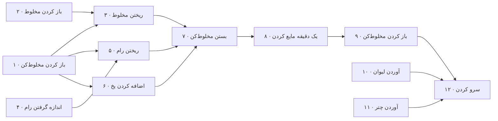
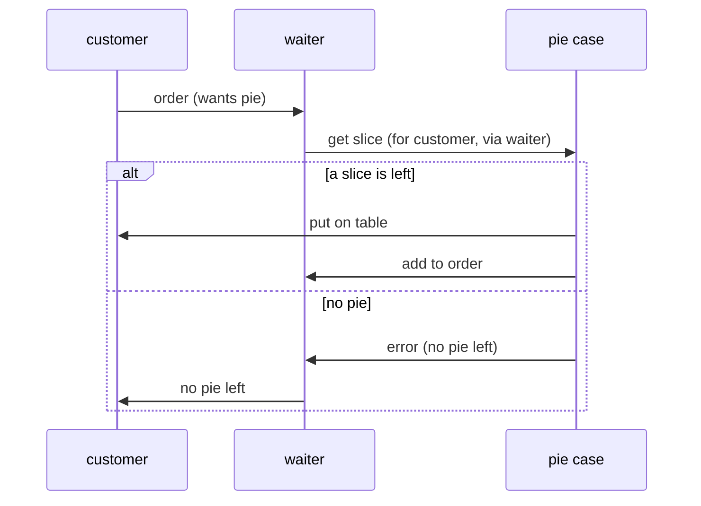

# فصل ۶: concurrency

[فصل ۵: خم شو، یا بشکن →](05-bend-or-break.md) · [کتاب](../README.md) · [فصل ۷: وقتی کد می‌زنید ←](07-while-you-are-coding.md)

## خلاصه

**مفهوم concurrency** وقتی است که دو تکه کد یا بیشتر طوری رفتار کنند که گویی با هم اجرا می‌شوند؛ **موازی‌کاری** وقتی است که واقعاً با هم اجرا شوند (p. 289). concurrency به محیطی نیاز دارد که بین کدها سوئیچ کند، مثل fiber و thread و پردازه؛ موازی‌کاری به سخت‌افزاری نیاز دارد که دو کار را با هم بکند (p. 289). تقریباً هر سیستم به‌اندازه‌ی کافی بزرگی هم‌زمان است، صریح یا داخل یک کتابخانه (p. 290). این فصل چهار موضوع را می‌پوشاند:

- **مفهوم coupling زمانی،** که ترتیبی را تحمیل می‌کند که مسئله لازمش ندارد (موضوع ۳۳).
- **ساختار shared state تغییرپذیر،** که بزرگ‌ترین مقصر است و دور‌زدن‌هایش همه خطا‌خیزند (موضوع ۳۴).
- **همه‌ی actorها،** که هیچ چیزی را شریک نمی‌شوند و با پیام ارتباط می‌گیرند (موضوع ۳۵).
- **همه‌ی blackboardها،** که agentهای مستقل را از راه انباری مشترک از واقعیت‌ها هماهنگ می‌کنند (موضوع ۳۶).

## نکته‌های کلیدی

- **مفهوم coupling زمانی، coupling در زمان است:** «تیک باید پیش از تاک بیفتد». گردش‌کار را تحلیل کنید، مثلاً با یک نمودار فعالیت، تا بفهمید چه چیزی می‌تواند با هم بیفتد (tip ۵۶، صص. ۲۹۰، ۲۹۲–۲۹۵).
- **دنبال فعالیت‌هایی بگردید که وقت می‌برند، ولی وقت کد شما را نه،** مثل کوئری دیتابیس و سرویس بیرونی و ورودی کاربر؛ و کار مستقل را برای موازی‌کاری بین processorها بشکنید (pp. 296–297).
- **ساختار shared state همان حالت نادرست است.** مسئله دو نویسنده نیست، بلکه این است که *نگاه* هیچ‌کس به داده سازگار نمی‌ماند؛ بررسی‌و‌بعد‌عمل اتمی نیست (tip ۵۷، صص. ۲۹۹–۳۰۱).
- **مفهوم semaphore فقط وقتی کار می‌کند که همه قرارداد را رعایت کنند.** بهتر: منبع را تراکنشی کنید، قفل‌ها را در `ensure` آزاد کنید، و منابع ترکیبی، یعنی پای با بستنی، را منبعی جدا ببینید (pp. 301–306).
- **شکست‌های تصادفی اغلب مسئله‌ی concurrency‌اند،** حتی با منابع مشترک غیر‌بدیهی مثل پوشه‌ی فعلی (tip ۵۸، صص. ۳۰۶–۳۰۷).
- **برای concurrency بی shared state از actor استفاده کنید.** هر کدام با حالت خصوصی‌اش یک پیام را در هر لحظه پردازش می‌کند، و همان کد روی یک هسته یا چند ماشین اجرا می‌شود (tip ۵۹، صص. ۳۰۹–۳۱۶).
- **برای هماهنگ کردن گردش‌کار از blackboard استفاده کنید** وقتی واقعیت‌ها به هر ترتیبی می‌رسند. سیستم‌های پیام‌رسانی امروزی مثل Kafka و NATS می‌توانند blackboard شوند، ولی ردیابی سیستم‌های غیرمستقیم سخت‌تر است (tip ۶۰، صص. ۳۱۷–۳۲۲).

## فهرست بخش‌ها

*از فهرست مطالب خود کتاب، از bookmarkهای PDF. شماره‌ها صفحه‌ی PDF‌اند، چون متن بازچینش‌شده‌ی این ویراست شماره‌ی صفحه‌ی چاپی ندارد.*

- موضوع ۳۳. شکستن coupling زمانی — ص. ۲۹۲
- موضوع ۳۴. shared state همان حالت نادرست است — ص. ۲۹۹
- موضوع ۳۵. actorها و processها — ص. ۳۰۹
- موضوع ۳۶. blackboardها — ص. ۳۱۷

## یادداشت‌ها

| tip | عبارت | صفحه |
|---:|---|---|
| ۵۶ | گردش‌کار را تحلیل کنید تا concurrency بهتر شود | ۲۹۳ |
| ۵۷ | shared state همان حالت نادرست است | ۲۹۹ |
| ۵۸ | شکست‌های تصادفی اغلب مسئله‌ی concurrencyاند | ۳۰۷ |
| ۵۹ | برای concurrency بی shared state از actor استفاده کنید | ۳۱۰ |
| ۶۰ | برای هماهنگ کردن گردش‌کار از blackboard استفاده کنید | ۳۲۱ |

ما برنامه‌نویسی را روی سیستم‌های پشت‌سرهم یاد گرفتیم، و قابلیت‌های زبانی‌ای که پشت‌سرهم امن‌اند وقتی دو چیز می‌توانند با هم بیفتند بدهی می‌شوند (pp. 290–291). shared state فقط متغیر سراسری نیست: هر دو تکه کدی که به همان داده‌ی mutable ارجاع دارند حالت را شریک‌اند (p. 291).

### موضوع ۳۳. شکستن coupling زمانی

زمان از دو راه مهم است: **concurrency**، یعنی چیزها با هم، و **ترتیب**، یعنی موقعیت نسبی در زمان (p. 292). فکر کردن خطی **coupling زمانی** می‌سازد: متد A باید پیش از B صدا زده شود، فقط یک گزارش در هر لحظه می‌تواند اجرا شود، صفحه باید پیش از رسیدن کلیک دوباره کشیده شود (p. 292). decouple کردن وابستگی زمان و ترتیب، سیستم‌هایی انعطاف‌پذیرتر و تندتر و قابل‌اعتمادتر می‌دهد (pp. 292–293).

**گشتن دنبال concurrency** (pp. 293–295). **tip ۵۶، گردش‌کار را تحلیل کنید تا concurrency بهتر شود** (p. 293). در یک **نمودار فعالیت**، کنش‌ها کادرهای گردند؛ یک فلش یعنی کنش بعدی می‌تواند همین که این یکی تمام شد شروع شود؛ یک **میله‌ی synchronization** کلفت منتظر همه‌ی کنش‌های ورودی می‌ماند؛ و کنشی که فلش ورودی ندارد هر وقت می‌تواند شروع شود (p. 293).

نمونه‌ی کتاب یک سازنده‌ی رباتیک **پینا کولادا** با دوازده مرحله است (pp. 293–294): ۱ باز کردن مخلوط‌کن، ۲ باز کردن مخلوط پینا کولادا، ۳ ریختن مخلوط در مخلوط‌کن، ۴ اندازه گرفتن نیم پیمانه رام سفید، ۵ ریختن رام، ۶ اضافه کردن دو module یخ، ۷ بستن مخلوط‌کن، ۸ یک دقیقه مایع کردن، ۹ باز کردن مخلوط‌کن، ۱۰ آوردن لیوان‌ها، ۱۱ آوردن چترهای صورتی، ۱۲ سرو کردن. متصدی باری که این‌ها را یکی‌یکی می‌کرد کارش را از دست می‌داد: کارهای ۱ و ۲ و ۴ و ۱۰ و ۱۱ همه می‌توانند از اول شروع شوند، و ۳ و ۵ و ۶ می‌توانند بعداً موازی بروند (p. 295).

*خوانش vault از نمودار فعالیت پینا کولادا، سازگار با concurrencyی که کتاب در ص. ۲۹۵ می‌شناسد؛ شکل کتاب یک تصویر است.*

**قالب‌بندی تندتر** (کادر کناری، ص. ۲۹۶): خود pipeline build کتاب هر مرحله‌ی پردازش را هم‌زمان اجرا می‌کند، و هر فرمول ریاضی را، که می‌تواند تا ۵۰۰ میلی‌ثانیه ببرد، در process موازی خودش تبدیل می‌کند. نویسنده‌ها در راه چند خطای concurrency پیدا کردند.

**فرصت‌های concurrency** (pp. 296–297). یک نمودار فعالیت concurrency *ممکن* را نشان می‌دهد و نه این که ارزشش را دارد یا نه: متصدی بار برای شروع همه‌ی کارهای اول به پنج دست نیاز داشت. ولی مایع کردن یک دقیقه می‌برد، و در آن یک دقیقه می‌تواند لیوان و چتر بیاورد و به مشتری دیگری سرو کند. دنبال فعالیت‌هایی بگردید که **وقت می‌برند، ولی وقت کد شما را نه**.

**فرصت‌های موازی‌کاری** (p. 297). concurrency سازوکاری نرم‌افزاری است و موازی‌کاری دغدغه‌ای سخت‌افزاری. کار بزرگ را به تکه‌های مستقل بشکنید، موازی پردازششان کنید، و نتیجه‌ها را ترکیب. کامپایلر Elixir هر ماژول را موازی compile می‌کند و یک ماژول را فقط تا وقتی نگه می‌دارد که ماژولی که به آن وابسته است تمام شود.

> **Try it:** [scheduler پینا کولادا](../widgets/06-pina-colada.html)؛ به متصدی بار یک یا دو یا چند دست بدهید و دوازده مرحله‌ی کتاب را پشت‌سرهم یا بر حسب وابستگی‌هایشان زمان‌بندی کنید، و ببینید مایع کردن یک‌دقیقه‌ای کجا دست‌ها را برای کار دیگری آزاد می‌کند.

> **In practice:** DAG در Airflow نمودار وابستگی است: taskهایی که به هم وابسته نیستند می‌توانند موازی اجرا شوند.
>
> **Your turn:** DAG شبانه ده جدول Silver را پشت سر هم می‌سازد و سه ساعت طول می‌کشد. چه چیزی را بررسی می‌کنید؟
>
> *Answer:* کدام taskها واقعاً به هم وابسته‌اند؛ آن‌هایی که نیستند را موازی کنید و با pool بار ClickHouse را محدود کنید. کتاب activity diagram را برای پیدا کردن همین موازی‌سازی پنهان پیشنهاد می‌کند (pp. 292–298).

### موضوع ۳۴. shared state همان حالت نادرست است

دو پیش‌خدمت در یک رستوران هر کدام آخرین برش پای سیب را در ویترین می‌بینند و به مشتری‌های خودشان قولش می‌دهند؛ یکی از مشتری‌ها ناامید می‌شود. حالا یک حساب بانکی مشترک و دو دستگاه فروش بگذارید، و کسی خیلی ناراضی در می‌آید (p. 299). **tip ۵۷، shared state همان حالت نادرست است** (p. 299).

**به‌روزرسانی ناتمی** (pp. 299–301). هر پیش‌خدمت `if display_case.pie_count > 0` را اجرا می‌کند و بعد قول می‌دهد و `take_pie` و تحویل. مسئله این نیست که دو process می‌توانند همان حافظه را بنویسند؛ مسئله این است که هیچ‌کدام نمی‌تواند تضمین کند نگاهش سازگار است. خواندن شمارش، آن را به حافظه‌ی خود پیش‌خدمت کپی می‌کند، که همان‌جا کهنه می‌شود. گرفتن و به‌روز کردن اتمی نیستند.

| اصلاح | چطور | مسئله‌ی مانده (pp. 301–306) |
|---|---|---|
| **semaphore** | در هر لحظه فقط یک دارنده. رستوران یک لپرکان پلاستیکی روی ویترین پای می‌گذارد؛ پیش‌خدمت برای فروش پای باید نگهش داشته باشد. کلاسیک P و V، و حالا lock و unlock | فقط وقتی کار می‌کند که همه قرارداد را رعایت کنند |
| **منبع تراکنشی** | ویترین `get_pie_if_available()` می‌دهد، که در یک فراخوانی بررسی و برمی‌دارد | خود آن متد باز هم می‌تواند هم‌زمان اجرا شود، پس به قفل خودش نیاز دارد |
| **قفل با `ensure`** | در یک بلوک `ensure`، یعنی finally، unlock کنید، یا از `protect { … }` یک کتابخانه استفاده | بی آن، یک exception در `update_sales_data` ویترین را تا ابد قفل می‌گذارد |
| **منبع ترکیبی** | پای با بستنی به پای *و* بستنی نیاز دارد. برداشتنشان یکی‌یکی یعنی پایی دستتان می‌ماند که به کار نمی‌آید، و کد پس دادن منطق کسب‌وکار را خاک می‌کند | «پای سیب با بستنی»، یا یک آیتم منوی عمومی، را منبعی جدا کنید که کامل موفق یا شکست می‌خورد |

**به‌روزرسانی ناتراکنشی** (pp. 306–307). هر منبع مشترک mutability حساب می‌شود: فایل، دیتابیس، سرویس بیرونی. وقتی نویسنده‌ها زنجیره‌ی ابزارشان را موازی کردند، buildها تصادفی با فایل غایب شکست می‌خوردند: بخشی از کد موقت **پوشه‌ی فعلی** را عوض می‌کرد، که همه‌ی threadها شریکش‌اند. **tip ۵۸، شکست‌های تصادفی اغلب مسئله‌ی concurrencyاند** (p. 307).

**گونه‌های دیگر دسترسی انحصاری** (p. 307): mutex و monitor و semaphore کتابخانه‌اند؛ Rust مالکیت را درون‌ساخت دارد، پس فقط یک ارجاع می‌تواند داده‌ی mutable را نگه دارد؛ و زبان‌های functional داده را immutable می‌کنند ولی باز هم به دنیای mutable می‌خورند.

**دکتر، وقتی این کار را می‌کنم درد می‌گیرد. خب نکن** (pp. 307–308): مدیریت concurrency روی منابع مشترک به‌دست خودتان پردردسر است، پس موضوع‌های بعدی از آن می‌پرهیزند.

> **Try it:** [آخرین برش پای](../widgets/06-pie-case.html)؛ دو پیش‌خدمت را از هر interleaving کدشان بگذرانید، بی قفل یا با semaphore یا با `get_pie_if_available` تراکنشی، و بشمارید چند بار به دو مشتری یک برش قول داده می‌شود.

> **In practice:** دو task که هم‌زمان در یک جدول ClickHouse می‌نویسند shared state دارند.
>
> **Your turn:** دو DAG، یکی شبانه و یکی backfill، هم‌زمان partition یک روز را با `REPLACE PARTITION` می‌نویسند. چه می‌شود؟
>
> *Answer:* هر کدام آخر بنویسد برنده است و نتیجه به زمان‌بندی بستگی دارد. با pool یا `max_active_runs` آن‌ها را سریالی کنید، یا هر DAG را مالک partitionهای جدا کنید. state مشترک بدون هماهنگی همیشه نادرست است (pp. 299–308).

### موضوع ۳۵. actorها و processها

یک **actor** پردازشگری مجازی و مستقل با حالت خصوصی و یک صندوق‌نامه است. وقتی بی‌کار است و پیامی می‌رسد، پردازشش می‌کند؛ و در این حین می‌تواند actor بسازد و به actorهایی که می‌شناسد پیام بفرستد و حالت بعدی‌اش را بسازد (p. 309). یک **process** این‌جا پردازشگری مجازی عمومی‌تر است که با قرارداد مجبور شده مثل actor رفتار کند (p. 309).

آن چیزی که مدل actor نمی‌آورد (p. 310):

- هیچ چیزی در کنترل نیست: هیچ زمان‌بندی جریان را ارکستر نمی‌کند.
- تنها حالت، در پیام‌ها و حالت خصوصی actorهاست.
- پیام‌ها یک‌طرفه‌اند. برای پاسخ، آدرس صندوق‌نامه‌ی خودتان را بگذارید.
- هر actor در هر لحظه یک پیام را تا کامل شدن پردازش می‌کند.

پس actorها هم‌زمان و asynchronous اجرا می‌شوند و هیچ چیزی را شریک نمی‌شوند، روی یک processor یا چند، با همان کد. **tip ۵۹، برای concurrency بی shared state از actor استفاده کنید** (p. 310).

**رستوران با actorها** (pp. 310–315)، در جاوااسکریپت با کتابخانه‌ی Nact:

- **مشتری** پیام‌های «گرسنه‌ی پای»، یعنی سفارش از پیش‌خدمت، و «روی میز بگذار» و «پای نمانده» را می‌گیرد.
- **پیش‌خدمت** پیام‌های «سفارش»، یعنی از ویترین پای می‌خواهد برشی به این مشتری بدهد، و «به سفارش اضافه کن» و «خطا»، یعنی از مشتری عذرخواهی می‌کند، را می‌گیرد.
- **ویترین پای** برش‌ها را دارد. سر «یک برش بده» یا برشی به مشتری می‌فرستد و به پیش‌خدمت می‌گوید صورت‌حسابش کند، یا به پیش‌خدمت می‌گوید چیزی نمانده.
- با برش‌های سیب و هلو و گیلاس، و مشتری‌هایی که سه و دو برش می‌خواهند، اجرا سه برش سرو می‌کند و هر دو مشتری دل‌شکسته در می‌آیند؛ ترتیب خروجی می‌تواند فرق کند.

*نمودار vault از جریان پیامی که در صص. ۳۱۰–۳۱۱ توضیح داده شده.*

هیچ کد **concurrency صریحی** نیست و هیچ منطق سر‌تا‌سری «این را بکن، بعد آن را»، و هیچ چیزی درباره‌ی معماری (p. 315). زبان **Erlang** صحنه را می‌چیند: processهای سبک و جداشده، یعنی میلیون‌ها در هر ماشین، رد‌و‌بدل پیام، **supervise کردن**، بار کردن داغ کد، و ادعای در دسترس بودن با نُه رقم نُه (pp. 315–316). چالش می‌خواهد پای با بستنی را با actorهای جدای پای و بستنی اضافه کنید (p. 316).

### موضوع ۳۶. blackboardها

کارآگاه‌هایی که بررسی می‌کنند Humpty Dumpty افتاد یا هلش دادند، واقعیت‌ها و اظهارات و شواهد را روی یک blackboard مشترک می‌گذارند؛ کسی بدهی‌های قمارش را به گزارش تماس‌ها وصل می‌کند (pp. 317–318). ویژگی‌هایش (pp. 318–319):

- کارآگاه‌ها لازم نیست بدانند بقیه وجود دارند؛ تخته را می‌پایند و یافته‌ها را اضافه می‌کنند.
- می‌توانند آموزش و تخصص مختلف داشته باشند و در جاهای مختلف کار کنند.
- می‌آیند و می‌روند و شیفت‌های مختلف کار می‌کنند.
- هر چیزی می‌تواند روی تخته برود.

این **concurrency بگذار‌و‌بگذر** است (p. 319). blackboardهای کامپیوتری در AI شروع شدند، یعنی بازشناسی گفتار و استدلال دانش‌محور. ابزار **Linda** از Gelernter، تاپل‌های نوع‌دار را ذخیره می‌کرد که با الگو‌تطبیق کوئری می‌شدند؛ **JavaSpaces** و **T Spaces** objectهای فعالی را ذخیره می‌کردند که با قالب و زیرنوع تطبیق می‌خوردند، پس یک قالب `Author` با نام خانوادگی «Shakespeare» نویسنده را پیدا می‌کند و نه باغبان را. هیچ‌وقت نگرفتند، شاید چون آن موقع نیاز هنوز نرسیده بود (pp. 319–320).

**یک blackboard در عمل** (pp. 320–321): درخواست وام مسکن یا وام زیر قانونی نفرت‌انگیز پیچیده، که پاسخ‌ها به هر ترتیبی می‌رسند، از آدم‌ها و سیستم‌های مختلف، با وابستگی، یعنی بی اثبات مالکیت جست‌و‌جوی سند نداریم، و داده‌ی تازه پرسش تازه می‌سازد. گردش‌کارهای سیم‌کشی‌شده باید با عوض شدن قاعده‌ها بازنویسی شوند. یک blackboard به‌علاوه‌ی یک **موتور قاعده** ترتیب رسیدن را بی‌اهمیت می‌کند: گذاشتن یک واقعیت، قاعده‌ها را راه می‌اندازد، و خروجی‌شان می‌تواند قاعده‌های بیشتری را راه بیندازد. **tip ۶۰، برای هماهنگ کردن گردش‌کار از blackboard استفاده کنید** (p. 321).

**سیستم‌های پیام‌رسانی می‌توانند مثل blackboard باشند** (p. 321): ابزارهای Kafka و NATS یک log رویداد را ماندگار می‌کنند و بازیابی با الگو‌تطبیق را پشتیبانی، پس می‌توانند blackboard باشند یا بستری برای actorها.

**ولی به این سادگی نیست** (pp. 321–322). معماری actor و blackboard و microservice یک رده از مسئله‌های concurrency را برمی‌دارند ولی استدلال کردن درباره‌شان سخت‌تر است، چون بیشتر ماجرا غیرمستقیم است:

- یک انبار مرکزی از قالب پیام یا API نگه دارید، در حالت آرمانی با ساختن کد و مستند.
- مفهوم trace خوب به کار ببرید: سر شروع یک کارکرد کسب‌وکار یک شناسه‌ی trace یکتا اضافه و منتشرش کنید، تا logها بتوانند بازسازی کنند چه اتفاقی افتاد.
- انتظار deploy سخت‌تری داشته باشید، که با توانایی جابه‌جا کردن هر actor جداگانه جبران می‌شود.

## بده‌بستان‌ها در یک نگاه

| رویکرد | چه می‌دهد | چه می‌گیرد |
|---|---|---|
| گردش‌کار پشت‌سرهم | استدلال کردن درباره‌اش ساده است | کند؛ coupling زمانی |
| گردش‌کار هم‌زمان از یک نمودار فعالیت | تندتر؛ وقت انتظار را به کار می‌برد | منابع، یعنی دست، و هماهنگی می‌خواهد |
| shared state با semaphore | آشنا؛ دانه‌ریز | به قرارداد تکیه دارد؛ بن‌بست؛ unlock فراموش‌شده |
| منبع تراکنشی | بررسی‌و‌برداشتن اتمی در یک جا | عملیات ترکیبی به منابع خودشان نیاز دارند |
| actorها | بی حالت مشترک؛ مکان‌شفاف | جریان غیرمستقیم؛ پیام یک‌طرفه؛ ردیابی سخت‌تر |
| blackboard با قاعده | بی‌نیاز به ترتیب؛ agentها می‌آیند و می‌روند | استدلال کردن سخت است؛ trace و schema پیام می‌خواهد |

## فراتر از کتاب

- **قانون Amdahl** تندشدن از موازی‌کاری را کران می‌گذارد: اگر کسری به اندازه‌ی s از کار پشت‌سرهم باشد، n processor حداکثر ۱ تقسیم بر (s + (1 − s)/n) می‌دهند. در پینا کولادا، مایع کردن یک‌دقیقه‌ای هر چند دست هم باشد پشت‌سرهم است، که [ویجت scheduler](../widgets/06-pina-colada.html) دیدنی‌اش می‌کند.
- **بررسی‌و‌بعد‌عمل** نام کتابی مسابقه‌ی پیش‌خدمت‌هاست؛ پسرخاله‌ی دیتابیسی‌اش *به‌روزرسانی گم‌شده* یا *write skew* است که در [فصل ۸ کتاب DDIA](../../designing-data-intensive-applications/chapters/08-transactions.md) پوشانده شده، و یک `UPDATE … WHERE count > 0` که در یک دستور بررسی و برمی‌دارد نسخه‌ی دیتابیسی `get_pie_if_available` است.
- **همه‌ی actorها و back-pressure.** صندوق‌نامه‌های بی‌کران، بار اضافی را تا تمام شدن حافظه پنهان می‌کنند؛ سیستم‌های actor تولیدی مثل Akka و Erlang/OTP صندوق‌نامه‌ی bounded یا خبر دادن تقاضا اضافه می‌کنند. کتاب [Think Distributed Systems](../../think-distributed-systems/README.md) تضمین‌های تحویل پیامی را می‌گیرد که پیام actorها به ارث می‌برند.

## پیوندها

- **فصل‌های مرتبط:** [فصل ۴: بدگمانی pragmatic](04-pragmatic-paranoia.md) که توازن منابع و ترتیب قفل و زود crash کردن و supervisorهای Erlang را دارد، [فصل ۵: خم شو، یا بشکن](05-bend-or-break.md) که decoupling و داده‌ی سراسری و رویداد و انتشار و اشتراک و تبدیل‌ها را دارد، و [فصل ۷: وقتی کد می‌زنید](07-while-you-are-coding.md) که برنامه‌نویسی تصادفی را دارد که باگ‌های concurrency تنبیهش می‌کنند.
- **Run it:** [هر interleaving ویترین پای](../lab/06-pie-interleavings/README.md)؛ هر interleaving مرحله‌های دو یا سه پیش‌خدمت را برمی‌شمارد و پای‌های بیش‌فروش‌شده را بی قفل، با قفل، و با برداشتن تراکنشی می‌شمارد.

## خودتان را بسنجید

*پرسش‌ها و پاسخ‌ها مال vault است و از روی یادداشت‌های بالا نوشته شده؛ پاسخ‌ها به صفحه‌های PDF کتاب ارجاع می‌دهند.*

1. **مفهوم concurrency و موازی‌کاری را همان‌طور که کتاب می‌گوید تعریف کنید.**

   *Answer:* concurrency: کد طوری رفتار می‌کند که گویی با هم اجرا می‌شود. موازی‌کاری: واقعاً با هم اجرا می‌شود (p. 289).

2. **کدام کارهای پینا کولادا می‌توانند بی‌درنگ شروع شوند؟**

   *Answer:* کارهای ۱ و ۲ و ۴ و ۱۰ و ۱۱: باز کردن مخلوط‌کن، باز کردن مخلوط، اندازه گرفتن رام، آوردن لیوان، و آوردن چتر (p. 295).

3. **چه گونه فعالیتی بهترین فرصت برای concurrency است؟**

   *Answer:* فعالیتی که وقت می‌برد ولی وقت کد شما را نه: انتظار برای دیتابیس یا سرویس بیرونی یا ورودی کاربر (pp. 296–297).

4. **در نمونه‌ی پای، مسئله‌ی واقعی shared state چیست؟**
   - [ ] دو process می‌توانند همان حافظه را بنویسند
   - [x] هیچ processی نمی‌تواند تضمین کند نگاهش به حافظه سازگار است
   - [ ] شمارش پای یک متغیر سراسری است

   *Answer:* خواندن شمارش کپی‌اش می‌کند؛ می‌تواند پیش از عمل پیش‌خدمت عوض شود، چون بررسی‌و‌بعد‌عمل اتمی نیست (pp. 300–301).

5. **چرا `get_pie_if_available` باز هم به semaphore نیاز دارد، و چرا به `ensure`؟**

   *Answer:* خود آن متد می‌تواند از چند thread با هم صدا زده شود؛ و اگر `update_sales_data` خطا پرتاب کند، unlock بی `ensure` هیچ‌وقت نمی‌افتد و ویترین تا ابد گیر می‌کند (pp. 302–304).

6. **چه چیزی شکست‌های تصادفی «فایل پیدا نشد» در build نویسنده‌ها را می‌ساخت؟**

   *Answer:* کدی که موقت پوشه‌ی فعلی را عوض می‌کرد، که همه‌ی threadها شریکش‌اند (pp. 306–307).

7. **یک actor چطور پاسخ می‌گیرد؟**

   *Answer:* پیام‌ها یک‌طرفه‌اند؛ فرستنده آدرس صندوق‌نامه‌ی خودش را می‌گذارد و پاسخ را به‌عنوان پیامی دیگر می‌گیرد (p. 310).

8. **چرا یک blackboard با موتور قاعده به درخواست وام می‌خورد؟**

   *Answer:* واقعیت‌ها به هر ترتیبی از منبع‌های زیادی می‌رسند؛ گذاشتن یک واقعیت قاعده‌های مربوط را راه می‌اندازد، که خروجی‌شان می‌تواند بیشتر را راه بیندازد، پس ترتیب رسیدن بی‌اهمیت است و عوض شدن قاعده به سیم‌کشی دوباره‌ی گردش‌کار نیاز ندارد (pp. 320–321).
