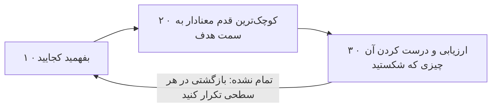

# فصل ۸: پیش از پروژه

[فصل ۷: وقتی کد می‌زنید →](07-while-you-are-coding.md) · [کتاب](../README.md) · [فصل ۹: پروژه‌های pragmatic ←](09-pragmatic-projects.md)

## خلاصه

پیش از آن که پروژه‌ای راه بیفتد، باید نیازمندی‌ها را یاد بگیرید، و این که به شما گفته شود یا گوش بدهید کافی نیست (موضوع ۴۵). مسئله‌های سخت، همین که قیدهای واقعی را پیدا کنید، کم به‌اندازه‌ی ظاهرشان سخت‌اند (موضوع ۴۶). سلاح پنهان پروژه‌های ناممکن، حل کردن مسئله با هم در حین کد زدن است (موضوع ۴۷). هیچ روشی جای فکر کردن را نمی‌گیرد؛ آن چیزی که لازم دارید جوهر چابکی است (موضوع ۴۸)، تا از فلج تحلیل بپرهیزید و واقعاً شروع کنید (pp. 403–404).

## نکته‌های کلیدی

- **هیچ‌کس دقیقاً نمی‌داند چه می‌خواهد، و برنامه‌نویس‌ها کمک می‌کنند مردم بفهمندش.** بیان یک نیاز، دعوتی است به کاویدن حالت‌های لبه‌اش (tipهای ۷۵ و ۷۶، صص. ۴۰۵–۴۰۹).
- **نیازمندی‌ها در یک حلقه‌ی بازخورد یاد گرفته می‌شوند:** پی‌آمدها را برگردانید، از mockup و تکرارهای کوتاه استفاده کنید، و کل پروژه را جمع کردن نیازمندی ببینید (tip ۷۷، صص. ۴۰۹–۴۱۰).
- **با یک کاربر کار کنید تا مثل کاربر فکر کنید:** یک هفته در کارش بنشینید (tip ۷۸، صص. ۴۱۰–۴۱۱).
- **سیاست همان metadata است.** حالت عمومی را پیاده کنید، مثل کنترل دسترسی، و قاعده‌ی کسب‌وکار امروز را داده ببینید (tip ۷۹، صص. ۴۱۱–۴۱۲).
- **بهترین مستند نیازمندی‌ها کد در حال کار است.** سندها برای برنامه‌ریزی‌اند، به شکل user storyهای روی کارت، و نه برای تأیید مشتری. نیازمندی خوب انتزاعی است؛ یک واژه‌نامه‌ی پروژه نگه دارید (tip ۸۰، صص. ۴۱۲–۴۱۶).
- **بیرون جعبه فکر نکنید؛ جعبه را پیدا کنید.** گزینه‌ها را برشمارید، ثابت کنید کدام قیدها واقعی‌اند، و سخت‌گیرانه‌ترین را اول بگیرید. وقتی گیر کردید فاصله بگیرید یا برای کسی توضیحش بدهید (tip ۸۱، صص. ۴۱۸–۴۲۳).
- **تنها به کد نروید.** جفتی و گروهی کار کنید، کاربرها را بیاورید، و قانون Conway را یادتان باشد (tip ۸۲، صص. ۴۲۴–۴۲۸).
- **چابک اسم نیست؛ چابک شکل کار کردن شماست.** بفهمید کجایید، کوچک‌ترین قدم معنادار را بردارید، ارزیابی کنید و آن چیزی را که شکستید درست، و این را بازگشتی در هر سطحی تکرار. طراحی خوب همان چیزی است که این حلقه را ارزان می‌کند (tip ۸۳، صص. ۴۲۹–۴۳۴).

## فهرست بخش‌ها

*از فهرست مطالب خود کتاب، از bookmarkهای PDF. شماره‌ها صفحه‌ی PDF‌اند، چون متن بازچینش‌شده‌ی این ویراست شماره‌ی صفحه‌ی چاپی ندارد.*

- موضوع ۴۵. گودال نیازمندی‌ها — ص. ۴۰۵
- موضوع ۴۶. حل کردن معماهای ناممکن — ص. ۴۱۸
- موضوع ۴۷. کار کردن با هم — ص. ۴۲۴
- موضوع ۴۸. جوهر چابکی — ص. ۴۲۹

## یادداشت‌ها

| tip | عبارت | صفحه |
|---:|---|---|
| ۷۵ | هیچ‌کس دقیقاً نمی‌داند چه می‌خواهد | ۴۰۵ |
| ۷۶ | برنامه‌نویس‌ها کمک می‌کنند مردم بفهمند چه می‌خواهند | ۴۰۶ |
| ۷۷ | نیازمندی‌ها در یک حلقه‌ی بازخورد یاد گرفته می‌شوند | ۴۰۹ |
| ۷۸ | با یک کاربر کار کنید تا مثل کاربر فکر کنید | ۴۱۱ |
| ۷۹ | سیاست همان metadata است | ۴۱۱ |
| ۸۰ | یک واژه‌نامه‌ی پروژه به کار ببرید | ۴۱۶ |
| ۸۱ | بیرون جعبه فکر نکنید؛ جعبه را پیدا کنید | ۴۲۰ |
| ۸۲ | تنها به کد نروید | ۴۲۸ |
| ۸۳ | چابک اسم نیست؛ چابک شکل کار کردن شماست | ۴۲۹ |

### موضوع ۴۵. گودال نیازمندی‌ها

واژه‌ی «جمع کردن» این حس را می‌دهد که نیازمندی‌ها روی سطح افتاده‌اند. در واقع زیر فرض و برداشت غلط و سیاست خاک شده‌اند، و اغلب کلاً وجود ندارند (p. 405). **tip ۷۵، هیچ‌کس دقیقاً نمی‌داند چه می‌خواهد.**

**افسانه‌ی نیازمندی‌ها** (pp. 405–406): وقتی ماشین‌ها از آدم‌ها گران‌تر بودند، تیم‌ها دقیق مشخص می‌کردند، بعد طراحی و فلوچارت و بررسی روی کاغذ می‌کردند، و فقط مسئله‌های کوچک و خوب‌فهمیده‌شده را خودکار می‌کردند. دنیای واقعی به‌هم‌ریخته است، پس مشخصات دقیق کمیاب‌اند. **tip ۷۶، برنامه‌نویس‌ها کمک می‌کنند مردم بفهمند چه می‌خواهند.**

**برنامه‌نویسی به‌عنوان روان‌درمانی** (pp. 406–409). بیان نیاز یک مشتری دعوتی به کاویدن است و نه نیازمندی مطلق. با «ارسال باید برای همه‌ی سفارش‌های پنجاه دلار و بیشتر رایگان باشد»، developer می‌پرسد:

- مالیات را شامل می‌شود، یا هزینه‌ی ارسال فعلی را؟
- فقط کتاب کاغذی، یا کتاب الکترونیکی هم؟
- کدام کلاس ارسال؟ بین‌المللی؟
- آن پنجاه دلار چند وقت یک‌بار عوض می‌شود؟

مشتری می‌گوید آن پنجاه دلار، ارسال را هم شامل می‌شود. developer اشاره می‌کند که یک کتاب بیست‌و‌پنج دلاری با ارسال یک‌شبه، یعنی حدود سی دلار، می‌شود پنجاه‌و‌پنج دلار، که آن‌وقت رایگان ارسال می‌شود. بعد developer می‌ایستد: واقعیت‌ها را بدهید و بگذارید مشتری تصمیم بگیرد.

> **Try it:** [ارسال رایگان بالای پنجاه دلار](../widgets/08-free-shipping.html)؛ سفارشی از نمونه‌ی کتاب بسازید، عوض کنید که آستانه‌ی پنجاه دلار چه چیزی را شامل می‌شود، و سفارش‌هایی را پیدا کنید که قاعده بیشتر از منظور مشتری می‌بخشد.

**نیازمندی‌ها یک فرایندند** (pp. 409–410). **tip ۷۷، نیازمندی‌ها در یک حلقه‌ی بازخورد یاد گرفته می‌شوند.** وقتی کلمه کافی نیست، از mockup و prototypeهای «منظورت این بود؟» استفاده کنید، آن‌قدر انعطاف‌پذیر که در میانه‌ی گفت‌و‌گو عوض شوند. همه‌ی کار شکلی از mockup است: تا آخرش مشتری‌های بیشتری هست، یعنی QA و عملیات و بازاریابی. پس تکرارهای کوتاهی را ترجیح بدهید که با بازخورد مشتری تمام می‌شوند، که وقتِ رفتن در راه غلط را کمینه می‌کند.

**در کفش مشتری راه بروید** (pp. 410–411): چند روز تلفن‌های میز پشتیبانی را بپایید، یا یک هفته در انبار کار کنید. اعتماد هم می‌سازد. **tip ۷۸، با یک کاربر کار کنید تا مثل کاربر فکر کنید.**

**نیازمندی در برابر سیاست** (pp. 411–412): «فقط سرپرست‌های یک کارمند و دپارتمان نیروی انسانی می‌توانند پرونده‌ی آن کارمند را ببینند» سیاست را در یک مطلق جا می‌دهد. وقتی به شکل «فقط کاربرهای مجاز می‌توانند به پرونده‌ی کارمند دسترسی داشته باشند» بیان شود، به سیستم کنترل دسترسی‌ای می‌رسد که تغییر سیاست در آن فقط به metadata می‌خورد. **tip ۷۹، سیاست همان metadata است:** حالت عمومی را پیاده کنید، و سیاست را نمونه‌ای از آن چیزی ببینید که باید پشتیبانی شود.

> **Try it:** [سیاست به‌عنوان کد یا به‌عنوان داده](../widgets/08-policy-metadata.html)؛ جریانی از تغییرهای سیاست نیروی انسانی را روی یک بررسی سخت‌کد‌شده و روی یک جدول کنترل دسترسی اعمال کنید، و بشمارید هر کدام چند تغییر کد و deploy دوباره می‌خواهد.

**نیازمندی در برابر واقعیت** (p. 412): Brian Eno در Wired در ژانویه‌ی ۱۹۹۹ از میز میکس نهایی گفت که سر راه بود، چون بازخورد گوش‌به‌نوک‌انگشت مهندس‌ها با keyboard و ماوس عوض شده بود. ابزارهای موفق با دستی که به کارشان می‌برد سازگار می‌شوند. بازخورد زودهنگام می‌گذارد مشتری‌ها بگویند «بله، آن کاری را می‌کند که می‌خواهم، ولی نه آن‌طور که می‌خواهم».

**مستند کردن نیازمندی‌ها** (pp. 412–415):

- بهترین مستند نیازمندی‌ها کد در حال کار است.
- مشخصات یک‌اینچی قلعه‌ای روی شن روان است، و مشتری هیچ‌وقت نمی‌خواندشان. وزنشان می‌کند، خلاصه‌ی مدیریتی را می‌خواند و به نمودارها نگاه؛ مثل این است که یک بازی ویدئویی را از *ایلیاد* به یونانی هومری کد بزنید.
- نیازمندی‌ها را روی کارت به شکل **user story** بنویسید، آن‌قدر کوچک که پرسش روشن‌کننده بسازند.
- **بیش‌مشخص‌سازی:** نیازمندی خوب انتزاعی است. ناوردای معنایی را به‌عنوان نیازمندی و روش فعلی را به‌عنوان سیاست ثبت کنید. نیازمندی، معماری یا طراحی یا UI نیست؛ نیازمندی همان نیاز است.
- **خزش نیازمندی‌ها**، یعنی «فقط یک نعنای کاغذ‌نازک دیگر»، همان قورباغه‌ی آب‌پز است. با تکرار و بازخورد، مشتری‌ها می‌بینند کارتی تازه بالا می‌رود و کمک می‌کنند انتخاب شود چه چیزی بیرون برود.
- **یک واژه‌نامه نگه دارید** (pp. 415–416): کاربرها ممکن است «client» را از «customer» جدا کنند. **tip ۸۰، یک واژه‌نامه‌ی پروژه به کار ببرید.**

> **In practice:** درخواست «یک داشبورد برای فروش» تقریباً هیچ‌وقت نیازمندی واقعی نیست.
>
> **Your turn:** مدیری داشبوردی با ۳۰ نمودار می‌خواهد. پیش از ساختن چه می‌پرسید؟
>
> *Answer:* «با این داشبورد چه تصمیمی می‌گیرید؟» و بعد کمترین تعداد metric که آن تصمیم را پشتیبانی می‌کند. کتاب می‌گوید نیازمندی کشف می‌شود، نه گردآوری؛ با یک prototype در Metabase بازخورد بگیرید (pp. 405–417).

### موضوع ۴۶. حل کردن معماهای ناممکن

اسکندر گره گوردیان را برید: «فقط تفسیری کمی متفاوت از نیازمندی‌ها» (p. 418). معمای واقعی رویکرد بدیهی را شکست می‌دهد؛ راز این است که قیدهای *واقعی* را بشناسید، که بعضی مطلق‌اند و بعضی پیش‌فرض ذهنی (pp. 418–419).

**درجه‌های آزادی** (pp. 419–420): جعبه مرز قیدهاست، و می‌تواند از آن چیزی که فکر می‌کنید بزرگ‌تر باشد. معمای چهار میله‌ی کتاب می‌خواهد همه‌ی نقطه‌ها را با سه خط راست وصل کنید و به شروع برگردید، بی برداشتن قلم و بی دوباره‌کشی، از Holt در *Math Puzzles & Games*؛ راه‌حلش آخر کتاب است. **tip ۸۱، بیرون جعبه فکر نکنید؛ جعبه را پیدا کنید.**

- هر راهی را، هر قدر هم احمقانه به گوش بیاید، برشمارید، و بعد توضیح بدهید چرا هر کدام شدنی نیست. می‌توانید ثابتش کنید؟ اسب تروا از در جلو رد شد.
- قیدها را رده‌بندی و اولویت‌بندی کنید، مثل نجارهایی که بلندترین قطعه‌ها را اول می‌برند: سخت‌گیرانه‌ترین را اول جا بدهید.

**از راه خودتان کنار بروید** (pp. 421–422): وقتی سخت‌تر از آن است که باید باشد، کار دیگری بکنید، مثل بردن سگ به پیاده‌روی یا خوابیدن رویش. مجله‌ی Psychology Today خبر می‌دهد که آدم‌های حواس‌پرت در حل مسئله‌ی پیچیده بهتر بودند. وگرنه، برای کسی توضیحش بدهید که می‌پرسد:

- چرا این را حل می‌کنید، و سودش چیست؟
- مسئله‌ها حالت‌های لبه‌ای‌اند که می‌توانستید حذفشان کنید؟
- مسئله‌ی مرتبطِ ساده‌تری هست؟

**بخت به سراغ ذهن آماده می‌آید** (Pasteur، ص. ۴۲۲): مغز ناهوشیارتان را با بازخورد بخورانید، مثلاً در یک دفتر روزنگار مهندسی. و هول نکنید.

### موضوع ۴۷. کار کردن با هم

کادر Andy و Dave در یک پروژه‌ی «ناممکن» با هم آشنا شدند: سیستمی در پایان عمر که رفتار اغلب بی‌مستندش باید دقیق تطبیق داده می‌شد، چند صد میلیون دلار، و مهلتی چند‌ماهه. موفق شد چون خبره‌ای که سال‌ها آن سیستم را گردانده بود آن طرف راهرو می‌نشست و پیوسته در دسترس بود (p. 424). آن‌ها با یک تایپ‌کننده و بقیه که نظر می‌دادند کد زدند، که حالا شاید برنامه‌نویسی جفتی یا گروهی نامیده شود. «کار کردن با» یعنی بحث کردن *در حین کد زدن* (p. 425).

**قانون Conway** (کادر کناری، ص. ۴۲۵)، از مقاله‌ی سال ۱۹۶۷ Melvin Conway: طراحی سیستم‌ها ساختارهای ارتباطی سازمانی را کپی می‌کند که می‌سازدشان. تیم‌هایی که حرف نمی‌زنند سیستم‌های دودکشی می‌دهند؛ و تیمی که دو تکه شود client و server می‌دهد. برعکسش هم کار می‌کند: تیم‌های پراکنده به نرم‌افزار ماژولار متمایل‌اند، و تیم‌هایی که کاربر را در خود دارند نرم‌افزاری می‌سازند که همین را بازتاب می‌دهد.

| کار | چطور کار می‌کند (pp. 425–427) |
|---|---|
| **برنامه‌نویسی جفتی** | یکی تایپ می‌کند، یعنی syntax و جزئیات، و دیگری در سطحی بالاتر فکر؛ فشار همتا جلوی `foo` و میان‌بر زدن را می‌گیرد |
| **برنامه‌نویسی گروهی** | بیشتر از دو نفر، با یک تایپ‌کننده، و احتمالاً کاربر و حامی و تست‌کننده: همکاری تنگ با کد زدن زنده. هر پنج تا ده دقیقه تایپ‌کننده را عوض کنید (p. 428) |

**چه کار کنم؟** (pp. 427–428):

- جفتی را دست‌کم دو هفته، هر بار چند ساعت، امتحان کنید، یا یک نشست گروهی برای مسئله‌های خاردار.
- کد را بسازید، نه نفستان را. کوچک شروع کنید، یعنی گروه‌های چهار یا پنج نفری.
- از کد نقد کنید، نه از آدم. گوش بدهید؛ متفاوت یعنی غلط نیست.
- بازنگری مکرر برگزار کنید، و پیش از شروع مطالعه کنید.

**نکته‌ی ۸۲، تنها به کد نروید** (p. 428).

### موضوع ۴۸. جوهر چابکی

**نکته‌ی ۸۳، چابک اسم نیست؛ چابک شکل کار کردن شماست** (p. 429). نزدیک بیست سال بعد از Manifesto، نویسنده‌ها «چابک در جعبه» می‌بینند: لایه‌های مدیریتی بیشتر، گزارش بیشتر، و «کسی با گیره‌کاغذ و کرنومتر» (p. 429). چهار ارزش، افراد و تعامل و نرم‌افزار در حال کار و همکاری مشتری و پاسخ به تغییر را *بر* فرایند و ابزار و مستند جامع و مذاکره‌ی قرارداد و پیروی از برنامه می‌گذارند. مقدمه، فرایندی زاینده را توصیف می‌کند و نه ایستا (p. 430).

**هیچ‌وقت فرایند چابک نمی‌تواند وجود داشته باشد** (pp. 430–431): چابکی پاسخ دادن به ناشناخته‌هاست، مثل غزالی که مستقیم نمی‌دود. سه‌تا از چهار ارزش درباره‌ی جمع کردن و پاسخ دادن به بازخوردند. می‌گویند دنبال چه بگردید و نه چه کار کنید، و تصمیم‌ها وابسته به زمینه‌اند.

**پس چه کار می‌کنیم؟** (pp. 431–432):

این حلقه در پایین‌ترین سطحش نام گذاشتن روی یک متغیر است (p. 432):

- عبارت `user = accountOwner(accountID)` می‌شود `owner`.
- ولی آن story فقط به یک ایمیل نیاز دارد، پس می‌شود `email = emailOfAccountOwner(accountID)`.
- همین، coupling به کد حساب‌ها را کم می‌کند.

در بالاترین سطح، یک قدم گاهی نشان می‌دهد بهترین راه‌حل اصلاً نرم‌افزار نیست. تیم‌ها باید این حلقه را روی فرایند خودشان هم اعمال کنند (p. 433).

**و همین طراحی را می‌راند** (p. 433): قدم ۳ می‌خواهد آن چیزی را که می‌شکنید ارزان درست کنید، و همین دلیلی است که طراحی خوب یعنی آسان برای تغییر، یعنی ETC. «همین چابکی است».

> **In practice:** چابکی یعنی گام کوچک، بازخورد، اصلاح: merge request کوچک و deploy مکرر با Argo CD همین است.
>
> **Your turn:** چرا یک مدل Gold را با یک ستون منتشر می‌کنید و بعد گسترش می‌دهید؟
>
> *Answer:* کاربر زودتر بازخورد می‌دهد و اگر جهت غلط بود هزینه کم است. کتاب جوهر چابکی را همین حلقه می‌داند: بفهم کجایی، کوچک‌ترین گام معنادار را بردار، نتیجه را ارزیابی کن (pp. 429–434).

## بده‌بستان‌ها در یک نگاه

| انتخاب | چه می‌دهد | چه می‌گیرد |
|---|---|---|
| پیاده کردن نیاز همان‌طور که بیان شده | شروع تند | چیز غلط را می‌سازد؛ حالت‌های لبه و سوءاستفاده را از دست می‌دهد |
| کاویدن با بازخورد و mockup | فهم مشترک؛ راه‌حل بهتر | وقت مشتری؛ دیپلماسی |
| سخت‌کد کردن سیاست | امروز ساده است | برای هر تغییر سیاست، تغییر کد |
| سیاست به‌عنوان metadata | تغییر سیاست، تغییر داده است | سازوکاری عمومی برای ساختن و امن کردن |
| مشخصات مفصل نیازمندی | ابهام کم روی کاغذ | روی شن روان بنا شده؛ مشتری هیچ‌وقت نمی‌خواندش |
| user story روی کارت | گفت‌و‌گو می‌سازد؛ اولویت‌بندی دوباره آسان است | طراحی‌اش ناقص است |
| کد زدن تنها | تمرکز؛ بی هماهنگی | پهنای باند مغزی کمتر؛ عادت بد بی‌بررسی می‌ماند |
| کد زدن جفتی یا گروهی | ذهن بیشتر، کاربر در حلقه، کیفیت | اول عجیب حس می‌شود؛ مهارت انسانی می‌خواهد |
| فرایند چابک در جعبه | آیین‌های پیش‌بینی‌پذیر | طبق تعریف چابک نیست |

## فراتر از کتاب

- **موتورهای سیاست.** «سیاست همان metadata است» ایده‌ی پشت کنترل دسترسی ویژگی‌محور و نقش‌محور و موتورهای سیاست مثل Open Policy Agent است، که قاعده‌ها در آن داده‌اند و یک موتور عمومی ارزیابی‌شان می‌کند؛ [ویجت سیاست](../widgets/08-policy-metadata.html) دو سبک را مقایسه می‌کند.
- کتاب **Team Topologies** (Skelton و Pais، سال ۲۰۱۹) روی مانور Conway معکوسی بنا می‌شود که کادر کناری ص. ۴۲۵ توضیحش می‌دهد: مرزهای تیم را طوری طراحی کنید که معماری دلخواهتان در بیاید.
- **طول تکرار.** استدلال کتاب که تکرار کوتاه، وقتِ رفتن در راه غلط را کمینه می‌کند (p. 410) مدل‌شدنی است: [آزمایش](../lab/08-iteration-length/README.md) کار هدر‌رفته را وقتی خواسته‌های مشتری رانش می‌کنند اندازه می‌گیرد.

## پیوندها

- **فصل‌های مرتبط:** [فصل ۱: فلسفه‌ی pragmatic](01-a-pragmatic-philosophy.md) که قورباغه‌ی آب‌پز و نرم‌افزار به‌اندازه‌ی کافی خوب و ارتباط گرفتن را دارد، [فصل ۲: رویکرد pragmatic](02-a-pragmatic-approach.md) که ETC و prototype و گلوله‌ی tracer و برگشت‌پذیری را دارد، [فصل ۷: وقتی کد می‌زنید](07-while-you-are-coding.md) که گوش دادن به مغز مارمولک و نام‌گذاری را دارد، و [فصل ۹: پروژه‌های pragmatic](09-pragmatic-projects.md) که خوشحال کردن کاربرها و تیم‌ها را دارد.
- **Run it:** [یک تکرار چقدر باید باشد؟](../lab/08-iteration-length/README.md)؛ مدلی seed‌دار از مشتری‌ای که خواسته‌هایش رانش می‌کنند، که کار هدر‌رفته بین نقطه‌های بازخورد را برای طول‌های مختلف تکرار اندازه می‌گیرد.

## خودتان را بسنجید

*پرسش‌ها و پاسخ‌ها مال vault است و از روی یادداشت‌های بالا نوشته شده؛ پاسخ‌ها به صفحه‌های PDF کتاب ارجاع می‌دهند.*

1. **چرا «جمع کردن» واژه‌ی گمراه‌کننده‌ای برای نیازمندی‌هاست؟**

   *Answer:* این حس را می‌دهد که روی سطح افتاده‌اند؛ آن‌ها زیر فرض و برداشت غلط و سیاست خاک شده‌اند، و اغلب هنوز وجود ندارند (p. 405).

2. **اگر جمع سفارش، ارسال را هم شامل شود، مشتری چطور می‌تواند از «ارسال رایگان برای سفارش‌های پنجاه دلار و بیشتر» سوءاستفاده کند؟**

   *Answer:* کتابی بیست‌و‌پنج دلاری با حدود سی دلار ارسال یک‌شبه بخرد؛ سفارش پنجاه‌و‌پنج دلاری رایگان ارسال می‌شود، پس ارسال یک‌شبه‌ی کتابی بیست‌و‌پنج دلاری بیست‌و‌پنج دلار در می‌آید (p. 408).

3. **بعد از اشاره به این نکته، developer باتجربه چه می‌کند؟**

   *Answer:* می‌ایستد. واقعیت‌ها را بدهید و بگذارید مشتری تصمیم بگیرد (pp. 408–409).

4. **عبارت «فقط سرپرست‌ها و نیروی انسانی می‌توانند پرونده‌ی کارمند را ببینند» را همان‌طور که کتاب توصیه می‌کند بازگو کنید.**

   *Answer:* «فقط کاربرهای مجاز می‌توانند به پرونده‌ی کارمند دسترسی داشته باشند»، که به سیستم کنترل دسترسی‌ای می‌رسد که سیاست در آن metadata است (p. 411).

5. **شکل مورد‌ترجیح کتاب برای مستند نیازمندی‌ها این است:**
   - [ ] مشخصاتی که تأیید شده
   - [x] کد در حال کار، با user storyهای روی کارت برای برنامه‌ریزی
   - [ ] یک خلاصه‌ی مدیریتی

   *Answer:* کد در حال کار بهترین و شاید تنها مستند نیازمندی‌هاست؛ storyهای روی کارت برنامه‌ریزی را راهنمایی می‌کنند (pp. 412–414).

6. **«جعبه» در «جعبه را پیدا کنید» چیست؟**

   *Answer:* مرز قیدها و شرط‌های واقعی، که می‌تواند بسیار بزرگ‌تر از آن چیزی باشد که فکر می‌کنید (pp. 419–420).

7. **قانون Conway چه می‌گوید، و معکوسش چیست؟**

   *Answer:* طراحی‌ها ساختارهای ارتباطی سازمان را کپی می‌کنند؛ و ساختار دادن آگاهانه به تیم‌ها نرم‌افزار را شکل می‌دهد، مثلاً تیم‌های پراکنده نرم‌افزار ماژولارتری می‌سازند (p. 425).

8. **دستور آشپزی سه‌مرحله‌ای کتاب برای کار کردن به شکل چابک چیست؟**

   *Answer:* بفهمید کجایید؛ کوچک‌ترین قدم معنادار را به سمت جایی که می‌خواهید باشید بردارید؛ و ارزیابی کنید کجا در آمدید و هر چیزی را که شکستید درست کنید. و بازگشتی تکرار (pp. 431–432).
