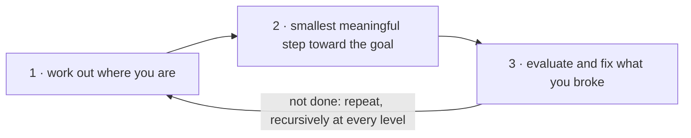

# 8. Before the Project

[← 7. While You Are Coding](07-while-you-are-coding.md) · [Book](../README.md) · [9. Pragmatic Projects →](09-pragmatic-projects.md)

## Summary

Before a project gets going, you need to learn the requirements, and being told or listening isn't enough (Topic 45). Hard problems are rarely as hard as they look once you find the real constraints (Topic 46). The secret weapon for impossible projects is solving problems together while coding (Topic 47). No method replaces thinking; what you need is the essence of agility (Topic 48), so you avoid analysis paralysis and actually begin (pp. 403–404).

## Key takeaways

- **No one knows exactly what they want, and programmers help people understand it.** A statement of need is an invitation to explore its edge cases (Tips 75–76, pp. 405–409).
- **Requirements are learned in a feedback loop:** feed back consequences, use mockups and short iterations, and treat the whole project as requirements gathering (Tip 77, pp. 409–410).
- **Work with a user to think like a user:** sit in on their job for a week (Tip 78, pp. 410–411).
- **Policy is metadata.** Implement the general case, such as access control, and treat today's business rule as data (Tip 79, pp. 411–412).
- **The best requirements documentation is working code.** Documents are for planning, as index-card user stories, not for client sign-off. Good requirements are abstract; keep a project glossary (Tip 80, pp. 412–416).
- **Don't think outside the box; find the box.** Enumerate the options, prove which constraints are real, and handle the most restrictive first. When stuck, step away or explain it to someone (Tip 81, pp. 418–423).
- **Don't go into the code alone.** Pair, mob, include users, and remember Conway's law (Tip 82, pp. 424–428).
- **Agile is not a noun; agile is how you do things.** Work out where you are, take the smallest meaningful step, evaluate and fix, recursively at every level. Good design is what makes that loop cheap (Tip 83, pp. 429–434).

## Section outline

*From the book’s own table of contents (PDF bookmarks). Page numbers are PDF pages: this edition's reflowed text has no printed page numbers.*

- Topic 45. The Requirements Pit — p. 405
- Topic 46. Solving Impossible Puzzles — p. 418
- Topic 47. Working Together — p. 424
- Topic 48. The Essence of Agility — p. 429

## Notes

| Tip | Statement | Page |
|---:|---|---|
| 75 | No One Knows Exactly What They Want | 405 |
| 76 | Programmers Help People Understand What They Want | 406 |
| 77 | Requirements Are Learned in a Feedback Loop | 409 |
| 78 | Work with a User to Think Like a User | 411 |
| 79 | Policy Is Metadata | 411 |
| 80 | Use a Project Glossary | 416 |
| 81 | Don’t Think Outside the Box—Find the Box | 420 |
| 82 | Don’t Go into the Code Alone | 428 |
| 83 | Agile Is Not a Noun; Agile Is How You Do Things | 429 |

### Topic 45. The Requirements Pit

"Gathering" implies requirements lie on the surface. In reality they're buried under assumptions, misconceptions and politics, and often don't exist at all (p. 405). **Tip 75, No One Knows Exactly What They Want.**

**The requirements myth** (pp. 405–406): when machines cost more than people, teams specified exactly, then designed, flowcharted and desk-checked, and only automated well-understood, small problems. The real world is messy, so exact specifications are rare. **Tip 76, Programmers Help People Understand What They Want.**

**Programming as therapy** (pp. 406–409). A client's statement of need is an invitation to explore, not an absolute requirement. Given "Shipping should be free on all orders costing $50 or more," the developer asks:

- Does it include tax, or current shipping charges?
- Paper books only, or ebooks too?
- Which shipping class? International?
- How often will $50 change?

The client says the $50 includes shipping. The developer points out that a $25 book with overnight shipping (about $30) makes $55, which then ships free. Then the developer stops: deliver facts, and let the client decide.

> **Try it:** [Free shipping over $50](../widgets/08-free-shipping.html) — build an order from the book's example, switch what the $50 threshold includes, and find the orders where the rule gives away more than the client meant.

**Requirements are a process** (pp. 409–410). **Tip 77, Requirements Are Learned in a Feedback Loop.** When words aren't enough, use "is this what you meant?" mockups and prototypes, flexible enough to change during the conversation. All the work is a form of mockup: by the end there are more clients (QA, operations, marketing). So prefer short iterations that end with client feedback, which minimizes the time lost going the wrong way.

**Walk in your client's shoes** (pp. 410–411): monitor the help-desk phones for a couple of days, or work in the warehouse for a week. It also builds trust. **Tip 78, Work with a User to Think Like a User.**

**Requirements vs. policy** (pp. 411–412): "Only an employee's supervisors and the personnel department may view that employee's records" embeds policy in an absolute. Stated as "only authorized users may access an employee record," it leads to an access-control system where policy changes only touch metadata. **Tip 79, Policy Is Metadata:** implement the general case, with the policy as an example of what it must support.

> **Try it:** [Policy as code or as data](../widgets/08-policy-metadata.html) — apply a stream of HR policy changes to a hard-coded check and to an access-control table, and count the code changes and redeploys each needs.

**Requirements vs. reality** (p. 412): Brian Eno described (Wired, January 1999) the ultimate mixing board that got in the way, because engineers' ear-to-fingertip feedback was replaced by keyboard and mouse. Successful tools adapt to the hands that use them. Early feedback lets clients say "yes, it does what I want, but not how I want."

**Documenting requirements** (pp. 412–415):

- The best requirements documentation is working code.
- Inch-thick specifications are a castle on quicksand, and the client never reads them. They heft it, read the Management Summary and look at diagrams; it's like coding a video game from the *Iliad* in Homeric Greek.
- Write requirements on index cards as **user stories**, small enough to prompt clarifying questions.
- **Overspecification:** good requirements are abstract. Capture semantic invariants as requirements and current practice as policy. Requirements are not architecture, design or UI; requirements are need.
- **Requirements creep** ("just one more wafer-thin mint") is the boiled frog. With iterations and feedback, clients see a new card go up and help choose what moves out.
- **Maintain a glossary** (pp. 415–416): users may distinguish "client" from "customer." **Tip 80, Use a Project Glossary.**

### Topic 46. Solving Impossible Puzzles

Alexander cut the Gordian knot: "just a little different interpretation of the requirements" (p. 418). Real puzzles defeat the obvious approach; the secret is to identify the *real* constraints, some absolute and some preconceived (pp. 418–419).

**Degrees of freedom** (pp. 419–420): the box is the boundary of constraints, and it may be larger than you think. The book's Four Posts puzzle asks you to connect all the dots and return to the start with three straight lines, without lifting the pen or retracing (Holt, *Math Puzzles & Games*); the solution is at the end of the book. **Tip 81, Don't Think Outside the Box—Find the Box.**

- Enumerate every avenue, however stupid it sounds, then explain why each can't be taken. Can you prove it? The Trojan horse went through the front door.
- Categorize and prioritize constraints, like woodworkers who cut the longest pieces first: fit the most restrictive first.

**Get out of your own way** (pp. 421–422): when it's harder than it should be, do something else, such as walking the dog or sleeping on it. Psychology Today reports distracted people did better at complex problem-solving. Otherwise, explain it to someone who asks:

- Why are you solving this, and what's the benefit?
- Are the problems edge cases you could eliminate?
- Is there a simpler related problem?

**Fortune favors the prepared mind** (Pasteur, p. 422): feed your nonconscious brain with feedback, for example in an engineering daybook. And DON'T PANIC.

### Topic 47. Working Together

Andy and Dave met on an "impossible" project: an end-of-life system whose often undocumented behaviour had to be matched exactly, hundreds of millions of dollars, a deadline of months. It succeeded because the expert who had run the system for years sat across the hall, continuously available (p. 424). They coded with one typist and others commenting, which might now be called pair or mob programming. "Working with" means discussing *while coding* (p. 425).

**Conway's law** (sidebar, p. 425), from Melvin Conway's 1967 paper: system designs copy the communication structures of the organizations that produce them. Teams that don't talk give stove-pipe systems; a team split in two gives client/server. The reverse works too: distributed teams tend toward modular software, and teams that include users produce software that reflects it.

| Practice | How it works (pp. 425–427) |
|---|---|
| **Pair programming** | One types (syntax, details), the other thinks at a higher level; peer pressure avoids `foo` and shortcuts |
| **Mob programming** | More than two people, one typist, possibly users, sponsors and testers: tight collaboration with live coding. Swap the typist every 5–10 minutes (p. 428) |

**What should I do?** (pp. 427–428):

- Try pairing for at least two weeks, a few hours at a time, or a mob session for thorny issues.
- Build the code, not your ego. Start small (mobs of 4–5).
- Criticize the code, not the person. Listen; different isn't wrong.
- Hold frequent retrospectives, and read up before you start.

**Tip 82, Don't Go into the Code Alone** (p. 428).

### Topic 48. The Essence of Agility

**Tip 83, Agile Is Not a Noun; Agile Is How You Do Things** (p. 429). Nearly 20 years after the Manifesto, the authors see Agile-in-a-Box: more management layers, reporting and "someone with a clipboard and a stopwatch" (p. 429). The four values put individuals and interactions, working software, customer collaboration and responding to change *over* processes and tools, comprehensive documentation, contract negotiation and following a plan. The introduction describes a generative process, not a static one (p. 430).

**There can never be an agile process** (pp. 430–431): agility is responding to unknowns, like a gazelle that doesn't run straight. Three of the four values are about gathering and responding to feedback. They tell you what to look for, not what to do, and decisions are contextual.

**So what do we do?** (pp. 431–432):

The loop at its lowest level is naming a variable (p. 432):

- `user = accountOwner(accountID)` becomes `owner`.
- But the story only needs an email, so it becomes `email = emailOfAccountOwner(accountID)`.
- That reduces coupling to the accounts code.

At the highest level, one step sometimes shows the best solution doesn't involve software. Teams should apply the loop to their process too (p. 433).

**And this drives design** (p. 433): step 3 requires fixing what you break cheaply, which is why good design means easy to change (ETC). "That is agility."

## Trade-offs at a glance

| Choice | Buys | Costs |
|---|---|---|
| Implement the stated need as given | Fast start | Builds the wrong thing; misses edge cases and gaming |
| Explore through feedback and mockups | Shared understanding; better solutions | Client time; diplomacy |
| Hard-code policy | Simple today | Code change for every policy change |
| Policy as metadata | Policy changes are data changes | A general mechanism to build and secure |
| Detailed requirements spec | Little ambiguity on paper | Built on quicksand; never read by the client |
| Index-card user stories | Prompts conversation; easy to reprioritize | Incomplete by design |
| Solo coding | Focus; no coordination | Less brain bandwidth; bad habits unchecked |
| Pair or mob coding | More minds, users in the loop, quality | Feels strange at first; needs human skills |
| Agile-in-a-Box process | Predictable rituals | Not agile by definition |

## Beyond the book

- **Policy engines.** "Policy is metadata" is the idea behind attribute- and role-based access control and policy engines such as Open Policy Agent, where rules are data evaluated by a general engine; the [policy widget](../widgets/08-policy-metadata.html) contrasts the two styles.
- **Team Topologies** (Skelton and Pais, 2019) builds on the reverse Conway manoeuvre the sidebar on p. 425 describes: design team boundaries to get the architecture you want.
- **Iteration length.** The book's argument that short iterations minimize time lost in a wrong direction (p. 410) can be modelled: the [lab](../lab/08-iteration-length/README.md) measures wasted work as a client's wishes drift.

## Connections

- **Related chapters:** [1. A Pragmatic Philosophy](01-a-pragmatic-philosophy.md) (boiled frogs, good-enough software, communicate), [2. A Pragmatic Approach](02-a-pragmatic-approach.md) (ETC, prototypes, tracer bullets, reversibility), [7. While You Are Coding](07-while-you-are-coding.md) (listen to your lizard brain, naming), [9. Pragmatic Projects](09-pragmatic-projects.md) (delight your users, teams).
- **Run it:** [How long should an iteration be?](../lab/08-iteration-length/README.md) — a seeded model of a client whose wishes drift, measuring work wasted between feedback points for different iteration lengths.

## Check yourself

*Questions and answers are the vault's, written from the notes above; answers cite the book's PDF pages.*

1. **Why is "gathering" a misleading word for requirements?**

   *Answer:* It implies they lie on the surface; they're buried under assumptions, misconceptions and politics, and often don't exist yet (p. 405).

2. **How could a customer game "free shipping on orders of $50 or more" if the total includes shipping?**

   *Answer:* Buy a $25 book with about $30 of overnight shipping; the $55 order ships free, giving overnight shipping on a $25 book for $25 (p. 408).

3. **After pointing that out, what does the experienced developer do?**

   *Answer:* Stops. Deliver facts and let the client make the decision (pp. 408–409).

4. **Restate "only supervisors and personnel may view an employee record" as the book recommends.**

   *Answer:* "Only authorized users may access an employee record," which leads to an access-control system where policy is metadata (p. 411).

5. **The book's preferred form of requirements documentation is:**
   - [ ] A signed-off specification
   - [x] Working code, with user stories on index cards for planning
   - [ ] A Management Summary

   *Answer:* Working code is the best (perhaps only) requirements documentation; stories on cards guide planning (pp. 412–414).

6. **What is the "box" in "find the box"?**

   *Answer:* The boundary of the real constraints and conditions, which may be considerably larger than you think (pp. 419–420).

7. **What does Conway's law say, and what's the reverse?**

   *Answer:* Designs copy the organization's communication structures; deliberately structuring teams shapes the software, e.g. distributed teams produce more modular software (p. 425).

8. **What is the book's three-step recipe for working in an agile way?**

   *Answer:* Work out where you are; make the smallest meaningful step toward where you want to be; evaluate where you end up and fix anything you broke. Repeat, recursively (pp. 431–432).
