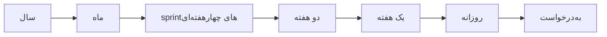

# فصل ۹: پروژه‌های pragmatic

[فصل ۸: پیش از پروژه →](08-before-the-project.md) · [کتاب](../README.md) · [فصل ۱۰: پس‌گفتار ←](10-postface.md)

## خلاصه

فصل آخر از کار فردی به مسئله‌های اندازه‌ی پروژه می‌رود:

- قاعده‌های پایه‌ی **تیم‌های pragmatic** (موضوع ۴۹).
- چرا تقلید کردن مصنوعات سطحی یک روش شکست می‌خورد، که کتاب **کارگو کالت** می‌نامدش (موضوع ۵۰).
- سه‌گانه‌ی جادویی **کنترل نسخه و تست و خودکارسازی**، یعنی جعبه‌ی شروع pragmatic (موضوع ۵۱).
- **خوشحال کردن** حامی، چون آن چیزی که به حساب می‌آید برداشت از موفقیت است (موضوع ۵۲).
- **امضا کردن** کارتان با افتخار (موضوع ۵۳).

آخرین tip کتاب نتیجه‌ی مستقیم همه‌ی بقیه است (pp. 435–436).

## نکته‌های کلیدی

- **تیم‌های کوچک و پایدار** زیر ده تا دوازده نفر نگه دارید که به هم اعتماد دارند. پنجاه نفر یک گله است (tip ۸۴، صص. ۴۳۷–۴۳۸).
- **کارهای فردی را در سطح تیم اعمال کنید:** پنجره‌ی شکسته نداشته باشید، چون کیفیت از اول ساخته می‌شود و بعداً نمی‌چسبد؛ قورباغه‌ی آب‌پز را بپایید؛ سبد دانش را زمان‌بندی کنید؛ و حضور تیم را اعلام (tip ۸۵، صص. ۴۳۸–۴۴۱).
- **با ارتباط بی‌اصطکاک DRY بمانید، و تیم‌های کاملاً کارآ سازمان بدهید** که بتوانند گلوله‌ی tracer را سر‌تا‌سر بی دروازه و تحویل‌دهی بسازند (tip ۸۶، صص. ۴۴۲–۴۴۳).
- **آن چیزی را بکنید که کار می‌کند، نه آن چیزی که مُد است:** جلسه‌ی ایستاده‌ی روزانه‌ی هفته‌ای‌یک‌بار فرودگاه نارگیلی است. ایده‌ها را آزمایشی اجرا کنید، آن چیزی را که کار می‌کند نگه دارید، و هدفتان **تحویل وقتی باشد که کاربرها لازم دارند** (tipهای ۸۷ و ۸۸، صص. ۴۴۶–۴۵۱).
- **از کنترل نسخه برای راندن build و تست و release استفاده کنید.** زود و زیاد و خودکار تست کنید؛ کد زدن تا همه‌ی تست‌ها اجرا نشوند تمام نشده (tipهای ۸۹ تا ۹۱، صص. ۴۵۲–۴۵۵).
- **برای تست کردن تستتان از خرابکار استفاده کنید، و پوشش حالت را تست کنید و نه پوشش کد.** باگ‌ها را یک‌بار پیدا کنید: هر باگ فراری یک تست می‌گیرد (tipهای ۹۲ تا ۹۴، صص. ۴۵۷–۴۵۹).
- **از رویه‌ی دستی استفاده نکنید** (tip ۹۵، صص. ۴۵۹–۴۶۰). **کاربرها را خوشحال کنید، نه فقط کد تحویل بدهید**: بپرسید همه از کجا می‌فهمند پروژه موفق شده (tip ۹۶، صص. ۴۶۲–۴۶۴). **کارتان را امضا کنید** (tip ۹۷، صص. ۴۶۵–۴۶۶).

## فهرست بخش‌ها

*از فهرست مطالب خود کتاب، از bookmarkهای PDF. شماره‌ها صفحه‌ی PDF‌اند، چون متن بازچینش‌شده‌ی این ویراست شماره‌ی صفحه‌ی چاپی ندارد.*

- موضوع ۴۹. تیم‌های pragmatic — ص. ۴۳۷
- موضوع ۵۰. نارگیل کار را راه نمی‌اندازد — ص. ۴۴۶
- موضوع ۵۱. جعبه‌ی شروع pragmatic — ص. ۴۵۲
- موضوع ۵۲. کاربرهایتان را خوشحال کنید — ص. ۴۶۲
- موضوع ۵۳. غرور و تعصب — ص. ۴۶۵

## یادداشت‌ها

| tip | عبارت | صفحه |
|---:|---|---|
| ۸۴ | تیم‌های کوچک و پایدار نگه دارید | ۴۳۸ |
| ۸۵ | زمان‌بندی‌اش کنید تا اتفاق بیفتد | ۴۴۱ |
| ۸۶ | تیم‌های کاملاً کارآ سازمان بدهید | ۴۴۳ |
| ۸۷ | آن چیزی را بکنید که کار می‌کند، نه آن چیزی که مُد است | ۴۴۷ |
| ۸۸ | وقتی تحویل بدهید که کاربرها لازم دارند | ۴۵۰ |
| ۸۹ | از کنترل نسخه برای راندن build و تست و release استفاده کنید | ۴۵۳ |
| ۹۰ | زود تست کنید، زیاد تست کنید، خودکار تست کنید | ۴۵۴ |
| ۹۱ | کد زدن تا همه‌ی تست‌ها اجرا نشوند تمام نشده | ۴۵۵ |
| ۹۲ | برای تست کردن تستتان از خرابکار استفاده کنید | ۴۵۷ |
| ۹۳ | پوشش حالت را تست کنید، نه پوشش کد | ۴۵۸ |
| ۹۴ | باگ‌ها را یک‌بار پیدا کنید | ۴۵۹ |
| ۹۵ | از رویه‌ی دستی استفاده نکنید | ۴۶۰ |
| ۹۶ | کاربرها را خوشحال کنید، نه فقط کد تحویل بدهید | ۴۶۴ |
| ۹۷ | کارتان را امضا کنید | ۴۶۵ |

### موضوع ۴۹. تیم‌های pragmatic

برنامه‌نویس‌ها مثل گربه‌اند: باهوش و یک‌دنده و دارای نظر و مستقل (p. 437). یک تیم کوچک و بیشتر پایدار است. پنجاه نفر یک گله‌اند، و آدم‌هایی که مدام به کارهای دیگر کشیده می‌شوند «غریبه‌هایی‌اند که موقت زیر باران یک ایستگاه اتوبوس را شریک شده‌اند». یک تیم pragmatic زیر ده تا دوازده عضو دارد که کم می‌آیند و می‌روند و به هم اعتماد دارند. **tip ۸۴، تیم‌های کوچک و پایدار نگه دارید** (pp. 437–438). پانویسی می‌گوید مسیرهای ارتباطی با اندازه‌ی تیم تند رشد می‌کنند، تا جایی که ارتباط می‌شکند (p. 467).

> **Try it:** [اندازه‌ی تیم و مسیرهای ارتباطی](../widgets/09-team-size.html)؛ تیمی را بزرگ کنید و ببینید مسیرهای ارتباطی دو‌به‌دو چند برابر می‌شوند، با راهنمای ده تا دوازده‌نفری کتاب و «گله»ی پنجاه‌نفری‌اش که علامت خورده‌اند.

| کار فردی | در سطح تیم (pp. 438–444) |
|---|---|
| **پنجره‌ی شکسته نداشته باشید** | کیفیت مسئله‌ی تیم است؛ یک «افسر کیفیت» مسخره است. کیفیت از اول ساخته می‌شود و بعداً نمی‌چسبد |
| **قورباغه‌ی آب‌پز** | تیم‌ها فرض می‌کنند کس دیگری دارد حلش می‌کند. همه تغییر دامنه و مقیاس زمانی و محیط را می‌پایند؛ درباره‌ی نیازمندی‌های تازه metric نگه دارید، که نمودار burnup تیرک‌های جابه‌جا‌شده را نشان می‌دهد |
| **سبد دانش** | نگه‌داری سیستم قدیمی و بازاندیشی فرایند و آزمایش فناوری تازه، که با prototype بررسی می‌شود، و یاد گرفتن را زمان‌بندی کنید. **tip ۸۵، زمان‌بندی‌اش کنید تا اتفاق بیفتد** |
| **اعلام حضور تیم** | تیم‌های بزرگ بیرون با یک صدا حرف می‌زنند و داخل سرزنده بحث می‌کنند. پروژه را با نامی خارج از عرف و لوگویی سی‌دقیقه‌ای و شلوغ برند کنید |
| **خودتان را تکرار نکنید** | ارتباط باید بی‌درنگ و بی‌اصطکاک باشد. یک هفته منتظر جلسه ماندن اصطکاک است؛ Andy تیم‌هایی را دیده که جلسه‌ی ایستاده‌ی روزانه‌شان جمعه‌ها بود |
| **گلوله‌ی tracer تیمی** | نقش‌های جدا دروازه و تحویل‌دهی اضافه می‌کنند، که Lean هدر می‌نامدش. frontend و UX و server و DBA و QA را در تیم داشته باشید. **tip ۸۶، تیم‌های کاملاً کارآ سازمان بدهید** |
| **خودکارسازی** | قالب‌بندی و تست و deploy خودکار باشند؛ تیم به مهارت ابزارسازی نیاز دارد |
| **بدانید کِی دیگر رنگ نزنید** | فقط به‌اندازه‌ی کافی ساختار بدهید و بعد بگذارید افراد بدرخشند |

چالش‌ها شامل معمای گودال‌اند، یعنی چهار کارگر شش ساعت می‌برند، پس هشت کارگر چقدر؟، که روی کد زدن اعمال می‌شود، و خواندن *The Mythical Man-Month*، یعنی «دو نسخه بخرید تا دو برابر تندتر بخوانیدش» (p. 445).

> **In practice:** تیم داده هم پنجره‌ی شکسته، قورباغه‌ی آب‌پز و DRY دارد، در سطح تیم.
>
> **Your turn:** چه کسی مالک کیفیت یک جدول Gold است؟
>
> *Answer:* یک نفر یا یک تیم با نام، که در catalog یا README جدول ثبت شده و alertهایش را می‌گیرد. کتاب می‌گوید تیم را بر اساس کارکرد سازمان دهید و مالکیت را روشن کنید، وگرنه همه فکر می‌کنند دیگری درستش می‌کند (pp. 437–445).

### موضوع ۵۰. نارگیل کار را راه نمی‌اندازد

بعد از جنگ، جزیره‌نشین‌ها فرودگاه را از پیچک و پوست نارگیل و برگ نخل ساختند، ولی هواپیماها نیامدند: شکل را تقلید کرده بودند و نه محتوا را. این **کارگو کالت** است (p. 446). نویسنده‌ها تیمی «Scrum» دیدند که جلسه‌ی ایستاده‌ی روزانه را هفته‌ای یک‌بار داشت، با تکرارهای چهار‌هفته‌ای که شش یا هشت هفته می‌شدند، چون ابزار زمان‌بندی چابک محبوبی به کار می‌بردند (pp. 446–447).

**زمینه مهم است** (p. 447): کپی کردن Spotify یا Netflix یا Stripe یا GitLab، بازار و قید و تخصص و اندازه و فرهنگ و کاربر را نادیده می‌گیرد. **tip ۸۷، آن چیزی را بکنید که کار می‌کند، نه آن چیزی که مُد است.** از کجا می‌فهمید چه چیزی کار می‌کند؟ امتحانش کنید: با تیمی کوچک آزمایشی اجرا کنید، آن چیزی را که کار می‌کند نگه دارید، و بقیه را دور بیندازید. آن شرکت‌ها در حین رشد از فرایند فعلی‌شان پیروی نمی‌کردند (pp. 447–448).

**یک اندازه به هیچ‌کس خوب نمی‌آید** (pp. 448–449): گواهی‌نامه‌ای که حفظ کردن قاعده‌ها را پاداش می‌دهد بدتر است؛ بهترین تکه‌ها را از چند روش بردارید. تنها Scrum نه کار فنی را می‌پوشاند و نه governance را. کادر کناری «مثل آن‌ها باش!»: برای کار کردن مثل Netflix، اول چند صد هزار سرور و چند ده میلیون کاربر بگیرید (p. 449).

**هدف واقعی** (pp. 449–451) تحویل نرم‌افزار در حال کاری است که به کاربرها در یک لحظه قابلیتی تازه بدهد. چرخه را قدم‌به‌قدم کوتاه کنید:

**نکته‌ی ۸۸، وقتی تحویل بدهید که کاربرها لازم دارند.** به‌درخواست یعنی هر دقیقه نه. به جعبه‌ی شروع و توسعه‌ی trunk‌محور و کلید قابلیت نیاز دارد. تازه‌کارها می‌توانند با Scrum به‌علاوه‌ی کارهای فنی XP شروع کنند؛ و تیم‌های باتجربه می‌توانند Kanban و Lean به کار ببرند. سرمایه‌گذاری بیش از اندازه روی یک روش شما را سخت می‌کند: «همان بهتر که نارگیل به کار می‌بردید» (p. 451).

### موضوع ۵۱. جعبه‌ی شروع pragmatic

دستور روشن کردن یک Model-T بیشتر از دو صفحه بود؛ خودروی امروزی با یک دکمه روشن می‌شود، و Whitehead می‌گفت تمدن با گسترش کارهایی پیش می‌رود که می‌توانیم بی فکر کردن انجامشان بدهیم (p. 452). هر کار تکرارشونده باید خودکار و روی هر ماشین توانمندی تکرار‌شدنی باشد. سه پایه‌ی جعبه‌ی شروع **کنترل نسخه و تست رگرسیون و خودکارسازی کامل‌اند** (pp. 452–453).

**با کنترل نسخه برانید** (pp. 453–454):

- ماشین‌های build به نمونه‌های transientی cloud تبدیل می‌شوند و نه «یک ماشین مقدس و قیژ‌قیژی در گوشه».
- تنظیم deploy هم نسخه‌دار می‌شود.
- همه‌ی commitها build و تست و deploy را در یک container راه می‌اندازند، و یک tag یک release را تعیین می‌کند.

**نکته‌ی ۸۹، از کنترل نسخه برای راندن build و تست و release استفاده کنید.**

**تست بی‌رحم و پیوسته** (pp. 454–459). developerها نرم تست می‌کنند و از نقطه‌های ضعیف می‌پرهیزند؛ برنامه‌نویس pragmatic باگ‌هایش را همین حالا پیدا می‌کند. تورهای ریز، یعنی unit test، ماهی‌ریزه‌ها را می‌گیرند و تورهای درشت، یعنی تست یکپارچه‌سازی، کوسه‌ها را. **tip ۹۰، زود تست کنید، زیاد تست کنید، خودکار تست کنید.** یک پروژه‌ی خوب می‌تواند کد تست بیشتری از کد تولید داشته باشد. **tip ۹۱، کد زدن تا همه‌ی تست‌ها اجرا نشوند تمام نشده.** محیط تست باید با تولید بخورد: فاصله‌ها جایی‌اند که باگ در آن زاد‌و‌ولد می‌کند.

| گونه‌ی تست | چه چیزی را نشان می‌دهد (pp. 455–457) |
|---|---|
| **unit** | هر ماژول قراردادش را رعایت می‌کند؛ پایه‌ی هر چیز دیگری |
| **یکپارچه‌سازی** | زیرسیستم‌ها با هم کار می‌کنند؛ اغلب تنها بزرگ‌ترین سرچشمه‌ی باگ |
| **اعتبارسنجی و تأیید** | همان چیزی است که کاربرها *لازم* دارند، با الگوهای دسترسی واقعی‌شان |
| **performance** | زیر بار واقعی نیازمندی‌ها را برآورده می‌کند؛ مقیاس‌پذیر است؟ |

**تست کردن تست‌ها** (p. 457): آگاهانه باگ را بسازید و مطمئن شوید تست شکایت می‌کند. **tip ۹۲، برای تست کردن تستتان از خرابکار استفاده کنید.** باگ‌ها را روی branchی جدا وارد کنید، یا از Chaos Monkey در Netflix استفاده کنید تا سرویس‌ها را بکشد.

**تست کردن جامع** (pp. 457–458): ابزارهای پوشش حسی می‌دهند، ولی انتظار صد درصد نداشته باشید. آن چیزی که مهم است حالت‌هاست. تابع `int test(int a, int b) { return a / (a + b); }` با a و b در بازه‌ی صفر تا ۹۹۹، یک میلیون حالت منطقی دارد، که یکی‌شان، یعنی a + b = 0، شکست می‌خورد، و اجرا شدن آن خط این را به شما نمی‌گوید. **tip ۹۳، پوشش حالت را تست کنید، نه پوشش کد.** تست property‌محور حالت‌ها را برایتان می‌سازد (p. 458).

> **Try it:** [خرابکارها و پوشش حالت](../widgets/09-saboteurs.html)؛ در تابعی کوچک باگ بکارید و ببینید مجموعه‌ی تستش کدام‌ها را می‌گیرد، بعد از فضای ورودی `a / (a + b)` کتاب نمونه بگیرید و ببینید تست تصادفی چقدر کم آن یک حالت شکست‌خورده را پیدا می‌کند.

**تنگ کردن تور** (p. 459): اگر باگی رد شد، تستی اضافه کنید که بار بعد بگیردش. **tip ۹۴، باگ‌ها را یک‌بار پیدا کنید**: همین که یک تست‌کننده‌ی انسانی باگی را پیدا کرد، آخرین باری است که انسانی پیدایش می‌کند.

**خودکارسازی کامل** (pp. 459–460): از اسکریپت shell با rsync و ssh استفاده کنید، یا Ansible و Puppet و Chef و Salt، بی هیچ دخالت دستی. در یک مشتری، چند صفحه راه‌اندازی IDE از جنس «این‌جا را کلیک کن» باعث شده بود هر ماشینی کمی فرق کند، و باگ‌ها فقط روی بعضی ماشین‌ها در بیایند. **tip ۹۵، از رویه‌ی دستی استفاده نکنید.** اسکریپت‌ها تکرار‌شدنی و نسخه‌دارند؛ و یک مرحله‌ی دستی «فقط برای همین یک بخش» پنجره‌ی شکسته‌ی خیلی بزرگی است.

> **In practice:** جعبه‌ی شروع کتاب در stack ما: کنترل نسخه در GitLab، تست در GitLab CI، و خودکارسازی کامل deploy با Argo CD.
>
> **Your turn:** کدام کار تیم هنوز دستی است و باید خودکار شود؟
>
> *Answer:* هر چیزی که یک بار با `kubectl` یا SSH دستی انجام شده، مثلاً ساختن جدول ClickHouse یا تغییر یک host؛ آن را به migration در CI یا playbook در Ansible ببرید. کتاب می‌گوید هر چیز دستی یک روز خطا می‌کند (pp. 452–461).

### موضوع ۵۲. کاربرهایتان را خوشحال کنید

هدف خوشحال کردن کاربرهاست، به گفته‌ی سرآغاز Guy Kawasaki، و نه کاویدن داده‌شان یا شمردن چشم‌ها؛ تحویل نرم‌افزار در حال کار سر وقت کافی نیست (p. 462). انتظارهای کاربرها درباره‌ی نرم‌افزار نیست، پس بپرسید: *یک ماه، یا یک سال، بعد از تمام شدن این پروژه، از کجا می‌فهمید همه‌مان موفق بوده‌ایم؟* (pp. 462–463).

پاسخ‌ها می‌توانند غافلگیرتان کنند. توصیه‌گر ممکن است با نگه داشتن مشتری سنجیده شود؛ و یکپارچه کردن دیتابیس با کیفیت داده یا صرفه‌جویی هزینه. بعد (p. 463):

- مطمئن شوید همه در تیم درباره‌ی این انتظارها روشن‌اند.
- راهی را انتخاب کنید که به آن‌ها نزدیک‌تر می‌شود.
- نیازمندی‌ها را نقادانه در برابرشان تحلیل کنید. نیازمندی بیان‌شده اغلب نقشه‌ی پیاده‌سازی آماتوری است؛ تغییرهایی پیشنهاد بدهید که به هدف نزدیک‌تر می‌شوند.
- در طول پیش رفتن پروژه مدام به آن‌ها فکر کنید.

**نکته‌ی ۹۶، کاربرها را خوشحال کنید، نه فقط کد تحویل بدهید** (p. 464). عنوان شما در واقع باید «حل‌کننده‌ی مسئله» باشد.

### موضوع ۵۳. غرور و تعصب

**نکته‌ی ۹۷، کارتان را امضا کنید** (p. 465). صنعتگرها کارشان را امضا می‌کردند. ولی مالکیت کد می‌تواند ملوک‌الطوایفی و تعصب در برابر کد همکارها بپروراند، پس قاعده‌ی طلایی و احترام متقابل را رعایت کنید. گمنامی شلختگی می‌پروراند. کد باید مالک داشته باشد، ولی لازم نیست مالکش فرد باشد: مالکیت جمعی XP به کارهایی مثل جفتی کار کردن نیاز دارد تا جلوی گمنامی را بگیرد. امضای شما باید از کیفیت خبر بدهد: محکم و خوش‌نوشته و تست‌شده و مستند (pp. 465–466).

## بده‌بستان‌ها در یک نگاه

| انتخاب | چه می‌دهد | چه می‌گیرد |
|---|---|---|
| تیم بزرگ یا در حال جابه‌جایی | شمار نفرات | ارتباط می‌شکند؛ اعتمادی نیست |
| تیم کوچک و پایدار و کاملاً کارآ | اعتماد، تحویل سر‌تا‌سری | به مهارت‌های گسترده در یک تیم نیاز دارد |
| تیم‌های متخصص با تحویل‌دهی | تخصص عمیق در هر مرحله | دروازه و انتظار و هدر؛ زمینه گم می‌شود |
| کپی کردن فرایند شرکتی معروف | پاسخ‌های آماده | زمینه‌ی متفاوت؛ کارگو کالت |
| اجرای آزمایشی و نگه داشتن آن چیزی که کار می‌کند | به زمینه‌ی شما می‌خورد | آزمایش پیوسته می‌خواهد |
| build و deploy دستی | بی اسکریپت‌نویسی اولیه | تکرار‌نشدنی؛ رانش ماشین‌ها؛ یک پنجره‌ی شکسته |
| هدف پوشش کد | اندازه‌گیری‌اش آسان است | خط‌ها حالت نیستند |
| خرابکار و تست آشوب | اطمینان از این که هشدارها کار می‌کنند | تلاش؛ باید اجرایش امن باشد |
| مالکیت فردی یا جمعی | غرور، پاسخ‌گویی | ملوک‌الطوایفی، یا گمنامی بی جفتی کار کردن |

## فراتر از کتاب

- **مسیرهای ارتباطی.** پانویس ص. ۴۶۷ فرمول رشد را می‌دهد؛ شکل استاندارد n(n − 1)/2 زوج است، پس ده نفر ۴۵ مسیر و پنجاه نفر ۱۲۲۵ مسیر دارند. قانون Brooks، یعنی «اضافه کردن نیروی انسانی به پروژه‌ی نرم‌افزاری عقب‌افتاده، عقب‌تر می‌اندازدش»، همان نتیجه‌ی [Mythical Man-Month](https://en.wikipedia.org/wiki/The_Mythical_Man-Month) است که چالش ص. ۴۴۵ به آن اشاره دارد.
- **تست mutantی** خرابکارهای کتاب را خودکار می‌کند: ابزارهایی مثل PIT برای Java و mutmut برای Python و Stryker برای جاوااسکریپت تغییرهای کوچک کد می‌سازند و خبر می‌دهند کدام‌ها جان سالم می‌برند. [آزمایش](../lab/09-saboteurs/README.md) نسخه‌ای کوچک را با کتابخانه‌ی استاندارد می‌سازد.
- **همه‌ی metricهای DORA** (Forsgren و Humble و Kim، کتاب *Accelerate*، سال ۲۰۱۸) همان هدف «وقتی تحویل بده که کاربرها لازم دارند» را اندازه می‌گیرند: بسامد deploy، زمان رسیدن تغییر، نرخ شکست تغییر، و زمان برگرداندن.

## پیوندها

- **فصل‌های مرتبط:** [فصل ۱: فلسفه‌ی pragmatic](01-a-pragmatic-philosophy.md) که پنجره‌ی شکسته و قورباغه‌ی آب‌پز و سبد دانش و ارتباط گرفتن را دارد، [فصل ۲: رویکرد pragmatic](02-a-pragmatic-approach.md) که DRY و گلوله‌ی tracer را دارد، [فصل ۳: ابزارهای پایه](03-the-basic-tools.md) که کنترل نسخه و بازی‌های shell را دارد، [فصل ۷: وقتی کد می‌زنید](07-while-you-are-coding.md) که از تست به کد و تست property‌محور را دارد، و [فصل ۸: پیش از پروژه](08-before-the-project.md) که نیازمندی‌ها و چابکی را دارد.
- **Run it:** [خرابکارها: تست‌ها باگ‌های کاشته‌شده را می‌گیرند؟](../lab/09-saboteurs/README.md)؛ mutantهایی از تابعی کوچک می‌سازد، یک مجموعه‌ی تست ضعیف و یک قوی را روی هر کدام اجرا می‌کند، و خبر می‌دهد کدام باگ‌ها جان سالم می‌برند؛ و بعد از فضای حالت `a / (a + b)` نمونه می‌گیرد.

## خودتان را بسنجید

*پرسش‌ها و پاسخ‌ها مال vault است و از روی یادداشت‌های بالا نوشته شده؛ پاسخ‌ها به صفحه‌های PDF کتاب ارجاع می‌دهند.*

1. **یک تیم pragmatic چقدر بزرگ است، و چه چیزی تیم نیست؟**

   *Answer:* زیر ده تا دوازده عضو پایدار که به هم اعتماد دارند؛ پنجاه نفر یک گله‌اند، و غریبه‌هایی که مدام جابه‌جا می‌شوند «زیر باران یک ایستگاه اتوبوس را شریک شده‌اند» (pp. 437–438).

2. **چرا کتاب یک «افسر کیفیت» را مسخره می‌نامد؟**

   *Answer:* کیفیت فقط می‌تواند از سهم هر عضو تیم بیاید؛ از اول ساخته می‌شود و بعداً نمی‌چسبد (p. 438).

3. **کارگو کالت در نمونه‌ی نرم‌افزاری کتاب چیست؟**

   *Answer:* تقلید شکل بی محتوا: تیمی که «Scrum کار می‌کند» با جلسه‌ی ایستاده‌ی روزانه‌ی هفتگی و تکرارهای چهار‌هفته‌ای که می‌کشند، و به ابزار زمان‌بندی چابک تکیه دارد (pp. 446–447).

4. **سه پایه‌ی جعبه‌ی شروع pragmatic چیست؟**

   *Answer:* کنترل نسخه، تست رگرسیون، و خودکارسازی کامل (p. 453).

5. **عمل release به staging یا تولید چطور باید تعیین شود؟**

   *Answer:* با یک tag در کنترل نسخه؛ و build و تست با commit یا push راه می‌افتند و در یک container در cloud اجرا می‌شوند (pp. 453–454).

6. **با تابع کتاب، چرا پوشش کد کافی نیست؟**
   - [ ] چون ابزارهای پوشش نادقیق‌اند
   - [x] تابع `a / (a + b)` یک میلیون حالت دارد و یکی شکست می‌خورد؛ و اجرا شدن آن خط آشکارش نمی‌کند
   - [ ] چون تست یکپارچه‌سازی مهم‌تر است

   *Answer:* حالت‌ها خط کد نیستند؛ پوشش حالت را تست کنید (p. 458).

7. **قاعده‌ی «باگ‌ها را یک‌بار پیدا کنید» چه می‌خواهد؟**

   *Answer:* همین که یک تست‌کننده‌ی انسانی باگی را پیدا کرد، تستی خودکار اضافه کنید تا آخرین باری باشد که انسانی پیدایش می‌کند، هر قدر هم پیش‌پاافتاده باشد (p. 459).

8. **کدام پرسش انتظارهای واقعی کاربرها را بیرون می‌کشد؟**

   *Answer:* «یک ماه، یا یک سال، بعد از تمام شدن این پروژه، از کجا می‌فهمید همه‌مان موفق بوده‌ایم؟» (pp. 462–463).
