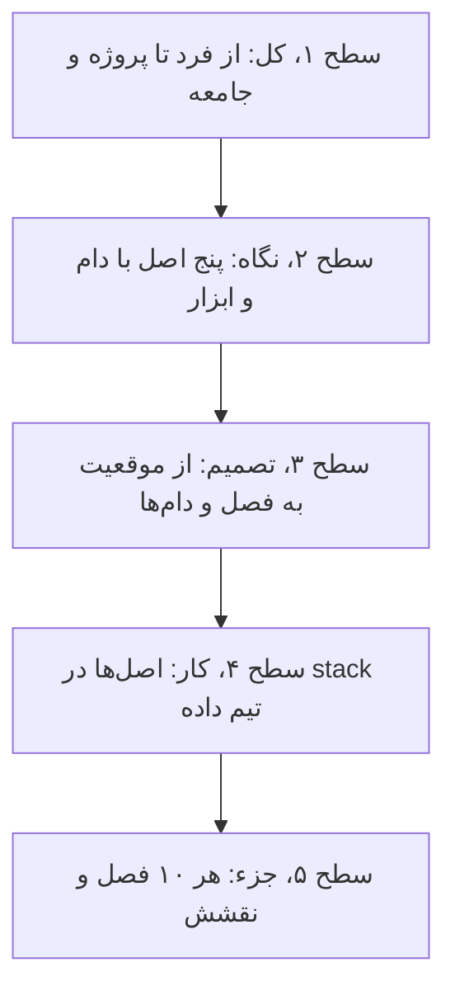
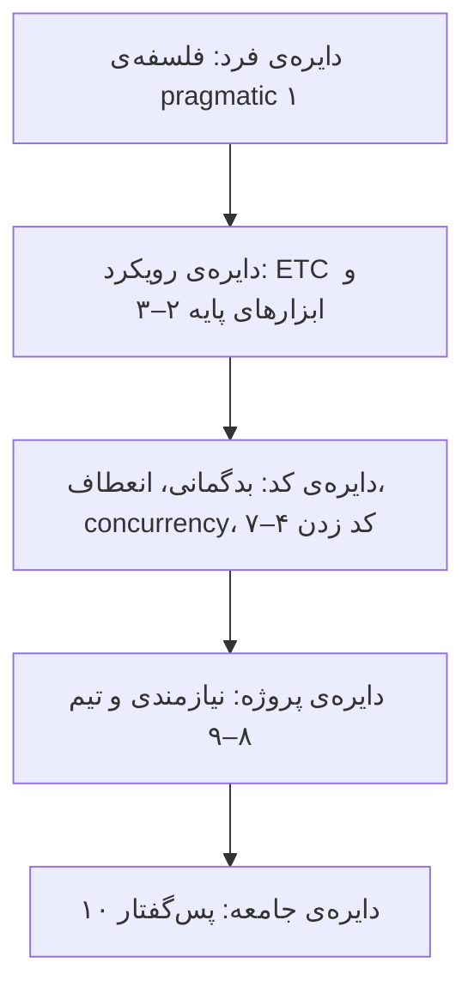
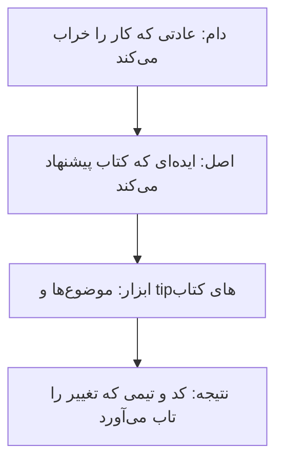
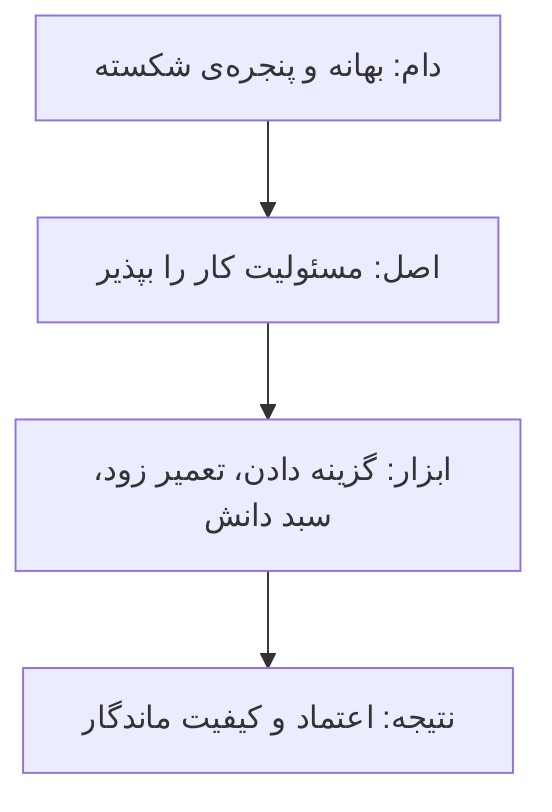
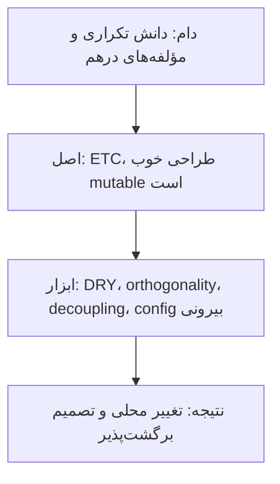
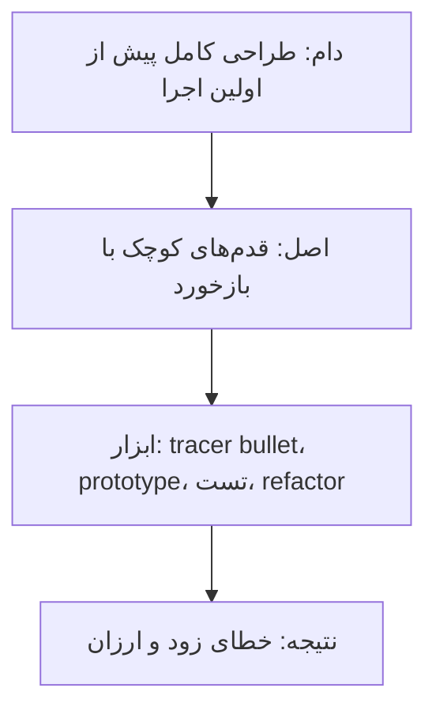
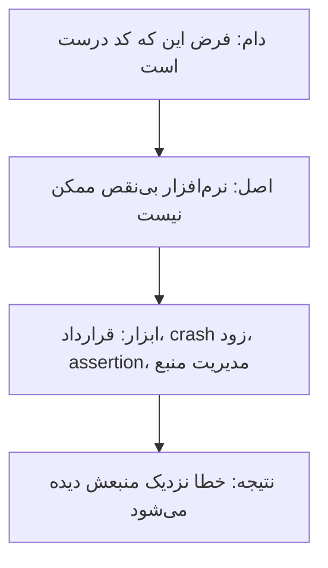
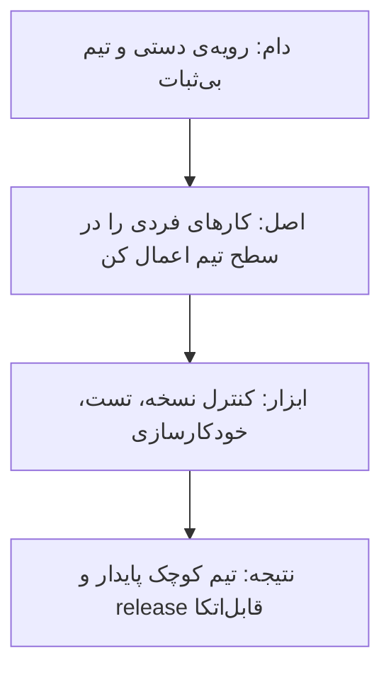

# چارچوب کتاب: برنامه‌نویس pragmatic از نگرش تا پروژه

[کتاب](README.md) · [فصل ۱ ←](chapters/01-a-pragmatic-philosophy.md)

این صفحه **سنتز خود vault** است، نه بخشی از کتاب. کتاب مجموعه‌ای از موضوع‌ها و tipهای کوتاه است که می‌شود از هر جایش خواند؛ همین آزادی باعث می‌شود رشته‌ی مشترکشان گم شود. این‌جا آن رشته پیدا می‌شود: یک ارزش مرکزی، یعنی ETC یا «آسان‌تر برای تغییر»، و چند عادت که آن را در کد و تیم نگه می‌دارند.

چارچوب سه لایه دارد. **نقشه‌ی کتاب** نشان می‌دهد فصل‌ها از نگرش فرد به کد و از کد به پروژه و جامعه می‌روند. **پنج اصل** آن رشته‌ها را نام می‌برند، هر کدام با دام و ابزار و نتیجه. **راهنمای تصمیم و stack** می‌گوید برای هر موقعیت کدام فصل را باز کنید و هر اصل در کار روزانه‌ی تیم داده کجا می‌نشیند. tipها مال نویسندگان‌اند؛ دسته‌بندی اصل‌ها مال vault است.

## تصویر کل

### کل کتاب در سه جمله

خوانش vault از کتاب، پیش از هر جزئی:

1. **مسئولیت کارتان را بپذیرید و دانشتان را مثل دارایی مدیریت کنید.** برنامه‌نویس pragmatic عاملیت دارد و گزینه می‌دهد، نه بهانه ([۱](chapters/01-a-pragmatic-philosophy.md)، [۱۰](chapters/10-postface.md)).
2. **طراحی خوب طراحی‌ای است که تغییرش آسان‌تر است.** اصل DRY و orthogonality و decoupling و برگشت‌پذیری همه ابزار همین یک ارزش‌اند ([۲](chapters/02-a-pragmatic-approach.md)، [۵](chapters/05-bend-or-break.md)).
3. **با بازخورد کوتاه و بدگمانی به خودتان کار کنید.** tracer bullet و تست و قرارداد و crash زودهنگام خطا را نزدیک منبعش می‌گیرند ([۲](chapters/02-a-pragmatic-approach.md)، [۴](chapters/04-pragmatic-paranoia.md)، [۷](chapters/07-while-you-are-coding.md)).

### از کل به جزء

## نقشه‌ی کتاب

### چهار دایره

*سطح ۱ از ۵: کل.*

کتاب از درون به بیرون می‌رود: اول نگرش فرد، بعد رویکرد و ابزار، بعد کد، بعد پروژه و تیم، و در آخر مسئولیت در برابر دنیا.

### دایره‌ها و پرسش‌هایشان

| دایره | پرسش اصلی | فصل‌ها |
|---|---|---|
| فرد | من در برابر کارم چه مسئولیتی دارم؟ | [۱](chapters/01-a-pragmatic-philosophy.md) |
| رویکرد و ابزار | چه چیزی طراحی را خوب می‌کند و با چه ابزاری کار کنم؟ | [۲](chapters/02-a-pragmatic-approach.md)، [۳](chapters/03-the-basic-tools.md) |
| کد | چطور کد را درست و انعطاف‌پذیر و هم‌زمان نگه دارم؟ | [۴](chapters/04-pragmatic-paranoia.md)، [۵](chapters/05-bend-or-break.md)، [۶](chapters/06-concurrency.md)، [۷](chapters/07-while-you-are-coding.md) |
| پروژه و تیم | چه بسازیم و تیم چطور کار کند؟ | [۸](chapters/08-before-the-project.md)، [۹](chapters/09-pragmatic-projects.md) |
| جامعه | آیا این کد از کاربر محافظت می‌کند؟ | [۱۰](chapters/10-postface.md) |

## پنج اصل

*سطح ۲ از ۵: نگاه.*

هر اصل با یک زنجیره‌ی چهارتایی شروع می‌شود: **دام** رایج، **اصل**، **ابزاری** که اصل را عملی می‌کند و **نتیجه**. بعد سه نکته می‌آید که هر کدام به فصل‌هایش پیوند دارد.

### اصل ۱: مسئولیت و عاملیت

- **گزینه بدهید، بهانه نیاورید**؛ و بی‌توجهی پوسیدگی را تندتر از هر عامل دیگری می‌کند ([۱](chapters/01-a-pragmatic-philosophy.md)).
- **دانش دارایی‌ای با تاریخ انقضاست** و ارتباط نصف کار است ([۱](chapters/01-a-pragmatic-philosophy.md)).
- **مسئولیت به کاربر و جامعه هم می‌رسد**: اول، آسیب نزن ([۱۰](chapters/10-postface.md)).

### اصل ۲: آسان‌تر برای تغییر

- **اصل DRY درباره‌ی دانش است و نه کد**؛ مؤلفه‌های orthogonal مستقل از هم عوض می‌شوند ([۲](chapters/02-a-pragmatic-approach.md)).
- **مفهوم coupling دشمن تغییر است**؛ بگو، نپرس، و برنامه را با config بیرونی پارامتری کن ([۵](chapters/05-bend-or-break.md)).
- **تصمیم نهایی وجود ندارد**؛ پس تصمیم‌ها را برگشت‌پذیر نگه دارید ([۲](chapters/02-a-pragmatic-approach.md)، [۵](chapters/05-bend-or-break.md)).

### اصل ۳: بازخورد کوتاه

- **کد tracer نگه داشته می‌شود و prototype دور انداخته** ([۲](chapters/02-a-pragmatic-approach.md)).
- **تست درباره‌ی پیدا کردن باگ نیست**؛ زود refactor کنید و تصادفی برنامه ننویسید ([۷](chapters/07-while-you-are-coding.md)).
- **نیازمندی‌ها در یک حلقه‌ی بازخورد یاد گرفته می‌شوند** و بهترین مستند نیازمندی کد در حال کار است ([۸](chapters/08-before-the-project.md)).

### اصل ۴: بدگمانی به خود

- **قرارداد پیش‌شرط و پس‌شرط را صریح می‌کند**؛ زود crash کنید ([۴](chapters/04-pragmatic-paranoia.md)).
- **مفهوم shared state همان حالت نادرست است**؛ actor و blackboard راه‌های بی‌state مشترک‌اند ([۶](chapters/06-concurrency.md)).
- **کار debug همان حل مسئله است** و فراخوانی «select» خراب نیست ([۳](chapters/03-the-basic-tools.md)).

### اصل ۵: تیم و خودکارسازی

- **همیشه کنترل نسخه به کار ببرید** و دانش را در متن ساده نگه دارید ([۳](chapters/03-the-basic-tools.md)).
- **تیم‌های کوچک و پایدار** با ارتباط بی‌اصطکاک DRY می‌مانند ([۹](chapters/09-pragmatic-projects.md)).
- **از رویه‌ی دستی استفاده نکنید**؛ build و تست و release را کنترل نسخه می‌راند ([۹](chapters/09-pragmatic-projects.md)).

## از موقعیت به فصل

*سطح ۳ از ۵: تصمیم.*

| موقعیت | اول بخوانید | بعد |
|---|---|---|
| کار عقب افتاده و باید به مدیر گفت | [۱](chapters/01-a-pragmatic-philosophy.md) | [۲](chapters/02-a-pragmatic-approach.md) |
| یک تغییر کوچک ده جا را عوض می‌کند | [۲](chapters/02-a-pragmatic-approach.md) | [۵](chapters/05-bend-or-break.md) |
| نمی‌دانیم معماری جواب می‌دهد یا نه | [۲](chapters/02-a-pragmatic-approach.md) | [۸](chapters/08-before-the-project.md) |
| باگ عجیب و بازتولیدنشدنی | [۳](chapters/03-the-basic-tools.md) | [۶](chapters/06-concurrency.md) |
| داده‌ی ورودی بد ساکت عبور می‌کند | [۴](chapters/04-pragmatic-paranoia.md) | [۷](chapters/07-while-you-are-coding.md) |
| منطق کسب‌وکار در کد hard-code شده | [۵](chapters/05-bend-or-break.md) | [۳](chapters/03-the-basic-tools.md) |
| شکست‌های تصادفی در jobهای موازی | [۶](chapters/06-concurrency.md) | [۴](chapters/04-pragmatic-paranoia.md) |
| کد کار می‌کند ولی نمی‌دانیم چرا | [۷](chapters/07-while-you-are-coding.md) | [۳](chapters/03-the-basic-tools.md) |
| ذی‌نفع دقیقاً نمی‌داند چه می‌خواهد | [۸](chapters/08-before-the-project.md) | [۲](chapters/02-a-pragmatic-approach.md) |
| release دستی و پرخطر | [۹](chapters/09-pragmatic-projects.md) | [۳](chapters/03-the-basic-tools.md) |
| سیستم می‌تواند به کاربر آسیب بزند | [۱۰](chapters/10-postface.md) | [۴](chapters/04-pragmatic-paranoia.md) |

## دام‌ها

1. **آوردن بهانه به‌جای گزینه** ([۱](chapters/01-a-pragmatic-philosophy.md)).
2. **رها کردن پنجره‌ی شکسته** در کد یا pipeline ([۱](chapters/01-a-pragmatic-philosophy.md)).
3. **یکی دانستن DRY و حذف کد مشابه**؛ موضوع دانش است ([۲](chapters/02-a-pragmatic-approach.md)).
4. **نگه داشتن prototype** به‌عنوان کد production ([۲](chapters/02-a-pragmatic-approach.md)).
5. **زندگی کردن فقط داخل IDE** و دور شدن از متن ساده و shell ([۳](chapters/03-the-basic-tools.md)).
6. **ادامه دادن بعد از حالت ناممکن** به‌جای crash زود ([۴](chapters/04-pragmatic-paranoia.md)).
7. **زنجیر کردن فراخوانی متدها** و داده‌ی سراسری ([۵](chapters/05-bend-or-break.md)).
8. **قفل گذاشتن روی shared state** به‌جای حذف آن ([۶](chapters/06-concurrency.md)).
9. **برنامه‌نویسی تصادفی** و اعتماد به چیزی که فقط امروز کار می‌کند ([۷](chapters/07-while-you-are-coding.md)).
10. **نوشتن مستند نیازمندی کامل** پیش از هر بازخورد ([۸](chapters/08-before-the-project.md)).
11. **انجام رویه‌ی دستی** برای build و release ([۹](chapters/09-pragmatic-projects.md)).

## در stack شما

*سطح ۴ از ۵: کار.*

هر اصل در [stack مرجع](../../practice/reference-stack.md) یک جای مشخص دارد. کادرهای *In practice* هر فصل جزئیاتش را می‌دهند.

| بخش stack | اصل | فصل‌ها | یادآوری |
|---|---|---|---|
| تعریف جدول‌ها در YAML برای loader | ۲ | [۲](chapters/02-a-pragmatic-approach.md)، [۵](chapters/05-bend-or-break.md) | یک تعریف برای هر جدول؛ ستون‌ها و schedule یک جا |
| Git و GitLab CI برای همه‌چیز | ۵ | [۳](chapters/03-the-basic-tools.md)، [۹](chapters/09-pragmatic-projects.md) | SQL و dashboard و config همه در کنترل نسخه |
| Argo CD و rollback با revert | ۲، ۵ | [۲](chapters/02-a-pragmatic-approach.md)، [۹](chapters/09-pragmatic-projects.md) | تصمیم deploy برگشت‌پذیر است |
| بررسی کیفیت بین لایه‌ها | ۴ | [۴](chapters/04-pragmatic-paranoia.md)، [۷](chapters/07-while-you-are-coding.md) | داده‌ی بد زود متوقف شود، نه در dashboard |
| jobهای Kubernetes و retry | ۴ | [۶](chapters/06-concurrency.md) | job هر لحظه ممکن است kill شود؛ state مشترک نگه ندارید |
| مدل تازه یا dbt | ۳ | [۲](chapters/02-a-pragmatic-approach.md)، [۸](chapters/08-before-the-project.md) | اول یک tracer سرتاسری از source تا Gold |
| incident review بی‌سرزنش | ۱ | [۱](chapters/01-a-pragmatic-philosophy.md)، [۹](chapters/09-pragmatic-projects.md) | گزینه و اقدام پیگیری، نه بهانه |
| داده‌ی شخصی hash شده | ۱ | [۱۰](chapters/10-postface.md) | آیا از کاربر محافظت کرده‌ام؟ |

> **In practice:** یک ذی‌نفع می‌خواهد گزارش تازه‌ای تا آخر هفته آماده شود و منبع داده‌اش هنوز در loader تعریف نشده است.
>
> **Your turn:** با سه اصل این چارچوب، اولین قدم چیست و به ذی‌نفع چه می‌گویید؟
>
> *Answer:* به‌جای بهانه گزینه بدهید: نسخه‌ی کوچک‌تری با منبع‌های موجود، یا تحویل کامل با تاریخ دیرتر ([۱](chapters/01-a-pragmatic-philosophy.md)). بعد یک tracer سرتاسری بسازید: یک جدول در YAML تعریف شود، تا Silver برسد و یک dashboard ساده آن را نشان دهد ([۲](chapters/02-a-pragmatic-approach.md)). کل مسیر از Git و CI بگذرد تا هیچ قدمی دستی نماند ([۹](chapters/09-pragmatic-projects.md)).

## نقشه‌ی فصل‌ها

*سطح ۵ از ۵: جزء.*

| فصل | دایره | اصل | نقش در چارچوب |
|---|---|---|---|
| [۱](chapters/01-a-pragmatic-philosophy.md) | فرد | ۱ | عاملیت، پنجره‌ی شکسته، سبد دانش، ارتباط |
| [۲](chapters/02-a-pragmatic-approach.md) | رویکرد | ۲، ۳ | ارزش ETC، DRY، orthogonality، tracer bullet و prototype |
| [۳](chapters/03-the-basic-tools.md) | ابزار | ۴، ۵ | متن ساده، shell، کنترل نسخه، debug |
| [۴](chapters/04-pragmatic-paranoia.md) | کد | ۴ | قرارداد، crash زود، assertion، مدیریت منبع |
| [۵](chapters/05-bend-or-break.md) | کد | ۲ | مفهوم decoupling، state machine، تبدیل داده، config |
| [۶](chapters/06-concurrency.md) | کد | ۴ | مفهوم concurrency، shared state، actor و blackboard |
| [۷](chapters/07-while-you-are-coding.md) | کد | ۳ | برنامه‌نویسی آگاهانه، refactor، تست، امنیت، نام‌گذاری |
| [۸](chapters/08-before-the-project.md) | پروژه | ۳ | نیازمندی، پیدا کردن جعبه، کار با هم، چابکی |
| [۹](chapters/09-pragmatic-projects.md) | پروژه | ۵ | تیم، starter kit، خودکارسازی، شادی کاربر |
| [۱۰](chapters/10-postface.md) | جامعه | ۱ | مسئولیت اخلاقی و سه tip آخر |
