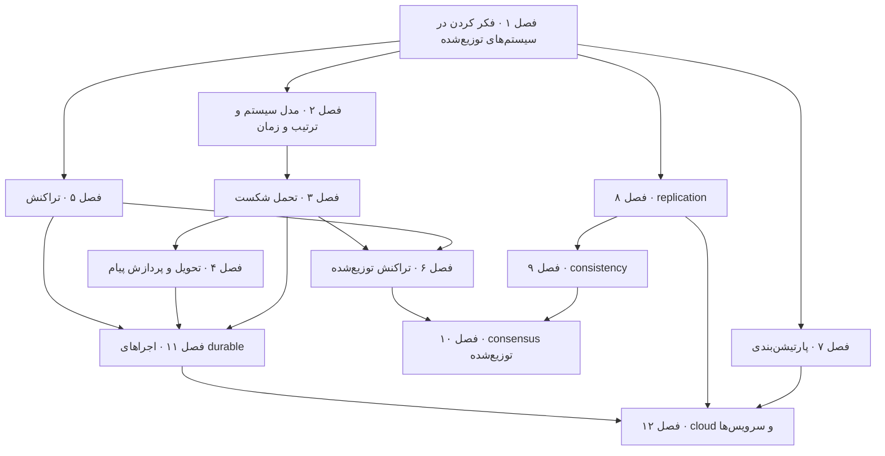

# Think Distributed Systems

**فایل [`index.html`](index.html) را در مرورگر باز کنید** تا نسخه‌ی تعاملی را ببینید: برای هر فصل یک درس اسلاید‌به‌اسلاید، با شبیه‌سازی‌های جاسازی‌شده و خودسنجی. هر چیزی که این‌جاست روی GitHub هم خوب خوانده می‌شود.

## درباره‌ی کتاب

فرض بنیادی کتاب این است که هر برنامه‌ی امروزی یک سیستم توزیع‌شده است. **مدل‌های ذهنی** سیستم‌های توزیع‌شده را یاد می‌دهد و نه فناوری‌ها یا فهرستی از الگوریتم‌ها: هدفش مدل‌هایی است که *درست* و به‌اندازه‌ی کافی *کامل* باشند که بشود با آن‌ها استدلال کرد (pp. xiv, 3–4). برای مهندس‌های نرم‌افزار و از اصل‌های اولیه نوشته شده و به تجربه‌ی قبلی نیاز ندارد (p. xiv). آگاهانه نمونه‌ی کد کمی دارد، چون بخش سخت سیستم‌های توزیع‌شده تعامل بین مؤلفه‌هاست و نه پیاده‌سازی یکی از آن‌ها (p. xv). به‌جایش مدل سیستم و تصویر به کار می‌برد.

ابزارهای تکرارشونده در کل کتاب:

- **لحظه‌های آها!**، جایی که نویسنده بینشی را می‌گوید که یک مفهوم را برایش جا انداخته.
- **شرکت سیستم‌های توزیع‌شده**، ساختمانی اداری که اتاق‌هایش مؤلفه‌اند و لوله‌های بادی‌اش شبکه (pp. 16–18).
- **تعریف‌های دقیق و بی‌کد** از شرایط مسابقه و concurrency و idempotence و سرویس.

نویسنده، Dominik Tornow، بنیان‌گذار و مدیرعامل Resonate HQ است و در مهندسی و مدل‌سازی سیستم‌ها تخصص دارد (درباره‌ی نویسنده، ص. شانزده).

## محتوای این پوشه

| مسیر | چه چیزی است |
|---|---|
| [`chapters/NN-*.md`](chapters/01-thinking-in-distributed-systems-models-mindsets-and-mechanics.md) | یادداشت‌های فصل، **منبع حقیقت**. هر `.md` یک درس `.html` ساخته‌شده کنارش دارد |
| [`widgets/`](widgets/01-interleavings.html) | شبیه‌سازی‌های دست‌ساز، جاسازی‌شده در درس‌ها؛ هر کدام جدا هم باز می‌شود |
| [`lab/`](lab/03-retry-strategies/README.md) | آزمایش‌های اجرا‌شدنی Python با خروجی مورد انتظار |
| `index.html` | صفحه‌ی اصلی کتاب، ساخته‌شده از این README و فصل‌ها |

## کتاب چطور به هم وصل است

نقشه‌ی راه در دوازده فصل از مفهوم‌های بنیادی به پیشرفته می‌رود (pp. xiv–xv):

- فصل‌های ۱ تا ۴ واژگان را می‌سازند: مدل ذهنی، مدل سیستم و زمان، شکست، و تحویل پیام.
- فصل‌های ۵ و ۶ تراکنش را به‌عنوان انتزاعی نشان می‌دهند که concurrency و شکست را قایم می‌کند، روی یک نود و روی چندتا.
- فصل‌های ۷ تا ۱۰ تکنیک‌های مقیاس‌پذیری و قابلیت اطمینان، یعنی پارتیشن‌بندی و replication، و این که replicaها چه می‌توانند نشان بدهند، یعنی سازگاری، و این که چطور توافق کنیم، یعنی consensus، را می‌پوشانند.
- فصل‌های ۱۱ و ۱۲ همه چیز را روی فرایندهای طولانی، یعنی اجرای بادوام، و روی cloud و سرویس‌ها اعمال می‌کنند.

*فلش‌ها خوانش vault از وابستگی فصل‌هاست؛ ترتیب فصل‌ها مال خود کتاب است.*

چند رشته در کل کتاب می‌دوند:

- **ایمنی و liveness** درستی را تعریف می‌کنند (فصل ۱)، تحمل شکست را رده‌بندی (فصل ۳)، تعهد اتمی را مشخص (فصل ۶) و consensus را مشخص (فصل ۱۰).
- **نگاه سراسری در برابر محلی** در شرکت سیستم‌های توزیع‌شده (فصل ۱) و بلاتکلیفی فرستنده (فصل ۴) و سرویس‌ها به‌عنوان قرارداد (فصل ۱۲) پیدا می‌شود.
- **هم‌ارزی** به شکل serializability (فصل‌های ۱ و ۵)، معنای exactly-once (فصل ۴)، «یک چیز» در replication (فصل ۸)، consistency modelها (فصل ۹) و بازیابی failure-transparent (فصل ۱۱) پیدا می‌شود.
- **سطح برنامه در برابر سطح بستر** رده‌های شکست را جدا می‌کند (فصل ۳)، و C در ACID را از A و I و D (فصل ۵)، و دو لایه‌ی Raft را (فصل ۱۰)، و saga را از اجرای durable (فصل ۱۱).

## فصل‌ها

| # | فصل | صفحه |
|---:|---|---|
| ۱ | [فکر کردن در سیستم‌های توزیع‌شده: مدل‌ها، ذهنیت‌ها و مکانیک](chapters/01-thinking-in-distributed-systems-models-mindsets-and-mechanics.md) | ۱–۲۲ |
| ۲ | [مدل سیستم، ترتیب و زمان](chapters/02-system-models-order-and-time.md) | ۲۳–۳۹ |
| ۳ | [تحمل شکست](chapters/03-failure-tolerance.md) | ۴۰–۵۴ |
| ۴ | [تحویل و پردازش پیام](chapters/04-message-delivery-and-processing.md) | ۵۵–۶۶ |
| ۵ | [تراکنش](chapters/05-transactions.md) | ۶۷–۷۸ |
| ۶ | [تراکنش توزیع‌شده](chapters/06-distributed-transactions.md) | ۷۹–۸۹ |
| ۷ | [پارتیشن‌بندی](chapters/07-partitioning.md) | ۹۰–۱۰۵ |
| ۸ | [replication](chapters/08-replication.md) | ۱۰۶–۱۱۶ |
| ۹ | [consistency](chapters/09-consistency.md) | ۱۱۷–۱۳۰ |
| ۱۰ | [consensus توزیع‌شده](chapters/10-distributed-consensus.md) | ۱۳۱–۱۴۴ |
| ۱۱ | [اجراهای durable](chapters/11-durable-executions.md) | ۱۴۵–۱۵۵ |
| ۱۲ | [cloud و سرویس‌ها](chapters/12-cloud-and-services.md) | ۱۵۶–۱۶۷ |

بازه‌های صفحه، صفحه‌ی چاپی‌اند. صفحه‌های اول کتاب، یعنی پیش‌گفتار و درباره‌ی این کتاب و درباره‌ی نویسنده، با عدد رومی شماره خورده‌اند، و کتاب با یک index از ص. ۱۶۸ تمام می‌شود.

## مفهوم‌های کلیدی

این ایده‌ها در فصل‌ها تکرار می‌شوند؛ هر ردیف فصل‌هایی را می‌آورد که بحثشان می‌کنند. تعریف‌ها خلاصه‌های vault از توضیح‌های کتاب‌اند.

| مفهوم | تعریف | فصل‌ها |
|---|---|---|
| مدل ذهنی | نمایشی درونی از یک سیستم. مدل خوب درست است، یعنی نادرستی ندارد، و کامل، یعنی چیز مربوطی را نینداخته. | [۱](chapters/01-thinking-in-distributed-systems-models-mindsets-and-mechanics.md) · [۱۲](chapters/12-cloud-and-services.md) |
| ایمنی و liveness | ایمنی: چیز بدی هیچ‌وقت نمی‌افتد. liveness: چیز خوبی سرانجام می‌افتد. سیستم درست است اگر هر رفتار ممکنش هر دو را برآورده کند. | [۱](chapters/01-thinking-in-distributed-systems-models-mindsets-and-mechanics.md) · [۳](chapters/03-failure-tolerance.md) · [۶](chapters/06-distributed-transactions.md) · [۱۰](chapters/10-distributed-consensus.md) |
| نگاه سراسری در برابر محلی | ناظری همه‌دان کل سیستم را می‌بیند؛ یک مؤلفه فقط حالت خودش و کانالش به «بقیه‌ی سیستم» را می‌بیند. | [۱](chapters/01-thinking-in-distributed-systems-models-mindsets-and-mechanics.md) · [۴](chapters/04-message-delivery-and-processing.md) · [۱۲](chapters/12-cloud-and-services.md) |
| مدل سیستم | فرض‌هایی درباره‌ی مؤلفه‌ها و شبکه و زمان‌بندی که درستی یک الگوریتم به آن‌ها بستگی دارد. مدل واقع‌بینانه partially synchronous است، با شکست‌های crash و recovery روی شبکه‌ای نامطمئن. | [۲](chapters/02-system-models-order-and-time.md) · [۴](chapters/04-message-delivery-and-processing.md) · [۸](chapters/08-replication.md) |
| شرایط مسابقه | سیستمی با چند اجرای ممکن، یعنی درهم‌آمیختگی، که بعضی‌شان نادرست حساب می‌شوند. | [۱](chapters/01-thinking-in-distributed-systems-models-mindsets-and-mechanics.md) · [۲](chapters/02-system-models-order-and-time.md) · [۵](chapters/05-transactions.md) |
| رابطه‌ی happened-before | ترتیب جزئی رویدادها از Lamport: ترتیب درون یک مؤلفه و فرستادن به گرفتن، بسته زیر تعدی. علیت بالقوه را می‌گیرد. | [۲](chapters/02-system-models-order-and-time.md) |
| تحمل شکست | رفتار کردن به شکلی خوب‌تعریف‌شده با وجود شکست. یا masking است، یعنی ایمن و زنده، یا nonmasking، یعنی زنده، یا fail-safe، یعنی ایمن. | [۳](chapters/03-failure-tolerance.md) · [۶](chapters/06-distributed-transactions.md) |
| بازیابی رو‌به‌جلو در برابر رو‌به‌عقب | بازیابی رو‌به‌جلو از شکست رد می‌شود و به حالت نهایی می‌رسد، با تلاش دوباره و Redo. بازیابی رو‌به‌عقب به حالت اولیه برمی‌گردد، با جبران و Undo. | [۳](chapters/03-failure-tolerance.md) · [۵](chapters/05-transactions.md) · [۱۱](chapters/11-durable-executions.md) |
| ویژگی idempotence | تکرار یک عملیات اثری هم‌ارز با یک‌بار انجام دادنش دارد. با پردازش دست‌کم‌یک‌بار، معنای پردازش exactly-once می‌دهد. | [۴](chapters/04-message-delivery-and-processing.md) · [۵](chapters/05-transactions.md) · [۱۱](chapters/11-durable-executions.md) |
| ویژگی serializability | تراکنش‌های هم‌زمان درست‌اند اگر اثرشان با ترتیبی پشت‌سرهم هم‌ارز باشد. | [۱](chapters/01-thinking-in-distributed-systems-models-mindsets-and-mechanics.md) · [۵](chapters/05-transactions.md) · [۹](chapters/09-consistency.md) |
| تعهد اتمی | همه‌ی شرکت‌کننده‌های یک تراکنش توزیع‌شده commit می‌کنند، یا همه abort. روش Two-Phase Commit این کار را می‌کند ولی اگر coordinatorاش شکست بخورد بند می‌آید. | [۶](chapters/06-distributed-transactions.md) · [۱۰](chapters/10-distributed-consensus.md) |
| پارتیشن‌بندی در برابر replication | پارتیشن‌بندی یک object منطقی را با بخش‌های مجزا نمایش می‌دهد، برای مقیاس‌پذیری. روش replication آن را با کل‌های یکسان نمایش می‌دهد، برای قابلیت اطمینان. | [۷](chapters/07-partitioning.md) · [۸](chapters/08-replication.md) |
| consistency model | محمولی روی تاریخچه‌ها که معتبر را از نامعتبر جدا می‌کند. مدل قوی‌تر تاریخچه‌های کمتری را اجازه می‌دهد؛ linearizability و eventual consistency دو سر طیف‌اند. | [۵](chapters/05-transactions.md) · [۹](chapters/09-consistency.md) |
| quorum | اکثریتی از process‌ها، یعنی Q بزرگ‌تر از N تقسیم بر ۲، پس هر دو quorum اشتراک دارند. تحمل f شکست به 2f + 1 process نیاز دارد. | [۸](chapters/08-replication.md) · [۱۰](chapters/10-distributed-consensus.md) |
| replication state machine | processهای قطعی یکسانی که همان ورودی‌ها را به همان ترتیب می‌گیرند هم‌گام می‌مانند. consensus روی log یک گروه را تحمل‌کننده‌ی خطا می‌کند. | [۸](chapters/08-replication.md) · [۱۰](chapters/10-distributed-consensus.md) |
| شفافیت شکست | اجرایی که شکست خورده و برگشته با اجرایی بی‌شکست هم‌ارز است، زیر هم‌ارزی‌ای که برنامه انتخاب می‌کند. | [۳](chapters/03-failure-tolerance.md) · [۱۱](chapters/11-durable-executions.md) |
| کشسانی | رسیدن به مقیاس‌پذیری و قابلیت اطمینان با گرفتن و آزاد کردن منابع به‌درخواست. پایه‌ی محاسبات cloud-native و serverless است. | [۷](chapters/07-partitioning.md) · [۱۲](chapters/12-cloud-and-services.md) |

## این یادداشت‌ها چطور نوشته شده‌اند

- **هر چیزی بالای *فراتر از کتاب* در یک یادداشت فصل، خود کتاب را بازگو می‌کند**، با ارجاع صفحه‌ی چاپی. مطالب تکمیلی، یعنی منبع‌های بیرونی و تفسیر vault، زیر *فراتر از کتاب* یا در کادرهای `> **Vault note:**` می‌نشینند.
- فهرست‌های بخش، همان فهرست مطالب تو‌در‌توی خود کتاب‌اند که از bookmarkهای PDF گرفته شده.
- نمودارهای Mermaid، بازکشی‌های vault از شکل‌های کتاب‌اند یا خلاصه‌های خودش. زیرنویس‌ها می‌گویند کدام است.
- پرسش و پاسخ‌های *خودتان را بسنجید* مال vault است و از روی یادداشت‌ها نوشته شده؛ پاسخ‌ها به صفحه ارجاع می‌دهند.
- شبیه‌سازی‌ها و آزمایش‌ها پیاده‌سازی‌های خود vault از سازوکارهایی‌اند که کتاب توضیحشان می‌دهد. هر کدام می‌گوید کدام صفحه‌ها را نشان می‌دهد و چه چیزی را ساده کرده.
- خیلی از موضوع‌ها در [Designing Data-Intensive Applications](../designing-data-intensive-applications/README.md) و [Database Internals](../database-internals/README.md) هم می‌آیند. شبیه‌سازی‌های این کتاب زاویه‌ی خودش را می‌گیرند، یعنی نمونه‌ها و شکل‌ها و معماهای خودش، و یادداشت‌های فصل به هم پیوند می‌خورند.
- چند ارجاع متقابل کتاب به فصل غلطی اشاره می‌کنند، مثل تعهد اتمی که «فصل ۸» گفته شده و پردازش exactly-once که «فصل ۶». یادداشت‌ها به فصل درست پیوند می‌دهند و در یک vault note می‌گویندش.

## منبع

- **منبع اصلی:** فایل PDF ناشر از ویراست اول، © 2025 Manning Publications، با ۱۹۴ صفحه‌ی PDF. شماره‌ی صفحه‌ی چاپی برابر شماره‌ی صفحه‌ی PDF منهای بیست است. فایل PDF بیرون از کنترل نسخه نگه داشته می‌شود؛ `.gitignore` را ببینید.
- **فهرست مطالب:** از فهرست bookmarkهای PDF گرفته شده، که بخش‌ها و زیربخش‌های هر فصل را با شماره‌ی صفحه می‌دهد.
- **ساختار:** صفحه‌های اول، یعنی پیش‌گفتار و قدردانی و درباره‌ی این کتاب و درباره‌ی نویسنده، بعد دوازده فصل که هر کدام با یک خلاصه تمام می‌شوند، و یک index.
- **پوشش:** هر دوازده فصل پوشانده شده‌اند.
