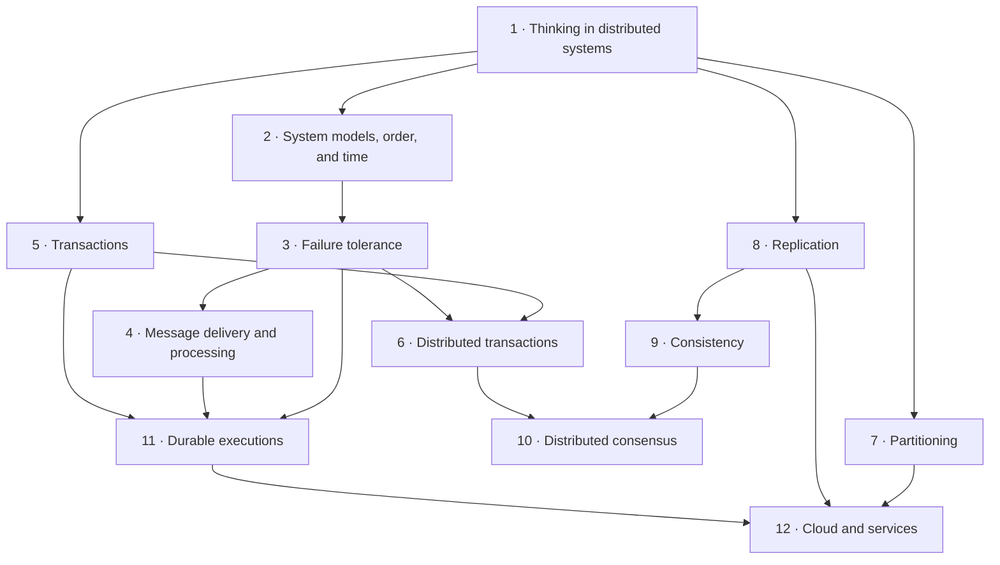

# Think Distributed Systems

**Open [`index.html`](index.html) in a browser** for the interactive version: one slide-by-slide lesson per chapter, with embedded simulations and self-checks. Everything here also reads fine on GitHub.

## About

The book's premise is that every modern application is a distributed system. It teaches **mental models** for distributed systems rather than technologies or a catalog of algorithms: it aims for models that are *correct* and *complete* enough to reason with (about this book, p. xiv; pp. 3–4). It's written for software engineers from first principles, with no prior experience needed (p. xiv). It deliberately has few code examples, because the hard part of distributed systems is the interaction between components, not the implementation of one (p. xv). It uses system models and illustrations instead.

Recurring devices throughout the book:

- **Aha! moments**, where the author shares the insight that made a concept click.
- **Distributed Systems Incorporated**, an office building whose rooms are components and whose pneumatic tubes are the network (pp. 16–18).
- **Precise, code-free definitions** of race conditions, concurrency, idempotence and services.

The author, Dominik Tornow, is the founder and CEO of Resonate HQ and specializes in systems engineering and modelling (about the author, p. xvi).

## What's in this folder

| Path | What it is |
|---|---|
| [`chapters/NN-*.md`](chapters/01-thinking-in-distributed-systems-models-mindsets-and-mechanics.md) | Chapter notes, **the source of truth**. Each `.md` has a generated `.html` lesson next to it |
| [`widgets/`](widgets/01-interleavings.html) | Hand-built simulations, embedded in the lessons; each also opens on its own |
| [`lab/`](lab/03-retry-strategies/README.md) | Runnable Python experiments with expected output |
| `index.html` | The book hub, generated from this README and the chapters |

## How the book fits together

The road map runs from fundamental to advanced concepts in 12 chapters (pp. xiv–xv):

- Chapters 1–4 build the vocabulary: mental models, system models and time, failure, and message delivery.
- Chapters 5–6 show transactions as the abstraction that hides concurrency and failure, on one node and on many.
- Chapters 7–10 cover the techniques for scalability and reliability (partitioning and replication), what replicas may show (consistency), and how to agree (consensus).
- Chapters 11–12 apply everything to long-running processes (durable executions) and to the cloud and services.

*The arrows are the vault's reading of the chapters' dependencies; the chapter order is the book's.*

Some threads run through the whole book:

- **Safety and liveness** define correctness (1), classify failure tolerance (3), specify atomic commitment (6) and specify consensus (10).
- **Global vs. local view** appears in Distributed Systems Incorporated (1), the sender's uncertainty (4) and services as contracts (12).
- **Equivalence** appears as serializability (1, 5), exactly-once semantics (4), "one thing" in replication (8), consistency models (9) and failure-transparent recovery (11).
- **Application level vs. platform level** separates failure classes (3), ACID's consistency from A, I and D (5), Raft's two layers (10), and sagas from durable execution (11).

## Chapters

| # | Chapter | Pages |
|---:|---|---|
| 1 | [Thinking in distributed systems: Models, mindsets, and mechanics](chapters/01-thinking-in-distributed-systems-models-mindsets-and-mechanics.md) | 1–22 |
| 2 | [System models, order, and time](chapters/02-system-models-order-and-time.md) | 23–39 |
| 3 | [Failure tolerance](chapters/03-failure-tolerance.md) | 40–54 |
| 4 | [Message delivery and processing](chapters/04-message-delivery-and-processing.md) | 55–66 |
| 5 | [Transactions](chapters/05-transactions.md) | 67–78 |
| 6 | [Distributed transactions](chapters/06-distributed-transactions.md) | 79–89 |
| 7 | [Partitioning](chapters/07-partitioning.md) | 90–105 |
| 8 | [Replication](chapters/08-replication.md) | 106–116 |
| 9 | [Consistency](chapters/09-consistency.md) | 117–130 |
| 10 | [Distributed consensus](chapters/10-distributed-consensus.md) | 131–144 |
| 11 | [Durable executions](chapters/11-durable-executions.md) | 145–155 |
| 12 | [Cloud and services](chapters/12-cloud-and-services.md) | 156–167 |

Page ranges are printed pages. Front matter (preface, about this book, about the author) is numbered in roman numerals, and the book ends with an index (from p. 168).

## Key concepts

These ideas recur across chapters; each row lists the chapters that discuss them. The definitions are the vault's summaries of the book's explanations.

| Concept | Definition | Chapters |
|---|---|---|
| Mental model | An internal representation of a system. A good one is correct (no falsehoods) and complete (no relevant omissions). | [1](chapters/01-thinking-in-distributed-systems-models-mindsets-and-mechanics.md) · [12](chapters/12-cloud-and-services.md) |
| Safety and liveness | Safety: something bad never happens. Liveness: something good eventually happens. A system is correct if every possible behavior satisfies both. | [1](chapters/01-thinking-in-distributed-systems-models-mindsets-and-mechanics.md) · [3](chapters/03-failure-tolerance.md) · [6](chapters/06-distributed-transactions.md) · [10](chapters/10-distributed-consensus.md) |
| Global vs. local view | An all-knowing observer sees the whole system; a component sees only its own state and its channel to "the rest of the system". | [1](chapters/01-thinking-in-distributed-systems-models-mindsets-and-mechanics.md) · [4](chapters/04-message-delivery-and-processing.md) · [12](chapters/12-cloud-and-services.md) |
| System model | The assumptions about components, network and timing that an algorithm's correctness depends on. The realistic one is partially synchronous, with crash and recovery failures over an unreliable network. | [2](chapters/02-system-models-order-and-time.md) · [4](chapters/04-message-delivery-and-processing.md) · [8](chapters/08-replication.md) |
| Race condition | A system with several possible executions (interleavings), some of which are considered incorrect. | [1](chapters/01-thinking-in-distributed-systems-models-mindsets-and-mechanics.md) · [2](chapters/02-system-models-order-and-time.md) · [5](chapters/05-transactions.md) |
| Happened-before | Lamport's partial order of events: intra-component order and send→receive, closed under transitivity. It captures potential causality. | [2](chapters/02-system-models-order-and-time.md) |
| Failure tolerance | Behaving in a well-defined way despite failures. It is masking (safe and live), nonmasking (live), or fail-safe (safe). | [3](chapters/03-failure-tolerance.md) · [6](chapters/06-distributed-transactions.md) |
| Forward vs. backward recovery | Forward recovery pushes past a failure to the final state (retries, Redo). Backward recovery returns to the initial state (compensation, Undo). | [3](chapters/03-failure-tolerance.md) · [5](chapters/05-transactions.md) · [11](chapters/11-durable-executions.md) |
| Idempotence | Repeating an operation has an effect equivalent to doing it once. Together with at-least-once processing, it yields exactly-once processing semantics. | [4](chapters/04-message-delivery-and-processing.md) · [5](chapters/05-transactions.md) · [11](chapters/11-durable-executions.md) |
| Serializability | Concurrent transactions are correct if their effect is equivalent to some serial order. | [1](chapters/01-thinking-in-distributed-systems-models-mindsets-and-mechanics.md) · [5](chapters/05-transactions.md) · [9](chapters/09-consistency.md) |
| Atomic commitment | All participants of a distributed transaction commit, or all abort. Two-Phase Commit does this but blocks if its coordinator fails. | [6](chapters/06-distributed-transactions.md) · [10](chapters/10-distributed-consensus.md) |
| Partitioning vs. replication | Partitioning represents one logical object by disjoint parts, for scalability. Replication represents it by identical wholes, for reliability. | [7](chapters/07-partitioning.md) · [8](chapters/08-replication.md) |
| Consistency model | A predicate on histories that separates valid from invalid ones. Stronger models allow fewer histories; linearizability and eventual consistency are the two extremes. | [5](chapters/05-transactions.md) · [9](chapters/09-consistency.md) |
| Quorum | A majority of processes (Q > N/2), so any two quorums intersect. Tolerating f failures needs 2f + 1 processes. | [8](chapters/08-replication.md) · [10](chapters/10-distributed-consensus.md) |
| State machine replication | Identical deterministic processes fed the same inputs in the same order stay in lockstep. Consensus on the log makes a group fault-tolerant. | [8](chapters/08-replication.md) · [10](chapters/10-distributed-consensus.md) |
| Failure transparency | A failed and recovered execution is equivalent to a failure-free one, under an equivalence the application chooses. | [3](chapters/03-failure-tolerance.md) · [11](chapters/11-durable-executions.md) |
| Elasticity | Achieving scalability and reliability by acquiring and releasing resources on demand. It is the basis of cloud-native and serverless computing. | [7](chapters/07-partitioning.md) · [12](chapters/12-cloud-and-services.md) |

## How these notes work

- **Everything above *Beyond the book* in a chapter note restates the book**, with printed page references. Supplementary material, meaning outside sources and the vault's interpretation, lives under *Beyond the book* or in `> **Vault note:**` callouts.
- Section outlines are the book's own nested table of contents, taken from the PDF's bookmarks.
- Mermaid diagrams are the vault's redrawings of the book's figures, or its own summaries. Captions say which.
- *Check yourself* questions and answers are the vault's, written from the notes; the answers cite pages.
- Simulations and experiments are the vault's own implementations of mechanisms the book describes. Each says which pages it illustrates and what it simplifies.
- Many topics also appear in [Designing Data-Intensive Applications](../designing-data-intensive-applications/README.md) and [Database Internals](../database-internals/README.md). This book's simulations take its own angle (its examples, figures and puzzles), and the chapter notes link across.
- A few of the book's cross-references point at the wrong chapter, such as atomic commitment ("chapter 8") and exactly-once processing ("chapter 6"). The notes link to the right chapter and say so in a vault note.

## Source

- **Primary source:** the publisher's PDF of the first edition, © 2025 Manning Publications (194 PDF pages). The printed page number is the PDF page number minus 20. The PDF is kept outside version control (see `.gitignore`).
- **Table of contents:** taken from the PDF's bookmark outline, which gives each chapter's sections and subsections with page numbers.
- **Structure:** front matter (preface, acknowledgments, about this book, about the author), 12 chapters each ending with a summary, and an index.
- **Coverage:** all 12 chapters are covered.
