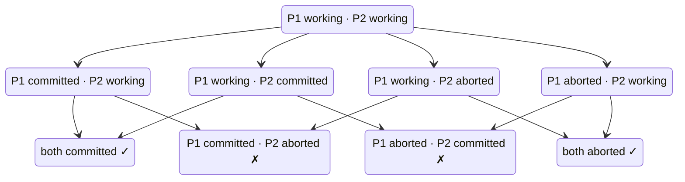

# 1. Thinking in distributed systems: Models, mindsets, and mechanics

[Book](../README.md) · [2. System models, order, and time →](02-system-models-order-and-time.md)

## Summary

The book's premise is that every modern application is distributed. The question is only *how* distributed, because no single component can handle unbounded load or survive inevitable failures (pp. 1–2). A **distributed system** is a collection of collaborating, concurrent components that communicate by sending and receiving messages over a network. Its behavior and complexity **emerge** from the components and their interactions (p. 1).

The chapter is about **mental models**: internal representations of a system that should be **correct** (no falsehoods) and **complete** (no relevant omissions) (pp. 3–4). It describes a system as a **state machine** that takes one step at a time, and correctness as **safety plus liveness** (pp. 8–11). **Scalability and reliability** are responsiveness under load and under failure (p. 12). Two big ideas run through the rest of the book: **systems of systems** (holons) and **global versus local views** (pp. 13–16). The chapter's recurring analogy is **Distributed Systems Incorporated**, an office building whose rooms are components and whose pneumatic tubes are the network (pp. 16–18). It ends by defining race conditions and serializability without code, over the set of possible interleavings (pp. 21–22).

## Key takeaways

- **Knowing isn't understanding.** Learning the rules of chess is quick; mastering its strategy is not. The book aims for understanding (p. 3).
- **A good mental model is correct and complete.** Every fact in the model is a fact of the system, and every *relevant* fact of the system is in the model. What counts as relevant depends on what you're trying to do (p. 4).
- **Different models can all be valid.** Some are equivalent (the network buffers in-flight messages, or each component does), and some deliberately capture different aspects (pp. 5–7).
- **Behavior is a sequence of states.** At any moment exactly one component, or the network, takes exactly one step, either external (send or receive) or internal (pp. 8–9).
- **Correctness = safety and liveness.** Safety: something bad never happens. Liveness: something good eventually happens. A system is correct if every possible behavior meets both (Lamport) (pp. 9–10).
- **Scalability and reliability are responsiveness:** keeping the error rate below the error budget under load and under failure. Both are **application-specific** and **emergent** (pp. 12–13).
- **The core challenge is thinking globally while acting locally.** A component sees only its own state, yet the system must behave correctly as a whole. Split brain is the classic failure of this (pp. 15–20).
- **A race condition** exists when some interleavings of concurrent processes are considered incorrect. **Serializability** demands that every interleaving equal P·Q or Q·P (pp. 21–22).

## Section outline

*From the book’s own table of contents (PDF bookmarks); printed page numbers.*

- 1.1 Software engineering and mental models — p. 2
  - 1.1.1 Mental models: The foundation of reasoning — p. 3
  - 1.1.2 Correct mental models — p. 4
  - 1.1.3 Complete mental models — p. 4
- 1.2 Mental model of software systems — p. 4
- 1.3 Different types of models — p. 5
  - 1.3.1 Different models describing the same aspects — p. 5
  - 1.3.2 Different models describing different aspects of a system — p. 6
- 1.4 Thinking about distributed systems — p. 8
  - 1.4.1 Correctness — p. 9
  - 1.4.2 Scalability and reliability — p. 12
  - 1.4.3 Responsiveness — p. 12
- 1.5 Two big ideas — p. 13
  - 1.5.1 Systems of systems — p. 13
  - 1.5.2 Global view vs. local view — p. 15
- 1.6 Distributed Systems Incorporated — p. 16
- 1.7 Navigating complexity — p. 18
  - 1.7.1 Simple yet complex — p. 18
  - 1.7.2 Emergent behavior — p. 19
  - 1.7.3 Changing perspective — p. 19
  - 1.7.4 Think globally; act locally — p. 20
- 1.8 Thinking above the code — p. 21

## Notes

Why distribute at all? Engineers judge a system by **correctness, scalability and reliability**: it must do its job under increasing load and despite inevitable failures. One component can be functional, but it can't absorb unbounded load or survive its own crash, so we need more than one (p. 2). The author shares his own "aha! moments" throughout the book (p. 2).

### 1.1 Software engineering and mental models

Software engineering is often confusing because we lack shared, robust models. Civil engineering has physics, mathematics and standard diagrams, while software engineers can't agree on what a microservice, the cloud or serverless is (p. 2). The goal is an **accurate, concise mental model**: an internal representation you can reason with confidently, instead of poking the system and rationalizing what it does (p. 2).

#### Mental models, correct and complete (pp. 3–4)

A **model** represents a target system; a **mental model** is the internal representation that underlies comprehension and communication (p. 3). Think of both as sets of facts:

| | Is a set of facts that constitutes… | Good when… (p. 4) |
|---|---|---|
| **System** | the ground truth | — |
| **Mental model** | our perceived truth | **correct**: every model fact is a system fact (no falsehoods); **complete**: every *relevant* system fact is a model fact (no omissions) |

The book's circuit example (Figure 1.1): a model that gives the bulb's resistance as 3.0 Ω is correct and complete for computing current, but incomplete for brightness, which also needs luminous efficiency (p. 4).

### 1.2 Mental model of software systems

Software systems are **virtual** constructs. Components and networks aren't physical things you can find; the system *behaves as though* it were made of them. So several equivalent models can describe the observable behavior equally well (p. 4). The author follows Edward A. Lee's view that so many layers separate software from electrons in silicon that the physical connection becomes meaningless (p. 4).

> **Vault note:** the book's sidebar "Beware the analogy" (p. 5) warns that analogies, such as electricity flowing like water, transfer understanding only up to the point where the similarity ends. Students often don't know where that point is.

### 1.3 Different types of models

Distributed systems are described informally or formally, as action machines, state machines, state-action machines or process algebras. Each perspective adds depth, and studying several exposes omissions and inconsistencies in your thinking (p. 5).

| Relationship | Example (pp. 5–7) |
|---|---|
| **Same aspects, equivalent models** (Figure 1.2) | The network as a bus *plus* a buffer of in-flight messages (Figure 1.3), or the network as a bus with a buffer in each component (Figure 1.4). Both can express loss, duplication and reordering; the choice is preference |
| **Different aspects** (Figure 1.5) | Lamport's TLA+ course: the *Transaction Commit* protocol (an abstraction of all distributed transaction protocols) ignores messages; *Two-Phase Commit* (one implementation) models them, so only it can represent lost, duplicated or reordered messages |

The sidebar on the blind men and the elephant makes the same point: when you meet a different model, ask *why* the author chose it before deciding it's wrong (p. 8).

### 1.4 Thinking about distributed systems

Each component has **exclusive access to its local state**, and the network has exclusive access to its own, including in-flight messages (Figure 1.6) (p. 8). The system's behavior is a **sequence of states**, a state machine, where each step moves the system to the next state (Figure 1.7) (pp. 8–9).

| Step type | Examples (p. 8) |
|---|---|
| **External** | Sending a message, receiving a message |
| **Internal** | Local computation, accessing local state |

The model assumes that at any moment, exactly one component or the network completes exactly one step (p. 8). Other texts call components actors, agents, processes or nodes, and call steps actions or events (p. 9).

#### 1.4.1 Correctness (pp. 9–12)

Lamport's definition, from "Proving the Correctness of Multiprocess Programs" (pp. 9–10):

- **Safety:** something bad never happens.
- **Liveness:** something good eventually happens.
- A system is correct if *every possible behavior* satisfies both (Figure 1.8).

The book's example is a distributed transaction that sets `b` at participant P1 and `a` at participant P2 (Listing 1.1). Each participant is *working*, *committed* or *aborted*, and each step moves one participant out of *working* (Figure 1.9) (pp. 10–11):

*The vault's redrawing of Figure 1.9.* Staying in *working* forever violates **liveness** ("can't stay here"). Reaching a mixed commit/abort state violates **safety** ("must not get here"). Together they say that both participants eventually reach the *same* decision (p. 11).

The model deliberately ignores keys, values and locks: the author asserts that they're irrelevant here, and you may disagree without either of you being wrong (p. 12).

> **Try it:** [Behavior space of a transaction](../widgets/01-behavior-space.html) — step the two participants of Figure 1.9 one transition at a time and see which behaviors violate safety, which get stuck and violate liveness, and which are correct.

#### 1.4.2–1.4.3 Scalability, reliability and responsiveness (p. 12)

Alpern and Schneider proved that every property is an intersection of a safety and a liveness property, but the author doesn't think about scalability and reliability that way (p. 12). He uses **responsiveness**, a system's ability to meet its service-level objectives:

- **Scalability:** being responsive in the presence of **load**.
- **Reliability:** being responsive in the presence of **failure**.

| Concept | Definition (p. 12) |
|---|---|
| **Service-level indicator (SLI)** | A quantitative observation of the system's behavior |
| **Service-level objective (SLO)** | A predicate on an SLI: does this observation meet the objective? |
| **Error rate** | Observations that miss their objective ÷ all observations, over a fixed interval |
| **Error budget** | The acceptable upper limit on the error rate |

**Responsiveness** means keeping the error rate below the error budget. Two aha! moments follow (p. 13):

- These guarantees are **application-specific**: what one team calls broken, another calls acceptable.
- They are **emergent**: no single component can absorb infinite load or survive a crash, so the guarantees come from the components and their interactions.

### 1.5 Two big ideas

#### Systems of systems (pp. 13–15)

The definition suggests components are atomic, but most are **subsystems** (Figure 1.10) (p. 13). Arthur Koestler's **holon** (*The Ghost in the Machine*, 1967) is a whole in itself and part of a larger whole; a hierarchy of holons is a **holarchy** (Figure 1.11). Holarchies can capture the "messy" organization of real systems and let you zoom in or out (p. 14).

The book's example is a multitenant database replicated by consensus (Paxos, Raft or Viewstamped Replication), with two tenants and three nodes. You can view it as one cluster made of three nodes, or as two tenant databases each made of the nodes (Figure 1.12). Which entities you treat as atomic depends on the point you're making (pp. 14–15).

#### Global view vs. local view (pp. 15–16)

An all-knowing observer has a **global view** and can determine the whole system state (Figure 1.13). A component has a **local view**: only its own state and its own channel to the network (Figure 1.14). To learn the global state, it needs the other components to send their local states (pp. 15–16). A component never talks *directly* to another. C1 hands a message addressed to C2 to the network, which may or may not deliver it (p. 16).

### 1.6 Distributed Systems Incorporated

The book's running analogy is a corporation in an office building (Figure 1.15) (pp. 16–17):

| Building | Distributed system |
|---|---|
| Rooms and their occupants | Concurrent components with local state |
| Pneumatic tubes through the mailroom | The network |
| The building's mailbox | The external interface |

It can express failure concerns (pp. 17–18):

- **Crash semantics:** a short break is a *transient* failure, a vacation an *intermittent* one, and leaving the company a *permanent* one.
- **Message-delivery semantics:** Bob in the mailroom may lose, duplicate or reorder messages.

If an employee sends a request and gets no reply, they can't tell whether the request or the response was lost, and resending risks processing it twice (p. 18). The book suggests modelling Kubernetes or Kafka the same way (p. 18).

### 1.7 Navigating complexity

| Idea | Meaning (pp. 18–20) |
|---|---|
| **Simple yet complex** | Simple employees following simple rules can make a complex company |
| **Emergent behavior** | Scalability and reliability can't be traced to one employee; this is the basis of building reliable systems from unreliable parts |
| **Changing perspective** | Black box vs. white box is a change of *resolution*: both are still the all-knowing global view (Figure 1.16). The real shift is to a component's **local** view (Figure 1.17) |
| **Think globally; act locally** | Design a *global* algorithm that each component implements as a *local* algorithm. **Split brain**, where two rooms both believe they are the team leader (Figure 1.18), shows how hard that is |

### 1.8 Thinking above the code

The book has almost no code, by design: static snippets are poor at capturing dynamic systems (p. 21). A code-based definition makes race conditions look limited to single-variable updates. The book's model is more general (pp. 21–22):

- A **process** is a sequence of atomic actions: P = a·b·c, Q = x·y·z.
- The **concurrent composition** (P | Q) is the set of all possible interleavings of their actions.
- A **race condition** is a situation in which a *subset* of (P | Q) is considered incorrect. You are the arbiter of correctness (Figure 1.19).
- **Serializability:** (P | Q) is correct if every interleaving has the same effect as P·Q or Q·P (Figure 1.20).

The model applies at every level: threads, cooperative and preemptive multitasking, single-core and multicore machines, and multiple machines (p. 21).

> **Try it:** [Interleavings and race conditions](../widgets/01-interleavings.html) — two processes each read, increment and write a shared counter. List all 20 interleavings of their actions, mark which ones are incorrect, and check which are equivalent to a serial order.

### Summary

The chapter summary (pp. 22): a mental model is the basis of comprehension and communication; understanding beats knowing; the core challenge is a coherent whole built from components with only local knowledge; guarantees are reasoned about as safety and liveness plus scalability and reliability; and Distributed Systems Incorporated is a way to visualize it all.

## Trade-offs at a glance

| Lens | What it captures | What it leaves out |
|---|---|---|
| Black-box global view | The system's observable behavior | How components cooperate |
| White-box global view | Every component's state and the network | What any one component can actually know |
| Local view | What a component can observe and decide | Everything outside it |
| Safety + liveness | Functional correctness of every behavior | Load and failure (use responsiveness) |
| Responsiveness (SLIs/SLOs) | Scalability and reliability | Functional correctness |

## Beyond the book

- **How many interleavings?** Two processes of *m* and *n* atomic actions have C(m + n, m) interleavings, so 20 for 3 + 3 and 184,756 for 10 + 10. That growth is why model checkers such as TLA+'s TLC explore state spaces mechanically. The [interleavings widget](../widgets/01-interleavings.html) enumerates the 3 + 3 case exactly.
- **Lost update.** The book's race-condition definition covers the classic *lost update*. If two processes each read a counter, add one and write it back, many interleavings end with the counter at 1 instead of 2. [DDIA Ch. 8](../../designing-data-intensive-applications/chapters/08-transactions.md) discusses the same anomaly under weak isolation.
- **SRE vocabulary.** The SLI/SLO/error-budget terms follow Google's *Site Reliability Engineering* books, which the author recommends (p. 12). In practice SLOs are usually stated as percentiles over a window, for example "99% of requests under 300 ms over 28 days".

## Connections

- **Related chapters:** [2. System models, order, and time](02-system-models-order-and-time.md) (the assumptions behind every model), [3. Failure tolerance](03-failure-tolerance.md) (safety and liveness under failure), [5. Transactions](05-transactions.md) (serializability in depth), [6. Distributed transactions](06-distributed-transactions.md) (the transaction of Figure 1.9), [12. Cloud and services](12-cloud-and-services.md) (global and local views of a service).

## Check yourself

*Questions and answers are the vault's, written from the notes above; answers cite the book's pages.*

1. **What makes a mental model good?**

   *Answer:* It is correct (every fact of the model is a fact of the system) and complete (every relevant fact of the system is in the model). Relevance depends on the question you're asking (p. 4).

2. **In Figure 1.9, which state violates safety and which situation violates liveness?**

   *Answer:* Any state where one participant committed and the other aborted violates safety. Staying in "working" forever violates liveness (p. 11).

3. **The author defines reliability as…**
   - [ ] the absence of failures
   - [x] the ability to be responsive in the presence of failure
   - [ ] the ability to be responsive in the presence of load

   *Answer:* Scalability is responsiveness under load; reliability is responsiveness under failure (p. 12).

4. **What is the error budget?**

   *Answer:* An acceptable upper limit on the error rate, which is the share of observations that miss their SLO in a fixed interval. A system is responsive while its error rate stays below the budget (p. 12).

5. **What is a holon, and why is it useful here?**

   *Answer:* An entity that is both a whole and part of a larger whole (Koestler). It lets you treat a component as atomic or as a subsystem, depending on the point you're making (pp. 13–15).

6. **Why can't C1 "talk to" C2 directly?**

   *Answer:* C1 sends a message addressed to C2 to the network, which may or may not deliver it. C1 really communicates with the rest of the system (p. 16).

7. **Define a race condition without code.**

   *Answer:* For concurrent processes P and Q, (P | Q) is the set of all interleavings of their actions. A race condition exists when some subset of those interleavings is considered incorrect (p. 21).
