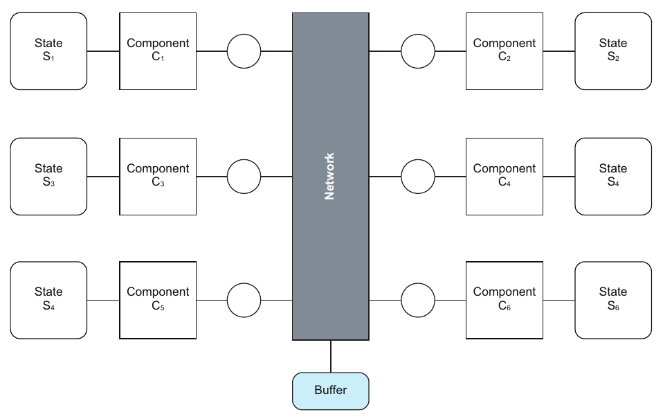
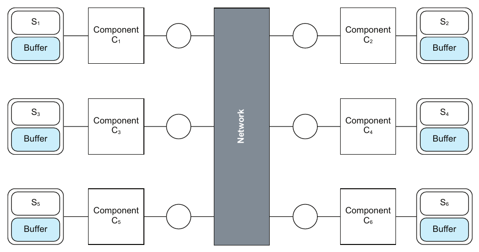
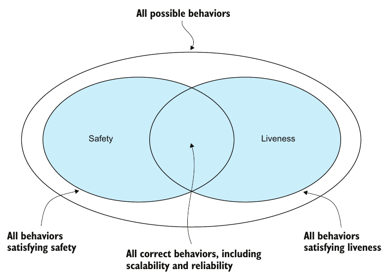
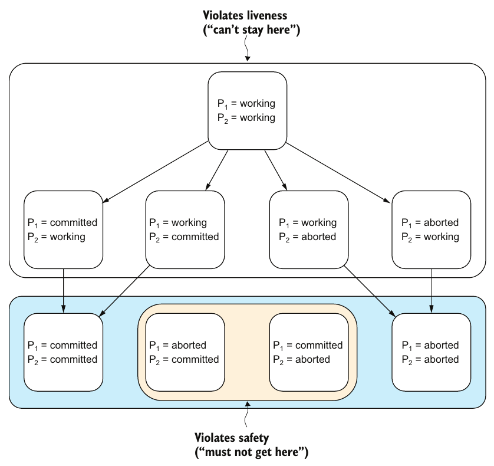

# فصل ۱: فکر کردن در سیستم‌های توزیع‌شده: مدل‌ها، ذهنیت‌ها و مکانیک

[کتاب](../README.md) · [فصل ۲: مدل سیستم، ترتیب و زمان ←](02-system-models-order-and-time.md)

## خلاصه

فرض بنیادی کتاب این است که هر برنامه‌ی امروزی توزیع‌شده است. پرسش فقط این است که *چقدر* توزیع‌شده، چون هیچ مؤلفه‌ی تنهایی نمی‌تواند بار unbounded را تاب بیاورد یا از شکست‌های ناگزیر جان سالم ببرد (pp. 1–2). یک **سیستم توزیع‌شده** مجموعه‌ای از مؤلفه‌های همکار و هم‌زمان است که با فرستادن و گرفتن پیام روی یک شبکه ارتباط می‌گیرند. رفتار و پیچیدگی‌اش از خود مؤلفه‌ها و تعاملشان **پدیدار** می‌شود (p. 1).

این فصل درباره‌ی **مدل‌های ذهنی** است: نمایش‌های درونی یک سیستم که باید **درست** باشند، یعنی نادرستی نداشته باشند، و **کامل**، یعنی چیز مربوطی را نینداخته باشند (pp. 3–4). سیستم را به‌عنوان **state machine** توصیف می‌کند که هر بار یک قدم برمی‌دارد، و درستی را به‌عنوان **ایمنی به‌علاوه‌ی liveness** (pp. 8–11). **مقیاس‌پذیری و قابلیت اطمینان** همان پاسخ‌گویی زیر بار و زیر شکست‌اند (p. 12). دو ایده‌ی بزرگ در بقیه‌ی کتاب می‌دوند: **سیستمی از سیستم‌ها**، یعنی holon، و **نگاه سراسری در برابر محلی** (pp. 13–16). قیاس تکرارشونده‌ی فصل **شرکت سیستم‌های توزیع‌شده** است، ساختمانی اداری که اتاق‌هایش مؤلفه‌اند و لوله‌های بادی‌اش شبکه (pp. 16–18). و با تعریف شرایط مسابقه و serializability بی هیچ کدی، روی مجموعه‌ی interleavingهای ممکن، تمام می‌شود (pp. 21–22).

## نکته‌های کلیدی

- **دانستن همان فهمیدن نیست.** یاد گرفتن قاعده‌های شطرنج تند است و تسلط بر راهبردش نه. کتاب هدفش فهمیدن است (p. 3).
- **مدل ذهنی خوب درست و کامل است.** هر واقعیت مدل واقعیتی از سیستم است، و هر واقعیت *مربوط* سیستم در مدل هست. این که چه چیزی مربوط حساب می‌شود به کاری بستگی دارد که می‌خواهید بکنید (p. 4).
- **مدل‌های مختلف می‌توانند همه معتبر باشند.** بعضی‌شان هم‌ارزند، مثل این که شبکه پیام‌های در پرواز را بافر کند یا هر مؤلفه، و بعضی‌شان آگاهانه جنبه‌های مختلفی را می‌گیرند (pp. 5–7).
- **رفتار دنباله‌ای از حالت‌هاست.** در هر لحظه دقیقاً یک مؤلفه، یا خود شبکه، دقیقاً یک قدم برمی‌دارد، یا بیرونی، یعنی فرستادن یا گرفتن، یا درونی (pp. 8–9).
- **درستی برابر ایمنی و liveness است.** ایمنی: چیز بدی هیچ‌وقت نمی‌افتد. liveness: چیز خوبی سرانجام می‌افتد. سیستم درست است اگر هر رفتار ممکن هر دو را برآورده کند، به گفته‌ی Lamport (pp. 9–10).
- **مقیاس‌پذیری و قابلیت اطمینان همان پاسخ‌گویی‌اند:** نگه داشتن نرخ خطا زیر بودجه‌ی خطا، زیر بار و زیر شکست. هر دو **وابسته به برنامه**اند و **پدیدار** (pp. 12–13).
- **چالش اصلی، سراسری فکر کردن و محلی عمل کردن است.** یک مؤلفه فقط حالت خودش را می‌بیند، و با این حال سیستم باید به‌عنوان یک کل درست رفتار کند. مغز دو‌پاره شکست کلاسیک همین است (pp. 15–20).
- **شرایط مسابقه** وقتی هست که بعضی interleavingهای processهای هم‌زمان نادرست حساب شوند. ویژگی **serializability** می‌خواهد که هر interleaving برابر P·Q یا Q·P باشد (pp. 21–22).

## فهرست بخش‌ها

*از فهرست مطالب خود کتاب، از bookmarkهای PDF؛ شماره‌ها صفحه‌ی چاپی‌اند.*

- ۱.۱ مهندسی نرم‌افزار و مدل‌های ذهنی — ص. ۲
  - ۱.۱.۱ مدل‌های ذهنی: پایه‌ی استدلال — ص. ۳
  - ۱.۱.۲ مدل‌های ذهنی درست — ص. ۴
  - ۱.۱.۳ مدل‌های ذهنی کامل — ص. ۴
- ۱.۲ مدل ذهنی سیستم‌های نرم‌افزاری — ص. ۴
- ۱.۳ گونه‌های مختلف مدل — ص. ۵
  - ۱.۳.۱ مدل‌های مختلفی که همان جنبه‌ها را توصیف می‌کنند — ص. ۵
  - ۱.۳.۲ مدل‌های مختلفی که جنبه‌های مختلف یک سیستم را توصیف می‌کنند — ص. ۶
- ۱.۴ فکر کردن درباره‌ی سیستم‌های توزیع‌شده — ص. ۸
  - ۱.۴.۱ درستی — ص. ۹
  - ۱.۴.۲ مقیاس‌پذیری و قابلیت اطمینان — ص. ۱۲
  - ۱.۴.۳ پاسخ‌گویی — ص. ۱۲
- ۱.۵ دو ایده‌ی بزرگ — ص. ۱۳
  - ۱.۵.۱ سیستمی از سیستم‌ها — ص. ۱۳
  - ۱.۵.۲ نگاه سراسری در برابر نگاه محلی — ص. ۱۵
- ۱.۶ شرکت سیستم‌های توزیع‌شده — ص. ۱۶
- ۱.۷ راه بردن در پیچیدگی — ص. ۱۸
  - ۱.۷.۱ ساده و با این حال پیچیده — ص. ۱۸
  - ۱.۷.۲ رفتار پدیدار — ص. ۱۹
  - ۱.۷.۳ عوض کردن چشم‌انداز — ص. ۱۹
  - ۱.۷.۴ سراسری فکر کن؛ محلی عمل کن — ص. ۲۰
- ۱.۸ فکر کردن بالای کد — ص. ۲۱

## یادداشت‌ها

اصلاً چرا توزیع کنیم؟ مهندس‌ها سیستم را با **درستی و مقیاس‌پذیری و قابلیت اطمینان** می‌سنجند: باید کارش را زیر بار رو‌به‌افزایش و با وجود شکست‌های ناگزیر بکند. یک مؤلفه می‌تواند کارآ باشد، ولی نمی‌تواند بار unbounded را جذب کند یا از crash خودش جان سالم ببرد، پس به بیشتر از یکی نیاز داریم (p. 2). نویسنده «لحظه‌های آها!» خودش را در کل کتاب می‌گوید (p. 2).

### ۱.۱ مهندسی نرم‌افزار و مدل‌های ذهنی

مهندسی نرم‌افزار اغلب گیج‌کننده است چون مدل‌های مشترک و محکم نداریم. مهندسی عمران فیزیک و ریاضی و نمودارهای استاندارد دارد، در حالی که مهندس‌های نرم‌افزار نمی‌توانند توافق کنند microservice یا cloud یا serverless چیست (p. 2). هدف یک **مدل ذهنی دقیق و فشرده** است: نمایشی درونی که با اطمینان بتوانید با آن استدلال کنید، به‌جای سیخونک زدن به سیستم و توجیه کردن کاری که می‌کند (p. 2).

#### مدل‌های ذهنی، درست و کامل (pp. 3–4)

یک **مدل** سیستمی هدف را نمایش می‌دهد؛ و یک **مدل ذهنی** نمایش درونی‌ای است که زیر فهم و ارتباط می‌نشیند (p. 3). هر دو را مجموعه‌ای از واقعیت‌ها ببینید:

| | مجموعه‌ای از واقعیت‌هاست که می‌سازد… | کِی خوب است… (p. 4) |
|---|---|---|
| **سیستم** | حقیقت زمینی | — |
| **مدل ذهنی** | حقیقت درک‌شده‌ی ما | **درست**: هر واقعیت مدل واقعیتی از سیستم است، یعنی نادرستی ندارد؛ **کامل**: هر واقعیت *مربوط* سیستم واقعیتی در مدل است، یعنی چیزی نیفتاده |

نمونه‌ی مدار کتاب (شکل ۱.۱): مدلی که مقاومت لامپ را ۳٫۰ اهم می‌دهد برای حساب کردن جریان درست و کامل است، ولی برای روشنایی ناقص، که به بازده نوری هم نیاز دارد (p. 4).

### ۱.۲ مدل ذهنی سیستم‌های نرم‌افزاری

سیستم‌های نرم‌افزاری ساخت‌هایی **مجازی**اند. مؤلفه‌ها و شبکه‌ها چیزهای فیزیکی‌ای نیستند که بتوانید پیدایشان کنید؛ سیستم *طوری رفتار می‌کند که گویی* از آن‌ها ساخته شده. پس چند مدل هم‌ارز می‌توانند رفتار مشاهده‌شدنی را به‌یک‌اندازه خوب توصیف کنند (p. 4). نویسنده نگاه Edward A. Lee را دنبال می‌کند که آن‌قدر لایه، نرم‌افزار را از الکترون‌های داخل سیلیکون جدا می‌کند که پیوند فیزیکی بی‌معنا می‌شود (p. 4).

> **Vault note:** کادر کناری «مواظب قیاس باش» در کتاب (p. 5) هشدار می‌دهد که قیاس‌ها، مثل جاری شدن برق مثل آب، فهم را فقط تا جایی منتقل می‌کنند که شباهت تمام می‌شود. دانشجوها اغلب نمی‌دانند آن نقطه کجاست.

### ۱.۳ گونه‌های مختلف مدل

سیستم‌های توزیع‌شده غیررسمی یا رسمی توصیف می‌شوند، به‌عنوان ماشین کنش، ماشین حالت، state machine‌کنش، یا جبر process. هر چشم‌انداز عمق اضافه می‌کند، و مطالعه‌ی چندتایشان افتادگی‌ها و ناسازگاری‌های فکرتان را آشکار می‌کند (p. 5).

| رابطه | نمونه (pp. 5–7) |
|---|---|
| **همان جنبه‌ها، مدل‌های هم‌ارز** (شکل ۱.۲) | شبکه به‌عنوان یک bus *به‌علاوه‌ی* یک بافر از پیام‌های در پرواز (شکل ۱.۳)، یا شبکه به‌عنوان bus با یک بافر در هر مؤلفه (شکل ۱.۴). هر دو می‌توانند گم شدن و تکراری و بی‌ترتیبی را بیان کنند؛ انتخاب سلیقه است |
| **جنبه‌های مختلف** (شکل ۱.۵) | دوره‌ی TLA+ از Lamport: پروتکل *Transaction Commit*، یعنی انتزاعی از همه‌ی پروتکل‌های تراکنش توزیع‌شده، پیام‌ها را نادیده می‌گیرد؛ و *Two-Phase Commit*، یعنی یک پیاده‌سازی، مدلشان می‌کند، پس فقط آن می‌تواند پیام گم‌شده یا تکراری یا بی‌ترتیب را نمایش بدهد |

*Figure 1.3 (p. 6): یک مدل هر پیام در پرواز را در بافر شبکه می‌گذارد…*

*Figure 1.4 (p. 7): …و دیگری به هر مؤلفه یک بافر می‌دهد. هر دو می‌توانند پیام را گم و تکرار و بی‌ترتیب کنند.*

کادر کناری مردهای نابینا و فیل همین نکته را می‌گوید: وقتی به مدلی متفاوت رسیدید، پیش از آن که غلطش بدانید بپرسید نویسنده *چرا* انتخابش کرده (p. 8).

### ۱.۴ فکر کردن درباره‌ی سیستم‌های توزیع‌شده

هر مؤلفه **دسترسی انحصاری به حالت محلی‌اش** دارد، و شبکه دسترسی انحصاری به حالت خودش، از جمله پیام‌های در پرواز (شکل ۱.۶) (p. 8). رفتار سیستم **دنباله‌ای از حالت‌هاست**، یعنی یک ماشین حالت، که هر قدمش سیستم را به حالت بعدی می‌برد (شکل ۱.۷) (pp. 8–9).

| گونه‌ی قدم | نمونه (p. 8) |
|---|---|
| **بیرونی** | فرستادن یک پیام، گرفتن یک پیام |
| **درونی** | محاسبه‌ی محلی، دسترسی به حالت محلی |

مدل فرض می‌کند در هر لحظه دقیقاً یک مؤلفه یا خود شبکه دقیقاً یک قدم را کامل می‌کند (p. 8). متن‌های دیگر به مؤلفه‌ها actor یا agent یا process یا نود می‌گویند، و به قدم‌ها کنش یا رویداد (p. 9).

#### ۱.۴.۱ درستی (pp. 9–12)

تعریف Lamport، از «Proving the Correctness of Multiprocess Programs» (pp. 9–10):

- **ایمنی:** چیز بدی هیچ‌وقت نمی‌افتد.
- **مفهوم liveness:** چیز خوبی سرانجام می‌افتد.
- سیستم درست است اگر *هر رفتار ممکنی* هر دو را برآورده کند (شکل ۱.۸).

*Figure 1.8 (p. 10): درستی همان اشتراک است؛ رفتاری که ایمن ولی گیرکرده است، یا زنده ولی غلط، بیرون از آن می‌افتد.*

نمونه‌ی کتاب تراکنشی توزیع‌شده است که `b` را در شرکت‌کننده‌ی P1 و `a` را در شرکت‌کننده‌ی P2 می‌گذارد (فهرست ۱.۱). هر شرکت‌کننده یا *working* است یا *committed* یا *aborted*، و هر قدم یکی از شرکت‌کننده‌ها را از *working* بیرون می‌برد (شکل ۱.۹) (pp. 10–11):

*Figure 1.9 (p. 11): ماندن همیشگی در «working» **liveness** را نقض می‌کند، یعنی «نمی‌شود این‌جا ماند»؛ و رسیدن به حالتی قاطی از commit و abort **ایمنی** را، یعنی «نباید به این‌جا رسید». با هم می‌گویند هر دو شرکت‌کننده سرانجام به همان تصمیم می‌رسند.*

مدل آگاهانه کلید و مقدار و قفل را نادیده می‌گیرد: نویسنده ادعا می‌کند این‌جا بی‌ربطند، و شما می‌توانید مخالف باشید بی آن که هیچ‌کدامتان غلط بگویید (p. 12).

> **Try it:** [فضای رفتار یک تراکنش](../widgets/01-behavior-space.html)؛ دو شرکت‌کننده‌ی شکل ۱.۹ را گذار‌به‌گذار قدم بدهید و ببینید کدام رفتارها ایمنی را نقض می‌کنند، کدام‌ها گیر می‌کنند و liveness را نقض، و کدام‌ها درست‌اند.

#### ۱.۴.۲ و ۱.۴.۳ مقیاس‌پذیری، قابلیت اطمینان و پاسخ‌گویی (p. 12)

سیستم Alpern و Schneider ثابت کردند که هر خاصیتی اشتراک یک خاصیت ایمنی و یک liveness است، ولی نویسنده به مقیاس‌پذیری و قابلیت اطمینان این‌طور فکر نمی‌کند (p. 12). او **پاسخ‌گویی** را به کار می‌برد، یعنی توانایی سیستم در برآورده کردن هدف‌های سطح سرویسش:

- **مقیاس‌پذیری:** پاسخ‌گو بودن در حضور **بار**.
- **قابلیت اطمینان:** پاسخ‌گو بودن در حضور **شکست**.

| مفهوم | تعریف (p. 12) |
|---|---|
| **شاخص سطح سرویس**، یعنی SLI | مشاهده‌ای کمی از رفتار سیستم |
| **هدف سطح سرویس**، یعنی SLO | محمولی روی یک SLI: این مشاهده هدف را برآورده می‌کند؟ |
| **نرخ خطا** | مشاهده‌هایی که هدفشان را از دست می‌دهند تقسیم بر همه‌ی مشاهده‌ها، در بازه‌ای ثابت |
| **بودجه‌ی خطا** | سقف پذیرفتنی نرخ خطا |

**پاسخ‌گویی** یعنی نگه داشتن نرخ خطا زیر بودجه‌ی خطا. دو لحظه‌ی آها! دنبالش می‌آیند (p. 13):

- این تضمین‌ها **وابسته به برنامه**اند: آن چیزی که یک تیم خراب می‌نامد، تیم دیگری پذیرفتنی می‌نامد.
- و **پدیدار**ند: هیچ مؤلفه‌ی تنهایی نمی‌تواند بار بی‌نهایت را جذب کند یا از crash جان سالم ببرد، پس تضمین‌ها از خود مؤلفه‌ها و تعاملشان می‌آیند.

> **In practice:** pipeline ما خودش یک سیستم توزیع‌شده است: loader در یک pod، دیتابیس منبع، ClickHouse با دو replica و Airflow که همه را هماهنگ می‌کند.
>
> **Your turn:** DAG در Airflow «success» نشان می‌دهد ولی جدول Gold عدد دیروز را دارد. درستی این سیستم را با کدام دو نوع ویژگی می‌سنجید؟
>
> *Answer:* safety، یعنی «هیچ‌وقت عدد غلط منتشر نشود»، مثلاً با تست مقایسه‌ی شمار ردیف‌ها در هر لایه؛ و liveness، یعنی «داده‌ی تازه بالاخره برسد»، که با metric تازگی هر جدول در Prometheus و alert روی آن سنجیده می‌شود. success در Airflow فقط می‌گوید taskها تمام شده‌اند، نه این‌که هیچ‌کدام از این دو برقرار است (pp. 9–12).

### ۱.۵ دو ایده‌ی بزرگ

#### سیستمی از سیستم‌ها (pp. 13–15)

تعریف این حس را می‌دهد که مؤلفه‌ها اتمی‌اند، ولی بیشترشان **زیرسیستم**اند (شکل ۱.۱۰) (p. 13). مفهوم **holon** از Arthur Koestler، در کتاب *The Ghost in the Machine* سال ۱۹۶۷، چیزی است که خودش یک کل است و بخشی از کلی بزرگ‌تر؛ و سلسله‌مراتبی از holonها یک **holarchy** است (شکل ۱.۱۱). holarchyها می‌توانند سازمان «به‌هم‌ریخته»ی سیستم‌های واقعی را بگیرند و بگذارند زوم کنید یا دور شوید (p. 14).

نمونه‌ی کتاب یک دیتابیس چند‌مستأجری است که با consensus تکرار شده، یعنی Paxos یا Raft یا Viewstamped Replication، با دو مستأجر و سه نود. می‌توانید یک cluster ببینیدش که از سه نود ساخته شده، یا دو دیتابیس مستأجر که هر کدام از آن نودها ساخته شده‌اند (شکل ۱.۱۲). این که کدام موجودیت‌ها را اتمی ببینید به نکته‌ای بستگی دارد که می‌خواهید بگویید (pp. 14–15).

#### نگاه سراسری در برابر نگاه محلی (pp. 15–16)

ناظری همه‌دان **نگاه سراسری** دارد و می‌تواند کل حالت سیستم را تعیین کند (شکل ۱.۱۳). یک مؤلفه **نگاه محلی** دارد: فقط حالت خودش و کانال خودش به شبکه (شکل ۱.۱۴). برای دانستن حالت سراسری، لازم است مؤلفه‌های دیگر حالت محلی‌شان را بفرستند (pp. 15–16). یک مؤلفه هیچ‌وقت *مستقیم* با دیگری حرف نمی‌زند. مؤلفه‌ی C1 پیامی را که به C2 آدرس خورده به شبکه می‌دهد، که ممکن است تحویلش بدهد یا ندهد (p. 16).

> **In practice:** هر جزء stack فقط نگاه محلی خودش را دارد: loader نمی‌داند ClickHouse چه دارد و Grafana فقط آن چیزی را می‌بیند که export شده.
>
> **Your turn:** on-call باید بفهمد چرا داشبورد مدیریت خالی است. چرا لاگ یک pod تنها کافی نیست و چه چیزی نگاه سراسری می‌دهد؟
>
> *Answer:* هر pod فقط نگاه محلی دارد؛ trace با OpenTelemetry که از task در Airflow تا insert در ClickHouse یک trace id دارد، به‌همراه metric هر مرحله، نزدیک‌ترین چیز به نگاه سراسری است، و آن هم فقط تقریبی است (pp. 13–15).

### ۱.۶ شرکت سیستم‌های توزیع‌شده

قیاس جاری کتاب شرکتی در یک ساختمان اداری است (شکل ۱.۱۵) (pp. 16–17):

| ساختمان | سیستم توزیع‌شده |
|---|---|
| اتاق‌ها و ساکنانشان | مؤلفه‌های هم‌زمان با حالت محلی |
| لوله‌های بادی که از اتاق نامه می‌گذرند | شبکه |
| صندوق‌نامه‌ی ساختمان | interface بیرونی |

می‌تواند دغدغه‌های شکست را بیان کند (pp. 17–18):

- **معنای crash:** یک وقفه‌ی کوتاه شکستی *transient* است، یک مرخصی شکستی *گاه‌به‌گاه*، و ترک کردن شرکت شکستی *دائمی*.
- **معنای تحویل پیام:** Bob در اتاق نامه می‌تواند پیام‌ها را گم یا تکرار یا بی‌ترتیب کند.

اگر کارمندی درخواستی بفرستد و پاسخی نگیرد، نمی‌تواند بگوید درخواست گم شده یا پاسخ، و فرستادن دوباره خطر دو بار پردازش شدن دارد (p. 18). کتاب پیشنهاد می‌دهد Kubernetes یا Kafka را هم همین‌طور مدل کنید (p. 18).

### ۱.۷ راه بردن در پیچیدگی

| ایده | معنا (pp. 18–20) |
|---|---|
| **ساده و با این حال پیچیده** | کارمندهای ساده‌ای که قاعده‌های ساده را رعایت می‌کنند می‌توانند شرکتی پیچیده بسازند |
| **رفتار پدیدار** | مقیاس‌پذیری و قابلیت اطمینان را نمی‌شود به یک کارمند ردیابی کرد؛ این پایه‌ی ساختن سیستم‌های قابل‌اعتماد از قطعه‌های نامطمئن است |
| **عوض کردن چشم‌انداز** | جعبه‌ی سیاه در برابر جعبه‌ی سفید عوض کردن *تفکیک‌پذیری* است: هر دو باز هم همان نگاه سراسری همه‌دان‌اند (شکل ۱.۱۶). جابه‌جایی واقعی، رفتن به نگاه **محلی** یک مؤلفه است (شکل ۱.۱۷) |
| **سراسری فکر کن؛ محلی عمل کن** | یک الگوریتم *سراسری* طراحی کنید که هر مؤلفه به‌عنوان الگوریتمی *محلی* پیاده‌اش کند. **مغز دو‌پاره**، که دو اتاق هر دو باور دارند leader تیم‌اند (شکل ۱.۱۸)، نشان می‌دهد این چقدر سخت است |

### ۱.۸ فکر کردن بالای کد

کتاب آگاهانه تقریباً هیچ کدی ندارد: تکه‌های ایستا در گرفتن سیستم‌های پویا ضعیف‌اند (p. 21). تعریفی کد‌محور، شرایط مسابقه را طوری نشان می‌دهد که انگار به به‌روزرسانی یک متغیر محدود است. مدل کتاب عمومی‌تر است (pp. 21–22):

- یک **process** دنباله‌ای از کنش‌های اتمی است: P = a·b·c و Q = x·y·z.
- **ترکیب هم‌زمان**، یعنی (P | Q)، مجموعه‌ی همه‌ی interleavingهای ممکن کنش‌هایشان است.
- **شرایط مسابقه** وضعیتی است که *زیرمجموعه*ای از (P | Q) نادرست حساب می‌شود. داور درستی شمایید (شکل ۱.۱۹).
- **ویژگی serializability:** ترکیب (P | Q) درست است اگر هر interleaving همان اثر P·Q یا Q·P را داشته باشد (شکل ۱.۲۰).

مدل در هر سطحی به کار می‌آید: thread، چند‌کاره‌ی تعاونی و انحصاری، ماشین‌های تک‌هسته‌ای و چند‌هسته‌ای، و چند ماشین (p. 21).

> **Try it:** [interleavingها و شرایط مسابقه](../widgets/01-interleavings.html)؛ دو process هر کدام یک شمارنده‌ی مشترک را می‌خوانند و یکی اضافه می‌کنند و می‌نویسند. هر بیست interleaving کنش‌هایشان را فهرست کنید، نادرست‌ها را علامت بزنید، و بررسی کنید کدام‌ها با ترتیبی پشت‌سرهم هم‌ارزند.

### خلاصه

خلاصه‌ی فصل (p. 22): مدل ذهنی پایه‌ی فهم و ارتباط است؛ فهمیدن از دانستن بهتر است؛ چالش اصلی کلی منسجم است که از مؤلفه‌هایی با دانش فقط محلی ساخته شده؛ درباره‌ی تضمین‌ها با ایمنی و liveness به‌علاوه‌ی مقیاس‌پذیری و قابلیت اطمینان استدلال می‌شود؛ و شرکت سیستم‌های توزیع‌شده راهی برای تجسم همه‌ی این‌هاست.

## بده‌بستان‌ها در یک نگاه

| عدسی | چه چیزی را می‌گیرد | چه چیزی را نمی‌گیرد |
|---|---|---|
| نگاه سراسری جعبه‌سیاه | رفتار مشاهده‌شدنی سیستم | این که مؤلفه‌ها چطور همکاری می‌کنند |
| نگاه سراسری جعبه‌سفید | حالت هر مؤلفه و شبکه | این که هر مؤلفه واقعاً چه می‌تواند بداند |
| نگاه محلی | آن چیزی که یک مؤلفه می‌تواند ببیند و تصمیم بگیرد | هر چیزی بیرون از آن |
| ایمنی به‌علاوه‌ی liveness | درستی کارکردی هر رفتار | بار و شکست؛ برای آن‌ها پاسخ‌گویی |
| پاسخ‌گویی با SLI و SLO | مقیاس‌پذیری و قابلیت اطمینان | درستی کارکردی |

## فراتر از کتاب

- **چند درهم‌آمیختگی؟** دو process با *m* و *n* کنش اتمی، C(m + n, m) interleaving دارند، پس بیست برای سه و سه، و ۱۸۴۷۵۶ برای ده و ده. همین رشد است که model checkerهایی مثل TLC در TLA+ را وادار می‌کند فضای حالت را ماشینی بکاوند. [ویجت interleaving](../widgets/01-interleavings.html) حالت سه و سه را دقیق برمی‌شمارد.
- **به‌روزرسانی گم‌شده.** تعریف شرایط مسابقه در کتاب همان *به‌روزرسانی گم‌شده*ی کلاسیک را می‌پوشاند. اگر دو process هر کدام شمارنده‌ای را بخوانند و یکی اضافه کنند و بازبنویسند، خیلی از interleavingها با شمارنده‌ی ۱ به‌جای ۲ تمام می‌شوند. [فصل ۸ کتاب DDIA](../../designing-data-intensive-applications/chapters/08-transactions.md) همین ناهنجاری را زیر جداسازی ضعیف بحث می‌کند.
- **واژگان SRE.** واژه‌های SLI و SLO و بودجه‌ی خطا از کتاب‌های *Site Reliability Engineering* در Google می‌آیند که نویسنده توصیه‌شان می‌کند (p. 12). در عمل SLOها معمولاً به‌عنوان صدک روی یک پنجره بیان می‌شوند، مثلاً «۹۹٪ درخواست‌ها زیر ۳۰۰ میلی‌ثانیه در بیست‌و‌هشت روز».

## پیوندها

- **فصل‌های مرتبط:** [فصل ۲: مدل سیستم، ترتیب و زمان](02-system-models-order-and-time.md) که فرض‌های پشت هر مدل را دارد، [فصل ۳: تحمل شکست](03-failure-tolerance.md) که ایمنی و liveness زیر شکست را دارد، [فصل ۵: تراکنش](05-transactions.md) که serializability را عمیق می‌گیرد، [فصل ۶: تراکنش توزیع‌شده](06-distributed-transactions.md) که تراکنش شکل ۱.۹ را دارد، و [فصل ۱۲: cloud و سرویس‌ها](12-cloud-and-services.md) که نگاه سراسری و محلی یک سرویس را دارد.

## خودتان را بسنجید

*پرسش‌ها و پاسخ‌ها مال vault است و از روی یادداشت‌های بالا نوشته شده؛ پاسخ‌ها به صفحه‌های کتاب ارجاع می‌دهند.*

1. **چه چیزی یک مدل ذهنی را خوب می‌کند؟**

   *Answer:* درست باشد، یعنی هر واقعیت مدل واقعیتی از سیستم باشد، و کامل، یعنی هر واقعیت مربوط سیستم در مدل باشد. مربوط بودن به پرسشی بستگی دارد که می‌پرسید (p. 4).

2. **در شکل ۱.۹، کدام حالت ایمنی را نقض می‌کند و کدام وضعیت liveness را؟**

   *Answer:* هر حالتی که یک شرکت‌کننده commit کرده و دیگری abort، ایمنی را نقض می‌کند. ماندن همیشگی در «working» liveness را نقض می‌کند (p. 11).

3. **نویسنده قابلیت اطمینان را این‌طور تعریف می‌کند…**
   - [ ] نبود شکست
   - [x] توانایی پاسخ‌گو بودن در حضور شکست
   - [ ] توانایی پاسخ‌گو بودن در حضور بار

   *Answer:* مقیاس‌پذیری پاسخ‌گویی زیر بار است و قابلیت اطمینان پاسخ‌گویی زیر شکست (p. 12).

4. **بودجه‌ی خطا چیست؟**

   *Answer:* سقف پذیرفتنی نرخ خطا، که همان سهم مشاهده‌هایی است که SLOشان را در بازه‌ای ثابت از دست می‌دهند. سیستم تا وقتی پاسخ‌گوست که نرخ خطایش زیر بودجه بماند (p. 12).

5. **مفهوم holon چیست و چرا این‌جا به کار می‌آید؟**

   *Answer:* موجودیتی که هم خودش یک کل است و هم بخشی از کلی بزرگ‌تر، به گفته‌ی Koestler. می‌گذارد یک مؤلفه را اتمی ببینید یا زیرسیستم، بسته به نکته‌ای که می‌خواهید بگویید (pp. 13–15).

6. **چرا C1 نمی‌تواند مستقیم «با C2 حرف بزند»؟**

   *Answer:* مؤلفه‌ی C1 پیامی را که به C2 آدرس خورده به شبکه می‌دهد، که ممکن است تحویلش بدهد یا ندهد. C1 در واقع با بقیه‌ی سیستم ارتباط می‌گیرد (p. 16).

7. **شرایط مسابقه را بی کد تعریف کنید.**

   *Answer:* برای processهای هم‌زمان P و Q، ترکیب (P | Q) مجموعه‌ی همه‌ی interleavingهای کنش‌هایشان است. شرایط مسابقه وقتی هست که زیرمجموعه‌ای از آن interleavingها نادرست حساب شود (p. 21).
