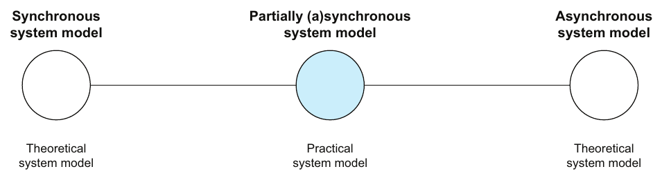
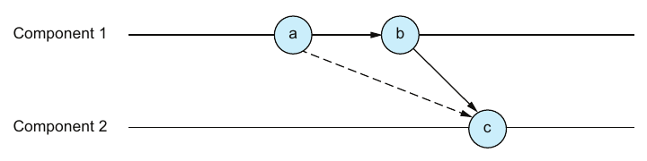
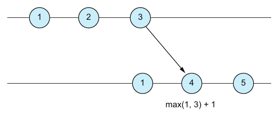

# فصل ۲: مدل سیستم، ترتیب و زمان

[فصل ۱: فکر کردن در سیستم‌های توزیع‌شده →](01-thinking-in-distributed-systems-models-mindsets-and-mechanics.md) · [کتاب](../README.md) · [فصل ۳: تحمل شکست ←](03-failure-tolerance.md)

## خلاصه

هر الگوریتمی فقط *نسبت به* یک **مدل سیستم** درست است: مجموعه‌ای از فرض‌ها درباره‌ی مؤلفه‌ها و شبکه و زمان‌بندی (p. 24). این فصل مدل‌های زمان‌بندی را می‌گردد، یعنی همگام، asynchronous با هیچ یا با درکی ضعیف از زمان، و نیمه‌همگام، و مدل‌های شکست مؤلفه را، یعنی Crash-Stop و Omission و Crash-Recovery و بیزانسی، و شکست‌های شبکه را، یعنی بی‌ترتیبی و تکراری و گم شدن (pp. 25–30). بعد **مدل سیستم واقع‌بینانه**ی نویسنده را بیان می‌کند: نیمه‌همگام، با مؤلفه‌های غیر‌بیزانسی که crash می‌کنند و برمی‌گردند، روی شبکه‌ای نامطمئن (p. 30).

نیمه‌ی دوم درباره‌ی **ترتیب** است. بیشتر کنش‌ها جابه‌جا‌پذیر نیستند، پس برقرار کردن ترتیب بنیادی است (p. 30). فصل شرایط مسابقه را روی اجراها تعریف می‌کند و نمونه را با یک coordinator که درخواست‌ها را برچسب می‌زند اصلاح (pp. 30–32). رابطه‌ی **happened-before** از Lamport و علیت و تعریفی دقیق از concurrency در برابر موازی‌کاری را می‌پوشاند (pp. 32–35). و با **consistency ساعت** و دو گونه ساعت تمام می‌شود: ساعت‌های فیزیکی با skew و drift و NTP و ساعت زمان‌روز در برابر یکنوا، و ساعت‌های منطقی با ساعت Lamport و offsetهای Kafka و شماره‌های ترتیب etcd (pp. 35–38).

## نکته‌های کلیدی

- **مدل سیستم همان قاعده‌های بازی است.** الگوریتمی که زیر مجموعه‌ای از فرض‌ها درست است می‌تواند زیر مجموعه‌ای دیگر غلط باشد؛ تغییر کوچکی در قاعده‌ها می‌تواند یک راهبرد را از هم بپاشد (p. 24).
- **واژه‌ی «asynchronous» مبهم است.** با *هیچ* درکی از زمان، یک مؤلفه نمی‌تواند timeout به کار ببرد. با درکی *ضعیف*، یعنی ساعت‌های asynchronous با انحراف ناشناخته، می‌تواند. بعضی مسئله‌ها فقط در دومی حل‌شدنی‌اند (pp. 25–26).
- **سیستم‌های واقعی partially synchronousاند**، یعنی بیشتر وقت‌ها synchronous و گاهی asynchronous. پس پروتکل‌ها ایمنی و liveness را تا وقتی synchronous است تضمین می‌کنند، و وگرنه **ایمنی را بر liveness** نگه می‌دارند (p. 26).
- **چهار مدل شکست مؤلفه:** Crash-Stop یعنی دیگر وجود ندارد، Omission یعنی استراحت می‌کند و حافظه‌اش را نگه می‌دارد، Crash-Recovery یعنی می‌تواند حالت را از دست بدهد، و بیزانسی یعنی هر چیزی، از جمله فریب (pp. 27–28).
- **شبکه می‌تواند پیام‌ها را بی‌ترتیب یا تکراری یا گم کند، ولی نمی‌تواند دروغ بگوید** (pp. 28–30).
- **رابطه‌ی happened-before** از Lamport در سال ۱۹۷۸، ترتیبی جزئی است که از ترتیب درون یک مؤلفه و زوج‌های فرستادن و گرفتن ساخته می‌شود و زیر تعدی بسته است. علیت *بالقوه* را می‌گیرد (pp. 32–34).
- **مفهوم concurrency منطقی است و موازی‌کاری فیزیکی.** دو عملیات هم‌زمان‌اند اگر پایان هیچ‌کدام پیش از شروع دیگری نیفتاده باشد، و موازی‌اند اگر در زمان هم‌پوشانی داشته باشند (pp. 34–35).
- **مفهوم consistency ساعت:** اگر a → b آن‌گاه C(a) < C(b). ساعت‌های فیزیکی مدت‌ها را داخل یک مؤلفه می‌سنجند و ساعت‌های منطقی رویدادها را بین مؤلفه‌ها مرتب می‌کنند (pp. 35, 38).

## فهرست بخش‌ها

*از فهرست مطالب خود کتاب، از bookmarkهای PDF؛ شماره‌ها صفحه‌ی چاپی‌اند.*

- ۲.۱ مدل‌های سیستم — ص. ۲۳
  - ۲.۱.۱ نظریه و عمل — ص. ۲۴
  - ۲.۱.۲ سیستم‌های توزیع‌شده‌ی synchronous — ص. ۲۵
  - ۲.۱.۳ سیستم‌های توزیع‌شده‌ی asynchronous — ص. ۲۵
  - ۲.۱.۴ سیستم‌های partially synchronous — ص. ۲۶
  - ۲.۱.۵ رفتار مؤلفه و شبکه — ص. ۲۷
  - ۲.۱.۶ مدل‌های سیستم واقع‌بینانه — ص. ۳۰
- ۲.۲ ترتیب و زمان — ص. ۳۰
  - ۲.۲.۱ رابطه‌ی happened-before — ص. ۳۲
  - ۲.۲.۲ زمان و ساعت — ص. ۳۵
  - ۲.۲.۳ زمان فیزیکی و ساعت‌های فیزیکی — ص. ۳۵
  - ۲.۲.۴ زمان منطقی و ساعت‌های منطقی — ص. ۳۷
  - ۲.۲.۵ ساعت فیزیکی در برابر ساعت منطقی — ص. ۳۸

## یادداشت‌ها

### ۲.۱ مدل‌های سیستم

یک **مدل سیستم** مجموعه‌ای از فرض‌ها درباره‌ی مؤلفه‌های سیستم و شبکه‌اش و رفتار زمانی‌اش است (جدول ۲.۱) (p. 24):

| یک مدل سیستم | مدل سیستمی دیگر |
|---|---|
| مؤلفه‌ها نمی‌توانند شکست بخورند | مؤلفه‌ها می‌توانند شکست بخورند |
| پیام‌ها نمی‌توانند گم شوند | پیام‌ها می‌توانند گم شوند |
| ساعت‌ها کاملاً synchronousاند | ساعت‌ها کاملاً synchronous نیستند |

لحظه‌ی آها! کتاب مدل سیستم را با **بازی رومیزی** مقایسه می‌کند: قاعده‌ها صحنه را می‌چینند، و حتی تغییری کوچک در قاعده می‌تواند راهبردی با‌دقت‌چیده‌شده را بی‌اثر کند (p. 24).

#### نظریه و عمل (pp. 24–25)

| گونه | معمولاً برای استدلال درباره‌ی | نمونه |
|---|---|---|
| **نظری** | ناممکن بودن‌ها، و کران پایین و بالا روی مؤلفه‌ها یا پیام‌ها | — |
| **عملی** | ممکن بودن‌ها، سنجیده در برابر هزینه‌ی توسعه و عملیات و مقیاس‌پذیری و قابلیت اطمینان | — |
| **هر دو** | — | مدل‌های زیربنای Viewstamped Replication و Paxos و Raft |

#### مدل‌های زمان‌بندی (pp. 25–26)

*Figure 2.2 (p. 26): دو سر طیف نظری‌اند؛ سیستم‌های واقعی partially synchronousاند.*

| مدل | ساعت‌ها | زمان‌بندی رویداد | پی‌آمد |
|---|---|---|---|
| **synchronous** | کاملاً همگام، یا با انحرافی که کران بالایش شناخته است | سخت‌گیرانه، یا با latency bounded | درکی قوی از زمان فیزیکی |
| **ناهمگام، بی هیچ درکی از زمان** | ندارد | زمان دلخواه یا latency دلخواه | **هیچ timeoutی نداریم**، و timeout برای تشخیص و کاهش شکست حیاتی است |
| **ناهمگام، با درکی ضعیف از زمان** | ناهمگام، با انحراف ناشناخته | دلخواه | **timeout ممکن است** |
| **partially synchronous** | — | بیشتر وقت‌ها همگام، و گاهی asynchronous | با تجربه می‌خورد، مثل اینترنت خانگی که معمولاً تند است و گاهی timeout می‌خورد |

نه مدل synchronous و نه asynchronous چیزی درباره‌ی شکست مؤلفه یا گم شدن پیام نمی‌گویند؛ آن‌ها فرض‌های جدایی‌اند (pp. 25–26). وقتی به واژه‌ی *سیستم asynchronous* رسیدید، اول بفهمید کدام درک از زمان را فرض می‌کند، و بعد این که آیا در آن زمینه مهم است (p. 25). طراحی معمول پروتکل این است که وقتی سیستم synchronous می‌گردد ایمنی و liveness را تضمین کند، و وقتی asynchronous می‌گردد **ایمنی را بر liveness** بگذارد: چیز بدی نمی‌افتد، حتی اگر مدتی چیز خوبی هم نیفتد (p. 26).

#### ۲.۱.۵ رفتار مؤلفه و شبکه (pp. 27–30)

مدل‌های شکست مؤلفه تو‌در‌توی هم‌اند (شکل ۲.۳): هر کدام از قبلی عمومی‌تر است.

| شکست مؤلفه | چه می‌شود (pp. 27–28) | کوتاه |
|---|---|---|
| **Crash-Stop** | در لحظه‌ای دلخواه قدم برداشتن را متوقف می‌کند و دیگر هیچ قدمی برنمی‌دارد | دیگر وجود ندارد |
| **Omission** | مدتی دلخواه می‌ایستد و بعد از همان حالتی که ایستاده بود ادامه می‌دهد | استراحت می‌کند، بی از دست دادن حافظه |
| **Crash-Recovery** | مدتی دلخواه می‌ایستد و بعد ادامه می‌دهد، ولی می‌تواند حالت را از دست بدهد | از دست دادن جزئی یا کامل حافظه |
| **بیزانسی** | دلخواه رفتار می‌کند، از جمله انحراف آگاهانه از الگوریتمش | هر چیزی ممکن است بیفتد |

| شکست شبکه | چه می‌شود (pp. 28–29) |
|---|---|
| **بی‌ترتیبی** | پیام‌ها به ترتیبی غیر از ترتیب فرستاده شدنشان تحویل می‌شوند (شکل ۲.۸) |
| **تکراری** | پیامی بیشتر از یک‌بار تحویل می‌شود (شکل ۲.۹) |
| **گم شدن** | پیامی هیچ‌وقت تحویل نمی‌شود (شکل ۲.۱۰) |

شبکه‌ای با این شکست‌ها **نامطمئن** نامیده می‌شود. با این حال کتاب فرض می‌کند *شبکه نمی‌تواند دروغ بگوید*: پیامی که تحویل شده را مؤلفه‌ای از سیستم فرستاده بوده (p. 30).

#### ۲.۱.۶ مدل‌های سیستم واقع‌بینانه (p. 30)

مدلی که نویسنده در کل کتاب در ذهن دارد:

- **مفهوم partially synchronous**: بیشتر وقت‌ها synchronous.
- مؤلفه‌هایی که شکست‌های **Crash-Stop و Omission و Crash-Recovery** می‌خورند. حالت *فرار* را فراموش می‌کنند و حالت *durable* را به یاد می‌آورند.
- ارتباط روی **شبکه‌ای نامطمئن** که می‌تواند پیام‌ها را بی‌ترتیب یا حذف یا تکرار کند.
- **شکست‌های بیزانسی بیشتر نادیده گرفته می‌شوند**، گرچه در حوزه‌هایی مثل رمزارز مهم‌اند.

> **In practice:** مدل سیستم درست برای stack ما partially synchronous است: بیشتر وقت‌ها شبکه و podها سریع‌اند ولی هیچ سقف تضمین‌شده‌ای نیست.
>
> **Your turn:** چرا `execution_timeout` روی taskهای Airflow لازم است، و چرا هیچ مقداری برایش «درست» نیست؟
>
> *Answer:* در مدل asynchronous نمی‌شود task کند را از task مرده تشخیص داد؛ timeout فرضی از نوع partially synchronous است که اجازه می‌دهد کار جلو برود. timeout کوتاه کار سالم را می‌کشد و timeout بلند کار مرده را دیر کشف می‌کند (pp. 24–27).

### ۲.۲ ترتیب و زمان

مؤلفه‌ها فقط ارتباط نمی‌گیرند؛ **همکاری و هماهنگی** می‌کنند، که یعنی مدیریت وابستگی بین قدم‌هایشان. کنش‌ها معمولاً جابه‌جا‌پذیر نیستند، پس نتیجه به ترتیب اعمال شدنشان بستگی دارد (p. 30).

**نمونه‌ی proposer و acceptor** (pp. 30–32):

- چیدمان: دو proposer به نام P1 و P2 درخواست‌های حسابی را به دو acceptor به نام A1 و A2 پخش می‌کنند، که از صفر شروع می‌کنند و درخواست‌ها را به ترتیب رسیدن اعمال.
- اگر هر دو درخواست (+۲) باشند، ترتیب مهم نیست، چون عملیات‌ها جابه‌جا‌پذیرند.
- اگر P1 عملیات (+۲) و P2 عملیات (×۲) را بفرستد، A1 می‌تواند به ۴ برسد، با اعمال +۲ و بعد ×۲، در حالی که A2 به ۲ می‌رسد، با اعمال ×۲ و بعد +۲ (شکل ۲.۱۱).
- تعریف کتاب: سیستمی **شرایط مسابقه** دارد اگر چند اجرای ممکن داشته باشد که بعضی درست و بعضی نادرست حساب شوند (p. 31).
- اصلاح، یک **coordinator** به نام C است که از صفر شروع می‌کند، هر درخواست را با مقدار فعلی‌اش برچسب می‌زند، پخشش می‌کند و یکی اضافه (شکل ۲.۱۲). acceptorی که برچسبی بزرگ‌تر از انتظار ببیند از قدمی پریده، و منتظر درخواست غایب می‌ماند.

در شکل ۲.۱۲، P1 اول می‌فرستد، ولی شبکه عملیات (×۲) از P2 را اول به C تحویل می‌دهد. این پذیرفتنی است: proposerها هیچ‌وقت هماهنگ نکردند، و C نمی‌تواند فرستادنشان را ببیند. مؤلفه‌ی C پیام‌های ⟨×۲، ۰⟩ و ⟨+۲، ۱⟩ را پخش می‌کند، و هر دو acceptor آن‌ها را بی توجه به ترتیب رسیدن، به ترتیب برچسب اعمال می‌کنند (p. 32).

> **Try it:** [proposerها و acceptorها و یک coordinator](../widgets/02-coordinator-ordering.html)؛ شکل‌های ۲.۱۱ و ۲.۱۲ را دوباره اجرا کنید: ترتیب تحویل شبکه را به هم بزنید و ببینید acceptorها بی coordinator از هم جدا می‌شوند، و بعد همین که درخواست‌ها برچسب coordinator را حمل کنند به هم می‌رسند.

#### ۲.۲.۱ رابطه‌ی happened-before (pp. 32–35)

از مقاله‌ی سال ۱۹۷۸ Lamport با عنوان «Time, Clocks, and the Ordering of Events in a Distributed System» (pp. 32–33):

| قاعده | تعریف |
|---|---|
| **درون‌مؤلفه‌ای** | اگر a و b در همان مؤلفه بیفتند و a پیش از b باشد، آن‌گاه a → b (شکل ۲.۱۳) |
| **بین‌مؤلفه‌ای** | اگر a رویداد فرستادن پیام باشد و b رویداد گرفتن متناظرش، آن‌گاه a → b (شکل ۲.۱۴) |
| **تعدی** | اگر a → b و b → c، آن‌گاه a → c (شکل ۲.۱۵) |

رابطه‌ی happened-before یک **ترتیب جزئی** است: برای هر دو رویداد، یا a → b، یا b → a، یا a ∥ b که یعنی هم‌زمان (جدول ۲.۲) (p. 33). **علیت** را به این معنا می‌گیرد که a *بالقوه* روی b اثر گذاشته، و نه این که واقعاً گذاشته (p. 34).

*Figure 2.15 (p. 34): رابطه‌ی a → b داخل یک مؤلفه و b → c از راه پیام، رابطه‌ی a → c را می‌دهند، یعنی همان فلش خط‌چین، گرچه a هیچ‌وقت چیزی به c نفرستاد.*

لحظه‌ی آها! درباره‌ی **concurrency در برابر موازی‌کاری** (pp. 34–35):

- مفهوم concurrency درباره‌ی *رویداد*هاست، یعنی لحظه‌ها، و موازی‌کاری درباره‌ی *عملیات*ها، یعنی بازه‌ها، پس یک عملیات را زوجی از رویداد شروع و پایان ببینید.
- دو عملیات **هم‌زمان**اند اگر رویداد پایان هیچ‌کدام پیش از رویداد شروع دیگری نیفتاده باشد. concurrency را زمان منطقی تعیین می‌کند.
- دو عملیات **موازی**اند اگر در زمان هم‌پوشانی داشته باشند. موازی‌کاری را زمان فیزیکی تعیین می‌کند.

#### ۲.۲.۲ زمان و ساعت (p. 35)

ساعت‌ها سرچشمه‌ی timestamp سیستم‌اند. برای مرتب کردن رویدادها، یک ساعت باید **consistency ساعت** را تضمین کند:

> اگر a → b آن‌گاه C(a) < C(b)

#### ۲.۲.۳ زمان فیزیکی و ساعت‌های فیزیکی (pp. 35–37)

**ساعت دیواری** ساعتی بی‌نقص و فرضی است که فقط ناظری همه‌دان دارد. هر مؤلفه‌ی واقعی ساعت فیزیکی ناقص خودش را دارد (p. 35).

| مسئله یا چاره | معنا (pp. 35–37) |
|---|---|
| **skew ساعت** | *افست ثابتی* بین دو ساعت: نمونه‌ی کتاب با پنج دقیقه فاصله شروع می‌کند و پنج دقیقه فاصله می‌ماند (شکل ۲.۱۶) |
| **drift ساعت** | *بسامد تیک* متفاوت: ساعت‌هایی که برابر شروع می‌کنند کم‌کم از هم دور می‌شوند (شکل ۲.۱۷) |
| **پروتکل NTP** | یک سرور NTP خوانشش را پخش می‌کند و clientها ساعتشان را با آن میزان می‌کنند، که skew و drift را کم می‌کند |
| **ساعت زمان‌روز** | تا جای ممکن نزدیک زمان ساعت دیواری است، ولی سر synchronization می‌تواند **به عقب** برود، پس حتی در برابر خودش هم می‌تواند consistency ساعت را نقض کند |
| **ساعت یکنوا** | مستقل از زمان ساعت دیواری است، هیچ‌وقت به عقب نمی‌رود، در برابر خودش سازگار است، پس **فقط داخل یک مؤلفه** مقایسه‌شدنی است |

#### ۲.۲.۴ زمان منطقی و ساعت‌های منطقی (pp. 37–38)

یک **ساعت Lamport** شمارنده‌ای است که هر مؤلفه نگه می‌دارد (p. 37):

- سر هر قدم درونی یا بیرونی یکی اضافه کنید، و رویداد را با مقدارش برچسب بزنید.
- سر گرفتن پیام، ساعت را روی بیشینه‌ی مقدار فعلی و timestamp گرفته‌شده به‌علاوه‌ی یک بگذارید. شکل ۲.۱۸ نشان می‌دهد max(1, 3) + 1 = 4.
- این به رویدادهای علّی‌مرتبط مقدارهای اکیداً صعودی می‌دهد.

*Figure 2.18 (p. 38): سر گرفتن، ساعت از timestamp فرستنده جلو می‌زند، پس رویداد گرفتن همیشه دیرتر از فرستادن است.*

نویسنده خودش هیچ‌وقت ساعت Lamport به کار نبرده، ولی ساعت‌های منطقی در خیلی از جاها قایم‌اند (pp. 37–38):

| سیستم | «ساعت» | «timestamp» | مقایسه‌شدنی در… |
|---|---|---|---|
| **Apache Kafka** | یک پارتیشن | offset پیام | داخل یک پارتیشن، و نه بین پارتیشن‌ها |
| **etcd** | یک کلید | شماره‌ی ترتیبش، که compare-and-swap را ممکن می‌کند | داخل یک کلید، و نه بین کلیدها |

> **Try it:** [رابطه‌ی happened-before و ساعت‌های Lamport](../widgets/02-happened-before.html)؛ نمودار فضا‌زمان سه مؤلفه را بسازید، هر دو رویدادی را انتخاب کنید تا ببینید یکی پیش از دیگری افتاده یا هم‌زمان‌اند، و consistency ساعت را بررسی: هر وقت a → b آن‌گاه C(a) < C(b)، ولی برعکسش نه.

#### ۲.۲.۵ ساعت فیزیکی در برابر ساعت منطقی (p. 38)

| | ساعت فیزیکی | ساعت منطقی |
|---|---|---|
| به کار می‌رود برای | مدت بین رویدادها *داخل* یک مؤلفه | ترتیب رویدادها *بین* مؤلفه‌ها |
| نقطه‌ی ضعف | skew و drift و مسئله‌های synchronization | مدت را نمی‌سنجند |

معمولاً با هم به کار می‌روند (p. 38).

> **In practice:** cursor در loader روی `update_date` است که ساعت دیتابیس منبع آن را می‌گذارد، و ساعت‌ها هیچ‌وقت دقیقاً هم‌خوان نیستند.
>
> **Your turn:** loader همه‌ی ردیف‌های با `update_date` بزرگ‌تر از cursor را می‌خواند و گاهی ردیفی گم می‌شود. چرا، و چه کار می‌کنید؟
>
> *Answer:* تراکنشی که زودتر شروع شده ولی دیرتر commit شده `update_date` قدیمی‌تری از cursor دارد و دیگر دیده نمی‌شود: ترتیب timestamp با ترتیب واقعی رخدادها یکی نیست. با یک lookback window، مثلاً cursor منهای ده دقیقه، و dedup در Silver این را جبران کنید. ساعت فیزیکی ترتیب happened-before را تضمین نمی‌کند (pp. 30–38).

## بده‌بستان‌ها در یک نگاه

| انتخاب | چه می‌دهد | چه می‌گیرد |
|---|---|---|
| مدل synchronous | استدلال ساده، و timeoutهایی که همیشه دقیق‌اند | غیرواقع‌بینانه |
| ناهمگام، بی هیچ درکی از زمان | الگوریتم‌هایی که هر جایی درست‌اند | هیچ timeoutی نداریم، پس بعضی مسئله‌ها حل‌نشدنی‌اند |
| مدل partially synchronous | واقع‌بینی، با liveness تا وقتی اوضاع خوب است | وقتی خوب نیست باید ایمنی را نگه داشت |
| ساعت زمان‌روز | با زمان ساعت دیواری مقایسه‌شدنی است | می‌تواند به عقب برود |
| ساعت یکنوا | هیچ‌وقت به عقب نمی‌رود | فقط داخل یک مؤلفه معنا دارد |
| برچسب زدن coordinator | یک ترتیب کلی برای هر acceptor | یک پرش اضافه، و مؤلفه‌ای که می‌تواند شکست بخورد |

## فراتر از کتاب

- **عکس consistency ساعت برقرار نیست.** ساعت‌های Lamport می‌دهند که اگر a → b آن‌گاه C(a) < C(b)، ولی C(a) < C(b) *نمی‌گوید* a → b: رویدادهای هم‌زمان هم عددهای مرتب می‌گیرند. **ساعت‌های برداری** برای هر مؤلفه یک شمارنده نگه می‌دارند و رابطه‌ای دو‌طرفه می‌دهند. [فصل ۶ کتاب DDIA](../../designing-data-intensive-applications/chapters/06-replication.md) و [فصل ۱۱ کتاب Database Internals](../../database-internals/chapters/11-replication-and-consistency.md) را ببینید، که شبیه‌سازی ساعت برداری دارد.
- **نتیجه‌ی FLP.** مدل «بی هیچ درکی از زمان» صحنه‌ی نتیجه‌ی سال ۱۹۸۵ Fischer و Lynch و Paterson است: consensus قطعی حتی با یک شکست crash ناممکن است. نیمه‌همگامی، از Dwork و Lynch و Stockmeyer در سال ۱۹۸۸، راه فرار استاندارد است. کتاب در [فصل ۱۰](10-distributed-consensus.md) به آن برمی‌گردد.
- **نقش coordinator یک sequencer است.** coordinator شکل ۲.۱۲ یک پخش ترتیب‌کلی از راه یک sequencer تک است. leader پارتیشن Kafka هم همین‌طور کار می‌کند، و leader Raft که index‌های log را می‌دهد؛ و consensus همان چیزی است که چنین sequencerی را سر شکست جابه‌جا‌شدنی می‌کند.

## پیوندها

- **فصل‌های مرتبط:** [فصل ۱: فکر کردن در سیستم‌های توزیع‌شده](01-thinking-in-distributed-systems-models-mindsets-and-mechanics.md) که شرایط مسابقه روی interleavingها را دارد، [فصل ۳: تحمل شکست](03-failure-tolerance.md) که مدل‌های شکست در عمل را دارد، [فصل ۴: تحویل و پردازش پیام](04-message-delivery-and-processing.md) که زندگی با شبکه‌ای نامطمئن را دارد، [فصل ۹: consistency](09-consistency.md) که تضمین‌های ترتیب را دارد، و [فصل ۱۰: consensus توزیع‌شده](10-distributed-consensus.md) که partially synchronousی و leaderها را دارد.

## خودتان را بسنجید

*پرسش‌ها و پاسخ‌ها مال vault است و از روی یادداشت‌های بالا نوشته شده؛ پاسخ‌ها به صفحه‌های کتاب ارجاع می‌دهند.*

1. **چرا معنای «asynchronous» مهم است؟**

   *Answer:* بی هیچ درکی از زمان، مؤلفه‌ها نمی‌توانند timeout به کار ببرند. با درکی ضعیف از زمان، یعنی ساعت‌های ناهمگام، می‌توانند، و بعضی مسئله‌ها فقط آن‌وقت حل‌شدنی‌اند (pp. 25–26).

2. **شکست Omission و Crash-Recovery چه تفاوتی دارند؟**

   *Answer:* هر دو مدتی دلخواه می‌ایستند و ادامه می‌دهند. بعد از شکست Omission مؤلفه حالتش را نگه می‌دارد؛ و بعد از شکست Crash-Recovery می‌تواند بخشی یا همه‌اش را از دست بدهد (pp. 27–28).

3. **کدام یکی از این‌ها بخشی از مدل سیستم واقع‌بینانه‌ی نویسنده است؟**
   - [ ] مؤلفه‌های بیزانسی
   - [x] نیمه‌همگامی، و مؤلفه‌هایی که روی شبکه‌ای نامطمئن crash می‌کنند و برمی‌گردند
   - [ ] شبکه‌ای synchronous که هیچ‌وقت پیام گم نمی‌کند

   *Answer:* نیمه‌همگام؛ با شکست‌های Crash-Stop و Omission و Crash-Recovery؛ روی شبکه‌ای نامطمئن. شکست‌های بیزانسی بیشتر نادیده گرفته می‌شوند (p. 30).

4. **در شکل ۲.۱۱ چرا A1 و A2 با مقدارهای مختلف تمام می‌شوند، و coordinator چطور درستش می‌کند؟**

   *Answer:* عملیات‌های (+۲) و (×۲) جابه‌جا‌پذیر نیستند، و acceptorها آن‌ها را به ترتیب‌های مختلف می‌گیرند. coordinator درخواست‌ها را با عددهای صعودی برچسب می‌زند، پس هر acceptor آن‌ها را به ترتیب برچسب اعمال می‌کند و منتظر پر شدن جاهای خالی می‌ماند (pp. 31–32).

5. **دو عملیات کِی هم‌زمان‌اند و کِی موازی؟**

   *Answer:* هم‌زمان‌اند اگر رویداد پایان هیچ‌کدام پیش از رویداد شروع دیگری نیفتاده باشد، که زمان منطقی است. و موازی‌اند اگر در زمان فیزیکی هم‌پوشانی داشته باشند (pp. 34–35).

6. **تفاوت skew ساعت و drift ساعت چیست؟**

   *Answer:* مقدار skew افستی ثابت بین دو ساعت است. مقدار drift تفاوتی در بسامد تیک است، که ساعت‌ها را در طول زمان از هم دور می‌کند (pp. 35–36).

7. **چرا خوانش ساعت یکنوا از دو مؤلفه مقایسه‌شدنی نیست؟**

   *Answer:* ساعت‌های یکنوا مستقل از زمان ساعت دیواری‌اند؛ consistency را فقط در برابر خودشان و داخل یک مؤلفه تضمین می‌کنند (p. 37).
