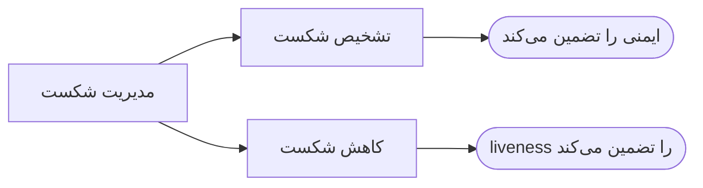
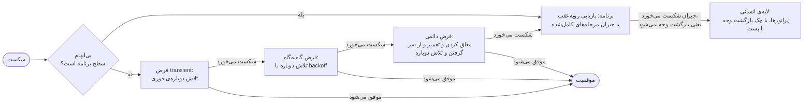

# فصل ۳: تحمل شکست

[فصل ۲: مدل سیستم، ترتیب و زمان →](02-system-models-order-and-time.md) · [کتاب](../README.md) · [فصل ۴: تحویل و پردازش پیام ←](04-message-delivery-and-processing.md)

## خلاصه

**تحمل شکست** تضمین این است که سیستم حتی وقتی شکست می‌افتد به شکلی خوب‌تعریف‌شده رفتار می‌کند (p. 40). فصل موضوع را اول در نظریه و بعد در عمل می‌گیرد.

در نظریه، شکست گذاری ناخواسته ولی ممکن از حالتی قانونی به حالتی غیرقانونی است. تحمل شکست بر حسب این که کدام یک از ایمنی و liveness از شکست جان سالم می‌برد رده‌بندی می‌شود: **masking** یا **nonmasking** یا **fail-safe** (pp. 41–44).

در عمل، فصل از **ارکستراسیون سرویس** استفاده می‌کند: فرایندی از مرحله‌ها که هر کدام درخواستی به یک تأمین‌کننده‌ی سرویس است، و اعمال جزئی نامطلوب است (pp. 44–46). مدیریت شکست یعنی **تشخیص**، که ایمنی را تضمین می‌کند، به‌علاوه‌ی **کاهش**، که liveness را تضمین (p. 46). شکست‌ها مکانی به **سطح برنامه یا سطح بستر** رده‌بندی می‌شوند و زمانی به **transient و گاه‌به‌گاه و دائمی** (pp. 47–50). detectorها در سیستمی partially synchronous نمی‌توانند هم کامل باشند و هم دقیق (pp. 50–51). کاهش یا **بازیابی رو‌به‌عقب** است، یعنی جبران، یا **بازیابی رو‌به‌جلو**، یعنی تلاش دوباره (p. 52). فصل با راهبردی پله‌پله تمام می‌شود: تلاش دوباره‌ی فوری، تلاش دوباره با backoff، معلق کردن و تعمیر، و دست آخر دادن شکست به برنامه، و به آدم‌ها اگر جبران هم شکست بخورد (pp. 52–53).

## نکته‌های کلیدی

- **حالت سیستم یا قانونی است یا غیرقانونی یا تحمل‌ناپذیر.** گذارهای عادی قانونی بودن را نگه می‌دارند یا برمی‌گردانند؛ گذارهای شکست سیستم را غیرقانونی می‌کنند. بازیابی مسیر برگشت به حالتی قانونی است. حالت‌های تحمل‌ناپذیر طبق تعریف بیرون از دامنه‌اند (pp. 41–42).
- **روش masking** ایمنی و liveness را نگه می‌دارد، **nonmasking** فقط liveness را، **fail-safe** فقط ایمنی را، و سیستمی که هیچ‌کدام را نگه ندارد تحمل‌کننده‌ی شکست نیست (جدول ۳.۱) (pp. 42–43).
- **یک فرایند باید کامل اعمال شود یا اصلاً نشود.** بازیابی باید به‌چشم با اعمال کامل هم‌ارز باشد، یعنی رو‌به‌جلو، یا با هیچ اعمالی، یعنی رو‌به‌عقب. کامل بودن برای سیستم‌های توزیع‌شده همان است که ACID برای دیتابیس‌هاست (p. 45).
- **تشخیص ایمنی را تضمین می‌کند و کاهش liveness را.** نود consensusی که به quorumش نمی‌رسد جواب دادن را متوقف می‌کند، یعنی ایمنی، و وقتی دوباره بپیوندد از سر می‌گیرد، یعنی liveness (p. 46).
- **شکست را در پایین‌ترین لایه‌ای مدیریت کنید که می‌تواند درست و کامل مدیریتش کند**، یعنی استدلال سر‌تا‌سری. خطای `InsufficientFunds` سطح برنامه است و `CouldNotConnect` سطح بستر (p. 48).
- **رده‌های زمانی احتمال شرطی‌اند:** transient یعنی P(F2 | F1) = P(F2)؛ گاه‌به‌گاه یعنی P(F2 | F1) > P(F2)؛ دائمی یعنی P(F2 | F1) = 1. دوتای اول خود‌تعمیر‌اند و شکست دائمی به تعمیر دستی نیاز دارد (pp. 48–50).
- **شاهد یک crash یک timeout است.** زیر partially synchronousی و روی شبکه‌ای نامطمئن، هیچ detectorی هم کامل است، یعنی چیزی را از دست نمی‌دهد، و هم دقیق، یعنی اشتباه نمی‌کند (p. 51).
- **پله‌پله بالا بروید.** تلاش دوباره‌ی فوری، بعد با backoff، بعد معلق کردن و تعمیر و از سر گرفتن. و فقط بعدش شکست را سطح برنامه ببینید. اگر جبران شکست بخورد، لایه‌ی انسانی تحویل می‌گیرد (pp. 52–53).

## فهرست بخش‌ها

*از فهرست مطالب خود کتاب، از bookmarkهای PDF؛ شماره‌ها صفحه‌ی چاپی‌اند.*

- ۳.۱ در نظریه — ص. ۴۱
- ۳.۲ گونه‌های تحمل شکست — ص. ۴۲
  - ۳.۲.۱ تحمل شکست masking — ص. ۴۲
  - ۳.۲.۲ تحمل شکست nonmasking — ص. ۴۲
  - ۳.۲.۳ تحمل شکست fail-safe — ص. ۴۳
  - ۳.۲.۴ هیچ‌کدام از بالایی‌ها — ص. ۴۳
- ۳.۳ در عمل — ص. ۴۴
  - ۳.۳.۱ مدل سیستم — ص. ۴۴
  - ۳.۳.۲ مدیریت شکست — ص. ۴۶
  - ۳.۳.۳ رده‌بندی شکست — ص. ۴۷
  - ۳.۳.۴ تشخیص شکست — ص. ۵۰
  - ۳.۳.۵ کاهش شکست — ص. ۵۲
  - ۳.۳.۶ کنار هم گذاشتن همه چیز — ص. ۵۲

## یادداشت‌ها

کتاب واژه‌ی *شکست* را به‌جای عیب یا خطا به کار می‌برد، و *تحمل شکست* را به‌جای تحمل عیب، چون این سه واژه تمایزی جهان‌پذیرفته ندارند (p. 41).

### ۳.۱ در نظریه

غیررسمی، **شکست** گذاری ناخواسته ولی ممکن از حالتی خوب به حالتی بد است (p. 41). رسمی (شکل ۳.۱):

*Figure 3.1 (p. 41): گذارهای ۲ و ۳ آن‌هایی‌اند که مهم‌اند؛ شکست سیستم را از ناحیه‌ی قانونی بیرون می‌برد، و بازیابی دنباله‌ی گذارهای عادی است که برش می‌گرداند (p. 42).*

حالت‌های تحمل‌ناپذیر از بحث محاسبات تحمل‌کننده‌ی شکست کنار گذاشته می‌شوند، چون طبق تعریف نمی‌کوشیم تحملشان کنیم. نمونه‌ی کتاب برخورد شهاب‌سنگ به زمین است (p. 42).

### ۳.۲ گونه‌های تحمل شکست

بی شکست، سیستم هم ایمنی و هم liveness را تضمین می‌کند. با شکست، ممکن است مجبور به مصالحه شویم (جدول ۳.۱) (p. 42):

| | **ایمن** | **ناایمن** |
|---|---|---|
| **زنده** | **masking**: شفافیت شکست، مطلوب‌ترین و شاید زیادی گران یا ناممکن، مثل CAP در فصل ۹ | **nonmasking**: می‌تواند خطا کند، ولی پیشرفت را ادامه می‌دهد |
| **نازنده** | **fail-safe**: خطا نمی‌کند، ولی می‌تواند بایستد | **هیچ‌کدام از بالایی‌ها**: تحمل‌کننده‌ی شکست نیست، و می‌شود گفت پذیرفتنی هم نیست |

نمونه‌ی صف FIFO کتاب (pp. 42–43):

- صفی **nonmasking** در طول شکست به تحویل پیام ادامه می‌دهد، احتمالاً بی‌ترتیب.
- صفی **fail-safe** تحویل را متوقف می‌کند تا بی‌ترتیب تحویل ندهد.

نمونه‌ی تک‌متغیری (فهرست ۳.۱، شکل ۳.۲) (pp. 43–44):

- مفهوم process P مقدار x را در مجموعه‌ی {۰، ۱، ۲، ۳} دارد و از ۱ شروع می‌کند.
- گذارهای عادی بین ۱ و ۲ یکی‌در‌میان می‌روند. یک گذار تعمیر، ۰ را به ۱ می‌برد. و یک گذار شکست، هر x ناصفری را به ۰.
- ایمنی: مقدار x یا ۱ است یا ۲. liveness: مقدار x سرانجام ۱ می‌شود و سرانجام ۲.
- وقتی x برابر ۰ است، سیستم ایمن نیست ولی باز هم زنده است، پس تحمل شکستش **nonmasking** است.
- مقدار x برابر ۳ تحمل‌ناپذیر است: هیچ چیز تضمین نمی‌کند سیستم هیچ‌وقت از آن بیرون بیاید.

> **Try it:** [masking و nonmasking و fail-safe](../widgets/03-failure-tolerance.html)؛ در process فهرست ۳.۱ و در صف FIFO کتاب شکست تزریق کنید، صف را بین nonmasking و fail-safe جابه‌جا کنید، و ببینید تا وقتی شکست هست هر کدام کدام خاصیت، یعنی ایمنی یا زنده‌بودن، را رها می‌کند.

> **In practice:** پیش از هر طراحی بپرسید وقتی یک جزء می‌افتد، کدام ویژگی‌ها باید بمانند: safety، liveness، یا هر دو.
>
> **Your turn:** وقتی ClickHouse در دسترس نیست، loader باید چه کند: fail شود یا داده را جایی نگه دارد و بعداً بنویسد؟
>
> *Answer:* Parquet در staging همین نقش را دارد: loader تمام می‌شود و کار ClickHouse بعداً تکرار می‌شود، پس liveness حفظ می‌شود بی‌آن‌که safety قربانی شود. اگر staging هم نباشد، fail شدن، یعنی تحمل fail-safe، بهتر از نوشتن نیمه‌کاره است (pp. 42–44).

### ۳.۳ در عمل

تلاش دوباره عمیق در فصل ۴ پوشانده می‌شود (p. 44).

#### ۳.۳.۱ مدل سیستم (pp. 44–46)

**ارکستراسیون سرویس** (شکل ۳.۳): یک consumer سرویس یک **فرایند** را اجرا می‌کند، یعنی دنباله‌ای از مرحله‌ها که هر کدام تبادل درخواست و پاسخ با یک تأمین‌کننده‌ی سرویس است (شکل ۳.۴).

| پیامد | معنا |
|---|---|
| **اعمال کامل** | هر مرحله موفق می‌شود: حالت درست به حالت درست |
| **اعمال جزئی** | شکستی وسط راه متوقفش می‌کند: حالت درست به حالتی که ممکن است نادرست باشد |

سر شکست، فرایند باید دست آخر یکی از این دو باشد (p. 45):

- **درست و مطلوب**: به‌چشم هم‌ارز با اعمال کامل، یعنی بازیابی رو‌به‌جلو، یا
- **درست ولی کم‌مطلوب‌تر**: به‌چشم هم‌ارز با هیچ اعمالی، یعنی بازیابی رو‌به‌عقب.

نمونه‌ی جاری، پرداخت یک فروشگاه اینترنتی با مرحله‌ی *شارژ کارت اعتباری* است. کارت باید اگر پرداخت موفق شود exactly-once شارژ شود و اگر شکست بخورد اصلاً نه، و هیچ‌وقت اگر کالا ارسال نشود یا بلیت صادر نشود (شکل ۳.۵) (p. 46).

#### ۳.۳.۲ مدیریت شکست (p. 46)

*بر پایه‌ی شکل ۳.۶.* لحظه‌ی آها!: تشخیص یک شکست و *بازداشتن از کنش‌های خطرناک* ایمنی را حفظ می‌کند، و کاهشش liveness را برمی‌گرداند. الگوریتم‌های consensus مثل Paxos و Raft و Viewstamped Replication هر دو را نشان می‌دهند. نودی که نمی‌تواند در quorum شرکت کند از جواب دادن خودداری می‌کند، یعنی تشخیص و ایمنی، و همین که دوباره بپیوندد از سر می‌گیرد، یعنی کاهش و liveness (p. 46).

#### ۳.۳.۳ رده‌بندی شکست (pp. 47–50)

دو بعد متعامد (شکل ۳.۷):

**مکانی: شکست کجا مدیریت می‌شود** (pp. 47–48).

- *فکر کردن در لایه‌ها* (شکل ۳.۹): لایه‌های بالاتر به پایین‌تر‌ها فراخوانی رو‌به‌پایین می‌زنند، و لایه‌های پایین‌تر گاهی از راه callbackهای ثبت‌شده فراخوانی رو‌به‌بالا می‌زنند.
- از نگاه هر لایه‌ای، آن لایه **برنامه** است و هر چیزی زیرش **بستر**. چیزها با نقشی که در زمینه بازی می‌کنند مشخص می‌شوند؛ ایده‌ای که کتاب به Eugenia Cheng نسبت می‌دهد.
- **استدلال سر‌تا‌سری**: شکست را در پایین‌ترین لایه، از نگاه بالا به پایین، مدیریت کنید که بتواند درست و کامل تشخیصش بدهد و کاهشش بدهد (شکل ۳.۱۰).

| شکست | سطح | چرا (p. 48) |
|---|---|---|
| خطای `InsufficientFunds` | **برنامه** | برای بستر بی‌معناست؛ فقط برنامه می‌تواند حلش کند |
| خطای `CouldNotConnect` | **بستر** | بستر می‌تواند با اتصال دوباره درست و کامل کاهشش بدهد |

**زمانی: کِی تکرار می‌شود** (pp. 48–50)، با `CouldNotConnect` به‌عنوان نمونه:

| رده | تعریف | تعمیر | علت در نمونه |
|---|---|---|---|
| **transient**، یعنی می‌آید و می‌رود | P(F2 \| F1) = P(F2) | خود‌تعمیر، تند | راه‌اندازی دوباره‌ی یک router |
| **گاه‌به‌گاه**، یعنی می‌ماند | P(F2 \| F1) > P(F2) | خود‌تعمیر، بعد از latencyی | جدول مسیریابی از‌رده‌خارج |
| **دائمی**، یعنی durable است | P(F2 \| F1) = 1 | دستی | گواهی منقضی، پس اپراتور باید تازه‌ای نصب کند |

#### ۳.۳.۴ تشخیص شکست (pp. 50–52)

بیشتر متن‌ها Chandra و Toueg را دنبال می‌کنند: هر process ماژول failure detector محلی دارد که فهرستی از processهایی را نگه می‌دارد که *مظنون* به crash کردن‌اند (p. 50). نویسنده تور پهن‌تری می‌اندازد. یک failure detector یک **شاهد** است، یعنی محمولی که گذاری ناخواسته به حالتی غیرقانونی را تأیید می‌کند، و اغلب داخل خود الگوریتم ساخته شده (p. 50).

- شکست‌های سطح برنامه و سطح بستر اغلب فقط از کد بازگشتی یک مرحله تشخیص داده می‌شوند: `InsufficientFunds` یا `CouldNotConnect` (p. 51).
- *در دسترس نبودن کامل* به تبادل پیام در بازه‌های معین نیاز دارد (p. 51):
  - **کشیدن**: ناظر درخواست می‌فرستد و ظرف پنجره‌ای زمانی پاسخ می‌خواهد.
  - **هل دادن**: مؤلفه‌ی مشاهده‌شده **heartbeat** می‌فرستد.
- شاهد یک crash یک **timeout** است. فقط در سیستمی synchronous روی شبکه‌ای مطمئن قطعی است. وگرنه، پیام غایب ممکن است فقط latency خورده یا گم شده باشد (p. 51).

| خاصیت | یعنی | با چه چیزی نقض می‌شود |
|---|---|---|
| **کامل** | هر شکست واقعی سرانجام تشخیص داده می‌شود | از دست دادن، یعنی منفی کاذب |
| **دقیق** | هر شکست تشخیص‌داده‌شده شکستی واقعی است | اشتباه، یعنی مثبت کاذب |

در سیستمی partially synchronous یا asynchronous روی شبکه‌ای نامطمئن، detector **نمی‌تواند هر دو باشد** (p. 51).

*چه کسی ناظر را نظارت می‌کند؟* درخت‌های supervision در Erlang/OTP شناخته‌شده‌ترین پاسخ‌اند، ولی سرانجام به قلمرو تحمل‌ناپذیر و دخالت انسانی می‌رسید (pp. 51–52).

#### ۳.۳.۵ کاهش شکست (p. 52)

| تکنیک | سیستم را به حالتی می‌برد هم‌ارز با… | علت تعمیر شود؟ | سطح و شکل معمول |
|---|---|---|---|
| **بازیابی رو‌به‌عقب** | حالت قانونی اولیه | معمولاً لازم نیست: از شکست رد نمی‌شویم | سطح برنامه: **جبران** |
| **بازیابی رو‌به‌جلو** | حالت قانونی نهایی | لازم است: از شکست رد می‌شویم | سطح بستر: **تلاش دوباره** |

#### ۳.۳.۶ کنار هم گذاشتن همه چیز (pp. 52–53)

راهبرد آرمانی برای یک فرایند ارکستر‌شده (شکل ۳.۱۶):

*Figure 3.16 (p. 53): هر تلاش دوباره‌ی شکست‌خورده به فرضی بدبینانه‌تر درباره‌ی شکست بالا می‌رود.*

*جریان vault، که مسیر سطح برنامه (p. 52) و یادداشت «هوشیار باشید» (p. 53) را به شکل ۳.۱۶ اضافه می‌کند.*

> **Try it:** [مدیریت پله‌پله‌ی شکست](../widgets/03-escalation.html)؛ مرحله‌ی *شارژ کارت اعتباری* پرداخت را در برابر شکست‌های `CouldNotConnect` transient و گاه‌به‌گاه و دائمی و یک شکست `InsufficientFunds` اجرا کنید، و ببینید راهبرد از تلاش دوباره‌ی فوری به backoff و بعد معلق کردن و تعمیر و بعد جبران بالا می‌رود.

> **In practice:** retry در Airflow و restart در Kubernetes هر دو mitigation شکست‌اند، ولی فقط برای شکست‌های transient.
>
> **Your turn:** task در Airflow با `retries=3` روی خطای «column not found» سه بار دیگر اجرا می‌شود و هر بار fail. این شکست را چطور رده‌بندی می‌کنید و چه باید کرد؟
>
> *Answer:* این شکست persistent است، نه transient: retry کمکی نمی‌کند و فقط alert را دیر می‌اندازد. خطاهای schema را non-retryable کنید، مثلاً با `AirflowFailException`، و retry را برای timeout شبکه نگه دارید. کتاب رده‌بندی شکست را پیش‌شرط انتخاب mitigation می‌داند (pp. 47–52).

## بده‌بستان‌ها در یک نگاه

| انتخاب | چه می‌دهد | چه می‌گیرد |
|---|---|---|
| تحمل masking | شفافیت شکست | گران است و گاهی ناممکن، یعنی CAP |
| تحمل nonmasking | پیشرفت در طول شکست | خطای ممکن، مثل تحویل بی‌ترتیب |
| تحمل fail-safe | هیچ خطایی | در طول شکست می‌ایستد |
| timeout کوتاه | تشخیص تند و کامل | نادقیق: شک‌های کاذب |
| timeout بلند | تشخیص دقیق | تشخیص کند: بیشتر از دست می‌دهد |
| بازیابی رو‌به‌عقب | لازم نیست علت درست شود | فرایند کامل نمی‌شود، و جبران هم می‌تواند شکست بخورد |
| بازیابی رو‌به‌جلو | فرایند کامل می‌شود | علت باید تعمیر شود؛ تلاش دوباره به idempotence نیاز دارد، فصل ۴ |

## فراتر از کتاب

- **چقدر backoff؟** کتاب سر «تلاش دوباره با راهبرد backoff» می‌ایستد (p. 53). انتخاب رایج، backoff نمایی سقف‌دار با jitter است: زمانی تصادفی در بازه‌ی [۰، کمینه‌ی سقف و base ضرب‌در ۲ به توان n] صبر کنید تا clientهای زیادی که با هم تلاش دوباره می‌کنند هم‌گام نشوند. [آزمایش راهبردهای تلاش دوباره](../lab/03-retry-strategies/README.md) تلاش دوباره‌ی فوری و ثابت و نمایی را در برابر سه رده‌ی زمانی شکست مقایسه می‌کند.
- **عیب و خطا و شکست.** کتاب تمایز کلاسیک را می‌اندازد، که از عیب به‌عنوان علت تا خطا به‌عنوان حالت درونی نادرست تا شکست به‌عنوان انحراف مشاهده‌شدنی در رده‌بندی اتکا‌پذیری Avizienis و Laprie و همکاران می‌رود. کتاب‌های دیگر، از جمله [فصل ۲ کتاب DDIA](../../designing-data-intensive-applications/chapters/02-defining-nonfunctional-requirements.md)، همان تمایز را به کار می‌برند، پس سر مقایسه ترجمه‌شان کنید.
- **نقش detector φ-accrual** timeout دودویی را با سطحی پیوسته از شک عوض می‌کند، پس هر برنامه‌ای بده‌بستان کامل بودن و دقت خودش را انتخاب می‌کند. [فصل ۹ کتاب Database Internals](../../database-internals/chapters/09-failure-detection.md) شبیه‌سازی‌اش را دارد، و [فصل ۹ کتاب DDIA](../../designing-data-intensive-applications/chapters/09-the-trouble-with-distributed-systems.md) یکی برای انتخاب timeout.

## پیوندها

- **فصل‌های مرتبط:** [فصل ۱: فکر کردن در سیستم‌های توزیع‌شده](01-thinking-in-distributed-systems-models-mindsets-and-mechanics.md) که ایمنی و liveness را دارد، [فصل ۲: مدل سیستم، ترتیب و زمان](02-system-models-order-and-time.md) که مدل‌های شکست را دارد، [فصل ۴: تحویل و پردازش پیام](04-message-delivery-and-processing.md) که تلاش دوباره و idempotence را دارد، [فصل ۶: تراکنش توزیع‌شده](06-distributed-transactions.md) که جبران در saga را دارد، و [فصل ۱۱: اجراهای durable](11-durable-executions.md) که از سر گرفتن فرایندها بعد از شکست را دارد.
- **Run it:** [راهبردهای تلاش دوباره در برابر رده‌های شکست](../lab/03-retry-strategies/README.md)؛ شکست‌های transient و گاه‌به‌گاه و دائمی را شبیه‌سازی می‌کند و نرخ موفقیت و شمار تلاش و زمان تا موفقیت را برای هر راهبرد تلاش دوباره اندازه می‌گیرد.

## خودتان را بسنجید

*پرسش‌ها و پاسخ‌ها مال vault است و از روی یادداشت‌های بالا نوشته شده؛ پاسخ‌ها به صفحه‌های کتاب ارجاع می‌دهند.*

1. **در مدل رسمی کتاب، بازیابی شکست چیست؟**

   *Answer:* دنباله‌ی گذارهای عادی که سیستم را از حالتی غیرقانونی به حالتی قانونی برمی‌گرداند (pp. 41–42).

2. **صفی در طول شکست به تحویل ادامه می‌دهد ولی می‌تواند بی‌ترتیب تحویل بدهد. این کدام گونه تحمل شکست است؟**
   - [ ] masking
   - [x] nonmasking
   - [ ] fail-safe

   *Answer:* زنده می‌ماند ولی ایمن نه، پس nonmasking است. صفی fail-safe به‌جایش تحویل را متوقف می‌کرد (pp. 42–43).

3. **چرا تحمل شکست process فهرست ۳.۱ از جنس nonmasking است؟**

   *Answer:* در x برابر ۰ ایمنی را نقض می‌کند، چون x باید ۱ یا ۲ باشد، ولی گذار تعمیر از x = 0 به x := 1 زنده نگهش می‌دارد (p. 44).

4. **از تشخیص شکست و کاهش شکست، کدام ایمنی را تضمین می‌کند و کدام liveness را؟**

   *Answer:* تشخیص پایه‌ی ایمنی است: شکست را تشخیص بدهید و کنش‌های خطرناک را بازدارید. کاهش پایه‌ی liveness است: پیشرفت را از سر بگیرید (p. 46).

5. **چرا `CouldNotConnect` شکستی سطح بستر است ولی `InsufficientFunds` سطح برنامه؟**

   *Answer:* بر پایه‌ی استدلال سر‌تا‌سری، شکست به پایین‌ترین لایه‌ای تعلق دارد که می‌تواند درست و کامل مدیریتش کند. اتصال دوباره می‌تواند اولی را در سطح بستر درست کند؛ و فقط برنامه می‌تواند دومی را تفسیر و حل کند (p. 48).

6. **شکست‌های transient و گاه‌به‌گاه و دائمی را به‌عنوان احتمال بیان کنید.**

   *Answer:* transient: P(F2 | F1) = P(F2). گاه‌به‌گاه: P(F2 | F1) > P(F2). دائمی: P(F2 | F1) = 1 (pp. 49–50).

7. **چرا یک failure detector در سیستمی partially synchronous نمی‌تواند هم کامل باشد و هم دقیق؟**

   *Answer:* یک heartbeat غایب می‌تواند یعنی crash یا latency یا پیام گم‌شده، و detector نمی‌تواند بگوید کدام (p. 51).

8. **اگر خود بازیابی رو‌به‌عقب شکست بخورد، مثلاً بازگشت وجه شکست بخورد، چه می‌شود؟**

   *Answer:* شکست به لایه‌ی انسانی بالا می‌رود. در بدترین حالت، کسی چک بازگشت وجه را با پست برای مشتری می‌فرستد (p. 53).
