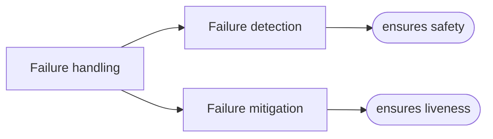
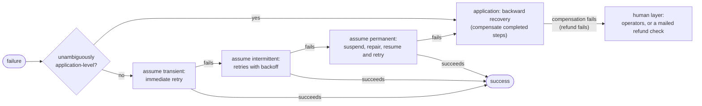

# 3. Failure tolerance

[← 2. System models, order, and time](02-system-models-order-and-time.md) · [Book](../README.md) · [4. Message delivery and processing →](04-message-delivery-and-processing.md)

## Summary

**Failure tolerance** is the guarantee that a system behaves in a well-defined way even when failures occur (p. 40). The chapter treats the topic first in theory and then in practice.

In theory, a failure is an unwanted but possible state transition from a legal to an illegal state. Failure tolerance is classified by which of safety and liveness survives the failure: **masking**, **nonmasking** or **fail-safe** (pp. 41–44).

In practice, the chapter uses **service orchestration**: a process of steps, each a request to a service provider, where partial application is undesirable (pp. 44–46). Failure handling is **detection**, which ensures safety, plus **mitigation**, which ensures liveness (p. 46). Failures are classified spatially as **application-level or platform-level** and temporally as **transient, intermittent or permanent** (pp. 47–50). Detectors can't be both complete and accurate in a partially synchronous system (pp. 50–51). Mitigation is **backward recovery** (compensation) or **forward recovery** (retries) (p. 52). The chapter ends with an escalating strategy: retry immediately, retry with backoff, suspend and repair, and finally hand the failure to the application, and to humans if compensation fails too (pp. 52–53).

## Key takeaways

- **A system state is legal, illegal or intolerable.** Normal transitions keep or restore legality; failure transitions make the system illegal. Recovery is the path back to a legal state. Intolerable states are out of scope by definition (pp. 41–42).
- **Masking** keeps safety and liveness, **nonmasking** keeps liveness only, **fail-safe** keeps safety only, and a system that keeps neither isn't failure-tolerant (Table 3.1) (pp. 42–43).
- **A process must apply totally or not at all.** Recovery must be observably equivalent to total application (forward) or to no application (backward). Completeness is to distributed systems what ACID is to databases (p. 45).
- **Detection ensures safety; mitigation ensures liveness.** A consensus node that can't reach its quorum stops answering (safety), and starts again when it rejoins (liveness) (p. 46).
- **Handle a failure at the lowest layer that can handle it correctly and completely** (the end-to-end argument). `InsufficientFunds` is application-level; `CouldNotConnect` is platform-level (p. 48).
- **The temporal classes are conditional probabilities:** transient P(F2 | F1) = P(F2); intermittent P(F2 | F1) > P(F2); permanent P(F2 | F1) = 1. The first two autorepair; permanent failures need manual repair (pp. 48–50).
- **The witness of a crash is a timeout.** Under partial synchrony and an unreliable network, no detector is both complete (no misses) and accurate (no mistakes) (p. 51).
- **Escalate.** Retry immediately, then with backoff, then suspend, repair and resume. Only then treat the failure as application-level. If compensation fails, the human layer takes over (pp. 52–53).

## Section outline

*From the book’s own table of contents (PDF bookmarks); printed page numbers.*

- 3.1 In theory — p. 41
- 3.2 Types of failure tolerance — p. 42
  - 3.2.1 Masking failure tolerance — p. 42
  - 3.2.2 Nonmasking failure tolerance — p. 42
  - 3.2.3 Fail-safe failure tolerance — p. 43
  - 3.2.4 None of the above — p. 43
- 3.3 In practice — p. 44
  - 3.3.1 System model — p. 44
  - 3.3.2 Failure handling — p. 46
  - 3.3.3 Failure classification — p. 47
  - 3.3.4 Failure detection — p. 50
  - 3.3.5 Failure mitigation — p. 52
  - 3.3.6 Putting everything together — p. 52

## Notes

The book uses *failure* rather than fault or error, and *failure tolerance* rather than fault tolerance, because the three terms have no universally accepted distinction (p. 41).

### 3.1 In theory

Informally, a **failure** is an unwanted but possible state transition from a good state to a bad one (p. 41). Formally (Figure 3.1):

*Figure 3.1 (p. 41): transitions 2 and 3 are the ones that matter — a failure takes the system out of the legal region, and recovery is the sequence of normal transitions that brings it back (p. 42).*

Intolerable states are excluded from discussions of failure-tolerant computing, because by definition we don't try to tolerate them. The book's example is the earth being hit by a meteor (p. 42).

### 3.2 Types of failure tolerance

Without failures, a system guarantees both safety and liveness. With failures, we may have to compromise (Table 3.1) (p. 42):

| | **Safe** | **Not safe** |
|---|---|---|
| **Live** | **Masking**: failure transparency, the most desirable and possibly too costly or impossible, as with CAP (Chapter 9) | **Nonmasking**: may make mistakes, but keeps making progress |
| **Not live** | **Fail-safe**: makes no mistakes, but may stop | **None of the above**: not failure-tolerant, arguably unacceptable |

The book's FIFO queue example (pp. 42–43):

- A **nonmasking** queue keeps delivering messages during a failure, possibly out of order.
- A **fail-safe** queue stops delivering to avoid delivering out of order.

The one-variable example (Listing 3.1, Figure 3.2) (pp. 43–44):

- Process P has x ∈ {0, 1, 2, 3}, starting at 1.
- Normal transitions alternate 1 ↔ 2. A repair transition takes 0 → 1. A failure transition takes any x ≠ 0 to 0.
- Safety: x is 1 or 2. Liveness: x will eventually be 1, and eventually be 2.
- When x = 0 the system is not safe but still live, so it is **nonmasking** failure-tolerant.
- x = 3 is intolerable: nothing guarantees the system ever leaves it.

> **Try it:** [Masking, nonmasking, fail-safe](../widgets/03-failure-tolerance.html) — inject failures into Listing 3.1's process and into the book's FIFO queue, switch the queue between nonmasking and fail-safe, and watch which property (safety or liveness) each one gives up while the failure lasts.

### 3.3 In practice

Retries are covered in depth in Chapter 4 (p. 44).

#### 3.3.1 System model (pp. 44–46)

**Service orchestration** (Figure 3.3): a service consumer runs a **process**, a sequence of steps, each a request–response exchange with a service provider (Figure 3.4).

| Outcome | Meaning |
|---|---|
| **Total application** | Every step succeeds: correct state → correct state |
| **Partial application** | A failure stops it partway: correct state → possibly incorrect state |

On failure, the process must end up either (p. 45):

- **correct and desirable**: observably equivalent to total application (forward recovery), or
- **correct but less desirable**: observably equivalent to no application (backward recovery).

The running example is an e-commerce checkout with a *Charge credit card* step. The card must be charged exactly once if checkout succeeds and not at all if it fails, and never if goods aren't shipped or tickets aren't issued (Figure 3.5) (p. 46).

#### 3.3.2 Failure handling (p. 46)

*After Figure 3.6.* The aha! moment: detecting a failure and *inhibiting dangerous actions* preserves safety, while mitigating it restores liveness. Consensus algorithms such as Paxos, Raft and Viewstamped Replication show both. A node that can't take part in the quorum refrains from answering (detection, safety), and resumes once it rejoins (mitigation, liveness) (p. 46).

#### 3.3.3 Failure classification (pp. 47–50)

Two orthogonal dimensions (Figure 3.7):

**Spatial: where the failure is handled** (pp. 47–48).

- *Thinking in layers* (Figure 3.9): higher layers make downcalls to lower ones, and lower layers occasionally make upcalls through registered callbacks.
- From any layer's point of view, that layer is the **application** and everything below it is the **platform**. Things are characterized by the role they play in context (an idea the book credits to Eugenia Cheng).
- The **end-to-end argument**: handle a failure in the lowest layer (viewed from the top down) that can detect and mitigate it correctly and completely (Figure 3.10).

| Failure | Level | Why (p. 48) |
|---|---|---|
| `InsufficientFunds` | **Application** | Meaningless to the platform; only the application can resolve it |
| `CouldNotConnect` | **Platform** | The platform can mitigate it correctly and completely by reconnecting |

**Temporal: when it recurs** (pp. 48–50), using `CouldNotConnect` as the example:

| Class | Definition | Repair | Cause in the example |
|---|---|---|---|
| **Transient** (come and go) | P(F2 \| F1) = P(F2) | Autorepair, quickly | A router restart |
| **Intermittent** (linger) | P(F2 \| F1) > P(F2) | Autorepair, after a delay | An outdated routing table |
| **Permanent** (here to stay) | P(F2 \| F1) = 1 | Manual | An expired certificate, so an operator must install a new one |

#### 3.3.4 Failure detection (pp. 50–52)

Most texts follow Chandra and Toueg: each process has a local failure-detector module that keeps a list of processes it *suspects* have crashed (p. 50). The author casts a wider net. A failure detector is a **witness**, a predicate that confirms an unwanted transition into an illegal state, and is often built into the algorithm itself (p. 50).

- Application- and platform-level failures are often detected simply from a step's return code: `InsufficientFunds` or `CouldNotConnect` (p. 51).
- *Complete unavailability* needs message exchange at set intervals (p. 51):
  - **Pull**: the observer sends requests and expects a response within a time window.
  - **Push**: the observed component sends **heartbeats**.
- The witness of a crash is a **timeout**. It's certain only in a synchronous system over a reliable network. Otherwise, a missing message may just be delayed or lost (p. 51).

| Property | Means | Violated by |
|---|---|---|
| **Complete** | Every actual failure is eventually detected | Misses (false negatives) |
| **Accurate** | Every detected failure is an actual failure | Mistakes (false positives) |

In a partially synchronous or asynchronous system over an unreliable network, a detector **can't be both** (p. 51).

*Who supervises the supervisor?* Erlang/OTP supervision trees are the best-known answer, but eventually you reach intolerable territory and human intervention (pp. 51–52).

#### 3.3.5 Failure mitigation (p. 52)

| Technique | Moves the system to a state equivalent to… | Repair the cause? | Typical level and form |
|---|---|---|---|
| **Backward recovery** | the initial legal state | Usually not needed: we don't push past the failure | Application level: **compensation** |
| **Forward recovery** | the final legal state | Required: we push past the failure | Platform level: **retries** |

#### 3.3.6 Putting everything together (pp. 52–53)

The ideal strategy for an orchestrated process (Figure 3.16):

*Figure 3.16 (p. 53): each failed retry escalates to a more pessimistic assumption about the failure.*

*The vault's flow, adding the application-level path (p. 52) and the "Be vigilant" note (p. 53) to Figure 3.16.*

> **Try it:** [Escalating failure handling](../widgets/03-escalation.html) — run the checkout's *Charge credit card* step against transient, intermittent and permanent `CouldNotConnect` failures and an `InsufficientFunds` failure, and watch the strategy escalate from immediate retry to backoff, to suspend and repair, to compensation.

## Trade-offs at a glance

| Choice | Buys | Costs |
|---|---|---|
| Masking tolerance | Failure transparency | Expensive, and sometimes impossible (CAP) |
| Nonmasking tolerance | Progress during failure | Possible mistakes, such as out-of-order delivery |
| Fail-safe tolerance | No mistakes | Stalls during failure |
| Short timeout | Fast, complete detection | Inaccurate: false suspicions |
| Long timeout | Accurate detection | Slow detection: misses for longer |
| Backward recovery | No need to fix the cause | The process doesn't complete, and compensation can fail too |
| Forward recovery | The process completes | The cause must be repaired; retries need idempotence (Chapter 4) |

## Beyond the book

- **How much backoff?** The book stops at "retries with a backoff strategy" (p. 53). A common choice is capped exponential backoff with jitter: wait a random time in [0, min(cap, base·2ⁿ)] so that many clients retrying together don't synchronize. The [retry-strategies lab](../lab/03-retry-strategies/README.md) compares immediate, fixed and exponential retries against the three temporal failure classes.
- **Fault, error, failure.** The book drops the classic distinction, which runs from fault (cause) to error (incorrect internal state) to failure (observable deviation) in Avizienis, Laprie and colleagues' dependability taxonomy. Other books, including [DDIA Ch. 2](../../designing-data-intensive-applications/chapters/02-defining-nonfunctional-requirements.md), use that distinction, so translate when comparing.
- **The φ-accrual detector** replaces the binary timeout with a continuous suspicion level, so each application picks its own completeness/accuracy trade-off. [Database Internals Ch. 9](../../database-internals/chapters/09-failure-detection.md) has a simulation, and [DDIA Ch. 9](../../designing-data-intensive-applications/chapters/09-the-trouble-with-distributed-systems.md) one for choosing a timeout.

## Connections

- **Related chapters:** [1. Thinking in distributed systems](01-thinking-in-distributed-systems-models-mindsets-and-mechanics.md) (safety and liveness), [2. System models, order, and time](02-system-models-order-and-time.md) (failure models), [4. Message delivery and processing](04-message-delivery-and-processing.md) (retries and idempotence), [6. Distributed transactions](06-distributed-transactions.md) (compensation in sagas), [11. Durable executions](11-durable-executions.md) (resuming processes after failure).
- **Run it:** [Retry strategies vs. failure classes](../lab/03-retry-strategies/README.md) — simulates transient, intermittent and permanent failures and measures success rate, attempts and time to success for each retry strategy.

## Check yourself

*Questions and answers are the vault's, written from the notes above; answers cite the book's pages.*

1. **What is failure recovery in the book's formal model?**

   *Answer:* The sequence of normal transitions that takes the system from an illegal state back to a legal state (pp. 41–42).

2. **A queue keeps delivering during a failure but may deliver out of order. Which kind of failure tolerance is that?**
   - [ ] Masking
   - [x] Nonmasking
   - [ ] Fail-safe

   *Answer:* It stays live but not safe, so it's nonmasking. A fail-safe queue would stop delivering instead (pp. 42–43).

3. **Why is Listing 3.1's process nonmasking failure-tolerant?**

   *Answer:* At x = 0 it violates safety (x must be 1 or 2), but the repair transition x = 0 → x := 1 keeps it live (p. 44).

4. **Which of failure detection and failure mitigation ensures safety, and which ensures liveness?**

   *Answer:* Detection is the basis for safety: detect the failure and inhibit dangerous actions. Mitigation is the basis for liveness: resume progress (p. 46).

5. **Why is `CouldNotConnect` a platform-level failure but `InsufficientFunds` an application-level one?**

   *Answer:* By the end-to-end argument, a failure belongs to the lowest layer that can handle it correctly and completely. Reconnecting can fix the first at the platform level; only the application can interpret and resolve the second (p. 48).

6. **Express transient, intermittent and permanent failures as probabilities.**

   *Answer:* Transient: P(F2 | F1) = P(F2). Intermittent: P(F2 | F1) > P(F2). Permanent: P(F2 | F1) = 1 (pp. 49–50).

7. **Why can't a failure detector be both complete and accurate in a partially synchronous system?**

   *Answer:* A missing heartbeat might mean a crash, a delay or a lost message, and the detector can't tell which (p. 51).

8. **What happens if backward recovery itself fails, for example a refund fails?**

   *Answer:* The failure is escalated to the human layer. In the worst case, someone mails the customer a refund check (p. 53).
