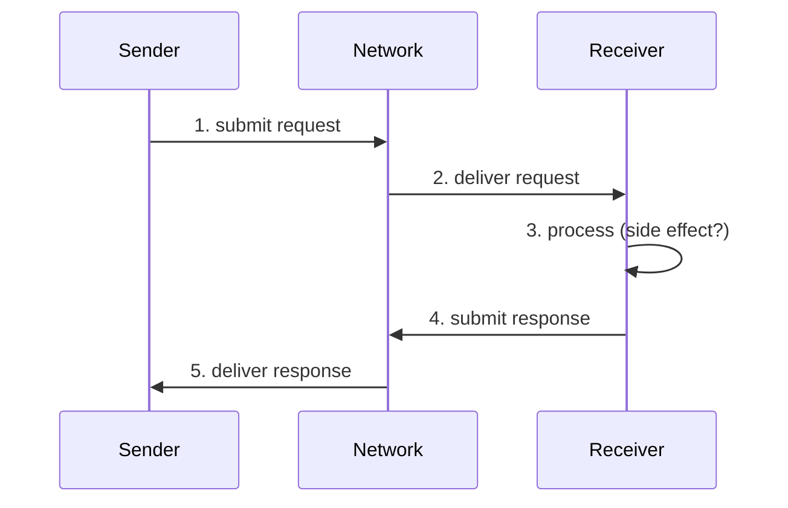
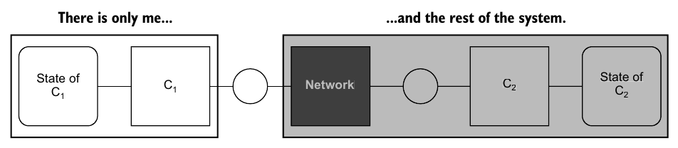

# 4. Message delivery and processing

[← 3. Failure tolerance](03-failure-tolerance.md) · [Book](../README.md) · [5. Transactions →](05-transactions.md)

## Summary

"Exactly once" is a phrase full of misconceptions. The book separates **exactly-once processing**, where each message is literally processed once, from **exactly-once processing semantics**, where the system *behaves as though* it was (p. 55). Using a request–response dialogue between a sender and a receiver, it splits message exchange into **delivery** and **processing**, each of which may happen at most once, at least once or exactly once (pp. 56–58).

The sender's limited local view creates an **uncertainty principle**. Between sending a request and getting a response, it can't tell a lost request from a crash, a lost response or plain slowness (pp. 58–59). TCP doesn't help, because the kernel acknowledges data before the application processes it (pp. 59–60). On a timeout the sender can only move on (at most once) or try again (at least once). Two attempts at receiver-side deduplication show why exactly-once *processing* is impossible (pp. 60–62). Exactly-once processing *semantics* is achievable: at-least-once delivery and processing plus an **idempotent** step, where equivalence (not equality) is defined by the application (pp. 62–63). The chapter ends with idempotence keys, transactional deduplication, Stripe's API and an airline app that charged the author four or five times (pp. 63–65).

## Key takeaways

- **Delivery ≠ processing.** Delivery is the network presenting the message to the component; processing is generating a response and the side effect. The semantics that matter are those of *processing* (p. 58).
- **Uncertainty between request and response.** The sender can't distinguish request lost, crash before processing, crash after processing, response lost, or a slow network or receiver (p. 59).
- **TCP will not save you.** At-least-once delivery at a lower layer doesn't give at-least-once delivery at a higher layer. The kernel acknowledges data it may never hand to the application (pp. 59–60).
- **Without a response there are two choices:** move on (at most once) or try again (at least once). Exactly-once *processing* is impossible in the presence of failure (pp. 60–61).
- **Exactly-once processing semantics** means P(m) is *equivalent* to P(m)·…·P(m). Equivalence is in the eye of the beholder, and it's an end-to-end guarantee that needs at-least-once delivery and processing (p. 62).
- **Idempotence** makes at-least-once processing look exactly-once: f(f(x)) = f(x), or in distributed terms, an equivalent effect (pp. 62–63).
- **Idempotence keys:** the sender attaches a UUID to a request and every retry, and the receiver deduplicates on it, ideally recording the key and the side effect in one transaction (p. 63).
- **Consider the user's experience.** The airline counted four or five pending charges that resolved to one as exactly-once. The author, looking at his card, didn't (p. 65).

## Section outline

*From the book’s own table of contents (PDF bookmarks); printed page numbers.*

- 4.1 Exchanging messages — p. 56
- 4.2 The uncertainty principle of message delivery and processing — p. 58
  - 4.2.1 Before sending the request — p. 59
  - 4.2.2 After sending the request and before receiving a response — p. 59
  - 4.2.3 After receiving a response — p. 59
- 4.3 Silence and chatter — p. 60
- 4.4 Exactly-once processing semantics — p. 62
- 4.5 Idempotence — p. 62
- 4.6 Case study: Charging a credit card — p. 64

## Notes

Precision matters here. A mental model built on misconceptions, or on marketing claims that hide a product's limits, leads to designs that rely on guarantees nobody provided (pp. 55–56).

### 4.1 Exchanging messages

The chapter uses the realistic system model from Chapter 2: partially synchronous; components that crash and recover, forgetting volatile state and keeping durable state; a network that reorders, drops and duplicates; no Byzantine failures (p. 56). A change in a component's local state is a **side effect** (p. 56).

A **sender** sends a request; a **receiver** processes it, possibly causing a side effect, and responds. The book models the dialogue as a **Petri net** (Figure 4.1). *Places* hold control state, *transitions* are events, and a transition fires when its input places hold tokens and its output places don't (p. 56).

*After Figure 4.2.* Steps 2 and 5 are **message delivery**; step 3 is **message processing** (p. 58).

| | Delivery: the network delivers the message… (Table 4.1) | Processing: the receiver processes it… (Table 4.2) |
|---|---|---|
| **At most once** | zero times or once | zero times or once |
| **At least once** | one or more times | one or more times |
| **Exactly once** | once | once |

The focus is processing, because processing embodies the application logic and its side effects (p. 58).

### 4.2 The uncertainty principle of message delivery and processing

A component sees only itself and "the rest of the system" (Figure 4.3) (p. 58):

*Figure 4.3 (p. 58): C1 cannot look inside the grey box, so it cannot tell a lost message from a slow network or a crashed C2.*

The sender therefore moves from certainty to uncertainty and must try to get back (p. 59):

| Moment | What the sender knows |
|---|---|
| **Before sending** | Certain: no work done, no side effects |
| **After sending, before a response** | Uncertain. It can't tell whether the request was lost, the receiver crashed before processing, the receiver crashed after processing, the response was lost, or the network or receiver is slow |
| **After a response** | Certain again: success means the work was done; failure means it wasn't. Components don't deceive |

**Aha! moment: TCP** (pp. 59–60).

- TCP is a reliable *delivery* protocol, with acknowledgments, retransmission and deduplication between kernel buffers.
- But the kernel acknowledges receipt *before* handing data to the application. If the process crashes after the acknowledgment and before processing, the message is lost.
- At-least-once delivery at the network layer becomes **at-most-once** at the application layer.

### 4.3 Silence and chatter

A **timeout** is the usual witness for a missing response. When the system is operating synchronously, a timeout is a true positive. When it's operating asynchronously, a timeout may be a false positive (p. 60). The receiver may also see **duplicates**. Between them, these make exactly-once delivery or processing impossible to guarantee (p. 60).

Without a response, the sender has exactly two choices (pp. 60–61):

| Choice | Intended semantics | What can still go wrong |
|---|---|---|
| **Move on** | At most once | The network may duplicate the message anyway |
| **Try again** | At least once | Messages may keep getting lost |

**Aha! moment: two failed attempts** at receiver-side tracking (pp. 61–62):

| Handler | Crash point | Effect of the retry | Result |
|---|---|---|---|
| Track the request, *then* process | After tracking, before processing | Skipped as a "duplicate", though never processed | **At most once** |
| Process, *then* track the request | After processing, before tracking | Processed again | **At least once** |

> **Try it:** [Deduplicating a retried request](../widgets/04-dedup-handler.html) — pick a handler (track-then-process, process-then-track or transactional), crash the receiver at any line, let the sender retry, and count how many times the balance transfer actually happened.

### 4.4 Exactly-once processing semantics

The semantics concern the processing *outcome*. Processing a message once must leave the system in a state **equivalent** to processing it two or more times (p. 62):

> P(m) ≡ P(m) · … · P(m)

The key word is *equivalent*, not *equal*. A system that logs each processing has more log entries after a duplicate, but we usually consider that inconsequential (p. 62). **Equivalence is in the eye of the beholder**: the application defines it, just as it defines correctness (p. 62).

Exactly-once processing semantics is an **end-to-end** guarantee and needs **at-least-once delivery and processing**. The sender must keep retrying until it gets a response, and the receiver must not skip processing (p. 62).

### 4.5 Idempotence

**Idempotence** (pp. 62–63): applying an operation many times has the same effect as applying it once, f(f(x)) = f(x). In a distributed system, executing it many times has an *equivalent* effect. **Idempotent processing plus at-least-once processing gives exactly-once processing semantics.**

| Operation | Inherently idempotent? (p. 63) |
|---|---|
| Set a **write-once register** (starts NULL; the first set locks the value) | Yes: a duplicate leaves exactly the same state |
| **Charge a credit card** | No: a duplicate charges twice |

Guaranteeing idempotence is hard. It's application-specific and end-to-end, like the semantics it supports (p. 63). Two common patterns (p. 63):

- **Idempotence key:** the sender generates a UUID and attaches it to the request *and every retry*; the receiver deduplicates on it.
- **Transactional recording and processing** (Listing 4.3): process the request and record its key in one transaction, so either both happen or neither does. In practice, use a key table with a uniqueness constraint and commit only if the new key insert succeeds alongside the side effect.

### 4.6 Case study: Charging a credit card

The example is booking an airline ticket, which must charge the card exactly once per purchase: not zero times, not twice (Figures 4.4–4.5) (p. 64). Without a response, the app may retry a bounded number of times and then tell the user, who can check for a confirmation email or refresh the *My Trips* tab (p. 65).

*Figure 4.5 (p. 64): from the client's side the two failures look the same — no response — but only the second one has already charged the card.*

| Approach | How it's equivalent | Caveat (p. 65) |
|---|---|---|
| **Stripe idempotency keys** | Stripe saves the status code and body of the first request for each key; later requests with that key get the same result, *including 500 errors* | The sender must generate the key. A reservation number that is itself a UUID can serve |
| **The airline's approach** | Four or five pending charges after app crashes; support said only one would take effect within 24 hours | Equivalent to the airline, not to the customer |

The author's cautionary tale: when you implement exactly-once processing semantics, consider the experience it creates for your users (p. 65).

## Trade-offs at a glance

| Strategy | Guarantees | Risk |
|---|---|---|
| Move on after a timeout | At most once | Lost work |
| Retry until a response | At least once | Duplicate side effects |
| Retry + idempotent step | Exactly-once processing semantics | Idempotence is hard and application-specific |
| Track, then process | No duplicates | A crash in between loses the message |
| Process, then track | No losses | A crash in between duplicates the message |
| Track and process in one transaction | Both | Needs the key store and the side effect in one transactional scope |

## Beyond the book

- **The Two Generals problem** is the classic statement of this uncertainty: no finite number of messages over a lossy channel lets two parties be *certain* they agree. The book's uncertainty principle is the same idea for one request–response pair.
- **Outside the transaction.** Listing 4.3 assumes the side effect and the key table share a transaction. When the side effect is a call to another service, as with Stripe, the key must be propagated instead. That's why idempotency-key APIs exist, and why [DDIA Ch. 13](../../designing-data-intensive-applications/chapters/13-a-philosophy-of-streaming-systems.md) argues for end-to-end request IDs. Its request-ID simulation shows the money moving twice without one.
- **Kafka's "exactly once"** combines an idempotent producer (sequence numbers per producer and partition) with transactions over consumer offsets and output. It's exactly-once processing semantics *within Kafka*; side effects outside Kafka still need idempotence. Compare the idempotency patterns in [Data Engineering Design Patterns Ch. 4](../../data-engineering-design-patterns/chapters/04-idempotency-design-patterns.md).

## Connections

- **Related chapters:** [2. System models, order, and time](02-system-models-order-and-time.md) (the network can reorder, duplicate and lose), [3. Failure tolerance](03-failure-tolerance.md) (retries as forward recovery), [5. Transactions](05-transactions.md) (the transaction behind Listing 4.3), [11. Durable executions](11-durable-executions.md) (retries and idempotence across a whole process).
- **Run it:** [Exactly-once by idempotence](../lab/04-idempotent-retries/README.md) — sends payments over a lossy, duplicating network with retries and counts charges per order for at-most-once, at-least-once, and at-least-once with an idempotence key.

## Check yourself

*Questions and answers are the vault's, written from the notes above; answers cite the book's pages.*

1. **What is the difference between exactly-once processing and exactly-once processing semantics?**

   *Answer:* The first means each message is literally processed once. The second means the system behaves as though it was, despite retries or duplicates (p. 55).

2. **List what the sender can't distinguish between after sending a request and before a response.**

   *Answer:* The request was lost; the receiver crashed before processing; the receiver crashed after processing; the response was lost; the network or the receiver is slow (p. 59).

3. **Why doesn't TCP prevent message loss for the application?**

   *Answer:* The kernel acknowledges data into its buffer before delivering it to the application. A crash in between loses the message, so the application gets at-most-once delivery (pp. 59–60).

4. **A handler records the request ID, then processes the request, then crashes between the two steps. What do retries get?**
   - [x] At-most-once processing
   - [ ] At-least-once processing
   - [ ] Exactly-once processing

   *Answer:* The retry is skipped as already received although it was never processed (p. 61).

5. **What do you need for exactly-once processing semantics?**

   *Answer:* At-least-once delivery, at-least-once processing, and an idempotent processing step (pp. 62–63, 65).

6. **Why does the book say "equivalent" rather than "equal"?**

   *Answer:* Duplicates may leave harmless differences, such as extra log entries, and the application decides what counts as equivalent (p. 62).

7. **What does Stripe return for a repeated idempotency key?**

   *Answer:* The saved status code and body of the first request with that key, whether it succeeded or failed, including 500 errors (p. 65).
