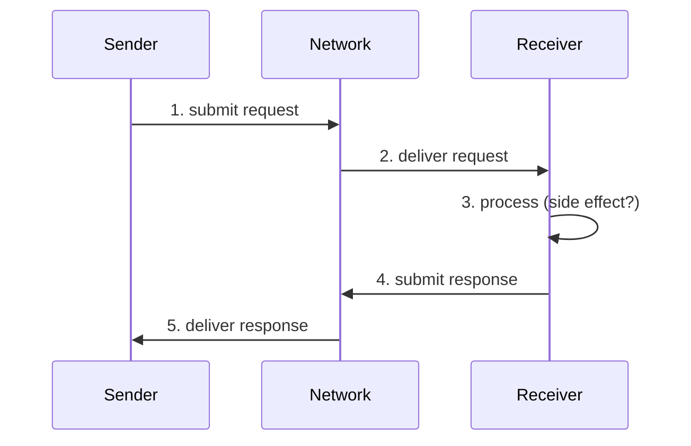
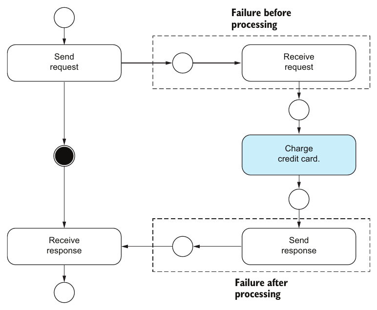

# فصل ۴: تحویل و پردازش پیام

[فصل ۳: تحمل شکست →](03-failure-tolerance.md) · [کتاب](../README.md) · [فصل ۵: تراکنش ←](05-transactions.md)

## خلاصه

عبارت «exactly-once» پر از برداشت غلط است. کتاب **پردازش exactly-once**، که هر پیام واقعاً یک‌بار پردازش می‌شود، را از **معنای پردازش exactly-once** جدا می‌کند، که سیستم *طوری رفتار می‌کند که گویی* یک‌بار پردازش شده (p. 55). با یک گفت‌و‌گوی درخواست و پاسخ بین فرستنده و گیرنده، تبادل پیام را به **تحویل** و **پردازش** می‌شکند، که هر کدام می‌تواند حداکثر یک‌بار یا دست‌کم یک‌بار یا exactly-once بیفتد (pp. 56–58).

نگاه محلی محدود فرستنده یک **اصل عدم قطعیت** می‌سازد. بین فرستادن درخواست و گرفتن پاسخ، نمی‌تواند درخواست گم‌شده را از crash یا پاسخ گم‌شده یا کندی ساده تشخیص بدهد (pp. 58–59). پروتکل TCP کمک نمی‌کند، چون kernel پیش از پردازش برنامه داده را تأیید می‌کند (pp. 59–60). سر timeout فرستنده فقط می‌تواند بگذرد، یعنی حداکثر یک‌بار، یا باز امتحان کند، یعنی دست‌کم یک‌بار. دو تلاش برای تکراری‌زدایی سمت گیرنده نشان می‌دهند چرا *پردازش* exactly-once ناممکن است (pp. 60–62). *معنای* پردازش exactly-once شدنی است: تحویل و پردازش at-least-once به‌علاوه‌ی مرحله‌ای **idempotent**، که هم‌ارزی‌اش، و نه برابری، را خود برنامه تعریف می‌کند (pp. 62–63). فصل با کلیدهای idempotence و تکراری‌زدایی تراکنشی و API سرویس Stripe و برنامه‌ی هواپیمایی‌ای تمام می‌شود که چهار یا پنج بار از نویسنده پول گرفت (pp. 63–65).

## نکته‌های کلیدی

- **تحویل با پردازش فرق دارد.** تحویل یعنی شبکه پیام را به مؤلفه نشان می‌دهد؛ پردازش یعنی ساختن پاسخ و اثر جانبی. معنایی که مهم است معنای *پردازش* است (p. 58).
- **عدم قطعیت بین درخواست و پاسخ.** فرستنده نمی‌تواند بین گم شدن درخواست، crash پیش از پردازش، crash بعد از پردازش، گم شدن پاسخ، و کندی شبکه یا گیرنده تمایز بگذارد (p. 59).
- **پروتکل TCP نجاتتان نمی‌دهد.** تحویل at-least-once در لایه‌ای پایین‌تر، تحویل at-least-once در لایه‌ای بالاتر نمی‌دهد. kernel داده‌ای را تأیید می‌کند که ممکن است هیچ‌وقت به برنامه ندهد (pp. 59–60).
- **بی پاسخ، دو انتخاب هست:** بگذرید، یعنی حداکثر یک‌بار، یا باز امتحان کنید، یعنی دست‌کم یک‌بار. *پردازش* exactly-once در حضور شکست ناممکن است (pp. 60–61).
- **معنای پردازش exactly-once** یعنی P(m) با P(m)·…·P(m) *هم‌ارز* است. هم‌ارزی در چشم بیننده است، و تضمینی سر‌تا‌سری است که به تحویل و پردازش at-least-once نیاز دارد (p. 62).
- **ویژگی idempotence** پردازش at-least-once را شبیه exactly-once نشان می‌دهد: f(f(x)) = f(x)، یا به زبان توزیع‌شده، اثری هم‌ارز (pp. 62–63).
- **کلیدهای idempotence:** فرستنده یک UUID به درخواست و هر تلاش دوباره می‌چسباند، و گیرنده روی آن تکراری‌زدایی می‌کند، در حالت آرمانی با ثبت کلید و اثر جانبی در یک تراکنش (p. 63).
- **تجربه‌ی کاربر را در نظر بگیرید.** شرکت هواپیمایی چهار یا پنج شارژ معلق که به یکی می‌رسیدند را exactly-once حساب می‌کرد. نویسنده که به کارتش نگاه می‌کرد، نه (p. 65).

## فهرست بخش‌ها

*از فهرست مطالب خود کتاب، از bookmarkهای PDF؛ شماره‌ها صفحه‌ی چاپی‌اند.*

- ۴.۱ تبادل پیام — ص. ۵۶
- ۴.۲ اصل عدم قطعیت تحویل و پردازش پیام — ص. ۵۸
  - ۴.۲.۱ پیش از فرستادن درخواست — ص. ۵۹
  - ۴.۲.۲ بعد از فرستادن درخواست و پیش از گرفتن پاسخ — ص. ۵۹
  - ۴.۲.۳ بعد از گرفتن پاسخ — ص. ۵۹
- ۴.۳ سکوت و پرحرفی — ص. ۶۰
- ۴.۴ معنای پردازش exactly-once — ص. ۶۲
- ۴.۵ ویژگی idempotence — ص. ۶۲
- ۴.۶ مطالعه‌ی موردی: شارژ کردن کارت اعتباری — ص. ۶۴

## یادداشت‌ها

دقت این‌جا مهم است. مدل ذهنی‌ای که روی برداشت غلط بنا شده، یا روی ادعاهای بازاریابی که محدودیت‌های محصول را قایم می‌کنند، به طراحی‌هایی می‌رسد که به تضمین‌هایی تکیه دارند که کسی نداده (pp. 55–56).

### ۴.۱ تبادل پیام

فصل همان مدل سیستم واقع‌بینانه‌ی فصل ۲ را به کار می‌برد: نیمه‌همگام؛ مؤلفه‌هایی که crash می‌کنند و برمی‌گردند و حالت فرار را فراموش و حالت durable را نگه می‌دارند؛ شبکه‌ای که بی‌ترتیب و حذف و تکرار می‌کند؛ و بی شکست بیزانسی (p. 56). تغییر در حالت محلی یک مؤلفه یک **اثر جانبی** است (p. 56).

یک **فرستنده** درخواستی می‌فرستد؛ یک **گیرنده** پردازشش می‌کند، احتمالاً با یک اثر جانبی، و پاسخ می‌دهد. کتاب گفت‌و‌گو را به‌عنوان یک **شبکه‌ی Petri** مدل می‌کند (شکل ۴.۱). *مکان*ها حالت کنترل را نگه می‌دارند، *گذار*ها رویدادند، و یک گذار وقتی شلیک می‌کند که مکان‌های ورودی‌اش توکن داشته باشند و مکان‌های خروجی‌اش نه (p. 56).

*بر پایه‌ی شکل ۴.۲.* قدم‌های ۲ و ۵ **تحویل پیام**اند؛ و قدم ۳ **پردازش پیام** (p. 58).

| | تحویل: شبکه پیام را تحویل می‌دهد… (جدول ۴.۱) | پردازش: گیرنده پردازشش می‌کند… (جدول ۴.۲) |
|---|---|---|
| **حداکثر یک‌بار** | صفر بار یا یک‌بار | صفر بار یا یک‌بار |
| **دست‌کم یک‌بار** | یک‌بار یا بیشتر | یک‌بار یا بیشتر |
| **exactly-once** | یک‌بار | یک‌بار |

تمرکز روی پردازش است، چون پردازش منطق برنامه و اثرهای جانبی‌اش را در خود دارد (p. 58).

### ۴.۲ اصل عدم قطعیت تحویل و پردازش پیام

یک مؤلفه فقط خودش و «بقیه‌ی سیستم» را می‌بیند (شکل ۴.۳) (p. 58):

*Figure 4.3 (p. 58): مؤلفه‌ی C1 نمی‌تواند داخل جعبه‌ی خاکستری را ببیند، پس نمی‌تواند پیام گم‌شده را از شبکه‌ی کند یا C2 که crash کرده تشخیص بدهد.*

پس فرستنده از قطعیت به عدم قطعیت می‌رود و باید بکوشد برگردد (p. 59):

| لحظه | فرستنده چه می‌داند |
|---|---|
| **پیش از فرستادن** | قطعی: هیچ کاری نشده و هیچ اثر جانبی‌ای نیست |
| **بعد از فرستادن و پیش از پاسخ** | نامطمئن. نمی‌تواند بگوید درخواست گم شد، یا گیرنده پیش از پردازش crash کرد، یا گیرنده بعد از پردازش crash کرد، یا پاسخ گم شد، یا شبکه یا گیرنده کند است |
| **بعد از پاسخ** | باز هم قطعی: موفقیت یعنی کار انجام شده و شکست یعنی نشده. مؤلفه‌ها فریب نمی‌دهند |

**لحظه‌ی آها!: پروتکل TCP** (pp. 59–60).

- پروتکل TCP پروتکلی مطمئن برای *تحویل* است، با تأیید و ارسال دوباره و تکراری‌زدایی بین بافرهای kernel.
- ولی kernel دریافت را *پیش از* دادن داده به برنامه تأیید می‌کند. اگر process بعد از تأیید و پیش از پردازش crash کند، پیام گم می‌شود.
- تحویل at-least-once در لایه‌ی شبکه در لایه‌ی برنامه **حداکثر یک‌بار** می‌شود.

> **In practice:** وقتی insert از loader به ClickHouse timeout می‌خورد، loader نمی‌داند داده رسیده یا نه.
>
> **Your turn:** دو گزینه دارید: retry نکنید یا retry کنید. هر کدام چه خطری دارد؟
>
> *Answer:* retry نکردن ممکن است داده را گم کند (at-most-once) و retry ممکن است داده را تکراری کند (at-least-once). فرستنده هیچ‌وقت نمی‌تواند تفاوت «پیام نرسید» و «پاسخ نرسید» را بداند؛ پس retry کنید و تکرار را در گیرنده، با deduplication بلوک یا dedup در Silver، بی‌اثر کنید (pp. 58–60).

### ۴.۳ سکوت و پرحرفی

یک **timeout** شاهد معمول پاسخ غایب است. وقتی سیستم synchronous کار می‌کند، timeout مثبت درست است. وقتی asynchronous کار می‌کند، timeout می‌تواند مثبت کاذب باشد (p. 60). گیرنده هم می‌تواند **تکراری** ببیند. این دو با هم، تضمین تحویل یا پردازش exactly-once را ناممکن می‌کنند (p. 60).

بی پاسخ، فرستنده دقیقاً دو انتخاب دارد (pp. 60–61):

| انتخاب | معنای موردنظر | باز چه چیزی می‌تواند خراب شود |
|---|---|---|
| **بگذرید** | حداکثر یک‌بار | شبکه می‌تواند به هر حال پیام را تکرار کند |
| **باز امتحان کنید** | دست‌کم یک‌بار | پیام‌ها می‌توانند مدام گم شوند |

**لحظه‌ی آها!: دو تلاش شکست‌خورده** در پی‌گیری سمت گیرنده (pp. 61–62):

| handler | نقطه‌ی crash | اثر تلاش دوباره | نتیجه |
|---|---|---|---|
| ثبت درخواست، *بعد* پردازش | بعد از ثبت و پیش از پردازش | به‌عنوان «تکراری» رد می‌شود، گرچه هیچ‌وقت پردازش نشد | **حداکثر یک‌بار** |
| پردازش، *بعد* ثبت درخواست | بعد از پردازش و پیش از ثبت | دوباره پردازش می‌شود | **دست‌کم یک‌بار** |

> **Try it:** [تکراری‌زدایی یک درخواست تلاش‌دوباره‌خورده](../widgets/04-dedup-handler.html)؛ یک handler انتخاب کنید، یعنی ثبت‌بعد‌پردازش یا پردازش‌بعد‌ثبت یا تراکنشی، گیرنده را در هر خطی crash کنید، بگذارید فرستنده تلاش دوباره کند، و بشمارید انتقال موجودی واقعاً چند بار افتاد.

### ۴.۴ معنای پردازش exactly-once

این معنا به *پیامد* پردازش می‌پردازد. یک‌بار پردازش کردن پیام باید سیستم را در حالتی بگذارد که با دو بار یا بیشتر پردازش کردنش **هم‌ارز** است (p. 62):

> P(m) ≡ P(m) · … · P(m)

واژه‌ی کلیدی *هم‌ارز* است و نه *برابر*. سیستمی که هر پردازش را log می‌کند بعد از یک تکراری ورودی‌های log بیشتری دارد، ولی معمولاً این را بی‌اهمیت می‌گیریم (p. 62). **هم‌ارزی در چشم بیننده است**: برنامه تعریفش می‌کند، همان‌طور که درستی را تعریف می‌کند (p. 62).

معنای پردازش exactly-once تضمینی **سر‌تا‌سری** است و به **تحویل و پردازش at-least-once** نیاز دارد. فرستنده باید تا گرفتن پاسخ تلاش دوباره کند، و گیرنده نباید از پردازش بپرد (p. 62).

### ۴.۵ ویژگی idempotence

**ویژگی idempotence** (pp. 62–63): اعمال کردن عملیاتی چند بار همان اثر یک‌بار اعمال کردنش را دارد، یعنی f(f(x)) = f(x). در یک سیستم توزیع‌شده، چند بار اجرا کردنش اثری *هم‌ارز* دارد. **پردازش idempotent به‌علاوه‌ی پردازش دست‌کم‌یک‌بار، معنای پردازش exactly-once می‌دهد.**

| عملیات | ذاتاً idempotent است؟ (p. 63) |
|---|---|
| گذاشتن یک **register یک‌بار‌نوشتنی**، که از NULL شروع می‌کند و اولین گذاشتن مقدار را قفل می‌کند | بله: یک تکراری دقیقاً همان حالت را می‌گذارد |
| **شارژ کردن کارت اعتباری** | نه: یک تکراری دو بار شارژ می‌کند |

تضمین idempotence سخت است. وابسته به برنامه و سر‌تا‌سری است، مثل معنایی که پشتیبانی‌اش می‌کند (p. 63). دو الگوی رایج (p. 63):

- **کلید idempotence:** فرستنده یک UUID می‌سازد و به درخواست *و هر تلاش دوباره* می‌چسباندش؛ و گیرنده روی آن تکراری‌زدایی می‌کند.
- **ثبت و پردازش تراکنشی** (فهرست ۴.۳): درخواست را پردازش و کلیدش را در یک تراکنش ثبت کنید، تا یا هر دو بیفتند یا هیچ‌کدام. در عمل، از جدول کلید با قید یکتایی استفاده کنید و فقط وقتی commit کنید که درج کلید تازه کنار اثر جانبی موفق شود.

> **In practice:** هر task در Airflow دست‌کم یک بار اجرا می‌شود، نه دقیقاً یک بار؛ retry، clear دستی و backfill همه دوباره اجرا می‌کنند.
>
> **Your turn:** task که Gold یک روز را می‌سازد با `INSERT INTO … SELECT` نوشته شده. اگر کسی آن را clear کند چه می‌شود و چطور idempotentش می‌کنید؟
>
> *Answer:* ردیف‌های آن روز دو برابر می‌شوند. partition آن روز را از نو بسازید و با `REPLACE PARTITION` جایگزین کنید، یا Gold را `ReplacingMergeTree` با کلید طبیعی کنید. exactly-once فقط «at-least-once به‌علاوه‌ی پردازش idempotent» است (pp. 62–63).

### ۴.۶ مطالعه‌ی موردی: شارژ کردن کارت اعتباری

نمونه، رزرو بلیت هواپیماست که باید کارت را برای هر خرید exactly-once شارژ کند: نه صفر بار و نه دو بار (شکل‌های ۴.۴ و ۴.۵) (p. 64). بی پاسخ، برنامه می‌تواند شمار محدودی تلاش دوباره کند و بعد به کاربر بگوید، که می‌تواند دنبال ایمیل تأیید بگردد یا تب *سفرهای من* را تازه کند (p. 65).

*Figure 4.5 (p. 64): از سمت client دو شکست یکسان به نظر می‌آیند، یعنی بی پاسخ، ولی فقط دومی از قبل کارت را شارژ کرده.*

| رویکرد | چطور هم‌ارز است | نکته (p. 65) |
|---|---|---|
| **کلیدهای idempotency در Stripe** | سرویس Stripe کد وضعیت و بدنه‌ی اولین درخواست هر کلید را ذخیره می‌کند؛ درخواست‌های بعدی با آن کلید همان نتیجه را می‌گیرند، *از جمله خطاهای ۵۰۰* | فرستنده باید کلید را بسازد. شماره‌ی رزروی که خودش یک UUID است می‌تواند به کار بیاید |
| **رویکرد شرکت هواپیمایی** | چهار یا پنج شارژ معلق بعد از crash برنامه؛ پشتیبانی گفت ظرف بیست‌و‌چهار ساعت فقط یکی اعمال می‌شود | برای شرکت هواپیمایی هم‌ارز است، نه برای مشتری |

داستان هشدار‌دهنده‌ی نویسنده: وقتی معنای پردازش exactly-once را پیاده می‌کنید، به تجربه‌ای که برای کاربرهایتان می‌سازد فکر کنید (p. 65).

## بده‌بستان‌ها در یک نگاه

| راهبرد | چه تضمین می‌کند | خطر |
|---|---|---|
| گذشتن بعد از timeout | حداکثر یک‌بار | کار از‌دست‌رفته |
| تلاش دوباره تا پاسخ | دست‌کم یک‌بار | اثر جانبی تکراری |
| تلاش دوباره به‌علاوه‌ی مرحله‌ی idempotent | معنای پردازش exactly-once | ویژگی idempotence سخت و وابسته به برنامه است |
| ثبت، بعد پردازش | بی تکراری | crash وسط راه پیام را گم می‌کند |
| پردازش، بعد ثبت | بی گم شدن | crash وسط راه پیام را تکرار می‌کند |
| ثبت و پردازش در یک تراکنش | هر دو | به انبار کلید و اثر جانبی در یک دامنه‌ی تراکنشی نیاز دارد |

## فراتر از کتاب

- **مسئله‌ی دو ژنرال** بیان کلاسیک همین عدم قطعیت است: هیچ شمار متناهی از پیام روی کانالی پر‌اتلاف نمی‌گذارد دو طرف *مطمئن* باشند توافق کرده‌اند. اصل عدم قطعیت کتاب همان ایده برای یک زوج درخواست و پاسخ است.
- **بیرون از تراکنش.** فهرست ۴.۳ فرض می‌کند اثر جانبی و جدول کلید یک تراکنش را شریک‌اند. وقتی اثر جانبی فراخوانی به سرویسی دیگر است، مثل Stripe، به‌جایش باید کلید منتشر شود. از همین‌جاست که APIهای کلید idempotency وجود دارند، و [فصل ۱۳ کتاب DDIA](../../designing-data-intensive-applications/chapters/13-a-philosophy-of-streaming-systems.md) برای شناسه‌های درخواست سر‌تا‌سری استدلال می‌کند. شبیه‌سازی شناسه‌ی درخواستش نشان می‌دهد بی آن پول دو بار جابه‌جا می‌شود.
- **«مفهوم exactly-once» در Kafka** یک producer idempotent، یعنی شماره‌های ترتیب برای هر producer و پارتیشن، را با تراکنش روی offsetهای consumer و خروجی ترکیب می‌کند. این معنای پردازش exactly-once *داخل Kafka* است؛ و اثرهای جانبی بیرون Kafka باز هم به idempotence نیاز دارند. با الگوهای idempotency در [فصل ۴ کتاب Data Engineering Design Patterns](../../data-engineering-design-patterns/chapters/04-idempotency-design-patterns.md) مقایسه کنید.

## پیوندها

- **فصل‌های مرتبط:** [فصل ۲: مدل سیستم، ترتیب و زمان](02-system-models-order-and-time.md) که می‌گوید شبکه می‌تواند بی‌ترتیب و تکرار و گم کند، [فصل ۳: تحمل شکست](03-failure-tolerance.md) که تلاش دوباره را به‌عنوان بازیابی رو‌به‌جلو دارد، [فصل ۵: تراکنش](05-transactions.md) که تراکنش پشت فهرست ۴.۳ را دارد، و [فصل ۱۱: اجراهای durable](11-durable-executions.md) که تلاش دوباره و idempotence را در کل یک فرایند دارد.
- **Run it:** [exactly-once با idempotence](../lab/04-idempotent-retries/README.md)؛ پرداخت‌ها را روی شبکه‌ای پر‌اتلاف و تکرار‌کننده با تلاش دوباره می‌فرستد و شارژهای هر سفارش را برای at-most-once و at-least-once و at-least-once با کلید idempotence می‌شمارد.

## خودتان را بسنجید

*پرسش‌ها و پاسخ‌ها مال vault است و از روی یادداشت‌های بالا نوشته شده؛ پاسخ‌ها به صفحه‌های کتاب ارجاع می‌دهند.*

1. **تفاوت پردازش exactly-once و معنای پردازش exactly-once چیست؟**

   *Answer:* اولی یعنی هر پیام واقعاً یک‌بار پردازش می‌شود. دومی یعنی سیستم طوری رفتار می‌کند که گویی یک‌بار پردازش شده، با وجود تلاش دوباره یا تکراری (p. 55).

2. **فهرست کنید فرستنده بعد از فرستادن درخواست و پیش از پاسخ نمی‌تواند بین چه چیزهایی تمایز بگذارد.**

   *Answer:* درخواست گم شد؛ گیرنده پیش از پردازش crash کرد؛ گیرنده بعد از پردازش crash کرد؛ پاسخ گم شد؛ و شبکه یا گیرنده کند است (p. 59).

3. **چرا TCP جلوی گم شدن پیام برای برنامه را نمی‌گیرد؟**

   *Answer:* kernel داده را سر رسیدن به بافرش تأیید می‌کند و پیش از تحویل به برنامه. crash وسط راه پیام را گم می‌کند، پس برنامه تحویل at-most-once می‌گیرد (pp. 59–60).

4. **یک handler شناسه‌ی درخواست را ثبت می‌کند، بعد درخواست را پردازش، و بین این دو قدم crash می‌کند. تلاش‌های دوباره چه می‌گیرند؟**
   - [x] پردازش at-most-once
   - [ ] پردازش at-least-once
   - [ ] پردازش exactly-once

   *Answer:* تلاش دوباره به‌عنوان از‌قبل‌گرفته‌شده رد می‌شود گرچه هیچ‌وقت پردازش نشد (p. 61).

5. **برای معنای پردازش exactly-once به چه چیزی نیاز دارید؟**

   *Answer:* تحویل دست‌کم‌یک‌بار، پردازش دست‌کم‌یک‌بار، و یک مرحله‌ی پردازش idempotent (pp. 62–63, 65).

6. **چرا کتاب «هم‌ارز» می‌گوید و نه «برابر»؟**

   *Answer:* تکراری‌ها می‌توانند تفاوت‌های بی‌آزاری بگذارند، مثل ورودی‌های log اضافه، و برنامه تصمیم می‌گیرد چه چیزی هم‌ارز حساب می‌شود (p. 62).

7. **سرویس Stripe برای کلید idempotency تکراری چه برمی‌گرداند؟**

   *Answer:* کد وضعیت و بدنه‌ی ذخیره‌شده‌ی اولین درخواست با آن کلید، چه موفق شده باشد و چه شکست خورده، از جمله خطاهای ۵۰۰ (p. 65).
