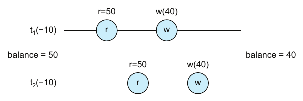
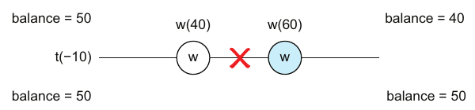
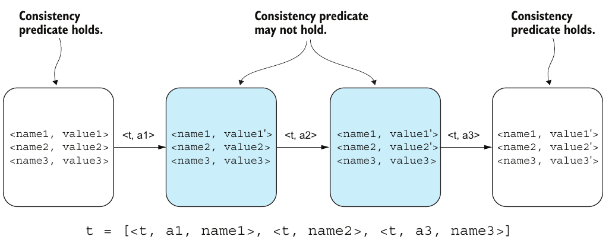

# فصل ۵: تراکنش

[فصل ۴: تحویل و پردازش پیام →](04-message-delivery-and-processing.md) · [کتاب](../README.md) · [فصل ۶: تراکنش توزیع‌شده ←](06-distributed-transactions.md)

## خلاصه

تراکنش از دیتابیس‌ها می‌آید و نه از سیستم‌های توزیع‌شده، ولی به معیار تجربه‌ی developer در سیستم‌های توزیع‌شده تبدیل شده. می‌گذارند **وانمود کنید concurrency و شکست وجود ندارند** (p. 67). به‌جای چهار حرف همیشگی ACID، فصل تراکنش را با **درستی**، یعنی concurrency مدیریت‌شده، و **کامل بودن**، یعنی شکست مدیریت‌شده، توضیح می‌دهد (p. 68).

اول به **انتزاع‌ها** نگاه می‌کند: بلوک‌های ساختمانی Abelson و Sussman، interfaceهای «زشت» و «زیبای» Tanenbaum و Bos، دنیاهای بی‌خبر و باخبر Helland که با یک API به هم می‌رسند، و نگاه خود نویسنده به تحویل و ترکیب به‌عنوان چیزهایی هم‌ارز (pp. 68–70). یک handler انتقال پول بی هیچ نرده‌ی دیدنی، جادو را نشان می‌دهد: برداشت‌های هم‌زمان به‌روزرسانی را گم نمی‌کنند، و crash بین دو نوشتن انتقال را نیمه‌کاره اعمال نمی‌کند (pp. 70–72). بعد مدل می‌آید: برنامه و تراکنش، trace و تاریخچه، ACID، و consistency به‌عنوان تنها خاصیت سطح برنامه (pp. 72–74). درستی به‌عنوان سه‌تایی Hoare و **serializability** رسمی می‌شود (pp. 74–77). کامل بودن با یک **log از Undo** توضیح داده می‌شود، که در آن عملیات Undo باید **از‌سر‌گرفتنی** باشند: بی‌اثر به‌علاوه‌ی idempotent (pp. 77–78).

## نکته‌های کلیدی

- **انتزاع‌ها دنیاها را تبدیل می‌کنند.** یک interface «زشت» سطح پایین را به interface «زیبای» سطح بالا تبدیل می‌کنند؛ یک OS سی‌پی‌یو و RAM و دیسک را به process و حافظه و فایل تبدیل می‌کند. تحویل، یعنی بالا‌به‌پایین، و ترکیب، یعنی پایین‌به‌بالا، باید هم‌ارز باشند (pp. 68–70).
- **تراکنش‌ها تعریف‌های بی‌خبر از concurrency و شکست را به اجراهای باخبر و تحمل‌کننده‌ی شکست تبدیل می‌کنند** (pp. 70, 72).
- **یک تراکنش** دنباله‌ای از عملیات روی مجموعه‌ای از objectهاست که با دقیقاً یک commit یا دقیقاً یک abort تمام می‌شود (p. 72).
- **مفهوم consistency وصله‌ی ناجور ACID است.** تضمینی سطح برنامه است، مثل `CHECK(balance >= 0)`؛ و اتمی بودن و جداسازی و durableی سطح بستر‌ند (pp. 72–73).
- **برنامه تعریف است و تراکنش اجرا.** عملیات به کنش، و نام به object. اجرای درهم‌آمیخته‌ی تراکنش‌ها یک **تاریخچه** است (pp. 73–74).
- **ویژگی serializability:** اجرای هم‌زمان t1 ∥ t2 درست است اگر با t1;t2 *یا* t2;t1 هم‌ارز باشد. یک consistency model است، یعنی محمولی که تاریخچه‌ها را به خوب و بد می‌شکند (pp. 75–76).
- **پیاده کردن serializability بدیهی است؛ کارآمد پیاده کردنش سخت.** یک قفل سراسری یک زمان‌بندی پشت‌سرهم را اجبار می‌کند، و قفل‌های ریزتر با همان معنا concurrency بیشتری می‌دهند (pp. 76–77).
- **عملیات Undo باید از‌سر‌گرفتنی باشد.** عملیات Undo ممکن است روی مقداری اجرا شود که عملیات هیچ‌وقت عوضش نکرده، یا بعد از crash در میانه‌ی بازیابی چند بار اجرا شود، پس هر کدام باید وقتی عملیاتش نیفتاده **بی‌اثر** باشد و **idempotent** (p. 78).

## فهرست بخش‌ها

*از فهرست مطالب خود کتاب، از bookmarkهای PDF؛ شماره‌ها صفحه‌ی چاپی‌اند.*

- ۵.۱ انتزاع‌ها — ص. ۶۸
- ۵.۲ جادوی تراکنش — ص. ۷۰
  - ۵.۲.۱ concurrency — ص. ۷۰
  - ۵.۲.۲ شکست — ص. ۷۱
- ۵.۳ مدل تراکنش — ص. ۷۲
  - ۵.۳.۱ درستی — ص. ۷۴
  - ۵.۳.۲ ویژگی serializability — ص. ۷۵
  - ۵.۳.۳ کامل بودن — ص. ۷۷
  - ۵.۳.۴ abort سطح برنامه — ص. ۷۷
  - ۵.۳.۵ abort سطح بستر — ص. ۷۸

## یادداشت‌ها

### ۵.۱ انتزاع‌ها

کتاب *Structure and Interpretation of Computer Programs* از Abelson و Sussman سه بلوک ساختمانی برنامه را نام می‌برد (p. 68):

- **عبارت‌های اولیه**،
- **راه‌های ترکیب**، و
- **راه‌های انتزاع**: نام گذاشتن روی عنصرهای مرکب و برخورد با آن‌ها به‌عنوان یک واحد.

آن چیزی که این تعریف تأکیدش نمی‌کند این است که انتزاع‌ها *قلمرو گفتمان را تبدیل می‌کنند* (p. 68). سه راه کشیدن این:

| نگاه | سطح پایین‌تر | سطح بالاتر | منبع (pp. 68–69) |
|---|---|---|---|
| **زشت به زیبا** (شکل ۵.۱) | برای OS: سی‌پی‌یو و RAM و دیسک. برای دیتابیس: process و حافظه و فایل | برای OS: process و حافظه و فایل. برای دیتابیس: جدول‌هایی از ردیف و ستون، و تراکنش | Tanenbaum و Bos، کتاب *Modern Operating Systems* |
| **باخبر و بی‌خبر** (شکل ۵.۲) | مفهوم‌های *باخبر* | مفهوم‌های *بی‌خبر*، با یک **API** که بین دو دنیا ترجمه می‌کند | Helland، مقاله‌ی «Life beyond Distributed Transactions» |
| **تحویل و ترکیب** (شکل ۵.۳) | بالا‌به‌پایین، موجودیتی به موجودیت‌های سطح پایین‌تر *تحویل* یا compile می‌شود | پایین‌به‌بالا، موجودیت‌های سطح پایین‌تر *ترکیب* می‌شوند و موجودیت بالاتر *پدیدار* می‌شود | نگاه مورد‌ترجیح نویسنده |

زیبایی در چشم بیننده است: interface زیبای OS، interface زشت دیتابیس است (p. 68). انتزاع‌ها **بازگشتی**اند، و هر مرزی موجودیت‌ها و رابطه‌ها و قیدهای متفاوتی می‌آورد، یعنی معنایی متفاوت (p. 69). در هر سطحی که استدلال کنید، سیستم باید همان نتیجه را برگرداند. این همان **هم‌ارزی** است (pp. 69–70).

### ۵.۲ جادوی تراکنش

نویسنده نفهمیده بود برنامه‌های وب اولیه توزیع‌شده‌اند، چون **تراکنش‌ها قایمش کرده بودند**. ساختن روی یک دیتابیس تراکنشی، تضمین‌هایش را به کل سیستم می‌کشاند (p. 70).

فهرست ۵.۱ یک endpoint به نام `/transfer` است که اضافه‌برداشت اجازه دارد. دستورهای `BEGIN; UPDATE … balance - $1 …; UPDATE … balance + $1 …; COMMIT;` را اجرا می‌کند، با **هیچ تشخیص یا کاهش دیدنی** برای concurrency یا شکست (p. 70).

| تهدید | بی تراکنش | با تراکنش (pp. 70–72) |
|---|---|---|
| **concurrency** (شکل ۵.۴) | دو انتقال ۱۰− هر کدام ۵۰ را می‌خوانند و ۴۰ می‌نویسند: نتیجه ۴۰ به‌جای ۳۰، یعنی مسابقه‌ای بین خواندن و نوشتن | طوری اجرا می‌شود که گویی concurrency وجود ندارد: **درستی** |
| **شکست** (شکل ۵.۵) | crash بعد از بدهکار کردن مبدأ، یعنی ۵۰ به ۴۰، و پیش از بستانکار کردن مقصد: ۴۰ و ۵۰ به‌جای ۴۰ و ۶۰ | طوری اجرا می‌شود که گویی شکست وجود ندارد: **کامل بودن** |

*Figure 5.4 (p. 71): هر دو خواندن پیش از هر نوشتنی می‌افتند، پس یک به‌روزرسانی گم می‌شود.*

*Figure 5.5 (p. 71): crash نیمی از انتقال را جا می‌گذارد — بدهکاری اعمال شده و بستانکاری نه.*

> **In practice:** ClickHouse تراکنش چندجدولی ندارد؛ هر insert در یک part اتمی است، نه بیشتر.
>
> **Your turn:** job شبانه سه جدول Gold را پشت سر هم بازسازی می‌کند و وسط کار fail می‌شود. داشبوردی که هر سه را join می‌کند چه می‌بیند؟
>
> *Answer:* ترکیبی از داده‌ی تازه و کهنه که هیچ‌وقت وجود نداشته. بدون تراکنش، هر سه را در جدول‌های staging بسازید و در پایان با `EXCHANGE TABLES` جابه‌جا کنید تا خواننده‌ها همه یا هیچ را ببینند. تراکنش همین «همه یا هیچ» را به برنامه‌نویس هدیه می‌دهد (pp. 70–72).

### ۵.۳ مدل تراکنش

یک **تراکنش** دنباله‌ای از عملیات روی مجموعه‌ای از objectهاست که با **دقیقاً یک commit یا دقیقاً یک abort** تمام می‌شود. درستی و کامل بودن را تضمین می‌کند، که از اصل‌های ACID می‌آیند (p. 72):

| حرف | تضمین (p. 72) | سطح (pp. 72–73) |
|---|---|---|
| **اتمی بودن** | به‌چشم هم‌ارز با اجرای کامل یا اصلاً اجرا نشدن | بستر |
| **consistency** | دیتابیس را از حالتی سازگار به حالتی سازگار می‌برد | **برنامه** |
| **جداسازی** | طوری اجرا می‌شود که گویی تنها تراکنش است، پس هیچ تداخلی نیست | بستر |
| **durableی** | همین که commit شد، اثرهایش ماندگارند: زیر حرفش نمی‌زند | بستر |

واقعیت بامزه: Jim Gray خبر داد که Andreas Reuter واژه‌ی «ACID» را ساخت چون همسرش Christiane از چیزهای شیرین بدش می‌آید و عاشق سرکه است (p. 72).

**مفهوم consistency سطح برنامه است** (pp. 72–73): با `balance INT`، تراکنشی که موجودی را منفی می‌کند commit می‌شود؛ و با `balance INT CHECK(balance >= 0)`، همان تراکنش abort می‌شود. در اصل، جداسازی یعنی serializability. دیتابیس‌های امروزی سطح‌های جداسازی ضعیف‌تر زیادی می‌دهند که کتاب نمی‌آوردشان (p. 73).

**تعریف در برابر اجرا** (شکل ۵.۶، جدول ۵.۱) (pp. 73–74):

| زمان طراحی، یعنی تعریف | زمان اجرا |
|---|---|
| برنامه‌ی P | تراکنش t |
| عملیات A | کنش a |
| نام N | object o |

- دیتابیس مجموعه‌ای از objectهاست که هر کدام زوج نام و مقدارند.
- **مفهوم trace** یک تراکنش دنباله‌ای از سه‌تایی‌های ⟨tx, aᵢ, oᵢ⟩ است، با i از ۱ تا n. آوردن tx در هر سه‌تایی، interleavingها را تحلیل‌شدنی می‌کند.
- یک **تاریخچه** اجرای درهم‌آمیخته‌ی چند تراکنش است.
- دیتابیس تعریف بی‌خبر از شکست را به اجرایی تحمل‌کننده‌ی شکست تبدیل می‌کند (شکل ۵.۷) (p. 74).

#### ۵.۳.۱ درستی (pp. 74–75)

یک تراکنش consistency را حفظ می‌کند، که به‌شکل سه‌تایی Hoare نوشته می‌شود: **{ C } tₓ { C }**. consistency می‌تواند *در طول* تراکنش نقض شود، مثلاً بعد از بدهکاری و پیش از بستانکاری (شکل ۵.۸):

*Figure 5.8 (p. 75): فقط دو سر یک تراکنش باید سازگار باشند؛ و حالت‌های بین آن‌ها زیر serializability برای کسی دیدنی نیستند.*

یک تاریخچه‌ی پشت‌سرهم امن ترکیب می‌شود:

> اگر { C } t1 { C } و { C } t2 { C } آن‌گاه { C } t1;t2 { C }

پس تراکنش‌های هم‌زمان درست‌اند اگر اثرشان با ترتیبی پشت‌سرهم برابر باشد:

> اگر { C } t1 ∥ t2 { C } آن‌گاه { C } t1;t2 { C } یا { C } t2;t1 { C }

این همان **serializability** است: concurrency فقط وقتی اجازه دارد که ناسازگاری وارد نکند (p. 75).

#### ۵.۳.۲ ویژگی serializability (pp. 75–77)

- یک **consistency model** محمولی روی تاریخچه‌های اجراست که آن‌ها را به خوب، یعنی قانونی و معتبر، و بد، یعنی غیرقانونی و نامعتبر، مرتب می‌کند (شکل ۵.۹). شما به‌عنوان مهندس انتخابش می‌کنید (p. 75).
- ویژگی serializability، که Edgar Codd معرفی‌اش کرد، اجرایی هم‌زمان را می‌پذیرد اگر زوج *(نتیجه‌ی تراکنش، حالت دیتابیس)* آن با t1•t2 یا t2•t1 هم‌ارز باشد (pp. 75–76).
- در شکل ۵.۱۰، t1 = A·B و t2 = C·D به شکل A·C·B·D اجرا می‌شوند. تاریخچه serializable است اگر این با (A·B)·(C·D) یا (C·D)·(A·B) هم‌ارز باشد. فقط باید با *یکی* از ترتیب‌های پشت‌سرهم بخورد و نه با ترتیبی معین (p. 76).
- **لحظه‌ی آها!:** یک قفل روی همه‌ی objectها یک زمان‌بندی پشت‌سرهم را اجبار می‌کند، که بدیهی است. قفل‌های دانه‌ریزتر روی زیرمجموعه‌هایی از objectها زمان‌بندی‌های هم‌زمان با معنای پشت‌سرهم می‌دهند. هدف، بیشترین concurrency است که معنای پشت‌سرهم را نگه دارد (pp. 76–77).

> **Vault note:** [شبیه‌سازی interleaving](../widgets/01-interleavings.html) در فصل ۱ همان سنجه‌ی هم‌ارزی را روی دو process خواندن‌و‌افزودن‌و‌نوشتن اعمال می‌کند، یعنی نسخه‌ی شمارنده‌ی شکل ۵.۴.

#### ۵.۳.۳ کامل بودن (p. 77)

بازیابی رو‌به‌عقب و رو‌به‌جلوی فصل ۳ در یک دیتابیس **Undo** و **Redo** می‌شوند. سیستم‌های واقعی هر دو را ترکیب می‌کنند؛ کتاب روی Undo تمرکز دارد (p. 77).

- هر عملیاتی یک **عملیات Undo** دارد.
- *پیش از* اجرای ⟨t, aᵢ, oᵢ⟩، سیستم سه‌تایی ⟨¬aᵢ, oᵢ⟩ را به **log از Undo تراکنش**، یعنی object به نام o_u، اضافه می‌کند.

این دو trace معتبر می‌دهد (p. 77):

| trace | شکل |
|---|---|
| **trace از commit**، یعنی بی شکست | [⟨tx, aᵢ, oᵢ⟩ \| i = 1..n] |
| **trace از abort**، یعنی با شکست | [⟨tx, aᵢ, oᵢ⟩ \| i = 1..k] و بعدش [⟨tx, ¬aᵢ, oᵢ⟩ \| i = k..1]: سیستم همان‌جایی است که شروع کرد |

#### ۵.۳.۴ و ۵.۳.۵ abort سطح برنامه و سطح بستر (pp. 77–78)

| abort | محرک | دیتابیس چه می‌کند |
|---|---|---|
| **سطح برنامه** | یک فرمان abort *صریح*، یا abort *ضمنی* مثل نقض consistency | عملیات Undo تراکنش را اجرا می‌کند؛ سر‌راست است |
| **سطح بستر** | crash و راه‌اندازی دوباره در نقطه‌ای دلخواه | **بازیابی**: log از Undo را برای تراکنش‌های commit‌نشده پیمایش می‌کند و عملیات Undoشان را اجرا |

مسئله: ثبت یک Undo و اجرای عملیات دو قدم جدایند (p. 78).

- مفهوم crash بعد از ثبت Undo ولی *پیش از* عملیات یعنی Undo روی مقدار **قدیمی** اعمال می‌شود.
- مفهوم crash *در طول* بازیابی یعنی عملیات Undo **بیشتر از یک‌بار** اجرا می‌شوند.

پس عملیات Undo باید **از‌سر‌گرفتنی** باشند، که یعنی بی‌اثر به‌علاوه‌ی idempotent (p. 78):

| خاصیت | معادله |
|---|---|
| **بی‌اثر** | ⟨tx, aᵢ, oᵢ⟩⟨tx, ¬aᵢ, oᵢ⟩ = ⟨tx, ¬aᵢ, oᵢ⟩: اعمال عملیات و بعد Undoی آن برابر اعمال فقط Undo است |
| **idempotent** | ⟨tx, aᵢ, oᵢ⟩⟨tx, ¬aᵢ, oᵢ⟩ = ⟨tx, aᵢ, oᵢ⟩⟨tx, ¬aᵢ, oᵢ⟩ … ⟨tx, ¬aᵢ, oᵢ⟩: تکرار Undo هیچ چیزی را عوض نمی‌کند |

> **Try it:** [یک log از Undo که از‌سر‌گرفتنی است](../widgets/05-undo-log.html)؛ انتقال کتاب را با یک log از Undo اجرا کنید، بین ثبت یک Undo و اعمال عملیاتش یا در میانه‌ی بازیابی crashش کنید، و Undoی نسبی، یعنی «ده را برگردان»، را با Undoیی مقایسه کنید که مقدار قدیمی را برمی‌گرداند: فقط دومی بی‌اثر و idempotent است.

> **In practice:** دیتابیس metadata در Airflow روی PostgreSQL است و schedulerها از تراکنش‌های آن برای هماهنگی استفاده می‌کنند.
>
> **Your turn:** چرا Airflow می‌تواند دو scheduler هم‌زمان را بدون انتخاب leader اجرا کند؟
>
> *Answer:* هر scheduler ردیف‌ها را در تراکنش با قفل ردیف برمی‌دارد و serializability دیتابیس تضمین می‌کند که دو تراکنش یک task را هم‌زمان برنمی‌دارند. ترتیب‌دهی را به دیتابیس واگذار کرده‌اند (pp. 74–77).

## بده‌بستان‌ها در یک نگاه

| انتخاب | چه می‌دهد | چه می‌گیرد |
|---|---|---|
| یک قفل سراسری | به‌طور بدیهی serializable | هیچ concurrencyی |
| قفل‌های دانه‌ریز | concurrency با معنای پشت‌سرهم | پیچیدگی، deadlock |
| سطح‌های جداسازی ضعیف‌تر، بیرون از دامنه‌ی کتاب | throughput | ناهنجاری‌هایی که برنامه باید تحملشان کند |
| روش Undo، یعنی بازیابی رو‌به‌عقب | کار commit‌نشده را برمی‌گرداند | یک نوشتن log پیش از هر عملیات؛ و Undo باید از‌سر‌گرفتنی باشد |
| روش Redo، یعنی بازیابی رو‌به‌جلو | کار commit‌شده را دوباره اجرا می‌کند | گفته شده ولی پوشانده نشده (p. 77) |
| قید consistency در schema | دیتابیس قاعده‌ها را اعمال می‌کند | قاعده‌ها در تعریف برنامه از consistency زندگی می‌کنند |

## فراتر از کتاب

- **یک Undo نسبی در برابر مطلق.** یک Undoی نسبی، یعنی «ده را برگردان»، نه بی‌اثر است و نه idempotent. یک Undo که *تصویر قبلی*، یعنی مقدار قدیمی، را برمی‌گرداند هر دو هست، به شرط آن که بازیابی بداند کدام عملیات‌ها واقعاً اجرا شده‌اند. سیستم‌های واقعی برای این کار شماره‌ی ترتیب log روی صفحه‌ها به کار می‌برند، مثل ARIES: [فصل ۵ کتاب Database Internals](../../database-internals/chapters/05-transaction-processing-and-recovery.md) و شبیه‌سازی بازیابی‌اش را ببینید.
- **سطح‌های جداسازی.** کتاب سر serializability می‌ایستد (p. 73). سطح‌های read committed و snapshot isolation و ناهنجاری‌هایشان، یعنی به‌روزرسانی گم‌شده و write skew، در [فصل ۸ کتاب DDIA](../../designing-data-intensive-applications/chapters/08-transactions.md) پوشانده شده‌اند، که برای هر سطح یک شبیه‌سازی دارد.
- **به‌روزرسانی گم‌شده.** دو انتقال شکل ۵.۴ که هر دو ۵۰ را می‌خوانند همان ناهنجاری به‌روزرسانی گم‌شده است. دستور `UPDATE … SET balance = balance - 10` در بیشتر دیتابیس‌ها دقیقاً برای همین اتمی است که حتی زیر جداسازی ضعیف هم نیفتد.

## پیوندها

- **فصل‌های مرتبط:** [فصل ۱: فکر کردن در سیستم‌های توزیع‌شده](01-thinking-in-distributed-systems-models-mindsets-and-mechanics.md) که شرایط مسابقه و serializability روی interleavingها را دارد، [فصل ۳: تحمل شکست](03-failure-tolerance.md) که بازیابی رو‌به‌عقب و رو‌به‌جلو را دارد، [فصل ۴: تحویل و پردازش پیام](04-message-delivery-and-processing.md) که تکراری‌زدایی تراکنشی را دارد، [فصل ۶: تراکنش توزیع‌شده](06-distributed-transactions.md) که کامل بودن بین resource managerها را دارد، و [فصل ۹: consistency](09-consistency.md) که consistency modelها فراتر از serializability را دارد.

## خودتان را بسنجید

*پرسش‌ها و پاسخ‌ها مال vault است و از روی یادداشت‌های بالا نوشته شده؛ پاسخ‌ها به صفحه‌های کتاب ارجاع می‌دهند.*

1. **تراکنش می‌گذارد برنامه چه چیزی را وانمود کند؟**

   *Answer:* این که concurrency و شکست وجود ندارند. دیتابیس تعریف‌های بی‌خبر را به اجراهای باخبر و تحمل‌کننده تبدیل می‌کند (pp. 67, 72).

2. **چرا consistency با A و I و D فرق دارد؟**

   *Answer:* تضمینی سطح برنامه است که با قاعده‌هایی مثل `CHECK(balance >= 0)` تعریف می‌شود. اتمی بودن و جداسازی و durableی سطح بستر‌ند (pp. 72–73).

3. **در شکل ۵.۴ دو انتقال ۱۰− روی موجودی ۵۰ اجرا می‌شوند. بی جداسازی چه چیزی خراب می‌شود؟**

   *Answer:* هر دو ۵۰ را می‌خوانند و ۴۰ می‌نویسند، پس موجودی نهایی به‌جای ۳۰ می‌شود ۴۰ (p. 71).

4. **اجرای t1 ∥ t2 کِی serializable است؟**
   - [ ] فقط اگر با t1;t2 هم‌ارز باشد
   - [x] اگر با t1;t2 یا با t2;t1 هم‌ارز باشد
   - [ ] اگر هیچ دو کنشی به یک object نخورند

   *Answer:* هم‌ارزی با *یکی* از ترتیب‌های پشت‌سرهم کافی است (pp. 75–76).

5. **مفهوم consistency model چیست؟**

   *Answer:* محمولی روی تاریخچه‌های اجرا که تاریخچه‌های خوب، یعنی قانونی، را از بد جدا می‌کند (p. 75).

6. **مفهوم trace از abort تراکنشی را توصیف کنید که بعد از k عملیات شکست می‌خورد.**

   *Answer:* k عملیات اولش، و بعد عملیات Undoشان به ترتیب عکس، یعنی از k تا ۱ (p. 77).

7. **چرا عملیات Undo باید بی‌اثر و idempotent باشند؟**

   *Answer:* crash بین log کردن یک Undo و اعمال عملیاتش یعنی Undo روی مقدار قدیمی اجرا می‌شود، پس آن‌وقت باید بی‌اثر باشد. و crash در طول بازیابی یعنی Undo باز اجرا می‌شود، پس باید idempotent باشد (p. 78).
