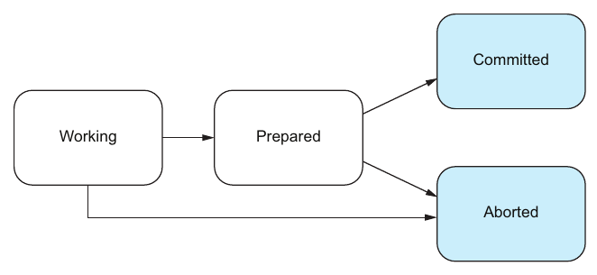
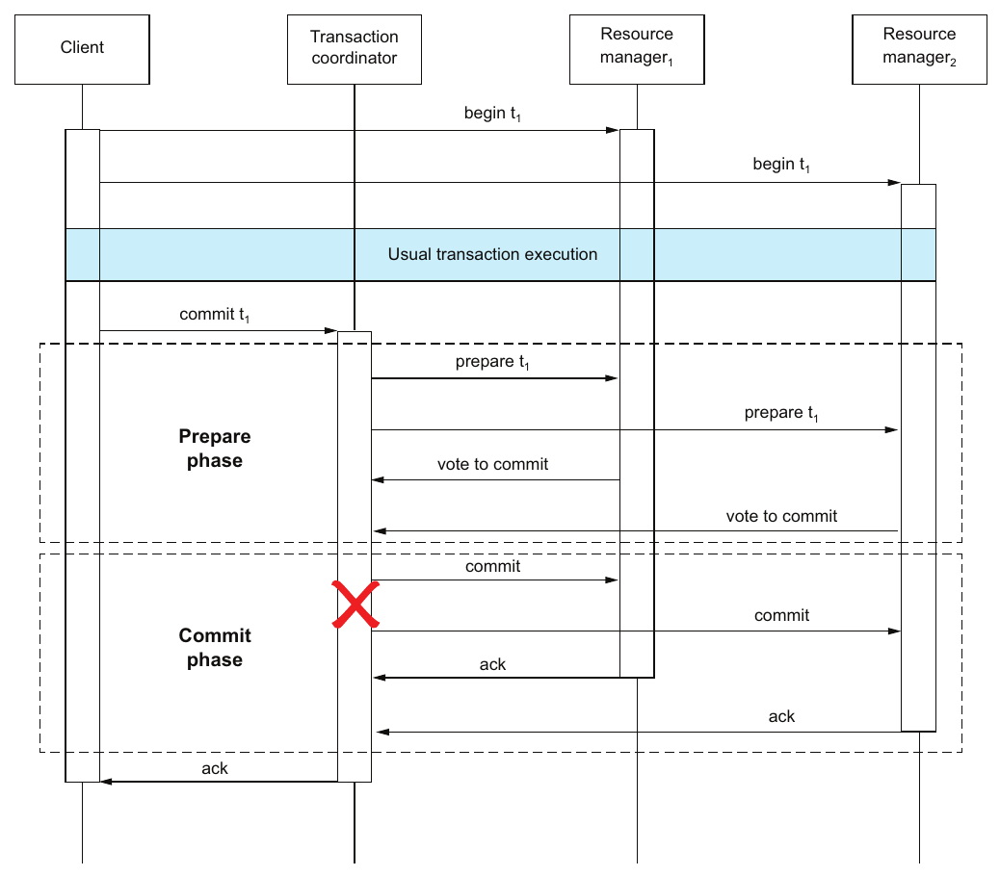

# 6. Distributed transactions

[← 5. Transactions](05-transactions.md) · [Book](../README.md) · [7. Partitioning →](07-partitioning.md)

## Summary

A **distributed transaction** spans several **resource managers (RMs)**: databases, but also systems such as message queues (p. 79). Moving Chapter 5's transfer onto two RMs turns one transaction into two, and raises the question of how to make them commit or abort **together**. The answer is an **atomic commit protocol** (pp. 79–80).

On one RM, atomicity is a single local write of a commit or abort entry; on several RMs it needs a protocol, specified by safety (no conflicting decisions) and liveness (everyone eventually decides) (pp. 81–82). Protocols are **blocking** or **nonblocking** (p. 82). The chapter models a global transaction as a state vector of local transactions, each *working → prepared → committed or aborted* (pp. 82–83). It then walks through **Two-Phase Commit**: the Prepare and Commit phases, the asymmetry of Vote-to-Commit vs. Abort, recovery rules for RMs that fail at each point, and the coordinator failure that **blocks** prepared RMs (pp. 83–86). Improvements, such as RMs asking each other, reduce blocking. Timing out and aborting can violate **safety** (pp. 86–88).

## Key takeaways

- **Resource manager** is the general term for any participant in a distributed transaction, such as a database or a message queue (p. 79).
- **One RM:** atomicity is one atomic write of a commit or abort entry. A crash before it is treated as abort on recovery (p. 81).
- **Many RMs:** an atomic commit protocol ensures that subtransactions *unanimously* commit or abort. Safety: no RM commits while another aborts. Liveness: every RM eventually stays committed or stays aborted forever (pp. 81–82).
- **Blocking** protocols keep safety but not liveness when a participant fails. **Nonblocking** protocols keep both despite a single participant failure (p. 82).
- **Local transaction states:** working, prepared, committed, aborted. A global transaction's state is the vector of these, plus in-flight messages (pp. 82–83).
- **2PC** has one transaction coordinator (TC) and two or more RMs. In Prepare, RMs vote; in Commit, the TC decides commit only if *every* vote is Vote-to-Commit (pp. 83–85).
- **The asymmetry:** in Prepare, an RM can unilaterally *abort* but can never unilaterally *commit* (p. 85).
- **RM failures don't block 2PC; a TC failure can.** An RM that voted to commit is stuck until the TC is repaired (pp. 85–86).
- **Timing out to abort is unsafe.** With imperfect clocks, a recovered TC's Commit can land inside some RMs' timeout windows and outside others' (p. 87).

## Section outline

*From the book’s own table of contents (PDF bookmarks); printed page numbers.*

- 6.1 Atomic commitment: From a single RM to multiple RMs — p. 79
  - 6.1.1 Transaction on a single RM — p. 81
  - 6.1.2 Transaction on multiple RMs — p. 81
  - 6.1.3 Blocking and nonblocking — p. 82
- 6.2 The essence of distributed transactions — p. 82
- 6.3 Two-Phase Commit protocol — p. 83
  - 6.3.1 In the absence of failure — p. 83
  - 6.3.2 In the presence of failure — p. 85
  - 6.3.3 Improvement — p. 86

## Notes

The book uses *resource manager* and *database system* interchangeably from here on (p. 79).

### 6.1 Atomic commitment: From a single RM to multiple RMs

Listing 6.1 is the transfer as one transaction on one RM. Listing 6.2 splits it: RM1 debits the source and RM2 credits the target, each in its own `BEGIN … COMMIT` (pp. 79–80). How do we make the *composition* of two subtransactions a transaction in itself (Figure 6.1)? With an **atomic commit protocol** (p. 80).

The chapter focuses on **atomicity** only, and doesn't explicitly discuss consistency, isolation or durability (p. 81).

#### 6.1.1–6.1.2 Single RM vs. multiple RMs (pp. 81–82)

| | Atomicity comes from… | Failure before the decision |
|---|---|---|
| **One RM** | One atomic write of a commit or abort entry to local state | On recovery, proceed as though an abort entry exists |
| **Many RMs** | An atomic commit protocol that coordinates the commits (Figure 6.2) | The protocol must decide |

The correctness of an atomic commit protocol (pp. 81–82):

| Guarantee | Formula | In words |
|---|---|---|
| **Safety** | ∄ rm₁, rm₂: state[rm₁] = commit ∧ state[rm₂] = abort | No two RMs reach conflicting decisions |
| **Liveness** | ∀ rm: ◇□ state[rm] = commit ∨ ◇□ state[rm] = abort | Every RM is *eventually always* committed or eventually always aborted |

#### 6.1.3 Blocking and nonblocking (p. 82)

| Protocol type | When a participant fails |
|---|---|
| **Blocking** | Safety, but not necessarily liveness |
| **Nonblocking** | Safety *and* liveness despite a single participant failure: one failure can't stop the others from deciding |

### 6.2 The essence of distributed transactions

A **distributed (global) transaction** consists of two or more **nondistributed (local) transactions** (Figure 6.3) (p. 82). Each local transaction follows the state machine of Figure 6.4 (pp. 82–83):

*Figure 6.4 (p. 83): Working can abort on its own; once Prepared, the transaction waits for someone else's decision.*

A prepared transaction executes no more operations but hasn't yet decided. Committed and aborted are final and irreversible (p. 82). The global state is a **state vector** of the local states, plus the outstanding messages in the network. Figure 6.5 steps (working, working) → (prepared, working) → (prepared, prepared) → (committed, prepared) → (committed, committed) (p. 83).

### 6.3 Two-Phase Commit protocol

2PC is the best-known and most-studied atomic commit protocol. It guarantees safety and liveness without participant failures, but only safety if one *specific* participant, the coordinator, fails. It is therefore **blocking** (p. 83).

#### 6.3.1 In the absence of failure (pp. 83–85)

The client begins a transaction on each RM and runs ordinary reads and writes. Then, instead of asking the RMs to commit, it asks the **TC** to commit, which starts 2PC (Figure 6.6):

*Figure 6.6 (p. 84): the client hands the commit to the coordinator; each phase is one round trip to every RM. What each party logs at each step is in the table below.*

| Phase | Step (pp. 84–85) |
|---|---|
| **1 · Prepare** | TC persists ⟨Prepare, Timeout⟩ and sends ⟨Prepare⟩ to all RMs |
| | To commit, an RM persists ⟨Vote-to-Commit⟩ and sends it. To abort, it persists ⟨Abort⟩, sends it **and aborts at once** |
| **2 · Commit** | All voted to commit ⇒ TC persists ⟨Commit⟩ and sends ⟨Commit⟩ to all |
| | At least one ⟨Abort⟩ *or a timeout* ⇒ TC persists ⟨Abort⟩ and sends ⟨Abort⟩ to all |
| | Each RM persists ⟨Commit⟩ or ⟨Abort⟩ and commits or aborts its local transaction |

**Aha! moment, the asymmetry** (p. 85): the vote isn't a Vote-to-Commit/Vote-to-Abort pair or a Commit/Abort pair. It's a **Vote-to-Commit/Abort** pair. During Prepare, an RM can't commit on its own, but it can abort on its own.

#### 6.3.2 In the presence of failure (pp. 85–86)

The system model is the partially synchronous one of Chapter 2 (p. 85).

**RM failure doesn't block 2PC.** What a recovering RM does depends on the last entry in its log (Figures 6.7–6.10):

| Last persisted entry | Meaning | On recovery |
|---|---|---|
| Neither ⟨Vote-to-Commit⟩ nor ⟨Abort⟩ | "We haven't promised yet" | Persist ⟨Abort⟩ and send ⟨Abort⟩ to the TC |
| ⟨Vote-to-Commit⟩ | "We already promised" | **Ask the TC** for the decision |
| ⟨Commit⟩ | "We already committed" | **REDO**, so the operations take effect |
| ⟨Abort⟩ | "We already aborted" | **UNDO**, so no operation takes effect |

**TC failure may block 2PC** (p. 86): an RM that has persisted ⟨Vote-to-Commit⟩ is stuck until the TC is repaired. In Figure 6.11, the TC fails during Commit *after* telling RM1 to commit. RM2 can neither commit nor abort, because it doesn't know what anyone else did.

*Figure 6.11 (p. 87): RM1 has committed; RM2 has voted and can only wait for a coordinator that is down.*

> **Try it:** [2PC: recovery and blocking](../widgets/06-two-phase-commit.html) — run 2PC between a coordinator and two RMs, crash any of them at any step, watch each recovering RM apply the rule for its last log entry, then try the two "improvements": asking a peer, and timing out to abort.

#### 6.3.3 Improvement (pp. 86–88)

Many 2PC variants improve liveness. They have fewer blocking executions, but still some (p. 86).

| Idea | When it works | When it doesn't (pp. 87–88) |
|---|---|---|
| **Ask the other RMs** | If some RMj has already committed or aborted, RMi can safely do the same | If all RMs voted to commit and none has received the decision (Figure 6.12), nobody knows |
| **Time out and abort** | — | **Unsafe**: clocks aren't perfectly synchronized, so when the TC recovers and sends ⟨Commit⟩, some RMs think it arrived within their window and commit, while others have already aborted |

The book calls this "a helpful reminder" of how subtle distributed protocols are (p. 87).

## Trade-offs at a glance

| Choice | Buys | Costs |
|---|---|---|
| One RM | Atomicity from a single local write | Data must live in one place |
| 2PC | Atomicity across RMs; tolerates RM failures | Blocking when the TC fails; an extra round trip and forced log writes |
| RMs ask their peers | Fewer blocked executions | Still blocks when everyone is prepared and nobody knows |
| Timeout-and-abort | Liveness | Breaks safety: conflicting decisions |
| A nonblocking protocol (outside the book) | Liveness despite a single failure | More rounds, or consensus on the decision |

## Beyond the book

- **Making 2PC nonblocking.** The standard fix is to replicate the coordinator's *decision* with consensus, as in Gray and Lamport's *Paxos Commit* or Spanner's Paxos-replicated participant groups. A crashed coordinator is then replaced by another replica that knows the decision. **Three-Phase Commit** adds a pre-commit phase but isn't safe under network partitions. Compare both in [Database Internals Ch. 13](../../database-internals/chapters/13-distributed-transactions.md) and its commit-protocol simulation.
- **Locks held while blocked.** A prepared RM must keep holding its locks until it learns the decision, so a blocked 2PC also blocks other transactions on the same rows. That's why [DDIA Ch. 8](../../designing-data-intensive-applications/chapters/08-transactions.md) is cautious about XA transactions in practice.
- **Sagas** avoid atomic commit altogether: each local transaction commits on its own, and failures are handled by compensation, the backward recovery of [Chapter 3](03-failure-tolerance.md). Helland's "Life beyond Distributed Transactions", cited in [Chapter 5](05-transactions.md), argues for this style.

## Connections

- **Related chapters:** [1. Thinking in distributed systems](01-thinking-in-distributed-systems-models-mindsets-and-mechanics.md) (the behavior space of a two-participant transaction), [3. Failure tolerance](03-failure-tolerance.md) (blocking as fail-safe), [5. Transactions](05-transactions.md) (Undo, Redo and atomicity on one RM), [10. Distributed consensus](10-distributed-consensus.md) (the tool for nonblocking commitment), [11. Durable executions](11-durable-executions.md) (processes across services without 2PC).

## Check yourself

*Questions and answers are the vault's, written from the notes above; answers cite the book's pages.*

1. **State the safety and liveness properties of an atomic commit protocol.**

   *Answer:* Safety: no two RMs end with one committed and the other aborted. Liveness: every RM is eventually always committed or eventually always aborted (pp. 81–82).

2. **What separates a blocking protocol from a nonblocking one?**

   *Answer:* A blocking protocol guarantees safety but not liveness when a participant fails. A nonblocking one guarantees both despite a single participant failure (p. 82).

3. **Which pair of responses can an RM give in the Prepare phase?**
   - [ ] Vote-to-Commit or Vote-to-Abort
   - [x] Vote-to-Commit or Abort
   - [ ] Commit or Abort

   *Answer:* An RM can unilaterally abort but can't unilaterally commit (p. 85).

4. **An RM crashes after persisting ⟨Vote-to-Commit⟩. What does it do on recovery, and why?**

   *Answer:* It asks the TC for the decision. It has promised to commit, so it may no longer abort on its own, but it doesn't know whether others committed (pp. 85–86).

5. **Why can a TC failure block 2PC while an RM failure can't?**

   *Answer:* A recovering RM can always work out what to do from its own log, or by asking the TC. RMs that voted to commit depend on the TC's decision, and nobody else may have it (pp. 85–86).

6. **Why is "time out and abort" unsafe for prepared RMs?**

   *Answer:* Clocks aren't perfectly synchronized. A recovered TC's Commit may arrive inside some RMs' timeout windows (they commit) and outside others' (they've aborted), so decisions conflict (p. 87).

7. **When does asking the other RMs fail to help?**

   *Answer:* When all RMs voted to commit and none has yet received ⟨Commit⟩ or ⟨Abort⟩ (Figure 6.12) (p. 87).
