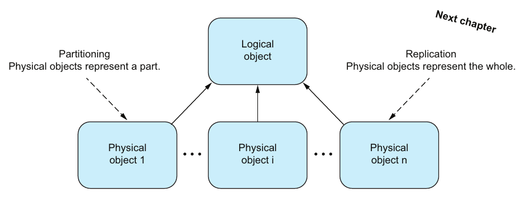
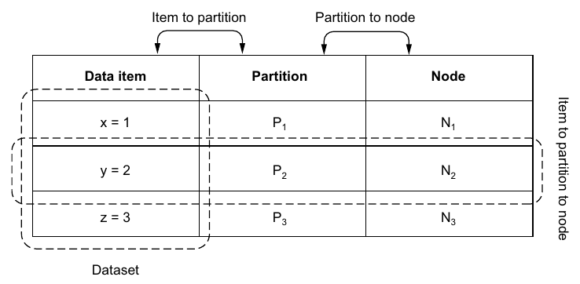
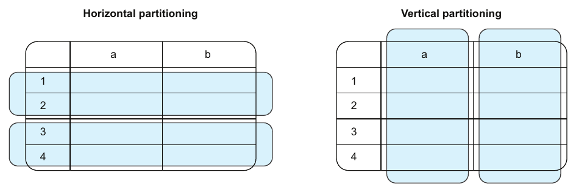
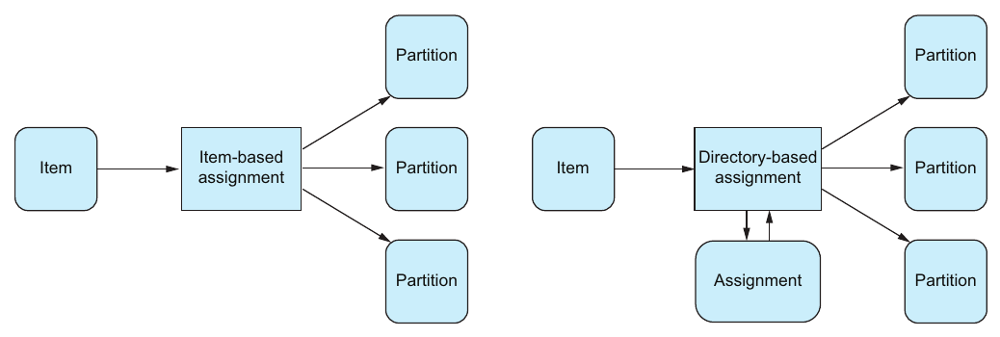
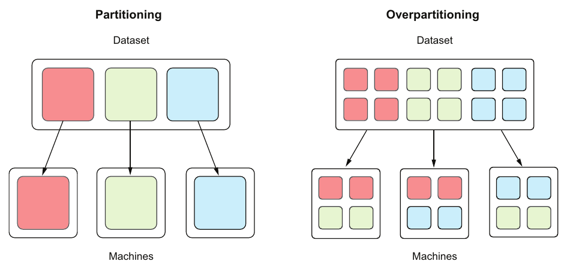

# 7. Partitioning

[← 6. Distributed transactions](06-distributed-transactions.md) · [Book](../README.md) · [8. Replication →](08-replication.md)

## Summary

Partitioning and replication are the two essential techniques for scalability and reliability. **Partitioning overcomes the scalability limits of a single component**; replication (Chapter 8) overcomes its reliability limits (p. 90). The chapter starts from an encyclopedia split alphabetically into volumes, which already shows uneven distribution, uneven demand and cross-references (pp. 90–91). It then defines partitioning as one logical object represented by several **disjoint** physical objects (p. 92).

It separates **partitioning** (item → partition) from **balancing** (partition → node) (pp. 93–94). It classifies partitioning as **static or dynamic** (a fixed or variable number of partitions) and **horizontal or vertical** (rows or columns) (pp. 94–97). It contrasts **item-based** assignment (stateless, coarse-grained) with **directory-based** assignment (stateful, fine-grained) (pp. 97–99). The author then runs an experiment: 235,976 dictionary words assigned to five partitions. **Range** partitioning is skewed, **hash** partitioning is even, and both relocate most items when going from 5 to 6 partitions. **Consistent hashing** relocates only about n/m (pp. 99–103). The chapter closes with **overpartitioning**, which gives balancing flexibility up to a limit (pp. 103–104).

## Key takeaways

- **Partitioning: one logical object, many disjoint physical objects.** Replication: many physical objects that each represent the *whole* (p. 92).
- **A distributed system is partitioned by definition.** Each component and its local state is a partition. Partitioning is about growing beyond *any* single-resource limit: data volume (intrinsic) or request volume (extrinsic) (p. 92).
- **Big data is relative:** anything that doesn't fit on one node (pp. 92–93).
- **Partitioning ≠ balancing.** Partitioning assigns items to partitions; balancing assigns partitions to nodes (pp. 93–94, 103).
- **The right strategy depends on the workload.** Partitioning X by user skews toward celebrities; partitioning IoT data by date sends all writes to one partition. Partitioning is rarely one-and-done (p. 94).
- **Static vs. dynamic** refers to the *number of partitions*. Static is simple but not elastic; dynamic is elastic but complex (p. 95).
- **Assignment fitness = variance + relocation.** Hashing minimizes variance; neither range nor modulo hashing minimizes relocation (Table 7.2). Consistent hashing does both (pp. 97, 102–103).
- **Overpartitioning** (more partitions than nodes) lets you add or remove nodes by moving whole partitions, but the number of partitions caps the number of nodes (p. 104).

## Section outline

*From the book’s own table of contents (PDF bookmarks); printed page numbers.*

- 7.1 Encyclopedias and volumes — p. 90
- 7.2 Thinking in partitions — p. 92
- 7.3 The mechanics of partitioning and balancing — p. 93
- 7.4 (Re)partitioning — p. 94
  - 7.4.1 Types of partitioning — p. 94
  - 7.4.2 Data item to partition assignment strategies — p. 97
- 7.5 Common item-based assignment strategies — p. 99
  - 7.5.1 Range partitioning — p. 100
  - 7.5.2 Hash partitioning — p. 100
- 7.6 Repartitioning — p. 101
  - 7.6.1 Range partitioning — p. 101
  - 7.6.2 Hash partitioning — p. 102
- 7.7 Consistent hashing — p. 103
- 7.8 (Re)balancing and overpartitioning — p. 103

## Notes

### 7.1 Encyclopedias and volumes

The author's teenage encyclopedia was split into volumes, one per letter (Figure 7.1). The encyclopedia is the **logical** object and the volumes are **physical** objects holding disjoint subsets (pp. 90–91). Random placement would make lookup a full scan, so producer and consumer agree on a rule: an entry goes in, and is fetched from, the volume for its first letter (p. 91).

| Challenge | Encyclopedia | Software system (p. 91) |
|---|---|---|
| **Uneven distribution** | Volume E is bulky, volume X slim | Some partitions hold far more items |
| **Uneven demand** | You reach for E more often than X | Hot partitions |
| **Cross-references** | *Partitioning* (under P) refers to *replication* (under R): two volumes | Operations that span partitions |

### 7.2 Thinking in partitions

*Figure 7.2 (p. 92): the same picture covers both techniques; only what each physical object stands for changes.*

Partitions are distributed across components called **nodes**, which spreads demand and avoids one node's limits (p. 92).

Two aha! moments (pp. 92–93):

- **A distributed system is inherently partitioned.** Each component with its exclusive local state *is* a partition. Partitioning is not only about data volume, an intrinsic property, but about any single-resource limit, such as request volume, an extrinsic property.
- **Big data is relative.** Pragmatically, it's "anything that doesn't fit on one node". If a node is a single key–value register, two pairs are big data. A Raspberry Pi and a MacBook Pro have different thresholds.

### 7.3 The mechanics of partitioning and balancing

The rest of the chapter uses a **key–value store** (pp. 93–94):

- In Figure 7.3, the dataset {x=1, y=2, z=3} is split into three partitions of one pair each, and each partition is replicated on three nodes.
- Two relationships matter (Figure 7.4): **item → partition** and **partition → node**.

*Figure 7.4 (p. 94): two separate mappings — changing one (repartitioning) is independent of changing the other (rebalancing).*

Examples of workload-dependent trade-offs (p. 94):

| Application | Partition by… | Good | Bad |
|---|---|---|---|
| Social media (X) | User | Balanced for the average user | Skewed for celebrities and influencers |
| IoT sensors | Date | Every day holds the same amount of data | All writes go to one partition |

Alternatives include sensor type, measurement type and region. Requirements change, so the strategy must adapt, often by moving data between partitions *while still serving requests* (p. 94).

### 7.4 (Re)partitioning

**Partitioning** assigns data items to partitions; **repartitioning** reassigns them, for example when the number of partitions changes (Figure 7.5) (p. 94).

#### 7.4.1 Types of partitioning (pp. 94–97)

**Static vs. dynamic** concerns only the *number of partitions*, not the number of nodes (Table 7.1) (p. 95):

| | Static | Dynamic |
|---|---|---|
| Number of partitions | Fixed; changing it is an **offline administrative** operation | Variable; changing it is a **normal online** operation |
| Elastic | ✗ | ✓ |
| Complexity | Low | High |

The aha! moment: *static* also covers slow or infrequent change. If changing the partition count is administration rather than normal operation (with planned migrations, rollbacks and possible downtime), it's static (p. 95).

**Horizontal vs. vertical** is easiest to see with relational tables (Figure 7.6) (pp. 95–96):

*Figure 7.6 (p. 96): horizontal partitions are groups of rows; vertical partitions are groups of columns.*

| Kind | Splits by | Also called |
|---|---|---|
| **Horizontal** | Rows: e.g. rows 1–2 in one partition and rows 3–4 in another | **Sharding** |
| **Vertical** | Columns: e.g. column a and column b | — |

You can combine them (Figure 7.7) (pp. 96–97):

1. Split user data vertically by type: text profile data in a relational database, profile pictures in a file store.
2. Split each part horizontally across several databases or several file stores.

Each aspect then scales independently.

#### 7.4.2 Data item to partition assignment strategies (pp. 97–99)

An assignment strategy's fitness is measured by two things (p. 97):

- **Variance**: how uniformly items are spread across partitions.
- **Relocation**: how many items move when the number of partitions changes.

*Figure 7.8 (p. 97): the only difference is the lookup box — and that box is the state the directory-based strategy has to keep available.*

| | **Item-based** (Listing 7.1) | **Directory-based** (Listing 7.2) |
|---|---|---|
| Partition is a function of… | The item alone (its key, or a hash of the key), e.g. `key % 5` | The item *and* a directory or lookup table |
| State | **Stateless**, simple to develop and operate | **Stateful**, more complex |
| Control | **Coarse-grained**: balances items, but can't place a given item somewhere, so two hot items may collide | **Fine-grained**: any item can go in any partition |
| Risk | No simple workaround for hot-item collisions | The directory can become the bottleneck for scalability and reliability, which defeats the purpose |

(pp. 97–99)

### 7.5 Common item-based assignment strategies

**The experiment** (Listing 7.3): assign every word in `/usr/share/dict/words` (235,976 words on the author's machine) to five partitions. The ideal is just under 47,200 per partition (p. 99).

| Partition | Range by first letter (Listing 7.4: a–e, f–j, k–o, p–t, u–z) | `hash(key) % 5` (Listing 7.5) |
|---|---|---|
| 0 | 67,730 | 47,219 |
| 1 | 33,203 | 47,187 |
| 2 | 35,829 | 47,362 |
| 3 | 73,432 | 47,175 |
| 4 | 25,782 | 47,033 |

Range partitioning has obvious hotspots in partitions 0 and 3; hashing is well balanced (pp. 100–101).

### 7.6 Repartitioning

Next, change 5 partitions to 6 and count the items that stay and the items that move (Listing 7.6) (p. 101). The number of partitions has an outsize effect on item-based placement:

| Strategy | Stay | Relocate |
|---|---|---|
| **Range** (Listing 7.7: a–d, e–h, i–l, m–p, q–t, u–z) | 114,790 (48.6%) | 121,186 (51.4%) |
| **Hash** `% 5` → `% 6` (Listing 7.8) | 39,443 (16.7%) | 196,533 (83.3%) |

(pp. 101–102)

**Table 7.2** (p. 102):

| | Key range | Hashing |
|---|---|---|
| Minimal variance | ✗ | ✓ |
| Minimal relocation | ✗ | ✗ |

### 7.7 Consistent hashing

Consistent hashing aims for **both** minimal variance and minimal relocation: with n items and m partitions, only about **n/m** items move on average (p. 103). Using the `uhashring` Python package (Listing 7.9), the author got (p. 103):

- a distribution of 49,084 / 47,753 / 48,172 / 47,144 / 43,823 across five partitions;
- 192,243 items staying (81.5%) and 43,733 relocating (18.5%) when going to six.

The aha! moment: the author prefers to think about algorithms by their **signatures and effects**, top-down, rather than their implementation. At the system level, what matters is what consistent hashing *does*, not how (p. 103).

> **Try it:** [Partitioning and balancing](../widgets/07-partitioning.html) — assign keys to partitions by range, by hash modulo and by consistent hashing; change the partition count from 5 to 6 to compare variance and relocation, then balance partitions onto nodes and see where overpartitioning runs out.

### 7.8 (Re)balancing and overpartitioning

**Balancing** assigns partitions to nodes; **rebalancing** reassigns them, for example when demand changes (Figure 7.9) (pp. 103–104).

| Setup | Flexibility (Figure 7.10) (p. 104) |
|---|---|
| Partitions = nodes (one each) | None: partitions and nodes are locked one-to-one |
| **Overpartitioning** (partitions > nodes) | When demand drops, decommission nodes and reassign their orphaned partitions. When demand rises, add nodes and spread partitions across them |

*Figure 7.10 (p. 104): with more partitions than machines, a machine can be added or removed by moving whole partitions rather than splitting them.*

The limit: the **number of partitions caps the number of nodes**. Once each node has one partition, adding more nodes doesn't help (p. 104).

## Trade-offs at a glance

| Strategy | Variance | Relocation on 5 → 6 | State | Control |
|---|---|---|---|---|
| Range (first letter) | High: 25,782 to 73,432 per partition | 51.4% | Stateless | Coarse |
| Hash modulo | Low | 83.3% | Stateless | Coarse |
| Consistent hashing | Low | 18.5% (ideal ≈ 1/6) | Stateless | Coarse |
| Directory | Whatever you choose | Whatever you choose | Stateful; can bottleneck | Fine |
| Static partition count | — | Offline only | Simple | — |
| Dynamic partition count | — | Online | Complex | — |
| Overpartitioning | — | Moves whole partitions | Simple | Capped by partition count |

## Beyond the book

- **Reproducing the experiment.** Python's built-in `hash()` of a string is randomized per process unless `PYTHONHASHSEED` is set, so the book's exact counts vary from run to run. Your words file will also differ. The [assignment-strategies lab](../lab/07-assignment-strategies/README.md) reruns the experiment deterministically with a stable hash and a seeded synthetic word list, so the proportions (not the exact counts) can be compared with the book's.
- **Why n/m?** When a sixth partition joins a ring, it takes over about 1/6 of the key space, and only keys in those arcs move: 1/6 ≈ 16.7%, close to the author's 18.5%. Modulo hashing keeps an item only when h mod 5 = h mod 6, which holds for roughly 1/6 of hash values, hence the 16.7% that stay.
- **Fixed partitions plus a directory.** Many systems (Elasticsearch, Riak, Kafka's partitions) combine the chapter's ideas: a *static*, overpartitioned key → partition hash, plus a small *directory* for partition → node. Rebalancing then moves whole partitions. [DDIA Ch. 7](../../designing-data-intensive-applications/chapters/07-sharding.md) compares this with dynamic splitting; [Database Internals Ch. 13](../../database-internals/chapters/13-distributed-transactions.md) has a consistent-hashing lab with virtual nodes.

## Connections

- **Related chapters:** [1. Thinking in distributed systems](01-thinking-in-distributed-systems-models-mindsets-and-mechanics.md) (components with exclusive local state), [8. Replication](08-replication.md) (the other half of scalability and reliability), [6. Distributed transactions](06-distributed-transactions.md) (what you need when an operation spans partitions), [12. Cloud and services](12-cloud-and-services.md) (scaling services).
- **Run it:** [Range, hash and consistent hashing](../lab/07-assignment-strategies/README.md) — reproduces the shape of Listings 7.3–7.9: per-partition counts for range and hash placement, and the share of items that stay when five partitions become six, including a consistent-hashing ring.

## Check yourself

*Questions and answers are the vault's, written from the notes above; answers cite the book's pages.*

1. **How does partitioning differ from replication in terms of physical objects?**

   *Answer:* In partitioning, each physical object represents a disjoint *part* of the logical object. In replication, each represents the *whole* (p. 92).

2. **What's the difference between partitioning and balancing?**

   *Answer:* Partitioning assigns data items to partitions; balancing assigns partitions to nodes (pp. 93–94, 103).

3. **Static partitioning means…**
   - [ ] the number of nodes is fixed
   - [x] the number of partitions is fixed, and changing it is an offline administrative operation
   - [ ] items never move

   *Answer:* Static and dynamic refer only to the number of partitions (p. 95).

4. **Why can directory-based assignment defeat the purpose of partitioning?**

   *Answer:* The directory is a stateful component that every lookup depends on, so it can become the scalability and reliability bottleneck (p. 99).

5. **In the book's experiment, which strategy had the lowest variance, and which relocated the most items going from 5 to 6 partitions?**

   *Answer:* Hash partitioning had the lowest variance, and it also relocated the most: 83.3%, against 51.4% for range (pp. 100–102).

6. **What does consistent hashing promise?**

   *Answer:* Minimal variance *and* minimal relocation: only about n/m of n items move when there are m partitions. The author measured 18.5% (p. 103).

7. **What limits overpartitioning?**

   *Answer:* The number of partitions determines the maximum number of nodes. Once every node has one partition, adding nodes doesn't help (p. 104).
