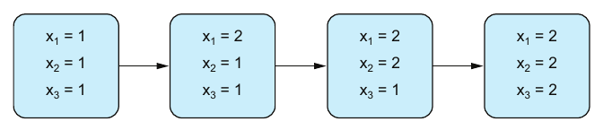
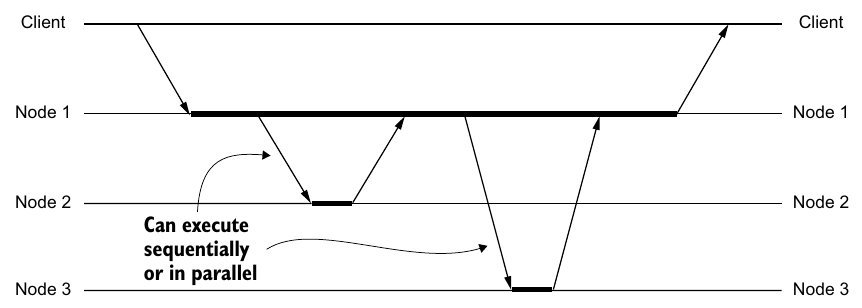
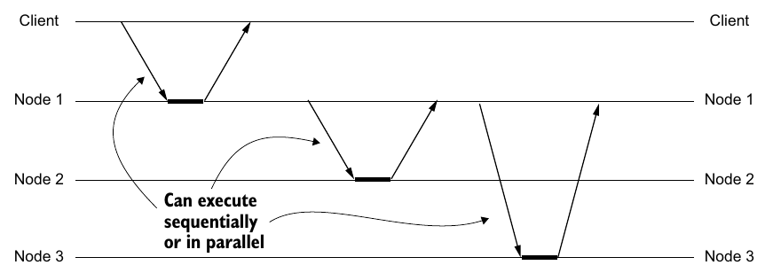
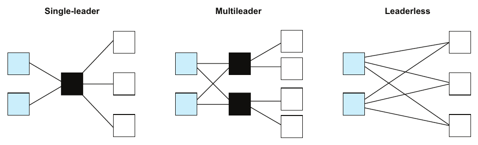

# فصل ۸: replication

[فصل ۷: پارتیشن‌بندی →](07-partitioning.md) · [کتاب](../README.md) · [فصل ۹: consistency ←](09-consistency.md)

## خلاصه

پایایی یعنی تراکنشی که commit شده نمی‌تواند **حرفش را پس بگیرد**، و فرایندهای کسب‌و‌کار به چنین قول‌هایی وابسته‌اند. فروشنده کالا را می‌فرستد چون پردازشگر پرداخت قول داده پول را وصول کند (p. 106). در مدلی با مؤلفه‌های بی‌عیب، هیچ قولی زیر پا نمی‌رود. در مدلی عملی، مؤلفه‌ای که شکسته ممکن است نتواند سر قولش بماند، پس **redundancy** اضافه می‌کنیم تا نقطه‌ی شکست تنها را برداریم (pp. 106–107).

فصل redundancy را **replication به‌علاوه‌ی هم‌آهنگی** تعریف می‌کند، و redundancy **ایستا** را از **پویا** جدا می‌کند (p. 107). «Hello World»ش یک gate منطقی است که سه بار تکرار شده و پشت gateهای اکثریت نشسته (p. 108). گشتی فلسفی در پرسش ویلیام کنت، یعنی «یک چیز چیست؟» و این‌که کتابخانه چند نسخه از SICP دارد، replication را مسئله‌ی هویت و هم‌ارزی قاب می‌گیرد (pp. 109–110). بعد فصل **replication** و **شفافیت replication** را تعریف می‌کند (p. 110)، و مکانیک یک ذخیره‌سازی key-value تکرارشده را می‌پوشاند:

- مدل شبکه‌ی نقطه‌به‌نقطه که در آن گم شدن پیام **پارتیشن شبکه** است (pp. 111–112)؛
- مفهوم latency ذاتی و تحمیلی **replication** (pp. 112–113)؛
- مفهوم replication **هم‌زمان و asynchronous و quorum** (pp. 113–114)؛
- مفهوم replication **state-based در برابر log‌محور** (p. 114)؛
- و سیستم‌های **تک‌leader و چند‌leader و بی‌leader**، با حل تعارض و هشداری درباره‌ی خواندن از followerها (pp. 114–115).

## نکته‌های کلیدی

- **مفهوم redundancy برابر replication به‌علاوه‌ی هم‌آهنگی است.** پشته‌ای از کپی سیستم نیست؛ چیزی، از توزیع بار round-robin تا consensus، باید هم‌آهنگشان کند (pp. 107–108).
- **مفهوم redundancy ایستا** همان مؤلفه‌ها و همان تعامل‌ها را برای کل عمر سیستم نگه می‌دارد، و بیشتر در سخت‌افزار. **redundancy پویا** عوضشان می‌کند، و بیشتر در نرم‌افزار (p. 107).
- **مفهوم redundancy برای قابلیت اطمینان است و پارتیشن‌بندی برای مقیاس‌پذیری.** replication می‌تواند با توزیع بار به مقیاس‌پذیری کمک کند، ولی گاهی به آن صدمه می‌زند (p. 107).
- **مفهوم redundancy سه‌گانه‌ی پودمانی:** سه gate و یک رأی اکثریت، یعنی R = (a ∧ b) ∨ (b ∧ c) ∨ (a ∧ c)، یک شکست را تحمل می‌کنند. gate اکثریت هم تکرار می‌شود تا نقطه‌ی شکست تنهای تازه نشود (p. 108).
- **«یک چیز» به مفهوم هم‌ارزی شما بستگی دارد.** ده نسخه‌ی SICP در سه ویراست، بسته به این‌که چه چیزی را یکی به حساب بیاورید، ۱۰ یا ۸ یا ۲ «کتاب»اند (pp. 109–110).
- **مفهوم latency replication ذاتی است**، چون در هر لحظه فقط یک قدم برداشته می‌شود. latency **تحمیلی** روی آن سوار می‌شود، از پارتیشن‌ها و شکست‌ها (pp. 112–113).
- **مفهوم replication هم‌زمان** تمام شدن را به تأیید هر replica node می‌زند. **asynchronous** پس از نود اول تمام می‌شود. **quorum** در پیش‌زمینه منتظر اکثریت می‌ماند و بقیه را در پس‌زمینه تکرار می‌کند (pp. 113–114).
- **«نقش leader برای نوشتن، follower برای خواندن» latency replication را نادیده می‌گیرد.** برای تازه‌ترین داده، از leader بخوانید (p. 115).

## فهرست بخش‌ها

*از فهرست مطالب خود کتاب، از bookmarkهای PDF؛ شماره‌ها صفحه‌ی چاپی‌اند.*

- ۸.۱ redundancy — ص. ۱۰۷
- ۸.۲ فکر کردن درباره‌ی replication و consistency — ص. ۱۰۹
- ۸.۳ replication — ص. ۱۱۰
- ۸.۴ مکانیک replication — ص. ۱۱۱
  - ۸.۴.۱ مدل سیستم — ص. ۱۱۱
  - ۸.۴.۲ latency replication — ص. ۱۱۲
  - ۸.۴.۳ replication هم‌زمان در برابر asynchronous — ص. ۱۱۳
  - ۸.۴.۴ replication state-based در برابر log‌محور — ص. ۱۱۴
  - ۸.۴.۵ سیستم‌های تک‌leader و چند‌leader و بی‌leader — ص. ۱۱۴

## یادداشت‌ها

پایایی، از فصل ۵، یک قول است، و قول‌ها همان چیزی‌اند که فرایندها رویشان ساخته می‌شوند. اگر پردازشگر پرداخت پس از یک تأیید عقب بکشد، فروشنده کالا را بی پول فرستاده (p. 106). در مدلی نظری بدون شکست، عقب کشیدن نمی‌تواند رخ بدهد. با شکست Crash-Stop یا Crash-Recovery می‌تواند، مگر redundancy اضافه کنیم (pp. 106–107).

### ۸.۱ redundancy

**مفهوم redundancy** replication و هم‌آهنگی زیرسیستم‌هاست، چنان که ضریب replication بالاتر قابلیت اطمینان یا مقیاس‌پذیری یا هر دو را بالا می‌برد (p. 107).

| گونه | مؤلفه‌ها و تعامل‌ها | معمولاً در (p. 107) |
|---|---|---|
| **redundancy ایستا** | برای کل عمر سیستم بی‌تغییر | سخت‌افزار |
| **redundancy پویا** | در طول عمر سیستم عوض می‌شوند | نرم‌افزار |

دو لحظه‌ی آها! (pp. 107–108):

- **مفهوم redundancy و مقیاس‌پذیری.** replication *داده* را پخش می‌کند؛ و پارتیشن‌بندی بار، مثل توزیع بار round-robin بین replicaها، *بار* را. redundancy هم می‌تواند مقیاس‌پذیری را *کم* کند، که فصل‌های بعد نشانش می‌دهند، پس نویسنده مقیاس‌پذیری را به پارتیشن‌بندی نسبت می‌دهد.
- **مفهوم replication و هم‌آهنگی.** مدل‌های ذهنی معمولاً کپی‌ها را دارند ولی کم‌تر آن هم‌آهنگی را که از آن‌ها سیستمی منسجم می‌سازد.

**مفهوم gate منطقی افزونه** (شکل ۸.۱) (p. 108):

- یک gate مقدار y = f(x₁, …, xₙ) را حساب می‌کند. اگر بشکند، سیستم می‌شکند: نقطه‌ی شکست تنهاست.
- سه بار تکرارش کنید، یعنی a و b و c، و با یک **gate اکثریت** هم‌آهنگش کنید: R = (a ∧ b) ∨ (b ∧ c) ∨ (a ∧ c)، که اگر دست‌کم دو ورودی درست باشند درست است.
- مفهوم gate اکثریت را هم تکرار کنید، تا نقطه‌ی شکست تنهای تازه نشود.
- گروه مثل gate اصلی رفتار می‌کند ولی یک مؤلفه‌ی شکسته را تحمل می‌کند.

**مفهوم replication**، یعنی چند نمونه از یک چیز داشتن، رایج‌ترین پیاده‌سازی replication است (p. 108).

> **Try it:** [redundancy با رأی اکثریت](../widgets/08-majority-gate.html)؛ ورودی‌ها را از یک gate یا از سه gate تکرارشده با voterهای اکثریت بگذرانید، هر کدام را بشکنید، یعنی گیر‌کرده روی ۰ یا گیر‌کرده روی ۱ یا برگشته، و ببینید خروجی کجا باز هم درست است؛ بعد قابلیت اطمینان اندازه‌گرفته را با فرمول مقایسه کنید.

> **In practice:** redundancy فقط داده نیست: Airflow دو scheduler، Grafana دو replica و Alertmanager دو نمونه دارد.
>
> **Your turn:** دو replica از ClickHouse روی یک node در Kubernetes اجرا می‌شوند. redundancy دارید؟
>
> *Answer:* نه برای شکست node: هر دو با هم می‌افتند. pod anti-affinity یا topology spread بگذارید تا روی nodeهای جدا باشند. redundancy فقط وقتی کار می‌کند که شکست نسخه‌ها مستقل باشد (pp. 107–109).

### ۸.۲ فکر کردن درباره‌ی replication و consistency

کتاب *Data and Reality* ویلیام کنت می‌پرسد **«یک چیز» چیست؟** (p. 109). روایت نویسنده (جدول ۸.۱، شکل ۸.۲) (pp. 109–110):

- کتابخانه‌ای ده نسخه از *Structure and Interpretation of Computer Programs* دارد: ۳ از ویراست اول در ۱۹۸۴، ۵ از ویراست دوم در ۱۹۹۶ و ۲ از ویراست JavaScript در ۲۰۲۲. دو ویراست اول Scheme به کار می‌برند.

| چیزهایی که هم‌ارز می‌گیرید… | نسخه‌های موجود |
|---|---|
| هر ویراستی | ۱۰ |
| فقط ویراست‌های Scheme | ۸ |
| فقط ویراست JavaScript | ۲ |

مفهوم replication و consistency درباره‌ی این‌اند که آیا قلم‌های فیزیکی قلم منطقی را *نمایش می‌دهند*. یعنی **هویت و هم‌ارزی**، یکی بودن و همان بودن، و این ابهام ذاتی سیستم‌های توزیع‌شده است (p. 110).

### ۸.۳ replication

**مفهوم replication** یک object منطقی را با چند object فیزیکی *یکسان* نمایش می‌دهد، که **replica** نامیده می‌شوند، تا از سقف قابلیت اطمینان یک object تنها رد شود (شکل ۸.۳) (p. 110). **شفافیت replication** توانایی سیستم است در پنهان کردن این‌که objectها چند تا هستند و دادن توهم یکی بودن. حرف زدن درباره‌اش یعنی سنجیدن این‌که چه چیزی را پنهان و چه چیزی را آشکار کنیم، و بده‌بستان consistency و availability و latency (p. 110).

### ۸.۴ مکانیک replication

مؤلفه‌های stateless هم می‌توانند تکرار شوند، مثل gateهای منطقی افزونه یا سرویس‌های stateless پشت توزیع بار. آن‌قدر سرراست است که کم اسمش را replication می‌گذاریم. فصل روی مؤلفه‌های **stateful** تمرکز می‌کند، که بیشتر پیچیدگی را دارند (p. 111). یک ذخیره‌سازی key-value تکرارشده را به کار می‌برد (شکل ۸.۴)، پارتیشن‌بندی را نادیده می‌گیرد، و فرض می‌کند کل مجموعه‌داده روی یک نود جا می‌شود (p. 111).

پیچیدگی از **تغییر** می‌آید: تکرار کردن یک object ایستا آسان است (p. 111). لحظه‌ی آها! این است که همه‌ی تغییرها یکسان نیستند. فرض کنید فقط برایتان مهم است که یک شمارنده از ۱۰ گذشته یا نه (p. 111):

| شمارنده چه چیزی را پشتیبانی می‌کند | آیا تغییری تازه «از ۱۰ بالاتر است» را باطل می‌کند؟ |
|---|---|
| افزودن و reset | بله: یک reset آن را به ۰ برمی‌گرداند |
| فقط افزودن | نه: همین که از ۱۰ گذشت، بالاتر می‌ماند. این **یکنوایی** است |

#### ۸.۴.۱ مدل سیستم (pp. 111–112)

همان مدل نیمه‌هم‌زمان با شکست‌های Crash-Stop و Omission و Crash-Recovery. دو تفاوت با فصل‌های پیش:

- شبکه به‌جای یک hub مرکزی به‌شکل **پیوندهای نقطه‌به‌نقطه** بین مؤلفه‌ها مدل می‌شود، که تصویر کردن **پارتیشن شبکه** را آسان می‌کند.
- گم شدن پیام به یک پارتیشن نسبت داده می‌شود: شکست موقت یا متناوب یا دائم یک یا چند پیوند. شکل ۸.۵ یک کلاینت و سه replica دارد، و پارتیشنی بین replica ۱ و replica ۲.

#### ۸.۴.۲ latency replication (pp. 112–113)

در هر لحظه فقط یک مؤلفه یا شبکه قدمی برمی‌دارد، پس یک به‌روزرسانی **یکی پس از دیگری** به replicaها می‌رسد. شکل ۸.۶ نشان می‌دهد که x₁ و x₂ و x₃ به‌نوبت ۲ می‌شوند. latency جنبه‌ای ذاتی از سیستم‌های تکرارشده است و نه فقط یک معطلی، و سرچشمه‌ی خیلی از مسئله‌هاست، از جمله از دست رفتن شفافیت replication (p. 112).

*Figure 8.6 (p. 112): هر حالت میانی حالتی است که در آن replicaها با هم اختلاف دارند.*

| latency | علت (p. 113) |
|---|---|
| **ذاتی** | سرشت سیستم‌های توزیع‌شده: ناگزیر |
| **تحمیلی** | پارتیشن‌های شبکه و شکست مؤلفه‌ها: اضافه |

#### ۸.۴.۳ replication هم‌زمان در برابر asynchronous (pp. 113–114)

| حالت | یک عملیات کِی تمام است… | replication کجا اجرا می‌شود | اثر |
|---|---|---|---|
| **هم‌زمان** (شکل ۸.۷) | وقتی هر نود دیگری تأیید کرده باشد | در پیش‌زمینه | consistency فوری؛ latency و availability به هر نودی وابسته‌اند |
| **asynchronous** (شکل ۸.۸) | وقتی نود آغازگر پردازشش کرده باشد | در پس‌زمینه | latency و availability بهتر، به بهای consistency |
| **quorum که دوگانه است** | وقتی اکثریتی تأیید کرده باشد | درون quorum پیش‌زمینه، و بیرونش پس‌زمینه | در عمل رایج |

هر طور که باشد، replicaها می‌توانند پشت‌سر‌هم یا موازی به‌روز شوند (شکل‌های ۸.۷ و ۸.۸).

*Figure 8.7 (p. 113): هم‌زمان؛ کلاینت تا پایان replication منتظر می‌ماند.*

*Figure 8.8 (p. 113): ناهم‌زمان؛ پاسخ کلاینت پیش از آن می‌آید که replicaها تغییر را داشته باشند.*

#### ۸.۴.۴ replication state-based در برابر log‌محور (p. 114)

یک **state machine قطعی** فرض بگیرید، یعنی `step : State → Operation → State`: replicaهایی که از یک حالت شروع می‌کنند و همان عملیات را به همان ترتیب اعمال می‌کنند به همان حالت می‌رسند. آن‌وقت دو گزینه دارید. برای شمارنده‌ای که از ۰ شروع می‌شود و `increment-by(2)` و بعد `increment-by(3)` می‌گیرد:

| چه چیزی را تکرار کنیم… | پیام‌هایی که روی سیم می‌روند |
|---|---|
| **حالت** یا تفاوتش | `counter = 2`، `counter = 5` |
| **log** یعنی خود عملیات | `increment-by(2)`، `increment-by(3)` |

مفهوم replication لاگ‌محور «در حال سر در آوردن به‌عنوان محبوب صنعت» است (p. 114).

> **Try it:** [تکرار کردن یک شمارنده](../widgets/08-replication-modes.html)؛ عملیات `increment-by(n)` را به یک leader با دو follower بدهید، بین تأیید هم‌زمان و asynchronous و quorum و بین پیام‌های state-based و log‌محور جابه‌جا شوید، بعد پیوندی را قطع کنید تا latency ذاتی تحمیلی شود.

#### ۸.۴.۵ سیستم‌های تک‌leader و چند‌leader و بی‌leader (pp. 114–115)

همه‌ی leaderها مجازند درخواست بپذیرند و رسیدگی کنند؛ و followerها شاید نتوانند درخواست را یک‌راست پردازش کنند (شکل ۸.۹):

*Figure 8.9 (p. 115): مربع‌های سیاه همان نودهایی‌اند که مجازند نوشتن بپذیرند؛ یکی، یا چندتا، یا در بی‌leader هر نودی.*

| چیدمان | چه کسی عملیات می‌پذیرد | قوت | ضعف |
|---|---|---|---|
| **تک‌leader** | یک leader، که تغییرها را به followerها می‌رساند | زنجیره‌ی فرمان | leader نقطه‌ی شکست تنهاست، که تقریباً هدف replication را نقض می‌کند |
| **چند‌leader** | هر یک از چند leader | نقطه‌ی شکست تنهایی ندارد | عملیات هم‌زمان تعارض می‌کنند، پس حل تعارض لازم است |
| **بی‌leader** | هر نودی | هیچ leaderی ندارد | حل تعارض لازم است |

حل تعارض از **آخرین نوشتن می‌برد** بر پایه‌ی timestamp تا **CRDT** را در بر می‌گیرد، و هیچ‌کدام در عمل ساده نیست. آخرین نوشتن می‌برد می‌تواند از دید کلاینت نوشتنی را به‌طور غیرمنتظره روی‌نویسی کند (p. 115).

**لحظه‌ی آها!: آیا leaderها برای نوشتن‌اند و followerها برای خواندن؟** چیدمانی رایج است، ولی latency replication را نادیده می‌گیرد. شاید followerها تازه‌ترین داده را نداشته باشند، پس برای به‌روزترین خواندن سراغ leader بروید (p. 115).

> **In practice:** replication در ClickHouse asynchronous و multi-leader است: insert به هر replica می‌رود و بقیه از Keeper می‌فهمند چه partی را fetch کنند.
>
> **Your turn:** insert به replica A موفق شد و A پیش از آن‌که B part را بگیرد دیسکش را از دست داد. داده کجاست؟
>
> *Answer:* از دست رفته، مگر insert با `insert_quorum=2` نوشته شده باشد. replication asynchronous یعنی تأیید به کاربر پیش از رسیدن داده به replica دوم؛ latency کمتر به بهای پنجره‌ای که در آن داده فقط یک نسخه دارد (pp. 111–116).

## بده‌بستان‌ها در یک نگاه

| انتخاب | چه می‌خرد | چه هزینه‌ای دارد |
|---|---|---|
| replication هم‌زمان | consistency فوری | تأخیر، و availability محدود به کندترین یا شکسته‌ترین replica |
| replication asynchronous | تأخیر، availability | عقب‌ماندگی: خواندن کهنه، و از دست رفتن نوشتن اگر leader بشکند |
| replication quorum | اقلیتی از replicaهای کند یا شکسته را تحمل می‌کند | یک رفت‌و‌برگشت اکثریت برای هر نوشتن |
| state-based | ساده؛ اگر کل حالت فرستاده شود پیام گم‌شده یا تکراری را تحمل می‌کند | پیام‌های بزرگ؛ تغییرهای هم‌زمان را روی‌نویسی می‌کند |
| log‌محور | پیام‌های کوچک؛ کل تاریخ | هر عملیات را دقیقاً یک بار و به ترتیب لازم دارد، از فصل ۴ |
| تک‌leader | تعارض نوشتن ندارد | نقطه‌ی شکست تنها؛ فصل ۱۰ leaderها را ایمن عوض می‌کند |
| چند‌leader یا بی‌leader | availability نوشتن | حل تعارض: آخرین نوشتن می‌برد نوشتن را می‌بازد، و CRDT مدل داده را محدود می‌کند |
| خواندن از followerها | مقیاس‌پذیری خواندن | داده‌ی کهنه |

## فراتر از کتاب

- **قابلیت اطمینان redundancy سه‌گانه‌ی پودمانی.** اگر هر gate با احتمال p و مستقل کار کند، اکثریت سه‌تا با احتمال 3p² − 2p³ کار می‌کند، با نادیده گرفتن voter. این فقط وقتی از یک gate تنها بهتر است که p > 0.5 باشد، و در p = 0.99 احتمال شکست از ۱٪ به حدود ۰٫۰۳٪ می‌افتد. [آزمایش redundancy اکثریتی](../lab/08-majority-redundancy/README.md) فرمول را با شبیه‌سازی می‌سنجد، از جمله با یک voter تنها و تکرار‌نشده.
- **همه‌ی CRDTهای state-based در برابر عملیات‌محور** آینه‌ی بخش ۸.۴.۴‌اند. CRDTهای state-based حالت می‌فرستند که با یک join جوش می‌خورد، یعنی commutative و associative و idempotent، که پیام تکراری و بی‌ترتیب را تحمل می‌کند. CRDTهای عملیات‌محور عملیات می‌فرستند و تحویل علّی قابل اطمینان لازم دارند. [فصل ۱۱ کتاب Database Internals](../../database-internals/chapters/11-replication-and-consistency.md) یک شبیه‌سازی CRDT دارد.
- **ناهنجاری‌های تأخیر، با نامشان.** خواندن از followerها ناهنجاری‌های معینی می‌سازد: نقض خواندن نوشته‌های خود، خواندن ناـیکنوا و نقض علیت. [فصل ۶ کتاب DDIA](../../designing-data-intensive-applications/chapters/06-replication.md) نامشان را می‌برد، و شبیه‌سازی replicationش هر کدام را نشان می‌دهد.

## پیوندها

- **فصل‌های مرتبط:** [فصل ۵: تراکنش](05-transactions.md) که پایایی را به‌شکل یک قول دارد، [فصل ۷: پارتیشن‌بندی](07-partitioning.md) که نیمه‌ی دیگر است، یعنی بخش‌ها در برابر کل‌ها، [فصل ۹: consistency](09-consistency.md) که آن چیزی را دارد که replicaها مجازند نشان بدهند، [فصل ۱۰: consensus توزیع‌شده](10-distributed-consensus.md) که عوض کردن ایمن leader شکسته را دارد، و [فصل ۲: مدل سیستم، ترتیب و زمان](02-system-models-order-and-time.md) که مدل شکست را دارد.
- **Run it:** [redundancy با رأی اکثریت](../lab/08-majority-redundancy/README.md)؛ gateهای تنها و redundancy سه‌گانه‌ی پودمانی را در قابلیت اطمینان‌های مختلف هر gate شبیه‌سازی می‌کند و قابلیت اطمینان اندازه‌گرفته‌ی سیستم را با 3p² − 2p³ مقایسه می‌کند.

## خودتان را بسنجید

*پرسش‌ها و پاسخ‌ها مال vault است و از روی یادداشت‌های بالا نوشته شده؛ پاسخ‌ها به صفحه‌های کتاب ارجاع می‌دهند.*

1. **چرا کتاب روی «replication *و* هم‌آهنگی» پا می‌فشارد؟**

   *Answer:* مجموعه‌ای از کپی سیستم نیست. چیزی باید از آن‌ها کلی منسجم بسازد، از توزیع بار round-robin تا یک پروتکل consensus (p. 108).

2. **مفهوم redundancy ایستا و پویا چه تفاوتی دارند؟**

   *Answer:* در redundancy ایستا، مؤلفه‌ها و تعامل‌هایشان در طول عمر سیستم عوض نمی‌شوند، که بیشتر سخت‌افزار است. در redundancy پویا عوض می‌شوند، که بیشتر نرم‌افزار است (p. 107).

3. **در طرح gate افزونه، چرا gate اکثریت هم تکرار می‌شود؟**

   *Answer:* وگرنه آن gate اکثریت تنها نقطه‌ی شکست تنهای تازه می‌شد (p. 108).

4. **چه چیزی شمارنده‌ای را که فقط می‌افزاید نسبت به «آیا از ۱۰ بالاتر است» یکنوا می‌کند؟**

   *Answer:* همین که از ۱۰ بالاتر رفت، هیچ تغییر بعدی نمی‌تواند آن دانش را باطل کند. یک عملیات reset می‌توانست (p. 111).

5. **کدام حالت replication عملیات را به‌محض پردازش شدن در نود اول تمام می‌کند؟**
   - [ ] هم‌زمان
   - [x] asynchronous
   - [ ] quorum

   *Answer:* replication asynchronous در پس‌زمینه اجرا می‌شود (p. 113).

6. **هر رویکرد برای `increment-by(2)` و بعد `increment-by(3)` از ۰ چه می‌فرستد؟**

   *Answer:* state-based `counter = 2` و `counter = 5` را می‌فرستد. log‌محور `increment-by(2)` و `increment-by(3)` را (p. 114).

7. **«همه‌ی leaderها نوشتن را رسیدگی می‌کنند و followerها خواندن را» چه اشکالی دارد؟**

   *Answer:* latency replication را نادیده می‌گیرد. شاید followerها داده‌ی کهنه برگردانند، پس خواندن به‌روز باید سراغ leader برود (p. 115).
