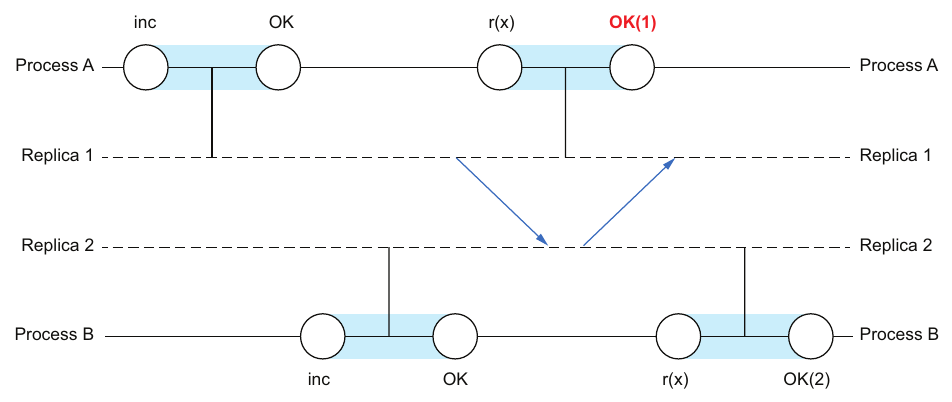
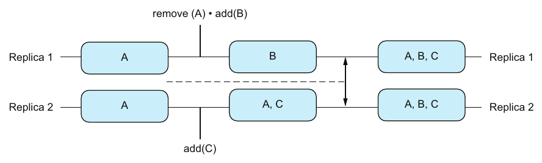
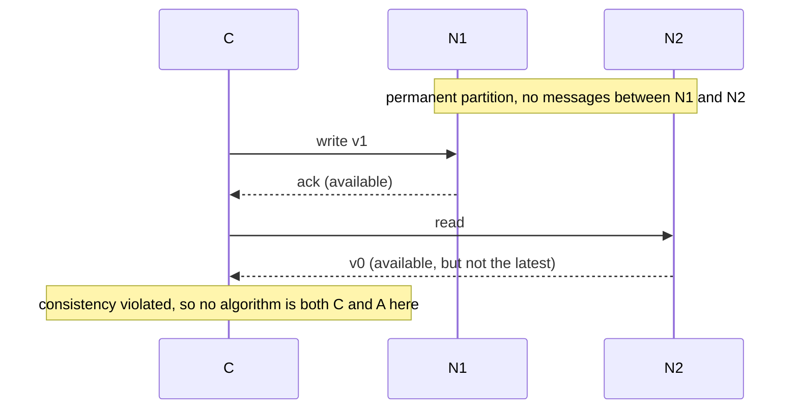

# فصل ۹: consistency

[فصل ۸: replication →](08-replication.md) · [کتاب](../README.md) · [فصل ۱۰: consensus توزیع‌شده ←](10-distributed-consensus.md)

## خلاصه

در دیتابیس‌ها، consistency یعنی درستی در سطح برنامه. در سیستم‌های توزیع‌شده، که مؤلفه‌ها می‌شکنند و پیام‌ها معطل یا بی‌ترتیب یا گم می‌شوند، معناهای زیادی دارد (p. 117). فصل سیستم را به‌شکل **process**‌هایی ترتیبی مدل می‌کند که **عملیات**شان یک فراخوانی و یک تمام شدن دارد. **تاریخ** همان دنباله‌ی real-time این رویدادهاست، و **consistency model** گزاره‌ای است که تاریخ‌ها را به معتبر و نامعتبر دسته می‌کند (pp. 117–118). مدل‌های قوی‌تر، یعنی زیرمجموعه‌ها، تجربه‌ی توسعه‌دهنده‌ی بهتری می‌دهند؛ و مدل‌های ضعیف‌تر، یعنی ابرمجموعه‌ها، availability و latency بهتری (pp. 119–121).

بعد فصل دو سر طیف را می‌پوشاند:

- **مفهوم linearizability** تضمین *تازگی* است: هر عملیاتی چنان به نظر می‌رسد که در یک نقطه بین فراخوانی و تمام شدنش اثر می‌کند، پس سیستمی تکرارشده مثل یک کپی تنها رفتار می‌کند. به‌تفکیک نوع object تعریف می‌شود، و با queue و stack و شمارنده‌ای که فقط می‌افزاید نشان داده می‌شود (pp. 121–124).
- **مفهوم eventual consistency** تضمین *هم‌گرایی* است، و با سبد خرید Amazon نشان داده می‌شود. گونه‌ی پایه و قوی دارد، و با آشتی‌دهی برنامه‌ویژه یا الگوریتمی، یعنی CRDT، پیاده می‌شود (pp. 124–126).

فصل با **CAP** تمام می‌شود: حدس Brewer در برابر قضیه‌ی Gilbert و Lynch، اثباتشان، و آن نقد که قضیه دقیق است ولی ناعملی (pp. 126–129).

## نکته‌های کلیدی

- **عملیات زوجی از فراخوانی و تمام شدن است**، و processها اکیداً ترتیبی‌اند. **تاریخ** این رویدادها را در زمان واقعی مرتب می‌کند (pp. 117–118).
- **مفهوم consistency model مجموعه‌ای از تاریخ‌هاست.** سیستم *نسبت به یک مدل* سازگار است اگر همه‌ی تاریخ‌های ممکنش معتبر باشند. سیستم‌ها «consistency را نقض نمی‌کنند»؛ یک مدل معین را نقض می‌کنند (pp. 118–119).
- **قوی‌تر یعنی تاریخ‌های معتبر کم‌تر.** مدل‌های قوی‌تر هم‌آهنگی بیشتری لازم دارند، که به بهای availability و latency تمام می‌شود ولی تجربه‌ی توسعه‌دهنده را بهتر می‌کند (pp. 119–121).
- **مفهوم linearizability:** تاریخی ترتیبی با همان نتیجه‌ها وجود دارد، *و* ترتیب real-time عملیاتی که هم‌پوشان نیستند را محترم می‌شمارد. تضمینی real-time درباره‌ی عملیات تنها روی objectهای تنهاست، و به‌تفکیک نوع object تعریف می‌شود (pp. 121–123).
- **تاریخ linearizable یک واقعیت است؛ و سیستم linearizable یک تضمین** که هر تاریخ ممکنی linearizable است (p. 123).
- **مفهوم eventual consistency:** پایه برابر تحویل غایی به‌علاوه‌ی هم‌گرایی ضعیف است، یعنی همین که به‌روزرسانی‌ها بس شوند؛ و قوی برابر تحویل غایی به‌علاوه‌ی هم‌گرایی قوی، یعنی همان به‌روزرسانی‌ها همان حالت را می‌دهند (p. 125).
- **همه‌ی CRDTها:** CRDTهای عملیات‌محور، یعنی جابه‌جایی‌پذیر، لازم دارند که هیچ عملیاتی گم نشود، هر کدام عملاً یک بار اعمال شود، و اعمال commutative باشد. CRDTهای حالت‌محور، یعنی هم‌گرا، یک merge associative و commutative و idempotent لازم دارند (p. 126).
- **مفهوم CAP «دو تا را بردار» نیست.** پارتیشن ناگزیر است، پس انتخاب واقعی بین consistency و availability *در میانه‌ی* یک پارتیشن است (p. 127). حدس شهودی است ولی اثبات‌نشده؛ و قضیه اثبات‌شده است ولی تنگ (p. 129).

## فهرست بخش‌ها

*از فهرست مطالب خود کتاب، از bookmarkهای PDF؛ شماره‌ها صفحه‌ی چاپی‌اند.*

- ۹.۱ consistency modelها — ص. ۱۱۷
  - ۹.۱.۱ مدل‌های رایج consistency — ص. ۱۱۹
  - ۹.۱.۲ فضیلت‌ها و محدودیت‌ها — ص. ۱۱۹
- ۹.۲ linearizability — ص. ۱۲۱
  - ۹.۲.۱ queue و stack — ص. ۱۲۲
  - ۹.۲.۲ تعریف صوری linearizability — ص. ۱۲۳
- ۹.۳ eventual consistency — ص. ۱۲۴
  - ۹.۳.۱ سبد خرید — ص. ۱۲۴
  - ۹.۳.۲ گونه‌های eventual consistency — ص. ۱۲۵
  - ۹.۳.۳ پیاده‌سازی — ص. ۱۲۵
- ۹.۴ consistency و availability و partition tolerance — ص. ۱۲۶
  - ۹.۴.۱ تاریخچه — ص. ۱۲۶
  - ۹.۴.۲ حدس در برابر قضیه — ص. ۱۲۷
  - ۹.۴.۳ قضیه‌ی CAP — ص. ۱۲۸

## یادداشت‌ها

### ۹.۱ consistency modelها

فصل درباره‌ی سیستم به‌شکل **process**‌هایی هم‌زمان استدلال می‌کند که روی **object**ها کار می‌کنند (pp. 117–118):

- مفهوم process دنباله‌ای از عملیات روی objectهاست.
- *نوع* یک object مقدارها و عملیات ممکنش را تعریف می‌کند.
- عملیات لحظه‌ای نیست: **عملیات برابر فراخوانی • تمام شدن** است.
- همه‌ی processها **اکیداً ترتیبی**اند: هر کدام یک عملیات فرا می‌خواند و پیش از بعدی منتظر پاسخش می‌ماند (شکل ۹.۱).

**تاریخ** دنباله‌ی رویدادهای فراخوانی و تمام شدن است که به زمان واقعی مرتب شده‌اند، مثلاً H = [I•A.1, I•B.1, C•A.1, I•A.2, C•B.1, C•A.2] (p. 118). **consistency model** مجموعه‌ای از تاریخ‌هاست، گزاره‌ای که یک تاریخ را خوب، یعنی معتبر، یا بد، یعنی نامعتبر، رده‌بندی می‌کند (شکل ۹.۲). سیستم *نسبت به یک مدل* سازگار است اگر هر تاریخ ممکن سیستم زیر آن معتبر باشد (p. 118).

**لحظه‌ی آها!:** «نقض consistency» بدفهمی است. سیستم فقط می‌تواند از برآوردن تضمین‌های یک مدل *معین* باز بماند (pp. 118–119).

#### ۹.۱.۱ مدل‌های رایج consistency (p. 119)

درستی برنامه‌ویژه است، پس می‌توانید مدل خودتان را تعریف کنید. در عمل، خانواده‌ای از مدل‌های خوش‌تعریف سر در آورده‌اند. شکل ۹.۳ نقشه‌ی Jepsen را بازتولید می‌کند:

*Figure 9.3 (p. 119): فلشی از مدلی ضعیف‌تر به مدلی قوی‌تر که آن را در بر دارد اشاره می‌کند؛ و رنگ، و راهنما، رده‌ی availability هر مدل را می‌دهد، که در جدول زیر خلاصه شده.*

| رده‌ی دسترس‌پذیری، از نقشه‌ی Jepsen | نمونه‌ها |
|---|---|
| **unavailable**: در برخی پارتیشن‌ها برخی نودها باید بایستند | strict serializable، serializable، linearizable، sequential، repeatable read، snapshot isolation |
| **sticky available**: روی نودهای سالم در دسترس است اگر هر کلاینتی با همان نود حرف بزند | causal، PRAM، read your writes |
| **total available**: روی نودهای سالم حتی در میانه‌ی پارتیشن در دسترس است | read committed، read uncommitted، monotonic reads، monotonic writes، writes follow reads، monotonic atomic view |

#### ۹.۱.۲ فضیلت‌ها و محدودیت‌ها (pp. 119–121)

دو مدل می‌توانند جدا از هم باشند، یا هم‌پوشان، یا یکی زیرمجموعه‌ی دیگری (شکل ۹.۴). **زیرمجموعه‌ها، با تاریخ‌های معتبر کم‌تر، قوی‌ترند؛ و ابرمجموعه‌ها ضعیف‌تر** (p. 119). محصول‌ها طیف را عرضه می‌کنند. مثلاً Azure Cosmos DB گزینه‌های Strong و Bounded staleness و Session و Consistent prefix و Eventual را می‌دهد، که availability و latency و throughput به‌سمت Eventual بهتر می‌شوند (شکل ۹.۵) (p. 120).

| جهت | چه می‌برید | چه می‌بازید |
|---|---|---|
| **قوی‌تر** | **تجربه‌ی توسعه‌دهنده**: بیشترِ اثرهای توزیع پنهان می‌شوند | availability و تأخیر، به‌خاطر هم‌آهنگی بیشتر |
| **ضعیف‌تر** | دسترس‌پذیری، latency | تجربه‌ی توسعه‌دهنده: بیشترِ اثرهای توزیع آشکار می‌شوند |

(شکل ۹.۶) (pp. 120–121)

تجربه‌ی توسعه‌دهنده‌ی خوب جایی برای غافلگیری ناخواسته نمی‌گذارد (p. 121). در شکل ۹.۷، process A مقدار x = 10 را می‌نویسد، تأیید می‌گیرد، بعد x را می‌خواند و ۰ می‌گیرد. درست بودن این به مدل بستگی دارد:

- اگر خواندن باید *تازه‌ترین* مقدار را برگرداند، نادرست است. آن انتظار همان **linearizability** است.
- اگر خواندن مجاز است *هر مقدار پیشینی* را برگرداند، درست است. آن انتظار همان **eventual consistency** است.

### ۹.۲ linearizability

**مفهوم linearizability**، که **consistency atomic** هم نامیده می‌شود، یکی از قوی‌ترین مدل‌هاست. **تضمین تازگی** است: همین که عملیاتی تمام شد، هر عملیات بعدی اثرهایش را می‌بیند (p. 121). برای objectهای مشترک روی چندپردازنده‌ها معرفی شد، و به همان اندازه برای سیستم‌های توزیع‌شده‌ی تکرارشده به کار می‌آید. سیستمی تکرارشده را وا می‌دارد مثل سیستمی تکرارنشده رفتار کند، که **شفافیت replication** می‌دهد (p. 121). تضمینی *real-time* درباره‌ی *عملیات تنها* روی *objectهای تنها* است، که *به‌تفکیک نوع object* تعریف می‌شود (pp. 121–122).

#### ۹.۲.۱ queue و stack (p. 122)

رفتار درست اول برای یک process تنها و یک object تنها تعریف می‌شود (جدول‌های ۹.۱ و ۹.۲). linearizability آن را به چند process و چند کپی گسترش می‌دهد:

| رد | queue که FIFO است | stack که FILO است |
|---|---|---|
| insert(a)، insert(b)، remove → a، remove → b | ✓ معتبر | ✗ نامعتبر |
| insert(a)، insert(b)، remove → b، remove → a | ✗ نامعتبر | ✓ معتبر |

#### ۹.۲.۲ تعریف صوری linearizability (pp. 123–124)

تاریخ **ترتیبی** است اگر پس از هر فراخوانی فوری تمام شدنش بیاید، و در غیر این صورت **هم‌زمان**، یعنی وقتی عملیات لابه‌لای هم می‌روند (جدول ۹.۳). تاریخ H **linearizable** است اگر (p. 123):

1. **هم‌ارزی ترتیبی:** تاریخی ترتیبی مثل H′ هست که همان نتیجه‌های H را می‌دهد.
2. **ترتیب real-time:** تاریخ H′ ترتیب real-time عملیات asynchronous در H را محترم می‌شمارد. عملیاتی که پس از تمام شدن عملیاتی دیگر فرا خوانده شده باید اثرهایش را ببیند.

شکل ۹.۸ تاریخی ناـخطی‌پذیر را نشان می‌دهد (pp. 123–124):

- شمارنده‌ای تکرارشده که فقط می‌افزاید از ۰ شروع می‌کند.
- افزودن process B تمام می‌شود، و *بعد* process A مقدار ۱ را از replicaیی عقب‌مانده می‌خواند.
- مفهوم linearizability ۲ را می‌خواست، چون خواندن A پس از افزودن B می‌آید. تاریخ، replicaها و latencyشان را آشکار می‌کند.

*Figure 9.8 (p. 124): میله‌های سایه‌دار مدت عملیات‌اند؛ خواندن A پس از پایان افزودن B شروع می‌شود، پس پاسخ درست ۲ بود.*

**لحظه‌ی آها!:** *تاریخ linearizable* یک واقعیت است، یعنی تاریخی ترتیبی و هم‌ارز وجود دارد. *سیستم linearizable* یک تضمین است، یعنی هر تاریخ ممکنی linearizable است (p. 123). پیاده کردنش موضوع فصل ۱۰ است، درباره‌ی consensus (p. 124).

> **Try it:** [آیا این تاریخ linearizable است؟](../widgets/09-linearizability.html)؛ عملیات سه process روی یک register را روی خط زمان بکشید، و سنجنده ترتیبی ترتیبی می‌جوید که همان نتیجه‌ها را بدهد و زمان واقعی را محترم بشمارد، یا توضیح می‌دهد کدام زوج عملیات ناممکنش می‌کند.

### ۹.۳ eventual consistency

**مفهوم eventual consistency** یکی از ضعیف‌ترین مدل‌هاست. **تضمین هم‌گرایی** است: در غایت، همه‌ی نودها در همان حالت‌اند. ورنر وگلز از AWS این اصطلاح را برای DynamoDB شرکت Amazon همه‌گیر کرد (p. 124).

#### ۹.۳.۱ سبد خرید (pp. 124–125)

در شکل ۹.۹، دو replica هر دو {A} را دارند که پارتیشنی از هم جداشان می‌کند:

*Figure 9.9 (p. 124): این merge هر قلم افزوده‌ای را نگه می‌دارد، پس آن A حذف‌شده در **{A, B, C}** برمی‌گردد.*

تعارض را باید مهندس‌ها حل کنند. اولویت Amazon نگه داشتن قلم‌های افزوده بر حذف‌شده‌هاست، پس هیچ قلم افزوده‌ای ناپدید نمی‌شود، ولی قلم‌های حذف‌شده هر از گاهی **رستاخیز** می‌کنند. بده‌بستان، availability در برابر تجربه‌ی بی‌غافلگیری توسعه‌دهنده و کاربر است (p. 125).

> **Try it:** [سبد خرید سازگار غایی](../widgets/09-shopping-cart.html)؛ دو replica سبد را پارتیشن کنید، در هر سو قلم بیفزایید و بردارید، پارتیشن را ترمیم کنید، و قاعده‌های آشتی‌دهی را مقایسه کنید: «افزودن می‌برد» Amazon از شکل ۹.۹، آخرین نوشتن می‌برد، و مجموعه‌ی فقط‌رشدی.

#### ۹.۳.۲ گونه‌های eventual consistency (p. 125)

| گونه | تضمین‌ها |
|---|---|
| **پایه** | **تحویل غایی**: به‌روزرسانی به یک replica سالم در غایت به هر replica سالمی می‌رسد. **هم‌گرایی ضعیف**: همین که به‌روزرسانی‌ها بس شوند، همه‌ی replicaها در غایت هم‌گرا می‌شوند. درباره‌ی خواندن پیش از هم‌گرایی یا درباره‌ی به‌روزرسانی پیوسته چیزی نمی‌گوید |
| **قوی** | **تحویل غایی** به‌علاوه‌ی **هم‌گرایی قوی**: هر دو replicaیی که همان مجموعه‌ی به‌روزرسانی را گرفته‌اند در همان حالت‌اند |

#### ۹.۳.۳ پیاده‌سازی (pp. 125–126)

هر replicaیی می‌تواند هر وقتی عوض شود، حتی وقتی قطع است، پس تعارض‌ها آشتی‌دهی لازم دارند:

| رویکرد | چطور |
|---|---|
| **برنامه‌ویژه** | برنامه تصمیم می‌گیرد؛ در سبد، افزودن بر برداشتن می‌برد (p. 125) |
| **الگوریتمی: CRDTها** | ساختار داده‌هایی که به‌روزرسانی هم‌زمان و مستقل روی replicaها را مجاز می‌کنند و در همان حال هم‌گرایی را تضمین (p. 126) |

| گونه‌ی CRDT | چه چیزی را تکرار می‌کند | هم‌گرایی چه لازم دارد (p. 126) |
|---|---|---|
| **عملیات‌محور** که commutative است | عملیات تک‌تک | هیچ عملیات گم‌شده‌ای نباشد، هر کدام عملاً یک بار اعمال شود، و تابع اعمال commutative باشد |
| **state-based** که هم‌گرا است | کل حالت | یک merge associative و commutative و idempotent |

جدول ۹.۴ **مجموعه‌ی فقط‌رشدی** را به هر دو شکل نشان می‌دهد: عملیات `add x` را با set := set ∪ {x} اعمال کنید، یا با set := set ∪ set′ آن را merge کنید. از جمله Riak اصول CRDT را به کار می‌برد (p. 126).

> **In practice:** داشبوردهای Metabase روی یکی از دو replica بار می‌شوند، که هر کدام ممکن است چند ثانیه عقب باشد.
>
> **Your turn:** کاربری داشبورد را دو بار refresh می‌کند و عدد امروز یک بار ۱۰۲۰ و یک بار ۱۰۱۸ است. باگ است؟
>
> *Answer:* نه لزوماً: دو refresh به دو replica با پیشرفت متفاوت رفته‌اند و هر دو بالاخره هم‌گرا می‌شوند. این eventual consistency بدون monotonic reads است؛ اگر مهم است، Metabase را به یک replica sticky کنید یا load balancer را با `load_balancing=in_order` تنظیم کنید (pp. 124–126).

### ۹.۴ consistency و availability و partition tolerance

قاعده‌ی CAP شاید شناخته‌ترین و بدفهمیده‌ترین قاعده‌ی سیستم‌های توزیع‌شده باشد (p. 126).

#### ۹.۴.۱ تاریخچه (pp. 126–127)

| | چه کسی و چه وقت | وضعیت |
|---|---|---|
| **حدس CAP** | اریک بروئر، سخنرانی کلیدی PODC در سال ۲۰۰۰ با نام «Towards Robust Distributed Systems» | به‌شکل قضیه عرضه شد، ولی بی اثبات: کوششی برای *صورت‌بندی* تعارض C و A |
| **قضیه‌ی CAP** | ست گیلبرت و نانسی لینچ در ۲۰۰۲ | اثباتی صوری: کوششی برای *صوری کردن* آن |

**لحظه‌ی آها!:** «دو تا از سه تا را بردار» می‌رساند که پارتیشن اختیاری است، ولی ناگزیر است. پس partition tolerance مذاکره‌پذیر نیست، و وقتی یکی رخ بدهد consistency *یا* availability را برمی‌دارید. قاعده‌ی CAP دنیا را به سیستم‌های **CP و AP** بخش می‌کند (p. 127).

#### ۹.۴.۲ حدس در برابر قضیه (pp. 127–128)

هر دو consistency را خاصیتی ایمنی و availability را خاصیتی liveness می‌گیرند (p. 127):

- **مفهوم consistency:** هر خواندنی یا موفقیتی می‌گیرد که تازه‌ترین نوشتن را بازتاب می‌دهد، یا یک شکست.
- **مفهوم availability:** هر خواندنی در غایت موفقیتی می‌گیرد، که لازم نیست تازه‌ترین نوشتن را بازتاب بدهد.
- **پارتیشن:** شبکه به بخش‌هایی می‌شکند، و پیام‌های بین بخش‌ها گم می‌شوند.

| | حدس | قضیه |
|---|---|---|
| **consistency** | serializability تک‌کپی | linearizability یک register خواندن و نوشتن |
| **availability** | *نودی* به‌هنگام پاسخ می‌دهد | *هر نودی* در غایت پاسخ می‌دهد |
| **پارتیشن‌بندی** | موقت | دائم |

(جدول ۹.۵) (p. 128)

#### ۹.۴.۳ قضیه‌ی CAP (pp. 128–129)

مدل: نودهای C و N1 و N2، بی ساعت، که روی شبکه‌ای asynchronous حرف می‌زنند. نودهای N1 و N2 هر دو با v0 شروع می‌کنند، و **پارتیشنی دائم** نود N1 را از N2 جدا می‌کند، در حالی که C به هر دو می‌رسد (شکل ۹.۱۰) (p. 128). اثبات برهان خلف است:

*ترسیم vault از اثبات در صص. ۱۲۸–۱۲۹.* با پارتیشنی دائم هیچ اطلاعی رد نمی‌شود، پس حتی ضعیف‌ترین consistency هم ناممکن است. مقاله‌ی «A Critique of the CAP Theorem» کلپمان قاعده‌ی CAP را دقیق‌تر صوری می‌کند (p. 129).

**نقد** (p. 129):

- روایت بروئر شهودی و عملی است، ولی قضیه نیست. روایت گیلبرت و لینچ قضیه است، ولی نه شهودی و نه عملی.
- قاعده‌ی CAP به جامعه فکر کردن درباره‌ی بده‌بستان‌های ذاتی را آموخت، ولی برای بستن گفت‌و‌گوهایی که به آن ربطی ندارند هم بدجا به کار می‌رود.
- نوشته‌ی وبلاگی کلپمان با نام «Please stop calling databases CP or AP» می‌خواهد قاعده‌ی CAP بازنشسته شود و اصطلاح‌های دقیق‌تر جایش بنشینند.

> **In practice:** CAP فقط وقتی معنی دارد که شبکه بین replicaها قطع شود؛ بقیه‌ی وقت‌ها بده‌بستان latency است.
>
> **Your turn:** ارتباط دو replica با Keeper قطع شده. ClickHouse کدام طرف CAP را انتخاب می‌کند؟
>
> *Answer:* برای نوشتن، consistency: جدول‌های Replicated بدون Keeper read-only می‌شوند. برای خواندن، availability: هر replica داده‌ی محلی‌اش را برمی‌گرداند حتی اگر کهنه باشد. CAP یک انتخاب کلی برای سیستم نیست؛ هر عمل می‌تواند انتخاب خودش را داشته باشد (pp. 126–129).

## بده‌بستان‌ها در یک نگاه

| مدل | تضمین | هم‌آهنگی | در میانه‌ی پارتیشن در دسترس؟ |
|---|---|---|---|
| linearizable | تازگی: یک کپی تنها در زمان واقعی | زیاد، یعنی consensus از فصل ۱۰ | نه: برخی نودها باید بایستند |
| sequential | یک ترتیب تنها، ولی نه زمان واقعی | زیاد | نه |
| causal | عملیات علّیت‌دار به ترتیب | متوسط | sticky available |
| read your writes و monotonic reads | تضمین‌های به‌تفکیک کلاینت | کم | sticky یا total available |
| غایی پایه | هم‌گرایی پس از بس شدن به‌روزرسانی‌ها | سر نوشتن هیچ | بله |
| غایی قوی با CRDT | همان به‌روزرسانی‌ها ⇒ همان حالت | سر نوشتن هیچ | بله، ولی نوع داده باید merge هم‌گرا داشته باشد |

## فراتر از کتاب

- **سنجیدن linearizability گران است.** تصمیم گرفتن درباره‌ی linearizable بودن یک تاریخ در حالت کلی NP-complete است، از گیبونز و کوراک در ۱۹۹۷. ابزارهایی مثل Knossos از Jepsen و Porcupine فضای ترتیب‌ها را با هرس کردن می‌جویند. [این widget](../widgets/09-linearizability.html) چند عملیات انگشت‌شمار را سرسختی می‌جوید، که همان ایده در مقیاس اسباب‌بازی است.
- **قاعده‌ی PACELC.** گسترش ابادی بر CAP می‌گوید: اگر پارتیشنی هست، یعنی P، availability یا سازگاری، یعنی A یا C، را بردارید؛ و وگرنه، یعنی E، latency یا سازگاری، یعنی L یا C. این به بده‌بستان شکل ۹.۶ کتاب نزدیک‌تر است، که حتی بی پارتیشن هم برقرار است.
- **مفهوم linearizability در برابر serializability.** قاعده‌ی serializability از فصل ۵ به تراکنش‌های چند‌objectی با *یک* ترتیب سری می‌پردازد. linearizability به objectهای تنها در ترتیب *real-time*. *strict serializability* هر دو است. [فصل ۱۰ کتاب DDIA](../../designing-data-intensive-applications/chapters/10-consistency-and-consensus.md) همان تمایز را می‌کشد.

## پیوندها

- **فصل‌های مرتبط:** [فصل ۵: تراکنش](05-transactions.md) که serializability و consistency به‌شکل گزاره‌ای روی تاریخ‌ها را دارد، [فصل ۸: replication](08-replication.md) که latency و شفافیت replication را دارد، [فصل ۱۰: consensus توزیع‌شده](10-distributed-consensus.md) که پیاده کردن linearizability را دارد، و [فصل ۳: تحمل شکست](03-failure-tolerance.md) که تحمل شکست پوشاننده و CAP را دارد.

## خودتان را بسنجید

*پرسش‌ها و پاسخ‌ها مال vault است و از روی یادداشت‌های بالا نوشته شده؛ پاسخ‌ها به صفحه‌های کتاب ارجاع می‌دهند.*

1. **مدل سازگاری، صوری، چیست؟**

   *Answer:* مجموعه‌ای از تاریخ‌ها، یا هم‌ارزش گزاره‌ای روی تاریخ‌ها که هر کدام را معتبر یا نامعتبر رده‌بندی می‌کند. سیستم نسبت به مدل سازگار است اگر همه‌ی تاریخ‌های ممکنش معتبر باشند (p. 118).

2. **قوی‌تر بودن مدل A از مدل B چه معنایی دارد؟**

   *Answer:* تاریخ‌های معتبر A زیرمجموعه‌ی تاریخ‌های B هستند: تاریخ‌های کم‌تری را مجاز می‌کند (p. 119).

3. **دو شرط linearizable بودن یک تاریخ چیست؟**

   *Answer:* هم‌ارزی ترتیبی، یعنی تاریخی ترتیبی همان نتیجه‌ها را می‌دهد، و ترتیب زمان‌واقعی، یعنی آن تاریخ ترتیب عملیاتی که هم‌پوشان نیستند را محترم می‌شمارد (p. 123).

4. **در شکل ۹.۸، چرا تاریخ linearizable نیست؟**

   *Answer:* خواندن A پس از تمام شدن افزودن B شروع می‌شود، پس باید ۲ برگرداند. از replicaیی عقب‌مانده ۱ برگرداند (pp. 123–124).

5. **چه چیزی eventual consistency قوی را از eventual consistency پایه جدا می‌کند؟**
   - [ ] مفهوم eventual consistency قوی linearizable است
   - [x] هر دو replicaیی که همان مجموعه‌ی به‌روزرسانی را گرفته‌اند در همان حالت‌اند
   - [ ] به‌روزرسانی‌ها فوری تحویل می‌شوند

   *Answer:* هم‌گرایی قوی جای هم‌گرایی ضعیف را می‌گیرد (p. 125).

6. **تابع merge یک CRDT state-based باید چه باشد؟**

   *Answer:* associative و commutative و idempotent (p. 126).

7. **چرا «دو تا از سه تا را بردار» بدخوانی CAP است؟**

   *Answer:* پارتیشن را اختیاری می‌گیرد. پارتیشن ناگزیر است، پس انتخاب واقعی بین consistency و availability در زمان رخ دادن پارتیشن است (p. 127).

8. **حدس و قضیه availability را چطور تعریف می‌کنند؟**

   *Answer:* حدس: نودی به‌هنگام پاسخ می‌دهد. قضیه: هر نودی در غایت پاسخ می‌دهد (p. 128).
